# ADVANCE QUANTITATIVE PIPELINE OVERVIEW

**Version 9: concise architecture, stage workflows and control specification**

> **Status:** Research and system-design specification, not evidence of profitability or production readiness. Model thresholds are provisional. Live use requires tested implementation, validated data and broker interfaces, approved risk limits, operational testing and explicit sign-off.

| Scope | Design |
|---|---|
| Markets | Any (ASX & US) |
| Sleeves | ASX interday, US interday, ASX intraday, US intraday |
| Forecast layers | Financial, macroeconomic, microeconomic and news-derived |
| Main flow | Data → fixed research universe → forecasts → validation → risk/optimisation → leverage/pre-trade gates → execution → monitoring/reporting |
| Out of scope | Full source code, provider API instructions and production runbooks |

## Executive Summary

This is a **gated research-to-execution system**, not a single predictive model. Its governing rules are:

1. Use point-in-time data and preserve historical vintages; do not leak future information.
2. Separate company-universe selection from return forecasting.
3. Standardise forecasts as predictive quantiles with metadata and lineage.
4. Validate models out of sample and after costs before giving them weight.
5. Keep portfolio risk, leverage, order limits and kill switches independent of forecasts.
6. Generate reproducible run records, plots and a narrative report from measured outputs.
7. Promote challengers only after validation, shadow testing, approval and a rollback plan.

A sophisticated design does not establish an economic edge. Test the complete system on chronological out-of-sample data and realistic costs before paper trading or live deployment.

## Contents

1. [Pipeline at a Glance](#1-pipeline-at-a-glance)
2. [Design Principles and Gates](#2-design-principles-and-gates)
3. [Stage 0: Point-in-Time Data and Company Knowledge](#3-stage-0-point-in-time-data-and-the-company-knowledge-layer)
4. [Stage 1: Universe and Archetype Selection](#4-stage-1-archetype-builder)
5. [Stage 2: Common Forecast Contract](#5-stage-2-the-common-forecast-representation)
6. [Stage 2A: Financial Models](#6-stage-2a-financial-model)
7. [Stage 2B: Macro Models](#7-stage-2b-macro-model-economy-stickers)
8. [Stage 2C: Micro Models](#8-stage-2c-micro-model-market-labels)
9. [Stage 2D: News Models](#9-stage-2d-news-model-llm-extraction)
10. [Stage 2E: Validation and Combination](#10-stage-2e-validation-eligibility-and-signal-combination)
11. [Stages 3–4: Risk, Optimisation and Sleeve Allocation](#11-stages-34-risk-model-optimiser-and-sleeve-allocator)
12. [Stage 5: Leverage and Position Report](#12-stage-5-leverage-and-position-report)
13. [Stages 6–7: Execution, Controls and Monitoring](#13-stages-67-execution-hard-limits-monitoring-and-learning)
14. [Core Design Decisions](#14-core-design-decisions)
15. [Notation and Open Decisions](#15-notation-glossary-and-open-questions)
16. [Run Contract and Outputs](#16-operating-contract-and-run-outputs)
17. [Implementation Roadmap](#17-implementation-roadmap-and-readiness-gates)

## 1. Pipeline at a Glance

Use this as the system map. The stage diagrams in Sections 3–13 show the detailed process and hand-off.

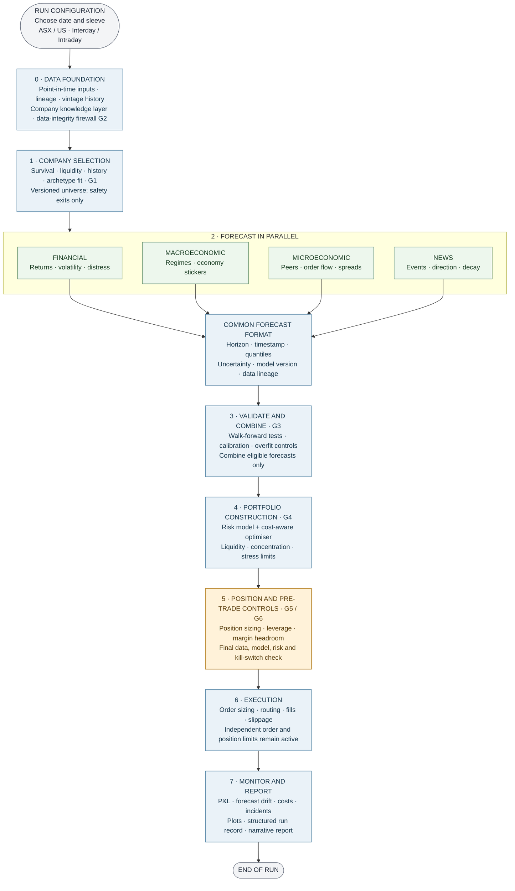

### Model improvement loop

Monitoring may trigger a challenger review, but a challenger never replaces the production model automatically.

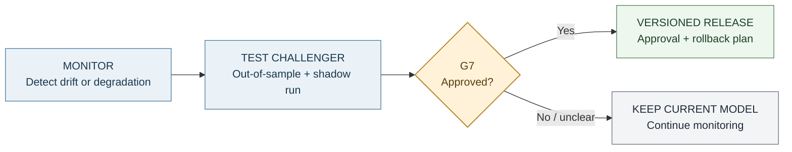

### Sleeves

| Sleeve | Market / currency | Key concern |
|---|---|---|
| ASX interday | ASX / AUD | Closing-auction execution and limited short borrow |
| US interday | US / USD | FX exposure and overnight gap risk |
| ASX intraday | ASX / AUD | Spread, tick size and available depth |
| US intraday | US / USD | Execution costs and competition for short-horizon signals |

Sleeves share infrastructure but keep separate calendars, cost assumptions, data depth and risk budgets.

| Forecast layer | Interday role | Intraday role |
|---|---|---|
| Financial | Return, volatility and distress | Distress controls and volatility |
| Macro | Regime and factor exposures | Scheduled-release risk and event windows |
| Micro | Industry economics and peer relationships | Order flow, spread, intensity and impact |
| News | Multi-day information drift | Fast-decaying, latency-sensitive event features |

## 2. Design Principles and Gates

| Principle | Implementation |
|---|---|
| Point-in-time | Input knowledge time must be no later than decision time. Filtered states only; smoothing is for retrospective analysis. |
| Common forecast format | Each model produces a predictive distribution and lineage metadata. |
| Validate before weighting | Fit success is not proof of out-of-sample skill or economic value. |
| Conservative credible risk | Use the most conservative risk estimate that passes its own backtests. |
| Default NO-TRADE | Trade only when required checks pass and expected benefit exceeds expected cost. |
| Separate sizing and leverage | Optimiser chooses relative weights; a separate rule controls total exposure. |
| Charge for search | Record trials and account for multiple testing and backtest overfitting. |
| Static universe | Formation runs once per universe version; only specified safety exits may remove names. |

| Gate | Pass condition | Failure action |
|---|---|---|
| **G1 Universe** | Formation filters pass; existing members meet safety rules | Reject at formation or log a safety exit |
| **G2 Data integrity** | No look-ahead, schema, unit, timezone or freshness breach | Quarantine affected name or block affected branch/run |
| **G3 Model eligibility** | Stable, calibrated, out-of-sample skill and positive net-of-cost evidence | Exclude model; no eligible signal means NO-TRADE |
| **G4 Portfolio risk** | Volatility, expected shortfall, concentration, liquidity and stress limits pass | Re-optimise within approved relaxations or scale toward cash |
| **G5 Leverage/margin** | Exposure, financing and stressed margin stay within approved limits | Reduce gross exposure or block new risk |
| **G6 Final no-trade** | Data, model, risk, liquidity, market-state and kill-switch checks pass | Block the order; risk-reducing actions only if policy permits |
| **G7 Promotion** | Challenger passes independent validation and shadow period | Keep current champion |

**Run status:** `PASS` means checks passed; `DEGRADED` means an approved fallback is active; `BLOCKED` means a critical check failed. Every failure receives a machine-readable reason code. If no approved fallback exists, stop the affected run/sleeve.

## 3. Stage 0: Point-in-Time Data and the Company Knowledge Layer

**Purpose:** Build one reproducible, timestamped view of every company and relevant market input before calculating features or forecasts.

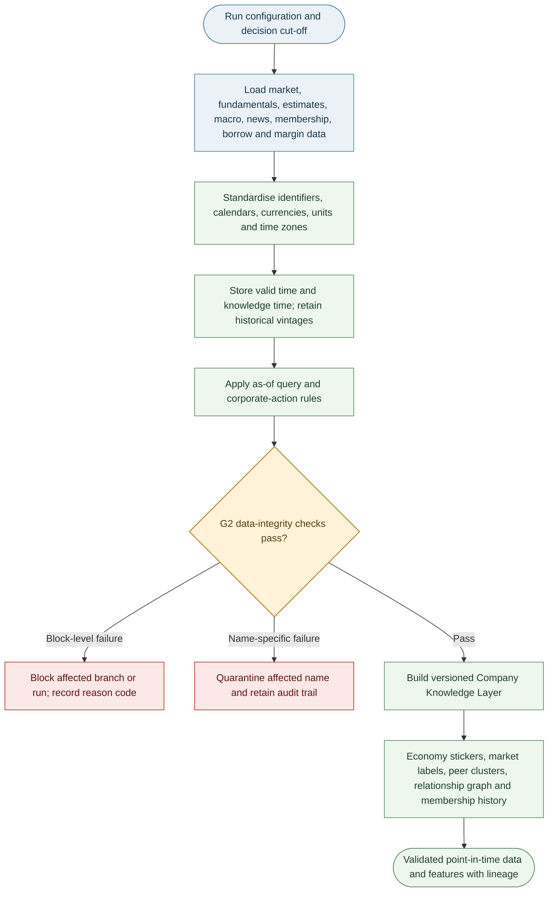

### Data timing and integrity

Store each fact with **valid time** (period described) and **knowledge time** (when it became available). A query as of time `t` must return only versions with knowledge time `k ≤ t`; restatements create new vintages rather than overwriting history.

| Source | Timing rule |
|---|---|
| Daily/intraday prices and quotes | Bar end or session close plus publication lag; include delisted names in historical tests |
| Fundamentals and guidance | Announcement/publication timestamp; use a conservative fallback if unavailable |
| Estimates and consensus | First observed timestamp and subsequent revisions |
| Macro data | Official release timestamp and each historical vintage |
| News | Publication time plus processing latency |
| Index membership | Announcement date, not only effective date |
| Borrow and margin | Observation time |

Raw prices are preserved. Adjustment factors for splits, rights and dividends are applied on read; level filters use the unadjusted price actually available at the time. Halted, suspended or zero-volume names are not tradable.

| G2 severity | Examples | Action |
|---|---|---|
| Block | Look-ahead, schema/type mismatch, bad units/timezone, duplicate keys | Stop affected branch/run |
| Quarantine | Stale or incomplete history, unexplained extreme return, unreconciled corporate action | Exclude affected name for this run |
| Warn | Repeated closes, revision bursts | Record warning; do not silently suppress it |

### Company Knowledge Layer

| Component | Contents | Downstream use |
|---|---|---|
| Economy stickers | Dated revenue and cost exposure vectors by economy | Macro models, FX and stress tests |
| Market labels | Industry, product market, listing venue and currency | Universe selection, peer models and constraints |
| Peer clusters | Label- and data-based peer groups | Pooling and relative valuation |
| Relationship graph | Directed customer, supplier, competitor and shared-input links | News propagation, macro transmission and contagion tests |
| Membership history | Listing, delisting and identity changes | Survivorship-safe universes |

Keep revenue and cost stickers separately: a company may sell in one economy and incur costs in another. Version all components point-in-time.

## 4. Stage 1: Archetype Builder

**Purpose:** Select companies suitable for analysis, not forecast returns. Historical formation must include later-delisted companies to avoid survivorship bias.

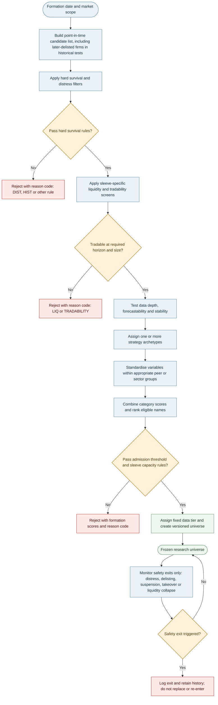

### Hard filters and score

The order is: **survival/distress → liquidity/tradability → data depth and stability → archetype fit → category score → admission**. Rejection reasons are recorded (for example `DIST`, `LIQ`, `HIST`, `DATA`). Banks and insurers require sector-appropriate capital/funding metrics rather than generic debt/EBITDA rules.

| Category | Example measures |
|---|---|
| Survival | 12-month hazard-model distress probability, distance to default, interest cover, refinancing wall, cash runway |
| Liquidity | Median daily traded value (MDTV), Amihud illiquidity, spread, zero-volume ratio, order-book depth |
| Stability | Beta-break tests, volatility forecastability and usable history |
| Business/market suitability | Profitability/cash conversion, valuation, trend, peer relationships and event coverage as relevant to the archetype |
| Operational/data coverage | Identifier quality, publication times, corporate actions, borrow data and intraday quote quality |

Metrics are robustly standardised within sector/peer group, direction-aligned and combined at category level so a category with more variables does not dominate by count:

$$
z_{ij}=\frac{x_{ij}-\operatorname{median}_{s(i)}(x_j)}{1.4826\,\operatorname{MAD}_{s(i)}(x_j)},\qquad q_i=\sum_j\omega_j\Phi(z_{ij}),\quad \sum_j\omega_j=1.
$$

A company is admitted only if it passes all hard gates and clears the configured formation threshold/capacity for that sleeve. Scores and membership are then frozen for that universe version.

| Archetype | Typical fit |
|---|---|
| Momentum/trend | Persistent 12–1 month trend, adequate liquidity, manageable idiosyncratic noise |
| Quality-value | Profitability, cash conversion, low accruals and sector-relative valuation |
| Mean-reversion/pairs | Stable peer relationship and spread half-life; borrow/costs permit trading |
| Event-driven | Reliable event stream, measurable announcement responses and sufficient coverage |
| Intraday liquid large-cap | Tight spreads, depth, activity and potentially forecastable short-horizon volatility |

### Static membership and safety exits

No score-based removal, replacement or re-entry is allowed inside a universe version. A deliberate re-formation creates a new version and requires validation.

| Exit code | Trigger |
|---|---|
| `EXIT-DIST` | Distress probability exceeds approved threshold or insolvency event |
| `EXIT-DLST` / `EXIT-SUSP` | Delisting or suspension beyond policy tolerance |
| `EXIT-TKO` | Approved takeover/scheme changes the security's status |
| `EXIT-LIQ` | Liquidity remains below the formation floor for the configured period |

Exited names stay in historical data and attribution. Positions are closed through normal execution controls.

### Data-depth tiers

| Tier | Typical allocation | Data use |
|---|---|---|
| T1 | Top ~40 per market | Trades/quotes for intraday and realised measures |
| T2 | Next ~120 | One-minute bars for intraday volatility/costs |
| T3 | Remaining names | Daily data; tick data selectively around events |

Sizes are budget examples, not fixed requirements. Allocate expensive data by expected analytical value, signal need, storage and provider cost; tier membership stays fixed within the universe version.

## 5. Stage 2: The Common Forecast Representation

All model families must use one adapter so forecasts can be compared, combined, calibrated and passed into risk calculations consistently.

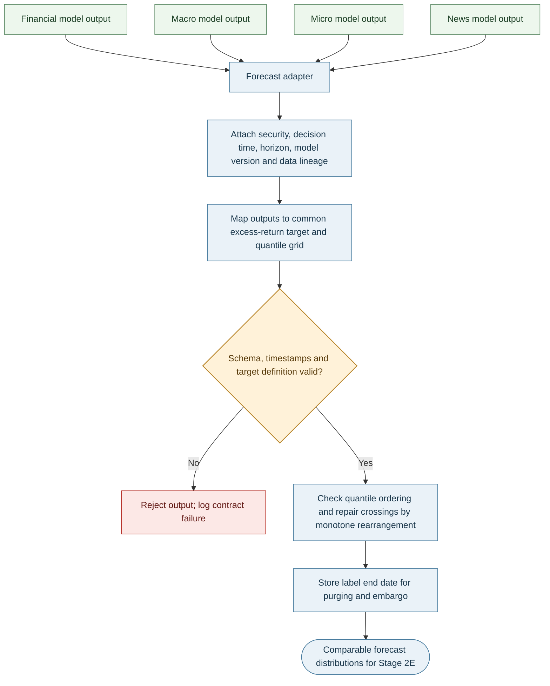

For security `i`, decision time `t` and horizon `h`, emit quantiles on a shared grid:

$$
\mathcal T=\{0.01,0.025,0.05,0.10,0.25,0.50,0.75,0.90,0.95,0.975,0.99\}.
$$

The return target is benchmark-relative excess return from the next executable session:

$$
y^{(h)}_{i,t}=\sum_{s=2}^{h+1}(r_{i,t+s}-r_{b,t+s}).
$$

Each forecast includes security, decision timestamp, horizon, target definition, quantile values, model/version, training window, feature version, data lineage and label end date. Reject invalid timestamps/schema or crossing quantiles; record the label end date for purging.

Use average quantile pinball loss as the primary distribution score; also track interval coverage, sharpness and the probability integral transform. More elaborate models are not admitted solely because they fit in sample.

## 6. Stage 2A: Financial Model

**Purpose:** Estimate return distributions, volatility, distress and changing factor exposures. Stage 2E—not this stage—decides model eligibility.

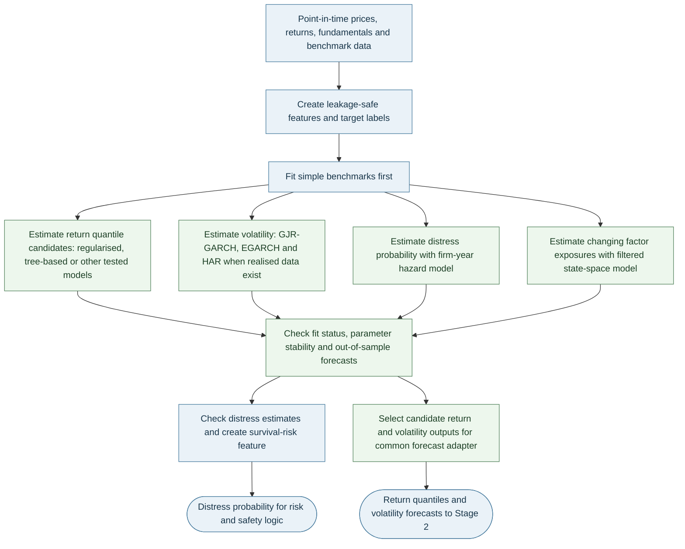

| Task | Candidate methods | Baseline / control |
|---|---|---|
| Return quantiles | Elastic net, quantile regression, gradient boosting (LightGBM/XGBoost), quantile random forest | Zero excess return, rolling mean and factor model |
| Distress | Discrete-time firm-year hazard model | Compare with simple threshold/logistic baseline |
| Daily volatility | GJR-GARCH or EGARCH with Student-t innovations | EWMA variance |
| Intraday realised volatility | HAR model on realised variance/jumps | Daily-only volatility baseline |
| Dynamic exposures | Filtered state-space/Kalman model | Static rolling beta |

**Distress hazard:**

$$
P(\text{default in }(t,t+1]\mid x_{i,t})=\Lambda(\alpha(t)+\beta^\top x_{i,t}),
$$

with distance to default, profitability, leverage, cash runway, returns and volatility as inputs. Use the output for survival gates, optimiser penalties and position reporting.

**GJR-GARCH:**

$$
r_t=\sigma_tz_t,\qquad \sigma_t^2=\omega+(\alpha+\gamma\mathbf1\{r_{t-1}<0\})r_{t-1}^2+\beta\sigma_{t-1}^2.
$$

Student-t innovations capture fat tails; `γ` captures asymmetric volatility response. For realised data, HAR uses daily, weekly and monthly realised-variance averages plus a jump component. Filter changing factor exposures using data available up to `t`; never use smoothed future-informed estimates for live signals.

**Feature groups:** earnings revisions/surprises, profitability and cash conversion, accruals, margins, investment and asset growth, leverage, valuation, momentum/reversal, idiosyncratic volatility and distress. Standardise features inside each training fold.

## 7. Stage 2B: Macro Model (Economy Stickers)

**Purpose:** Combine economy-level states with each firm's dated revenue/cost exposures and estimated sensitivities.

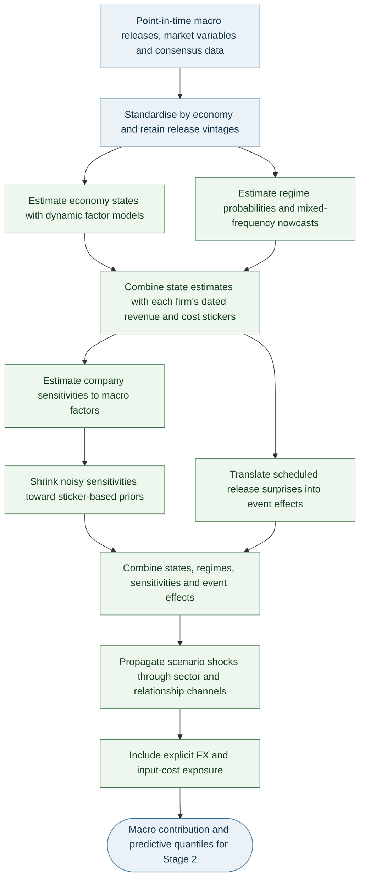

| Component | Method / output |
|---|---|
| Economy states | Dynamic factor model for activity, inflation, rates, labour, credit and financial conditions; use the Kalman filter for ragged-edge releases |
| Regimes | Markov-switching model with filtered probabilities for expansion, slowdown and stress |
| Nowcasts | MIDAS for mixed-frequency targets such as GDP; Bayesian VAR as a challenger |
| Company exposure | Sticker-weighted state: $f^{mac}_{i,t}=\sum_c e_{i,c}f_{c,t}$ |
| Sensitivities | Estimate firm responses to macro factors; shrink noisy coefficients toward sticker/industry priors |
| Scheduled events | Standardised actual-minus-consensus surprise, with release-time volatility controls for intraday sleeves |
| Transmission/stress | Local projections and the shared relationship graph to convert macro scenarios into firm shocks |
| FX | Explicit revenue/cost currency exposure and portfolio-level USD translation exposure |

Shrink noisy firm sensitivities toward prior estimates:

$$
\hat b^{post}_{ij}=\lambda_{ij}\hat b^{OLS}_{ij}+(1-\lambda_{ij})b^{prior}_{ij},\qquad
\lambda_{ij}=\frac{\tau_j^2}{\tau_j^2+\mathrm{se}(\hat b_{ij})^2}.
$$

Standardised release surprise: $S_{c,t}=(\mathrm{actual}-\mathrm{consensus})/\mathrm{sd}(\mathrm{surprise})$. Estimate horizon-specific shock responses with local projections; include sector, sticker, input-cost and FX channels. Use filtered, point-in-time states only.

## 8. Stage 2C: Micro Model (Market Labels)

Interday micro models describe product-market economics. Intraday micro models describe price formation and execution.

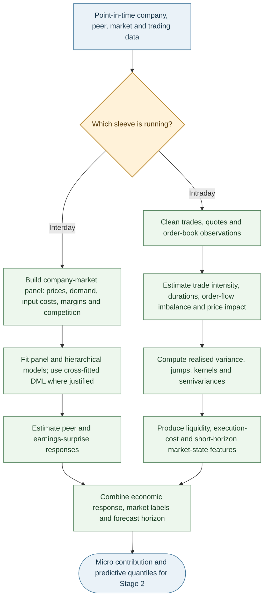

| Branch | Main methods and features | Output |
|---|---|---|
| Interday | Firm/market panel and hierarchical models; demand, input costs, prices, margins, market share and competitive intensity; cross-fitted DML only where justified | Peer/earnings response and firm-level micro contribution |
| Intraday | Trade/quote cleaning; trade intensity and durations; order-flow imbalance; spread, depth and price impact | Short-horizon features, liquidity state and execution-cost estimates |

Two-way panel baseline:

$$
r_{it}=\alpha_i+\lambda_t+\beta^\top x_{it}+\epsilon_{it},
$$

with firm- and date-clustered uncertainty. Hierarchical estimates shrink low-history firms toward market-label/peer-group estimates.

Realised measures from intraday data include realised variance, bipower variation, jumps, semivariance and realised kernels. Use them only when quote/trade timestamps and market sessions are reliable; otherwise fall back to validated daily estimates.

## 9. Stage 2D: News Model (LLM Extraction)

Use an LLM to extract structured facts from timestamped text—not to issue orders or directly declare a profitable trade.

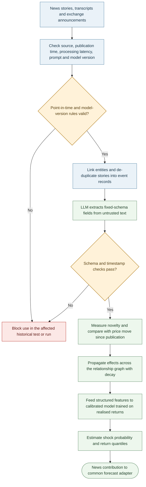

### Processing and event schema

1. Check source, publication timestamp, processing latency and model/prompt version.
2. Deduplicate stories, link entities, compare with prior disclosures and estimate novelty/priced-in status.
3. Extract structured fields; pass them to calibrated statistical models.

| Field | Meaning |
|---|---|
| Entity / source / time | Company identifier, source credibility, publication time and processing latency |
| Event | Type, channel, novelty and whether expected/already priced |
| Impact | Direction, magnitude, confidence and persistence/decay horizon |
| Evidence | Supporting text span or source reference for audit |

Propagate material effects through the shared relationship graph. For edge weight $W_{ij}$ and decay $\delta$, a first-order propagation is proportional to $W_{ij}\delta$; enforce stability of the propagation network (spectral radius below one) to avoid exploding effects.

A calibrated logistic model estimates shock probability, for example:

$$
P(|AR_{i,t}|>2\hat\sigma_i\mid z_d)=\Lambda(\theta^\top z_d),
$$

where features include novelty, direction, magnitude, source credibility, residual surprise and propagated effects. Validate with Brier scores and reliability curves.

**Horizon policy:** intraday news usually widens volatility or reduces exposure unless latency tests show a directional edge; interday models may test slower diffusion/drift.

**Leakage controls:** freeze the LLM/prompt during evaluation, obey publication/training cut-offs, use only text available at decision time, and validate prospectively through paper/live shadow runs.

## 10. Stage 2E: Validation, Eligibility and Signal Combination

Validation occurs before a candidate model receives any combination weight.

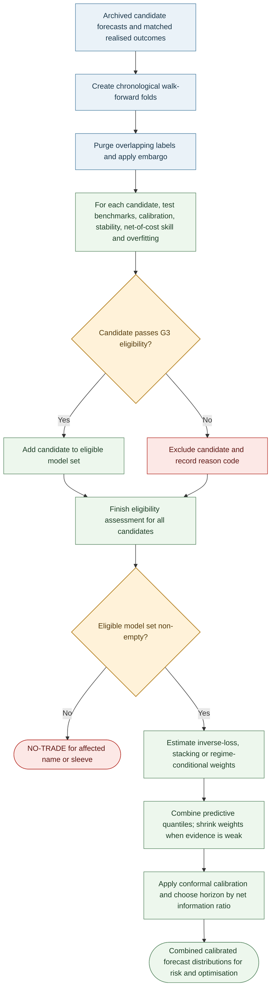

### Validation protocol

- Use chronological walk-forward folds; train only on prior data.
- Purge training labels overlapping each test window and embargo at least the forecast horizon.
- Tune hyperparameters inside training folds; use outer test blocks once.
- Compare with relevant baselines and deduct realistic spread, commission, borrow and impact costs.

| Test / metric | Question |
|---|---|
| Pinball loss / CRPS and coverage | Is the predictive distribution accurate and calibrated? |
| Diebold–Mariano / Giacomini–White | Is forecast skill better, possibly conditional on regime? |
| Hansen SPA / Model Confidence Set | Does a candidate beat the benchmark after model search? |
| Deflated Sharpe / PBO | Could apparent trading performance be due to repeated trials/overfitting? |
| Stability and residual checks | Do parameters, errors and signs remain credible across folds? |

### G3 eligibility defaults

| Criterion | Provisional research rule |
|---|---|
| Fit | Converged; acceptable diagnostics; no unexplained boundary estimates |
| Stability | Coefficients/signs reasonably stable across folds |
| Calibration | 90% interval coverage near target (e.g. within ±3 percentage points) |
| Skill | Out-of-sample improvement against suitable baseline/model set |
| Economic value | Positive net-of-cost value; costs and turnover included |
| Overfitting | Record all trials; apply PBO/DSR or comparable controls |

Thresholds must be calibrated per sleeve and approved; they are not universal constants. If the eligible set is empty, output `NO-TRADE` for the affected name/sleeve.

### Combination and calibration

Candidate approaches include inverse-loss weights, stacking and regime-conditional weights. Shrink estimated weights toward equal weights when evidence is weak. Quantile averaging:

$$
\hat q_\tau=\sum_kw_k\hat q_{k,\tau},\qquad w_k\ge0,\quad\sum_kw_k=1.
$$

Apply conformal calibration on held-out data and choose the horizon with the best net information ratio after costs, capacity and portfolio constraints. Track signal decay and re-evaluate the sleeve assignment if the estimated half-life changes materially.

## 11. Stages 3–4: Risk Model, Optimiser and Sleeve Allocator

The optimiser uses only risk estimates that passed their own checks. Liquidity and tail-risk limits are not relaxed merely to produce a feasible solution.

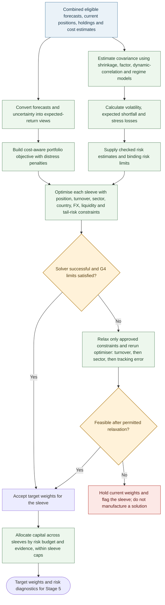

### Risk estimation

| Method | Role |
|---|---|
| Ledoit–Wolf shrinkage | Stabilise sample covariance |
| Factor covariance | Explain market, sector, style, macro/sticker and FX exposures |
| DCC-GARCH | Allow correlations to vary over time |
| Regime mixture | Blend calm/stress covariance using filtered regime probabilities |
| Filtered historical simulation / Monte Carlo / EVT | Independent tail-risk views; the most conservative credible estimate binds |

$$
\mathrm{VaR}_\alpha=-\inf\{x:P(R_p\le x)>1-\alpha\},\qquad
\mathrm{ES}_\alpha=-E[R_p\mid R_p\le-\mathrm{VaR}_\alpha].
$$

Backtest VaR coverage/independence and ES. Demote an engine that fails. Cross-market covariance must account for asynchronous ASX and US sessions via multi-day returns or lead–lag terms.

### Stress library

Include global crisis/recession/rate-shock history, China activity shocks, AUD moves, US overnight gaps, liquidity drought (lower volume/wider spreads) and relationship-graph contagion. Apply shocks through company-specific stickers and sector exposures.

### Portfolio optimisation

Use Black–Litterman to blend equilibrium returns with confidence-weighted forecast views:

$$
\mu_{BL}=\left[(\tau\Sigma)^{-1}+P^\top\Omega^{-1}P\right]^{-1}
\left[(\tau\Sigma)^{-1}\pi+P^\top\Omega^{-1}q\right].
$$

Cost-aware objective:

$$
\max_w\ \mu_{BL}^\top w-\frac{\gamma}{2}w^\top\hat\Sigma w
-\sum_i(c_i|\Delta w_i|+\eta_i|\Delta w_i|^{3/2})
-\kappa\sum_i p_i^{dist}|w_i|.
$$

Constraints cover position/liquidity capacity, turnover, sector/country/sticker, factor/FX exposures, borrow and stress/CVaR. Check solver status and residuals. If infeasible, relax only approved constraints (e.g. turnover, then sector, then tracking error); never relax liquidity or tail-risk limits. If still infeasible, hold current positions and flag the sleeve.

**Provisional examples only:** volatility no more than 1.1× target; single name ≤8%; sector ≤30%; exit within three days at 20% ADV. Configure and validate limits separately for each sleeve/instrument.

### Sleeve allocation

Allocate capital across sleeves by risk budget and out-of-sample evidence, with bounds and a hard cap on intraday risk. Budget USD/FX exposure explicitly or hedge it. Do not allow intraday drawdown to silently consume interday capacity.

## 12. Stage 5: Leverage and Position Report

Optimisation determines relative weights; this stage determines permitted total exposure and whether each proposed trade should be submitted.

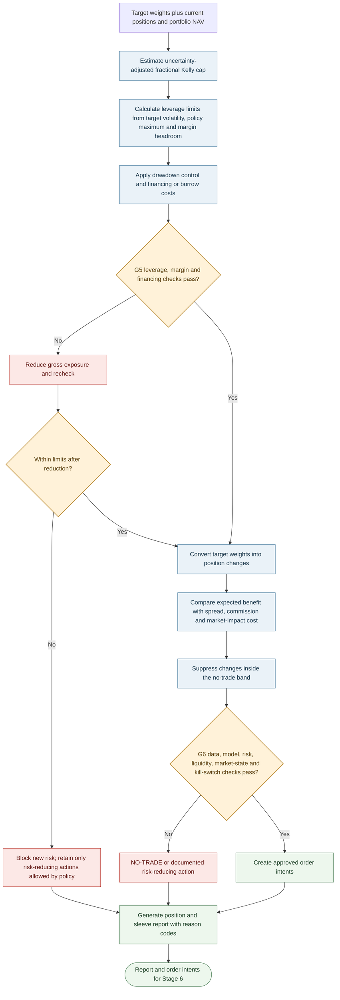

### Kelly cap and leverage rule

Full Kelly $f^*=\mu/\sigma^2$ is too sensitive to estimation error to use as a direct target. Apply fractional Kelly and account for uncertainty in expected return:

$$
f=c\frac{\mu_{BL}}{\sigma^2+\mathrm{Var}(\hat\mu)},\qquad c\in[0.25,0.5]\ \text{(research range)}.
$$

Overall leverage is the lowest permitted bound, then reduced by drawdown:

$$
L_t=\min\left\{\frac{\sigma^*}{\hat\sigma_{p,t}},\ f_t,\ L_{max},\ L_t^{margin}\right\}
\max\left\{0,1-\frac{DD_t}{DD_{max}}\right\}.
$$

Overnight sizing must include gap risk; US positions held during Sydney night hours are a key case. Financing, borrow costs and stressed margin headroom are included in expected net returns and G5.

### Decision and position report

Trade only if expected benefit over the chosen horizon exceeds spread, commission and market-impact cost by the configured margin. Suppress changes within the no-trade band. Each position records invalidation conditions (forecast reversal, tail-quantile breach, stress-regime change, adverse news or rising distress probability).

Every report—trade or `NO-TRADE`—contains:

- Current/target weight, action and reason code.
- Median and interval forecasts, model-layer contributions and model agreement.
- Volatility, expected-shortfall contribution and main stress scenarios.
- Distress probability, sticker/sector/factor/FX exposures and expected costs.
- Gross/net exposure, leverage components, margin headroom, drawdown state and G5/G6 results.

## 13. Stages 6–7: Execution, Hard Limits, Monitoring and Learning

Execution uses approved order intents only. Hard limits are independent of forecast, optimisation and monitoring models.

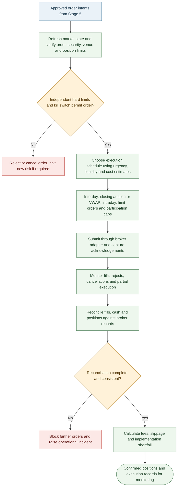

### Independent safety controls

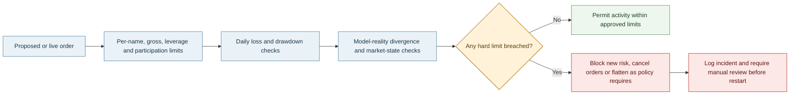

### Hard limits and monitoring

| Control | Illustrative behaviour |
|---|---|
| Name/gross leverage/participation | Reject orders beyond approved limits |
| Kill switch | Cancel open orders and block new risk on breach, stale data or operational incident |
| Reconciliation | Block further orders if broker fills, cash or positions do not reconcile |
| Drawdown | Reduce risk according to the approved drawdown policy |
| Monitoring | Track P&L, forecast calibration, feature drift, risk backtests, execution error, slippage and data quality |

Example alerts (calibrate per sleeve): 90% interval coverage outside 87–93% for 20 sessions; alpha half-life more than 50% shorter than at admission; VaR backtest p-value below 0.01; realised execution-cost error above 30%. Alerts trigger the configured response, not automatic model promotion.

### Monitoring and controlled learning

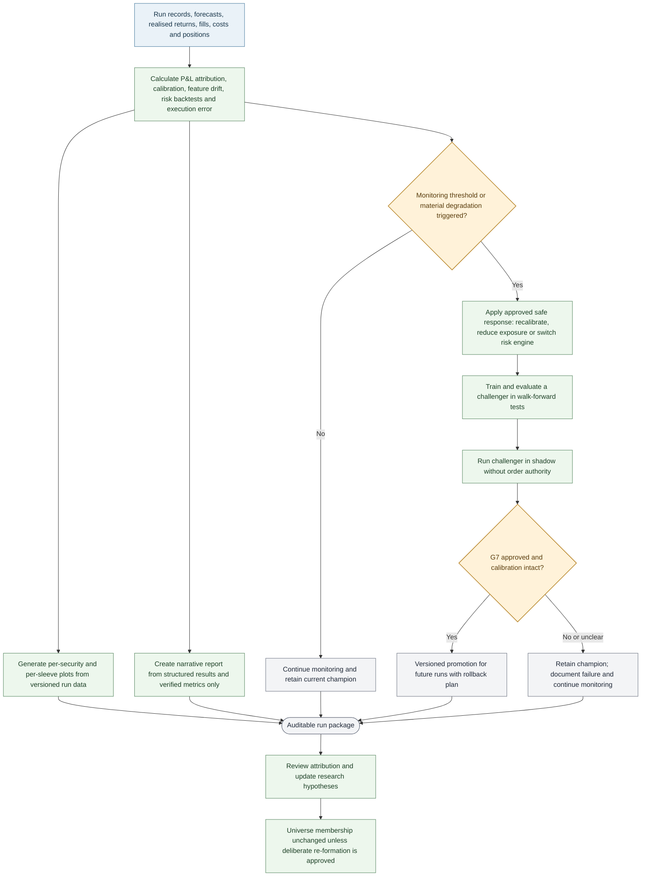

A model may move through `candidate → G3 eligible → shadow → challenger → G7 approved champion → retired`. Promotion requires independent review, a pre-agreed shadow period (e.g. at least 60 sessions), intact calibration, evidence against the champion and a rollback path. A challenger never replaces the champion automatically.

Performance attribution should separate selection, forecasting, portfolio allocation, factor/sector/country effects and execution shortfall. Findings can inform later research but must not alter a frozen universe version silently.

## 14. Core Design Decisions

- Quantile distributions and metadata provide a common interface for all forecast layers.
- Validation precedes eligibility and combination; trial counts and net-of-cost results are recorded.
- Economy stickers are versioned revenue/cost exposures; one relationship graph supports macro transmission, news propagation and contagion stress.
- The universe is static per version; safety exits are logged and do not trigger replacement.
- Data depth follows model need and provider/storage cost.
- Relative weights, total leverage, and order authorisation are separate decisions.
- Hard limits and kill switches remain independent of model outputs.
- AI-generated narrative reports explain structured results only; they do not invent metrics or issue orders.

## 15. Notation, Glossary and Open Questions

| Symbol/term | Meaning |
|---|---|
| $t$, $k$, $	au$ | Decision time, knowledge time and valid time |
| $h$, $r_{i,t}$ | Forecast horizon and security return |
| $\mathbf e_i$, $f_{c,t}$ | Economy sticker vector and economy state factor |
| $\hat q_	au$, CRPS | Forecast quantile and distribution scoring rule |
| $p_i^{dist}$ | Estimated distress probability |
| $w$, $\Sigma$, $L_t$ | Portfolio weights, covariance and leverage |
| $DD_t$, $b_i$ | Drawdown and no-trade band |
| Purging/embargo | Removing overlapping labels/adjacent observations during validation |
| DSR/PBO/SPA/MCS | Multiple-testing and model-comparison diagnostics |

### Decisions required before implementation

1. Instruments and capital structure: cash equities on margin, CFDs or futures; available capital and financing arrangements.
2. Per-sleeve target volatility, maximum drawdown, per-name/sector/gross limits and margin buffer.
3. US-market broker and provider; licensed data coverage and intraday data cost/depth.
4. News sources and latency requirements; whether intraday news can be used directionally.
5. Long-only versus long-short and permitted borrow, especially for ASX names.
6. Whether universe re-formation is only by deliberate decision or on a defined schedule.
7. Whether model families are fixed or open to a challenger process governed by G3/G7.

## 16. Operating Contract and Run Outputs

Every run creates a unique `run_id` and records:

| Record | Required fields |
|---|---|
| Run/config | Start/end timestamps, code revision, config version, market, sleeve, cutoff, calendar and horizons |
| Data lineage | Provider/dataset, extraction and observation timestamps, knowledge-time rule, row counts and schema version |
| Universe | Universe version, eligible names, exits and reason codes |
| Models/validation | Model/feature versions, training window, fit status, fold/purge/embargo settings, benchmark/calibration/net-cost results and trial count |
| Portfolio/decision | Forecasts, current/target weights, costs, risk contributions, binding constraints, `TRADE`/`REDUCE`/`HOLD`/`NO-TRADE` and reason codes |
| Execution | Order intents, submissions/fills, timestamps, fees, cancellations/rejections and implementation shortfall |
| Outputs | Per-security and per-sleeve plots, diagnostics, warnings and narrative report |

**Terminal status:**
- `PASS`: required data, models, risk and execution checks passed.
- `DEGRADED`: a non-critical component failed and an approved fallback is used; trading remains subject to every hard gate.
- `BLOCKED`: a critical check failed; do not initiate new risk.

The narrative report must be generated from structured outputs. AI/ML may summarise measured results but may not invent numbers, override a gate or issue an order. Plot/report failures are logged and never conceal safety failures. Fallbacks must be tested and cannot bypass data integrity, margin, hard exposure limits, kill switches or reconciliation.

## 17. Implementation Roadmap and Readiness Gates

| Phase | Deliverable | Exit criterion |
|---|---|---|
| 1. Data foundation | Point-in-time schemas, calendars, identifiers, corporate actions and lineage | As-of queries and schema/timestamp/unit tests pass |
| 2. Baseline research | Benchmarks, costs and frozen-universe builder | Survivorship/look-ahead tests pass; clean runs reproduce results |
| 3. Validation | Walk-forward folds, purging/embargo and trial registry | Leakage tests work; trials and fold boundaries logged |
| 4. Forecast layers | Financial, macro, micro and news modules under common contract | Baselines, calibration and model failure states are measured |
| 5. Risk/optimisation | Covariance/ES, stress library, optimiser and sleeve allocator | Constraint tests pass; infeasibility cannot create tradable weights |
| 6. Execution simulation | Scheduling, fill/cost model and shortfall attribution | Costs/fills are stress-tested and documented |
| 7. Paper trading | Scheduled end-to-end runs without capital at risk | Reconciliation, stale-data, restart, latency and kill-switch tests pass |
| 8. Controlled deployment | Small approved allocation with monitoring and broker permissions | Written sign-off, limits, rollback and incident response tested |
| 9. Challenger lifecycle | Shadow tests and champion/challenger governance | Out-of-sample criteria met; versioned rollback available |

A stage is complete only when its input/output schema, unit/failure tests, point-in-time handling, versioned configuration, logs/reason codes, reproducible outputs, benchmark/invariant and downstream failure action are documented.

**Final rule:** research models propose forecasts; the validated pipeline proposes target positions; only independent risk and execution controls authorise orders.
