# Multi-Market Quantitative Investment Pipeline

**Version 12: terminology-reviewed architecture, stage workflows and control specification**

> **Status:** Research and system-design specification, not evidence of profitability or production readiness. Model thresholds are provisional. Live use requires tested implementation, validated data and broker interfaces, approved risk limits, operational testing and explicit sign-off.
>
> **Math rendering:** Formulas use LaTeX Markdown (`$...$` for inline maths and `$$...$$` for display equations). Use a math-enabled Markdown preview if commands such as `\mathrm` display literally.

| Scope | Design |
|---|---|
| Markets | ASX and US equities |
| Sleeves | ASX interday, US interday, ASX intraday, US intraday |
| Forecast layers | Financial, macroeconomic, microeconomic and news-derived |
| Main flow | Data → fixed research universe → forecasts → validation → risk/optimisation → leverage/pre-trade gates → execution → monitoring/reporting |
| Out of scope | Full source code, provider API instructions and production runbooks |

## Executive Summary

This is a **gated research-to-execution system**, not a single predictive model. Its governing rules are:

1. Use point-in-time data and preserve historical vintages; do not leak future information.
2. Separate company-universe selection from return forecasting.
3. Standardise forecasts as predictive quantiles with metadata and lineage.
4. Validate models out of sample and after costs before giving them weight.
5. Keep portfolio risk, leverage, order limits and kill switches independent of forecasts.
6. Generate reproducible run records, plots and a narrative report from measured outputs.
7. Promote challengers only after validation, shadow testing, approval and a rollback plan.

A sophisticated design does not establish an economic edge. Test the complete system on chronological out-of-sample data and realistic transaction costs before paper trading or live deployment.

### Terminology convention

Recognised finance, econometrics, risk and market-structure terminology is used where a stable term exists. That does not make every research method a regulatory requirement. Stage names, gate IDs G1–G7 and the **Company Reference and Exposure Dataset** are project-specific architecture labels, not external standards. “Geographic revenue/cost exposure” is descriptive terminology. Model choices and numerical thresholds are research design decisions, not universal industry standards.

## Contents

1. [Pipeline at a Glance](#1-pipeline-at-a-glance)
2. [Design Principles and Gates](#2-design-principles-and-gates)
3. [Stage 0: Point-in-Time Data and Company Reference Data](#3-stage-0-point-in-time-data-and-company-reference-data)
4. [Stage 1: Universe Selection and Strategy Classification](#4-stage-1-universe-selection-and-strategy-classification)
5. [Stage 2: Common Forecast Schema](#5-stage-2-common-forecast-schema)
6. [Stage 2A: Financial Forecast and Distress Model](#6-stage-2a-financial-forecast-and-distress-model)
7. [Stage 2B: Macroeconomic Exposure and Regime Model](#7-stage-2b-macroeconomic-exposure-and-regime-model)
8. [Stage 2C: Firm Fundamentals and Market Microstructure](#8-stage-2c-firm-fundamentals-and-market-microstructure)
9. [Stage 2D: News Event Extraction and Modelling](#9-stage-2d-news-event-extraction-and-modelling)
10. [Stage 2E: Validation and Combination](#10-stage-2e-validation-eligibility-and-signal-combination)
11. [Stages 3–4: Risk, Optimisation and Sleeve Allocation](#11-stages-34-risk-model-optimiser-and-sleeve-allocator)
12. [Stage 5: Leverage and Position Report](#12-stage-5-leverage-and-position-report)
13. [Stages 6–7: Execution, Controls and Monitoring](#13-stages-67-execution-hard-limits-monitoring-and-learning)
14. [Core Design Decisions](#14-core-design-decisions)
15. [Notation and Open Decisions](#15-notation-glossary-and-open-decisions)
16. [Run Contract and Outputs](#16-operating-contract-and-run-outputs)
17. [Implementation Roadmap](#17-implementation-roadmap-and-readiness-gates)

## 1. Pipeline at a Glance

Use this as the system map. The diagrams in Sections 3–13 show the process and stage hand-offs.

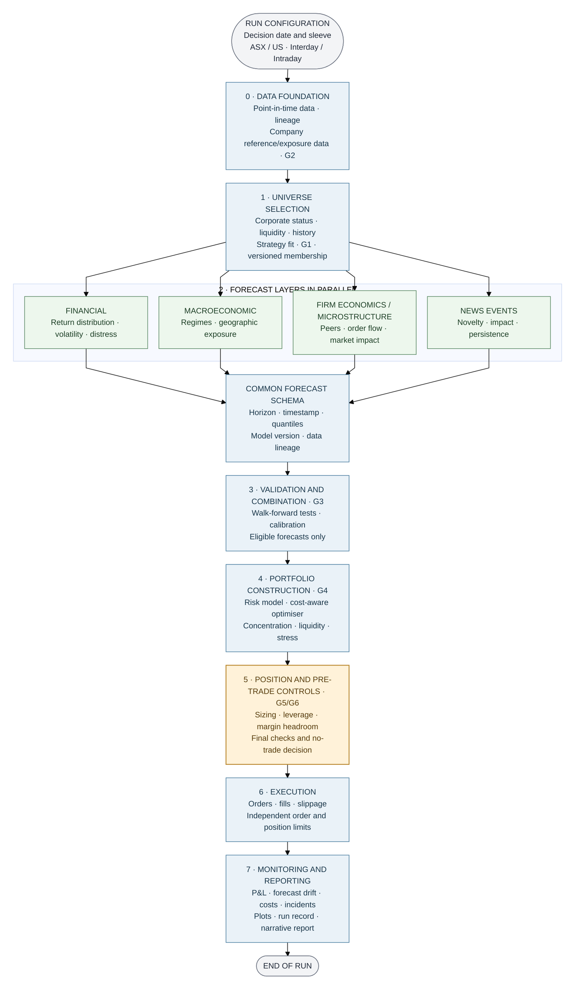

### Approved-model / candidate-model lifecycle

Monitoring may trigger a challenger review, but a challenger never replaces the production model automatically.

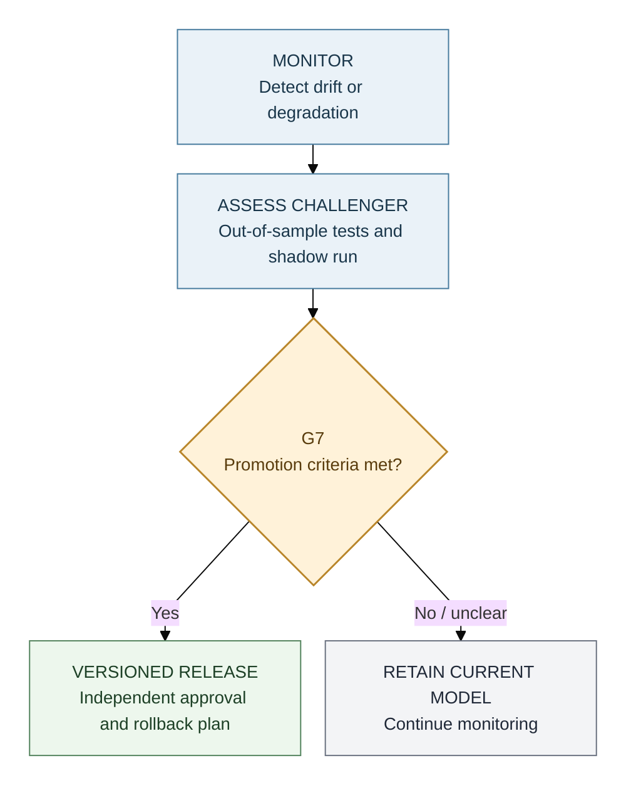

### Sleeves

| Sleeve | Market / currency | Key concern |
|---|---|---|
| ASX interday | ASX / AUD | Closing-auction execution and limited short borrow |
| US interday | US / USD | FX exposure and overnight gap risk |
| ASX intraday | ASX / AUD | Spread, tick size and available depth |
| US intraday | US / USD | Execution costs and competition for short-horizon signals |

Portfolio sleeves (separately governed sub-portfolios) share infrastructure but keep separate calendars, cost assumptions, data depth and risk budgets.

| Forecast layer | Interday role | Intraday role |
|---|---|---|
| Financial | Return, volatility and distress | Distress controls and volatility |
| Macro | Regime and factor exposures | Scheduled-release risk and event windows |
| Micro | Industry economics and peer relationships | Order flow, spread, intensity and impact |
| News | Multi-day information drift | Fast-decaying, latency-sensitive event features |

## 2. Design Principles and Gates

| Principle | Implementation |
|---|---|
| Point-in-time | Input availability timestamp must be no later than decision time. Filtered states only; smoothing is for retrospective analysis. |
| Common forecast format | Each model produces a predictive distribution and lineage metadata. |
| Validate before weighting | Fit success is not proof of out-of-sample skill or economic value. |
| Conservative, validated risk estimates | Use the most conservative risk estimate that passes its own backtests. |
| Default no-trade | Trade only when required checks pass and expected benefit exceeds expected cost. |
| Separate sizing and leverage | Optimiser chooses relative weights; a separate rule controls total exposure. |
| Charge for search | Record trials and account for multiple testing and backtest overfitting. |
| Fixed, versioned universe | Formation runs once per version; only specified mandatory removal rules may remove names. |

| Gate | Pass condition | Failure action |
|---|---|---|
| **G1 Universe gate (project-defined)** | Formation filters pass; existing members meet safety rules | Reject at formation or log a safety exit |
| **G2 Data-integrity gate (project-defined)** | No look-ahead, schema, unit, timezone or freshness breach | Quarantine affected name or block affected branch/run |
| **G3 Model-eligibility gate (project-defined)** | Stable, calibrated, out-of-sample skill and positive net-of-cost evidence | Exclude model; no eligible signal means no trade |
| **G4 Portfolio-risk gate (project-defined)** | Volatility, expected shortfall, concentration, liquidity and stress limits pass | Re-optimise within approved relaxations or scale toward cash |
| **G5 Leverage/margin gate (project-defined)** | Exposure, financing and stressed margin stay within approved limits | Reduce gross exposure or block new risk |
| **G6 Final trade-eligibility gate (project-defined)** | Data, model, risk, liquidity, market-state and kill-switch checks pass | Block the order; risk-reducing actions only if policy permits |
| **G7 Model-promotion gate (project-defined)** | Challenger passes independent validation and shadow period | Keep the current approved model |

**Run status (project-defined labels):** `PASS` means checks passed; `DEGRADED` means an approved fallback is active; `BLOCKED` means a critical check failed. These are internal operational statuses, not exchange or regulatory classifications. Every failure receives a machine-readable reason code. If no approved fallback exists, stop the affected run/sleeve.

## 3. Stage 0: Point-in-Time Data and Company Reference Data

**Purpose:** Build one reproducible, timestamped view of every company and relevant market input before calculating features or forecasts.

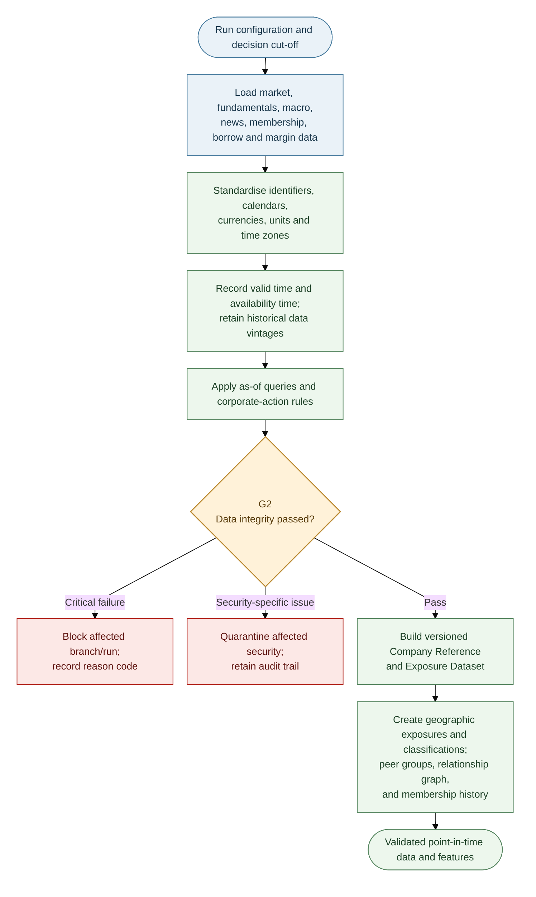

### Data timing and integrity

Store each fact with **valid time** (period described) and **availability timestamp** (when the system could first have used it). A query as of time `t` must return only versions with availability timestamp `a ≤ t`; restatements create new vintages rather than overwriting history.

| Source | Timing rule |
|---|---|
| Daily/intraday prices and quotes | Bar end or session close plus publication lag; include delisted names in historical tests |
| Fundamentals and guidance | Announcement/publication timestamp; use a conservative fallback if unavailable |
| Estimates and consensus | First observed timestamp and subsequent revisions |
| Macro data | Official release timestamp and each historical vintage |
| News | Publication time plus processing latency |
| Index membership | Announcement date, not only effective date |
| Borrow and margin | Observation time |

Raw prices are preserved. Adjustment factors for splits, rights and dividends are applied on read; level filters use the unadjusted price actually available at the time. Halted, suspended or zero-volume names are not tradable.

| G2 severity | Examples | Action |
|---|---|---|
| Block | Look-ahead, schema/type mismatch, bad units/timezone, duplicate keys | Stop affected branch/run |
| Quarantine | Stale or incomplete history, unexplained extreme return, unreconciled corporate action | Exclude affected name for this run |
| Warn | Repeated closes, revision bursts | Record warning; do not silently suppress it |

### Company Reference and Exposure Dataset

| Component | Contents | Downstream use |
|---|---|---|
| Geographic revenue and cost exposures | Dated revenue-share and cost-share vectors by economy | Macroeconomic models, currency analysis and stress tests |
| Industry/sector and product-market classifications | Sector, industry, product-market, listing venue and trading currency | Universe selection, peer models and constraints |
| Peer clusters | Classification- and data-based peer groups | Pooling and relative valuation |
| Relationship graph | Directed customer, supplier, competitor and shared-input links | News propagation, macro transmission and contagion tests |
| Membership history | Listing, delisting and identity changes | Survivorship-safe universes |

Keep geographic revenue and cost exposures separate: a company may generate revenue in one economy and incur costs in another. Version all components point-in-time.

## 4. Stage 1: Universe Selection and Strategy Classification

**Purpose:** Select companies suitable for analysis, not forecast returns. Historical formation must include later-delisted companies to avoid survivorship bias.

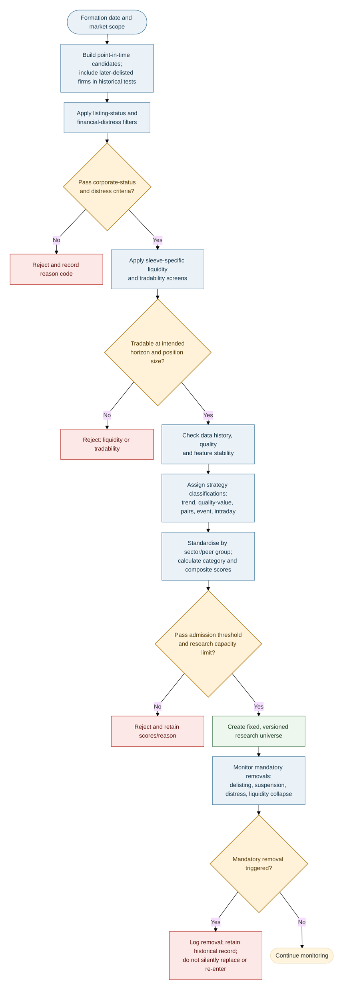

### Eligibility filters and composite score

The order is: **corporate eligibility/distress risk → liquidity/tradability → data depth and stability → strategy classification → category score → admission**. Rejection reasons are recorded (for example `DIST`, `LIQ`, `HIST`, `DATA`). Banks and insurers require sector-appropriate capital/funding metrics rather than generic debt/EBITDA rules.

| Category | Example measures |
|---|---|
| Financial distress and corporate status | 12-month probability of default estimated with a hazard model, distance to default, interest cover, concentrated debt maturities, cash runway |
| Liquidity | Median daily dollar value traded, Amihud illiquidity ratio, bid–ask spread, zero-volume ratio and order-book depth |
| Stability | Structural-break tests for market beta, volatility-model performance and usable history |
| Business/market suitability | Profitability/cash conversion, valuation, trend, peer relationships and event coverage as relevant to the strategy class |
| Operational/data coverage | Identifier quality, publication times, corporate actions, borrow data and intraday quote quality |

Metrics are robustly standardised within sector/peer group, direction-aligned and combined first within categories, then across categories. Here MAD is median absolute deviation, Φ is the standard normal cumulative distribution function, and $d_j$ is +1 when higher values are preferable or −1 when lower values are preferable:

$$
z_{ij}=\frac{x_{ij}-\operatorname{median}_{s(i)}(x_j)}
{1.4826\,\operatorname{MAD}_{s(i)}(x_j)},\qquad
C_{ik}=\sum_{j\in k}\omega_{jk}\Phi(d_jz_{ij}),\qquad
S_i=100\sum_k w_k C_{ik},\qquad \sum_{j\in k}\omega_{jk}=1,\quad \sum_k w_k=1.
$$

A company is admitted only if it passes all hard gates and clears the configured formation threshold/capacity for that sleeve. Scores and membership remain fixed for that universe version.

| Strategy classification | Typical characteristics |
|---|---|
| Momentum/trend | Persistent 12–1 momentum (trailing 12-month return excluding the most recent month), adequate liquidity, manageable idiosyncratic noise |
| Quality-value | Profitability, cash conversion, low accruals and sector-relative valuation |
| Mean-reversion/pairs | Stable peer relationship and spread half-life; borrow/costs permit trading |
| Event-driven | Reliable event stream, measurable announcement responses and sufficient coverage |
| Intraday liquid large-cap | Tight spreads, depth, activity and potentially forecastable short-horizon volatility |

### Fixed membership and mandatory removals

No score-based removal, replacement or re-entry is allowed within a universe version. A deliberate re-formation creates a new version and requires validation.

| Exit code | Trigger |
|---|---|
| `EXIT-DIST` | Distress probability exceeds approved threshold or insolvency event |
| `EXIT-DLST` / `EXIT-SUSP` | Delisting or suspension beyond policy tolerance |
| `EXIT-TKO` | Approved takeover/scheme changes the security's status |
| `EXIT-LIQ` | Liquidity remains below the formation floor for the configured period |

Exited names stay in historical data and attribution. Positions are closed through normal execution controls.

### Data-coverage tiers

| Tier | Typical allocation | Data use |
|---|---|---|
| T1 | Top ~40 per market | Trades/quotes for intraday and realised measures |
| T2 | Next ~120 | One-minute bars for intraday volatility/costs |
| T3 | Remaining names | Daily data; tick data selectively around events |

Sizes are budget examples, not fixed requirements. Allocate expensive data by expected analytical value, signal need, storage and provider cost; tier membership stays fixed within the universe version.

## 5. Stage 2: Common Forecast Schema

All model families use the same forecast schema/interface so forecasts can be compared, combined, calibrated and passed into risk calculations consistently.

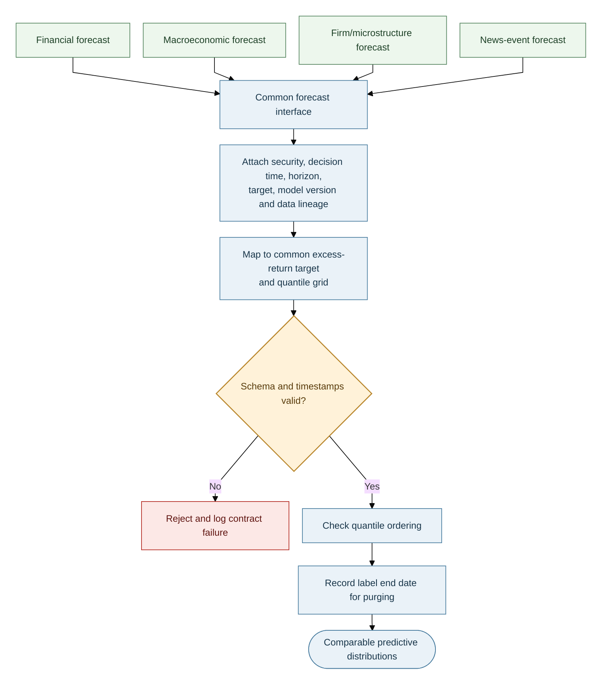

For security `i`, decision time `t` and horizon `h`, emit quantiles on a shared grid:

$$
\mathcal T=\{0.01,0.025,0.05,0.10,0.25,0.50,0.75,0.90,0.95,0.975,0.99\}.
$$

The benchmark-relative excess-return target spans the selected forecast horizon, beginning after the decision point:

$$
y^{(h)}_{i,t}=\sum_{s=2}^{h+1}(r_{i,t+s}-r_{b,t+s}).
$$

Each forecast includes security, decision timestamp, horizon, target definition, quantile values, model/version, training window, feature version, data lineage and label end date. Reject invalid timestamps/schema or crossing quantiles; record the label end date for purging.

Use mean quantile pinball loss as the primary quantile score; also track interval coverage, sharpness and the probability integral transform (PIT). More elaborate models are not admitted solely because they fit in sample.

## 6. Stage 2A: Financial Forecast and Distress Model

**Purpose:** Estimate return distributions, volatility, distress and changing factor exposures. Stage 2E—not this stage—decides model eligibility.

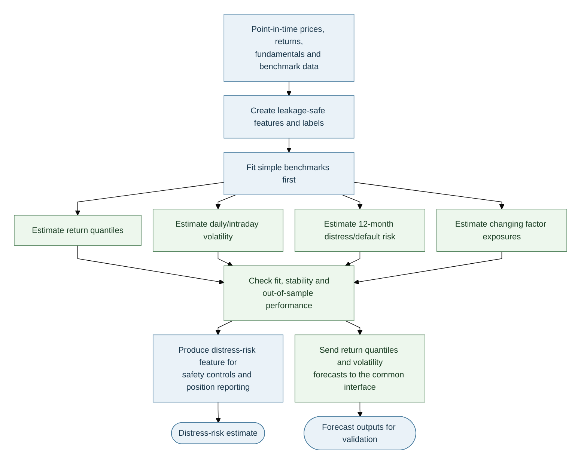

| Task | Candidate methods | Baseline / control |
|---|---|---|
| Return quantiles | Elastic net, quantile regression, gradient boosting (LightGBM/XGBoost), quantile random forest | Zero excess return, rolling mean and factor model |
| Distress | Discrete-time firm-year hazard model | Compare with simple threshold/logistic baseline |
| Daily volatility | Glosten–Jagannathan–Runkle GARCH (GJR-GARCH) or exponential GARCH (EGARCH), with Student-t innovations | exponentially weighted moving average (EWMA) variance |
| Intraday realised volatility | Heterogeneous Autoregressive model of Realised Volatility (HAR-RV), with realised variance and jump measures | Daily-only volatility baseline |
| Dynamic exposures | Filtered state-space/Kalman model | Static rolling beta |

**Distress hazard:**

$$
P(\text{default in }(t,t+1]\mid x_{i,t})=\Lambda(\alpha(t)+\beta^\top x_{i,t}),
$$

with distance to default, profitability, leverage, cash runway, returns and volatility as inputs. Use the output for distress-risk gates, optimiser penalties and position reporting.

**Glosten–Jagannathan–Runkle GARCH (GJR-GARCH):**

$$
r_t=\sigma_tz_t,\qquad \sigma_t^2=\omega+(\alpha+\gamma\mathbf1\{r_{t-1}<0\})r_{t-1}^2+\beta\sigma_{t-1}^2.
$$

Student-t innovations capture fat tails; `γ` captures asymmetric volatility response. For intraday data, the HAR-RV uses daily, weekly and monthly realised-variance averages, optionally with a jump component. Filter changing factor exposures using data available up to `t`; never use smoothed future-informed estimates for live signals.

**Feature groups:** earnings revisions/surprises, profitability and cash conversion, accruals, margins, investment and asset growth, leverage, valuation, momentum/reversal, idiosyncratic volatility and distress. Standardise features inside each training fold.

## 7. Stage 2B: Macroeconomic Exposure and Regime Model

**Purpose:** Combine economy-level states with each firm's dated revenue/cost exposures and estimated sensitivities.

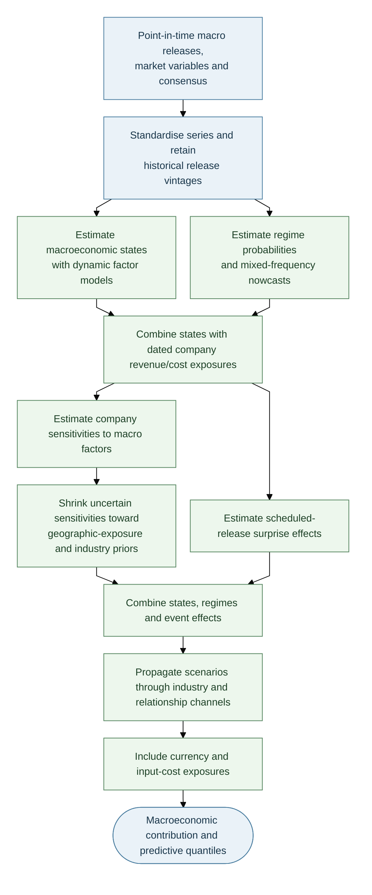

| Component | Method / output |
|---|---|
| Economy states | Dynamic factor model for activity, inflation, rates, labour, credit and financial conditions; use the Kalman filter for ragged-edge releases |
| Regimes | Markov-switching model with filtered probabilities for expansion, slowdown and stress |
| Nowcasts | Mixed-data sampling (MIDAS) regression for mixed-frequency targets such as GDP; Bayesian vector autoregression (BVAR) as a challenger |
| Company exposure | Retain dated revenue-share and cost-share exposures separately; do not collapse them into one score. |
| Sensitivities | Estimate firm responses to macro factors; shrink noisy coefficients toward geographic-exposure and industry priors |
| Scheduled events | Standardised actual-minus-consensus surprise, with release-time volatility controls for intraday sleeves |
| Transmission/stress | Local projections and the shared relationship graph to convert macro scenarios into firm shocks |
| FX | Explicit revenue/cost currency exposure and portfolio-level USD translation exposure |

For economy $c$, calculate revenue and cost exposure separately:

$$
f^{rev}_{i,t}=\sum_c e^{rev}_{i,c}f_{c,t}, \qquad f^{cost}_{i,t}=\sum_c e^{cost}_{i,c}f_{c,t}.
$$

The weights are dated revenue and cost shares. Preserve coverage flags; do not silently treat unknown exposures as zero.

Shrink noisy firm sensitivities toward prior estimates:

$$
\hat b^{post}_{ij}=\lambda_{ij}\hat b^{OLS}_{ij}+(1-\lambda_{ij})b^{prior}_{ij},\qquad
\lambda_{ij}=\frac{\tau_j^2}{\tau_j^2+\mathrm{se}(\hat b_{ij})^2}.
$$

Standardised release surprise: $S_{c,t}=(\mathrm{actual}-\mathrm{consensus})/\mathrm{sd}(\mathrm{surprise})$. Estimate horizon-specific shock responses with local projections; include industry, geographic exposure, input-cost and FX channels. Use filtered, point-in-time states only.

## 8. Stage 2C: Firm Fundamentals and Market Microstructure

Interday models describe firm fundamentals, industry conditions and peer effects. Intraday models describe price formation, order flow and execution.

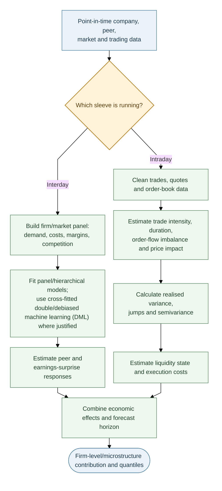

| Branch | Main methods and features | Output |
|---|---|---|
| Interday | Firm/market panel and hierarchical models; demand, input costs, prices, margins, market share and competitive intensity; cross-fitted double/debiased machine learning (DML) only where justified | Peer/earnings response and firm-level micro contribution |
| Intraday | Trade/quote cleaning; trade intensity and durations; order-flow imbalance; spread, depth and price impact | Short-horizon features, liquidity state and execution-cost estimates |

Two-way panel baseline:

$$
r_{it}=\alpha_i+\lambda_t+\beta^\top x_{it}+\epsilon_{it},
$$

with firm- and date-clustered uncertainty. Hierarchical estimates shrink low-history firms toward industry- and peer-group estimates.

Realised measures from intraday data include realised variance, bipower variation, jumps, semivariance and realised kernels. Use them only when quote/trade timestamps and market sessions are reliable; otherwise fall back to validated daily estimates.

## 9. Stage 2D: News Event Extraction and Modelling

Use a large language model (LLM) to extract structured facts from timestamped text. It does not issue orders or independently declare a trade profitable.

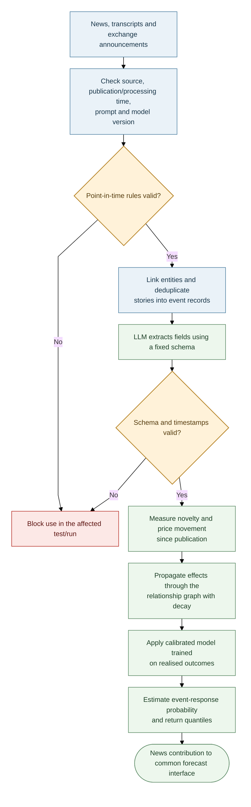

### Processing and event schema

1. Check source, publication timestamp, processing latency and model/prompt version.
2. Deduplicate stories, link entities, compare with prior disclosures and estimate novelty/priced-in status.
3. Extract structured fields; pass them to calibrated statistical models.

| Field | Meaning |
|---|---|
| Entity / source / time | Company identifier, source credibility, publication time and processing latency |
| Event | Type, channel, novelty and whether expected/already priced |
| Impact | Direction, magnitude, confidence and persistence/decay horizon |
| Evidence | Supporting text span or source reference for audit |

Propagate material effects through the shared relationship graph. For edge weight $W_{ij}$ and decay $\delta$, a first-order propagation is proportional to $W_{ij}\delta$; enforce stability of the propagation network (spectral radius below one) to avoid exploding effects.

A calibrated logistic model estimates the probability of a material abnormal-return event, for example:

$$
P(|AR_{i,t}|>2\hat\sigma_i\mid z_d)=\Lambda(\theta^\top z_d),
$$

where $AR_{i,t}$ is abnormal return over the pre-defined event window relative to a specified benchmark, and $\hat\sigma_i$ is a point-in-time estimate of conditional return volatility. The threshold is a configurable research rule, not a regulatory standard. Features include novelty, direction, magnitude, source credibility, residual surprise and propagated effects. Validate with Brier scores and reliability curves.

**Horizon policy:** intraday news usually widens volatility or reduces exposure unless latency tests show a directional edge; interday models may test slower diffusion/drift.

**Leakage controls:** freeze the LLM/prompt during evaluation, obey publication/training cut-offs, use only text available at decision time, and validate prospectively through paper/live shadow runs.

## 10. Stage 2E: Validation, Eligibility and Signal Combination

Validation occurs before a candidate model receives any combination weight.

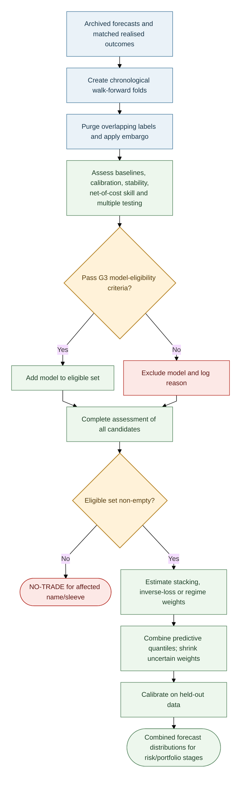

### Validation protocol

- Use chronological walk-forward folds; train only on prior data.
- Purge training labels overlapping each test window and embargo at least the forecast horizon.
- Tune hyperparameters inside training folds; use outer test blocks once.
- Compare with relevant baselines and deduct realistic spread, commission, borrow and impact costs.

| Test / metric | Question |
|---|---|
| Pinball loss / continuous ranked probability score (CRPS) and coverage | Is the predictive distribution accurate and calibrated? |
| Diebold–Mariano / Giacomini–White | Is forecast skill better, possibly conditional on regime? |
| Hansen Superior Predictive Ability (SPA) test / Model Confidence Set (MCS) | Do comparative forecast tests identify superior candidates or a statistically indistinguishable set of best models? |
| Deflated Sharpe Ratio (DSR) / Probability of Backtest Overfitting (PBO) | Could apparent trading performance be due to repeated trials/overfitting? |
| Stability and residual checks | Are parameter estimates, forecast errors and coefficient signs stable across folds? |

### G3 model-eligibility criteria (provisional)

| Criterion | Provisional research rule |
|---|---|
| Fit | Converged; acceptable diagnostics; no unexplained boundary estimates |
| Stability | Coefficients/signs reasonably stable across folds |
| Calibration | 90% interval coverage near target (e.g. within ±3 percentage points) |
| Skill | Out-of-sample improvement against suitable baseline/model set |
| Economic value | Positive net-of-cost value; costs and turnover included |
| Overfitting | Record all trials; apply PBO/DSR or comparable controls |

Thresholds must be calibrated per sleeve and approved; they are not universal constants. If the eligible set is empty, output `NO-TRADE` for the affected name/sleeve.

### Combination and calibration

Candidate approaches include inverse-loss weights, stacking and regime-conditional weights. Shrink estimated weights toward equal weights when evidence is weak. Quantile averaging:

$$
\hat q_\tau=\sum_kw_k\hat q_{k,\tau},\qquad w_k\ge0,\quad\sum_kw_k=1.
$$

Apply conformal calibration on held-out data and choose the horizon with the best net information ratio after costs, capacity and portfolio constraints. Track signal decay and re-evaluate the sleeve assignment if the estimated half-life changes materially.

## 11. Stages 3–4: Risk Model, Optimiser and Sleeve Allocator

The optimiser uses only risk estimates that passed their own checks. Liquidity and tail-risk limits are not relaxed merely to produce a feasible solution.

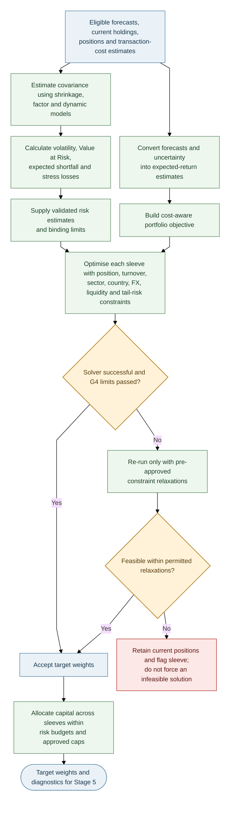

### Risk estimation

| Method | Role |
|---|---|
| Ledoit–Wolf shrinkage | Stabilise sample covariance |
| Factor covariance | Explain market, sector, style, macroeconomic, geographic exposure and FX risks |
| Dynamic conditional correlation GARCH (DCC-GARCH) | Allow correlations to vary over time |
| Regime mixture | Blend calm/stress covariance using filtered regime probabilities |
| Filtered historical simulation / Monte Carlo / extreme-value theory (EVT) | Independent tail-risk views; use a risk estimate only if its backtest is acceptable |

$$
\mathrm{VaR}_\alpha=-\inf\{x:P(R_p\le x)>1-\alpha\},\qquad
\mathrm{ES}_\alpha=-E[R_p\mid R_p\le-\mathrm{VaR}_\alpha].
$$

Backtest value-at-risk (VaR) coverage and independence, and assess expected shortfall (ES) forecasts. Demote an engine that fails. Cross-market covariance must account for asynchronous ASX and US sessions via multi-day returns or lead–lag terms.

### Stress library

Include global crisis/recession/rate-shock history, China activity shocks, AUD moves, US overnight gaps, liquidity drought (lower volume/wider spreads) and relationship-graph contagion. Apply shocks through company-specific geographic revenue/cost exposures and sector exposures.

### Portfolio optimisation

Use Black–Litterman to blend equilibrium returns with confidence-weighted forecast views:

$$
\mu_{BL}=\left[(\tau\Sigma)^{-1}+P^\top\Omega^{-1}P\right]^{-1}
\left[(\tau\Sigma)^{-1}\pi+P^\top\Omega^{-1}q\right].
$$

Cost-aware objective:

$$
\max_w\ \mu_{BL}^\top w-\frac{\gamma}{2}w^\top\hat\Sigma w
-\sum_i(c_i|\Delta w_i|+\eta_i|\Delta w_i|^{3/2})
-\kappa\sum_i p_i^{dist}|w_i|.
$$

Constraints cover position and liquidity capacity, turnover, sector/country concentration, geographic revenue/cost exposures, factor and foreign-exchange (FX) exposures, borrow availability, and stress-loss/expected-shortfall limits. Check solver status and residuals. If infeasible, relax only approved constraints (e.g. turnover, then sector, then tracking error); never relax liquidity or tail-risk limits. If still infeasible, hold current positions and flag the sleeve.

**Provisional examples only:** volatility no more than 1.1× target; single name ≤8%; sector ≤30%; test whether an exit within three trading days is feasible at a participation cap of 20% of average daily volume (ADV). Configure and validate limits separately for each sleeve/instrument.

### Sleeve allocation

Allocate capital across sleeves by risk budget and out-of-sample evidence, with bounds and a hard cap on intraday risk. Budget USD/FX exposure explicitly or hedge it. Do not allow intraday drawdown to consume the risk budget allocated to interday positions without an explicit policy rule.

## 12. Stage 5: Leverage and Position Report

Optimisation determines relative weights; this stage determines permitted total exposure and whether each proposed trade should be submitted.

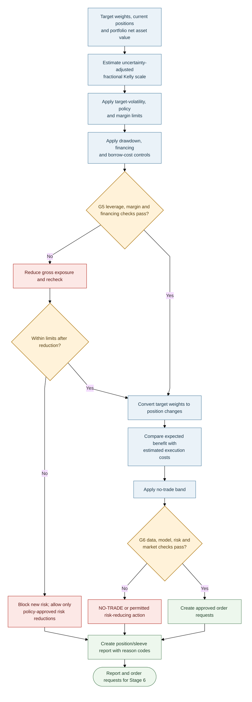

### Fractional Kelly and leverage rule

The classical Kelly rule relates expected excess return to return variance. Here, **fractional Kelly is used only as a conservative portfolio-exposure scaling heuristic**; it is not a universal or regulatory formula. Here, $\hat\mu_{BL,t}^{\mathrm{excess}}$ is the estimated excess return in the proposed portfolio direction, and $\hat\sigma_{p,t}$ is the estimated volatility of those target weights before leverage scaling. Keep forecasts, variances and drawdown inputs on consistent horizons and in consistent units. The portfolio optimiser determines trade direction; this stage applies a non-negative exposure cap.

First combine portfolio variance and uncertainty in the expected-return estimate:

$$
u_t = \hat\sigma_{p,t}^{2} + \widehat{\operatorname{Var}}\!\left(\hat\mu_{BL,t}^{\mathrm{excess}}\right).
$$

Then calculate the Kelly exposure cap. The fractional coefficient range is provisional and must be validated:

$$
L_t^{\mathrm{Kelly}} = \max\!\left(0,\ c\frac{\hat\mu_{BL,t}^{\mathrm{excess}}}{u_t}\right), \qquad 0.25\le c\le0.5.
$$

Calculate the volatility-scaling cap:

$$
L_t^{\mathrm{vol}} = \frac{\sigma_{\mathrm{target}}}{\hat\sigma_{p,t}}.
$$

The leverage cap is the smallest permitted bound:

$$
L_t^{\mathrm{cap}} = \min\!\left(L_t^{\mathrm{vol}},\ L_t^{\mathrm{Kelly}},\ L_{\max},\ L_t^{\mathrm{margin}}\right).
$$

Apply the drawdown multiplier:

$$
d_t^{\mathrm{DD}} = \max\!\left(0,\ 1-\frac{DD_t}{DD_{\max}}\right), \qquad L_t = L_t^{\mathrm{cap}}d_t^{\mathrm{DD}}.
$$

**Plain-text reading:** estimate uncertainty-adjusted Kelly exposure; cap it by target volatility, maximum leverage and margin capacity; then reduce it according to drawdown. Drawdown is expressed as a positive fraction (for example, 0.10 for a 10% drawdown). If drawdown reaches the configured maximum, the multiplier is zero. Missing, stale, non-finite or invalid inputs must trigger a safe fallback—not an increase in permitted leverage. If estimated volatility or the maximum drawdown threshold is zero or invalid, block new risk pending a valid configuration.

Overnight sizing must include gap risk; US positions held during Sydney night hours are a key case. Financing, borrow costs and stressed margin headroom are included in expected net returns and G5.

### Trade decision and position report

Trade only if expected benefit over the chosen horizon exceeds spread, commission and market-impact cost by the configured margin. Suppress changes within the no-trade band. Each position records invalidation conditions (forecast reversal, tail-quantile breach, stress-regime change, adverse news or rising distress probability).

Every report—trade or `NO-TRADE`—contains:

- Current/target weight, action and reason code.
- Median and interval forecasts, model-layer contributions and model agreement.
- Volatility, expected-shortfall contribution and main stress scenarios.
- Distress probability, geographic, sector, factor and FX exposures and expected costs.
- Gross/net exposure, leverage components, margin headroom, drawdown state and G5/G6 results.

## 13. Stages 6–7: Execution, Hard Limits, Monitoring and Learning

Execution uses approved order requests only. Hard limits are independent of forecast, optimisation and monitoring models.

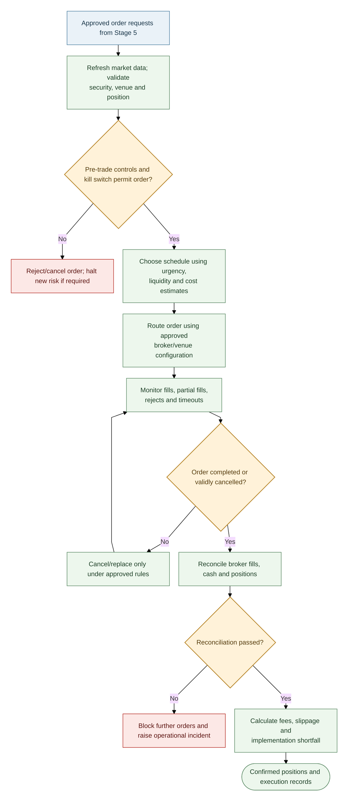

### Independent safety controls

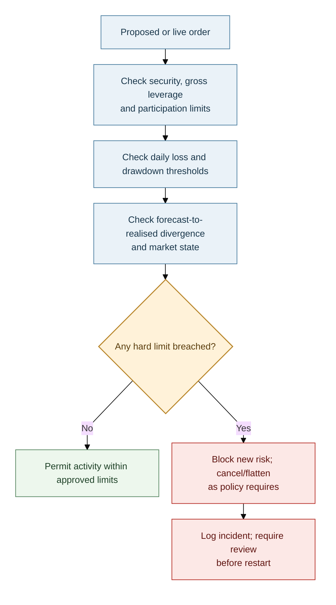

### Hard limits and monitoring

| Control | Illustrative behaviour |
|---|---|
| Name/gross leverage/participation | Reject orders beyond approved limits |
| Kill switch | Cancel open orders and block new risk on breach, stale data or operational incident |
| Reconciliation | Block further orders if broker fills, cash or positions do not reconcile |
| Drawdown | Reduce risk according to the approved drawdown policy |
| Monitoring | Track P&L, forecast calibration, feature drift, risk backtests, execution error, slippage and data quality |

Illustrative alerts (calibrate per sleeve; these are not universal regulatory thresholds): 90% interval coverage outside 87–93% for 20 sessions; alpha half-life more than 50% shorter than at admission; VaR backtest p-value below 0.01; realised execution-cost error above 30%. Alerts trigger the configured response, not automatic model promotion.

### Monitoring and controlled learning

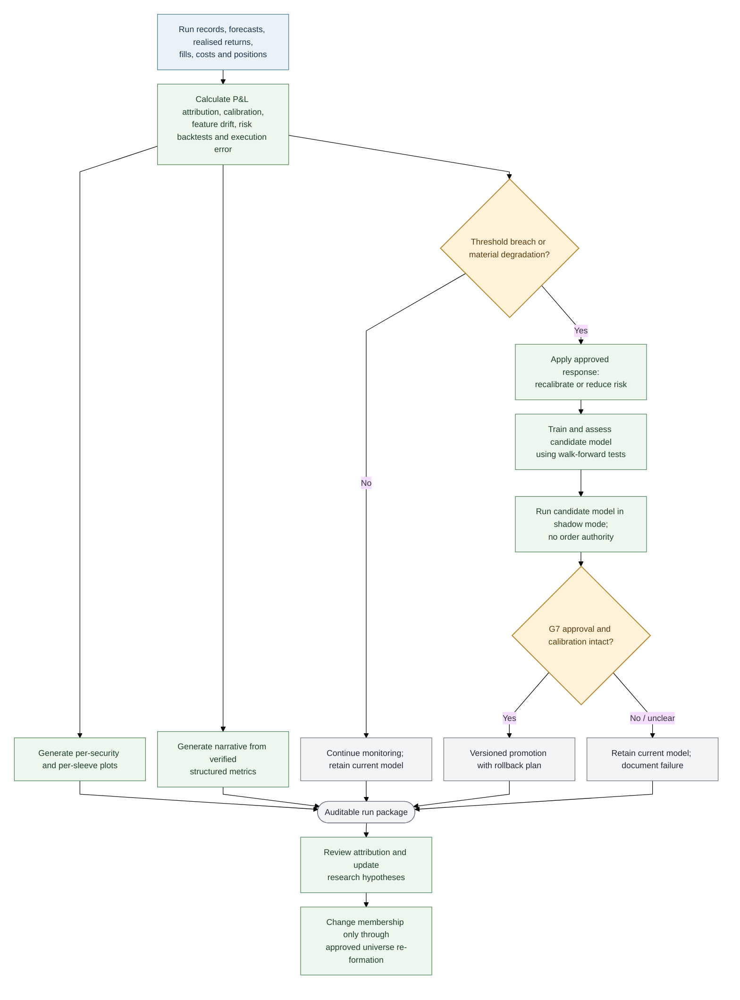

A model may move through `candidate → G3 eligible → shadow mode → G7 approved production model → retired`. Promotion requires independent review, a pre-agreed shadow period (e.g. at least 60 sessions), intact calibration, evidence against the current approved model and a rollback path. A candidate model never replaces the current approved model automatically.

Performance attribution should separate selection, forecasting, portfolio allocation, factor/sector/country effects and execution shortfall. Findings can inform later research but must not alter a fixed universe version without an approved re-formation.

## 14. Core Design Decisions

- Quantile distributions and metadata provide a common interface for all forecast layers.
- Validation precedes eligibility and combination; trial counts and net-of-cost results are recorded.
- Geographic revenue/cost exposures are versioned separately; one relationship graph supports macroeconomic transmission, news propagation and contagion stress.
- Membership is fixed within each universe version; mandatory removals are logged and do not trigger automatic replacement.
- Data depth follows model need and provider/storage cost.
- Relative weights, total leverage, and order authorisation are separate decisions.
- Hard limits and kill switches remain independent of model outputs.
- AI-generated narrative reports explain structured results only; they do not invent metrics or issue orders.

## 15. Notation, Glossary and Open Decisions

| Symbol / term | Meaning |
|---|---|
| $t$, $a$, $v$ | Decision time, first-available timestamp and valid time |
| $h$, $r_{i,t}$ | Forecast horizon and security return |
| $e^{rev}_{i,c}$, $e^{cost}_{i,c}$ | Security $i$'s dated revenue and cost exposure shares for economy $c$ |
| $f_{c,t}$ | Macroeconomic state/factor for economy $c$ at time $t$ |
| $q_{i,t}(\tau)$ | Forecast quantile at probability level $\tau$ |
| $\hat{\Sigma}$ | Estimated covariance matrix |
| $p_i^{dist}$ | Estimated distress/default probability |
| $w_i$, $L_t$, $DD_t$ | Portfolio weight, leverage and drawdown |
| $b_i$ | No-trade band for security $i$ |
| Purging / embargo | Removing overlapping labels and a defined buffer around test periods during validation |

### Acronyms and established model names

| Term | Meaning |
|---|---|
| VaR / ES | Value at Risk / Expected Shortfall; some literature uses Conditional Value at Risk (CVaR) for related tail-risk measures |
| CRPS / PIT | Continuous Ranked Probability Score / Probability Integral Transform |
| GARCH / GJR-GARCH / EGARCH | Generalised Autoregressive Conditional Heteroskedasticity / Glosten–Jagannathan–Runkle GARCH / Exponential GARCH |
| HAR-RV | Heterogeneous Autoregressive model of Realised Volatility |
| MIDAS / DCC-GARCH | Mixed Data Sampling model / Dynamic Conditional Correlation GARCH model |
| DML | Double/debiased machine learning (academic terminology; both forms are used in the literature) |
| EWMA | Exponentially weighted moving average |
| DSR / PBO | Deflated Sharpe Ratio / Probability of Backtest Overfitting |
| SPA / MCS | Superior Predictive Ability test / Model Confidence Set |
| NAV / ADV / FX | Net asset value / average daily volume / foreign exchange |
| OLS / EVT / BVAR | Ordinary Least Squares / Extreme Value Theory / Bayesian Vector Autoregression |
| Champion / challenger | Current approved model / candidate model undergoing independent evaluation |
| G1–G7 | Project-specific gate identifiers, not external regulatory rule numbers |

### Decisions required before implementation

1. Instruments and capital structure: cash equities on margin, CFDs or futures; available capital and financing arrangements.
2. Per-sleeve target volatility, maximum drawdown, per-name/sector/gross limits and margin buffer.
3. US-market broker and provider; licensed data coverage and intraday data cost/depth.
4. News sources and latency requirements; whether intraday news can be used directionally.
5. Long-only versus long-short and permitted borrow, especially for ASX names.
6. Whether universe re-formation is only by deliberate decision or on a defined schedule.
7. Whether model families are fixed or open to a challenger process governed by G3/G7.

## 16. Operating Contract and Run Outputs

Every run creates a unique `run_id` and records:

| Record | Required fields |
|---|---|
| Run/config | Start/end timestamps, code revision, config version, market, sleeve, cutoff, calendar and horizons |
| Data lineage | Provider/dataset, extraction and observation timestamps, availability-time rule, row counts and schema version |
| Universe | Universe version, eligible names, exits and reason codes |
| Models/validation | Model/feature versions, training window, fit status, fold/purge/embargo settings, benchmark/calibration/net-cost results and trial count |
| Portfolio/decision | Forecasts, current/target weights, costs, risk contributions, binding constraints, `TRADE`/`REDUCE`/`HOLD`/`NO-TRADE` and reason codes |
| Execution | Order requests, submissions/fills, timestamps, fees, cancellations/rejections and implementation shortfall |
| Outputs | Per-security and per-sleeve plots, diagnostics, warnings and narrative report |

**Terminal status:**
- `PASS`: required data, models, risk and execution checks passed.
- `DEGRADED`: a non-critical component failed and an approved fallback is used; trading remains subject to every hard gate.
- `BLOCKED`: a critical check failed; do not initiate new risk.

The narrative report must be generated from structured outputs. An AI-generated summary may describe measured results but must not invent numbers, override a gate or issue an order. Plot/report failures are logged and never conceal safety failures. Fallbacks must be tested and cannot bypass data integrity, margin, hard exposure limits, kill switches or reconciliation.

## 17. Implementation Roadmap and Readiness Gates

| Phase | Deliverable | Exit criterion |
|---|---|---|
| 1. Data foundation | Point-in-time schemas, calendars, identifiers, corporate actions and lineage | As-of queries and schema/timestamp/unit tests pass |
| 2. Baseline research | Benchmarks, costs and fixed-universe builder | Survivorship/look-ahead tests pass; clean runs reproduce results |
| 3. Validation | Walk-forward folds, purging/embargo and trial registry | Leakage tests work; trials and fold boundaries logged |
| 4. Forecast layers | Financial, macro, micro and news modules under common contract | Baselines, calibration and model failure states are measured |
| 5. Risk/optimisation | Covariance/ES, stress library, optimiser and sleeve allocator | Constraint tests pass; infeasibility cannot create tradable weights |
| 6. Execution simulation | Scheduling, fill/cost model and shortfall attribution | Costs/fills are stress-tested and documented |
| 7. Paper trading | Scheduled end-to-end runs without capital at risk | Reconciliation, stale-data, restart, latency and kill-switch tests pass |
| 8. Controlled deployment | Small approved allocation with monitoring and broker permissions | Written sign-off, limits, rollback and incident response tested |
| 9. Challenger lifecycle | Shadow tests and approved-model/candidate-model governance | Out-of-sample criteria met; versioned rollback available |

A stage is complete only when its input/output schema, unit and failure tests, point-in-time handling, versioned configuration, logs and reason codes, reproducible outputs, baseline/invariants and downstream failure actions are documented.

**Final rule:** research models propose forecasts; the validated pipeline proposes target positions; only independent risk and execution controls authorise orders.

## Terminology and rendering references

**Terminology note:** recognised technical names below identify established methods; they are not all regulatory standards. The architecture's stages, gates and dataset name are intentionally project-defined. Risk-control legal obligations depend on market, instrument and entity; this design is not a compliance opinion.

- [CFA Institute — Backtesting and Simulation](https://www.cfainstitute.org/insights/professional-learning/refresher-readings/2026/backtesting-and-simulation): walk-forward backtesting, look-ahead bias, survivorship bias and limitations of historical simulation.
- [CFA Institute — Active Equity Investing: Strategies](https://www.cfainstitute.org/insights/professional-learning/refresher-readings/2026/active-equity-investing-strategies): portfolio and active-investment context.
- [Basel Committee / Bank for International Settlements — Market risk terminology](https://www.bis.org/committees/bcbs/basel-framework/standard/mar/10/inforce/2023-01-01/published/2020-03-27): regulatory market-risk terminology, including Value at Risk, expected shortfall and liquidity horizon.
- [U.S. Securities and Exchange Commission — Market Access Rule FAQ](https://www.sec.gov/rules-regulations/staff-guidance/trading-markets-frequently-asked-questions/divisionsmarketregfaq-0): U.S. broker-dealer terminology for market-access controls, order limits and pre-trade risk controls. Applicability depends on the entity, product and jurisdiction; this document is not a legal compliance determination.
- [Bailey and López de Prado — The Deflated Sharpe Ratio](https://doi.org/10.3905/jpm.2014.40.5.094) and [The Probability of Backtest Overfitting](https://doi.org/10.2139/ssrn.2326253): original research references for DSR and PBO.
- [Hansen, Lunde and Nason — The Model Confidence Set](https://doi.org/10.3982/ECTA5771): original research reference for MCS; Hansen’s [Superior Predictive Ability test](https://doi.org/10.1198/073500105000000063) is another established forecast-comparison method.
- [Corsi — A Simple Approximate Long-Memory Model of Realized Volatility](https://doi.org/10.1093/jjfinec/nbp001): original HAR-RV reference.
- [Mermaid — Flowchart configuration](https://mermaid.js.org/config/schema-docs/config-defs-flowchart-diagram-config.html) and [Mermaid configuration schema](https://mermaid.js.org/config/schema-docs/config.html): references for node spacing, rank spacing, wrapping width and diagram padding used in the flowcharts.
