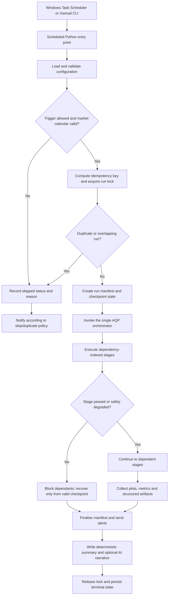
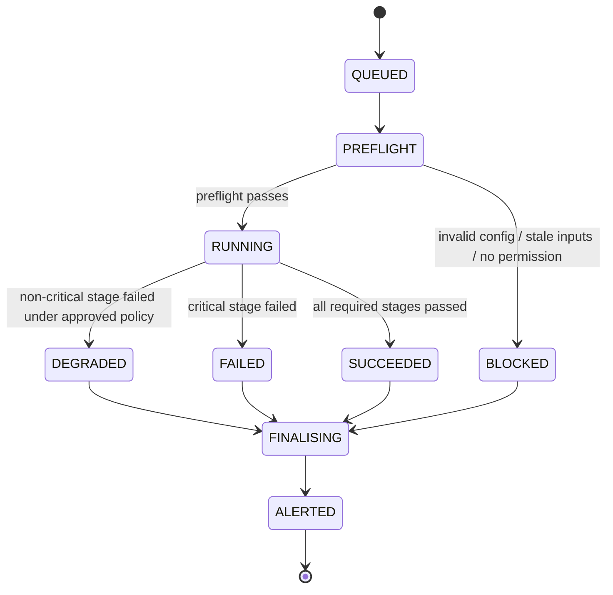

# AQP-HYBRID-AUTO — Automated Python/C++ Quantitative Pipeline

**Project:** AQP — Advanced Quantitative Pipeline  
**Repository:** `AQP-HYBRID-AUTO`  
**Languages:** Python + C++20  
**Primary environment:** Windows, Visual Studio Code, Python virtual environment, Microsoft C++ Build Tools, CMake  
**Python/C++ bridge:** `pybind11`  
**Automation default:** disabled until explicitly configured  
**Default run mode:** research / simulation; live order submission is disabled by default  
**Document status:** Target repository design and implementation guide

> **Important:** This is a repository blueprint plus starter configuration examples. The complete application, scheduler integration, Python modules and C++ engine are not all implemented by this document. Automation does not mean unattended live trading is enabled. First validate the entire workflow with synthetic data, then research/backtest and paper-trade it. Live execution requires a separate deliberate approval path, operational monitoring and broker-specific controls.

---

## 1. Purpose

`AQP-HYBRID-AUTO` is the automated variant of `AQP-HYBRID`. It retains the same hybrid division of labour—Python controls workflows and research, while selected computational kernels run in native C++—and adds scheduling, dependency tracking, run-state persistence, safe retries, recovery, alerting and unattended report production.

The automation layer is a **trigger and control plane**, not a second quant engine. Windows Task Scheduler (recommended for a Windows-first repository) or another explicitly selected scheduler starts a short-lived Python entry point. That entry point validates the trigger and configuration, obtains a single-run lock, creates a run record and invokes the same central AQP orchestrator used for manual runs.

### Responsibility split

| Component | Responsibility |
|---|---|
| Windows Task Scheduler | Starts scheduled entry points at configured times or system events. It does not contain model logic. |
| Python automation layer | Interprets trigger IDs, checks market calendars/readiness, deduplicates runs, acquires locks, controls retries/checkpoints/recovery and dispatches alerts. |
| Python orchestrator | Executes the ordered AQP stages and manages stage dependencies. It is the only owner of pipeline stage order. |
| Python research/data layer | LSEG connector, point-in-time data, company selection workflow, forecasting, model validation, execution simulation and reporting. |
| C++ native engine | Selected batch transforms, scoring/rolling kernels and deterministic risk calculations where benchmarks and tests justify native execution. |
| Persistent run state | Tracks trigger, run, stage and alert states across restarts; provides an audit trail. |
| Configuration files | Define approved schedules, data readiness, timeouts, retry policy, allowed run modes, risk limits and reporting. |

### Non-negotiable design rules

1. **One orchestrator, many triggers.** Manual and scheduled runs call the same orchestration API; do not fork a separate pipeline for scheduled jobs.
2. **No overlapping portfolio runs by default.** Use a persistent single-instance lock and run idempotency keys. Scheduler-level “do not start a new instance” settings are an additional layer, not the only lock.
3. **Calendar-aware schedules.** Use exchange calendars, session times and time zones; do not assume every weekday is a trading day or that US local times remain constant through daylight-saving changes.
4. **Missed-run policy is explicit.** Data refreshes may be caught up when safe; time-sensitive intraday or order decisions should normally be skipped and reported if their window was missed.
5. **Retries must be operation-aware.** Retry safe reads and idempotent calculations. Never blindly retry order submission or any non-idempotent external action.
6. **Resume only from a verified checkpoint.** A checkpoint records its inputs, configuration hash, code version and output checksums. If these do not match, recompute or block the dependent stage.
7. **Fail closed for controls.** Missing native module, stale inputs, invalid limits, an unavailable hard-limit check, or ambiguous execution state must not be interpreted as approval.
8. **Separate run mode from schedule.** A schedule may request research or paper mode; it cannot grant itself live-trading permission.
9. **Secrets stay out of Git.** Do not place LSEG, broker, email, webhook or LLM credentials in YAML or source files.
10. **Automation must be observable.** Every run has a manifest, structured log, stage statuses, duration, output index and terminal status.
11. **AI reports are downstream only.** The narrative generator summarises structured, recorded evidence. It cannot alter stage statuses, signals, risk decisions or execution permissions.
12. **Prefer a simple scheduler first.** Use Windows Task Scheduler to launch one-off jobs unless there is a demonstrated need for a continuously running scheduler service.

---

## 2. Naming conventions

| Item | Convention | Example |
|---|---|---|
| Repository | `AQP-HYBRID-AUTO` | `AQP-HYBRID-AUTO/` |
| Python package | `aqp_python` | `src/aqp_python/` |
| C++ public headers | `.hpp` | `cpp/include/aqp_cpp/risk/aqp_hard_limits.hpp` |
| C++ implementation | `.cpp` | `cpp/src/risk/aqp_hard_limits.cpp` |
| Custom Python module | `aqp_` prefix | `aqp_scheduled_entry.py` |
| Custom C++ module | `aqp_` prefix | `aqp_pre_trade_gate.cpp` |
| YAML configuration | `aqp_*.yaml` | `aqp_automation.yaml` |
| Test | purpose-specific name | `test_aqp_duplicate_trigger.py` |
| Run ID | timestamp + unique suffix, or UUID | `20261016T171500Z_asx_close_a13f` |
| Trigger ID | stable configured name | `asx_after_close_research` |
| Idempotency key | trigger + session + configuration identity | hashed canonical values, not a ticker alone |

Keep standard tool names such as `CMakeLists.txt`, `pyproject.toml`, `README.md` and `.gitignore` unchanged. Do not commit built `.pyd`/`.dll` files, CMake build trees, production data, credentials, or generated per-run outputs.

---

## 3. Proposed repository tree

The tree shows the intended design. It does not mean every listed source file has already been implemented.

```text
AQP-HYBRID-AUTO/
├── README.md
├── AUTOMATED HYBRID REPOSITORY OVERVIEW.md
├── pyproject.toml
├── CMakeLists.txt
├── CMakePresets.json
├── .gitignore
├── .gitattributes
├── .env.example
│
├── .vscode/
│   ├── settings.json
│   ├── launch.json
│   └── tasks.json
│
├── configs/
│   ├── aqp_pipeline.yaml
│   ├── aqp_markets.yaml
│   ├── aqp_data_sources.yaml
│   ├── aqp_universe_rules.yaml
│   ├── aqp_forecast_models.yaml
│   ├── aqp_validation.yaml
│   ├── aqp_risk_limits.yaml
│   ├── aqp_execution.yaml
│   ├── aqp_reporting.yaml
│   ├── aqp_automation.yaml
│   └── examples/
│       ├── aqp_automation.yaml.example
│       └── aqp_pipeline.yaml.example
│
├── docs/
│   ├── architecture/
│   │   ├── aqp_hybrid_auto_architecture.md
│   │   ├── aqp_python_cpp_boundary.md
│   │   ├── aqp_automation_contract.md
│   │   ├── aqp_run_state_machine.md
│   │   └── aqp_data_dictionary.md
│   ├── automation/
│   │   ├── aqp_schedule_matrix.md
│   │   ├── aqp_retry_and_recovery.md
│   │   ├── aqp_task_scheduler_setup.md
│   │   └── aqp_alerting_and_operations.md
│   ├── methodology/
│   │   ├── aqp_stage_00_data.md
│   │   ├── aqp_stage_01_universe.md
│   │   ├── aqp_stage_02_forecasting.md
│   │   ├── aqp_stages_03_04_portfolio.md
│   │   ├── aqp_stage_05_sizing.md
│   │   ├── aqp_stage_06_execution.md
│   │   └── aqp_stage_07_monitoring.md
│   ├── runbooks/
│   │   ├── aqp_failed_run.md
│   │   ├── aqp_stale_data.md
│   │   ├── aqp_duplicate_or_overlapping_run.md
│   │   ├── aqp_lseg_connection_failure.md
│   │   └── aqp_emergency_stop.md
│   └── diagrams/
│       ├── aqp_hybrid_auto_overview.mmd
│       ├── aqp_automation_dispatch.mmd
│       ├── aqp_run_state_machine.mmd
│       ├── aqp_stage_00_data.mmd
│       ├── aqp_stage_01_universe.mmd
│       ├── aqp_stage_02_forecasting.mmd
│       ├── aqp_stage_02e_validation.mmd
│       ├── aqp_stages_03_04_portfolio.mmd
│       ├── aqp_stage_05_sizing.mmd
│       ├── aqp_stage_06_execution.mmd
│       ├── aqp_safety_controls.mmd
│       └── aqp_stage_07_monitoring.mmd
│
├── src/
│   └── aqp_python/
│       ├── __init__.py
│       ├── cli.py
│       ├── logging_config.py
│       ├── config/
│       │   ├── __init__.py
│       │   ├── aqp_config_loader.py
│       │   └── aqp_config_validation.py
│       ├── contracts/
│       │   ├── __init__.py
│       │   ├── aqp_data_schemas.py
│       │   ├── aqp_forecast_schema.py
│       │   ├── aqp_portfolio_schema.py
│       │   ├── aqp_automation_contracts.py
│       │   ├── aqp_native_contracts.py
│       │   └── aqp_run_manifest.py
│       ├── automation/
│       │   ├── __init__.py
│       │   ├── aqp_scheduled_entry.py
│       │   ├── aqp_trigger_parser.py
│       │   ├── aqp_trigger_dispatcher.py
│       │   ├── aqp_market_calendar_gate.py
│       │   ├── aqp_run_lock.py
│       │   ├── aqp_idempotency.py
│       │   ├── aqp_retry_policy.py
│       │   ├── aqp_checkpoint_manager.py
│       │   ├── aqp_recovery_manager.py
│       │   ├── aqp_run_state_store.py
│       │   ├── aqp_timeout_manager.py
│       │   ├── aqp_health_monitor.py
│       │   └── aqp_alert_dispatcher.py
│       ├── connectors/
│       │   ├── __init__.py
│       │   └── lseg/
│       │       ├── __init__.py
│       │       ├── aqp_lseg_session.py
│       │       ├── aqp_lseg_instruments.py
│       │       ├── aqp_lseg_fields.py
│       │       └── aqp_lseg_extractor.py
│       ├── orchestration/
│       │   ├── __init__.py
│       │   ├── aqp_orchestrator.py
│       │   ├── aqp_stage_router.py
│       │   ├── aqp_run_context.py
│       │   └── aqp_run_manifest_writer.py
│       ├── storage/
│       │   ├── __init__.py
│       │   ├── aqp_storage_paths.py
│       │   ├── aqp_dataset_registry.py
│       │   ├── aqp_run_store.py
│       │   └── aqp_artifact_checksums.py
│       ├── native/
│       │   ├── __init__.py
│       │   └── aqp_native_adapter.py
│       ├── stages/
│       │   ├── stage_00_data/
│       │   │   ├── __init__.py
│       │   │   ├── aqp_data_ingestion.py
│       │   │   ├── aqp_hfd_builder.py
│       │   │   ├── aqp_lfd_builder.py
│       │   │   ├── aqp_corporate_actions.py
│       │   │   ├── aqp_data_quality.py
│       │   │   └── aqp_point_in_time_controls.py
│       │   ├── stage_01_universe/
│       │   │   ├── __init__.py
│       │   │   ├── aqp_candidate_universe.py
│       │   │   ├── aqp_company_screening.py
│       │   │   ├── aqp_universe_scoring.py
│       │   │   ├── aqp_archetype_assignment.py
│       │   │   └── aqp_universe_formation.py
│       │   ├── stage_02_forecasting/
│       │   │   ├── __init__.py
│       │   │   ├── aqp_forecast_runner.py
│       │   │   ├── aqp_forecast_registry.py
│       │   │   ├── aqp_forecast_adapter.py
│       │   │   ├── financial/
│       │   │   ├── macro/
│       │   │   ├── micro_market/
│       │   │   ├── news/
│       │   │   └── validation/
│       │   ├── stages_03_04_portfolio/
│       │   │   ├── __init__.py
│       │   │   ├── aqp_covariance_estimator.py
│       │   │   ├── aqp_portfolio_risk.py
│       │   │   ├── aqp_stress_testing.py
│       │   │   ├── aqp_portfolio_optimizer.py
│       │   │   └── aqp_sleeve_allocator.py
│       │   ├── stage_05_sizing/
│       │   │   ├── __init__.py
│       │   │   ├── aqp_position_sizer.py
│       │   │   ├── aqp_kelly_cap.py
│       │   │   ├── aqp_leverage_rules.py
│       │   │   └── aqp_position_report.py
│       │   ├── stage_06_execution/
│       │   │   ├── __init__.py
│       │   │   ├── aqp_order_intent.py
│       │   │   ├── aqp_execution_simulator.py
│       │   │   ├── aqp_cost_slippage_model.py
│       │   │   └── aqp_fill_reconciliation.py
│       │   └── stage_07_monitoring/
│       │       ├── __init__.py
│       │       ├── aqp_performance_monitor.py
│       │       ├── aqp_data_drift_monitor.py
│       │       ├── aqp_model_drift_monitor.py
│       │       └── aqp_readiness_status.py
│       ├── safety/
│       │   ├── __init__.py
│       │   └── aqp_native_safety_gate.py
│       ├── compiler/
│       │   ├── __init__.py
│       │   ├── aqp_plot_compiler.py
│       │   ├── aqp_report_compiler.py
│       │   └── aqp_run_artifact_index.py
│       └── reporting/
│           ├── __init__.py
│           ├── aqp_metrics_summary.py
│           ├── aqp_narrative_report.py
│           └── aqp_report_fact_checks.py
│
├── cpp/
│   ├── CMakeLists.txt
│   ├── include/aqp_cpp/
│   │   ├── core/
│   │   ├── data/
│   │   ├── filters/
│   │   ├── features/
│   │   ├── portfolio/
│   │   └── risk/
│   └── src/
│       ├── core/
│       ├── data/
│       ├── filters/
│       ├── features/
│       ├── portfolio/
│       ├── risk/
│       └── bindings/aqp_python_bindings.cpp
│
├── tests/
│   ├── python/unit/
│   ├── python/integration/
│   ├── python/automation/
│   ├── cpp/unit/
│   ├── cpp/integration/
│   ├── contracts/
│   └── test_batches/
│       ├── batch_01_repository_build/
│       ├── batch_02_config_and_contracts/
│       ├── batch_03_data_and_native_bridge/
│       ├── batch_04_scheduler_lock_idempotency/
│       ├── batch_05_universe_selection/
│       ├── batch_06_forecasts_and_validation/
│       ├── batch_07_portfolio_sizing_safety/
│       ├── batch_08_execution_simulation/
│       ├── batch_09_reporting_alerts/
│       └── batch_10_end_to_end_recovery/
│
├── scripts/
│   ├── windows/
│   │   ├── aqp_setup.ps1
│   │   ├── aqp_build.ps1
│   │   ├── aqp_test.ps1
│   │   ├── aqp_run_once.ps1
│   │   ├── aqp_register_tasks.ps1
│   │   ├── aqp_remove_tasks.ps1
│   │   ├── aqp_task_status.ps1
│   │   └── aqp_health_check.ps1
│   └── automation/
│       ├── README.md
│       └── task_templates/
│           └── README.md
│
├── ops/
│   ├── runbooks/
│   │   ├── README.md
│   │   ├── failed_run.md
│   │   ├── stale_data.md
│   │   ├── overlap_or_duplicate.md
│   │   ├── provider_unavailable.md
│   │   └── emergency_stop.md
│   └── schedules/
│       └── aqp_schedule_matrix.md
│
├── data/
│   ├── README.md
│   ├── raw/                 # source/licensed data; do not normally commit
│   ├── interim/
│   ├── processed/
│   ├── reference/
│   └── samples/             # synthetic test data only
│
├── outputs/
│   ├── README.md
│   ├── runs/.gitkeep
│   ├── plots/.gitkeep
│   └── reports/.gitkeep
├── logs/.gitkeep
├── state/.gitkeep           # local state DB/lock metadata; not a source of truth for broker state
└── build/                   # generated by CMake; do not commit
```

**Tree note:** the directories under `stage_02_forecasting/` are expanded during implementation into the financial, macro, micro/market, news and validation files defined in the AQP hybrid overview. Use `.gitkeep` only for intentionally empty folders; remove it when a meaningful file is added.

---

## 4. Automation architecture



### Scheduler choice

**Recommended first implementation:** Windows Task Scheduler starts the Python program at pre-configured times. The program itself checks the exchange calendar, trigger identifier, data freshness and run mode before it can perform pipeline work. Microsoft documents Task Scheduler through its GUI and command-line `schtasks` interface; use the GUI first while validating each trigger, then automate task registration after the invocation command is stable. [Microsoft Task Scheduler command reference](https://learn.microsoft.com/en-us/windows-server/administration/windows-commands/schtasks-create).

An in-process scheduler library is optional if a persistent Python process is genuinely required. Do not run Task Scheduler and a second scheduler against the same trigger set without shared deduplication and locking. The scheduler should invoke a **single run**, not host the market models itself.

### Scheduler vs orchestrator

- **Scheduler:** decides when to ask for a run.
- **Scheduled entry point:** validates the request, records its trigger metadata, and enforces duplicate/overlap protections.
- **Orchestrator:** decides which stages run and in what dependency order.
- **Run-state store:** persists the lifecycle and checkpoints so a process restart does not erase run history.
- **Recovery manager:** decides whether a stage may safely resume, must be recomputed, or must be marked blocked.

---

## 5. Automated run lifecycle and statuses

Use a persisted state machine rather than inferring success from whether a terminal window closed.



Recommended persisted statuses are:

- `QUEUED`: trigger accepted but the run has not started.
- `PREFLIGHT`: configuration, permissions, freshness, calendar, build and lock checks are underway.
- `RUNNING`: stages are executing.
- `SUCCEEDED`: every required stage completed and all required gates passed.
- `DEGRADED`: approved non-critical work was skipped or failed; the manifest lists the consequences.
- `BLOCKED`: preflight or a safety gate prevented progression.
- `FAILED`: a critical stage failed or the outcome is unknown.
- `TIMED_OUT`: run duration exceeded its configured bound; state must be reconciled before retry.
- `SKIPPED`: trigger was invalid for the current session, was an intentionally missed time window, or was a configured no-op.
- `DUPLICATE`: idempotency key matched a run already accepted or completed.
- `CANCELLED`: an operator requested cancellation or a valid shutdown policy stopped the run.

A process exit code, final manifest and state-store record must agree. If they disagree, mark the run for reconciliation instead of guessing it succeeded.

---

## 6. Schedule policy and session timing

Schedule **jobs**, not arbitrary weekdays. A schedule has a trigger ID, intended market/session, time zone, readiness prerequisites, permitted run mode, timeout, missed-run policy and alert policy. The examples below are design patterns, not a recommendation to immediately automate trading.

| Job | Trigger idea | Required checks | Missed-run policy |
|---|---|---|---|
| Daily health check | Fixed local time, including weekends if useful | Code/build status, disk space, state-store health, last-run status | Run at next opportunity; alert if unhealthy |
| Data refresh | Before a session or after provider data becomes available | Provider availability, configured date window, rate limits, source timestamps | A later catch-up may be allowed for data-only work |
| ASX interday research | After ASX close and after close data is ready | ASX calendar, close bar availability, corporate actions, freshness | Skip stale portfolio decisions; re-run data ingestion only when explicitly safe |
| US interday research | After US close in the US market time zone | US calendar, close data, daylight-saving rules, freshness | Same rule: don't turn a missed close signal into a delayed order |
| Intraday analysis pulse | Repeated only inside approved market session windows | Session open, quote/bar freshness, expected cadence, capacity and kill-switch state | Skip expired intervals; never replay stale intervals as fresh decisions |
| Final report | On terminal state of a pipeline run | Run manifest and structured artifacts are final | Retry report generation separately; never rerun portfolio actions solely to regenerate a report |
| Drift/challenger evaluation | Scheduled window after sufficient new observations | Sample size, data quality, evaluation policy and approval status | Defer if minimum evidence is unavailable |

### Clock and calendar rules

- Store timestamps in UTC in manifests and state records; show market-local time for operations and reports.
- Read exchange session windows from a maintained market-calendar source. Include holidays, half-days, auctions and daylight-saving changes where applicable.
- On Windows, verify that the Python environment can resolve the required IANA time zones; include and test the `tzdata` dependency if needed.
- Task Scheduler's local trigger is only a wake-up signal. The market-calendar gate decides if the job is valid at that moment.
- If an unexpected shutdown or sleep causes a market window to pass, use the configured missed-run policy. Do not automatically submit an outdated intended order.
- Test schedules around DST switches, holidays, short sessions and machine clock changes.

---

## 7. Single-instance locks, idempotency and safe retries

### Run lock

`aqp_run_lock.py` acquires an OS-safe or transactional lock before the orchestrator starts. A lock record includes owner process/run ID, creation time, heartbeat and configuration/trigger identity. A stale lock is **not** deleted merely because it is old; recovery must establish that the owner is dead and reconcile any incomplete side effects first.

### Idempotency

`aqp_idempotency.py` computes a stable key from the trigger ID, market/session date, run purpose and relevant configuration identity. If the same key is already accepted or completed, the dispatcher records `DUPLICATE` or returns the existing run reference rather than creating a second portfolio calculation or action.

Data refreshes and calculations can be idempotent if outputs are written to run-specific paths and committed atomically. External side effects require explicit semantics. Repeating an order request can create a duplicate order, so the order route must use a broker-supported idempotency/client-order ID where available and reconcile order status before deciding whether a retry is safe.

### Retry policy

| Operation | Retry behaviour |
|---|---|
| Provider history read | Bounded exponential backoff with jitter for transient/network errors; respect rate limits. |
| Download of a known immutable response | Retry if safe; validate checksum and response metadata. |
| Deterministic native calculation | Retry only after confirming input immutability and no shared-state mutation; otherwise fail and diagnose. |
| Model fitting | Retry only from recorded inputs and seeds where determinism is intended; record compute/resource failure. |
| Report generation | Retry separately from the trading workflow using already-finalised structured artifacts. |
| Broker order submission | Never blindly retry. Query/reconcile by client-order ID first, then follow an explicitly approved broker-specific policy. |
| Safety-gate error or native extension missing | Block the affected order intent; no retry may convert failure into approval. |

Use maximum attempt counts, total timeout budgets and circuit-breaker/backoff policies. A persistent provider outage should stop repeated calls and issue an alert rather than generate a request storm.

### Checkpoint and resume

A checkpoint is reusable only when input artifact checksums, schema versions, code revision, configuration hash, model versions and relevant run context match. Write artifacts to temporary paths and atomically promote them after validation. If provenance differs, recompute the stage. The recovery manager must not resume from the middle of an unknown broker side effect.

---

## 8. Root/build files

| File | Purpose |
|---|---|
| `README.md` | Quick overview and manual/scheduled-mode entry points. |
| `AUTOMATED HYBRID REPOSITORY OVERVIEW.md` | Full tree, file responsibilities, automation contract and roadmap. |
| `pyproject.toml` | Python package, dependencies, CLI entry points and C++ extension build integration. |
| `CMakeLists.txt` / `cpp/CMakeLists.txt` | Build the C++ engine and `pybind11` extension. |
| `CMakePresets.json` | Repeatable Windows/MSVC CMake configure/build/test presets. |
| `.env.example` | Environment variable names only; no secret values. |
| `.gitignore` | Excludes virtual environments, build products, secrets, licensed market data, run logs, state DBs and generated outputs. |
| `.vscode/` | Editor, debugger and task definitions for Windows/VS Code. |
| `configs/` | Tracked settings templates and approved non-secret configuration. |
| `ops/` | Schedule inventory and operator runbooks. |
| `scripts/windows/` | Setup, build/test, one-off execution and scheduler task registration/removal scripts. |

CMake and `pyproject.toml`/`scikit-build-core` should build the extension reproducibly. pybind11 officially documents CMake targets for Python extension modules; the native extension is generated for the active Python/compiler environment and should not be committed as source. See the [pybind11 build documentation](https://pybind11.readthedocs.io/en/stable/compiling.html).

---

## 9. Configuration file responsibilities

| Configuration | Controls |
|---|---|
| `aqp_pipeline.yaml` | Run mode, enabled stages, date window, output root and global limits. |
| `aqp_markets.yaml` | ASX/US calendars, time zones, session windows and market-specific rules. |
| `aqp_data_sources.yaml` | LSEG/file connectors, field mappings, frequency, freshness SLA and request limits. |
| `aqp_universe_rules.yaml` | Eligibility gates, data coverage, scoring weights, archetypes and formation policy. |
| `aqp_forecast_models.yaml` | Enabled models, horizons, parameters and compute settings. |
| `aqp_validation.yaml` | Walk-forward splits, metrics, calibration rules and model eligibility gates. |
| `aqp_risk_limits.yaml` | Position/concentration/leverage limits, drawdown controls and required risk checks. |
| `aqp_execution.yaml` | Simulation/paper execution, spread/slippage assumptions, order constraints and execution permissions. |
| `aqp_reporting.yaml` | Plots, diagnostics, deterministic reports and optional AI narrative settings. |
| `aqp_automation.yaml` | Triggers, scheduler adapter, concurrency/lock rules, timeouts, retry budgets, missed-run policy, recovery and alerting. |

`configs/examples/` contains example templates only. Copy and review them into actual `configs/aqp_*.yaml` files when implementing the real repository. The example schedule has automation disabled and must not authorize live trading.

### Example automation configuration

See `configs/examples/aqp_automation.yaml.example` for a starter template. Key rules:

- `enabled: false` initially.
- Every trigger has a unique stable `trigger_id`.
- Every trigger declares market/time-zone context, intended run mode, readiness checks, timeout and missed-run policy.
- `max_concurrent_pipeline_runs: 1` for the initial local implementation.
- Live execution stays disabled in a separate execution permission configuration. The automation file cannot override that gate.
- Secrets use environment variables or an approved credential store; they never appear in tracked YAML.

---

## 10. Python modules added for automation

| Module | Purpose |
|---|---|
| `aqp_scheduled_entry.py` | One-shot entry point called by Task Scheduler or a manual CLI. Validates the named trigger and delegates to the automation dispatcher. |
| `aqp_trigger_parser.py` | Parses trigger ID, configuration path, requested mode, and operator-supplied run parameters. |
| `aqp_trigger_dispatcher.py` | Applies trigger policy and hands a valid request to the orchestrator. |
| `aqp_market_calendar_gate.py` | Confirms that the requested market/session and time window are valid and that the relevant data is ready. |
| `aqp_run_lock.py` | Prevents concurrent runs; safely reports lock ownership and stale-lock conditions. |
| `aqp_idempotency.py` | Detects duplicate triggers and repeat requests. |
| `aqp_retry_policy.py` | Defines retryable exception classes, exponential backoff, jitter, attempt count and total deadlines. |
| `aqp_checkpoint_manager.py` | Stores/validates stage checkpoints and artifact checksums. |
| `aqp_recovery_manager.py` | Chooses resume, recompute, block, reconcile or operator intervention based on checkpoint and side-effect state. |
| `aqp_run_state_store.py` | Persists runs, stages, trigger IDs, state transitions, heartbeat, timestamps and terminal reason. SQLite is a reasonable local starting point; use transactional writes and plan backups. |
| `aqp_timeout_manager.py` | Enforces job and stage time budgets and applies timeout policy. |
| `aqp_health_monitor.py` | Checks scheduler reachability/last run, disk space, build/module availability, state DB health and last-success age. |
| `aqp_alert_dispatcher.py` | Sends safe summaries through approved channels; must redact credentials and sensitive account details. |

The modules are boundaries, not a promise that every one requires a separate service or process. The first implementation may keep several helpers small. Keep the run path understandable and avoid adding distributed infrastructure until a single Windows host requires it.

---

## 11. How an automated run proceeds

1. Windows Task Scheduler wakes the configured entry point, or the user runs the same entry point manually.
2. The entry point loads and validates all required YAML and verifies that automation is enabled for that trigger.
3. The market-calendar/readiness gate checks market state, data freshness, configuration date window and required provider/build availability.
4. A stable idempotency key is calculated. If an identical run already exists, record a duplicate/skip rather than launch it again.
5. The run lock is acquired. The program stores a manifest including trigger ID, run ID, start time, config hash, code revision, environment versions and selected market/sleeves.
6. The orchestrator executes dependency-ordered stages. Each stage records start/end time, status, input/output references and failure reason.
7. If a stage fails, the dependency graph blocks downstream stages that need its output. Only explicitly safe transient failures can be retried.
8. Portfolio and order-intent outputs encounter independent risk/safety gates. In research mode, the terminal action is a simulation or a saved proposal—not a broker order.
9. Finalisation writes a deterministic machine-readable summary, compiles plots, and builds a report from actual artifacts. An optional AI narrative is generated after the run status is fixed.
10. The run record becomes terminal, alerts are sent according to policy, and the lock is released. If cleanup fails, report it and let the recovery workflow reconcile it.

### Stage dependency principle

For example, if Stage 00 produces stale or invalid data, the scheduler must not continue into forecasting just because the trigger occurred. It should mark the run `BLOCKED` or `FAILED`, record the reason, alert at the configured severity, and avoid producing an apparently valid portfolio decision.

---

## 12. Python/C++ division in the automated system

Python remains responsible for provider sessions, trigger policy, schedules, model orchestration, model experiments, reporting and alerts. C++ remains a callable computational engine—not a second scheduler or daemon.

The native interface should receive validated batches with explicit shapes, units and missing-value policy. It returns result objects/status codes. The Python adapter validates these responses and converts errors into structured failures. Avoid calling across the Python/C++ boundary once per row where a batch operation is suitable.

Selected C++ areas:

- batch validation and deterministic transforms;
- vectorised Stage 1 company screening/scoring kernels;
- rolling statistics and feature kernels;
- selected covariance/portfolio arithmetic;
- Kelly caps, leverage calculations and hard pre-trade constraints.

Keep the model selection policy and run sequencing explicit in Python. A C++ function must never independently create a scheduled run, activate a broker connection or override Python's mode/permission gates.

If a required C++ safety function is unavailable or returns an error, the affected intent is blocked. Do not silently fall back to a less restrictive implementation in automation mode.

---

## 13. Stage-by-stage automation behaviour

| Stage | Automated work | Failure response |
|---|---|---|
| **00 — Data** | Request the planned frequency/date windows; normalise source records; validate timestamps, corporate actions, missing data, and point-in-time fields. | Retry eligible provider reads within limits; if critical data remains stale/invalid, block dependent stages. |
| **01 — Universe** | Apply versioned exclusions, multi-variable category scores, archetypes and scheduled universe formation rules. | Save rejected candidates and reason codes; do not silently alter a frozen universe mid-run. |
| **02 — Forecasts** | Run only enabled models for the relevant sleeve/horizon and available features. | Model-specific failures can degrade only if validation policy explicitly allows it; critical missing forecast coverage blocks downstream dependencies. |
| **02E — Validation** | Apply walk-forward/eligibility checks, calibration and signal combination. | Ineligible forecasts are excluded; never promote a model merely because a scheduled cycle occurred. |
| **03–04 — Portfolio** | Estimate risk, stress scenarios, optimise and allocate among approved sleeves. | Invalid covariance/solver status or violated constraints blocks output. |
| **05 — Sizing** | Compute positions and apply fractional Kelly/volatility/leverage/position limits. | Invalid values or missing native gate blocks the proposed order intent. |
| **06 — Execution** | Research mode simulates fills/costs; paper mode uses approved paper connection; live mode is separately gated. | Unknown order status triggers reconciliation, not a blind retry. |
| **07 — Monitoring** | Update run diagnostics, performance/drift metrics, plots, and structured/narrative reports. | Report failure is retried separately; it must not rerun portfolio or execution actions. |

---

## 14. Run artifacts, logs and auditability

Each attempt writes to a unique run folder. A suggested layout:

```text
outputs/runs/<run_id>/
├── run_manifest.json
├── config_snapshot/
├── trigger.json
├── state_transitions.jsonl
├── stage_status.json
├── data_lineage.json
├── input_index.json
├── outputs_index.json
├── checkpoints/
├── universe/
├── forecasts/
├── validation/
├── portfolio/
├── sizing/
├── execution_simulation/
├── diagnostics/
├── plots/
└── reports/
    ├── run_summary.json
    └── aqp_run_report.md
```

Logs may be both run-scoped and application-wide, but never rely on a console window as the only record. Include UTC timestamps, run ID, trigger ID, stage, attempt number, event code and safe diagnostic context. Redact secrets, access tokens, account numbers and licensed payloads.

Each run manifest should record:

- repository revision/working-tree state and Python/C++ build identifiers;
- configuration file hashes and effective run mode;
- trigger ID, idempotency key, market, session and time zone;
- source/provider identifiers, as-of/availability timestamps and data artifact checksums;
- model versions, validation windows and relevant random seeds;
- stage start/end, status, retries and reason codes;
- final risk/safety decisions, without storing unnecessary sensitive broker details;
- output artifact paths/checksums and report-generation status.

Persist production run outputs outside Git. Establish a retention/archival policy, protect the state database, and back up manifests/checkpoints needed to explain historical results. Do not include full licensed provider datasets in automatic notifications.

---

## 15. Alerts and automated reports

The alert dispatcher should emit concise events for at least: run started, run skipped/duplicate, blocked by preflight, data freshness failure, retry budget exhausted, critical stage failed, safety gate blocked, run completed, report failed, disk/state-store problem and emergency stop.

Use structured alert payloads with run ID, trigger ID, status, stage, timestamp, reason and a link/path to local artifacts. Alerts should not carry credentials, complete source payloads, or private account information. Notifications are not the authoritative record; the run state and manifest are.

### AI-generated narrative report

Run the narrative generator only after the deterministic summary is built. Pass it a bounded set of structured facts/metrics and the permitted artifact references. Require it to distinguish observed metrics from interpretation, mention missing/failed stages, avoid unsupported return/profitability claims, and never invent data. Store the exact input facts and report generator/model version. If the AI service is unavailable, the deterministic Markdown/JSON report still completes. The AI result cannot set `SUCCEEDED`, change a gate decision, or trigger a trade.

---

## 16. Failure, restart and recovery rules

| Incident | Automatic response | Operator response |
|---|---|---|
| Scheduler starts the same trigger twice | Idempotency and lock prevent duplicate pipeline work. | Review repeated scheduling if it persists. |
| Data source temporarily unavailable | Bounded retry/backoff; then mark data stage failed or blocked. | Check provider service, entitlements, limits and credentials. |
| Stale/partial input data | Block downstream forecasting for affected dependencies. | Re-extract or explicitly accept a researched degraded mode; never silently use stale data. |
| Process crashes | Mark unfinished run as interrupted after verifying process state; inspect checkpoints and side effects before recovery. | Reconcile uncertain execution actions, then resume/recompute/block. |
| C++ extension missing or incompatible | Block any stage requiring it; especially block trades requiring native safety checks. | Rebuild extension using the documented Python/compiler/CMake versions and rerun tests. |
| State store cannot be written | Do not start a new automated portfolio run. | Restore/repair the store and verify audit integrity. |
| Report generator fails | Produce deterministic report and alert; do not restart earlier stages. | Inspect report integration separately. |
| Disk space below threshold | Block run before writing large datasets/artifacts. | Archive outputs or expand storage. |
| Unknown broker/order state | Stop order submissions and reconcile using broker records. | Confirm final order state before resuming. |
| Emergency stop enabled | Block new order intents and suspend configured trading-related jobs. | Follow the emergency-stop runbook; restart only after explicit clearance. |

Use timeouts at task and stage levels. A timeout is not proof that an operation had no effect; for external side effects, query state and reconcile before deciding whether to rerun.

---

## 17. Windows setup and operation

### Recommended toolchain

- Visual Studio Code;
- a compatible Python version and `.venv`;
- Microsoft Visual Studio C++ Build Tools with the workload/components required by the selected compiler;
- CMake and Ninja or the Visual Studio generator;
- Git for source control (Git Bash is not required);
- the selected Python dependencies and `pybind11` build requirements;
- LSEG Workspace/API access configured according to the provider's current setup and entitlements.

### Initial setup (after source files and packaging metadata exist)

From PowerShell in the repository root:

```powershell
py -3 --version
cmake --version
git --version

py -3 -m venv .venv
.\.venv\Scripts\Activate.ps1
python -m pip install --upgrade pip
python -m pip install -e ".[dev]"
```

The install command depends on the future `pyproject.toml` and build configuration, which are not implemented by this overview alone.

### Manual run before scheduling

The intended CLI could expose commands similar to:

```powershell
python -m aqp_python.cli validate-config --config configs/aqp_pipeline.yaml
python -m aqp_python.automation.aqp_scheduled_entry --trigger-id manual_research --mode research
python -m aqp_python.cli status --latest
```

These are target interfaces, not yet guaranteed executable commands. Implement and test the CLI first. Start with a synthetic-data research run, then test provider integration manually, and only then create scheduled tasks.

### Registering scheduled tasks

The planned `scripts/windows/aqp_register_tasks.ps1` should create or update Windows Task Scheduler tasks from the approved schedule configuration. It should validate the repository path, Python executable, config path and arguments; show a dry-run/task summary before registration; and never embed secrets in task command strings. Provide a corresponding removal script and a way to export/inspect each registered task.

On Windows, scheduled tasks that use LSEG Workspace may depend on the user's Workspace sign-in or interactive session. Verify the connector's authentication requirements for your own Workspace/API environment before running it while logged off or before the user session starts. A scheduled task should fail preflight and alert if it cannot establish an authorised data session.

### Operational deployment levels

1. **Manual research:** developer starts one run; synthetic/local test data first.
2. **Scheduled research:** Windows Task Scheduler, real data read access, no broker order submission.
3. **Scheduled paper trading:** approved paper environment, reconciliation and alerts enabled.
4. **Controlled live trading:** only after separate written approval, broker-specific safeguards, tested kill switch, operational alert coverage, recovery drills and explicit permission settings. Not enabled by the starter examples.

---

## 18. Testing plan — ten batches

| Batch | Scope | Exit criterion |
|---|---|---|
| **01 — Repository build** | Python import, CMake configure/build, native import, lint and basic CI. | Clean environment builds and basic smoke tests pass. |
| **02 — Configuration/contracts** | YAML parsing, schema checks, config hash, Python/C++ input/output contracts. | Invalid/missing/contradictory critical settings block execution. |
| **03 — Data/native bridge** | Synthetic data, schema conversion, C++ batch checks, point-in-time timestamps and parity tests. | No future data leakage; expected C++/Python results match tolerances. |
| **04 — Automation control** | Trigger parsing, calendar gate, duplicate trigger, run lock, overlap, retry and timeout. | Repeated triggers do not duplicate work; faults resolve to explicit status. |
| **05 — Universe selection** | Candidate filters, scoring, archetypes, historical membership and rejection reason codes. | Formation is reproducible as of a timestamp; no survivorship/leakage shortcut. |
| **06 — Forecasts/validation** | Model runs, walk-forward splits, calibration, eligibility and signal combining. | Only validated/eligible outputs proceed. |
| **07 — Portfolio/sizing/safety** | Risk, optimiser, Kelly/volatility/leverage caps and native safety gate. | Edge cases block safely; constraints and reason codes verified. |
| **08 — Execution simulation** | Cost/slippage, order intent, simulated fills, idempotency and reconciliation state. | No duplicate actions; uncertain order status is reconciled, not blindly retried. |
| **09 — Reporting/alerts** | Plot compiler, structured summary, narrative report, notification redaction and report-only retry. | Artifacts agree with the run manifest; report failure cannot rerun the portfolio. |
| **10 — End-to-end/recovery** | Scheduled trigger to final report, crash injection, restart, DST/holiday, state-store and emergency stop tests. | Repeatable outcomes, explicit failure states and tested recovery with no unsafe resubmission. |

Test automation using a fake clock, synthetic market calendars and mocked provider/broker boundaries. Do not test duplicate order protection with live orders. Require all tests to pass before a scheduled trigger is enabled on real data.

---

## 19. Implementation roadmap

1. **Foundation:** initialise repository metadata, package layout, YAML loader/validator, typed contracts, logging and run manifest.
2. **Native bridge:** compile a small tested C++ function and expose it through `pybind11`; record build versions.
3. **Run-state store:** persist run/stage status and add a manual `research` CLI path with synthetic data.
4. **Automation controls:** implement trigger parsing, market-calendar gate, idempotency, lock, timeouts and safe retries; use a fake scheduler in tests.
5. **Data and universe:** connect the approved LSEG integration, validate point-in-time data and form a versioned universe.
6. **Forecasts/validation:** add model layers and walk-forward eligibility gates.
7. **Portfolio/sizing:** integrate optimisation and independent risk controls; default to proposal/simulation outputs.
8. **Execution simulation/reporting:** simulate costs and fills, compile plots and deterministic reports, then the optional AI narrative.
9. **Windows scheduling:** register one health task and one synthetic/research task; observe repeated runs and recovery behaviour.
10. **Paper trading:** enable only after scheduled research and operational tests pass; monitor missed/duplicate triggers and reconciliation.
11. **Controlled live review:** separate documented approval process, credentials/permissions review, broker integration validation, kill-switch drills and operational acceptance. This step is not automatic and is outside starter configuration.

### Definition of done for an automated stage

A stage is not complete just because its function returns. It must have defined inputs/outputs, validated contracts, deterministic status/reason codes, structured logs, retry/timeout classification, a test batch, run-manifest entries and an explicit dependency/failure policy. Any non-idempotent side effect requires an idempotency/reconciliation design.

---

## 20. Source references

- Microsoft Learn, `schtasks /create` — official command-line reference for creating scheduled tasks: https://learn.microsoft.com/en-us/windows-server/administration/windows-commands/schtasks-create
- pybind11 documentation, “Build systems” — CMake integration and Python extension module build: https://pybind11.readthedocs.io/en/stable/compiling.html

These references support the scheduler/build integration choices; they do not certify AQP's models, strategy, runtime safety, LSEG access or profitability. Verify current provider API/authentication details against your licensed LSEG Workspace environment before implementing the connector.
