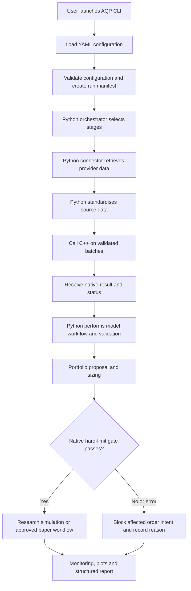

# AQP-HYBRID — Hybrid Python/C++ Repository Overview

**Project:** AQP — Advanced Quantitative Pipeline  
**Repository:** `AQP-HYBRID`  
**Languages:** Python + C++20  
**Primary environment:** Windows, Visual Studio Code, Python virtual environment, Microsoft C++ Build Tools and CMake  
**Python/C++ bridge:** `pybind11`  
**Build and packaging:** CMake + `pyproject.toml` / `scikit-build-core`  
**Status:** Target repository design and implementation guide

> **Implementation status:** This document defines the intended structure. Listed source files are planned until implemented and tested. It is not evidence that the full pipeline is running, profitable, or ready for live trading. The default operating mode is research or simulation.

---

## 1. Purpose and design

`AQP-HYBRID` combines Python's research, data-provider, orchestration and reporting ecosystem with C++ for selected performance-sensitive calculations and deterministic controls. It is one repository and one coordinated pipeline—not two independent implementations that happen to share a folder.

### The division of responsibility

| Component | Main responsibility | Why it belongs there |
|---|---|---|
| **Python control plane** | CLI, configuration loading, orchestration, run manifests, workflow routing and high-level stage coordination | Flexible integration, experiment management and readable workflow logic. |
| **Python research layer** | LSEG access, feature research, statistical/ML models, walk-forward testing, news/LLM integrations, reporting and plots | Uses the mature Python ecosystem for research and external service integration. |
| **C++ native engine** | Batch-oriented data transforms, deterministic filters, rolling/statistical kernels and selected risk/position-control calculations | Can reduce per-record overhead and provide predictable low-level behaviour where profiling demonstrates a need. |
| **`pybind11` interface** | Exposes selected C++ functions as an importable Python extension | Lets Python call native functions without launching another process for every operation. |
| **YAML configuration** | Holds editable run, market, data, model, validation, risk, execution and reporting settings | Keeps normal parameter changes out of source code. |
| **Tests and run artifacts** | Validate contracts and preserve the configuration, lineage, diagnostics, plots and reports from every run | Makes research results auditable and repeatable. |

### Core design rules

1. **One orchestrator:** `aqp_orchestrator.py` owns run order. C++ modules do not start a second, competing pipeline.
2. **One configuration authority:** Python loads and validates YAML once, then passes validated, typed settings to C++ functions. Do not maintain conflicting YAML parsers or duplicate defaults across languages.
3. **Batch data across the language boundary:** call native functions with arrays or batches, not once per individual row or ticker unless the operation truly requires it.
4. **Stable data contracts:** Python and C++ agree on identifiers, units, array shapes, missing-value handling, timestamps and error states.
5. **Point-in-time integrity:** all decisions use only information available at the relevant decision time.
6. **Selection is not a signal:** Stage 1 forms a research universe; forecasting and portfolio controls determine whether to take exposure.
7. **Controls fail closed:** if a required native safety check fails, returns an invalid result or is unavailable, the affected trade must be blocked rather than implicitly approved.
8. **No hidden side effects:** importing modules must not sign in to LSEG, download data, place orders or start a run.
9. **Research before deployment:** research, backtest, paper-trading and live modes have separate permissions and readiness gates.
10. **Profile before optimising:** move a calculation into C++ when measured bottlenecks or safety requirements justify it—not just because C++ is available.

## 2. Repository and naming conventions

| Item | Convention | Example |
|---|---|---|
| Repository folder | `AQP-HYBRID` | `AQP-HYBRID/` |
| Python package | `aqp_python` | `src/aqp_python/` |
| C++ public headers | `.hpp` under `include/aqp_cpp/` | `aqp_kelly_cap.hpp` |
| C++ implementations | `.cpp` under `cpp/src/` | `aqp_kelly_cap.cpp` |
| Python custom modules | `aqp_` prefix where useful | `aqp_orchestrator.py` |
| C++ custom modules | `aqp_` prefix | `aqp_risk_kernels.cpp` |
| Native Python module | `_aqp_native` | built `.pyd` on Windows; generated, not committed |
| Configuration files | `aqp_*.yaml` | `aqp_risk_limits.yaml` |
| Python tests | `test_*.py` | `test_aqp_config_loader.py` |
| C++ tests | `*_test.cpp` | `aqp_risk_limits_test.cpp` |
| Mermaid diagrams | `aqp_*.mmd` | `aqp_stage_01_universe.mmd` |
| Generated runs | unique run ID | `outputs/runs/<run_id>/` |

Do not force the prefix into standard tool files such as `CMakeLists.txt`, `pyproject.toml`, `README.md` or `.gitignore`. The repository/package names already identify the project.

---

## 3. Proposed repository tree

```text
AQP-HYBRID/
├── README.md
├── HYBRID REPOSITORY OVERVIEW.md
├── pyproject.toml
├── CMakeLists.txt
├── CMakePresets.json
├── .gitignore
├── .gitattributes
├── .env.example
├── .pre-commit-config.yaml
│
├── .vscode/
│   ├── settings.json
│   ├── launch.json
│   └── tasks.json
│
├── configs/
│   ├── aqp_pipeline.yaml
│   ├── aqp_markets.yaml
│   ├── aqp_data_sources.yaml
│   ├── aqp_universe_rules.yaml
│   ├── aqp_forecast_models.yaml
│   ├── aqp_validation.yaml
│   ├── aqp_risk_limits.yaml
│   ├── aqp_execution.yaml
│   └── aqp_reporting.yaml
│
├── docs/
│   ├── architecture/
│   │   ├── aqp_hybrid_architecture.md
│   │   ├── aqp_language_boundary.md
│   │   ├── aqp_data_dictionary.md
│   │   └── aqp_run_contract.md
│   ├── methodology/
│   │   ├── aqp_stage_00_data.md
│   │   ├── aqp_stage_01_universe.md
│   │   ├── aqp_stage_02_forecasting.md
│   │   ├── aqp_stages_03_04_portfolio.md
│   │   ├── aqp_stage_05_sizing.md
│   │   ├── aqp_stage_06_execution.md
│   │   └── aqp_stage_07_monitoring.md
│   ├── decisions/
│   │   ├── README.md
│   │   └── adr_0001_python_control_cpp_compute.md
│   └── diagrams/
│       ├── aqp_hybrid_overview.mmd
│       ├── aqp_language_boundary.mmd
│       ├── aqp_stage_00_data.mmd
│       ├── aqp_stage_01_universe.mmd
│       ├── aqp_stage_02_forecasting.mmd
│       ├── aqp_stage_02e_validation.mmd
│       ├── aqp_stages_03_04_portfolio.mmd
│       ├── aqp_stage_05_sizing.mmd
│       ├── aqp_stage_06_execution.mmd
│       ├── aqp_safety_controls.mmd
│       └── aqp_stage_07_monitoring.mmd
│
├── src/
│   └── aqp_python/
│       ├── __init__.py
│       ├── cli.py
│       ├── logging_config.py
│       ├── config/
│       │   ├── __init__.py
│       │   ├── aqp_config_loader.py
│       │   └── aqp_config_validation.py
│       ├── contracts/
│       │   ├── __init__.py
│       │   ├── aqp_data_schemas.py
│       │   ├── aqp_forecast_schema.py
│       │   ├── aqp_portfolio_schema.py
│       │   ├── aqp_native_contracts.py
│       │   └── aqp_run_manifest.py
│       ├── connectors/
│       │   ├── __init__.py
│       │   └── lseg/
│       │       ├── __init__.py
│       │       ├── aqp_lseg_session.py
│       │       ├── aqp_lseg_instruments.py
│       │       ├── aqp_lseg_fields.py
│       │       └── aqp_lseg_extractor.py
│       ├── orchestration/
│       │   ├── __init__.py
│       │   ├── aqp_orchestrator.py
│       │   ├── aqp_stage_router.py
│       │   ├── aqp_run_context.py
│       │   └── aqp_run_manifest_writer.py
│       ├── storage/
│       │   ├── __init__.py
│       │   ├── aqp_storage_paths.py
│       │   ├── aqp_dataset_registry.py
│       │   └── aqp_run_store.py
│       ├── native/
│       │   ├── __init__.py
│       │   └── aqp_native_adapter.py
│       │   # Built extension goes here in the installed package:
│       │   # _aqp_native.pyd on Windows; do not commit build output.
│       ├── stages/
│       │   ├── stage_00_data/
│       │   │   ├── __init__.py
│       │   │   ├── aqp_data_ingestion.py
│       │   │   ├── aqp_hfd_builder.py
│       │   │   ├── aqp_lfd_builder.py
│       │   │   ├── aqp_corporate_actions.py
│       │   │   ├── aqp_data_quality.py
│       │   │   └── aqp_point_in_time_controls.py
│       │   ├── stage_01_universe/
│       │   │   ├── __init__.py
│       │   │   ├── aqp_candidate_universe.py
│       │   │   ├── aqp_company_screening.py
│       │   │   ├── aqp_universe_scoring.py
│       │   │   ├── aqp_archetype_assignment.py
│       │   │   └── aqp_universe_formation.py
│       │   ├── stage_02_forecasting/
│       │   │   ├── __init__.py
│       │   │   ├── aqp_forecast_runner.py
│       │   │   ├── aqp_forecast_registry.py
│       │   │   ├── aqp_forecast_adapter.py
│       │   │   ├── financial/
│       │   │   │   ├── aqp_financial_features.py
│       │   │   │   ├── aqp_return_forecast.py
│       │   │   │   └── aqp_distress_model.py
│       │   │   ├── macro/
│       │   │   │   ├── aqp_macro_features.py
│       │   │   │   ├── aqp_macro_state_model.py
│       │   │   └── aqp_macro_sensitivity.py
│       │   │   ├── micro_market/
│       │   │   │   ├── aqp_interday_market_model.py
│       │   │   │   ├── aqp_intraday_features.py
│       │   │   │   └── aqp_market_microstructure_model.py
│       │   │   ├── news/
│       │   │   │   ├── aqp_news_ingestion.py
│       │   │   │   ├── aqp_news_event_extractor.py
│       │   │   │   ├── aqp_news_novelty_check.py
│       │   │   │   └── aqp_news_event_forecast.py
│       │   │   └── validation/
│       │   │       ├── aqp_walk_forward_validation.py
│       │   │       ├── aqp_forecast_calibration.py
│       │   │       ├── aqp_model_eligibility.py
│       │   │       └── aqp_signal_combiner.py
│       │   ├── stages_03_04_portfolio/
│       │   │   ├── __init__.py
│       │   │   ├── aqp_covariance_estimator.py
│       │   │   ├── aqp_portfolio_risk.py
│       │   │   ├── aqp_stress_testing.py
│       │   │   ├── aqp_portfolio_optimizer.py
│       │   │   └── aqp_sleeve_allocator.py
│       │   ├── stage_05_sizing/
│       │   │   ├── __init__.py
│       │   │   ├── aqp_position_sizer.py
│       │   │   ├── aqp_kelly_cap.py
│       │   │   ├── aqp_leverage_rules.py
│       │   │   └── aqp_position_report.py
│       │   ├── stage_06_execution/
│       │   │   ├── __init__.py
│       │   │   ├── aqp_order_intent.py
│       │   │   ├── aqp_execution_simulator.py
│       │   │   ├── aqp_cost_slippage_model.py
│       │   │   └── aqp_fill_reconciliation.py
│       │   └── stage_07_monitoring/
│       │       ├── __init__.py
│       │       ├── aqp_performance_monitor.py
│       │       ├── aqp_data_drift_monitor.py
│       │       ├── aqp_model_drift_monitor.py
│       │       └── aqp_readiness_status.py
│       ├── safety/
│       │   ├── __init__.py
│       │   └── aqp_native_safety_gate.py
│       ├── compiler/
│       │   ├── __init__.py
│       │   ├── aqp_plot_compiler.py
│       │   ├── aqp_report_compiler.py
│       │   └── aqp_run_artifact_index.py
│       └── reporting/
│           ├── __init__.py
│           ├── aqp_metrics_summary.py
│           ├── aqp_narrative_report.py
│           └── aqp_report_fact_checks.py
│
├── cpp/
│   ├── CMakeLists.txt
│   ├── include/
│   │   └── aqp_cpp/
│   │       ├── core/
│   │       │   ├── aqp_types.hpp
│   │       │   ├── aqp_result.hpp
│   │       │   ├── aqp_errors.hpp
│   │       │   └── aqp_data_contracts.hpp
│   │       ├── data/
│   │       │   ├── aqp_batch_validator.hpp
│   │       │   └── aqp_data_transforms.hpp
│   │       ├── filters/
│   │       │   ├── aqp_company_filters.hpp
│   │       │   └── aqp_universe_scoring.hpp
│   │       ├── features/
│   │       │   ├── aqp_rolling_statistics.hpp
│   │       │   └── aqp_feature_kernels.hpp
│   │       ├── portfolio/
│   │       │   ├── aqp_covariance_kernels.hpp
│   │       │   └── aqp_portfolio_math.hpp
│   │       ├── risk/
│   │       │   ├── aqp_hard_limits.hpp
│   │       │   ├── aqp_kelly_cap.hpp
│   │       │   ├── aqp_leverage_rules.hpp
│   │       │   └── aqp_pre_trade_gate.hpp
│   │       └── bindings/
│   │           └── aqp_binding_contracts.hpp
│   └── src/
│       ├── core/
│       ├── data/
│       │   ├── aqp_batch_validator.cpp
│       │   └── aqp_data_transforms.cpp
│       ├── filters/
│       │   ├── aqp_company_filters.cpp
│       │   └── aqp_universe_scoring.cpp
│       ├── features/
│       │   ├── aqp_rolling_statistics.cpp
│       │   └── aqp_feature_kernels.cpp
│       ├── portfolio/
│       │   ├── aqp_covariance_kernels.cpp
│       │   └── aqp_portfolio_math.cpp
│       ├── risk/
│       │   ├── aqp_hard_limits.cpp
│       │   ├── aqp_kelly_cap.cpp
│       │   ├── aqp_leverage_rules.cpp
│       │   └── aqp_pre_trade_gate.cpp
│       └── bindings/
│           └── aqp_python_bindings.cpp
│
├── tests/
│   ├── python/
│   │   ├── unit/
│   │   └── integration/
│   ├── cpp/
│   │   ├── unit/
│   │   └── integration/
│   ├── contracts/
│   │   ├── test_python_cpp_contracts.py
│   │   └── fixtures/
│   └── test_batches/
│       ├── batch_01_repository_build/
│       ├── batch_02_config_contracts/
│       ├── batch_03_data_native_bridge/
│       ├── batch_04_universe_selection/
│       ├── batch_05_forecasts_validation/
│       ├── batch_06_portfolio_sizing_safety/
│       └── batch_07_end_to_end_reporting/
│
├── data/
│   ├── README.md
│   ├── raw/                 # licensed/provider data; normally not in Git
│   ├── interim/
│   ├── processed/
│   ├── reference/
│   └── samples/             # small synthetic fixtures only
│
├── outputs/
│   ├── README.md
│   ├── runs/.gitkeep
│   ├── plots/.gitkeep
│   └── reports/.gitkeep
│
├── scripts/
│   └── windows/
│       ├── aqp_setup.ps1
│       ├── aqp_build.ps1
│       └── aqp_test.ps1
│
└── build/                   # generated by CMake; do not commit
```

**Tree convention:** empty folders are represented in a real Git repository by tracked files such as `.gitkeep` or, preferably, by adding their first meaningful file. The tree above documents intended locations; do not create empty source files just to match it.

---

## 4. What runs when you launch AQP?

The **Python orchestrator is the only production pipeline entry point**. C++ is compiled into a native extension imported by Python. C++ does not need a separate application entry point for ordinary runs.



The extension file is generated by the build and normally has a Windows `.pyd` extension. Do not manually edit it, store it in Git, or treat it as source code.

### Python-to-C++ boundary

- Python is responsible for provider sessions, workflow control, high-level data frames, model experimentation, external service calls, plots and narrative reports.
- C++ receives validated arrays or batches and explicit typed parameters. It returns results and status values in the documented contract.
- Validate dimensions, numeric types, units, missing values and timestamp alignment before dispatching work to native code.
- Avoid repeated Python/C++ transitions for every row. Prefer one operation on a batch or contiguous numeric buffer.
- Exceptions crossing the binding must become clear Python exceptions or structured failure statuses. No failure may be silently interpreted as a valid zero or approval.
- A native safety gate must return an explicit decision, reason code and relevant calculated values. If the native module is missing or the gate errors, reject the trade intent in modes that require the gate.

---

## 5. Root and build files

| File | Purpose |
|---|---|
| `README.md` | Short project introduction and quick-start instructions. |
| `HYBRID REPOSITORY OVERVIEW.md` | Detailed repository tree, language boundaries and implementation plan. |
| `pyproject.toml` | Python package metadata, Python dependencies, development tools and native-extension build configuration. The proposed backend is `scikit-build-core`. |
| `CMakeLists.txt` | Configures C++ targets, discovers Python/pybind11, builds native libraries and the `_aqp_native` extension, and registers C++ tests. |
| `CMakePresets.json` | Repeatable Windows/MSVC configure, build and test presets. |
| `.gitignore` | Excludes `.venv`, CMake build folders, generated `.pyd`/`.dll` files, caches, private secrets, licensed market data and generated run outputs. |
| `.env.example` | Names expected environment variables without containing real credentials. |
| `.pre-commit-config.yaml` | Optional automated formatting and checks for Python, C++, YAML and Markdown. |
| `.vscode/settings.json` | Repository-specific editor preferences. |
| `.vscode/launch.json` | Debug configurations for the Python CLI and tests. |
| `.vscode/tasks.json` | Optional shortcuts for configure, build and test commands. |

### Build strategy

Use CMake to compile the extension and `pyproject.toml`/`scikit-build-core` to make it installable into the Python environment. This avoids maintaining a hand-copied `.pyd` file. Pin compatible build-tool versions after the initial Windows build succeeds and retain the compiler, Python version and dependency versions in the run/build metadata.

---

## 6. Configuration files

YAML files contain settings; they do not execute. Python loads and validates the relevant files at startup, snapshots them into the run directory, and passes only the required validated values to each component.

| File | Responsibility |
|---|---|
| `configs/aqp_pipeline.yaml` | Run mode, date window, enabled stages, run label and output root. |
| `configs/aqp_markets.yaml` | ASX/US markets, time zones, exchange calendars and trading sessions. |
| `configs/aqp_data_sources.yaml` | LSEG or file-based input selection, requested frequency, retry rules and source configuration. Never store credentials in this tracked YAML. |
| `configs/aqp_universe_rules.yaml` | Stage 1 hard exclusions, data coverage rules, factor categories, weights and archetype definitions. |
| `configs/aqp_forecast_models.yaml` | Enabled financial, macro, micro/market and news models, horizons and model parameters. |
| `configs/aqp_validation.yaml` | Walk-forward windows, calibration, out-of-sample metrics and model eligibility rules. |
| `configs/aqp_risk_limits.yaml` | Position and concentration limits, leverage caps, drawdown controls and portfolio exposure limits. |
| `configs/aqp_execution.yaml` | Backtest/paper settings, transaction costs, spreads, slippage assumptions and execution mode. |
| `configs/aqp_reporting.yaml` | Plot families, diagnostics, report sections and AI narrative-generation settings. |

### Configuration flow

1. `aqp_config_loader.py` reads requested YAML files.
2. `aqp_config_validation.py` checks required fields, types, bounds and incompatible settings.
3. The orchestrator creates a run context and saves a configuration snapshot.
4. Python passes each C++ function an explicit, typed parameter object or well-defined scalar/array arguments.
5. Any missing or invalid safety-critical setting blocks the run; it must not silently fall back to a permissive default.

Do not parse the same YAML independently in both Python and C++ for the standard hybrid run. That can lead to different defaults or different interpretations of the same value.

---

## 7. Python package responsibilities

### Configuration, contracts and orchestration

| Path | Purpose |
|---|---|
| `src/aqp_python/cli.py` | Provides the user-facing command line, such as `validate-config`, `run` and `status`. |
| `src/aqp_python/config/aqp_config_loader.py` | Loads YAML into validated Python structures. |
| `src/aqp_python/config/aqp_config_validation.py` | Checks configuration fields and cross-file constraints. |
| `src/aqp_python/contracts/` | Defines the expected shapes, units, identifiers and statuses for datasets, forecasts, portfolios, native-call inputs and run manifests. |
| `src/aqp_python/orchestration/aqp_orchestrator.py` | Coordinates the full run, establishes stage order and handles stage-level failure. |
| `src/aqp_python/orchestration/aqp_stage_router.py` | Selects enabled stages and ensures required dependencies have succeeded. |
| `src/aqp_python/orchestration/aqp_run_context.py` | Holds run ID, mode, configuration, timestamps and run-local paths. |
| `src/aqp_python/orchestration/aqp_run_manifest_writer.py` | Writes code/config versions, data lineage, completion status and output locations. |
| `src/aqp_python/storage/` | Manages dataset paths, metadata and run-artifact registration. |

### Connectors

| Path | Purpose |
|---|---|
| `connectors/lseg/aqp_lseg_session.py` | Opens and closes an authorised LSEG Workspace/data session and handles connection errors. |
| `aqp_lseg_instruments.py` | Resolves instrument identifiers and exchange/listing metadata. |
| `aqp_lseg_fields.py` | Centralises provider field mappings and normalisation rules. |
| `aqp_lseg_extractor.py` | Coordinates history requests and returns source data to Stage 00. |

**LSEG integration note:** this blueprint deliberately puts the normal LSEG integration on the Python side, where supported Workspace/data-library workflows are commonly available. The actual API, authentication method, entitlements, field codes and rate limits must be confirmed against the user's current LSEG environment. Do not assume that a native C++ API or unrestricted access is available. The C++ side receives normalised batches rather than handling provider login directly.

### Native adapter

`src/aqp_python/native/aqp_native_adapter.py` is the only normal application-facing wrapper around the compiled extension. It should:

- import `aqp_python.native._aqp_native`;
- expose typed Python-friendly functions rather than leaking binding details through every stage;
- validate call inputs and returned dimensions/status fields;
- translate C++ errors into clear application errors;
- enforce a fail-closed response when a required safety call cannot be completed;
- report the extension/build version for reproducibility.

Avoid importing `_aqp_native` throughout dozens of modules. Concentrate the interface in the adapter and contract tests.

### Pipeline stages

| Stage | Python responsibilities | Intended C++ support |
|---|---|---|
| **00 — Data** | Provider extraction, historical CSV/Parquet organisation, corporate-action workflow, point-in-time lineage and data-quality reporting. | Batch validation and fast numeric/data transforms after schema and timestamp checks. |
| **01 — Universe** | Assemble candidate listings, apply screening workflow, combine category scores, assign archetypes and version the formed universe. | Vectorised deterministic filters and scoring kernels where benchmarks justify native execution. |
| **02A — Financial** | Feature design, model fitting/inference, distress analysis and evaluation. | Reusable rolling and arithmetic kernels if they are bottlenecks. |
| **02B — Macro** | Economy stickers, state models, release-calendar alignment and company sensitivity research. | Selected vector/matrix calculations after validating numerical parity. |
| **02C — Micro/market** | Interday and intraday model workflow, order-book feature construction and evaluation. | Batch microstructure and rolling-statistics kernels. |
| **02D — News** | News-source integration, event extraction, novelty analysis and calibrated event forecasts. | Only deterministic high-volume parsing or feature kernels if profiling supports it; external LLM/API calls remain Python integrations. |
| **02E — Validation** | Walk-forward tests, calibration, eligibility decisions and signal combination. | Optional efficient statistic calculations; validation policy remains explicit in Python/configuration. |
| **03–04 — Portfolio** | Risk modelling workflow, stress scenarios, optimisation, costs and sleeve allocation. | Covariance/linear-algebra kernels where they meet accuracy tests and measurable performance goals. |
| **05 — Sizing** | Build position proposals and audit tables, then request the native sizing/risk gate. | Deterministic Kelly fraction caps, leverage calculations and hard pre-trade constraints. |
| **06 — Execution** | Simulation, order-intent routing, broker integration if authorised, cost models and reconciliation. | Hard-limit decision functions and performance-sensitive calculations; broker session is not hidden inside a native import. |
| **07 — Monitoring** | Performance/drift monitoring, run diagnostics, plot generation, structured summaries and narrative reports. | Optional metrics kernels; no narrative generation in C++. |

Python and C++ should not independently implement the same business rule unless one implementation is explicitly a test oracle. If a rule is deliberately duplicated for defence in depth, document how the two versions are reconciled and which one can veto a decision.

---

## 8. C++ native engine responsibilities

C++ code lives under `cpp/`, with public interfaces in `cpp/include/aqp_cpp/` and implementations in `cpp/src/`.

| Area | Main files | Purpose |
|---|---|---|
| Core types and errors | `core/aqp_types.hpp`, `aqp_result.hpp`, `aqp_errors.hpp` | Shared types, structured results, error codes and status conventions. |
| Data processing | `data/aqp_batch_validator.*`, `aqp_data_transforms.*` | Validate batch dimensions and run deterministic normalisation/transformation routines. |
| Filters and scoring | `filters/aqp_company_filters.*`, `aqp_universe_scoring.*` | Efficient, reproducible screening and category-level score calculations. |
| Feature kernels | `features/aqp_rolling_statistics.*`, `aqp_feature_kernels.*` | Rolling means/variances and other explicitly specified numeric transformations. |
| Portfolio arithmetic | `portfolio/aqp_covariance_kernels.*`, `aqp_portfolio_math.*` | Optional numerical kernels—not a replacement for the whole Python research workflow. |
| Kelly and leverage | `risk/aqp_kelly_cap.*`, `aqp_leverage_rules.*` | Implement stated formulas with finite-value, sign, bounds and edge-case checks. |
| Hard limits | `risk/aqp_hard_limits.*`, `aqp_pre_trade_gate.*` | Return allow/block decisions with reason codes; failure to calculate means block. |
| Python binding | `bindings/aqp_python_bindings.cpp` | Defines the public functions exposed through `_aqp_native`. |

Every exposed C++ function needs a documented contract: accepted data types, shape/order, units, timestamp semantics, valid ranges, missing-value policy, output schema and failure cases. Compare native outputs to a simple trusted reference implementation on synthetic and real-world edge-case fixtures before relying on them in research.

### What should not move to C++ automatically?

Do not port every Python model just to make the codebase “more C++”. Keep experiment-heavy models and external integrations in Python initially. Move code only when benchmarking shows the cost matters or a deterministic native control has a clearly justified role. Keep research methodology, risk policy and language-boundary decisions in documentation.

---

## 9. Stage-by-stage execution

### Stage 00 — Data extraction and validation

1. Python reads source configuration and opens the permitted LSEG or file-based connector.
2. Instruments, fields, time range, market calendar and frequency are resolved explicitly.
3. Provider rows are normalised into AQP schemas with source timestamps and availability metadata.
4. Batch-level native validators/transforms run where suitable.
5. Python performs point-in-time, corporate-action, missing-data and source-lineage checks and persists the validated result.

Outputs include source references, high-/low-frequency datasets as configured, validation diagnostics and clear `PASS`, `DEGRADED` or `BLOCKED` status.

### Stage 01 — Company selection

1. Build the point-in-time candidate universe.
2. Apply mandatory gates first, including listing status, data integrity, minimum usable history and strategy-specific liquidity requirements.
3. Calculate group/category scores using documented directions, transformations, peer groups and weights.
4. Classify each eligible candidate into one or more research archetypes.
5. Freeze and version membership for the formation period, subject only to documented formation or safety-exit rules.

The native scoring kernel accelerates a specified score; it does not choose new thresholds or rewrite policy on its own.

### Stage 02 — Forecasts and validation

Python coordinates the four forecasting families—financial, macroeconomic, micro/market and news—and standardises results into a common forecast contract. Model forecasts do not bypass walk-forward validation, calibration and eligibility rules. Only eligible outputs are passed into signal combination and portfolio construction.

### Stages 03–05 — Portfolio, risk and sizing

Python proposes portfolio allocations and position intents from eligible forecasts, expected returns, covariances, constraints and estimated costs. The native risk functions check the relevant position/leverage/Kelly calculations and hard constraints. Keep the maximum exposure and safety limits explicit and versioned. An optimiser's result is a proposal, not permission to trade.

### Stage 06 — Execution

The first implementation should use simulation. Model orders and fills with plausible spreads, market impact, transaction costs, partial fills and latency assumptions. Any future broker integration requires separate authentication, operational controls and explicit deployment approval. The hybrid's C++ binding does not itself connect to or submit orders to a broker.

### Stage 07 — Monitoring and reporting

Python compiles model graphs, diagnostics, run records and an automated narrative report. The narrative system must draw only from structured outputs and traceable evidence, note failures and uncertainty, and never invent metrics or override the risk gate. Save outputs under a unique run ID.

---

## 10. The nine YAML configuration files

| File | What it controls |
|---|---|
| `aqp_pipeline.yaml` | Run mode, date window, stages, output locations and general run metadata. |
| `aqp_markets.yaml` | ASX/US calendars, time zones and sessions. |
| `aqp_data_sources.yaml` | Provider/file source, frequencies, retry and extraction options. |
| `aqp_universe_rules.yaml` | Stage 1 gates, ranking weights and archetype rules. |
| `aqp_forecast_models.yaml` | Model enablement, horizons and model parameters. |
| `aqp_validation.yaml` | Walk-forward split rules, metrics, calibration and model eligibility. |
| `aqp_risk_limits.yaml` | Risk budgets, concentration, exposure, leverage and drawdown caps. |
| `aqp_execution.yaml` | Simulation/paper settings, fees, spread, slippage and order restrictions. |
| `aqp_reporting.yaml` | Graphs, tables, diagnostics and narrative report options. |

Keep credentials outside version control. Use environment variables or a supported secret store, with `.env` ignored by Git. Configuration snapshots should omit secret values and retain only safe references or redacted markers.

---

## 11. Build and run on Windows

### Required tools

- Visual Studio Code (editor).
- A compatible Python version supported by the project's locked dependencies.
- Visual Studio 2022 Build Tools or Visual Studio with the **Desktop development with C++** workload and a Windows SDK.
- CMake and Git.
- The Python `venv` module and pip.

Git Bash is optional. The commands below use PowerShell.

### Intended first-time workflow

After the complete source tree and build metadata have been implemented:

```powershell
# From the repository root
py -3 --version
cmake --version

# Create and activate the project-specific Python environment
py -3 -m venv .venv
.\.venv\Scripts\Activate.ps1

# Install the project in editable mode; this is intended to build the C++ extension
python -m pip install --upgrade pip
python -m pip install -e ".[dev]"

# Check the native module import before launching a full run
python -c "from aqp_python.native import aqp_native_adapter; print('AQP native adapter import OK')"

# Validate settings, then run a research-mode pipeline
python -m aqp_python.cli validate-config --config configs/aqp_pipeline.yaml
python -m aqp_python.cli run --config configs/aqp_pipeline.yaml --mode research

# Run tests
python -m pytest tests/python
ctest --test-dir build --output-on-failure
```

These are **target commands**, not guaranteed working commands in the overview-only blueprint. They become runnable when `pyproject.toml`, `CMakeLists.txt`, the CLI, the configuration loader, C++ sources and tests have been implemented. Exact CMake preset names and test paths should be finalised in the actual build files.

If the editable installation does not build in the first implementation, debug the build toolchain and `pybind11` discovery rather than copying a `.pyd` file by hand. Keep Python version, architecture (normally 64-bit), MSVC toolset and compiled extension compatible.

---

## 12. Testing strategy and seven batches

The Python and C++ suites test the same interface from different sides. Native numerical outputs require parity tests against reference implementations, particularly around NaNs, zeros, negative values, overflow, empty input and boundary conditions.

| Batch | Scope | Exit condition |
|---|---|---|
| **01 — Repository/build** | Python package imports, CMake configure/build, extension loads in the selected interpreter. | Clean build from a fresh environment. |
| **02 — Config/contracts** | YAML validation, Python schemas, C++ input contracts and invalid configuration behaviour. | Invalid critical settings stop before data/model execution. |
| **03 — Data/native bridge** | Synthetic data, shapes, timestamps, missing values, numerical parity and error translation. | Python and C++ contracts agree on valid/invalid fixtures. |
| **04 — Universe selection** | Mandatory gates, scoring direction, ranking reproducibility and frozen-universe output. | Every excluded company has reason codes; results are repeatable. |
| **05 — Forecast/validation** | Model schemas, time-ordered folds, calibration and eligibility decisions. | Ineligible models cannot feed the portfolio combiner. |
| **06 — Portfolio/sizing/safety** | Numerical edge cases, leverage/Kelly formulas, limit breaches and fail-closed cases. | No failed/unknown safety result is treated as approved. |
| **07 — End-to-end/reporting** | Complete sample-data run, outputs, plots, manifest, diagnostics and narrative report. | One reproducible run artifact with explicit final status and no missing required outputs. |

Do not begin with live LSEG extraction as the only test path. Keep small synthetic fixtures so build and pipeline behaviour can be checked without provider credentials or licensed market data.

---

## 13. Run outputs and reproducibility

Every run should create a unique directory and preserve at least the following:

```text
outputs/runs/<run_id>/
├── run_manifest.json
├── config_snapshot/                 # secret values redacted
├── data_quality/
├── universe/
├── forecasts/
├── validation/
├── portfolio/
├── sizing/
├── execution_simulation/
├── diagnostics/
├── plots/
└── reports/
    ├── run_summary.json
    └── aqp_run_report.md
```

The manifest should record run ID, code commit, build/compiler details, Python version, native extension build version, configuration hash/snapshot, input dataset references, formation/universe version, model versions, validation results, safety-gate decisions and final status. Store licensed raw data only in locations and formats permitted by the relevant provider agreement.

Use `PASS`, `DEGRADED` and `BLOCKED` consistently. `DEGRADED` is only allowed where the relevant policy explicitly defines a safe fallback; it must not be treated as `PASS` by default.

---

## 14. Implementation roadmap

1. **Repository foundation:** initialise Git; create `pyproject.toml`, CMake build, Python package, native binding and a minimal test that imports a simple native function.
2. **Configuration and contracts:** implement the YAML loader, validation, common schemas, run context and manifest writer.
3. **Synthetic data path:** implement file/synthetic inputs and Stage 00 validation; preserve point-in-time metadata.
4. **Stage 01:** implement hard gates, scoring, archetypes and universe versioning. Test scoring against a transparent Python reference.
5. **Stage 02:** add the forecast families and walk-forward validation; keep early models as explicit baselines.
6. **Stages 03–05:** implement portfolio risk, optimiser and sizing; validate every native function with edge-case and parity tests.
7. **Stages 06–07:** simulation, monitoring, plot compilation and narrative report generation.
8. **LSEG integration:** connect using the API and entitlements available to the user and validate the extraction path independently.
9. **Paper-trading readiness:** add logging, restart/recovery tests, hard-limit fault tests, operational approval and monitoring before considering any live mode.

### Definition of done for a stage

A stage is not complete merely because its code runs. It must have input/output contracts, deterministic fixtures where possible, failure-path tests, logs/reason codes, documentation, run-manifest integration and a defined readiness status. Any research result must be evaluated out of sample with leakage and survivorship bias addressed.

---

## 15. Sources and implementation references

Use the official documentation for the tools chosen in the actual build. Dependency versions and setup instructions must be pinned and re-tested when the project is implemented.

- **pybind11 CMake integration:** https://pybind11.readthedocs.io/en/stable/cmake/
- **pybind11 compilation/building:** https://pybind11.readthedocs.io/en/stable/compiling.html
- **Python packaging and `pyproject.toml`:** https://packaging.python.org/en/latest/guides/writing-pyproject-toml/
- **CMake documentation:** https://cmake.org/cmake/help/latest/
- **LSEG developer portal:** https://developers.lseg.com/

These references document implementation tooling, not the correctness or profitability of AQP's investment strategy. Model choices, risk limits and trading decisions require independent empirical validation.
