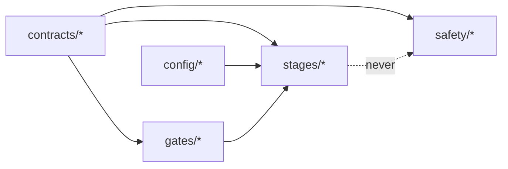

# Part 02 — Contracts, configuration and the gate result

**Goal:** agree on shared definitions *before* any model exists. These are the words every stage uses (`PASS`, `BLOCKED`, `NO-TRADE`, reason codes, the quantile grid), the place every limit lives (YAML), the check that refuses incomplete configuration, and the shape every gate returns.

**Design:** §2 (principles, gates, run status), §5 (common forecast schema), §16 (operating contract).

Why first? Stages built by different people, or by you at different times, can only be combined if they agree on these shapes. If each model invented its own idea of a "forecast" or a "failure", combining them later would mean rewriting them.



`contracts` and `config` are the bottom layer. They import nothing else from `aqp_python`, so everything else can depend on them without circular imports. Part 11 enforces this automatically.

---

## 2.1 Run status vs trade decision

**File:** `src/aqp_python/contracts/run_status.py`

```python
"""Run status (is the pipeline healthy?) and trade decision (what to do?) are different things."""
from enum import StrEnum


class RunStatus(StrEnum):
    PASS = "PASS"            # required checks passed
    DEGRADED = "DEGRADED"    # an approved fallback is active and recorded
    BLOCKED = "BLOCKED"      # a critical check failed; no new risk


class TradeDecision(StrEnum):
    TRADE = "TRADE"
    REDUCE = "REDUCE"
    HOLD = "HOLD"
    NO_TRADE = "NO-TRADE"


_SEVERITY = {RunStatus.PASS: 0, RunStatus.DEGRADED: 1, RunStatus.BLOCKED: 2}


def worst_status(statuses: list[RunStatus]) -> RunStatus:
    """Terminal status is the most severe one seen: BLOCKED > DEGRADED > PASS."""
    if not statuses:
        return RunStatus.PASS
    return max(statuses, key=_SEVERITY.__getitem__)
```

These two vocabularies must never be mixed:

- **`RunStatus`** answers *is the pipeline healthy?* `DEGRADED` means an approved fallback is active and recorded. `BLOCKED` means a critical check failed and no new risk may be taken.
- **`TradeDecision`** answers *what should we do with this security?*

A run can be `PASS` and still decide `NO-TRADE` everywhere: every check worked, and no model earned the right to trade. That is a healthy outcome, not a failure. `worst_status` gives the run's terminal status: the most severe status of any stage (design §16, and the repository convention in overview §5).

`StrEnum` (Python 3.11+) members are also strings, so `RunStatus.PASS == "PASS"` is `True` and they serialise to JSON without special handling.

## 2.2 Reason codes

**File:** `src/aqp_python/contracts/reason_codes.py`

```python
"""Machine-readable reason codes. Every failure, exclusion and decision gets one."""
from enum import StrEnum


class ReasonCode(StrEnum):
    # Configuration / run
    CONFIG_INVALID = "CONFIG_INVALID"
    STAGE_EXCEPTION = "STAGE_EXCEPTION"
    UPSTREAM_BLOCKED = "UPSTREAM_BLOCKED"
    # G2 data integrity
    DATA_SCHEMA = "DATA_SCHEMA"
    DATA_TIMEZONE = "DATA_TIMEZONE"
    DATA_DUPLICATE = "DATA_DUPLICATE"
    DATA_LOOKAHEAD = "DATA_LOOKAHEAD"
    DATA_STALE = "DATA_STALE"
    DATA_EXTREME_RETURN = "DATA_EXTREME_RETURN"
    DATA_NONPOSITIVE_PRICE = "DATA_NONPOSITIVE_PRICE"
    # G1 universe formation rejections (design codes)
    DIST = "DIST"
    LIQ = "LIQ"
    HIST = "HIST"
    DATA = "DATA"
    NOT_LISTED = "NOT_LISTED"
    BELOW_THRESHOLD = "BELOW_THRESHOLD"
    CAPACITY = "CAPACITY"
    # Mandatory exits
    EXIT_DIST = "EXIT-DIST"
    EXIT_DLST = "EXIT-DLST"
    EXIT_SUSP = "EXIT-SUSP"
    EXIT_TKO = "EXIT-TKO"
    EXIT_LIQ = "EXIT-LIQ"
    # Forecasting / G3
    FORECAST_INVALID = "FORECAST_INVALID"
    QUANTILE_CROSSING = "QUANTILE_CROSSING"
    MODEL_FIT_FAILED = "MODEL_FIT_FAILED"
    MODEL_IS_BASELINE = "MODEL_IS_BASELINE"
    MODEL_MISCALIBRATED = "MODEL_MISCALIBRATED"
    MODEL_NO_SKILL = "MODEL_NO_SKILL"
    MODEL_NO_NET_VALUE = "MODEL_NO_NET_VALUE"
    MODEL_OVERFIT_RISK = "MODEL_OVERFIT_RISK"
    NO_ELIGIBLE_MODEL = "NO_ELIGIBLE_MODEL"
    # Portfolio / G4
    OPT_INFEASIBLE = "OPT_INFEASIBLE"
    OPT_RELAXED = "OPT_RELAXED"
    RISK_ES_BREACH = "RISK_ES_BREACH"
    RISK_STRESS_BREACH = "RISK_STRESS_BREACH"
    RISK_CONCENTRATION = "RISK_CONCENTRATION"
    # Sizing / G5 / G6
    LEVERAGE_INVALID_INPUT = "LEVERAGE_INVALID_INPUT"
    LEVERAGE_ZERO = "LEVERAGE_ZERO"
    MARGIN_HEADROOM = "MARGIN_HEADROOM"
    DRAWDOWN_LIMIT = "DRAWDOWN_LIMIT"
    WITHIN_NO_TRADE_BAND = "WITHIN_NO_TRADE_BAND"
    BELOW_COST_THRESHOLD = "BELOW_COST_THRESHOLD"
    TRADE_APPROVED = "TRADE_APPROVED"
    DATA_TOO_OLD = "DATA_TOO_OLD"
    # Safety / execution
    HARD_LIMIT_NAME = "HARD_LIMIT_NAME"
    HARD_LIMIT_GROSS = "HARD_LIMIT_GROSS"
    HARD_LIMIT_PARTICIPATION = "HARD_LIMIT_PARTICIPATION"
    HARD_LIMIT_DAILY_LOSS = "HARD_LIMIT_DAILY_LOSS"
    HARD_LIMIT_ORDER_COUNT = "HARD_LIMIT_ORDER_COUNT"
    KILL_SWITCH = "KILL_SWITCH"
    RECONCILIATION_FAILED = "RECONCILIATION_FAILED"
    PARTIAL_FILL = "PARTIAL_FILL"
    PAPER_OUT_OF_ORDER = "PAPER_OUT_OF_ORDER"
```

Design §2: *"Every failure receives a machine-readable reason code."* The design's own codes are kept exactly (`DIST`, `LIQ`, `HIST`, `DATA`, `EXIT-DIST`, `EXIT-DLST`, `EXIT-SUSP`, `EXIT-TKO`, `EXIT-LIQ`); the rest are project codes for the other gates. Codes are stable identifiers. Explanations go in the gate result's `detail`, never in the code. Add a code only through the decision log (Part 12), because downstream reports and monitoring match on these strings.

## 2.3 The shared quantile grid

**File:** `src/aqp_python/contracts/quantile_grid.py`

```python
"""The one quantile grid every forecast model must use."""
import math
from collections.abc import Sequence

QUANTILE_GRID: tuple[float, ...] = (
    0.01, 0.025, 0.05, 0.10, 0.25, 0.50, 0.75, 0.90, 0.95, 0.975, 0.99,
)
QUANTILE_COLUMNS: tuple[str, ...] = tuple(f"q{q:.3f}" for q in QUANTILE_GRID)
MEDIAN_COLUMN = "q0.500"
LOWER_90, UPPER_90 = "q0.050", "q0.950"


def check_quantile_values(values: Sequence[float]) -> None:
    """Raise ValueError if values do not match the grid or are not ordered."""
    if len(values) != len(QUANTILE_GRID):
        raise ValueError(f"expected {len(QUANTILE_GRID)} quantiles, got {len(values)}")
    if any(not math.isfinite(v) for v in values):
        raise ValueError("quantiles must be finite")
    if any(left > right for left, right in zip(values, values[1:])):
        raise ValueError("quantile crossing: values must be non-decreasing")
```

Design §5: every model emits the same 11 quantiles, `𝒯 = {0.01, 0.025, 0.05, 0.10, 0.25, 0.50, 0.75, 0.90, 0.95, 0.975, 0.99}`. Because the grid is shared, forecasts from different models can be compared, averaged and scored without conversion. The column names (`q0.010` … `q0.990`) are generated from the grid, so a typo cannot create a 12th quantile. `check_quantile_values` enforces the two non-negotiable properties: finite values and no **quantile crossing** (the 5% quantile can never exceed the 10% quantile).

## 2.4 Table contracts

Start `data_schemas.py` with the column lists. The hand-off dataclasses (`MarketData`, `UniverseSelection`) are added to the bottom of this file in Parts 04 and 05.

**File:** `src/aqp_python/contracts/data_schemas.py` — top of file, `require_columns`

```python
"""Column contracts and hand-off objects passed between stages."""
from collections.abc import Iterable
from dataclasses import dataclass

import pandas as pd

# One row per security per trading day. date = valid time; availability_ts = when usable.
PRICE_COLUMNS = ("security_id", "date", "availability_ts", "close", "volume", "currency", "source")
BENCHMARK_COLUMNS = ("date", "availability_ts", "benchmark_return")
REFERENCE_COLUMNS = (
    "security_id", "name", "sector", "listing_date", "delisting_date", "currency",
    "distress_probability", "quality_score", "revenue_share_au", "revenue_share_us",
    "revenue_share_cn", "availability_ts",
)
CORPORATE_ACTION_COLUMNS = ("security_id", "ex_date", "split_ratio", "availability_ts")


def require_columns(frame: pd.DataFrame, columns: Iterable[str], name: str) -> None:
    missing = sorted(set(columns) - set(frame.columns))
    if missing:
        raise ValueError(f"{name} is missing columns: {missing}")
```

Note the two timestamps on every row. `date` is the **valid time** (the period a fact describes); `availability_ts` is the time the system could first have used it. Point-in-time correctness (Part 03) depends entirely on that second column.

## 2.5 Order requests

**File:** `src/aqp_python/contracts/order_schema.py`

```python
"""Order requests: the only object that may travel from sizing to execution."""
from dataclasses import asdict, dataclass
from enum import StrEnum


class Side(StrEnum):
    BUY = "BUY"
    SELL = "SELL"


@dataclass(frozen=True)
class OrderRequest:
    order_id: str
    security_id: str
    side: Side
    quantity: int
    reference_price: float
    reason_code: str

    @property
    def notional(self) -> float:
        return self.quantity * self.reference_price

    def validate(self) -> None:
        if self.quantity <= 0:
            raise ValueError("order quantity must be positive")
        if self.reference_price <= 0:
            raise ValueError("reference price must be positive")

    def to_dict(self) -> dict:
        record = asdict(self)
        record["side"] = str(self.side)
        record["notional"] = self.notional
        return record
```

Design §12 to §13: an order request is the *only* object that travels from sizing to execution, and it is created only after G5 and G6 pass (Part 09). `frozen=True` makes it immutable, so nothing downstream can quietly change a quantity after the safety checks have approved it.

## 2.6 All the configuration, in one place

Design §2, *"thresholds are provisional"*, and the overview's rule *"all limits, thresholds and approvals live here, never in code"*. Create all eight files now, even though most keys are used later. The validator in 2.7 checks every section at once, so a run cannot start with a missing limit.

**File:** `configs/pipeline.yaml`

```yaml
# Top-level run configuration. Every limit and threshold lives in YAML, never in code.
pipeline:
  name: AQP-PYTHON
  mode: research            # research | paper   (live is not accepted by this build)
  output_root: outputs
  data_dir: data/samples
  universe_dir: data/universes
  state_dir: outputs/state
  timezone: Australia/Sydney
  decision_time_local: "17:00"   # after the ASX close and data publication lag
  random_seed: 20261018

includes:
  gates: gates.yaml
  universe: universe_rules.yaml
  forecast_models: forecast_models.yaml
  validation: validation.yaml
  risk_limits: risk_limits.yaml
  monitoring: monitoring_alerts.yaml
  model_lifecycle: model_lifecycle.yaml

sleeves:
  asx_interday: sleeves/sleeve_asx_interday.yaml
```

`decision_time_local: "17:00"` with `timezone: Australia/Sydney` means a decision for 16 October 2026 is taken at 17:00 Sydney time. That is after the ASX close and after the 16:30 publication time of the synthetic close prices, so that day's close is usable and nothing later is. `includes` lists the other files; `sleeves` maps a sleeve name to its file, so adding the US interday sleeve later means adding one line here and one file.

**File:** `configs/gates.yaml`

```yaml
# Provisional gate thresholds. Calibrate and approve per sleeve before paper trading.
g2_data_integrity:
  max_staleness_days: 3          # last price older than this -> quarantine name
  extreme_return_abs: 0.40       # unexplained |daily return| above this -> quarantine name
  extreme_lookback_days: 60

g3_model_eligibility:
  coverage_target: 0.90
  coverage_tolerance: 0.03       # 90% interval must cover 87%-93% of outcomes
  max_dm_pvalue: 0.10            # one-sided Diebold-Mariano test against the best baseline
  min_net_sharpe: 0.0            # annualised, after costs
  min_deflated_sharpe: 0.50      # probability that the true Sharpe exceeds the trial-adjusted benchmark

g4_portfolio_risk:
  max_expected_shortfall: 0.06   # 97.5% one-horizon ES of the relative portfolio
  max_stress_loss: 0.25

g5_leverage_margin:
  min_margin_headroom: 0.20

g6_trade_eligibility:
  max_data_age_days: 1
```

**File:** `configs/universe_rules.yaml`

```yaml
formation_date: "2025-06-30"     # universe is formed once per version, at this date
version_label: v1
max_distress_probability: 0.10   # DIST
min_median_dollar_volume: 2000000  # LIQ, AUD per day over the lookback
max_zero_volume_ratio: 0.05      # LIQ
min_history_days: 500            # HIST
max_missing_ratio: 0.02          # DATA: share of expected sessions with no price
liquidity_lookback_days: 60
admission_threshold: 40.0        # composite score 0-100
capacity: 30                     # research capacity per sleeve
category_weights:                # w_k, must sum to 1
  liquidity: 0.40
  stability: 0.30
  suitability: 0.30
category_metrics:                # metric: [direction d_j, weight omega_jk]; weights sum to 1 per category
  liquidity:
    log_dollar_volume: [1, 0.5]
    amihud_illiquidity: [-1, 0.3]
    zero_volume_ratio: [-1, 0.2]
  stability:
    volatility_252: [-1, 0.5]
    beta_instability: [-1, 0.5]
  suitability:
    quality_score: [1, 0.6]
    distress_probability: [-1, 0.4]
strategy_rules:
  momentum_abs_threshold: 0.25   # |12-1 momentum| above this -> momentum_trend
  quality_threshold: 0.5         # quality score above this -> quality_value
mandatory_removal:
  distress_probability: 0.20     # EXIT-DIST
  suspension_days: 5             # EXIT-SUSP
  liquidity_floor_ratio: 0.50    # EXIT-LIQ if median dollar volume < ratio x formation floor
```

This is the design §4 scoring recipe written as data. `category_metrics` gives each metric a direction `d_j` (+1 if higher is better, −1 if lower is better) and a weight `ω_jk`; `category_weights` gives `w_k`. Part 05 turns it into `S_i = 100 Σ_k w_k Σ_j ω_jk Φ(d_j z_ij)`.

**File:** `configs/forecast_models.yaml`

```yaml
# Model registry entries. role: baseline models are references and never trade.
horizon_days: 5
features: [mom_252_21, rev_5, vol_20, quality_score]
models:
  zero_excess:
    role: baseline
    enabled: true
    version: "1.0"
  rolling_mean:
    role: baseline
    enabled: true
    version: "1.0"
    params: {window_days: 252}
  ridge_location_scale:
    role: candidate
    enabled: true
    version: "1.0"
    params: {alpha: 10.0, t_dof: 5}
  linear_quantile:
    role: candidate
    enabled: false               # slower; enable once the core run is working
    version: "1.0"
    params: {alpha: 0.0001, max_train_rows: 4000}
```

`role: baseline` models are the yardsticks of design §6 (zero excess return, rolling mean). They are scored, but G3 never gives them weight. `linear_quantile` ships disabled to show that adding or removing a model is a configuration change, not a code change.

**File:** `configs/validation.yaml`

```yaml
min_train_days: 252
n_folds: 5
embargo_days: 5                   # at least the forecast horizon
step_days: 5                      # evaluate non-overlapping decision dates
combination_shrinkage: 0.5        # 0 = pure inverse-loss weights, 1 = equal weights
long_short_quantile: 0.2          # top/bottom fraction for net-of-cost evaluation
```

`embargo_days` must be at least the 5-day horizon (design §10). The validator enforces this.

**File:** `configs/risk_limits.yaml`

```yaml
# Hard limits read ONLY by aqp_python.safety. Models cannot change these.
max_single_name_fraction_nav: 0.10
max_gross_leverage: 1.0
max_participation_adv: 0.20
max_daily_loss_fraction: 0.05
max_order_count: 60
kill_switch_file: KILL_SWITCH      # relative to pipeline.state_dir
```

Only the `safety` package reads this file (Part 10). Keeping hard limits in their own file makes it easy to give it a separate approval process, and to show in a review that no model parameter appears in it.

**File:** `configs/monitoring_alerts.yaml`

```yaml
# Illustrative alert thresholds - calibrate per sleeve. Alerts trigger review, never automatic promotion.
coverage_band: [0.87, 0.93]      # rolling 90% interval coverage
coverage_window_dates: 20        # number of recent test dates pooled
max_drawdown_alert: 0.10
max_shortfall_bps_alert: 50
```

**File:** `configs/sleeves/sleeve_asx_interday.yaml`

```yaml
sleeve: asx_interday
market: ASX
currency: AUD
calendar: ASX
initial_nav: 1000000
costs:
  half_spread_bps: 10
  commission_bps: 5
  impact_coefficient: 0.10       # eta in the eta*|dw|^1.5 term (per unit of daily vol)
  holding_periods: 4             # expected holding period in forecast horizons; costs are amortised over it
portfolio:
  long_only: true                # open decision 5: long-only until ASX borrow is confirmed
  risk_aversion: 2.5             # gamma
  market_risk_premium_annual: 0.06   # equilibrium prior for Black-Litterman
  distress_penalty: 0.02         # kappa
  max_name_weight: 0.08
  max_sector_weight: 0.30
  max_turnover: 0.60
  participation_cap: 0.20
  exit_days: 3
  bl_tau: 0.05
  covariance_lookback_days: 252
  relaxation_order: [max_turnover, max_sector_weight]   # never liquidity or tail risk
  relaxation_step: 1.5
stress_scenarios:
  market_crash: {market: -0.20}
  china_slowdown: {revenue_cn: -0.15}
  sector_financials: {sector: Financials, shock: -0.25}
sizing:
  target_volatility_annual: 0.12
  kelly_fraction: 0.35           # c, provisional range 0.25-0.50
  max_leverage: 1.0
  initial_margin_rate: 1.0       # cash equities, no margin
  margin_buffer: 0.20
  max_drawdown: 0.15
  no_trade_band: 0.005           # |dw| below this is ignored
  min_benefit_cost_ratio: 1.5
```

Everything that differs between sleeves lives here: costs, portfolio constraints, stress scenarios, leverage policy. `long_only: true` records **open decision 5** (long-only versus long-short, design §15) as a configuration value with a comment instead of a silent assumption. `holding_periods: 4` is explained in Part 09: costs are paid once, but a position is held for several 5-day horizons.

## 2.7 Loading configuration

**File:** `src/aqp_python/config/config_loader.py`

```python
"""Load the pipeline YAML and the files it includes into one mapping."""
import hashlib
import json
from pathlib import Path
from typing import Any

import yaml


def load_yaml(path: Path) -> dict[str, Any]:
    if not path.is_file():
        raise FileNotFoundError(f"Configuration file not found: {path}")
    with path.open("r", encoding="utf-8") as handle:
        value = yaml.safe_load(handle)
    if not isinstance(value, dict):
        raise ValueError(f"Top-level YAML value must be a mapping: {path}")
    return value


def load_pipeline_config(path: Path, sleeve: str) -> dict[str, Any]:
    """Return {'pipeline', 'gates', 'universe', ..., 'sleeve'} for one sleeve."""
    path = Path(path)
    top = load_yaml(path)
    config: dict[str, Any] = {"pipeline": top.get("pipeline")}
    for key, relative in (top.get("includes") or {}).items():
        config[key] = load_yaml(path.parent / relative)
    sleeves = top.get("sleeves") or {}
    if sleeve not in sleeves:
        raise ValueError(f"Unknown sleeve '{sleeve}'. Configured: {sorted(sleeves)}")
    config["sleeve"] = load_yaml(path.parent / sleeves[sleeve])
    return config


def config_hash(config: dict[str, Any]) -> str:
    """Stable SHA-256 of the merged configuration (key order does not matter)."""
    canonical = json.dumps(config, sort_keys=True, default=str, separators=(",", ":"))
    return hashlib.sha256(canonical.encode("utf-8")).hexdigest()
```

- `yaml.safe_load` never constructs arbitrary Python objects from YAML. Never use `yaml.load` on files.
- A missing file raises `FileNotFoundError` immediately. A missing risk policy must not silently become a default.
- `config_hash` turns the merged configuration into canonical JSON (sorted keys) and hashes it. Two runs with the same hash used the same settings; the hash goes into every run manifest.

## 2.8 Fail-fast validation

**File:** `src/aqp_python/config/config_validation.py`

```python
"""Fail-fast checks: a missing limit must stop the run, never become a default."""
from collections.abc import Iterable, Mapping
from typing import Any

REQUIRED_SECTIONS = (
    "pipeline", "gates", "universe", "forecast_models", "validation", "risk_limits",
    "monitoring", "sleeve",
)
ALLOWED_MODES = {"research", "paper"}


class ConfigError(ValueError):
    """Raised when configuration is missing, malformed or out of range."""


def require_keys(section: Mapping[str, Any], keys: Iterable[str], where: str) -> None:
    if not isinstance(section, Mapping):
        raise ConfigError(f"'{where}' must be a mapping")
    missing = sorted(set(keys) - set(section))
    if missing:
        raise ConfigError(f"'{where}' is missing keys: {missing}")


def require_fraction(value: Any, where: str, *, allow_zero: bool = True) -> None:
    if not isinstance(value, (int, float)) or isinstance(value, bool):
        raise ConfigError(f"'{where}' must be a number, got {value!r}")
    low_ok = value >= 0 if allow_zero else value > 0
    if not (low_ok and value <= 1):
        raise ConfigError(f"'{where}' must be in {'[0, 1]' if allow_zero else '(0, 1]'}, got {value}")


def validate_config(config: Mapping[str, Any]) -> None:
    require_keys(config, REQUIRED_SECTIONS, "config")

    pipeline = config["pipeline"]
    require_keys(pipeline, ["name", "mode", "output_root", "data_dir", "universe_dir",
                            "state_dir", "timezone", "decision_time_local"], "pipeline")
    if pipeline["mode"] not in ALLOWED_MODES:
        raise ConfigError(f"pipeline.mode must be one of {sorted(ALLOWED_MODES)}")

    universe = config["universe"]
    require_keys(universe, ["formation_date", "version_label", "max_distress_probability",
                            "min_median_dollar_volume", "min_history_days", "admission_threshold",
                            "capacity", "category_weights", "mandatory_removal"], "universe")
    weights = universe["category_weights"]
    if abs(sum(weights.values()) - 1.0) > 1e-9:
        raise ConfigError("universe.category_weights must sum to 1")
    for category, metrics in universe["category_metrics"].items():
        if abs(sum(weight for _, weight in metrics.values()) - 1.0) > 1e-9:
            raise ConfigError(f"universe.category_metrics.{category} weights must sum to 1")
        if any(direction not in (-1, 1) for direction, _ in metrics.values()):
            raise ConfigError(f"universe.category_metrics.{category} directions must be +1 or -1")

    models = config["forecast_models"]
    require_keys(models, ["horizon_days", "features", "models"], "forecast_models")
    roles = {spec.get("role") for spec in models["models"].values() if spec.get("enabled")}
    if "baseline" not in roles:
        raise ConfigError("at least one enabled baseline model is required")

    validation = config["validation"]
    require_keys(validation, ["min_train_days", "n_folds", "embargo_days", "step_days"], "validation")
    if validation["embargo_days"] < models["horizon_days"]:
        raise ConfigError("validation.embargo_days must be at least forecast_models.horizon_days")

    limits = config["risk_limits"]
    require_keys(limits, ["max_single_name_fraction_nav", "max_gross_leverage",
                          "max_participation_adv", "max_daily_loss_fraction",
                          "max_order_count", "kill_switch_file"], "risk_limits")
    require_fraction(limits["max_single_name_fraction_nav"], "risk_limits.max_single_name_fraction_nav",
                     allow_zero=False)

    sleeve = config["sleeve"]
    require_keys(sleeve, ["sleeve", "market", "currency", "initial_nav", "costs",
                          "portfolio", "sizing", "stress_scenarios"], "sleeve")
    sizing = sleeve["sizing"]
    require_keys(sizing, ["target_volatility_annual", "kelly_fraction", "max_leverage",
                          "max_drawdown", "no_trade_band", "min_benefit_cost_ratio"], "sleeve.sizing")
    if not 0.25 <= sizing["kelly_fraction"] <= 0.5:
        raise ConfigError("sleeve.sizing.kelly_fraction must be within the provisional range 0.25-0.50")
    require_fraction(sizing["max_drawdown"], "sleeve.sizing.max_drawdown", allow_zero=False)
    portfolio = sleeve["portfolio"]
    for key in ("max_name_weight", "max_sector_weight", "max_turnover"):
        require_fraction(portfolio[key], f"sleeve.portfolio.{key}", allow_zero=False)
    for never in ("participation_cap", "exit_days"):
        if never in portfolio.get("relaxation_order", []):
            raise ConfigError(f"'{never}' is a liquidity limit and may never be relaxed")
```

Read `validate_config` as a list of things that would be dangerous to discover halfway through a run:

- every section and key exists (`require_keys`);
- `mode` is `research` or `paper`. This build refuses `live`, because a config value is never an authorisation (design §17, phase 8);
- the scoring weights sum to 1 and directions are ±1;
- at least one enabled baseline exists, so G3 always has a yardstick;
- the embargo covers the horizon;
- the Kelly fraction is inside the design's provisional 0.25–0.50 range;
- **liquidity limits can never appear in the relaxation list** (design §11: *"never relax liquidity or tail-risk limits"*).

## 2.9 The gate result

**File:** `src/aqp_python/gates/gate_result.py`

```python
"""Every gate returns the same small, serialisable result object."""
from dataclasses import dataclass, field
from enum import StrEnum


class GateOutcome(StrEnum):
    PASS = "PASS"
    WARN = "WARN"              # recorded, never silently suppressed
    QUARANTINE = "QUARANTINE"  # exclude one subject (e.g. a security) for this run
    BLOCK = "BLOCK"            # stop the affected branch or run


@dataclass(frozen=True)
class GateResult:
    gate_id: str                       # "G1" ... "G7"
    outcome: GateOutcome
    subject: str = "run"               # "run", a security_id, a model name, an order id
    reason_codes: tuple[str, ...] = ()
    detail: str = ""
    evidence: dict = field(default_factory=dict)

    def __post_init__(self) -> None:
        if self.outcome != GateOutcome.PASS and not self.reason_codes:
            raise ValueError(f"{self.gate_id} {self.outcome} for {self.subject} needs a reason code")

    @property
    def passed(self) -> bool:
        return self.outcome in (GateOutcome.PASS, GateOutcome.WARN)

    def to_dict(self) -> dict:
        return {
            "gate_id": self.gate_id, "outcome": str(self.outcome), "subject": self.subject,
            "reason_codes": [str(code) for code in self.reason_codes],
            "detail": self.detail, "evidence": self.evidence,
        }


def any_block(results: list[GateResult]) -> bool:
    return any(result.outcome == GateOutcome.BLOCK for result in results)
```

Design §2 defines gates by a pass condition and a failure action. Every gate in this project (G1 to G6 here, G7 in Part 12) returns this one object, so the orchestrator, manifest and report treat them all the same way. The four outcomes map to the design's failure actions: `BLOCK` stops a branch or run, `QUARANTINE` excludes one subject for this run, `WARN` is recorded but never suppressed, and `PASS` continues. `__post_init__` makes it impossible to create a failing result without a reason code.

## 2.10 The command line

Write the whole CLI now. Only `validate-config` works at this point. The other commands import their modules *inside* the `if` branch (a **lazy import**), so the CLI loads even though Stage 00 and the orchestrator do not exist yet.

**File:** `src/aqp_python/cli.py`

```python
"""Command line: python -m aqp_python.cli <command> ...   (or just `aqp <command>` once installed)."""
import argparse
import logging
import sys
from datetime import date
from pathlib import Path

from aqp_python.logging_config import configure_logging

log = logging.getLogger("aqp")


def build_parser() -> argparse.ArgumentParser:
    parser = argparse.ArgumentParser(prog="aqp", description="AQP - Advanced Quantitative Pipeline")
    sub = parser.add_subparsers(dest="command", required=True)

    check = sub.add_parser("validate-config", help="load and validate the configuration")
    check.add_argument("--config", type=Path, default=Path("configs/pipeline.yaml"))
    check.add_argument("--sleeve", default="asx_interday")

    sample = sub.add_parser("build-sample-data", help="write the synthetic market to data/samples")
    sample.add_argument("--output", type=Path, default=Path("data/samples"))
    sample.add_argument("--seed", type=int, default=7)
    sample.add_argument("--no-signal", action="store_true",
                        help="remove the planted signal (no model should pass G3 -> NO-TRADE)")

    run = sub.add_parser("run", help="run the pipeline for one sleeve and decision date")
    run.add_argument("--config", type=Path, default=Path("configs/pipeline.yaml"))
    run.add_argument("--sleeve", default="asx_interday")
    run.add_argument("--as-of", type=date.fromisoformat, required=True, help="trading date, YYYY-MM-DD")
    run.add_argument("--mode", choices=("research", "paper"), default=None)
    return parser


def main(argv: list[str] | None = None) -> int:
    args = build_parser().parse_args(argv)
    configure_logging()
    root = Path.cwd()

    if args.command == "validate-config":
        from aqp_python.config.config_loader import config_hash, load_pipeline_config
        from aqp_python.config.config_validation import ConfigError, validate_config
        try:
            config = load_pipeline_config(args.config, args.sleeve)
            validate_config(config)
        except (ConfigError, FileNotFoundError, ValueError) as error:
            log.error("Configuration INVALID: %s", error)
            return 2
        print(f"Configuration valid: {args.config} (sleeve {args.sleeve}, hash {config_hash(config)[:12]})")
        return 0

    if args.command == "build-sample-data":
        from aqp_python.stages.stage_00_data.synthetic_market import write_sample_data
        if "raw" in args.output.parts:
            log.error("refusing to write synthetic data into a raw-data folder")
            return 2
        signal = {"quality_alpha": 0.0, "reversal_strength": 0.0} if args.no_signal else {}
        for name, path in write_sample_data(args.output, seed=args.seed, **signal).items():
            print(f"wrote {name:<18} -> {path}")
        return 0

    if args.command == "run":
        from aqp_python.orchestration.orchestrator import run_pipeline
        try:
            outcome = run_pipeline(args.config, args.sleeve, args.as_of, root, args.mode)
        except (ValueError, FileNotFoundError) as error:     # bad config or sleeve: nothing ran
            log.error("Run not started: %s", error)
            return 2
        print(f"\nrun_id : {outcome.run_id}\nstatus : {outcome.status}\nfolder : {outcome.run_dir}")
        print(f"report : {outcome.run_dir / 'reports' / 'run_report.md'}")
        return 0 if str(outcome.status) != "BLOCKED" else 1
    return 2


if __name__ == "__main__":
    sys.exit(main())
```

```powershell
python -m aqp_python.cli validate-config
```

```text
Configuration valid: configs\pipeline.yaml (sleeve asx_interday, hash 3f0a9c41d2be)
```

Break something on purpose to see it fail closed. Delete the line `max_gross_leverage: 1.0` from `risk_limits.yaml` and run it again:

```text
... ERROR   aqp | Configuration INVALID: 'risk_limits' is missing keys: ['max_gross_leverage']
```

`$LASTEXITCODE` is now `2`. Put the line back.

## 2.11 Tests

Start `tests\conftest.py` with the shared configuration fixture. More fixtures are added to this file in Parts 04 and 07.

**File:** `tests/conftest.py` — top of file, `config`

```python
"""Shared fixtures. Tests never touch the real data/, outputs/ or configs/ folders."""
import shutil
from datetime import date
from pathlib import Path

import pandas as pd
import pytest

REPO = Path(__file__).resolve().parents[1]
CONFIG = REPO / "configs" / "pipeline.yaml"
AS_OF = date(2026, 10, 16)          # last date of the synthetic market


@pytest.fixture
def config():
    """The shipped configuration for the ASX interday sleeve (read-only)."""
    from aqp_python.config.config_loader import load_pipeline_config
    return load_pipeline_config(CONFIG, "asx_interday")
```

**File:** `tests/unit/test_contracts.py`

```python
import pytest

from aqp_python.contracts.order_schema import OrderRequest, Side
from aqp_python.contracts.quantile_grid import QUANTILE_GRID, check_quantile_values
from aqp_python.contracts.run_status import RunStatus, worst_status
from aqp_python.gates.gate_result import GateOutcome, GateResult

pytestmark = pytest.mark.batch01


def test_quantile_grid_is_sorted_and_symmetric():
    assert list(QUANTILE_GRID) == sorted(QUANTILE_GRID)
    assert all(abs(a + b - 1) < 1e-12 for a, b in zip(QUANTILE_GRID, reversed(QUANTILE_GRID)))


def test_crossing_quantiles_are_rejected():
    values = list(range(11))
    values[3], values[4] = values[4], values[3]
    with pytest.raises(ValueError, match="crossing"):
        check_quantile_values(values)


def test_worst_status_orders_blocked_over_degraded_over_pass():
    assert worst_status([RunStatus.PASS, RunStatus.DEGRADED]) == RunStatus.DEGRADED
    assert worst_status([RunStatus.BLOCKED, RunStatus.PASS]) == RunStatus.BLOCKED
    assert worst_status([]) == RunStatus.PASS


def test_a_failed_gate_needs_a_reason_code():
    with pytest.raises(ValueError, match="reason code"):
        GateResult("G2", GateOutcome.BLOCK, "run")


def test_order_validation():
    with pytest.raises(ValueError):
        OrderRequest("o1", "SYN01", Side.BUY, 0, 10.0, "x").validate()
    assert OrderRequest("o1", "SYN01", Side.BUY, 10, 2.5, "x").notional == 25.0
```

**File:** `tests/unit/test_config.py`

```python
import copy

import pytest

from aqp_python.config.config_loader import config_hash, load_pipeline_config, load_yaml
from aqp_python.config.config_validation import ConfigError, validate_config
from tests.conftest import CONFIG

pytestmark = pytest.mark.batch01


def test_shipped_config_is_valid(config):
    validate_config(config)


def test_missing_file_is_an_error(tmp_path):
    with pytest.raises(FileNotFoundError):
        load_yaml(tmp_path / "nope.yaml")


def test_top_level_must_be_a_mapping(tmp_path):
    path = tmp_path / "list.yaml"
    path.write_text("- a\n- b\n")
    with pytest.raises(ValueError, match="mapping"):
        load_yaml(path)


def test_unknown_sleeve_is_rejected():
    with pytest.raises(ValueError, match="Unknown sleeve"):
        load_pipeline_config(CONFIG, "mars_intraday")


def test_live_mode_is_not_accepted(config):
    bad = copy.deepcopy(config)
    bad["pipeline"]["mode"] = "live"
    with pytest.raises(ConfigError, match="mode"):
        validate_config(bad)


def test_missing_limit_fails_closed(config):
    bad = copy.deepcopy(config)
    del bad["risk_limits"]["max_gross_leverage"]
    with pytest.raises(ConfigError, match="max_gross_leverage"):
        validate_config(bad)


def test_liquidity_limits_can_never_be_relaxed(config):
    bad = copy.deepcopy(config)
    bad["sleeve"]["portfolio"]["relaxation_order"].append("participation_cap")
    with pytest.raises(ConfigError, match="never be relaxed"):
        validate_config(bad)


def test_category_weights_must_sum_to_one(config):
    bad = copy.deepcopy(config)
    bad["universe"]["category_weights"]["liquidity"] = 0.9
    with pytest.raises(ConfigError, match="sum to 1"):
        validate_config(bad)


def test_config_hash_ignores_key_order():
    assert config_hash({"a": 1, "b": {"c": 2}}) == config_hash({"b": {"c": 2}, "a": 1})
```

Each config test copies the configuration with `copy.deepcopy`, breaks one thing and expects a specific error. Testing the failure path is as important as testing success: these tests prove that a missing limit stops the run.

```powershell
python -m pytest tests\unit\test_contracts.py tests\unit\test_config.py -q
```

```text
..............                                                           [100%]
14 passed in 0.4s
```

## Checkpoint

- [ ] `python -m aqp_python.cli validate-config` prints `Configuration valid`.
- [ ] Removing a limit from YAML produces `Configuration INVALID` and exit code 2.
- [ ] 14 tests pass.

```powershell
git add .
git commit -m "Contracts, YAML configuration, fail-fast validation, gate result and CLI"
```

Next: [Part 03 — storage, run context and manifest](03_storage_run_context_and_manifest.md).
