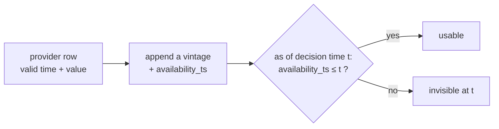

# Part 03 — Point-in-time storage, the run context and the run manifest

**Goal:** three foundations every stage relies on:

1. an **as-of query** that returns only what was knowable at the decision time;
2. a **run context** that gives each run an ID, a time-zone-aware decision time and its own folder;
3. a **manifest** that records what happened, written safely after every stage.

**Design:** §3 (data timing: *"a query as of time t must return only versions with availability timestamp a ≤ t"*) and §16 (every run creates a unique `run_id` and records its configuration, lineage, statuses and outputs).

---

## 3.1 Why "as of" is the most important function in the project

Most backtest disasters are look-ahead bugs: the model is shown something it could not have known on the day. The classic case is a **restatement**. A company reports Q4 revenue of 100 on 20 January and restates it to 90 on 10 March. A backtest for 1 February that uses "the Q4 revenue" from today's database sees 90, which nobody knew on 1 February.

The fix is to store every version with an availability timestamp and always query *as of* the decision time:



**File:** `src/aqp_python/storage/vintage_store.py`

```python
"""Point-in-time queries: only rows whose availability_ts <= decision time may be used."""
from collections.abc import Sequence
from datetime import datetime

import pandas as pd


def as_of(frame: pd.DataFrame, decision_time: datetime,
          column: str = "availability_ts") -> pd.DataFrame:
    """Return the rows that were knowable at `decision_time`."""
    if decision_time.tzinfo is None:
        raise ValueError("decision_time must be timezone-aware")
    if column not in frame.columns:
        raise ValueError(f"missing availability column '{column}'")
    available = pd.to_datetime(frame[column], utc=True)
    return frame.loc[available <= pd.Timestamp(decision_time)].copy()


def latest_vintage(frame: pd.DataFrame, decision_time: datetime,
                   keys: Sequence[str]) -> pd.DataFrame:
    """For each logical key keep the most recent version knowable at the decision time.

    A restatement published later describes an old period but was NOT known then,
    so it must be excluded - sorting by the period date alone would leak it.
    """
    eligible = as_of(frame, decision_time)
    return (eligible.sort_values("availability_ts", kind="mergesort")
            .drop_duplicates(list(keys), keep="last")
            .reset_index(drop=True))
```

- `as_of` refuses a naive (time-zone-less) decision time, because comparing a naive time with UTC timestamps is ambiguous by up to a day.
- `latest_vintage` keeps the *most recently published* version per logical key **among those already published**. Sorting by availability (not by the period described) is what excludes the March restatement for a February decision. `kind="mergesort"` is a stable sort, so ties keep their file order and the result is deterministic.

## 3.2 Run folders

**File:** `src/aqp_python/storage/storage_paths.py`

```python
"""Every path the pipeline writes to is built here - nowhere else."""
import re
from dataclasses import dataclass
from pathlib import Path

RUN_SUBFOLDERS = (
    "data_lineage", "universe", "forecasts", "validation", "portfolio", "sizing",
    "execution", "safety", "monitoring", "plots", "reports",
)
_RUN_ID_PATTERN = re.compile(r"^[0-9]{8}T[0-9]{6}Z_[0-9a-f]{8}$")


def project_root(start: Path | None = None) -> Path:
    """Walk upwards until a folder containing pyproject.toml is found."""
    candidate = (start or Path.cwd()).resolve()
    for folder in (candidate, *candidate.parents):
        if (folder / "pyproject.toml").is_file():
            return folder
    raise FileNotFoundError(f"No pyproject.toml above {candidate}; run from inside AQP-PYTHON")


@dataclass(frozen=True)
class RunPaths:
    root: Path      # the run folder: <output_root>/runs/<run_id>

    @classmethod
    def for_run(cls, output_root: Path, run_id: str) -> "RunPaths":
        if not _RUN_ID_PATTERN.match(run_id):
            raise ValueError(f"run_id has an unexpected format: {run_id!r}")
        return cls(Path(output_root) / "runs" / run_id)

    def create(self) -> None:
        """Create the run folder once. A run folder is never reused or overwritten."""
        self.root.mkdir(parents=True, exist_ok=False)
        for name in RUN_SUBFOLDERS:
            (self.root / name).mkdir()

    def sub(self, folder: str, filename: str) -> Path:
        if folder not in RUN_SUBFOLDERS:
            raise ValueError(f"unknown run subfolder: {folder}")
        return self.root / folder / filename

    @property
    def manifest(self) -> Path:
        return self.root / "run_manifest.json"

    @property
    def config_snapshot(self) -> Path:
        return self.root / "config_snapshot.yaml"
```

- `RUN_SUBFOLDERS` is the folder layout from design §16 and overview §10. Every stage writes only through `paths.sub(folder, filename)`, so an output can never end up in an unexpected place.
- `for_run` validates the run ID against a strict pattern, so a malformed ID (for example `../../escape`) cannot create a folder outside `outputs\runs`.
- `create()` uses `exist_ok=False`. A run folder is created exactly once and **never reused**: two runs can never overwrite each other's evidence.

## 3.3 The run context

Build `run_context.py` in pieces. First, the imports and the run ID:

**File:** `src/aqp_python/orchestration/run_context.py` — top of file, `new_run_id`

```python
"""Identity and settings of one run, passed to every stage."""
from dataclasses import dataclass
from datetime import UTC, date, datetime, time
from pathlib import Path
from typing import Any
from uuid import uuid4
from zoneinfo import ZoneInfo

import pandas as pd

from aqp_python.config.config_loader import config_hash, load_pipeline_config
from aqp_python.config.config_validation import validate_config
from aqp_python.storage.storage_paths import RunPaths
from aqp_python.version import get_code_revision


def new_run_id(now: datetime | None = None) -> str:
    """UTC timestamp for humans plus a random suffix so two runs never collide."""
    moment = now or datetime.now(UTC)
    if moment.tzinfo is None:
        raise ValueError("run timestamp must be timezone-aware")
    stamp = moment.astimezone(UTC).strftime("%Y%m%dT%H%M%SZ")
    return f"{stamp}_{uuid4().hex[:8]}"
```

`20261016T060000Z_1f2e3d4c` contains a sortable UTC timestamp for humans and 8 random hex characters, so two runs started in the same second still get different IDs.

**File:** `src/aqp_python/orchestration/run_context.py` — `resolve_decision_time`

```python
def resolve_decision_time(as_of: date, pipeline_cfg: dict[str, Any]) -> datetime:
    """Combine a trading date with the configured local decision time, e.g. 17:00 Sydney."""
    hour, minute = (int(part) for part in pipeline_cfg["decision_time_local"].split(":"))
    zone = ZoneInfo(pipeline_cfg["timezone"])
    return datetime.combine(as_of, time(hour, minute), tzinfo=zone)
```

`as_of` is a plain trading date. The decision is taken at 17:00 Sydney time on that date. `ZoneInfo` handles daylight saving: 17:00 in October is UTC+11 and 17:00 in June is UTC+10. This is why `tzdata` is a dependency on Windows.

**File:** `src/aqp_python/orchestration/run_context.py` — `RunContext`

```python
@dataclass(frozen=True)
class RunContext:
    run_id: str
    sleeve: str
    mode: str
    decision_time: datetime
    project_root: Path
    config: dict[str, Any]
    config_hash: str
    code_revision: str
    paths: RunPaths

    def __post_init__(self) -> None:
        if self.decision_time.tzinfo is None:
            raise ValueError("decision_time must be timezone-aware")
        if self.mode not in {"research", "paper"}:
            raise ValueError(f"unsupported mode: {self.mode}")

    @property
    def decision_date(self) -> pd.Timestamp:
        """The trading date (naive, local) on which the decision is taken."""
        return pd.Timestamp(self.decision_time.date())

    def resolve(self, relative: str) -> Path:
        """Resolve a config path such as 'data/samples' against the project root."""
        return (self.project_root / relative).resolve()
```

The context is **frozen**: no stage can change the decision time or the configuration halfway through a run. `decision_date` gives the naive trading date used to index daily tables. `resolve()` turns config paths such as `data/samples` into absolute paths under the project root, so the pipeline behaves the same whatever folder you launch it from.

**File:** `src/aqp_python/orchestration/run_context.py` — `create_context`

```python
def create_context(config_path: Path, sleeve: str, as_of: date, project_root: Path,
                   mode: str | None = None) -> RunContext:
    """Load + validate config, create a fresh run folder and return the context for one run."""
    config = load_pipeline_config(config_path, sleeve)
    if mode is not None:
        config["pipeline"]["mode"] = mode
    validate_config(config)
    run_id = new_run_id()
    paths = RunPaths.for_run(project_root / config["pipeline"]["output_root"], run_id)
    paths.create()
    return RunContext(run_id=run_id, sleeve=sleeve, mode=config["pipeline"]["mode"],
                      decision_time=resolve_decision_time(as_of, config["pipeline"]),
                      project_root=project_root, config=config, config_hash=config_hash(config),
                      code_revision=get_code_revision(project_root), paths=paths)
```

This is the one way to start a run: load and validate the configuration, create the run ID and folder, and record the configuration hash and code revision. Tests use the same function (Part 04), so they exercise the same path as real runs.

## 3.4 The common stage result

**File:** `src/aqp_python/orchestration/stage_status.py`

```python
"""The common return type of every stage service."""
from dataclasses import dataclass, field
from typing import Any

from aqp_python.contracts.run_status import RunStatus
from aqp_python.gates.gate_result import GateResult


@dataclass
class StageResult:
    stage: str
    status: RunStatus = RunStatus.PASS
    reason_codes: list[str] = field(default_factory=list)
    warnings: list[str] = field(default_factory=list)
    artifacts: dict[str, str] = field(default_factory=dict)   # name -> path relative to run folder
    metrics: dict[str, Any] = field(default_factory=dict)
    gates: list[GateResult] = field(default_factory=list)
    lineage: dict[str, Any] = field(default_factory=dict)   # input provenance (Stage 00)

    def block(self, code: str, message: str) -> "StageResult":
        """Mark the stage BLOCKED. A block can never be downgraded afterwards."""
        self.status = RunStatus.BLOCKED
        self.reason_codes.append(str(code))
        self.warnings.append(message)
        return self

    def degrade(self, code: str, message: str) -> "StageResult":
        if self.status != RunStatus.BLOCKED:
            self.status = RunStatus.DEGRADED
        self.reason_codes.append(str(code))
        self.warnings.append(message)
        return self

    def to_dict(self) -> dict[str, Any]:
        return {
            "stage": self.stage, "status": str(self.status),
            "reason_codes": list(dict.fromkeys(self.reason_codes)),
            "warnings": self.warnings, "artifacts": self.artifacts, "metrics": self.metrics,
        }
```

Every stage's `run_stage` function returns a `StageResult` (plus its typed output). Two rules are built into the methods:

- `block()` can be called at any time. `degrade()` **never downgrades a block**, because a `BLOCKED` stage must not later be reported as `DEGRADED` or `PASS` (an invariant in design §16).
- `artifacts` are paths *relative to the run folder*, so a run folder can be moved or zipped and still make sense.

## 3.5 The manifest

The manifest's shape is a contract:

**File:** `src/aqp_python/contracts/run_manifest.py`

```python
"""Shape of run_manifest.json. The writer lives in orchestration/run_manifest_writer.py."""
from typing import Any

MANIFEST_SCHEMA_VERSION = "1.0"


def initial_manifest(*, run_id: str, sleeve: str, mode: str, decision_time: str,
                     config_hash: str, code_revision: str, package_version: str,
                     started_at: str) -> dict[str, Any]:
    return {
        "schema_version": MANIFEST_SCHEMA_VERSION,
        "run_id": run_id,
        "sleeve": sleeve,
        "mode": mode,
        "decision_time": decision_time,
        "config_hash": config_hash,
        "code_revision": code_revision,
        "package_version": package_version,
        "started_at": started_at,
        "finished_at": None,
        "status": "RUNNING",
        "stages": [],
        "gates": [],
        "artifacts": {},
        "lineage": {},
        "warnings": [],
    }
```

The writer fills it in:

**File:** `src/aqp_python/orchestration/run_manifest_writer.py`

```python
"""Writes run_manifest.json atomically after every stage."""
import json
import os
from datetime import UTC, datetime
from pathlib import Path
from typing import Any

from aqp_python.contracts.run_status import RunStatus, worst_status
from aqp_python.orchestration.stage_status import StageResult


class ManifestWriter:
    def __init__(self, path: Path, manifest: dict[str, Any]) -> None:
        self.path = path
        self.manifest = manifest
        self._statuses: list[RunStatus] = []
        self.write()

    def write(self) -> None:
        """Write to a temporary file then rename, so a crash never leaves half a JSON file."""
        temporary = self.path.with_suffix(".json.tmp")
        temporary.write_text(json.dumps(self.manifest, indent=2, default=str), encoding="utf-8")
        os.replace(temporary, self.path)

    def record_stage(self, result: StageResult, started: datetime, finished: datetime) -> None:
        if self.manifest["finished_at"] is not None:
            raise RuntimeError("manifest is final; a finished run cannot be modified")
        entry = result.to_dict()
        entry["started_at"] = started.isoformat()
        entry["seconds"] = round((finished - started).total_seconds(), 3)
        self.manifest["stages"].append(entry)
        self.manifest["gates"].extend(gate.to_dict() for gate in result.gates)
        for name, relative in result.artifacts.items():
            self.manifest["artifacts"][f"{result.stage}.{name}"] = relative
        self.manifest["warnings"].extend(f"{result.stage}: {w}" for w in result.warnings)
        if result.lineage:
            self.manifest["lineage"][result.stage] = result.lineage
        self._statuses.append(result.status)
        self.write()

    def finish(self, extra_statuses: list[RunStatus] | None = None) -> RunStatus:
        status = worst_status(self._statuses + list(extra_statuses or []))
        self.manifest["status"] = str(status)
        self.manifest["finished_at"] = datetime.now(UTC).isoformat()
        self.write()
        return status

    def record_report(self, status: str, detail: str = "") -> None:
        """Report compilation happens after the run status is final and cannot change it."""
        self.manifest["report"] = {"status": status, "detail": detail}
        self.write()
```

- **Atomic writes.** JSON is written to `run_manifest.json.tmp` and then renamed with `os.replace`. On Windows and Linux the rename is atomic, so a crash leaves either the old complete file or the new complete file, never half a file.
- **The manifest is rewritten after every stage.** If the process dies during Stage 05, the manifest still shows Stages 00 to 04 and their artifacts.
- **`finish()` is final.** After it runs, `record_stage` raises an error. `record_report` is the one exception: the report is compiled after the status is final, and it records only whether the report itself succeeded. It cannot change the run status.

## 3.6 Try it

Create a context by hand and look at what it made:

```powershell
python -c "from datetime import date; from pathlib import Path; from aqp_python.orchestration.run_context import create_context; c = create_context(Path('configs/pipeline.yaml'), 'asx_interday', date(2026, 10, 16), Path.cwd()); print(c.run_id); print(c.decision_time); print(c.paths.root)"
```

```text
20261018T071436Z_626e7519
2026-10-16 17:00:00+11:00
C:\Users\you\Documents\AQP-PYTHON\outputs\runs\20261018T071436Z_626e7519
```

```powershell
Get-ChildItem .\outputs\runs -Directory | Sort-Object Name | Select-Object -Last 1 | Get-ChildItem
```

You should see the 11 empty subfolders. Delete this experiment with `Remove-Item -Recurse -Force .\outputs` (it is generated output and is ignored by Git).

## 3.7 Tests

**File:** `tests/unit/test_storage.py`

```python
import json
from datetime import UTC, datetime

import pandas as pd
import pytest

from aqp_python.orchestration.run_context import new_run_id
from aqp_python.orchestration.run_manifest_writer import ManifestWriter
from aqp_python.orchestration.stage_status import StageResult
from aqp_python.storage.storage_paths import RunPaths
from aqp_python.storage.vintage_store import as_of, latest_vintage

pytestmark = pytest.mark.batch01
UTC = UTC


def test_as_of_excludes_rows_not_yet_available():
    frame = pd.DataFrame({"security_id": ["A", "A"], "value": [10.0, 12.0],
                          "availability_ts": pd.to_datetime(["2026-01-02", "2026-02-01"], utc=True)})
    assert as_of(frame, datetime(2026, 1, 15, tzinfo=UTC))["value"].tolist() == [10.0]


def test_as_of_rejects_naive_decision_time():
    frame = pd.DataFrame({"availability_ts": pd.to_datetime(["2026-01-02"], utc=True)})
    with pytest.raises(ValueError, match="timezone"):
        as_of(frame, datetime(2026, 1, 15))


def test_latest_vintage_ignores_a_restatement_published_later():
    frame = pd.DataFrame({
        "security_id": ["A", "A"], "period": ["2025Q4", "2025Q4"], "revenue": [100.0, 90.0],
        "availability_ts": pd.to_datetime(["2026-01-20", "2026-03-10"], utc=True)})
    early = latest_vintage(frame, datetime(2026, 2, 1, tzinfo=UTC), ["security_id", "period"])
    late = latest_vintage(frame, datetime(2026, 4, 1, tzinfo=UTC), ["security_id", "period"])
    assert early["revenue"].item() == 100.0 and late["revenue"].item() == 90.0


def test_run_folder_is_created_once(tmp_path):
    paths = RunPaths.for_run(tmp_path, new_run_id())
    paths.create()
    assert (paths.root / "forecasts").is_dir()
    with pytest.raises(FileExistsError):
        paths.create()


def test_run_id_format_is_enforced(tmp_path):
    with pytest.raises(ValueError):
        RunPaths.for_run(tmp_path, "../../escape")


def test_manifest_is_final_after_finish(tmp_path):
    writer = ManifestWriter(tmp_path / "m.json", {"finished_at": None, "stages": [], "gates": [],
                                                  "artifacts": {}, "warnings": [], "status": "RUNNING"})
    now = datetime.now(UTC)
    writer.record_stage(StageResult("a").block("X", "broken"), now, now)
    writer.record_stage(StageResult("b"), now, now)
    assert writer.finish() == "BLOCKED"
    assert json.loads((tmp_path / "m.json").read_text())["status"] == "BLOCKED"
    with pytest.raises(RuntimeError):
        writer.record_stage(StageResult("c"), now, now)
```

`test_latest_vintage_ignores_a_restatement_published_later` is the restatement example from 3.1 as code. Read it until it is obvious why `early` sees 100 and `late` sees 90.

The first permanent **invariant** joins the suite. Invariants live in `tests\invariants\` and must pass in every release, whatever else changes:

**File:** `tests/invariants/test_status_semantics.py`

```python
import pytest

from aqp_python.contracts.run_status import RunStatus, TradeDecision
from aqp_python.orchestration.stage_status import StageResult

pytestmark = pytest.mark.invariant


def test_blocked_can_never_be_downgraded():
    result = StageResult("x").block("A", "first failure")
    result.degrade("B", "later fallback")
    assert result.status == RunStatus.BLOCKED


def test_run_status_and_trade_decision_are_different_vocabularies():
    assert not set(map(str, RunStatus)) & set(map(str, TradeDecision))
```

```powershell
python -m pytest tests\unit\test_storage.py tests\invariants\test_status_semantics.py -q
python -m pytest -m batch01 -q
```

```text
8 passed
20 passed          # 14 from Part 02 + 6 storage tests (the invariant is not a batch01 test)
```

## Checkpoint

- [ ] You can explain why `latest_vintage` sorts by `availability_ts`.
- [ ] Creating a run folder twice raises `FileExistsError`.
- [ ] A finished manifest cannot be modified.

```powershell
git add .
git commit -m "Vintage store, run folders, run context, stage result and atomic manifest"
```

Next: [Part 04 — Stage 00 point-in-time data](04_stage00_point_in_time_data.md).
