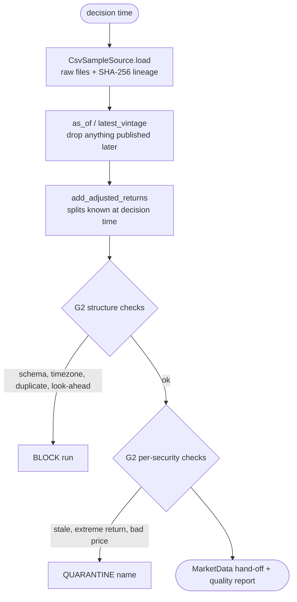

# Part 04 — Stage 00: point-in-time data and the G2 data-integrity gate

**Goal:** turn raw files into one validated, point-in-time, split-adjusted view of the market, and decide what to do about bad data: **block** the run, **quarantine** a security, or **warn**.

**Design:** §3. *"Store each fact with valid time and availability timestamp"*; *"raw prices are preserved; adjustment factors are applied on read"*; the G2 severity table (block / quarantine / warn).



---

## 4.1 A market designed to break things

You cannot test a data gate on clean data. The synthetic generator plants one problem for each check in the design:

| Security | What happens | Who should catch it | Expected result |
|---|---|---|---|
| SYN05 | delisted 2023-09-01, before universe formation | Stage 01 | rejected at formation: `NOT_LISTED` |
| SYN07 | 15% distress probability | Stage 01 / G1 | rejected: `DIST` |
| SYN09 | tiny volume with frequent zero-volume days | Stage 01 / G1 | rejected: `LIQ` |
| SYN11 | 2-for-1 split on 2024-05-13, announced 2024-04-22 | Stage 00 split adjustment | **no** false −50% return |
| SYN13 | a new reference vintage on 2026-08-03 raises distress to 25% | vintage store + Stage 01 | mandatory exit `EXIT-DIST` |
| SYN17 | one wrong print (×1.8) ten days before the end | Stage 00 / G2 | quarantined: `DATA_EXTREME_RETURN` |
| SYN21 | listed 2025-01-15 | Stage 01 / G1 | rejected: `HIST` |
| SYN25 | stops trading 8 days before the end, still listed | G2 and G1 | quarantined `DATA_STALE` + exit `EXIT-SUSP` |
| SYN30 | delisted 2026-03-02, after formation | Stage 01 / G1 | mandatory exit `EXIT-DLST` |

Returns follow a simple factor model, `r_it = α_it + β_i m_t + s_{sector,t} + ε_it`, with a calm/stress volatility regime in 2022. The **planted signal** `α_it = 0.0004·quality_i − 0.09·(last 5 days' excess return)` gives a quality drift and a short-term reversal. It is weak enough that only a careful model detects it after costs, and `--no-signal` removes it so you can watch the pipeline correctly refuse to trade (Part 11).

## 4.2 The generator

Create `src\aqp_python\stages\stage_00_data\synthetic_market.py`. Start with the scenario table as constants:

**File:** `src/aqp_python/stages/stage_00_data/synthetic_market.py` — top of file, `_availability`

```python
"""Deterministic synthetic ASX-like market used for tests and the first end-to-end runs.

The data is fake but deliberately awkward: it contains a delisted name, a late
listing, an illiquid name, a distressed name, a stock split, a bad price print
and a suspension, so every gate has something real to catch. It also contains a
weak, planted predictive signal (short-term reversal and a quality effect) so
the validation stage has something genuine to find. Nothing here says anything
about real markets.
"""
from pathlib import Path

import numpy as np
import pandas as pd

TIMEZONE = "Australia/Sydney"
PUBLICATION_TIME = "16:30"          # close data becomes usable 30 minutes after the auction
SECTORS = ("Financials", "Materials", "Health Care", "Industrials", "Consumer", "Technology")

# Named special cases (security_id -> scenario). See module docstring.
DELISTED_BEFORE_FORMATION = ("SYN05", "2023-09-01")
DELISTED_AFTER_FORMATION = ("SYN30", "2026-03-02")
LATE_LISTING = ("SYN21", "2025-01-15")
ILLIQUID = "SYN09"
DISTRESSED = "SYN07"
DISTRESS_REVISION = ("SYN13", "2026-08-03", 0.25)   # new reference vintage after formation
SPLIT = ("SYN11", "2024-05-13", "2024-04-22", 2.0)   # ex-date, announcement, ratio
BAD_PRINT_DAYS_BEFORE_END = ("SYN17", 10)
SUSPENDED_DAYS_BEFORE_END = ("SYN25", 8)

# Planted signal. Set both to 0.0 to get a market in which no model should pass G3.
QUALITY_ALPHA = 0.0004     # daily drift per unit of quality score
REVERSAL_STRENGTH = 0.09   # share of last week's excess move that reverses each day


def _availability(dates: pd.Series | pd.DatetimeIndex) -> pd.Series:
    local = pd.to_datetime(pd.Series(dates).dt.strftime("%Y-%m-%d") + f" {PUBLICATION_TIME}")
    return local.dt.tz_localize(TIMEZONE).dt.tz_convert("UTC")
```

`_availability` stamps every daily row with **16:30 Sydney time**, converted to UTC. That single line makes the data point-in-time: a decision at 17:00 can use that day's close, and a decision at 16:00 cannot.

**File:** `src/aqp_python/stages/stage_00_data/synthetic_market.py` — `generate_market`

```python
def generate_market(seed: int = 7, start: str = "2022-01-03", end: str = "2026-10-16",
                    n_securities: int = 40, quality_alpha: float = QUALITY_ALPHA,
                    reversal_strength: float = REVERSAL_STRENGTH) -> dict[str, pd.DataFrame]:
    rng = np.random.default_rng(seed)
    dates = pd.bdate_range(start, end)
    n_days, n = len(dates), n_securities
    ids = [f"SYN{i + 1:02d}" for i in range(n)]
    sectors = [SECTORS[i % len(SECTORS)] for i in range(n)]
    sector_index = np.array([SECTORS.index(s) for s in sectors])

    # --- static characteristics -------------------------------------------------------
    beta = rng.uniform(0.7, 1.3, n)
    idio_vol = rng.uniform(0.012, 0.022, n)
    quality = rng.normal(0.0, 1.0, n)
    distress = rng.uniform(0.005, 0.05, n)
    distress[ids.index(DISTRESSED)] = 0.15
    dollar_volume_median = np.exp(rng.normal(np.log(8e6), 0.6, n))
    dollar_volume_median[ids.index(ILLIQUID)] = 2e5
    start_price = rng.uniform(5.0, 60.0, n)
    revenue = rng.dirichlet([3.0, 1.5, 1.0], n)        # AU, US, CN revenue shares

    listing = pd.Series(pd.Timestamp(start), index=ids)
    listing[LATE_LISTING[0]] = pd.Timestamp(LATE_LISTING[1])
    delisting = pd.Series(pd.NaT, index=ids, dtype="datetime64[ns]")
    for security_id, day in (DELISTED_BEFORE_FORMATION, DELISTED_AFTER_FORMATION):
        delisting[security_id] = pd.Timestamp(day)

    # --- daily returns with factor structure and a planted signal ------------------
    stress = (dates >= "2022-05-02") & (dates <= "2022-07-29")
    market_vol = np.where(stress, 0.018, 0.009)
    market = rng.normal(0.0003, 1.0, n_days) * market_vol
    sector_factor = rng.normal(0.0, 0.006, (n_days, len(SECTORS)))
    noise = rng.normal(0.0, 1.0, (n_days, n)) * idio_vol
    returns = np.zeros((n_days, n))
    for t in range(n_days):
        past = returns[max(0, t - 5):t]
        past_excess = (past - past.mean(axis=1, keepdims=True)).sum(axis=0) if len(past) else 0.0
        alpha = quality_alpha * quality - reversal_strength * past_excess   # planted signal
        returns[t] = alpha + beta * market[t] + sector_factor[t, sector_index] + noise[t]

    listed = np.array([[listing[s] <= d and (pd.isna(delisting[s]) or d < delisting[s])
                        for s in ids] for d in dates])
    suspended_id, suspended_days = SUSPENDED_DAYS_BEFORE_END
    listed_trading = listed.copy()
    listed_trading[-suspended_days:, ids.index(suspended_id)] = False

    benchmark_return = np.nanmean(np.where(listed, returns, np.nan), axis=1)

    # --- prices, volumes, split and bad print -------------------------------------------
    rows = []
    split_id, split_ex, _, split_ratio = SPLIT
    bad_id, bad_offset = BAD_PRINT_DAYS_BEFORE_END
    for j, security_id in enumerate(ids):
        mask = listed_trading[:, j]
        true_close = start_price[j] * np.cumprod(1.0 + np.where(listed[:, j], returns[:, j], 0.0))
        raw_close = true_close.copy()
        if security_id == split_id:
            raw_close[dates >= split_ex] /= split_ratio
        if security_id == bad_id:
            raw_close[n_days - bad_offset] *= 1.8                 # one wrong print, not a real move
        dollar_volume = dollar_volume_median[j] * np.exp(rng.normal(0.0, 0.35, n_days))
        if security_id == ILLIQUID:
            dollar_volume[rng.uniform(size=n_days) < 0.10] = 0.0  # frequent zero-volume days
        volume = np.round(dollar_volume / raw_close)
        for t in np.flatnonzero(mask):
            rows.append((security_id, dates[t], raw_close[t], volume[t]))

    prices = pd.DataFrame(rows, columns=["security_id", "date", "close", "volume"])
    prices["close"] = prices["close"].round(4)
    prices["availability_ts"] = _availability(prices["date"]).to_numpy()
    prices["currency"] = "AUD"
    prices["source"] = "synthetic"
    prices = prices[["security_id", "date", "availability_ts", "close", "volume", "currency", "source"]]

    benchmark = pd.DataFrame({"date": dates, "benchmark_return": benchmark_return})
    benchmark["availability_ts"] = _availability(benchmark["date"]).to_numpy()
    benchmark = benchmark[["date", "availability_ts", "benchmark_return"]]

    reference = pd.DataFrame({
        "security_id": ids, "name": [f"Synthetic Company {i[3:]}" for i in ids],
        "sector": sectors, "listing_date": listing.to_numpy(),
        "delisting_date": delisting.to_numpy(), "currency": "AUD",
        "distress_probability": distress.round(4), "quality_score": quality.round(4),
        "revenue_share_au": revenue[:, 0].round(4), "revenue_share_us": revenue[:, 1].round(4),
        "revenue_share_cn": revenue[:, 2].round(4),
    })
    reference["availability_ts"] = pd.Timestamp(start, tz="UTC") - pd.Timedelta(days=1)
    revision = reference.loc[reference["security_id"] == DISTRESS_REVISION[0]].copy()
    revision["distress_probability"] = DISTRESS_REVISION[2]
    revision["availability_ts"] = pd.Timestamp(DISTRESS_REVISION[1], tz="UTC")
    reference = pd.concat([reference, revision], ignore_index=True)
    reference["availability_ts"] = pd.to_datetime(reference["availability_ts"], utc=True)

    actions = pd.DataFrame({
        "security_id": [split_id], "ex_date": [pd.Timestamp(split_ex)],
        "split_ratio": [split_ratio],
        "availability_ts": [pd.Timestamp(SPLIT[2], tz="UTC")],
    })
    return {"prices": prices, "benchmark": benchmark, "reference": reference,
            "corporate_actions": actions}
```

Points worth slowing down for:

- `rng = np.random.default_rng(seed)` creates one seeded generator, so the same seed always produces the same market. Tests depend on that.
- The return loop is sequential because the reversal term depends on the previous five days. `past_excess` subtracts the cross-sectional mean, so it is an *excess* move, which is what a benchmark-relative model can predict.
- The split divides **raw** prices after the ex-date while the true returns are unchanged. Stage 00 must undo that using the corporate-action file.
- `reference` gets a **second row** for SYN13, available from 2026-08-03. Both vintages are kept; nothing is overwritten.

**File:** `src/aqp_python/stages/stage_00_data/synthetic_market.py` — `write_sample_data`

```python
def write_sample_data(folder: Path, seed: int = 7, **signal: float) -> dict[str, Path]:
    """Write the four CSV files. Timestamps are stored as ISO-8601 with a UTC offset."""
    folder = Path(folder)
    folder.mkdir(parents=True, exist_ok=True)
    written = {}
    for name, frame in generate_market(seed=seed, **signal).items():
        frame = frame.copy()
        for column in frame.columns:
            if isinstance(frame[column].dtype, pd.DatetimeTZDtype):
                frame[column] = frame[column].dt.strftime("%Y-%m-%dT%H:%M:%S%z")
            elif pd.api.types.is_datetime64_any_dtype(frame[column]):
                frame[column] = frame[column].dt.strftime("%Y-%m-%d")
        path = folder / f"{name}.csv"
        frame.to_csv(path, index=False)
        written[name] = path
    return written
```

Timestamps are written as ISO-8601 with an explicit offset (`2022-01-03T05:30:00+0000`), so nobody has to guess the time zone when the file is read back.

Now build the data:

```powershell
python -m aqp_python.cli build-sample-data
```

```text
wrote prices             -> data\samples\prices.csv
wrote benchmark          -> data\samples\benchmark.csv
wrote reference          -> data\samples\reference.csv
wrote corporate_actions  -> data\samples\corporate_actions.csv
```

Look at it the way the pipeline will:

```powershell
Import-Csv .\data\samples\prices.csv | Select-Object -First 3 | Format-Table
Import-Csv .\data\samples\reference.csv | Where-Object security_id -eq SYN13 | Format-Table security_id, distress_probability, availability_ts
```

The second command shows the two SYN13 vintages: `0.0xxx` available from 2022 and `0.25` available from 2026-08-03.

## 4.3 The Stage 00 hand-off contract

Add `MarketData` to the bottom of `contracts\data_schemas.py`:

**File:** `src/aqp_python/contracts/data_schemas.py` — `MarketData`

```python
@dataclass(frozen=True)
class MarketData:
    """Stage 00 output: validated, point-in-time, split-adjusted data."""
    prices: pd.DataFrame          # PRICE_COLUMNS + adj_close, return, dollar_volume
    benchmark: pd.DataFrame       # BENCHMARK_COLUMNS
    reference: pd.DataFrame       # latest reference vintage per security
    reference_vintages: pd.DataFrame  # every reference vintage known at decision time
    trading_days: pd.DatetimeIndex
    quarantined: frozenset[str]     # names excluded for this run by G2
```

Later stages receive this object and nothing else from Stage 00. They never reopen the CSV files themselves. That is the overview's rule *"hand-offs go through contract-typed datasets"*, and it means Stage 01 cannot accidentally read data that Stage 00 filtered out.

## 4.4 The data source boundary

**File:** `src/aqp_python/connectors/connector_base.py`

```python
"""Data sources. Stage 00 only ever talks to this interface, never to a provider SDK."""
import hashlib
from dataclasses import dataclass
from pathlib import Path
from typing import Protocol

import pandas as pd

from aqp_python.contracts.data_schemas import (
    BENCHMARK_COLUMNS,
    CORPORATE_ACTION_COLUMNS,
    PRICE_COLUMNS,
    REFERENCE_COLUMNS,
    require_columns,
)


@dataclass(frozen=True)
class RawMarketData:
    prices: pd.DataFrame
    benchmark: pd.DataFrame
    reference: pd.DataFrame
    corporate_actions: pd.DataFrame
    lineage: dict


class MarketDataSource(Protocol):
    name: str

    def load(self) -> RawMarketData: ...


def _sha256(path: Path) -> str:
    return hashlib.sha256(path.read_bytes()).hexdigest()


class CsvSampleSource:
    """Reads the synthetic CSV files written by scripts/build_sample_data.py."""

    name = "synthetic_csv"
    FILES = ("prices.csv", "benchmark.csv", "reference.csv", "corporate_actions.csv")

    def __init__(self, folder: Path) -> None:
        self.folder = Path(folder)

    def load(self) -> RawMarketData:
        missing = [name for name in self.FILES if not (self.folder / name).is_file()]
        if missing:
            raise FileNotFoundError(
                f"Sample data missing in {self.folder}: {missing}. "
                "Run: python scripts/build_sample_data.py")
        read = {name: pd.read_csv(self.folder / name) for name in self.FILES}
        for name, columns in zip(self.FILES, (PRICE_COLUMNS, BENCHMARK_COLUMNS, REFERENCE_COLUMNS,
                                              CORPORATE_ACTION_COLUMNS)):
            require_columns(read[name], columns, name)
        prices = read["prices.csv"]
        prices["date"] = pd.to_datetime(prices["date"])
        prices["availability_ts"] = pd.to_datetime(prices["availability_ts"], utc=True)
        benchmark = read["benchmark.csv"]
        benchmark["date"] = pd.to_datetime(benchmark["date"])
        benchmark["availability_ts"] = pd.to_datetime(benchmark["availability_ts"], utc=True)
        reference = read["reference.csv"]
        for column in ("listing_date", "delisting_date"):
            reference[column] = pd.to_datetime(reference[column])
        reference["availability_ts"] = pd.to_datetime(reference["availability_ts"], utc=True)
        actions = read["corporate_actions.csv"]
        actions["ex_date"] = pd.to_datetime(actions["ex_date"])
        actions["availability_ts"] = pd.to_datetime(actions["availability_ts"], utc=True)
        lineage = {
            name: {"path": str(self.folder / name), "rows": len(read[name]),
                   "sha256": _sha256(self.folder / name), "provider": self.name}
            for name in self.FILES
        }
        return RawMarketData(prices, benchmark, reference, actions, lineage)
```

`MarketDataSource` is a `Protocol`: anything with a `name` and a `load()` that returns `RawMarketData` can be used. Today that is `CsvSampleSource`; Part 12 adds an LSEG source with the same shape, and nothing downstream changes. The lineage dictionary (file path, row count, SHA-256) goes into the run manifest. Part 11's replay script uses those hashes to prove the inputs have not changed.

## 4.5 Calendar and corporate actions

**File:** `src/aqp_python/stages/stage_00_data/calendar_manager.py`

```python
"""Trading calendar. The benchmark's dates are the official trading days of the sleeve."""
import pandas as pd


def trading_days(benchmark: pd.DataFrame) -> pd.DatetimeIndex:
    days = pd.DatetimeIndex(pd.to_datetime(benchmark["date"])).sort_values().unique()
    if days.empty:
        raise ValueError("benchmark has no dates; cannot build a trading calendar")
    return days
```

The benchmark's dates are the sleeve's official trading days. A US sleeve would take its calendar from its own benchmark.

**File:** `src/aqp_python/stages/stage_00_data/corporate_actions.py`

```python
"""Raw prices are preserved; split adjustments are applied on read, point-in-time."""
from datetime import datetime

import numpy as np
import pandas as pd

from aqp_python.storage.vintage_store import as_of


def add_adjusted_returns(prices: pd.DataFrame, actions: pd.DataFrame,
                         decision_time: datetime) -> pd.DataFrame:
    """Add `return`, `adj_close` and `dollar_volume` using only actions known at decision time.

    On an ex-date with ratio k (k new shares per old share) the raw close drops by
    a factor k, so the economic return is close_t * k / close_{t-1} - 1.
    An action announced after the decision time is NOT applied, which is exactly
    what a system running on that day would have seen.
    """
    known = as_of(actions, decision_time)
    frame = prices.sort_values(["security_id", "date"], kind="mergesort").reset_index(drop=True)
    ratio = pd.Series(1.0, index=frame.index)
    for action in known.itertuples(index=False):
        hit = (frame["security_id"] == action.security_id) & (frame["date"] == action.ex_date)
        ratio[hit] = float(action.split_ratio)
    previous_close = frame.groupby("security_id")["close"].shift(1)
    frame["return"] = frame["close"] * ratio / previous_close - 1.0

    # Backward adjustment factor: divide earlier prices by every later split ratio.
    later_ratio = (ratio.groupby(frame["security_id"])
                   .transform(lambda r: r[::-1].cumprod()[::-1].shift(-1, fill_value=1.0)))
    frame["adj_close"] = frame["close"] / later_ratio
    frame["dollar_volume"] = frame["close"] * frame["volume"]
    frame["return"] = frame["return"].replace([np.inf, -np.inf], np.nan)
    return frame
```

The algebra: on an ex-date with ratio `k` (2.0 for a 2-for-1 split), the raw close drops by a factor `k`, so the economic return is `close_t · k / close_{t−1} − 1`. Two design rules are visible in the code:

- **Raw prices are never modified.** `close` stays as published; `adj_close` and `return` are new columns.
- **Only actions known at the decision time are applied** (`as_of(actions, decision_time)`). A system running on 1 April 2024 did not know about the split announced on 22 April, so the backtest must not know either. If you make the announcement date later than the ex-date, G2 will (correctly) see a −50% "return" and quarantine the name.

## 4.6 The G2 gate

**File:** `src/aqp_python/gates/g2_data_integrity.py`

```python
"""G2 - data integrity. Block the run for structural faults; quarantine names for local faults."""
from datetime import datetime

import numpy as np
import pandas as pd

from aqp_python.contracts.data_schemas import PRICE_COLUMNS
from aqp_python.contracts.reason_codes import ReasonCode as RC
from aqp_python.gates.gate_result import GateOutcome, GateResult

GATE = "G2"


def check_structure(prices: pd.DataFrame, decision_time: datetime) -> list[GateResult]:
    """Run-level checks. Any failure here is a BLOCK: the data cannot be trusted at all."""
    missing = sorted(set(PRICE_COLUMNS) - set(prices.columns))
    if missing:
        return [GateResult(GATE, GateOutcome.BLOCK, "run", (RC.DATA_SCHEMA,), f"missing {missing}")]
    availability = prices["availability_ts"]
    if not isinstance(availability.dtype, pd.DatetimeTZDtype):
        return [GateResult(GATE, GateOutcome.BLOCK, "run", (RC.DATA_TIMEZONE,),
                           "availability_ts must be timezone-aware")]
    results = []
    duplicates = int(prices.duplicated(["security_id", "date"]).sum())
    if duplicates:
        results.append(GateResult(GATE, GateOutcome.BLOCK, "run", (RC.DATA_DUPLICATE,),
                                  f"{duplicates} duplicate (security_id, date) rows"))
    future = int((availability > pd.Timestamp(decision_time)).sum())
    if future:
        results.append(GateResult(GATE, GateOutcome.BLOCK, "run", (RC.DATA_LOOKAHEAD,),
                                  f"{future} rows were not available at the decision time"))
    return results


def check_securities(prices: pd.DataFrame, listed: set[str], decision_date: pd.Timestamp,
                     rules: dict) -> list[GateResult]:
    """Per-security checks. Failures QUARANTINE that name for this run only.

    `prices` must already carry split-adjusted returns in column 'return'.
    """
    results = []
    lookback_start = decision_date - pd.offsets.BDay(rules["extreme_lookback_days"])
    for security_id, rows in prices.groupby("security_id", sort=True):
        codes, notes = [], []
        if (rows["close"] <= 0).any():
            codes.append(RC.DATA_NONPOSITIVE_PRICE)
        if security_id in listed:
            last_date = rows["date"].max()
            stale_days = len(pd.bdate_range(last_date, decision_date)) - 1
            if stale_days > rules["max_staleness_days"]:
                codes.append(RC.DATA_STALE)
                notes.append(f"last price {last_date.date()} ({stale_days} business days old)")
        recent = rows.loc[rows["date"] >= lookback_start, "return"].abs()
        if np.nanmax(recent.to_numpy(), initial=0.0) > rules["extreme_return_abs"]:
            codes.append(RC.DATA_EXTREME_RETURN)
            notes.append(f"max |return| {recent.max():.2f} in last {rules['extreme_lookback_days']} days")
        if codes:
            results.append(GateResult(GATE, GateOutcome.QUARANTINE, str(security_id),
                                      tuple(codes), "; ".join(notes)))
    return results
```

The split into two functions mirrors the design's severity table:

| Function | Faults | Outcome | Why |
|---|---|---|---|
| `check_structure` | missing columns, naive time zone, duplicate keys, rows from after the decision time | `BLOCK` the run | The whole dataset is untrustworthy: one wrong time zone shifts every row. |
| `check_securities` | non-positive price, stale price for a listed name, unexplained extreme return | `QUARANTINE` that name | The problem is local; exclude the name for this run and keep an audit trail. |

The look-ahead check looks redundant, because `as_of` already removed future rows. It is a **second line of defence**: if someone later edits Stage 00 and forgets `as_of`, G2 blocks the run instead of silently leaking the future.

**File:** `src/aqp_python/stages/stage_00_data/data_validator.py`

```python
"""Stage 00 validation: run G2 and decide which names are quarantined."""
from datetime import datetime

import pandas as pd

from aqp_python.gates.g2_data_integrity import check_securities, check_structure
from aqp_python.gates.gate_result import GateOutcome, GateResult


def listed_at(reference: pd.DataFrame, date: pd.Timestamp) -> set[str]:
    listed = (reference["listing_date"] <= date) & (
        reference["delisting_date"].isna() | (reference["delisting_date"] > date))
    return set(reference.loc[listed, "security_id"])


def validate_market_data(prices: pd.DataFrame, reference: pd.DataFrame,
                         decision_time: datetime, decision_date: pd.Timestamp,
                         rules: dict) -> tuple[list[GateResult], frozenset[str]]:
    """Return all G2 results and the set of quarantined securities."""
    results = check_structure(prices, decision_time)
    if any(result.outcome == GateOutcome.BLOCK for result in results):
        return results, frozenset()
    results += check_securities(prices, listed_at(reference, decision_date), decision_date, rules)
    quarantined = frozenset(r.subject for r in results if r.outcome == GateOutcome.QUARANTINE)
    results.insert(0, GateResult("G2", GateOutcome.PASS, "run", (), "structure checks passed"))
    return results, quarantined
```

`listed_at` matters for staleness. A delisted name *should* have no recent prices; only a name that is still listed but has stopped printing is suspicious.

**File:** `src/aqp_python/stages/stage_00_data/data_quality_report.py`

```python
"""One row per security describing what Stage 00 saw - written to data_lineage/."""
import pandas as pd

from aqp_python.gates.gate_result import GateResult


def build_quality_report(prices: pd.DataFrame, trading_days: pd.DatetimeIndex,
                         gate_results: list[GateResult]) -> pd.DataFrame:
    codes = {r.subject: ";".join(map(str, r.reason_codes)) for r in gate_results if r.subject != "run"}
    rows = []
    for security_id, group in prices.groupby("security_id", sort=True):
        first, last = group["date"].min(), group["date"].max()
        expected = int(((trading_days >= first) & (trading_days <= last)).sum())
        rows.append({
            "security_id": security_id,
            "first_date": first.date(), "last_date": last.date(), "rows": len(group),
            "missing_ratio": round(1 - len(group) / expected, 4) if expected else 1.0,
            "max_abs_return": round(float(group["return"].abs().max()), 4),
            "median_dollar_volume": round(float(group["dollar_volume"].median()), 0),
            "quarantined": security_id in codes,
            "reason_codes": codes.get(security_id, ""),
        })
    return pd.DataFrame(rows)
```

## 4.7 The Stage 00 service

Every stage exposes one function, `run_stage(ctx, ...)`. It returns a `StageResult`, plus the stage's hand-off object if it has one (`(StageResult, MarketData)` here). The orchestrator (Part 11) calls only these functions.

**File:** `src/aqp_python/stages/stage_00_data/service.py`

```python
"""Stage 00 entry point: load -> as-of filter -> adjust -> validate (G2) -> hand off."""
import logging

import pandas as pd

from aqp_python.connectors.connector_base import CsvSampleSource
from aqp_python.contracts.data_schemas import MarketData
from aqp_python.contracts.reason_codes import ReasonCode as RC
from aqp_python.gates.gate_result import GateOutcome
from aqp_python.orchestration.run_context import RunContext
from aqp_python.orchestration.stage_status import StageResult
from aqp_python.stages.stage_00_data.calendar_manager import trading_days
from aqp_python.stages.stage_00_data.corporate_actions import add_adjusted_returns
from aqp_python.stages.stage_00_data.data_quality_report import build_quality_report
from aqp_python.stages.stage_00_data.data_validator import validate_market_data
from aqp_python.storage.vintage_store import as_of, latest_vintage

log = logging.getLogger(__name__)
STAGE = "stage_00_data"


def run_stage(ctx: RunContext) -> tuple[StageResult, MarketData | None]:
    result = StageResult(STAGE)
    source = CsvSampleSource(ctx.resolve(ctx.config["pipeline"]["data_dir"]))
    raw = source.load()
    result.lineage = raw.lineage            # file paths, row counts and SHA-256 hashes

    # 1. Point-in-time view: nothing published after the decision time survives.
    prices = as_of(raw.prices, ctx.decision_time)
    benchmark = as_of(raw.benchmark, ctx.decision_time)
    reference_vintages = as_of(raw.reference, ctx.decision_time)
    reference = latest_vintage(reference_vintages, ctx.decision_time, keys=["security_id"])
    days = trading_days(benchmark)

    # 2. Split adjustment on read, then G2.
    prices = add_adjusted_returns(prices, raw.corporate_actions, ctx.decision_time)
    gates, quarantined = validate_market_data(
        prices, reference, ctx.decision_time, ctx.decision_date,
        ctx.config["gates"]["g2_data_integrity"])
    result.gates.extend(gates)

    report = build_quality_report(prices, days, gates)
    report.to_csv(ctx.paths.sub("data_lineage", "data_quality_summary.csv"), index=False)
    result.artifacts["data_quality_summary"] = "data_lineage/data_quality_summary.csv"
    pd.DataFrame([g.to_dict() for g in gates if g.outcome == GateOutcome.QUARANTINE]).to_csv(
        ctx.paths.sub("data_lineage", "quarantine.csv"), index=False)
    result.artifacts["quarantine"] = "data_lineage/quarantine.csv"

    blocking = [code for g in gates if g.outcome == GateOutcome.BLOCK for code in g.reason_codes]
    if blocking:
        result.reason_codes.extend(map(str, blocking[1:]))
        return result.block(blocking[0], "G2 blocked the run; see gates in the manifest"), None
    if days[-1] != ctx.decision_date:
        return result.block(RC.DATA_STALE, f"no benchmark data for {ctx.decision_date.date()}"), None

    result.metrics.update({"securities": int(prices["security_id"].nunique()),
                           "rows": len(prices), "quarantined": sorted(quarantined)})
    if quarantined:
        result.warnings.append(f"quarantined for this run: {sorted(quarantined)}")
    log.info("Stage 00: %d securities, %d quarantined", result.metrics["securities"], len(quarantined))
    return result, MarketData(prices, benchmark, reference, reference_vintages, days, quarantined)
```

Read it top to bottom as the flowchart at the start of this part: load, filter as of the decision time, adjust, validate, write the quality report and quarantine list, then either block or hand off. Two details:

- `reference_vintages` (every version known today) is passed on as well as `reference` (the latest version), because Stage 01 needs to reconstruct what was known on the *formation* date.
- If there is no benchmark row for the decision date, the run is blocked. You cannot make a 16 October decision with data that ends on 15 October.

## 4.8 Tests

Unit tests for G2 and the split logic, on tiny hand-made tables where you can check every number:

**File:** `tests/unit/test_data_validator.py`

```python
from datetime import UTC, datetime

import pandas as pd
import pytest

from aqp_python.contracts.reason_codes import ReasonCode as RC
from aqp_python.gates.g2_data_integrity import check_securities, check_structure
from aqp_python.gates.gate_result import GateOutcome
from aqp_python.stages.stage_00_data.corporate_actions import add_adjusted_returns

pytestmark = pytest.mark.batch01
DECISION = datetime(2026, 1, 10, 6, 0, tzinfo=UTC)
RULES = {"max_staleness_days": 3, "extreme_return_abs": 0.4, "extreme_lookback_days": 60}


def prices(closes, start="2026-01-01", sid="A"):
    dates = pd.bdate_range(start, periods=len(closes))
    return pd.DataFrame({"security_id": sid, "date": dates, "close": closes, "volume": 1000.0,
                         "availability_ts": pd.to_datetime(dates, utc=True), "currency": "AUD",
                         "source": "test"})


def codes(results):
    return {code for r in results for code in r.reason_codes}


def test_duplicate_rows_block_the_run():
    frame = prices([10, 11, 12])
    frame = pd.concat([frame, frame.iloc[[0]]])
    assert RC.DATA_DUPLICATE in codes(check_structure(frame, DECISION))


def test_future_rows_block_the_run():
    frame = prices([10, 11, 12], start="2026-01-09")      # 2026-01-13 is after the decision
    assert RC.DATA_LOOKAHEAD in codes(check_structure(frame, DECISION))


def test_naive_timestamps_block_the_run():
    frame = prices([10, 11])
    frame["availability_ts"] = frame["availability_ts"].dt.tz_localize(None)
    assert RC.DATA_TIMEZONE in codes(check_structure(frame, DECISION))


def test_extreme_unexplained_return_quarantines_the_name():
    frame = prices([10, 10, 18, 10, 10])
    frame["return"] = frame["close"].pct_change()
    result = check_securities(frame, {"A"}, frame["date"].max(), RULES)
    assert result[0].outcome == GateOutcome.QUARANTINE and RC.DATA_EXTREME_RETURN in result[0].reason_codes


def test_stale_listed_name_is_quarantined():
    frame = prices([10, 10, 10])
    frame["return"] = 0.0
    result = check_securities(frame, {"A"}, pd.Timestamp("2026-01-12"), RULES)
    assert RC.DATA_STALE in codes(result)


def test_known_split_is_not_mistaken_for_a_crash():
    frame = prices([20.0, 20.2, 10.1, 10.0])
    actions = pd.DataFrame({"security_id": ["A"], "ex_date": [frame["date"][2]], "split_ratio": [2.0],
                            "availability_ts": pd.to_datetime(["2025-12-01"], utc=True)})
    adjusted = add_adjusted_returns(frame, actions, DECISION)
    assert adjusted["return"].iloc[2] == pytest.approx(0.0, abs=1e-12)
    assert adjusted["adj_close"].iloc[0] == pytest.approx(10.0)


def test_split_announced_after_the_decision_is_not_applied():
    frame = prices([20.0, 20.2, 10.1])
    actions = pd.DataFrame({"security_id": ["A"], "ex_date": [frame["date"][2]], "split_ratio": [2.0],
                            "availability_ts": pd.to_datetime(["2026-06-01"], utc=True)})
    adjusted = add_adjusted_returns(frame, actions, DECISION)
    assert adjusted["return"].iloc[2] == pytest.approx(10.1 / 20.2 - 1)
```

Now the fixtures that give every integration test a fresh, throw-away copy of the project. Add them to `tests\conftest.py`, under the `config` fixture:

**File:** `tests/conftest.py` — `sample_data_dir`, `project`, `make_context`

```python
@pytest.fixture(scope="session")
def sample_data_dir(tmp_path_factory) -> Path:
    """Generate the synthetic market once per test session (imported lazily: built in Part 4)."""
    from aqp_python.stages.stage_00_data.synthetic_market import write_sample_data
    folder = tmp_path_factory.mktemp("samples")
    write_sample_data(folder)
    return folder


@pytest.fixture
def project(tmp_path, sample_data_dir, monkeypatch) -> Path:
    """A throw-away copy of the project (configs + sample data) used as the working directory."""
    shutil.copytree(REPO / "configs", tmp_path / "configs")
    shutil.copytree(sample_data_dir, tmp_path / "data" / "samples")
    (tmp_path / "pyproject.toml").write_text("[project]\nname = 'fixture'\n")
    monkeypatch.chdir(tmp_path)
    return tmp_path


@pytest.fixture
def make_context(project):
    """Factory for a RunContext whose run folder lives inside the throw-away project."""
    from aqp_python.orchestration.run_context import create_context

    def _make(mode: str = "research", as_of: date = AS_OF):
        return create_context(project / "configs" / "pipeline.yaml", "asx_interday", as_of, project, mode)
    return _make
```

`sample_data_dir` has `scope="session"`, so the synthetic market is generated once per pytest run (about 2 seconds), not once per test. `project` copies it with the configs into pytest's temporary folder and makes that the working directory (`monkeypatch.chdir`), so nothing a test writes can land in your real `outputs\`.

Finally, the **stage checkpoint file**. It grows by one test per part; this is where you watch each stage work on the whole synthetic market:

**File:** `tests/integration/test_stage_handoffs.py` — top of file, `run_through`, `test_stage_00_data`

```python
"""Stage-by-stage checkpoints on the synthetic market.

Each Part of the guide adds one test here. Run one with output visible, e.g.

    python -m pytest tests/integration/test_stage_handoffs.py -k stage_00 -s

`run_through` imports each stage only when it is reached, so this file works
while later stages do not exist yet.
"""
import pandas as pd
import pytest


def run_through(ctx, last: str) -> dict:
    """Run the stages in order up to and including `last`; return every stage's outputs."""
    out = {}
    from aqp_python.stages.stage_00_data import service as s00
    out["stage_00_data"], data = s00.run_stage(ctx)
    out["data"] = data
    if last == "stage_00_data":
        return out
    from aqp_python.stages.stage_01_universe import service as s01
    out["stage_01_universe"], universe = s01.run_stage(ctx, data)
    out["universe"] = universe
    if last == "stage_01_universe":
        return out
    from aqp_python.stages.stage_02_forecasting import service as s02
    out["stage_02_forecasting"], bundle = s02.run_stage(ctx, data, universe)
    out["bundle"] = bundle
    if last == "stage_02_forecasting":
        return out
    from aqp_python.stages.stage_02_forecasting.validation import service as s02e
    out["stage_02e_validation"], combined = s02e.run_stage(ctx, bundle, data.trading_days)
    out["combined"] = combined
    if last == "stage_02e_validation":
        return out
    from aqp_python.stages.stage_06_execution.portfolio_state import load_portfolio_state
    from aqp_python.stages.stages_03_04_portfolio import service as s0304
    state = load_portfolio_state(ctx, data)
    out["state"] = state
    out["stages_03_04_portfolio"], target = s0304.run_stage(ctx, data, combined, state)
    out["target"] = target
    if last == "stages_03_04_portfolio":
        return out
    from aqp_python.stages.stage_05_sizing import service as s05
    out["stage_05_sizing"], orders = s05.run_stage(ctx, data, universe, combined, target, state)
    out["orders"] = orders
    if last == "stage_05_sizing":
        return out
    from aqp_python.stages.stage_06_execution import service as s06
    out["stage_06_execution"] = s06.run_stage(ctx, data, orders, state)
    return out


@pytest.mark.batch01
def test_stage_00_data(make_context):
    ctx = make_context()
    out = run_through(ctx, "stage_00_data")
    result, data = out["stage_00_data"], out["data"]
    print("\nrun folder:", ctx.paths.root, "\nquarantined:", sorted(data.quarantined))
    assert result.status == "PASS"
    assert data.quarantined == {"SYN17", "SYN25"}            # bad print and suspension
    assert (data.prices["availability_ts"] <= pd.Timestamp(ctx.decision_time)).all()
    assert (ctx.paths.root / "data_lineage" / "data_quality_summary.csv").is_file()
```

`run_through` contains every stage, but each `import` sits inside the function just before the stage it loads. Asking for `"stage_00_data"` returns before any later import runs, so the file works now even though Stages 01 to 06 do not exist yet.

Run the unit tests, then the checkpoint with its output visible (`-s`). `--basetemp` puts pytest's temporary folders inside the project's `build\` folder, which Git ignores, so you can open the run folder it creates:

```powershell
python -m pytest tests\unit\test_data_validator.py -q
New-Item -ItemType Directory -Force build | Out-Null
python -m pytest tests\integration\test_stage_handoffs.py -k stage_00 -s --basetemp=build\pytest
```

```text
run folder: C:\...\AQP-PYTHON\build\pytest\test_stage_00_data0\outputs\runs\20261018T073737Z_6e9f5491
quarantined: ['SYN17', 'SYN25']
.
1 passed
```

Open the quality report from that run:

```powershell
$run = (Get-ChildItem .\build\pytest\test_stage_00_data0\outputs\runs -Directory)[0].FullName
Import-Csv "$run\data_lineage\data_quality_summary.csv" |
    Where-Object { $_.security_id -in 'SYN11','SYN17','SYN25','SYN30' } |
    Format-Table security_id, first_date, last_date, rows, max_abs_return, quarantined, reason_codes
```

```text
security_id first_date last_date  rows max_abs_return quarantined reason_codes
SYN11       2022-01-03 2026-10-16 1250 0.0652         False
SYN17       2022-01-03 2026-10-16 1250 0.8216         True        DATA_EXTREME_RETURN
SYN25       2022-01-03 2026-10-06 1242 0.073          True        DATA_STALE
SYN30       2022-01-03 2026-02-27 1085 0.063          False
```

SYN11's largest move is 6.5%, so the split was handled. SYN30 is delisted, so its old last price is correct and not "stale".

## Checkpoint

- [ ] `python -m pytest -m batch01 -q` → `28 passed`.
- [ ] The Stage 00 checkpoint quarantines exactly SYN17 and SYN25.
- [ ] Experiment: in `test_data_validator.py`, change the split announcement in `test_known_split_is_not_mistaken_for_a_crash` to `"2026-06-01"`. The test fails because the return becomes −50%. Undo the change.

```powershell
git add .
git commit -m "Stage 00: synthetic market, CSV source, split adjustment, G2 and quality report"
```

Next: [Part 05 — Stage 01 universe](05_stage01_universe.md).
