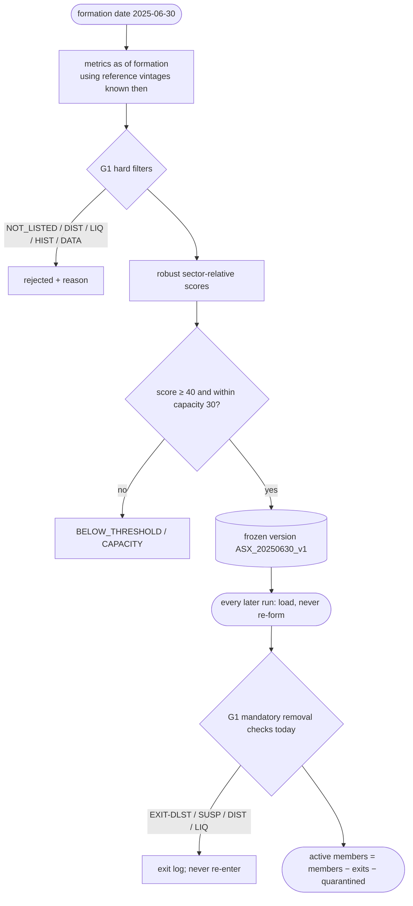

# Part 05 — Stage 01: a fixed, versioned research universe (G1)

**Goal:** choose the companies the research may study, **once per universe version**, with a reason code for every rejection. Afterwards, apply only the mandatory removals the design lists. A low score never removes a member, and a member that leaves never comes back within the version.

**Design:** §4. The order of filters is *corporate status / distress → liquidity → data depth → strategy classification → score → admission*. Also: *"Historical formation must include later-delisted companies to avoid survivorship bias"* and *"No score-based removal, replacement or re-entry is allowed within a universe version."*

**Selection is not forecasting.** Stage 01 never imports Stage 02. A name being in the universe means it may be *studied*, not that it will be *bought*. Part 11 enforces the import rule automatically.



---

## 5.1 Metrics, as of a date

**File:** `src/aqp_python/stages/stage_01_universe/universe_metrics.py` — top of file, `listed_mask`

```python
"""Point-in-time metrics used by formation filters, scoring and mandatory removals."""
import numpy as np
import pandas as pd


def listed_mask(reference: pd.DataFrame, date: pd.Timestamp) -> pd.Series:
    return (reference["listing_date"] <= date) & (
        reference["delisting_date"].isna() | (reference["delisting_date"] > date))
```

**File:** `src/aqp_python/stages/stage_01_universe/universe_metrics.py` — `compute_metrics`

```python
def compute_metrics(prices: pd.DataFrame, benchmark: pd.DataFrame, reference: pd.DataFrame,
                    trading_days: pd.DatetimeIndex, as_of_date: pd.Timestamp,
                    lookback_days: int) -> pd.DataFrame:
    """One row per security in `reference`, using only prices dated <= as_of_date."""
    prices = prices.loc[prices["date"] <= as_of_date]
    days = trading_days[trading_days <= as_of_date]
    recent_start = days[-lookback_days] if len(days) >= lookback_days else days[0]
    year_start = days[-252] if len(days) >= 252 else days[0]
    bench = benchmark.set_index("date")["benchmark_return"]
    listed = listed_mask(reference, as_of_date).to_numpy()

    rows = []
    for (security_id, ref), is_listed in zip(reference.set_index("security_id").iterrows(), listed):
        group = prices.loc[prices["security_id"] == security_id].set_index("date").sort_index()
        recent = group.loc[group.index >= recent_start]
        year = group.loc[group.index >= year_start]
        history = int(((days >= group.index.min()) & (days <= group.index.max())).sum()) if len(group) else 0
        row = {
            "security_id": security_id, "sector": ref["sector"], "listed": bool(is_listed),
            "distress_probability": float(ref["distress_probability"]),
            "quality_score": float(ref["quality_score"]),
            "history_days": len(group),
            "missing_ratio": 1 - len(group) / history if history else 1.0,
            "days_since_last_trade": int((days > group.index.max()).sum()) if len(group) else 10**6,
            "median_dollar_volume": float(recent["dollar_volume"].median()) if len(recent) else 0.0,
            "zero_volume_ratio": float((recent["volume"] <= 0).mean()) if len(recent) else 1.0,
        }
        r = year["return"].dropna()
        dollar = year["dollar_volume"].reindex(r.index)
        row["amihud_illiquidity"] = float((r.abs() / dollar.replace(0, np.nan)).mean() * 1e6) if len(r) else np.nan
        row["volatility_252"] = float(r.std() * np.sqrt(252)) if len(r) > 20 else np.nan
        row["log_dollar_volume"] = float(np.log1p(row["median_dollar_volume"]))
        b = bench.reindex(r.index)
        half = len(r) // 2
        if half > 40:
            betas = [np.cov(r.iloc[s], b.iloc[s])[0, 1] / b.iloc[s].var()
                     for s in (slice(0, half), slice(half, None))]
            row["beta_instability"] = float(abs(betas[1] - betas[0]))
        else:
            row["beta_instability"] = np.nan
        closes = group["adj_close"]
        if len(closes) > 252:
            row["momentum_12_1"] = float(closes.iloc[-22] / closes.iloc[-253] - 1)
        else:
            row["momentum_12_1"] = np.nan
        rows.append(row)
    return pd.DataFrame(rows).set_index("security_id")
```

The same function serves two purposes. It is called with the **formation date** to form the universe, and with **today's date** to check mandatory removals. It loops over the reference table, which includes companies that have since been delisted. That is the survivorship rule in practice: SYN05, delisted in 2023, is evaluated (and rejected as `NOT_LISTED`) instead of silently missing.

Metrics by category (design §4 table):

| Category | Metrics computed here | Direction |
|---|---|---|
| Liquidity | median daily dollar volume (log), Amihud illiquidity `mean(|r| / dollar volume)`, zero-volume ratio | +, −, − |
| Stability | annualised volatility, beta instability (difference between first- and second-half betas over the last year) | −, − |
| Suitability | quality score, distress probability | +, − |

Momentum 12-1 is computed too. It is not scored, but it is used for strategy classification.

## 5.2 The G1 gate

**File:** `src/aqp_python/gates/g1_universe.py`

```python
"""G1 - universe gate: hard formation filters and mandatory-removal checks."""
from collections.abc import Mapping

from aqp_python.contracts.reason_codes import ReasonCode as RC
from aqp_python.gates.gate_result import GateOutcome, GateResult

GATE = "G1"


def check_formation(security_id: str, metrics: Mapping, rules: Mapping) -> GateResult:
    """Ordered hard filters: corporate status -> distress -> liquidity -> history/data."""
    codes = []
    if not metrics["listed"]:
        codes.append(RC.NOT_LISTED)
    if metrics["distress_probability"] > rules["max_distress_probability"]:
        codes.append(RC.DIST)
    if (metrics["median_dollar_volume"] < rules["min_median_dollar_volume"]
            or metrics["zero_volume_ratio"] > rules["max_zero_volume_ratio"]):
        codes.append(RC.LIQ)
    if metrics["history_days"] < rules["min_history_days"]:
        codes.append(RC.HIST)
    if metrics["missing_ratio"] > rules["max_missing_ratio"]:
        codes.append(RC.DATA)
    if codes:
        return GateResult(GATE, GateOutcome.BLOCK, security_id, tuple(codes), "rejected at formation")
    return GateResult(GATE, GateOutcome.PASS, security_id)


def check_membership(security_id: str, metrics: Mapping, rules: Mapping) -> GateResult:
    """Existing members may only leave for mandatory reasons - never because of a score."""
    removal = rules["mandatory_removal"]
    codes = []
    if not metrics["listed"]:
        codes.append(RC.EXIT_DLST)
    elif metrics["days_since_last_trade"] > removal["suspension_days"]:
        codes.append(RC.EXIT_SUSP)
    if metrics["distress_probability"] > removal["distress_probability"]:
        codes.append(RC.EXIT_DIST)
    floor = removal["liquidity_floor_ratio"] * rules["min_median_dollar_volume"]
    if metrics["median_dollar_volume"] < floor:
        codes.append(RC.EXIT_LIQ)
    if codes:
        return GateResult(GATE, GateOutcome.BLOCK, security_id, tuple(codes), "mandatory removal")
    return GateResult(GATE, GateOutcome.PASS, security_id)
```

`check_formation` is the hard filter: fail any test and you are out, whatever your score. `check_membership` is the **only** way an existing member can leave, and its codes are exactly the design's exit codes. Note what it does *not* check: score. A member whose composite score falls from 70 to 30 stays.

Overview note: the repository overview plans separate files (`corporate_status_filter.py`, `distress_screen.py`, `liquidity_screen.py`, `data_history_check.py`). Each would be about five lines, so they are combined in the gate here. Split them out if they grow (Appendix B).

## 5.3 Robust, sector-relative scoring

Design §4:

```text
z_ij = (x_ij − median_s(x_j)) / (1.4826 · MAD_s(x_j))         robust z-score within sector s
C_ik = Σ_{j∈k} ω_jk Φ(d_j z_ij)                                category score, 0..1
S_i  = 100 Σ_k w_k C_ik                                        composite score, 0..100
```

`1.4826 · MAD` estimates the standard deviation for normal data, but a single outlier barely moves it, unlike the ordinary standard deviation. `Φ` (the standard normal CDF) squashes each z into 0..1, so no single extreme metric dominates. `d_j` flips metrics where lower is better.

**File:** `src/aqp_python/stages/stage_01_universe/composite_score.py`

```python
"""Robust, sector-relative scoring: z = (x - median) / (1.4826 MAD), C = sum w Phi(d z), S = 100 sum w C."""
import numpy as np
import pandas as pd
from scipy.stats import norm


def robust_z(values: pd.Series, groups: pd.Series) -> pd.Series:
    """Standardise within each group; a group with no dispersion scores 0, not infinity."""
    def _one(x: pd.Series) -> pd.Series:
        median = x.median()
        mad = (x - median).abs().median() * 1.4826
        if not np.isfinite(mad) or mad == 0:
            return pd.Series(0.0, index=x.index)
        return (x - median) / mad
    return values.groupby(groups, group_keys=False).apply(_one).reindex(values.index)


def composite_scores(metrics: pd.DataFrame, category_metrics: dict,
                     category_weights: dict) -> pd.DataFrame:
    """Return one column per category score (0-1) plus `composite_score` (0-100)."""
    out = pd.DataFrame(index=metrics.index)
    for category, spec in category_metrics.items():
        total = pd.Series(0.0, index=metrics.index)
        for metric, (direction, weight) in spec.items():
            z = robust_z(metrics[metric].astype(float), metrics["sector"]).fillna(0.0)
            total += weight * norm.cdf(direction * z)
        out[f"score_{category}"] = total
    out["composite_score"] = 100 * sum(
        weight * out[f"score_{category}"] for category, weight in category_weights.items())
    return out
```

`robust_z` returns 0 for a group with no dispersion (MAD = 0) instead of dividing by zero. A missing metric is filled with `z = 0` (the sector median), which neither helps nor hurts.

**File:** `src/aqp_python/stages/stage_01_universe/strategy_classification.py`

```python
"""Route each admitted company to a modelling hypothesis. This is not a trade signal."""
import pandas as pd


def classify(metrics: pd.DataFrame, rules: dict) -> pd.Series:
    def _one(row: pd.Series) -> str:
        if abs(row.get("momentum_12_1", 0.0) or 0.0) >= rules["momentum_abs_threshold"]:
            return "momentum_trend"
        if row["quality_score"] >= rules["quality_threshold"]:
            return "quality_value"
        return "mean_reversion"
    return metrics.apply(_one, axis=1)
```

The classification routes a company to a modelling hypothesis (design §4 strategy table). In this build every member feeds the same forecast models; Part 12 shows how a class can select models.

## 5.4 Forming and freezing a version

**File:** `src/aqp_python/stages/stage_01_universe/universe_formation.py`

```python
"""Form a universe version once: hard filters (G1) -> scores -> threshold -> capacity."""
import pandas as pd

from aqp_python.contracts.data_schemas import UNIVERSE_MEMBER_COLUMNS
from aqp_python.contracts.reason_codes import ReasonCode as RC
from aqp_python.gates.g1_universe import check_formation
from aqp_python.gates.gate_result import GateResult
from aqp_python.stages.stage_01_universe.composite_score import composite_scores
from aqp_python.stages.stage_01_universe.strategy_classification import classify


def universe_id_for(market: str, rules: dict) -> str:
    return f"{market}_{pd.Timestamp(rules['formation_date']):%Y%m%d}_{rules['version_label']}"


def form_universe(metrics: pd.DataFrame, rules: dict) -> tuple[pd.DataFrame, pd.DataFrame, list[GateResult]]:
    """Return (members, decisions, gate_results). Every rejection has a reason code."""
    gates = [check_formation(sid, row, rules) for sid, row in metrics.iterrows()]
    decisions = metrics.copy()
    decisions["passed_hard_filters"] = [g.passed for g in gates]
    decisions["reason_codes"] = [";".join(map(str, g.reason_codes)) for g in gates]

    eligible = decisions.loc[decisions["passed_hard_filters"]]
    scores = composite_scores(eligible, rules["category_metrics"], rules["category_weights"])
    decisions = decisions.join(scores)
    decisions["strategy_class"] = classify(decisions, rules["strategy_rules"])

    ranked = decisions.loc[decisions["passed_hard_filters"]].sort_values("composite_score", ascending=False)
    above = ranked.loc[ranked["composite_score"] >= rules["admission_threshold"]]
    admitted = above.index[: rules["capacity"]]
    decisions["admitted"] = decisions.index.isin(admitted)
    below = ranked.index.difference(above.index)
    over_capacity = above.index[rules["capacity"]:]
    decisions.loc[below, "reason_codes"] = str(RC.BELOW_THRESHOLD)
    decisions.loc[over_capacity, "reason_codes"] = str(RC.CAPACITY)

    members = (decisions.loc[admitted].reset_index()
               .loc[:, list(UNIVERSE_MEMBER_COLUMNS)].sort_values("security_id"))
    return members.reset_index(drop=True), decisions.reset_index(), gates
```

Every candidate ends with exactly one outcome in `decisions`: rejected by a hard filter (with codes), `BELOW_THRESHOLD`, `CAPACITY`, or admitted. The universe ID encodes market, formation date and label (`ASX_20250630_v1`), so a deliberate re-formation (design §4) means changing `formation_date` or `version_label`, which creates a new ID.

**File:** `src/aqp_python/storage/universe_store.py`

```python
"""Frozen, versioned universe memberships. A saved version is never edited."""
import json
from pathlib import Path

import pandas as pd


def universe_folder(universe_dir: Path, universe_id: str) -> Path:
    return Path(universe_dir) / universe_id


def save_universe(universe_dir: Path, universe_id: str, members: pd.DataFrame,
                  decisions: pd.DataFrame, metadata: dict) -> Path:
    folder = universe_folder(universe_dir, universe_id)
    if folder.exists():
        raise FileExistsError(f"universe {universe_id} already exists; versions are immutable")
    folder.mkdir(parents=True)
    members.to_csv(folder / "members.csv", index=False)
    decisions.to_csv(folder / "formation_decisions.csv", index=False)
    (folder / "metadata.json").write_text(json.dumps(metadata, indent=2, default=str),
                                          encoding="utf-8")
    return folder


def load_universe(universe_dir: Path, universe_id: str) -> tuple[pd.DataFrame, dict]:
    folder = universe_folder(universe_dir, universe_id)
    if not folder.is_dir():
        raise FileNotFoundError(f"universe {universe_id} not found in {universe_dir}")
    members = pd.read_csv(folder / "members.csv")
    metadata = json.loads((folder / "metadata.json").read_text(encoding="utf-8"))
    return members, metadata


def append_exits(universe_dir: Path, universe_id: str, exits: pd.DataFrame) -> None:
    """Exits are logged next to the frozen membership; the membership file is untouched."""
    if exits.empty:
        return
    path = universe_folder(universe_dir, universe_id) / "exit_log.csv"
    previous = pd.read_csv(path) if path.is_file() else pd.DataFrame(columns=exits.columns)
    combined = pd.concat([previous, exits], ignore_index=True)
    combined = combined.drop_duplicates(["security_id"], keep="first")
    combined.to_csv(path, index=False)


def load_exits(universe_dir: Path, universe_id: str) -> pd.DataFrame:
    path = universe_folder(universe_dir, universe_id) / "exit_log.csv"
    return pd.read_csv(path) if path.is_file() else pd.DataFrame(columns=["security_id"])
```

`save_universe` raises `FileExistsError` if the version already exists: **versions are immutable**. Exits go to a separate `exit_log.csv` next to the membership, so `members.csv` is never edited. `drop_duplicates(keep="first")` keeps the *first* exit of a name, so its exit date never moves.

## 5.5 Mandatory removals

**File:** `src/aqp_python/stages/stage_01_universe/mandatory_removals.py`

```python
"""Members leave only for mandatory reasons, and never come back within a version."""
import pandas as pd

from aqp_python.gates.g1_universe import check_membership
from aqp_python.gates.gate_result import GateResult


def find_exits(members: list[str], metrics: pd.DataFrame, rules: dict,
               decision_date: pd.Timestamp) -> tuple[pd.DataFrame, list[GateResult]]:
    gates = [check_membership(sid, metrics.loc[sid], rules) for sid in members]
    exits = [{"security_id": g.subject, "exit_date": decision_date.date(),
              "reason_codes": ";".join(map(str, g.reason_codes))}
             for g in gates if not g.passed]
    return pd.DataFrame(exits, columns=["security_id", "exit_date", "reason_codes"]), gates
```

## 5.6 The Stage 01 hand-off and service

Add the universe contract to the bottom of `contracts\data_schemas.py`:

**File:** `src/aqp_python/contracts/data_schemas.py` — `UniverseSelection`

```python
# Universe hand-off: one row per member of a frozen universe version.
UNIVERSE_MEMBER_COLUMNS = ("security_id", "sector", "strategy_class", "composite_score")


@dataclass(frozen=True)
class UniverseSelection:
    """Stage 01 output: the frozen version and the members usable in this run."""
    universe_id: str
    members: pd.DataFrame         # UNIVERSE_MEMBER_COLUMNS, frozen at formation
    active_ids: tuple[str, ...]   # members minus mandatory exits minus quarantined names
```

**File:** `src/aqp_python/stages/stage_01_universe/service.py`

```python
"""Stage 01 entry point: load (or form once) the frozen universe, then apply mandatory exits."""
import logging

import pandas as pd

from aqp_python.contracts.data_schemas import MarketData, UniverseSelection
from aqp_python.contracts.reason_codes import ReasonCode as RC
from aqp_python.orchestration.run_context import RunContext, resolve_decision_time
from aqp_python.orchestration.stage_status import StageResult
from aqp_python.stages.stage_01_universe.mandatory_removals import find_exits
from aqp_python.stages.stage_01_universe.universe_formation import form_universe, universe_id_for
from aqp_python.stages.stage_01_universe.universe_metrics import compute_metrics
from aqp_python.storage.universe_store import (
    append_exits,
    load_exits,
    load_universe,
    save_universe,
    universe_folder,
)
from aqp_python.storage.vintage_store import latest_vintage

log = logging.getLogger(__name__)
STAGE = "stage_01_universe"


def _form(ctx: RunContext, data: MarketData, rules: dict, universe_dir, universe_id: str) -> None:
    formation_date = pd.Timestamp(rules["formation_date"])
    formation_time = resolve_decision_time(formation_date.date(), ctx.config["pipeline"])
    if formation_time > ctx.decision_time:
        raise ValueError("formation_date is after the decision time")
    # Formation uses only what was known on the formation date (including reference vintages).
    reference = latest_vintage(data.reference_vintages, formation_time, keys=["security_id"])
    metrics = compute_metrics(data.prices, data.benchmark, reference, data.trading_days,
                              formation_date, rules["liquidity_lookback_days"])
    members, decisions, _ = form_universe(metrics, rules)
    save_universe(universe_dir, universe_id, members, decisions, {
        "universe_id": universe_id, "formation_date": rules["formation_date"],
        "formed_in_run": ctx.run_id, "config_hash": ctx.config_hash, "members": len(members)})
    log.info("Formed universe %s with %d members", universe_id, len(members))


def run_stage(ctx: RunContext, data: MarketData) -> tuple[StageResult, UniverseSelection | None]:
    result = StageResult(STAGE)
    rules = ctx.config["universe"]
    universe_dir = ctx.resolve(ctx.config["pipeline"]["universe_dir"])
    universe_id = universe_id_for(ctx.config["sleeve"]["market"], rules)
    if not universe_folder(universe_dir, universe_id).is_dir():
        _form(ctx, data, rules, universe_dir, universe_id)
        result.metrics["formed_now"] = True
    members, metadata = load_universe(universe_dir, universe_id)

    # Mandatory removals at today's decision date, using today's reference vintage.
    already_exited = set(load_exits(universe_dir, universe_id)["security_id"])
    candidates = [s for s in members["security_id"] if s not in already_exited]
    metrics_now = compute_metrics(data.prices, data.benchmark, data.reference, data.trading_days,
                                  ctx.decision_date, rules["liquidity_lookback_days"])
    exits, gates = find_exits(candidates, metrics_now, rules, ctx.decision_date)
    append_exits(universe_dir, universe_id, exits)
    result.gates.extend(gates)
    all_exits = load_exits(universe_dir, universe_id)

    exited = set(all_exits["security_id"])
    active = tuple(sorted(set(members["security_id"]) - exited - data.quarantined))

    decisions = pd.read_csv(universe_folder(universe_dir, universe_id) / "formation_decisions.csv")
    members.to_csv(ctx.paths.sub("universe", "selected_companies.csv"), index=False)
    decisions.loc[~decisions["admitted"]].to_csv(ctx.paths.sub("universe", "exclusions.csv"), index=False)
    all_exits.to_csv(ctx.paths.sub("universe", "exits.csv"), index=False)
    pd.Series(active, name="security_id").to_csv(ctx.paths.sub("universe", "active_members.csv"), index=False)
    result.artifacts.update({"selected_companies": "universe/selected_companies.csv",
                             "exclusions": "universe/exclusions.csv", "exits": "universe/exits.csv",
                             "active_members": "universe/active_members.csv"})
    result.metrics.update({"universe_id": universe_id, "members": len(members),
                           "exits": sorted(exited), "active": len(active),
                           "formed_in_run": metadata["formed_in_run"]})
    if not active:
        return result.block(RC.EXIT_LIQ, "no active members remain in the universe"), None
    if len(exits):
        result.warnings.append(f"mandatory exits today: {exits['security_id'].tolist()}")
    return result, UniverseSelection(universe_id, members, active)
```

How the service keeps the universe fixed:

1. If the version folder does not exist, `_form` builds it **using only what was known on the formation date**. It rebuilds the reference table with `latest_vintage(..., formation_time)`, so SYN13's 2026 distress revision is invisible at formation. SYN13 is admitted in 2025 and must leave later through a mandatory exit.
2. Every run, including the one that formed it, then **loads** the version from disk. There is no code path that re-forms an existing version.
3. Mandatory removals use *today's* reference vintage and prices. New exits are appended to the log; earlier exits stay excluded.
4. Quarantined names (from Stage 00) are excluded from `active_ids` for this run only. They are not exits.

## 5.7 Tests

**File:** `tests/unit/test_universe.py`

```python
import pandas as pd
import pytest

from aqp_python.contracts.reason_codes import ReasonCode as RC
from aqp_python.gates.g1_universe import check_formation, check_membership
from aqp_python.stages.stage_01_universe.composite_score import composite_scores, robust_z

pytestmark = pytest.mark.batch02

RULES = {"max_distress_probability": 0.1, "min_median_dollar_volume": 1e6, "max_zero_volume_ratio": 0.05,
         "min_history_days": 500, "max_missing_ratio": 0.02,
         "mandatory_removal": {"distress_probability": 0.2, "suspension_days": 5, "liquidity_floor_ratio": 0.5}}
GOOD = {"listed": True, "distress_probability": 0.01, "median_dollar_volume": 5e6, "zero_volume_ratio": 0.0,
        "history_days": 800, "missing_ratio": 0.0, "days_since_last_trade": 0}


def test_robust_z_uses_median_and_mad_within_group():
    values = pd.Series([1.0, 2.0, 3.0, 100.0, 5.0, 5.0])
    groups = pd.Series(["a", "a", "a", "a", "b", "b"])
    z = robust_z(values, groups)
    # group a: median 2.5, MAD 1.0 -> z(2.0) = (2.0 - 2.5) / 1.4826; the outlier 100 barely matters
    assert z.iloc[1] == pytest.approx((2.0 - 2.5) / 1.4826)
    assert (z.iloc[4:] == 0).all()                 # no dispersion -> 0, never infinite


def test_direction_flips_the_score():
    metrics = pd.DataFrame({"sector": ["x"] * 3, "m": [1.0, 2.0, 3.0]}, index=["a", "b", "c"])
    up = composite_scores(metrics, {"cat": {"m": [1, 1.0]}}, {"cat": 1.0})["composite_score"]
    down = composite_scores(metrics, {"cat": {"m": [-1, 1.0]}}, {"cat": 1.0})["composite_score"]
    assert up["c"] > up["a"] and down["a"] > down["c"]
    assert up.between(0, 100).all()


@pytest.mark.parametrize("change, code", [
    ({"distress_probability": 0.3}, RC.DIST), ({"median_dollar_volume": 1e3}, RC.LIQ),
    ({"history_days": 100}, RC.HIST), ({"listed": False}, RC.NOT_LISTED)])
def test_formation_rejections_have_reason_codes(change, code):
    result = check_formation("X", {**GOOD, **change}, RULES)
    assert not result.passed and code in result.reason_codes


@pytest.mark.parametrize("change, code", [
    ({"listed": False}, RC.EXIT_DLST), ({"days_since_last_trade": 9}, RC.EXIT_SUSP),
    ({"distress_probability": 0.25}, RC.EXIT_DIST), ({"median_dollar_volume": 1e5}, RC.EXIT_LIQ)])
def test_mandatory_exits(change, code):
    assert code in check_membership("X", {**GOOD, **change}, RULES).reason_codes


def test_a_low_score_alone_is_not_an_exit():
    assert check_membership("X", GOOD, RULES).passed
```

`test_a_low_score_alone_is_not_an_exit` is the most important line in this file. It captures the design's "fixed membership" rule in a form that cannot be argued with later.

Add the Stage 01 checkpoint to `tests\integration\test_stage_handoffs.py`:

**File:** `tests/integration/test_stage_handoffs.py` — `test_stage_01_universe`

```python
@pytest.mark.batch02
def test_stage_01_universe(make_context):
    ctx = make_context()
    out = run_through(ctx, "stage_01_universe")
    universe, metrics = out["universe"], out["stage_01_universe"].metrics
    print("\nuniverse:", universe.universe_id, "members:", metrics["members"], "exits:", metrics["exits"])
    assert {"SYN13", "SYN25", "SYN30"} <= set(metrics["exits"])   # distress, suspension, delisting
    assert not set(universe.active_ids) & set(metrics["exits"])
    exclusions = pd.read_csv(ctx.paths.root / "universe" / "exclusions.csv").set_index("security_id")
    assert "DIST" in exclusions.loc["SYN07", "reason_codes"] and "LIQ" in exclusions.loc["SYN09", "reason_codes"]
```

```powershell
python -m pytest tests\unit\test_universe.py -q
python -m pytest tests\integration\test_stage_handoffs.py -k stage_01 -s --basetemp=build\pytest
```

```text
universe: ASX_20250630_v1 members: 27 exits: ['SYN13', 'SYN25', 'SYN30']
.
1 passed
```

Look at the frozen version and the run's universe artifacts:

```powershell
$root = ".\build\pytest\test_stage_01_universe0"
Get-ChildItem "$root\data\universes\ASX_20250630_v1"
Import-Csv "$root\data\universes\ASX_20250630_v1\exit_log.csv" | Format-Table
$run = (Get-ChildItem "$root\outputs\runs" -Directory)[0].FullName
Import-Csv "$run\universe\exclusions.csv" | Format-Table security_id, reason_codes, composite_score
```

```text
security_id exit_date  reason_codes
SYN13       2026-10-16 EXIT-DIST
SYN25       2026-10-16 EXIT-SUSP
SYN30       2026-10-16 EXIT-DLST;EXIT-LIQ

security_id reason_codes        composite_score
SYN02       BELOW_THRESHOLD     33.2...
SYN05       NOT_LISTED;LIQ;HIST
SYN07       DIST
SYN09       LIQ
SYN21       HIST
...
```

Every name that is not a member has a reason. Every exit has a code. The membership file itself never changes.

## Checkpoint

- [ ] `python -m pytest -m batch02 -q` → `12 passed`.
- [ ] SYN05, SYN07, SYN09 and SYN21 are rejected with `NOT_LISTED`, `DIST`, `LIQ` and `HIST`.
- [ ] SYN13, SYN25 and SYN30 are admitted at formation and exit later.

```powershell
git add .
git commit -m "Stage 01: universe metrics, G1, robust scoring, frozen versions and mandatory exits"
```

Next: [Part 06 — the validation framework](06_validation_framework.md).
