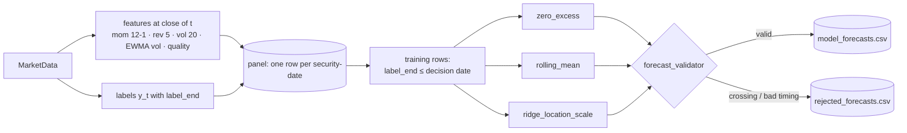

# Part 07 — Stage 02: the forecast contract, features, baselines and a candidate model

**Goal:** produce forecasts that every later stage can trust: one row per (model, security) on the shared quantile grid, with the decision time, horizon, target, label end, model version, feature version and training window attached. Build the **baselines first**, then one candidate that has to beat them.

**Design:** §5 (common forecast schema), §6 (Stage 2A financial layer: *"fit simple benchmarks first"*, *"standardise features inside each training fold"*).



---

## 7.1 The forecast contract

**File:** `src/aqp_python/contracts/forecast_schema.py` — top of file, `ForecastBundle`

```python
"""The common forecast contract: every model returns rows in this shape."""
from dataclasses import dataclass

import pandas as pd

from aqp_python.contracts.quantile_grid import QUANTILE_COLUMNS

FORECAST_ID_COLUMNS = (
    "security_id", "sleeve", "decision_time", "horizon_days", "target",
    "label_end", "model_name", "model_version", "feature_version",
    "train_start", "train_end",
)
FORECAST_COLUMNS = FORECAST_ID_COLUMNS + QUANTILE_COLUMNS
TARGET_NAME = "benchmark_excess_return"


@dataclass(frozen=True)
class ForecastBundle:
    """Stage 02 output.

    panel: features + labels for every (security, date) - the research history
    live:  one row per (model, active security) at the decision time, FORECAST_COLUMNS
    """
    panel: pd.DataFrame
    live: pd.DataFrame
    model_roles: dict[str, str]
    feature_version: str
```

Every forecast row carries the fields design §5 requires: security, sleeve, decision time, horizon, target definition, label end (for purging), model name and version, feature version and training window. Two hand-off objects are defined: `ForecastBundle` now, and `CombinedForecast` in Part 08.

## 7.2 Leakage-safe features

**File:** `src/aqp_python/stages/stage_02_forecasting/financial/financial_features.py`

```python
"""Leakage-safe price features. Every value at date t uses data up to the close of t only."""
import hashlib

import numpy as np
import pandas as pd

FEATURE_CODE_VERSION = "fin-1.0"
EWMA_LAMBDA = 0.94


def feature_version(features: list[str]) -> str:
    digest = hashlib.sha256(",".join(sorted(features)).encode()).hexdigest()[:8]
    return f"{FEATURE_CODE_VERSION}-{digest}"


def _long(wide: pd.DataFrame, name: str) -> pd.Series:
    """Wide (date x security) -> long Series indexed by (date, security_id), keeping NaN."""
    wide = wide.copy()
    wide.index.name = "date"
    long = wide.reset_index().melt(id_vars="date", var_name="security_id", value_name=name)
    return long.set_index(["date", "security_id"])[name]


def build_features(prices: pd.DataFrame, benchmark: pd.DataFrame, reference_vintages: pd.DataFrame,
                   trading_days: pd.DatetimeIndex) -> pd.DataFrame:
    close = prices.pivot(index="date", columns="security_id", values="adj_close").reindex(trading_days)
    ret = prices.pivot(index="date", columns="security_id", values="return").reindex(trading_days)
    bench = benchmark.set_index("date")["benchmark_return"].reindex(trading_days)
    excess = ret.sub(bench, axis=0)

    features = pd.concat([
        _long(close.shift(21) / close.shift(252) - 1.0, "mom_252_21"),      # 12-1 momentum
        _long(excess.rolling(5, min_periods=5).sum(), "rev_5"),              # last week's excess move
        _long(ret.rolling(20, min_periods=20).std(), "vol_20"),
        _long(np.sqrt((excess ** 2).ewm(alpha=1 - EWMA_LAMBDA, adjust=False,
                                         min_periods=20).mean()), "ewma_vol"),
    ], axis=1).reset_index()

    # Reference data joins point-in-time: each row sees the latest vintage available by then.
    vintages = reference_vintages[["security_id", "availability_ts", "quality_score"]].copy()
    vintages["available_date"] = (vintages["availability_ts"].dt.tz_convert("Australia/Sydney")
                                  .dt.tz_localize(None).dt.normalize())
    features = pd.merge_asof(features.sort_values("date"),
                             vintages.sort_values("available_date")
                             [["security_id", "available_date", "quality_score"]],
                             left_on="date", right_on="available_date", by="security_id",
                             direction="backward").drop(columns="available_date")
    return features.sort_values(["security_id", "date"]).reset_index(drop=True)
```

| Feature | Formula | Known at close of `t` because… |
|---|---|---|
| `mom_252_21` | `P_{t−21} / P_{t−252} − 1` (12-1 momentum) | it uses prices from 21 or more days ago |
| `rev_5` | sum of the last 5 daily excess returns | it ends at `t` |
| `vol_20` | 20-day return standard deviation | rolling window ending at `t` |
| `ewma_vol` | `sqrt(EWMA(excess²))`, λ = 0.94 | `adjust=False` is a recursive filter: past values only |
| `quality_score` | latest reference vintage available by `t` | `merge_asof(direction="backward")` |

Three habits prevent leaks:

1. **Wide tables indexed by the trading calendar.** `pivot(...).reindex(trading_days)` puts every security on the same dates, so `shift(21)` means 21 sessions, not "21 rows of whatever data this security has".
2. **Only backward-looking operations** (`shift(k ≥ 0)`, `rolling`, `ewm(adjust=False)`). A negative shift in a feature is a red flag.
3. **Reference data joins point-in-time.** `merge_asof` gives each row the latest vintage published on or before that date. Joining "the current quality score" onto all history would leak future revisions into the past.

`feature_version` hashes the feature list into the code version. If you change the features, every forecast says so.

## 7.3 Baselines

Design §6: *"Fit simple benchmarks first."* A candidate is worth something only if it beats these out of sample.

**File:** `src/aqp_python/stages/stage_02_forecasting/financial/baselines.py`

```python
"""Simple baselines first. A candidate model must beat these out of sample to earn weight.

All models share one interface:
    fit(train) -> self        train has feature columns, 'ewma_vol' and 'label'
    predict(rows) -> ndarray  shape (n_rows, 11) on QUANTILE_GRID
"""
import numpy as np
import pandas as pd
from scipy.stats import norm

from aqp_python.contracts.quantile_grid import QUANTILE_GRID

Z = norm.ppf(QUANTILE_GRID)


def horizon_scale(rows: pd.DataFrame, horizon: int) -> np.ndarray:
    """Volatility of an h-day excess return implied by the daily EWMA volatility."""
    return rows["ewma_vol"].to_numpy() * np.sqrt(horizon)


class ZeroExcessBaseline:
    """Median 0; spread from EWMA volatility with a training-fitted scale factor."""
    name = "zero_excess"

    def __init__(self, horizon: int, version: str = "1.0", **_: object) -> None:
        self.horizon, self.version = horizon, version
        self.scale_ = 1.0

    def fit(self, train: pd.DataFrame) -> "ZeroExcessBaseline":
        standardised = train["label"].to_numpy() / horizon_scale(train, self.horizon)
        self.scale_ = float(np.std(standardised))
        if not np.isfinite(self.scale_) or self.scale_ <= 0:
            raise ValueError("could not estimate a positive scale")
        return self

    def predict(self, rows: pd.DataFrame) -> np.ndarray:
        sigma = horizon_scale(rows, self.horizon)[:, None] * self.scale_
        return sigma * Z[None, :]


class RollingMeanBaseline(ZeroExcessBaseline):
    """Location = mean label over the most recent `window_days` of training data."""
    name = "rolling_mean"

    def __init__(self, horizon: int, version: str = "1.0", window_days: int = 252, **_: object) -> None:
        super().__init__(horizon, version)
        self.window_days = window_days
        self.mean_ = 0.0

    def fit(self, train: pd.DataFrame) -> "RollingMeanBaseline":
        super().fit(train)
        recent_dates = np.sort(train["date"].unique())[-self.window_days:]
        self.mean_ = float(train.loc[train["date"].isin(recent_dates), "label"].mean())
        return self

    def predict(self, rows: pd.DataFrame) -> np.ndarray:
        return self.mean_ + super().predict(rows)
```

All models share a two-method interface: `fit(train) -> self` and `predict(rows) -> array (n, 11)`. Both baselines use the same spread. The h-day volatility is `ewma_vol · √h`, multiplied by a scale factor fitted on the training fold, so their 90% intervals are already roughly calibrated. They differ only in location: zero, or the recent average label. That makes the comparison fair: a candidate cannot win just by having a better-calibrated spread.

## 7.4 A candidate model: volatility-standardised ridge with Student-t quantiles

Return noise scales with volatility, so the model works in volatility units:

```text
u_t  = y_t / (σ_t √h)                                    standardised label
x_t  = (features − mean_train) / std_train               standardised inside the training fold
β̂    = (XᵀX + αI)⁻¹ Xᵀu      (intercept not penalised)    ridge regression
s    = std(u − Xβ̂)                                        residual scale
q_τ  = σ_t √h · ( x_tᵀβ̂ + s · t_ν⁻¹(τ) · √((ν−2)/ν) )    Student-t quantiles with unit variance
```

The Student-t (ν = 5) gives fatter tails than the normal, as daily returns have. The `√((ν−2)/ν)` factor rescales it to variance 1, so `s` keeps its meaning. The quantiles are increasing by construction: they are a location plus increasing offsets.

**File:** `src/aqp_python/stages/stage_02_forecasting/financial/return_quantiles.py` — top of file, `RidgeLocationScale`

```python
"""Candidate return-quantile models."""
import numpy as np
import pandas as pd
from scipy.stats import t as student_t

from aqp_python.contracts.quantile_grid import QUANTILE_GRID
from aqp_python.stages.stage_02_forecasting.financial.baselines import horizon_scale


class RidgeLocationScale:
    """Volatility-standardised ridge regression with Student-t quantiles.

    u = label / (ewma_vol * sqrt(h)) is regressed on standardised features:
        beta = (X'X + alpha I)^-1 X'u
    Quantiles are  sigma_h * (x'beta + s * t_nu^-1(tau) * sqrt((nu-2)/nu)),
    where s is the residual standard deviation. Feature means and standard
    deviations are estimated on the training fold only.
    """
    name = "ridge_location_scale"

    def __init__(self, horizon: int, features: list[str], version: str = "1.0",
                 alpha: float = 10.0, t_dof: float = 5.0, **_: object) -> None:
        if t_dof <= 2:
            raise ValueError("t_dof must exceed 2 for a finite variance")
        self.horizon, self.features, self.version = horizon, list(features), version
        self.alpha, self.t_dof = alpha, t_dof

    def _design(self, rows: pd.DataFrame) -> np.ndarray:
        x = (rows[self.features].to_numpy() - self.mean_) / self.std_
        return np.column_stack([np.ones(len(rows)), x])

    def fit(self, train: pd.DataFrame) -> "RidgeLocationScale":
        self.mean_ = train[self.features].mean().to_numpy()
        self.std_ = train[self.features].std().replace(0, 1.0).to_numpy()
        x = self._design(train)
        u = train["label"].to_numpy() / horizon_scale(train, self.horizon)
        penalty = self.alpha * np.eye(x.shape[1])
        penalty[0, 0] = 0.0                                 # never shrink the intercept
        self.beta_ = np.linalg.solve(x.T @ x + penalty, x.T @ u)
        self.resid_std_ = float(np.std(u - x @ self.beta_))
        if not np.all(np.isfinite(self.beta_)) or self.resid_std_ <= 0:
            raise ValueError("ridge fit produced non-finite coefficients")
        return self

    def predict(self, rows: pd.DataFrame) -> np.ndarray:
        location = self._design(rows) @ self.beta_
        unit_t = student_t.ppf(QUANTILE_GRID, self.t_dof) * np.sqrt((self.t_dof - 2) / self.t_dof)
        standardised = location[:, None] + self.resid_std_ * unit_t[None, :]
        return horizon_scale(rows, self.horizon)[:, None] * standardised
```

The design also lists linear quantile regression. It is included, disabled in `forecast_models.yaml`, to show the *reject, don't repair* rule for crossing quantiles:

**File:** `src/aqp_python/stages/stage_02_forecasting/financial/return_quantiles.py` — `LinearQuantile`

```python
class LinearQuantile:
    """One linear quantile regression per grid point (scikit-learn QuantileRegressor).

    Separate fits can cross; crossed rows are rejected by the forecast validator,
    never silently sorted.
    """
    name = "linear_quantile"

    def __init__(self, horizon: int, features: list[str], version: str = "1.0",
                 alpha: float = 1e-4, max_train_rows: int = 4000, **_: object) -> None:
        self.horizon, self.features, self.version = horizon, list(features), version
        self.alpha, self.max_train_rows = alpha, max_train_rows

    def fit(self, train: pd.DataFrame) -> "LinearQuantile":
        from sklearn.linear_model import QuantileRegressor  # optional dependency, imported on use
        sample = train.sample(min(len(train), self.max_train_rows), random_state=0)
        self.mean_ = sample[self.features].mean().to_numpy()
        self.std_ = sample[self.features].std().replace(0, 1.0).to_numpy()
        x = (sample[self.features].to_numpy() - self.mean_) / self.std_
        u = sample["label"].to_numpy() / horizon_scale(sample, self.horizon)
        self.models_ = [QuantileRegressor(quantile=q, alpha=self.alpha, solver="highs").fit(x, u)
                        for q in QUANTILE_GRID]
        return self

    def predict(self, rows: pd.DataFrame) -> np.ndarray:
        x = (rows[self.features].to_numpy() - self.mean_) / self.std_
        standardised = np.column_stack([m.predict(x) for m in self.models_])
        return horizon_scale(rows, self.horizon)[:, None] * standardised
```

Eleven separate regressions can cross (predict a 10% quantile above the 25% quantile). The validator in 7.6 rejects such rows and records `QUANTILE_CROSSING`. Silently sorting them would change which model produced which quantile. If you adopt a correction method later, version it and test it. Note the `sklearn` import *inside* `fit`: an optional heavy dependency is loaded only when the model is used.

## 7.5 The model registry

**File:** `src/aqp_python/stages/stage_02_forecasting/forecast_registry.py`

```python
"""Config name -> model class. Adding a model = new class + one line here + YAML entry."""
from aqp_python.stages.stage_02_forecasting.financial.baselines import RollingMeanBaseline, ZeroExcessBaseline
from aqp_python.stages.stage_02_forecasting.financial.return_quantiles import (
    LinearQuantile,
    RidgeLocationScale,
)

MODEL_CLASSES = {
    "zero_excess": ZeroExcessBaseline,
    "rolling_mean": RollingMeanBaseline,
    "ridge_location_scale": RidgeLocationScale,
    "linear_quantile": LinearQuantile,
}


def build_model(name: str, spec: dict, horizon: int, features: list[str]):
    if name not in MODEL_CLASSES:
        raise KeyError(f"model '{name}' is configured but not registered")
    return MODEL_CLASSES[name](horizon=horizon, features=features,
                               version=spec.get("version", "1.0"), **spec.get("params", {}))


def enabled_models(models_cfg: dict) -> dict[str, dict]:
    return {name: spec for name, spec in models_cfg["models"].items() if spec.get("enabled")}
```

Adding a model takes three steps: write the class with `fit`/`predict`, add one line to `MODEL_CLASSES`, and add an entry to `forecast_models.yaml`. Nothing else changes. Part 12 adds GARCH and macro models the same way.

## 7.6 Enforcing the contract

**File:** `src/aqp_python/stages/stage_02_forecasting/forecast_validator.py`

```python
"""Enforce the common forecast contract before any forecast leaves Stage 02."""
from datetime import datetime

import numpy as np
import pandas as pd

from aqp_python.contracts.forecast_schema import FORECAST_COLUMNS
from aqp_python.contracts.quantile_grid import QUANTILE_COLUMNS
from aqp_python.contracts.reason_codes import ReasonCode as RC


def validate_forecasts(frame: pd.DataFrame, decision_time: datetime) -> tuple[pd.DataFrame, pd.DataFrame]:
    """Split rows into (valid, rejected); rejected rows carry a reason_code column."""
    missing = sorted(set(FORECAST_COLUMNS) - set(frame.columns))
    if missing:
        raise ValueError(f"forecast frame is missing columns: {missing}")
    q = frame[list(QUANTILE_COLUMNS)].to_numpy(dtype=float)
    decision_date = pd.Timestamp(decision_time.date())
    reason = pd.Series("", index=frame.index, dtype=object)
    reason[~np.isfinite(q).all(axis=1)] = str(RC.FORECAST_INVALID)
    crossing = (np.diff(q, axis=1) < 0).any(axis=1)
    reason[(reason == "") & crossing] = str(RC.QUANTILE_CROSSING)
    bad_time = (pd.to_datetime(frame["label_end"]) <= decision_date) | (
        pd.to_datetime(frame["train_end"]) > decision_date)
    reason[(reason == "") & bad_time.to_numpy()] = str(RC.FORECAST_INVALID)
    rejected = frame.loc[reason != ""].assign(reason_code=reason[reason != ""])
    return frame.loc[reason == ""].copy(), rejected
```

A row is rejected if any quantile is not finite, if quantiles cross, if its label end is not after the decision date, or if its training window ends after the decision date (look-ahead). Rejections are kept with their reason codes, not dropped silently.

## 7.7 Producing today's forecasts

**File:** `src/aqp_python/stages/stage_02_forecasting/forecast_runner.py`

```python
"""Build the research panel and produce live forecasts at the decision time."""
import logging

import numpy as np
import pandas as pd

from aqp_python.contracts.forecast_schema import FORECAST_COLUMNS, TARGET_NAME
from aqp_python.contracts.quantile_grid import QUANTILE_COLUMNS
from aqp_python.stages.stage_02_forecasting.forecast_registry import build_model

log = logging.getLogger(__name__)


def build_panel(features: pd.DataFrame, labels: pd.DataFrame, feature_cols: list[str]) -> pd.DataFrame:
    """Features (always) joined with labels (only where the future is complete)."""
    panel = features.merge(labels, on=["security_id", "date"], how="left")
    return panel.dropna(subset=feature_cols + ["ewma_vol"]).reset_index(drop=True)


def training_rows(panel: pd.DataFrame, decision_date: pd.Timestamp) -> pd.DataFrame:
    """Rows whose label was fully known at the decision date (label_end <= decision date)."""
    return panel.loc[panel["label"].notna() & (panel["label_end"] <= decision_date)]


def to_forecast_frame(rows: pd.DataFrame, quantiles: np.ndarray, *, sleeve: str,
                      decision_time, horizon: int, label_end: pd.Timestamp, model_name: str,
                      model_version: str, feature_version: str, train: pd.DataFrame) -> pd.DataFrame:
    frame = pd.DataFrame(quantiles, columns=list(QUANTILE_COLUMNS), index=rows.index)
    frame.insert(0, "security_id", rows["security_id"].to_numpy())
    meta = {"sleeve": sleeve, "decision_time": decision_time.isoformat(), "horizon_days": horizon,
            "target": TARGET_NAME, "label_end": label_end, "model_name": model_name,
            "model_version": model_version, "feature_version": feature_version,
            "train_start": train["date"].min(), "train_end": train["label_end"].max()}
    for key, value in meta.items():
        frame[key] = value
    return frame[list(FORECAST_COLUMNS)].reset_index(drop=True)


def live_forecasts(panel: pd.DataFrame, models: dict[str, dict], active_ids: tuple[str, ...],
                   *, decision_time, decision_date: pd.Timestamp, label_end: pd.Timestamp,
                   horizon: int, features: list[str], sleeve: str,
                   feature_version: str) -> tuple[pd.DataFrame, dict[str, str]]:
    """Fit each enabled model on all fully-labelled history and predict for today."""
    train = training_rows(panel, decision_date)
    today = panel.loc[(panel["date"] == decision_date) & panel["security_id"].isin(active_ids)]
    frames, failures = [], {}
    for name, spec in models.items():
        try:
            model = build_model(name, spec, horizon, features).fit(train)
            q = model.predict(today)
        except Exception as error:                      # a failed model is recorded, not hidden
            failures[name] = f"{type(error).__name__}: {error}"
            log.warning("model %s failed: %s", name, error)
            continue
        frames.append(to_forecast_frame(
            today, q, sleeve=sleeve, decision_time=decision_time, horizon=horizon,
            label_end=label_end, model_name=name, model_version=spec.get("version", "1.0"),
            feature_version=feature_version, train=train))
    live = pd.concat(frames, ignore_index=True) if frames else pd.DataFrame(columns=FORECAST_COLUMNS)
    return live, failures
```

`training_rows` is the purge for *live* forecasting: on 16 October, a label is known only if its `label_end ≤ 16 October`. Rows from the last six sessions still have open labels and are excluded, even though their features are known. A model failure is caught and recorded, never turned into an empty or stale forecast.

**File:** `src/aqp_python/stages/stage_02_forecasting/service.py`

```python
"""Stage 02 entry point: features + labels -> panel -> live forecasts for every enabled model."""
import pandas as pd

from aqp_python.contracts.data_schemas import MarketData, UniverseSelection
from aqp_python.contracts.forecast_schema import ForecastBundle
from aqp_python.contracts.reason_codes import ReasonCode as RC
from aqp_python.orchestration.run_context import RunContext
from aqp_python.orchestration.stage_status import StageResult
from aqp_python.stages.stage_02_forecasting.financial.financial_features import (
    build_features,
    feature_version,
)
from aqp_python.stages.stage_02_forecasting.forecast_registry import enabled_models
from aqp_python.stages.stage_02_forecasting.forecast_runner import build_panel, live_forecasts
from aqp_python.stages.stage_02_forecasting.forecast_validator import validate_forecasts
from aqp_python.stages.stage_02_forecasting.label_builder import build_labels

STAGE = "stage_02_forecasting"


def run_stage(ctx: RunContext, data: MarketData,
              universe: UniverseSelection) -> tuple[StageResult, ForecastBundle | None]:
    result = StageResult(STAGE)
    cfg = ctx.config["forecast_models"]
    horizon, features = cfg["horizon_days"], list(cfg["features"])
    days = data.trading_days

    # Research panel excludes quarantined names: their recent data is not trusted.
    prices = data.prices.loc[~data.prices["security_id"].isin(data.quarantined)]
    feats = build_features(prices, data.benchmark, data.reference_vintages, days)
    labels = build_labels(prices, data.benchmark, days, horizon)
    panel = build_panel(feats, labels, features)
    version = feature_version(features)

    # Label end for today's forecast: h+1 sessions ahead (may lie beyond known calendar).
    label_end = ctx.decision_date + pd.offsets.BDay(horizon + 1)
    models = enabled_models(cfg)
    live, failures = live_forecasts(
        panel, models, universe.active_ids, decision_time=ctx.decision_time,
        decision_date=ctx.decision_date, label_end=label_end, horizon=horizon,
        features=features, sleeve=ctx.sleeve, feature_version=version)
    valid, rejected = validate_forecasts(live, ctx.decision_time)

    valid.to_csv(ctx.paths.sub("forecasts", "model_forecasts.csv"), index=False)
    rejected.to_csv(ctx.paths.sub("forecasts", "rejected_forecasts.csv"), index=False)
    result.artifacts.update({"model_forecasts": "forecasts/model_forecasts.csv",
                             "rejected_forecasts": "forecasts/rejected_forecasts.csv"})
    for name, message in failures.items():          # recorded; G3 will exclude the model
        result.reason_codes.append(str(RC.MODEL_FIT_FAILED))
        result.warnings.append(f"{name} failed to fit: {message}")
    if len(rejected):
        result.warnings.append(f"{len(rejected)} forecast rows rejected by the contract validator")
    result.metrics.update({"panel_rows": len(panel), "feature_version": version,
                           "models": sorted(valid["model_name"].unique()),
                           "live_rows": len(valid), "failed_models": sorted(failures)})
    if valid.empty:
        return result.block(RC.FORECAST_INVALID, "no valid forecasts were produced"), None
    roles = {name: spec["role"] for name, spec in models.items()}
    return result, ForecastBundle(panel, valid, roles, version)
```

The research panel contains **all** non-quarantined securities with data, including names that were later delisted, not just today's universe members. Models are fitted on a survivorship-safe history. Live forecasts are produced only for `universe.active_ids`.

## 7.8 Tests

Add the shared forecast-row helper to the bottom of `tests\conftest.py`:

**File:** `tests/conftest.py` — `forecast_frame`

```python
def forecast_frame(quantiles, label_end="2026-01-20", train_end="2026-01-09"):
    """One forecast row on the common contract (imported lazily: the contract is built in Part 7)."""
    from aqp_python.contracts.forecast_schema import FORECAST_COLUMNS
    from aqp_python.contracts.quantile_grid import QUANTILE_COLUMNS

    row = {"security_id": "A", "sleeve": "s", "decision_time": "t", "horizon_days": 5, "target": "x",
           "label_end": pd.Timestamp(label_end), "model_name": "m", "model_version": "1",
           "feature_version": "f", "train_start": pd.Timestamp("2025-01-01"),
           "train_end": pd.Timestamp(train_end), **dict(zip(QUANTILE_COLUMNS, quantiles))}
    return pd.DataFrame([row])[list(FORECAST_COLUMNS)]
```

**File:** `tests/unit/test_forecast_models.py`

```python
from datetime import UTC, datetime

import numpy as np
import pandas as pd
import pytest

from aqp_python.stages.stage_02_forecasting.financial.baselines import ZeroExcessBaseline
from aqp_python.stages.stage_02_forecasting.financial.return_quantiles import RidgeLocationScale
from aqp_python.stages.stage_02_forecasting.forecast_validator import validate_forecasts
from tests.conftest import forecast_frame

pytestmark = pytest.mark.batch04


@pytest.fixture
def training():
    rng = np.random.default_rng(3)
    n = 3000
    frame = pd.DataFrame({"signal": rng.normal(size=n), "noise": rng.normal(size=n),
                          "ewma_vol": 0.02, "date": pd.Timestamp("2026-01-01")})
    frame["label"] = 0.02 * np.sqrt(5) * (0.3 * frame["signal"] + rng.standard_t(5, n) * 0.6)
    return frame


def test_baseline_quantiles_are_ordered_and_centred(training):
    q = ZeroExcessBaseline(horizon=5).fit(training).predict(training.head(3))
    assert (np.diff(q, axis=1) > 0).all() and np.allclose(q[:, 5], 0.0)


def test_ridge_recovers_the_signal_direction(training):
    model = RidgeLocationScale(horizon=5, features=["signal", "noise"], alpha=1.0).fit(training)
    assert model.beta_[1] > 0.2 and abs(model.beta_[2]) < 0.05
    q = model.predict(training.head(50))
    assert (np.diff(q, axis=1) >= 0).all()


def test_validator_rejects_crossing_and_bad_timing():
    decision = datetime(2026, 1, 12, 6, tzinfo=UTC)
    good = list(np.linspace(-1, 1, 11))
    crossing = good.copy()
    crossing[2], crossing[3] = crossing[3], crossing[2]
    frame = pd.concat([forecast_frame(good), forecast_frame(crossing),
                       forecast_frame(good, train_end="2026-02-01")])
    valid, rejected = validate_forecasts(frame, decision)
    assert len(valid) == 1
    assert rejected["reason_code"].tolist() == ["QUANTILE_CROSSING", "FORECAST_INVALID"]
```

`test_ridge_recovers_the_signal_direction` is a **parameter recovery test**: generate data where you know the true coefficient, fit, and check that the model finds it. It is the fastest way to catch a sign error or a mis-scaled feature.

The look-ahead invariant. If a feature at date `t` changes when data after `t` is added, the feature is leaking:

**File:** `tests/invariants/test_no_lookahead.py`

```python
"""Nothing computed at time t may change when data after t is added."""
from datetime import UTC, datetime

import pandas as pd
import pytest

from aqp_python.stages.stage_00_data.corporate_actions import add_adjusted_returns
from aqp_python.stages.stage_00_data.synthetic_market import generate_market
from aqp_python.stages.stage_02_forecasting.financial.financial_features import build_features
from aqp_python.stages.stage_02_forecasting.forecast_runner import training_rows

pytestmark = pytest.mark.invariant
CUT = pd.Timestamp("2025-06-30")


@pytest.fixture(scope="module")
def market():
    data = generate_market()
    late = datetime(2027, 1, 1, tzinfo=UTC)
    data["prices"] = add_adjusted_returns(data["prices"], data["corporate_actions"], late)
    return data


def features_until(data, end):
    prices = data["prices"].loc[data["prices"]["date"] <= end]
    bench = data["benchmark"].loc[data["benchmark"]["date"] <= end]
    days = pd.DatetimeIndex(bench["date"])
    return build_features(prices, bench, data["reference"], days)


def test_features_do_not_change_when_future_data_arrives(market):
    truncated = features_until(market, CUT)
    full = features_until(market, pd.Timestamp("2026-10-16"))
    a = truncated.loc[truncated["date"] == CUT].set_index("security_id").sort_index()
    b = full.loc[full["date"] == CUT].set_index("security_id").sort_index()
    pd.testing.assert_frame_equal(a, b)


def test_training_rows_only_use_labels_known_at_the_decision():
    panel = pd.DataFrame({"date": pd.bdate_range("2026-01-01", periods=10), "label": 0.0,
                          "label_end": pd.bdate_range("2026-01-07", periods=10)})
    rows = training_rows(panel, pd.Timestamp("2026-01-12"))
    assert rows["label_end"].max() <= pd.Timestamp("2026-01-12")
```

The Stage 02 checkpoint:

**File:** `tests/integration/test_stage_handoffs.py` — `test_stage_02_forecasting`

```python
@pytest.mark.batch04
def test_stage_02_forecasting(make_context):
    ctx = make_context()
    out = run_through(ctx, "stage_02_forecasting")
    live = out["bundle"].live
    print("\n", live.groupby("model_name").size())
    assert set(live["model_name"]) == {"zero_excess", "rolling_mean", "ridge_location_scale"}
    assert set(live["security_id"]) == set(out["universe"].active_ids)
    assert (pd.to_datetime(out["bundle"].panel["date"]) <= ctx.decision_date).all()
```

```powershell
python -m pytest tests\unit\test_forecast_models.py tests\invariants\test_no_lookahead.py -q
python -m pytest tests\integration\test_stage_handoffs.py -k stage_02_forecasting -s --basetemp=build\pytest
```

```text
 model_name
ridge_location_scale    24
rolling_mean            24
zero_excess             24
.
1 passed
```

Three models, 24 active securities each. Open `forecasts\model_forecasts.csv` in the run folder (or in Excel). Each row has `q0.010` to `q0.990` increasing from left to right, and identical metadata columns for every row of the same model.

**Experiment:** set `linear_quantile: enabled: true` in `configs\forecast_models.yaml` and rerun the checkpoint (the test will now fail its model-set assertion, which is expected). Look at `forecasts\rejected_forecasts.csv`: any `QUANTILE_CROSSING` rows are listed there with their reason. Set it back to `false`.

## Checkpoint

- [ ] `python -m pytest -m batch04 -q` passes (this batch keeps growing in Part 08).
- [ ] You can name the three habits that keep features leak-free.
- [ ] `model_forecasts.csv` has 72 rows, all on the shared grid.

```powershell
git add .
git commit -m "Stage 02: forecast contract, leakage-safe features, baselines, ridge and quantile models, validator"
```

Next: [Part 08 — Stage 02E: eligibility and combination](08_stage02e_eligibility_and_combination.md).
