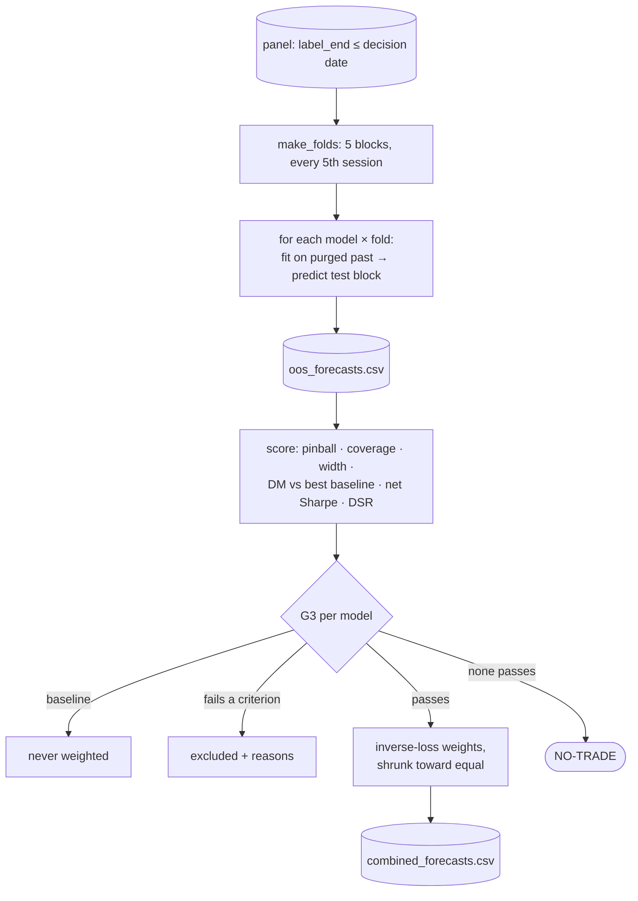

# Part 08 — Stage 02E: out-of-sample evaluation, the G3 gate and forecast combination

**Goal:** give a model weight only after it has proven itself out of sample and after costs, against the baselines, with the number of trials taken into account. If nothing qualifies, the sleeve does not trade.

**Design:** §10. *"Validation occurs before a candidate model receives any combination weight"*; the G3 criteria table; *"If the eligible set is empty, output `NO-TRADE`"*; *"Shrink estimated weights toward equal weights when evidence is weak."*



---

## 8.1 The evaluation loop

**File:** `src/aqp_python/stages/stage_02_forecasting/validation/model_eligibility.py` — top of file, `out_of_sample_predictions`

```python
"""Walk-forward evaluation of every enabled model -> metrics consumed by G3."""
import numpy as np
import pandas as pd

from aqp_python.contracts.quantile_grid import QUANTILE_COLUMNS
from aqp_python.stages.stage_02_forecasting.forecast_registry import build_model
from aqp_python.stages.stage_02_forecasting.validation.forecast_comparison_tests import diebold_mariano
from aqp_python.stages.stage_02_forecasting.validation.forecast_scoring import (
    coverage_90,
    pinball_loss,
    width_90,
)
from aqp_python.stages.stage_02_forecasting.validation.net_of_cost_evaluation import (
    annualised_sharpe,
    long_short_returns,
)
from aqp_python.stages.stage_02_forecasting.validation.overfitting_controls import deflated_sharpe_ratio
from aqp_python.stages.stage_02_forecasting.validation.walk_forward_folds import Fold, expanding_train

MEDIAN_INDEX = list(QUANTILE_COLUMNS).index("q0.500")


def out_of_sample_predictions(panel: pd.DataFrame, models: dict[str, dict], folds: list[Fold],
                              trading_days: pd.DatetimeIndex, *, horizon: int, features: list[str],
                              embargo_days: int) -> tuple[pd.DataFrame, dict[str, str]]:
    labelled = panel.loc[panel["label"].notna()]
    frames, failures = [], {}
    for name, spec in models.items():
        for fold in folds:
            train = expanding_train(labelled, fold, trading_days, embargo_days)
            test = labelled.loc[labelled["date"].isin(fold.test_dates)]
            try:
                if train.empty:
                    raise ValueError("empty training set")
                q = build_model(name, spec, horizon, features).fit(train).predict(test)
            except Exception as error:
                failures[name] = f"fold {fold.number}: {type(error).__name__}: {error}"
                break
            out = pd.DataFrame(q, columns=list(QUANTILE_COLUMNS))
            out["date"], out["security_id"] = test["date"].to_numpy(), test["security_id"].to_numpy()
            out["label"], out["model_name"], out["fold"] = test["label"].to_numpy(), name, fold.number
            frames.append(out)
    if not frames:
        raise ValueError("no model produced out-of-sample forecasts")
    oos = pd.concat(frames, ignore_index=True)
    return oos.loc[~oos["model_name"].isin(failures)], failures
```

For each model and fold: train on the purged past (`expanding_train` from Part 06), predict the test block, and keep the predictions next to the realised labels. A failure in any fold marks the whole model as failed. A model that cannot be evaluated cannot be eligible.

**File:** `src/aqp_python/stages/stage_02_forecasting/validation/model_eligibility.py` — `score_models`

```python
def score_models(oos: pd.DataFrame, roles: dict[str, str], failures: dict[str, str], *,
                 horizon: int, step_days: int, fraction: float, cost_per_turnover: float,
                 n_trials: int) -> dict[str, dict]:
    metrics: dict[str, dict] = {name: {"fit_ok": False, "error": err} for name, err in failures.items()}
    per_date: dict[str, pd.Series] = {}
    for name, rows in oos.groupby("model_name"):
        q, y = rows[list(QUANTILE_COLUMNS)].to_numpy(), rows["label"].to_numpy()
        loss = pinball_loss(y, q)
        per_date[name] = pd.Series(loss).groupby(rows["date"].to_numpy()).mean()
        ls = long_short_returns(rows.assign(median=q[:, MEDIAN_INDEX]), fraction, cost_per_turnover)
        metrics[name] = {
            "fit_ok": True, "pinball": float(loss.mean()), "coverage_90": coverage_90(y, q),
            "width_90": width_90(q), "net_sharpe": annualised_sharpe(ls, 252 / step_days),
            "net_mean_return": float(ls.mean()), "deflated_sharpe": deflated_sharpe_ratio(ls.to_numpy(), n_trials),
            "n_test_rows": int(len(rows)), "n_test_dates": int(rows["date"].nunique()), "n_trials": n_trials,
        }
    baselines = [n for n in per_date if roles.get(n) == "baseline"]
    best = min(baselines, key=lambda n: metrics[n]["pinball"]) if baselines else None
    lags = max(1, int(np.ceil(horizon / step_days)))
    for name in per_date:
        if best is None or name == best:
            metrics[name].update(dm_pvalue=1.0, dm_statistic=0.0, compared_with=best)
            continue
        aligned = pd.concat([per_date[name], per_date[best]], axis=1, join="inner").to_numpy()
        stat, p = diebold_mariano(aligned[:, 0], aligned[:, 1], lags)
        metrics[name].update(dm_pvalue=p, dm_statistic=stat, compared_with=best)
    return metrics
```

- The **comparison baseline** is the baseline with the lowest pinball loss. A candidate has to beat the *best* simple alternative, not the worst.
- The DM test uses **per-date** mean losses, with HAC lags of `ceil(h / step)`.
- `n_trials` comes from the trial registry, so the deflated Sharpe ratio charges for every configuration ever tried.

## 8.2 The G3 gate

**File:** `src/aqp_python/gates/g3_model_eligibility.py`

```python
"""G3 - model eligibility. Fit success is not evidence of skill."""
from collections.abc import Mapping

from aqp_python.contracts.reason_codes import ReasonCode as RC
from aqp_python.gates.gate_result import GateOutcome, GateResult

GATE = "G3"


def check_model(model_name: str, role: str, metrics: Mapping, rules: Mapping) -> GateResult:
    """`metrics` comes from Stage 02E validation; all criteria must pass."""
    if role == "baseline":
        return GateResult(GATE, GateOutcome.BLOCK, model_name, (RC.MODEL_IS_BASELINE,),
                          "baselines are references and never receive weight")
    if not metrics.get("fit_ok", False):
        return GateResult(GATE, GateOutcome.BLOCK, model_name, (RC.MODEL_FIT_FAILED,),
                          metrics.get("error", "fit failed"))
    codes = []
    if abs(metrics["coverage_90"] - rules["coverage_target"]) > rules["coverage_tolerance"]:
        codes.append(RC.MODEL_MISCALIBRATED)
    if not metrics["dm_pvalue"] <= rules["max_dm_pvalue"]:
        codes.append(RC.MODEL_NO_SKILL)
    if not metrics["net_sharpe"] > rules["min_net_sharpe"]:
        codes.append(RC.MODEL_NO_NET_VALUE)
    if not metrics["deflated_sharpe"] >= rules["min_deflated_sharpe"]:
        codes.append(RC.MODEL_OVERFIT_RISK)
    evidence = {key: metrics[key] for key in
                ("coverage_90", "pinball", "dm_pvalue", "net_sharpe", "deflated_sharpe", "n_trials")}
    if codes:
        return GateResult(GATE, GateOutcome.BLOCK, model_name, tuple(codes), "not eligible", evidence)
    return GateResult(GATE, GateOutcome.PASS, model_name, (), "eligible", evidence)
```

| Design criterion (§10) | Implemented as | Config key |
|---|---|---|
| Fit: converged, diagnostics acceptable | `fit_ok` (every fold fitted) | — |
| Calibration: 90% coverage within ±3 points | `abs(coverage_90 − 0.90) ≤ 0.03` | `coverage_target`, `coverage_tolerance` |
| Skill: out-of-sample improvement against a baseline | one-sided Diebold–Mariano p ≤ 0.10 against the best baseline | `max_dm_pvalue` |
| Economic value: positive net of cost | annualised net long-short Sharpe > 0 | `min_net_sharpe` |
| Overfitting: trials recorded, DSR/PBO applied | deflated Sharpe ≥ 0.5 | `min_deflated_sharpe` |
| Stability across folds | *not yet*: see Part 12, "stability checks" | — |

Every failed criterion adds its own reason code, so the report says *why* a model was excluded (for example `MODEL_NO_SKILL, MODEL_OVERFIT_RISK`), not just that it was. Baselines are blocked with `MODEL_IS_BASELINE` by design: they are yardsticks, not signals.

## 8.3 Combining eligible forecasts

Design §10:

```text
q̂_τ = Σ_k w_k q̂_{k,τ},   w_k ≥ 0,   Σ w_k = 1
w_k = (1 − λ) · (1/L_k) / Σ_j (1/L_j)  +  λ / K          inverse pinball loss, shrunk toward equal
```

**File:** `src/aqp_python/stages/stage_02_forecasting/validation/signal_combiner.py`

```python
"""Combine eligible forecasts: q_tau = sum_k w_k q_k,tau with w_k >= 0, sum w_k = 1."""
import pandas as pd

from aqp_python.contracts.forecast_schema import FORECAST_COLUMNS
from aqp_python.contracts.quantile_grid import QUANTILE_COLUMNS


def inverse_loss_weights(pinball: dict[str, float], shrinkage: float) -> dict[str, float]:
    """Inverse-loss weights shrunk toward equal weights (shrinkage=1 -> equal)."""
    if not pinball:
        return {}
    inverse = {name: 1.0 / loss for name, loss in pinball.items()}
    total, k = sum(inverse.values()), len(inverse)
    return {name: (1 - shrinkage) * inv / total + shrinkage / k for name, inv in inverse.items()}


def combine(live: pd.DataFrame, weights: dict[str, float]) -> pd.DataFrame:
    """Weighted quantile average. Averaging ordered quantiles keeps them ordered."""
    if not weights:
        return pd.DataFrame(columns=FORECAST_COLUMNS)
    used = live.loc[live["model_name"].isin(weights)].copy()
    used["w"] = used["model_name"].map(weights)
    quantiles = list(QUANTILE_COLUMNS)
    weighted = used[quantiles].mul(used["w"], axis=0).assign(security_id=used["security_id"])
    combined = weighted.groupby("security_id")[quantiles].sum()
    # Only securities covered by every eligible model are combined.
    counts = used.groupby("security_id")["model_name"].nunique()
    combined = combined.loc[counts[counts == len(weights)].index]
    template = used.drop_duplicates("security_id").set_index("security_id")
    meta = [c for c in FORECAST_COLUMNS if c not in quantiles and c != "security_id"]
    out = template.loc[combined.index, meta].join(combined).reset_index()
    out["model_name"] = "combined"
    out["model_version"] = "+".join(f"{n}:{w:.3f}" for n, w in sorted(weights.items()))
    out["train_start"] = used["train_start"].min()
    out["train_end"] = used["train_end"].max()
    return out[list(FORECAST_COLUMNS)]
```

Averaging quantiles that are each non-decreasing with non-negative weights gives a non-decreasing result, so the combination cannot create crossings. A security is combined only if *every* eligible model forecast it; a partial combination would silently change the weights for that name. The combined row's `model_version` records the weights, for example `ridge_location_scale:1.000`.

Add the hand-off to the bottom of `contracts\forecast_schema.py`:

**File:** `src/aqp_python/contracts/forecast_schema.py` — `CombinedForecast`

```python
@dataclass(frozen=True)
class CombinedForecast:
    """Stage 02E output: the distribution the portfolio stage is allowed to use."""
    combined: pd.DataFrame         # FORECAST_COLUMNS, model_name == "combined"
    eligible_models: tuple[str, ...]
    weights: dict[str, float]
    model_metrics: dict[str, dict]
```

## 8.4 The Stage 02E service

**File:** `src/aqp_python/stages/stage_02_forecasting/validation/service.py`

```python
"""Stage 02E entry point: walk-forward validation -> G3 -> combination of eligible models."""
import json

import pandas as pd

from aqp_python.contracts.forecast_schema import CombinedForecast, ForecastBundle
from aqp_python.contracts.reason_codes import ReasonCode as RC
from aqp_python.gates.g3_model_eligibility import check_model
from aqp_python.orchestration.run_context import RunContext
from aqp_python.orchestration.stage_status import StageResult
from aqp_python.stages.stage_02_forecasting.forecast_registry import enabled_models
from aqp_python.stages.stage_02_forecasting.validation.model_eligibility import (
    out_of_sample_predictions,
    score_models,
)
from aqp_python.stages.stage_02_forecasting.validation.signal_combiner import combine, inverse_loss_weights
from aqp_python.stages.stage_02_forecasting.validation.walk_forward_folds import make_folds
from aqp_python.storage.trial_registry import record_trial, trial_key

STAGE = "stage_02e_validation"


def run_stage(ctx: RunContext, bundle: ForecastBundle,
              trading_days: pd.DatetimeIndex) -> tuple[StageResult, CombinedForecast]:
    result = StageResult(STAGE)
    vcfg, mcfg = ctx.config["validation"], ctx.config["forecast_models"]
    costs = ctx.config["sleeve"]["costs"]
    horizon, features = mcfg["horizon_days"], list(mcfg["features"])
    models = enabled_models(mcfg)

    # Only labels fully known today may be used - the last test date ends h+1 sessions ago.
    panel = bundle.panel.loc[bundle.panel["label_end"] <= ctx.decision_date]
    folds = make_folds(trading_days, panel["date"].min(), panel["date"].max(),
                       min_train_days=vcfg["min_train_days"], n_folds=vcfg["n_folds"],
                       step_days=vcfg["step_days"])

    registry = ctx.resolve(ctx.config["pipeline"]["state_dir"]) / "trial_registry.jsonl"
    n_trials = 0
    for name, spec in models.items():
        key = trial_key(name, spec.get("version", "1.0"), spec.get("params", {}), features)
        n_trials = record_trial(registry, key, {"model": name, "run_id": ctx.run_id})

    oos, failures = out_of_sample_predictions(panel, models, folds, trading_days, horizon=horizon,
                                              features=features, embargo_days=vcfg["embargo_days"])
    cost = (costs["half_spread_bps"] + costs["commission_bps"]) * 1e-4
    metrics = score_models(oos, bundle.model_roles, failures, horizon=horizon,
                           step_days=vcfg["step_days"], fraction=vcfg["long_short_quantile"],
                           cost_per_turnover=cost, n_trials=n_trials)

    rules = ctx.config["gates"]["g3_model_eligibility"]
    gates = [check_model(name, bundle.model_roles[name], metrics[name], rules) for name in metrics]
    result.gates.extend(gates)
    eligible = tuple(sorted(g.subject for g in gates if g.passed))
    weights = inverse_loss_weights({n: metrics[n]["pinball"] for n in eligible},
                                   vcfg["combination_shrinkage"])
    combined = combine(bundle.live, weights)

    pd.DataFrame([{"fold": f.number, "test_start": f.test_start.date(), "test_end": f.test_end.date(),
                   "test_dates": len(f.test_dates)} for f in folds]).to_csv(
        ctx.paths.sub("validation", "folds.csv"), index=False)
    pd.DataFrame(metrics).T.rename_axis("model_name").to_csv(ctx.paths.sub("validation", "model_scores.csv"))
    pd.DataFrame([g.to_dict() for g in gates]).to_csv(ctx.paths.sub("validation", "eligibility.csv"), index=False)
    oos.to_csv(ctx.paths.sub("validation", "oos_forecasts.csv"), index=False)
    combined.to_csv(ctx.paths.sub("forecasts", "combined_forecasts.csv"), index=False)
    ctx.paths.sub("validation", "combination_weights.json").write_text(json.dumps(weights, indent=2))
    result.artifacts.update({
        "folds": "validation/folds.csv", "model_scores": "validation/model_scores.csv",
        "eligibility": "validation/eligibility.csv", "oos_forecasts": "validation/oos_forecasts.csv",
        "combined_forecasts": "forecasts/combined_forecasts.csv",
        "combination_weights": "validation/combination_weights.json"})
    result.metrics.update({"eligible_models": list(eligible), "weights": weights,
                           "n_trials": n_trials, "folds": len(folds), "model_metrics": metrics})
    if not eligible:
        result.reason_codes.append(str(RC.NO_ELIGIBLE_MODEL))
        result.warnings.append("no model passed G3: the sleeve will not trade (NO-TRADE)")
    return result, CombinedForecast(combined, eligible, weights, metrics)
```

Notice the first two lines of real work: `panel` is restricted to labels known at the decision date, and the folds are built from that restricted panel. Validation can never peek at a label that ends after today. An empty eligible set is **not** a blocked run. The stage records `NO_ELIGIBLE_MODEL` and a warning, and the pipeline carries on to produce a complete `NO-TRADE` record (Part 11 demonstrates this).

## 8.5 Tests

**File:** `tests/unit/test_combination.py`

```python
import numpy as np
import pandas as pd
import pytest

from aqp_python.contracts.quantile_grid import QUANTILE_COLUMNS
from aqp_python.contracts.reason_codes import ReasonCode as RC
from aqp_python.gates.g3_model_eligibility import check_model
from aqp_python.stages.stage_02_forecasting.validation.signal_combiner import combine, inverse_loss_weights
from tests.conftest import forecast_frame

pytestmark = pytest.mark.batch04
RULES = {"coverage_target": 0.90, "coverage_tolerance": 0.03, "max_dm_pvalue": 0.10,
         "min_net_sharpe": 0.0, "min_deflated_sharpe": 0.5}
GOOD = {"fit_ok": True, "coverage_90": 0.89, "pinball": 0.005, "dm_pvalue": 0.02, "net_sharpe": 1.1,
        "deflated_sharpe": 0.9, "n_trials": 3}


def test_a_candidate_passing_every_criterion_is_eligible():
    assert check_model("m", "candidate", GOOD, RULES).passed


@pytest.mark.parametrize("change, code", [
    ({"coverage_90": 0.80}, RC.MODEL_MISCALIBRATED), ({"dm_pvalue": 0.4}, RC.MODEL_NO_SKILL),
    ({"net_sharpe": -0.2}, RC.MODEL_NO_NET_VALUE), ({"deflated_sharpe": 0.2}, RC.MODEL_OVERFIT_RISK)])
def test_each_failed_criterion_has_its_own_reason(change, code):
    result = check_model("m", "candidate", {**GOOD, **change}, RULES)
    assert not result.passed and code in result.reason_codes


def test_baselines_and_failed_fits_never_receive_weight():
    assert check_model("b", "baseline", GOOD, RULES).reason_codes == (RC.MODEL_IS_BASELINE,)
    assert check_model("m", "candidate", {"fit_ok": False}, RULES).reason_codes == (RC.MODEL_FIT_FAILED,)


def test_combination_weights_sum_to_one_and_shrink_to_equal():
    weights = inverse_loss_weights({"a": 1.0, "b": 3.0}, shrinkage=0.0)
    assert sum(weights.values()) == pytest.approx(1.0) and weights["a"] == pytest.approx(0.75)
    assert inverse_loss_weights({"a": 1.0, "b": 3.0}, shrinkage=1.0) == {"a": 0.5, "b": 0.5}


def test_combined_quantiles_stay_ordered():
    a = forecast_frame(np.linspace(-1, 1, 11)).assign(model_name="a")
    b = forecast_frame(np.linspace(-3, 2, 11)).assign(model_name="b")
    out = combine(pd.concat([a, b]), {"a": 0.4, "b": 0.6})
    assert (np.diff(out[list(QUANTILE_COLUMNS)].to_numpy(), axis=1) >= 0).all()
```

**File:** `tests/integration/test_stage_handoffs.py` — `test_stage_02e_validation`

```python
@pytest.mark.batch04
def test_stage_02e_validation(make_context):
    ctx = make_context()
    out = run_through(ctx, "stage_02e_validation")
    combined = out["combined"]
    print("\n", pd.DataFrame(combined.model_metrics).T[["pinball", "coverage_90", "dm_pvalue", "net_sharpe"]])
    assert combined.eligible_models == ("ridge_location_scale",)
    assert not combined.combined.empty
```

```powershell
python -m pytest -m batch04 -q
python -m pytest tests\integration\test_stage_handoffs.py -k stage_02e -s --basetemp=build\pytest
```

```text
                        pinball coverage_90 dm_pvalue net_sharpe
ridge_location_scale   0.005652    0.881537  0.021665   2.797208
rolling_mean           0.005668    0.897095  0.797861  -0.490337
zero_excess            0.005668    0.897282       1.0  -0.490337
.
1 passed
```

How to read this table:

- The candidate's pinball loss is lower than both baselines' by a small amount (0.00565 vs 0.00567). Small differences are normal in return forecasting. The DM p-value of 0.02 says this one is unlikely to be luck.
- Its coverage (88.2%) is inside the 87–93% band, slightly narrow.
- The net Sharpe of 2.8 is **high because the signal was planted**. Real equity signals are far weaker. Expect most real candidates to fail G3, and treat that as the system working.
- The two baselines have identical net Sharpe because a constant median gives no ranking: their long-short "portfolio" is arbitrary. That is fine; they are not meant to trade.

In the run folder, `validation\eligibility.csv` lists one G3 result per model with its evidence, and `validation\folds.csv` lists the fold boundaries. That is the record design §17 asks for: *"trials and fold boundaries logged"*.

## Checkpoint

- [ ] `python -m pytest -m batch04 -q` → `13 passed`.
- [ ] `ridge_location_scale` is the only eligible model; both baselines are `MODEL_IS_BASELINE`.
- [ ] Experiment: in `configs\gates.yaml` set `max_dm_pvalue: 0.01` and rerun the checkpoint. It fails because nothing is eligible, and `eligibility.csv` shows `MODEL_NO_SKILL`. Set it back to `0.10`.

```powershell
git add .
git commit -m "Stage 02E: walk-forward evaluation, G3 eligibility and inverse-loss combination"
```

Next: [Part 09 — Stages 03–05: portfolio and sizing](09_stages03_05_portfolio_and_sizing.md).
