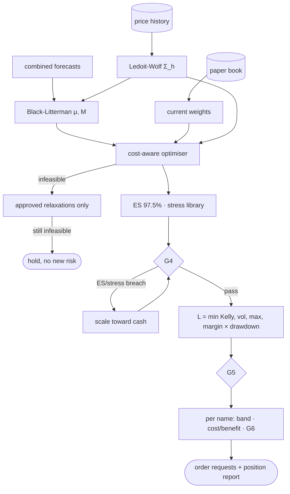

# Part 09 — Stages 03–05: risk, optimisation, leverage and trade decisions (G4, G5, G6)

**Goal:** turn eligible forecasts into orders through three separate decisions, each with its own gate:

| Decision | Stage | Gate | Question |
|---|---|---|---|
| **Relative weights** | 03–04 | G4 | Given forecasts, risk and costs, which mix of names? Does it respect concentration, tail-risk and stress limits? |
| **Total exposure** | 05 | G5 | How much of the portfolio should be at risk at all (Kelly, volatility target, drawdown, margin)? |
| **Each trade** | 05 | G6 | Is this particular change worth its cost, and are its data and model still valid? |

**Design:** §11 (risk model, Black–Litterman, cost-aware objective, relaxation policy, stress library), §12 (fractional Kelly, volatility cap, drawdown multiplier, no-trade band, position report). Design §14: *"Relative weights, total leverage, and order authorisation are separate decisions."*



---

## 9.1 Hand-off contracts for the book and the target

**File:** `src/aqp_python/contracts/portfolio_schema.py`

```python
"""Hand-off objects for the book state and the portfolio target."""
from dataclasses import dataclass, field

import pandas as pd


@dataclass(frozen=True)
class PortfolioState:
    """Current holdings, read from the broker by Stage 06 and passed forward."""
    positions: pd.Series          # shares by security_id
    cash: float
    prices: pd.Series             # latest validated close by security_id
    equity_history: pd.Series     # NAV by date (for drawdown)

    @property
    def nav(self) -> float:
        held = self.positions.reindex(self.prices.index).fillna(0.0)
        return float(self.cash + (held * self.prices).sum())

    def weights(self) -> pd.Series:
        value = self.positions * self.prices.reindex(self.positions.index)
        return (value / self.nav).fillna(0.0)


@dataclass(frozen=True)
class PortfolioTarget:
    """Stages 03-04 output: relative target weights plus the risk evidence behind them."""
    weights: pd.Series            # relative weights before leverage (sum <= 1)
    current: pd.Series            # current weights on the same index
    mu: pd.Series                 # posterior expected h-day excess return
    mu_covariance: pd.DataFrame   # posterior uncertainty of mu
    covariance: pd.DataFrame      # h-day return covariance
    feasible: bool
    tradable: bool                # False -> Stage 05 may not create new risk
    relaxations: list[str] = field(default_factory=list)
    risk: dict = field(default_factory=dict)
```

`PortfolioState` describes what we hold (shares, cash, last prices, NAV history). `PortfolioTarget` is what Stages 03–04 want: **relative** weights (their sum is at most 1, before leverage), the evidence behind them (`mu`, its uncertainty, the covariance), and two flags. `feasible` says whether the optimiser solved; `tradable` says whether Stage 05 may create new risk.

## 9.2 The book (read side)

Stage 06 owns the broker (Part 10), but Stages 03–05 need to know current holdings. Build the paper broker and its read side now.

**File:** `src/aqp_python/connectors/broker/broker_interface.py`

```python
"""What any broker adapter must provide. Live adapters are added only after sign-off."""
from typing import Protocol

import pandas as pd


class Broker(Protocol):
    def positions(self) -> pd.Series: ...
    def cash(self) -> float: ...
    def apply_fill(self, security_id: str, signed_quantity: int, price: float, fees: float) -> None: ...
    def record_equity(self, date: str, nav: float) -> None: ...
    def equity_history(self) -> pd.Series: ...
    def save(self) -> None: ...
```

**File:** `src/aqp_python/connectors/broker/paper_broker.py`

```python
"""A paper broker that keeps its book in a JSON file. No real orders are ever sent."""
import json
from pathlib import Path

import pandas as pd


class PaperBroker:
    def __init__(self, path: Path, initial_cash: float) -> None:
        self.path = Path(path)
        if self.path.is_file():
            book = json.loads(self.path.read_text(encoding="utf-8"))
        else:
            book = {"cash": float(initial_cash), "positions": {}, "equity": {}}
        self._book = book

    def positions(self) -> pd.Series:
        return pd.Series(self._book["positions"], dtype=float)

    def cash(self) -> float:
        return float(self._book["cash"])

    def apply_fill(self, security_id: str, signed_quantity: int, price: float, fees: float) -> None:
        held = self._book["positions"].get(security_id, 0) + int(signed_quantity)
        if held < 0:
            raise ValueError(f"fill would create a short position in {security_id}")
        if held == 0:
            self._book["positions"].pop(security_id, None)
        else:
            self._book["positions"][security_id] = held
        self._book["cash"] -= signed_quantity * price + fees

    def record_equity(self, date: str, nav: float) -> None:
        self._book["equity"][date] = float(nav)

    def equity_history(self) -> pd.Series:
        series = pd.Series(self._book["equity"], dtype=float)
        series.index = pd.to_datetime(series.index)
        return series.sort_index()

    def save(self) -> None:
        self.path.parent.mkdir(parents=True, exist_ok=True)
        temporary = self.path.with_suffix(".tmp")
        temporary.write_text(json.dumps(self._book, indent=2), encoding="utf-8")
        temporary.replace(self.path)
```

The book is a JSON file in `outputs\state\asx_interday\paper_book.json`. It holds cash, positions in shares, and NAV by date. `apply_fill` refuses to go short, because this sleeve is long-only. `save()` writes to a temporary file and then replaces the real one, the same atomic pattern as the manifest. A brand-new book starts with `initial_nav` in cash.

**File:** `src/aqp_python/stages/stage_06_execution/portfolio_state.py`

```python
"""The read side of the book: Stage 06 owns the broker, and lends its state to Stages 03-05."""
from pathlib import Path

import pandas as pd

from aqp_python.connectors.broker.paper_broker import PaperBroker
from aqp_python.contracts.data_schemas import MarketData
from aqp_python.contracts.portfolio_schema import PortfolioState
from aqp_python.orchestration.run_context import RunContext


def state_dir(ctx: RunContext) -> Path:
    return ctx.resolve(ctx.config["pipeline"]["state_dir"])


def open_broker(ctx: RunContext) -> PaperBroker:
    path = state_dir(ctx) / ctx.sleeve / "paper_book.json"
    return PaperBroker(path, ctx.config["sleeve"]["initial_nav"])


def latest_prices(data: MarketData) -> pd.Series:
    """Last validated close per security (held names that stopped trading keep their last price)."""
    last = data.prices.sort_values("date").groupby("security_id").tail(1)
    return last.set_index("security_id")["close"]


def load_portfolio_state(ctx: RunContext, data: MarketData) -> PortfolioState:
    broker = open_broker(ctx)
    return PortfolioState(broker.positions(), broker.cash(), latest_prices(data), broker.equity_history())
```

## 9.3 Covariance

**File:** `src/aqp_python/stages/stages_03_04_portfolio/covariance_estimator.py`

```python
"""Ledoit-Wolf shrinkage covariance, scaled to the forecast horizon."""
import numpy as np
import pandas as pd
from sklearn.covariance import LedoitWolf


def daily_returns_window(prices: pd.DataFrame, ids: list[str], end: pd.Timestamp,
                         lookback: int) -> pd.DataFrame:
    wide = prices.pivot(index="date", columns="security_id", values="return")
    wide = wide.loc[wide.index <= end, ids].tail(lookback)
    return wide.dropna(how="any")


def ledoit_wolf_covariance(returns: pd.DataFrame, horizon: int) -> pd.DataFrame:
    """Sigma_h = h * Sigma_daily (i.i.d. scaling; a conservative engine can replace it later)."""
    if len(returns) < 60:
        raise ValueError(f"only {len(returns)} complete return rows; need at least 60")
    estimate = LedoitWolf().fit(returns.to_numpy()).covariance_ * horizon
    if not np.all(np.isfinite(estimate)):
        raise ValueError("covariance estimate is not finite")
    return pd.DataFrame(estimate, index=returns.columns, columns=returns.columns)
```

With 24 names and 252 days, the sample covariance is noisy and its smallest eigenvalues are too small, so an optimiser would load up on spurious "low-risk" combinations. **Ledoit–Wolf** shrinks it toward a structured target by a data-chosen amount (design §11). `Σ_h = h · Σ_daily` scales to the 5-day horizon under an i.i.d. assumption. Factor and DCC-GARCH engines can replace this later (Part 12) without changing the interface.

## 9.4 Expected returns: Black–Litterman

Design §11:

```text
μ_BL = [ (τΣ)⁻¹ + PᵀΩ⁻¹P ]⁻¹ [ (τΣ)⁻¹π + PᵀΩ⁻¹q ]          posterior mean
M    = [ (τΣ)⁻¹ + PᵀΩ⁻¹P ]⁻¹                               posterior covariance of μ (used by Kelly)
```

| Symbol | Here |
|---|---|
| `π` | equilibrium return, `β_i × market risk premium × h/252` (CAPM prior) |
| `P = I` | one view per security |
| `q` | `π + forecast median` (the forecast is an *excess* return over the benchmark) |
| `Ω` | `τ · diag(s²)`, `s = IQR / 1.349`: a wide predictive distribution is an unconfident view |

**File:** `src/aqp_python/stages/stages_03_04_portfolio/expected_returns.py`

```python
"""Black-Litterman: blend equilibrium returns with confidence-weighted forecast views.

mu_BL = [(tau Sigma)^-1 + P' Omega^-1 P]^-1 [(tau Sigma)^-1 pi + P' Omega^-1 q]

pi     equilibrium (CAPM) return: beta_i x market risk premium over the horizon
P = I  one view per security
q      pi + forecast median (the forecast is an excess return over the benchmark)
Omega  tau x diag(s^2), s = IQR / 1.349 - a wider predictive distribution means
       a less confident view
"""
import numpy as np
import pandas as pd

from aqp_python.contracts.quantile_grid import MEDIAN_COLUMN


def equilibrium_returns(beta: pd.Series, premium_annual: float, horizon: int) -> pd.Series:
    return (beta * premium_annual * horizon / 252).rename("pi")


def black_litterman(forecasts: pd.DataFrame, covariance: pd.DataFrame, prior: pd.Series,
                    tau: float) -> tuple[pd.Series, pd.DataFrame]:
    ids = list(covariance.index)
    view = forecasts.set_index("security_id").loc[ids]
    pi = prior.reindex(ids).to_numpy()
    q = pi + view[MEDIAN_COLUMN].to_numpy()
    spread = ((view["q0.750"] - view["q0.250"]) / 1.349).to_numpy()
    prior_precision = np.linalg.inv(tau * covariance.to_numpy())
    view_precision = np.diag(1.0 / (tau * spread ** 2))
    posterior_cov = np.linalg.inv(prior_precision + view_precision)
    mu = posterior_cov @ (prior_precision @ pi + view_precision @ q)
    return (pd.Series(mu, index=ids, name="mu_bl"),
            pd.DataFrame(posterior_cov, index=ids, columns=ids))
```

Why bother with a prior? Without `π`, a long-only optimiser sees only small excess-return views, which barely exceed trading costs, and it would hold almost nothing. With `π`, "no view" means "the market return for your beta", and the forecasts tilt the portfolio away from that. The unit test checks both extremes: a tight IQR lets the view dominate, and a wide IQR leaves the prior.

## 9.5 The cost-aware optimiser

Design §11:

```text
max_w  μᵀw − (γ/2) wᵀΣw − Σ_i ( c_i|Δw_i| + η_i|Δw_i|^1.5 ) − κ Σ_i p_i^dist |w_i|
```

| Term | Meaning | Where its value comes from |
|---|---|---|
| `γ/2 wᵀΣw` | risk penalty | `risk_aversion` |
| `c_i|Δw_i|` | spread + commission per unit traded | `half_spread_bps + commission_bps` |
| `η_i|Δw_i|^1.5` | market impact: square-root law, `η_i = coef × σ_i × √(NAV/ADV_i)` | `impact_coefficient`, data |
| `κ p_i|w_i|` | distress penalty | `distress_penalty`, reference data |

Constraints: `0 ≤ w_i ≤ min(name cap, liquidity cap_i)`, `Σw ≤ 1`, sector sums ≤ the sector cap, and turnover `Σ|Δw| ≤` the turnover cap. The liquidity cap is `participation × ADV_i × exit_days / NAV`: the most we could sell in three days at 20% of volume (design §11's example).

**Units.** `μ` is a 5-day return, but a position is typically held for several 5-day periods while its costs are paid once. Comparing one period's return with the full cost would make almost every trade look unprofitable. Costs are therefore divided by `holding_periods` (4) in the objective, and Stage 05 multiplies the expected benefit by the same number. This is an explicit, configurable assumption, not a hidden fudge.

**File:** `src/aqp_python/stages/stages_03_04_portfolio/portfolio_optimizer.py`

```python
"""Cost-aware mean-variance optimiser (SLSQP).

max_w  mu'w - (gamma/2) w'Sigma w - sum_i (c_i |dw_i| + eta_i |dw_i|^1.5) - kappa sum_i p_i |w_i|
s.t.   0 <= w_i <= min(name cap, liquidity cap_i),  sum w <= 1,
       sector sums <= sector cap,  sum |dw| <= turnover cap
"""
from dataclasses import dataclass

import numpy as np
import pandas as pd
from scipy.optimize import minimize

SMOOTH = 1e-8         # |x| ~ sqrt(x^2 + SMOOTH) keeps the problem differentiable
FEASIBILITY_TOL = 1e-6


@dataclass(frozen=True)
class OptimisationProblem:
    mu: pd.Series
    covariance: pd.DataFrame
    current: pd.Series
    upper: pd.Series              # min(name cap, liquidity cap) per security
    sectors: pd.Series
    linear_cost: pd.Series        # c_i
    impact: pd.Series             # eta_i
    distress: pd.Series           # p_i
    risk_aversion: float
    distress_penalty: float
    max_sector_weight: float
    max_turnover: float


@dataclass(frozen=True)
class OptimisationResult:
    weights: pd.Series
    success: bool
    message: str


def _abs(x: np.ndarray) -> np.ndarray:
    return np.sqrt(x * x + SMOOTH)


def optimise(problem: OptimisationProblem) -> OptimisationResult:
    ids = list(problem.mu.index)
    mu, sigma = problem.mu.to_numpy(), problem.covariance.loc[ids, ids].to_numpy()
    w0 = problem.current.reindex(ids).fillna(0.0).to_numpy()
    c, eta = problem.linear_cost.loc[ids].to_numpy(), problem.impact.loc[ids].to_numpy()
    p, upper = problem.distress.loc[ids].to_numpy(), problem.upper.loc[ids].to_numpy()

    def negative_utility(w: np.ndarray) -> float:
        dw = _abs(w - w0)
        return -(mu @ w - 0.5 * problem.risk_aversion * w @ sigma @ w
                 - c @ dw - eta @ dw ** 1.5 - problem.distress_penalty * p @ _abs(w))

    constraints = [{"type": "ineq", "fun": lambda w: 1.0 - w.sum()},
                   {"type": "ineq", "fun": lambda w: problem.max_turnover - _abs(w - w0).sum()}]
    for sector in sorted(problem.sectors.loc[ids].unique()):
        mask = (problem.sectors.loc[ids] == sector).to_numpy()
        constraints.append({"type": "ineq",
                            "fun": lambda w, m=mask: problem.max_sector_weight - w[m].sum()})
    start = np.clip(w0, 0.0, upper)
    solution = minimize(negative_utility, start, method="SLSQP", bounds=list(zip(np.zeros(len(ids)), upper)),
                        constraints=constraints, options={"maxiter": 500, "ftol": 1e-12})
    w = solution.x
    feasible = (solution.success
                and all(con["fun"](w) >= -FEASIBILITY_TOL for con in constraints)
                and np.all(w >= -FEASIBILITY_TOL) and np.all(w <= upper + FEASIBILITY_TOL))
    weights = pd.Series(np.clip(w, 0.0, None), index=ids).where(lambda s: s > 1e-6, 0.0)
    return OptimisationResult(weights, bool(feasible), str(solution.message))
```

- `|x|` is not differentiable at 0, and SLSQP needs gradients, so `_abs` uses `sqrt(x² + 10⁻⁸)`.
- **Feasibility is checked independently** of the solver's own success flag: every constraint is evaluated at the returned point. A solver can report success with a slightly violated constraint; this code does not trust it.
- Weights below `10⁻⁶` are set to zero, so the output does not contain dust positions.

## 9.6 When the optimiser fails: the relaxation policy

**File:** `src/aqp_python/stages/stages_03_04_portfolio/relaxation_policy.py`

```python
"""If the optimiser is infeasible, relax ONLY pre-approved constraints, in order.

Liquidity and tail-risk limits are never on the list. If nothing works, the
sleeve keeps its current positions and is flagged - an infeasible solution is
never turned into tradable weights.
"""
from dataclasses import replace

from aqp_python.stages.stages_03_04_portfolio.portfolio_optimizer import (
    OptimisationProblem,
    OptimisationResult,
    optimise,
)

RELAXABLE = {"max_turnover", "max_sector_weight"}


def optimise_with_relaxation(problem: OptimisationProblem, order: list[str],
                             step: float) -> tuple[OptimisationResult, list[str]]:
    unknown = set(order) - RELAXABLE
    if unknown:
        raise ValueError(f"constraints {sorted(unknown)} may not be relaxed")
    result = optimise(problem)
    relaxed: list[str] = []
    for name in order:
        if result.success:
            break
        problem = replace(problem, **{name: getattr(problem, name) * step})
        relaxed.append(f"{name}->{getattr(problem, name):.4f}")
        result = optimise(problem)
    return result, relaxed
```

Design §11: *"If infeasible, relax only approved constraints (e.g. turnover, then sector...); never relax liquidity or tail-risk limits. If still infeasible, hold current positions and flag the sleeve."* `RELAXABLE` is a hard-coded allow-list. Even if someone adds `participation_cap` to the YAML list, this function refuses, and so does the config validator from Part 02.

## 9.7 Tail risk and stress

**File:** `src/aqp_python/stages/stages_03_04_portfolio/portfolio_risk.py`

```python
"""Tail risk (historical simulation) and the stress library."""
import numpy as np
import pandas as pd


def horizon_returns(daily: pd.DataFrame, horizon: int) -> pd.DataFrame:
    """Overlapping h-day compounded returns from daily returns."""
    return (1 + daily).rolling(horizon).apply(np.prod, raw=True).dropna() - 1


def var_es(weights: pd.Series, scenarios: pd.DataFrame, alpha: float = 0.975) -> tuple[float, float]:
    """Historical-simulation VaR and ES of the portfolio, reported as positive losses."""
    pnl = scenarios[weights.index].to_numpy() @ weights.to_numpy()
    var = -np.quantile(pnl, 1 - alpha)
    tail = pnl[pnl <= -var]
    es = -tail.mean() if len(tail) else var
    return float(var), float(es)


def betas(daily: pd.DataFrame, benchmark: pd.Series) -> pd.Series:
    bench = benchmark.reindex(daily.index)
    return daily.apply(lambda r: np.cov(r, bench)[0, 1] / bench.var())


def stress_losses(weights: pd.Series, reference: pd.DataFrame, beta: pd.Series,
                  scenarios: dict) -> dict[str, float]:
    """Loss (positive number) of each scenario applied through betas, revenue shares and sectors."""
    ref = reference.set_index("security_id").reindex(weights.index)
    losses = {}
    for name, shock in scenarios.items():
        impact = pd.Series(0.0, index=weights.index)
        if "market" in shock:
            impact += beta.reindex(weights.index).fillna(1.0) * shock["market"]
        if "revenue_cn" in shock:
            impact += ref["revenue_share_cn"].fillna(0.0) * shock["revenue_cn"]
        if "sector" in shock:
            impact += (ref["sector"] == shock["sector"]).astype(float) * shock["shock"]
        losses[name] = float(-(weights * impact).sum())
    return losses
```

- **Historical-simulation VaR/ES** at 97.5% on overlapping 5-day returns over the last three years: `ES = −mean(P&L | P&L ≤ −VaR)` (design §11). Losses are reported as positive numbers.
- **Stress library** (configured in the sleeve YAML): a −20% market move applied through each name's beta, a China slowdown applied through each company's **China revenue share** (the Company Reference and Exposure Dataset at work), and a sector shock.

**File:** `src/aqp_python/gates/g4_portfolio_risk.py`

```python
"""G4 - portfolio risk: concentration, tail risk and stress loss of the target weights."""
from collections.abc import Mapping

import pandas as pd

from aqp_python.contracts.reason_codes import ReasonCode as RC
from aqp_python.gates.gate_result import GateOutcome, GateResult

GATE = "G4"
TOLERANCE = 1e-6


def check_portfolio(weights: pd.Series, sectors: pd.Series, expected_shortfall: float,
                    worst_stress_loss: float, portfolio_rules: Mapping,
                    gate_rules: Mapping) -> GateResult:
    codes, notes = [], []
    if (weights.abs() > portfolio_rules["max_name_weight"] + TOLERANCE).any():
        codes.append(RC.RISK_CONCENTRATION)
        notes.append("name weight above cap")
    sector_weights = weights.groupby(sectors.reindex(weights.index)).sum()
    if (sector_weights.abs() > portfolio_rules["max_sector_weight"] + TOLERANCE).any():
        codes.append(RC.RISK_CONCENTRATION)
        notes.append("sector weight above cap")
    if expected_shortfall > gate_rules["max_expected_shortfall"]:
        codes.append(RC.RISK_ES_BREACH)
        notes.append(f"ES {expected_shortfall:.4f}")
    if worst_stress_loss > gate_rules["max_stress_loss"]:
        codes.append(RC.RISK_STRESS_BREACH)
        notes.append(f"stress loss {worst_stress_loss:.4f}")
    evidence = {"expected_shortfall": expected_shortfall, "worst_stress_loss": worst_stress_loss,
                "max_sector_weight": float(sector_weights.abs().max()) if len(sector_weights) else 0.0}
    if codes:
        return GateResult(GATE, GateOutcome.BLOCK, "portfolio", tuple(dict.fromkeys(codes)),
                          "; ".join(notes), evidence)
    return GateResult(GATE, GateOutcome.PASS, "portfolio", (), "", evidence)
```

## 9.8 The Stages 03–04 service

**File:** `src/aqp_python/stages/stages_03_04_portfolio/service.py`

```python
"""Stages 03-04 entry point: covariance -> Black-Litterman -> optimiser -> tail risk -> G4."""
import json

import numpy as np
import pandas as pd

from aqp_python.contracts.data_schemas import MarketData
from aqp_python.contracts.forecast_schema import CombinedForecast
from aqp_python.contracts.portfolio_schema import PortfolioState, PortfolioTarget
from aqp_python.contracts.reason_codes import ReasonCode as RC
from aqp_python.gates.g4_portfolio_risk import check_portfolio
from aqp_python.orchestration.run_context import RunContext
from aqp_python.orchestration.stage_status import StageResult
from aqp_python.stages.stages_03_04_portfolio.covariance_estimator import (
    daily_returns_window,
    ledoit_wolf_covariance,
)
from aqp_python.stages.stages_03_04_portfolio.expected_returns import black_litterman, equilibrium_returns
from aqp_python.stages.stages_03_04_portfolio.portfolio_optimizer import OptimisationProblem
from aqp_python.stages.stages_03_04_portfolio.portfolio_risk import (
    betas,
    horizon_returns,
    stress_losses,
    var_es,
)
from aqp_python.stages.stages_03_04_portfolio.relaxation_policy import optimise_with_relaxation

STAGE = "stages_03_04_portfolio"
RISK_LOOKBACK_DAYS = 750


def _hold(current: pd.Series, reason: str) -> PortfolioTarget:
    """Fallback target: keep what we have, create no new risk."""
    empty = pd.DataFrame(index=current.index, columns=current.index, dtype=float)
    return PortfolioTarget(current.copy(), current, pd.Series(0.0, index=current.index), empty,
                           empty, feasible=False, tradable=False, risk={"hold_reason": reason})


def build_problem(ctx: RunContext, data: MarketData, ids: list[str], mu: pd.Series,
                  covariance: pd.DataFrame, current: pd.Series, nav: float) -> OptimisationProblem:
    pcfg, costs = ctx.config["sleeve"]["portfolio"], ctx.config["sleeve"]["costs"]
    recent = data.prices.loc[data.prices["security_id"].isin(ids)]
    recent = recent.loc[recent["date"] > ctx.decision_date - pd.offsets.BDay(60)]
    adv = recent.groupby("security_id")["dollar_volume"].median().reindex(ids)
    daily_vol = recent.groupby("security_id")["return"].std().reindex(ids)
    liquidity_cap = pcfg["participation_cap"] * adv * pcfg["exit_days"] / nav
    reference = data.reference.set_index("security_id")
    # Costs are paid once but a position is held for several horizons, so they are
    # amortised over `holding_periods` to compare with a one-horizon expected return.
    amortise = 1.0 / costs["holding_periods"]
    return OptimisationProblem(
        mu=mu, covariance=covariance, current=current.reindex(ids).fillna(0.0),
        upper=np.minimum(pcfg["max_name_weight"], liquidity_cap),
        sectors=reference.loc[ids, "sector"],
        linear_cost=pd.Series((costs["half_spread_bps"] + costs["commission_bps"]) * 1e-4 * amortise, index=ids),
        impact=costs["impact_coefficient"] * daily_vol * np.sqrt(nav / adv) * amortise,
        distress=reference.loc[ids, "distress_probability"],
        risk_aversion=pcfg["risk_aversion"], distress_penalty=pcfg["distress_penalty"],
        max_sector_weight=pcfg["max_sector_weight"], max_turnover=pcfg["max_turnover"])


def run_stage(ctx: RunContext, data: MarketData, combined: CombinedForecast,
              state: PortfolioState) -> tuple[StageResult, PortfolioTarget]:
    result = StageResult(STAGE)
    sleeve = ctx.config["sleeve"]
    pcfg, horizon = sleeve["portfolio"], ctx.config["forecast_models"]["horizon_days"]
    current = state.weights()

    if combined.combined.empty:
        result.reason_codes.append(str(RC.NO_ELIGIBLE_MODEL))
        result.warnings.append("no eligible forecasts: holding current positions (NO-TRADE)")
        target = _hold(current, str(RC.NO_ELIGIBLE_MODEL))
        _write(ctx, result, target, pd.Series(dtype=float))
        return result, target

    ids = sorted(combined.combined["security_id"])
    daily = daily_returns_window(data.prices, ids, ctx.decision_date, pcfg["covariance_lookback_days"])
    covariance = ledoit_wolf_covariance(daily, horizon)
    bench = data.benchmark.set_index("date")["benchmark_return"]
    prior = equilibrium_returns(betas(daily, bench), pcfg["market_risk_premium_annual"], horizon)
    mu, mu_cov = black_litterman(combined.combined, covariance, prior, pcfg["bl_tau"])
    problem = build_problem(ctx, data, ids, mu, covariance, current, state.nav)
    solution, relaxed = optimise_with_relaxation(problem, pcfg["relaxation_order"], pcfg["relaxation_step"])
    if relaxed:
        result.reason_codes.append(str(RC.OPT_RELAXED))
        result.warnings.append(f"approved relaxations used: {relaxed}")
    if not solution.success:
        result.reason_codes.append(str(RC.OPT_INFEASIBLE))
        result.warnings.append(f"optimiser infeasible ({solution.message}); holding current positions")
        target = _hold(current, str(RC.OPT_INFEASIBLE))
        _write(ctx, result, target, problem.upper)
        return result, target

    # Names we hold but can no longer forecast (exits, quarantine) get a target of zero.
    weights = solution.weights.reindex(sorted(set(ids) | set(current.index))).fillna(0.0)

    # Tail risk and stress on the relative weights, with a scale-toward-cash response (G4).
    history = daily_returns_window(data.prices, ids, ctx.decision_date, RISK_LOOKBACK_DAYS)
    scenarios = horizon_returns(history, horizon)
    beta = betas(history, bench)
    gate_rules = ctx.config["gates"]["g4_portfolio_risk"]
    sectors = data.reference.set_index("security_id")["sector"]

    def assess(w: pd.Series):
        live = w.loc[ids]
        _, es = var_es(live, scenarios)
        stress = stress_losses(live, data.reference, beta, sleeve["stress_scenarios"])
        return es, stress, check_portfolio(live, sectors, es, max(stress.values()), pcfg, gate_rules)

    es, stress, gate = assess(weights)
    if not gate.passed and set(gate.reason_codes) <= {RC.RISK_ES_BREACH, RC.RISK_STRESS_BREACH}:
        scale = min(gate_rules["max_expected_shortfall"] / max(es, 1e-12),
                    gate_rules["max_stress_loss"] / max(max(stress.values()), 1e-12)) * 0.99
        weights.loc[ids] *= scale
        result.warnings.append(f"G4 breach: scaled toward cash by {scale:.3f}")
        es, stress, gate = assess(weights)
    result.gates.append(gate)
    tradable = gate.passed
    if not tradable:
        result.reason_codes.extend(map(str, gate.reason_codes))
        target = _hold(current, "G4")
        _write(ctx, result, target, problem.upper)
        return result, target

    covariance_all = covariance.reindex(index=weights.index, columns=weights.index).fillna(0.0)
    risk = {"expected_shortfall_975": es, "stress_losses": stress,
            "volatility_h": float(np.sqrt(weights @ covariance_all @ weights)),
            "gross_relative": float(weights.sum()), "names": int((weights > 0).sum())}
    target = PortfolioTarget(weights, current.reindex(weights.index).fillna(0.0),
                             mu.reindex(weights.index).fillna(0.0),
                             mu_cov.reindex(index=weights.index, columns=weights.index).fillna(0.0),
                             covariance_all, feasible=True, tradable=True, relaxations=relaxed, risk=risk)
    _write(ctx, result, target, problem.upper)
    result.metrics.update(risk)
    return result, target


def _write(ctx: RunContext, result: StageResult, target: PortfolioTarget, upper: pd.Series) -> None:
    table = pd.DataFrame({"current_weight": target.current, "target_weight": target.weights,
                          "mu_bl": target.mu, "upper_bound": upper}).rename_axis("security_id")
    table.to_csv(ctx.paths.sub("portfolio", "target_weights.csv"))
    summary = {"feasible": target.feasible, "tradable": target.tradable,
               "relaxations": target.relaxations, **target.risk}
    ctx.paths.sub("portfolio", "risk_summary.json").write_text(json.dumps(summary, indent=2, default=str))
    result.artifacts.update({"target_weights": "portfolio/target_weights.csv",
                             "risk_summary": "portfolio/risk_summary.json"})
```

Three ways this stage can end, and what each means:

1. **No eligible forecasts** → `_hold`: target = current weights, `tradable=False`, reason `NO_ELIGIBLE_MODEL`. A healthy NO-TRADE.
2. **Optimiser infeasible even after relaxations** → `_hold` with `OPT_INFEASIBLE`. An infeasible solution is never turned into tradable weights.
3. **Solved** → G4. If the only breaches are ES or stress, the weights are scaled toward cash (design G4 failure action) and checked again. Any other breach, or a breach that persists, means hold.

Names we hold but no longer forecast (exits, quarantines) get a target of 0, so they are sold through the normal path. Design §4: *"Positions are closed through normal execution controls."*

## 9.9 How much in total: leverage (G5)

Design §12, as code:

**File:** `src/aqp_python/stages/stage_05_sizing/leverage_rules.py`

```python
"""Total exposure: L = min(L_vol, L_kelly, L_max, L_margin) * d_DD.

u       = sigma_p^2 + Var(mu_p)                 (risk plus uncertainty in the edge)
L_kelly = max(0, c * mu_p / u),  0.25 <= c <= 0.5
L_vol   = sigma_target / sigma_p
d_DD    = max(0, 1 - DD / DD_max)
Invalid inputs give L = 0 - they must never increase leverage.
"""
import math
from dataclasses import asdict, dataclass

from aqp_python.contracts.reason_codes import ReasonCode as RC


@dataclass(frozen=True)
class LeverageComponents:
    kelly: float
    volatility: float
    maximum: float
    margin: float
    drawdown_multiplier: float
    cap: float
    final: float
    reason_code: str

    def to_dict(self) -> dict:
        return asdict(self)


def _finite(*values: float) -> bool:
    return all(isinstance(v, (int, float)) and math.isfinite(v) for v in values)


def compute_leverage(*, mu_p: float, sigma_p: float, mu_variance: float, target_vol_h: float,
                     kelly_fraction: float, max_leverage: float, margin_capacity: float,
                     drawdown: float, max_drawdown: float) -> LeverageComponents:
    if (not _finite(mu_p, sigma_p, mu_variance, target_vol_h, drawdown, max_drawdown)
            or sigma_p <= 0 or max_drawdown <= 0 or mu_variance < 0):
        return LeverageComponents(0, 0, max_leverage, margin_capacity, 0, 0, 0.0,
                                  str(RC.LEVERAGE_INVALID_INPUT))
    u = sigma_p ** 2 + mu_variance
    kelly = max(0.0, kelly_fraction * mu_p / u)
    volatility = target_vol_h / sigma_p
    cap = min(volatility, kelly, max_leverage, margin_capacity)
    multiplier = max(0.0, 1.0 - max(drawdown, 0.0) / max_drawdown)
    final = cap * multiplier
    if multiplier == 0:
        reason = str(RC.DRAWDOWN_LIMIT)
    elif final == 0:
        reason = str(RC.LEVERAGE_ZERO)
    else:
        reason = ""
    return LeverageComponents(kelly, volatility, max_leverage, margin_capacity,
                              multiplier, cap, final, reason)
```

A worked example from the synthetic run: `μ_p = 0.00136` (5-day), `σ_p = 0.0135`, `c = 0.35`:

```text
Kelly  = 0.35 × 0.00136 / (0.0135² + Var μ)  ≈ 2.59
Vol    = (0.12 × √(5/252)) / 0.0135          ≈ 1.25
Max    = 1.0,   Margin = (1 − 0.20) / 1.0     = 0.80
Cap    = min(2.59, 1.25, 1.0, 0.80)           = 0.80
DD     = max(0, 1 − 0/0.15)                   = 1.00   (no drawdown yet)
L      = 0.80
```

Any non-finite input, a zero volatility or a zero maximum drawdown gives `L = 0` with `LEVERAGE_INVALID_INPUT`. Missing data must never *increase* exposure (design §12).

**File:** `src/aqp_python/gates/g5_leverage_margin.py`

```python
"""G5 - leverage and margin: the final leverage must be finite, bounded and leave headroom."""
import math
from collections.abc import Mapping

from aqp_python.contracts.reason_codes import ReasonCode as RC
from aqp_python.gates.gate_result import GateOutcome, GateResult

GATE = "G5"


def check_leverage(leverage: float, max_leverage: float, margin_headroom: float,
                   drawdown_multiplier: float, rules: Mapping) -> GateResult:
    evidence = {"leverage": leverage, "max_leverage": max_leverage,
                "margin_headroom": margin_headroom, "drawdown_multiplier": drawdown_multiplier}
    if not math.isfinite(leverage) or leverage < 0:
        return GateResult(GATE, GateOutcome.BLOCK, "sleeve", (RC.LEVERAGE_INVALID_INPUT,),
                          "non-finite or negative leverage", evidence)
    codes = []
    if leverage > max_leverage + 1e-9:
        codes.append(RC.HARD_LIMIT_GROSS)
    if margin_headroom < rules["min_margin_headroom"] - 1e-9:
        codes.append(RC.MARGIN_HEADROOM)
    if drawdown_multiplier <= 0:
        codes.append(RC.DRAWDOWN_LIMIT)
    if codes:
        return GateResult(GATE, GateOutcome.BLOCK, "sleeve", tuple(codes), "block new risk", evidence)
    return GateResult(GATE, GateOutcome.PASS, "sleeve", (), "", evidence)
```

## 9.10 Each trade: band, cost/benefit and G6

**File:** `src/aqp_python/gates/g6_trade_eligibility.py`

```python
"""G6 - final per-trade eligibility. Any failure blocks that order."""
from aqp_python.contracts.reason_codes import ReasonCode as RC
from aqp_python.gates.gate_result import GateOutcome, GateResult

GATE = "G6"


def check_trade(security_id: str, *, data_age_days: int, max_data_age_days: int,
                quarantined: bool, has_eligible_forecast: bool, risk_reducing: bool,
                upstream_blocked: bool) -> GateResult:
    codes = []
    if data_age_days > max_data_age_days:
        codes.append(RC.DATA_TOO_OLD)
    if quarantined:
        codes.append(RC.DATA_STALE)
    if not has_eligible_forecast and not risk_reducing:
        codes.append(RC.NO_ELIGIBLE_MODEL)
    if upstream_blocked and not risk_reducing:
        codes.append(RC.UPSTREAM_BLOCKED)
    if codes:
        return GateResult(GATE, GateOutcome.BLOCK, security_id, tuple(codes), "order blocked")
    return GateResult(GATE, GateOutcome.PASS, security_id)
```

**File:** `src/aqp_python/stages/stage_05_sizing/trade_decision.py`

```python
"""Turn target weights into TRADE / REDUCE / HOLD / NO-TRADE decisions and order requests."""
import numpy as np
import pandas as pd

from aqp_python.contracts.order_schema import OrderRequest, Side
from aqp_python.contracts.reason_codes import ReasonCode as RC
from aqp_python.contracts.run_status import TradeDecision
from aqp_python.gates.g6_trade_eligibility import check_trade
from aqp_python.gates.gate_result import GateResult


def decide_trades(*, final_weights: pd.Series, current: pd.Series, mu: pd.Series,
                  prices: pd.Series, impact: pd.Series, linear_cost: float, nav: float,
                  band: float, min_ratio: float, holding_periods: float, forecast_ids: set[str], quarantined: set[str],
                  data_age_days: int, max_data_age_days: int, new_risk_allowed: bool,
                  run_id: str) -> tuple[pd.DataFrame, list[OrderRequest], list[GateResult]]:
    rows, orders, gates = [], [], []
    for sid in sorted(set(final_weights.index) | set(current.index)):
        target, now = float(final_weights.get(sid, 0.0)), float(current.get(sid, 0.0))
        dw = target - now
        exit_trade = target == 0.0 and now > 0.0
        risk_reducing = dw < 0
        price = float(prices.get(sid, np.nan))
        cost = abs(dw) * nav * (linear_cost + float(impact.get(sid, 0.0)) * abs(dw) ** 0.5)
        benefit = abs(dw) * nav * abs(float(mu.get(sid, 0.0))) * holding_periods
        row = {"security_id": sid, "current_weight": now, "target_weight": target, "delta_weight": dw,
               "expected_benefit": benefit, "expected_cost": cost}
        if abs(dw) < band and not exit_trade:
            action = TradeDecision.HOLD if now > 0 else TradeDecision.NO_TRADE
            rows.append({**row, "action": str(action), "reason_code": str(RC.WITHIN_NO_TRADE_BAND)})
            continue
        if not risk_reducing and not new_risk_allowed:
            rows.append({**row, "action": str(TradeDecision.NO_TRADE), "reason_code": str(RC.UPSTREAM_BLOCKED)})
            continue
        if not exit_trade and benefit < min_ratio * cost:
            action = TradeDecision.HOLD if now > 0 else TradeDecision.NO_TRADE
            rows.append({**row, "action": str(action), "reason_code": str(RC.BELOW_COST_THRESHOLD)})
            continue
        gate = check_trade(sid, data_age_days=data_age_days, max_data_age_days=max_data_age_days,
                           quarantined=sid in quarantined and not risk_reducing,
                           has_eligible_forecast=sid in forecast_ids, risk_reducing=risk_reducing,
                           upstream_blocked=not new_risk_allowed)
        gates.append(gate)
        quantity = int(abs(dw) * nav // price) if np.isfinite(price) and price > 0 else 0
        if not gate.passed or quantity == 0:
            code = gate.reason_codes[0] if gate.reason_codes else RC.BELOW_COST_THRESHOLD
            rows.append({**row, "action": str(TradeDecision.NO_TRADE), "reason_code": str(code)})
            continue
        action = TradeDecision.REDUCE if risk_reducing else TradeDecision.TRADE
        order = OrderRequest(order_id=f"{run_id}-{sid}", security_id=sid,
                             side=Side.SELL if risk_reducing else Side.BUY, quantity=quantity,
                             reference_price=price, reason_code=str(RC.TRADE_APPROVED))
        order.validate()
        orders.append(order)
        rows.append({**row, "action": str(action), "reason_code": str(RC.TRADE_APPROVED),
                     "quantity": quantity, "side": str(order.side)})
    return pd.DataFrame(rows), orders, gates
```

The decision for each security, in order:

1. Inside the **no-trade band** (`|Δw| < 0.5%`) and not an exit → `HOLD` or `NO-TRADE`.
2. Would increase risk while new risk is not allowed → `NO-TRADE` (`UPSTREAM_BLOCKED`).
3. Expected benefit over the holding period below `1.5 ×` expected cost (and not an exit) → `BELOW_COST_THRESHOLD`.
4. **G6**: data fresh, not quarantined (unless reducing), has an eligible forecast (unless reducing).
5. Otherwise build an `OrderRequest`. Risk-reducing changes are `REDUCE` / `SELL`.

**File:** `src/aqp_python/stages/stage_05_sizing/position_report.py`

```python
"""Every security gets a report line - trade or NO-TRADE - with its reason code."""
import pandas as pd

from aqp_python.contracts.quantile_grid import LOWER_90, MEDIAN_COLUMN, UPPER_90


def build_position_report(decisions: pd.DataFrame, combined: pd.DataFrame,
                          reference: pd.DataFrame) -> pd.DataFrame:
    forecast = combined.set_index("security_id")[[LOWER_90, MEDIAN_COLUMN, UPPER_90]]
    forecast.columns = ["forecast_q05", "forecast_median", "forecast_q95"]
    ref = reference.set_index("security_id")[["sector", "distress_probability", "revenue_share_cn"]]
    return (decisions.set_index("security_id").join(forecast).join(ref).reset_index())
```

Design §12: *"Every report — trade or NO-TRADE — contains"* the weights, action, reason code, forecast interval and exposures. This report has one row per security that has a target or a holding.

## 9.11 The Stage 05 service

**File:** `src/aqp_python/stages/stage_05_sizing/service.py`

```python
"""Stage 05 entry point: leverage (G5) -> per-name decisions (G6) -> order requests."""
import json

import numpy as np
import pandas as pd

from aqp_python.contracts.data_schemas import MarketData, UniverseSelection
from aqp_python.contracts.forecast_schema import CombinedForecast
from aqp_python.contracts.order_schema import OrderRequest
from aqp_python.contracts.portfolio_schema import PortfolioState, PortfolioTarget
from aqp_python.gates.g5_leverage_margin import check_leverage
from aqp_python.orchestration.run_context import RunContext
from aqp_python.orchestration.stage_status import StageResult
from aqp_python.stages.stage_05_sizing.leverage_rules import compute_leverage
from aqp_python.stages.stage_05_sizing.position_report import build_position_report
from aqp_python.stages.stage_05_sizing.trade_decision import decide_trades

STAGE = "stage_05_sizing"


def run_stage(ctx: RunContext, data: MarketData, universe: UniverseSelection,
              combined: CombinedForecast, target: PortfolioTarget,
              state: PortfolioState) -> tuple[StageResult, list[OrderRequest]]:
    result = StageResult(STAGE)
    sleeve = ctx.config["sleeve"]
    sizing, costs = sleeve["sizing"], sleeve["costs"]
    horizon = ctx.config["forecast_models"]["horizon_days"]
    w = target.weights

    # 1. Leverage: only when Stages 03-04 produced a tradable target with some exposure.
    equity = state.equity_history
    drawdown = float(1 - equity.iloc[-1] / equity.cummax().iloc[-1]) if len(equity) else 0.0
    margin_capacity = (1 - sizing["margin_buffer"]) / sizing["initial_margin_rate"]
    lev, gross, new_risk_allowed, mu_p, sigma_p = None, 0.0, False, None, None
    if target.tradable and w.sum() > 0:
        mu_p = float(w @ target.mu.reindex(w.index).fillna(0.0))              # h-day expected return
        sigma_p = float(np.sqrt(w @ target.covariance.loc[w.index, w.index] @ w))
        lev = compute_leverage(
            mu_p=mu_p, sigma_p=sigma_p,
            mu_variance=float(w @ target.mu_covariance.loc[w.index, w.index] @ w),
            target_vol_h=sizing["target_volatility_annual"] * np.sqrt(horizon / 252),
            kelly_fraction=sizing["kelly_fraction"], max_leverage=sizing["max_leverage"],
            margin_capacity=margin_capacity, drawdown=drawdown, max_drawdown=sizing["max_drawdown"])
        gross = lev.final * float(w.sum())
        headroom = 1 - gross * sizing["initial_margin_rate"]
        g5 = check_leverage(gross, sizing["max_leverage"], headroom, lev.drawdown_multiplier,
                            ctx.config["gates"]["g5_leverage_margin"])
        result.gates.append(g5)
        new_risk_allowed = g5.passed and lev.final > 0
        if lev.reason_code:
            result.reason_codes.append(lev.reason_code)

    # 2. Per-security decisions, cost/benefit, no-trade band and G6.
    if new_risk_allowed:
        final_weights = w * lev.final
    else:   # no new risk: hold, but still close names that left the universe or are quarantined
        final_weights = target.current.where(target.current.index.isin(universe.active_ids), 0.0)
    latest = data.prices.loc[data.prices["date"] == data.prices["date"].max()]
    prices = latest.set_index("security_id")["close"]
    recent = data.prices.loc[data.prices["date"] > ctx.decision_date - pd.offsets.BDay(60)]
    adv = recent.groupby("security_id")["dollar_volume"].median()
    daily_vol = recent.groupby("security_id")["return"].std()
    impact = costs["impact_coefficient"] * daily_vol * np.sqrt(state.nav / adv)
    data_age = len(data.trading_days[data.trading_days > data.prices["date"].max()])
    decisions, orders, g6 = decide_trades(
        final_weights=final_weights, current=target.current, mu=target.mu, prices=prices,
        impact=impact, linear_cost=(costs["half_spread_bps"] + costs["commission_bps"]) * 1e-4,
        nav=state.nav, band=sizing["no_trade_band"], min_ratio=sizing["min_benefit_cost_ratio"],
        holding_periods=costs["holding_periods"],
        forecast_ids=set(combined.combined["security_id"]), quarantined=set(data.quarantined),
        data_age_days=data_age, max_data_age_days=ctx.config["gates"]["g6_trade_eligibility"]["max_data_age_days"],
        new_risk_allowed=new_risk_allowed, run_id=ctx.run_id)
    result.gates.extend(g6)

    report = build_position_report(decisions, combined.combined, data.reference) if len(decisions) else decisions
    report.to_csv(ctx.paths.sub("sizing", "position_report.csv"), index=False)
    pd.DataFrame([o.to_dict() for o in orders]).to_csv(ctx.paths.sub("sizing", "order_requests.csv"), index=False)
    summary = {"leverage": lev.to_dict() if lev else None, "gross_exposure": gross, "drawdown": drawdown,
               "nav": state.nav, "sigma_p_h": sigma_p, "mu_p_h": mu_p, "orders": len(orders),
               "new_risk_allowed": new_risk_allowed}
    ctx.paths.sub("sizing", "sizing_summary.json").write_text(json.dumps(summary, indent=2, default=str))
    result.artifacts.update({"position_report": "sizing/position_report.csv",
                             "order_requests": "sizing/order_requests.csv",
                             "sizing_summary": "sizing/sizing_summary.json"})
    actions = decisions["action"].value_counts().to_dict() if len(decisions) else {}
    result.metrics.update({"leverage": lev.final if lev else 0.0, "gross_exposure": gross,
                           "orders": len(orders), "actions": actions})
    return result, orders
```

Leverage is computed only when Stages 03–04 produced a tradable target with some exposure. Otherwise the stage still runs, so it still records a decision for every holding, but it can only hold or close names that left the universe.

## 9.12 Tests

**File:** `tests/unit/test_portfolio_and_sizing.py`

```python
import numpy as np
import pandas as pd
import pytest

from aqp_python.contracts.reason_codes import ReasonCode as RC
from aqp_python.stages.stage_05_sizing.leverage_rules import compute_leverage
from aqp_python.stages.stage_05_sizing.trade_decision import decide_trades
from aqp_python.stages.stages_03_04_portfolio.expected_returns import black_litterman
from aqp_python.stages.stages_03_04_portfolio.portfolio_optimizer import OptimisationProblem, optimise
from aqp_python.stages.stages_03_04_portfolio.relaxation_policy import optimise_with_relaxation

pytestmark = pytest.mark.batch05
IDS = ["A", "B", "C", "D"]


def problem(**overrides) -> OptimisationProblem:
    base = dict(
        mu=pd.Series([0.010, 0.008, 0.002, -0.004], index=IDS),
        covariance=pd.DataFrame(np.diag([4e-4] * 4) + 1e-4, index=IDS, columns=IDS),
        current=pd.Series(0.0, index=IDS), upper=pd.Series(0.4, index=IDS),
        sectors=pd.Series(["x", "x", "y", "y"], index=IDS),
        linear_cost=pd.Series(0.0005, index=IDS), impact=pd.Series(0.0, index=IDS),
        distress=pd.Series(0.0, index=IDS), risk_aversion=2.0, distress_penalty=0.0,
        max_sector_weight=0.6, max_turnover=2.0)
    return OptimisationProblem(**{**base, **overrides})


def test_optimiser_respects_bounds_and_sector_caps():
    result = optimise(problem())
    w = result.weights
    assert result.success
    assert (w <= 0.4 + 1e-6).all() and w[["A", "B"]].sum() <= 0.6 + 1e-6
    assert w["A"] > w["C"] and w["D"] == 0.0


def test_impossible_constraints_are_reported_as_infeasible():
    # We hold 60% in A, A's cap is now 10%, and turnover is frozen: no feasible point exists.
    result = optimise(problem(current=pd.Series([0.6, 0, 0, 0], index=IDS), max_turnover=0.0,
                              upper=pd.Series(0.1, index=IDS)))
    assert not result.success


def test_relaxation_only_touches_approved_constraints():
    with pytest.raises(ValueError, match="may not be relaxed"):
        optimise_with_relaxation(problem(), ["participation_cap"], 1.5)
    tight = problem(current=pd.Series([0.3, 0, 0, 0], index=IDS), max_turnover=0.0,
                    upper=pd.Series(0.25, index=IDS))
    result, relaxed = optimise_with_relaxation(tight, ["max_turnover"], 1.5)
    assert relaxed and relaxed[0].startswith("max_turnover")


def test_black_litterman_moves_from_prior_toward_confident_views():
    cov = pd.DataFrame(np.diag([4e-4, 4e-4]), index=["A", "B"], columns=["A", "B"])
    prior = pd.Series([0.001, 0.001], index=["A", "B"])
    forecasts = pd.DataFrame({"security_id": ["A", "B"], "q0.500": [0.02, 0.0],
                              "q0.250": [-0.0001, -0.1], "q0.750": [0.0001, 0.1]})
    mu, _ = black_litterman(forecasts, cov, prior, tau=0.05)
    assert mu["A"] == pytest.approx(0.021, rel=0.01)       # tight IQR: view dominates
    assert mu["B"] == pytest.approx(0.001, abs=2e-4)       # wide IQR: stays near prior


def test_leverage_is_the_smallest_cap_times_the_drawdown_multiplier():
    lev = compute_leverage(mu_p=0.01, sigma_p=0.02, mu_variance=0.0, target_vol_h=0.01,
                           kelly_fraction=0.5, max_leverage=1.0, margin_capacity=0.8,
                           drawdown=0.05, max_drawdown=0.10)
    assert lev.volatility == pytest.approx(0.5) and lev.cap == pytest.approx(0.5)
    assert lev.final == pytest.approx(0.25)


@pytest.mark.parametrize("kwargs", [dict(sigma_p=float("nan")), dict(sigma_p=0.0), dict(max_drawdown=0.0)])
def test_invalid_inputs_never_increase_leverage(kwargs):
    base = dict(mu_p=0.01, sigma_p=0.02, mu_variance=0.0, target_vol_h=0.01, kelly_fraction=0.5,
                max_leverage=1.0, margin_capacity=0.8, drawdown=0.0, max_drawdown=0.1)
    lev = compute_leverage(**{**base, **kwargs})
    assert lev.final == 0.0 and lev.reason_code == RC.LEVERAGE_INVALID_INPUT


def decisions(**overrides):
    base = dict(final_weights=pd.Series({"A": 0.05, "B": 0.002, "C": 0.0}),
                current=pd.Series({"A": 0.0, "B": 0.0, "C": 0.03}),
                mu=pd.Series({"A": 0.01, "B": 0.01, "C": 0.0}), prices=pd.Series({"A": 10.0, "B": 10.0, "C": 10.0}),
                impact=pd.Series(0.0, index=["A", "B", "C"]), linear_cost=0.0015, nav=1e6, band=0.005,
                min_ratio=1.5, holding_periods=1, forecast_ids={"A", "B"}, quarantined=set(),
                data_age_days=0, max_data_age_days=1, new_risk_allowed=True, run_id="r")
    return decide_trades(**{**base, **overrides})


def test_band_cost_and_exit_rules():
    table, orders, _ = decisions()
    by_id = table.set_index("security_id")
    assert by_id.loc["A", "action"] == "TRADE"
    assert by_id.loc["B", "reason_code"] == RC.WITHIN_NO_TRADE_BAND
    assert by_id.loc["C", "action"] == "REDUCE"          # name left the forecast set: exit
    assert {o.security_id for o in orders} == {"A", "C"}


def test_no_new_risk_still_allows_exits():
    table, orders, _ = decisions(new_risk_allowed=False)
    assert {o.security_id for o in orders} == {"C"}
    assert table.set_index("security_id").loc["A", "reason_code"] == RC.UPSTREAM_BLOCKED
```

The design invariant *"infeasibility cannot create tradable weights"* becomes a permanent test:

**File:** `tests/invariants/test_infeasible_means_no_trade.py`

```python
import pandas as pd
import pytest

from aqp_python.contracts.portfolio_schema import PortfolioTarget
from aqp_python.stages.stages_03_04_portfolio.service import _hold

pytestmark = pytest.mark.invariant


def test_hold_target_is_never_tradable():
    current = pd.Series({"A": 0.05, "B": 0.02})
    target = _hold(current, "OPT_INFEASIBLE")
    assert isinstance(target, PortfolioTarget)
    assert not target.tradable and not target.feasible
    pd.testing.assert_series_equal(target.weights, current)
```

**File:** `tests/integration/test_stage_handoffs.py` — `test_stages_03_to_05`

```python
@pytest.mark.batch05
def test_stages_03_to_05(make_context):
    ctx = make_context()
    out = run_through(ctx, "stage_05_sizing")
    target, orders = out["target"], out["orders"]
    print("\n", target.weights[target.weights > 1e-4].round(4), "\norders:", len(orders))
    assert target.tradable and target.weights.sum() <= 1 + 1e-9
    assert orders and all(o.side == "BUY" for o in orders)     # an empty book can only buy
```

```powershell
python -m pytest -m batch05 -q
python -m pytest tests\integration\test_stage_handoffs.py -k stages_03 -s --basetemp=build\pytest
```

```text
 SYN10    0.0800
SYN12    0.0800
SYN26    0.0004
SYN27    0.0278
SYN28    0.0800
SYN31    0.0800
SYN38    0.0738
SYN40    0.0800
orders: 7
.
1 passed
```

Then read the run folder's `portfolio\risk_summary.json` and `sizing\sizing_summary.json`:

```text
risk_summary:   expected_shortfall_975 0.0306 | stress market_crash 0.100 | gross_relative 0.50
sizing_summary: leverage.final 0.80 (kelly 2.59, volatility 1.25, margin 0.80) | gross_exposure 0.40 | orders 7
```

The optimiser chose 50% relative exposure, capped at 8% per name. Leverage 0.8 scaled that to 40% of NAV. SYN26's tiny weight (0.04% × 0.8) falls inside the no-trade band. Seven names cleared the band, the cost/benefit test and G6; every other name has a `NO-TRADE` line with its reason in `position_report.csv`.

## Checkpoint

- [ ] `python -m pytest -m batch05 -q` → `11 passed`; the infeasibility invariant passes.
- [ ] You can explain why the optimiser returns relative weights and Stage 05 decides total exposure.
- [ ] Experiment: set `max_drawdown: 0.0` in the sleeve YAML and run the config check. Part 02's validator rejects it (`must be in (0, 1]`). Then explain what `compute_leverage` would do if it got through anyway. Undo the change.

```powershell
git add .
git commit -m "Stages 03-05: Ledoit-Wolf, Black-Litterman, optimiser, relaxation, ES/stress, G4-G6, leverage and trade decisions"
```

Next: [Part 10 — safety, execution, monitoring and reporting](10_safety_execution_monitoring_reporting.md).
