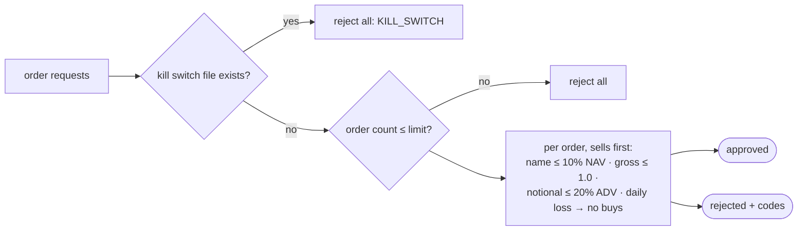

# Part 10 — Independent safety, execution, monitoring and the fact-checked report

**Goal:** the last mile, from order requests to a record a human can trust.

1. **Safety** approves or rejects each order using only hard limits and plain market facts. It never sees a forecast.
2. **Stage 06** simulates fills, updates the paper book, and **reconciles** what we expect to hold with what the broker says.
3. **Stage 07** monitors calibration, drawdown and execution cost, and raises alerts that ask for review.
4. **The compiler and report** draw plots and write a narrative built *only* from structured outputs, with every number checked.

**Design:** §13 (execution, independent safety controls, hard limits, monitoring, controlled learning), §14 (*"Hard limits and kill switches remain independent of model outputs"*, *"AI-generated narrative reports explain structured results only"*), §16 (report rules).

---

## 10.1 Why safety is a separate package

If the hard limits read the optimiser's output to decide what is "safe", a bug in the optimiser could switch off the safety net. So the rules are structural:

- `safety/` imports only `contracts` (and its own modules). It never imports `stages`, `reporting` or `orchestration`. Part 11 adds a test that fails the build if anyone breaks this.
- Hard limits come from `risk_limits.yaml`, a file no model parameter lives in.
- Inputs are facts: orders, positions, prices, NAV, average daily volume, today's P&L and the kill-switch file.



**File:** `src/aqp_python/safety/hard_limits.py`

```python
"""Hard limits loaded from risk_limits.yaml only. No forecast or optimiser input can change them."""
from dataclasses import dataclass


@dataclass(frozen=True)
class HardLimits:
    max_single_name_fraction_nav: float
    max_gross_leverage: float
    max_participation_adv: float
    max_daily_loss_fraction: float
    max_order_count: int

    @classmethod
    def from_config(cls, risk_limits: dict) -> "HardLimits":
        return cls(**{field: risk_limits[field] for field in cls.__dataclass_fields__})
```

`from_config` copies exactly the fields the dataclass declares, so a typo in the YAML raises a `KeyError` instead of silently dropping a limit.

**File:** `src/aqp_python/safety/kill_switch.py`

```python
"""A file-based kill switch: if the file exists, no new risk is allowed. Simple and inspectable."""
import json
from datetime import UTC, datetime
from pathlib import Path


def kill_switch_path(state_dir: Path, filename: str) -> Path:
    return Path(state_dir) / filename


def is_engaged(path: Path) -> bool:
    return path.is_file()


def engage(path: Path, reason: str) -> None:
    path.parent.mkdir(parents=True, exist_ok=True)
    path.write_text(json.dumps({"engaged_at": datetime.now(UTC).isoformat(),
                                "reason": reason}), encoding="utf-8")
```

The kill switch is a **file**: `outputs\state\KILL_SWITCH`. Anyone can engage it with one command, without touching code or config, and its presence is easy to see:

```powershell
'{"reason": "manual stop"}' | Set-Content .\outputs\state\KILL_SWITCH      # engage
Remove-Item .\outputs\state\KILL_SWITCH                                     # release, after review
```

**File:** `src/aqp_python/safety/incident_log.py`

```python
"""Append-only incident log. Restarting after an incident requires a human review."""
import json
from datetime import UTC, datetime
from pathlib import Path


def log_incident(path: Path, run_id: str, code: str, detail: str) -> None:
    path.parent.mkdir(parents=True, exist_ok=True)
    entry = {"at": datetime.now(UTC).isoformat(), "run_id": run_id, "code": code, "detail": detail}
    with path.open("a", encoding="utf-8") as handle:
        handle.write(json.dumps(entry) + "\n")
```

**File:** `src/aqp_python/safety/pre_trade_checks.py`

```python
"""Independent pre-trade approval. Inputs are orders and plain market facts - never forecasts."""
from dataclasses import dataclass

import pandas as pd

from aqp_python.contracts.order_schema import OrderRequest, Side
from aqp_python.contracts.reason_codes import ReasonCode as RC
from aqp_python.safety.hard_limits import HardLimits


@dataclass(frozen=True)
class SafetyDecision:
    approved: list[OrderRequest]
    rejected: list[tuple[OrderRequest, tuple[str, ...]]]


def approve_orders(orders: list[OrderRequest], *, positions: pd.Series, prices: pd.Series,
                   nav: float, adv: pd.Series, daily_pnl_fraction: float,
                   limits: HardLimits, kill_switch_engaged: bool) -> SafetyDecision:
    if kill_switch_engaged:
        return SafetyDecision([], [(o, (str(RC.KILL_SWITCH),)) for o in orders])
    if len(orders) > limits.max_order_count:
        return SafetyDecision([], [(o, (str(RC.HARD_LIMIT_ORDER_COUNT),)) for o in orders])

    holdings = (positions * prices.reindex(positions.index)).fillna(0.0)
    approved, rejected = [], []
    loss_breached = daily_pnl_fraction < -limits.max_daily_loss_fraction
    # Sells first: they free capacity and are always risk-reducing for a long-only book.
    for order in sorted(orders, key=lambda o: o.side != Side.SELL):
        signed = order.notional if order.side == Side.BUY else -order.notional
        after = holdings.copy()
        after[order.security_id] = after.get(order.security_id, 0.0) + signed
        codes = []
        if order.side == Side.BUY:
            if loss_breached:
                codes.append(str(RC.HARD_LIMIT_DAILY_LOSS))
            if after[order.security_id] > limits.max_single_name_fraction_nav * nav + 1e-6:
                codes.append(str(RC.HARD_LIMIT_NAME))
            if after.abs().sum() > limits.max_gross_leverage * nav + 1e-6:
                codes.append(str(RC.HARD_LIMIT_GROSS))
        if order.notional > limits.max_participation_adv * float(adv.get(order.security_id, 0.0)):
            codes.append(str(RC.HARD_LIMIT_PARTICIPATION))
        if codes:
            rejected.append((order, tuple(codes)))
        else:
            approved.append(order)
            holdings = after
    return SafetyDecision(approved, rejected)
```

Orders are processed **sells first**, and the running `holdings` are updated only for approved orders. A buy that would breach the gross limit can therefore still pass if earlier sells freed room, and a rejected order never counts toward the limits. After a large daily loss, buys are blocked but sells still pass, because reducing risk is always allowed (design §12, *"risk-reducing actions only if policy permits"*).

**File:** `src/aqp_python/safety/reconciliation_block.py`

```python
"""Compare what we expect to hold with what the broker says. Any mismatch blocks trading."""
import pandas as pd


def reconcile(expected: pd.Series, broker: pd.Series, tolerance: float = 0.0) -> pd.DataFrame:
    """Return the mismatching rows (empty frame = reconciled)."""
    ids = sorted(set(expected.index) | set(broker.index))
    table = pd.DataFrame({"expected": expected.reindex(ids).fillna(0.0),
                          "broker": broker.reindex(ids).fillna(0.0)})
    table["difference"] = table["broker"] - table["expected"]
    return table.loc[table["difference"].abs() > tolerance]
```

## 10.2 Stage 06: execution simulation and reconciliation

**File:** `src/aqp_python/stages/stage_06_execution/execution_simulator.py`

```python
"""Simulated fills: half-spread + square-root impact, capped by participation of ADV."""
import numpy as np
import pandas as pd

from aqp_python.contracts.order_schema import OrderRequest, Side


def simulate_fills(orders: list[OrderRequest], *, adv: pd.Series, daily_vol: pd.Series,
                   half_spread_bps: float, commission_bps: float, impact_coefficient: float,
                   participation_cap: float) -> pd.DataFrame:
    rows = []
    for order in orders:
        capacity = participation_cap * float(adv.get(order.security_id, 0.0))
        fill_qty = min(order.quantity, int(capacity // order.reference_price))
        notional = fill_qty * order.reference_price
        impact = impact_coefficient * float(daily_vol.get(order.security_id, 0.0)) * np.sqrt(
            notional / max(float(adv.get(order.security_id, 1.0)), 1.0))
        sign = 1 if order.side == Side.BUY else -1
        price = order.reference_price * (1 + sign * (half_spread_bps * 1e-4 + impact))
        rows.append({
            "order_id": order.order_id, "security_id": order.security_id, "side": str(order.side),
            "requested_quantity": order.quantity, "filled_quantity": fill_qty,
            "reference_price": order.reference_price, "fill_price": round(price, 6),
            "fees": round(fill_qty * price * commission_bps * 1e-4, 2),
            "status": "FILLED" if fill_qty == order.quantity else ("PARTIAL" if fill_qty else "UNFILLED"),
        })
    return pd.DataFrame(rows, columns=["order_id", "security_id", "side", "requested_quantity",
                                       "filled_quantity", "reference_price", "fill_price", "fees", "status"])
```

The fill price is the reference price moved against us by the half-spread plus a square-root impact term: `impact = coef × σ_daily × √(notional / ADV)`. No more than 20% of average daily volume fills in one session, so a larger order fills **partially** and the rest is reported, not assumed done.

**File:** `src/aqp_python/stages/stage_06_execution/fill_reconciliation.py`

```python
"""Expected positions after fills, and implementation shortfall against the decision price."""
import pandas as pd


def signed_quantity(fills: pd.DataFrame) -> pd.Series:
    sign = fills["side"].map({"BUY": 1, "SELL": -1})
    return (fills["filled_quantity"] * sign).groupby(fills["security_id"]).sum()


def expected_positions(before: pd.Series, fills: pd.DataFrame) -> pd.Series:
    if fills.empty:
        return before.copy()
    after = before.add(signed_quantity(fills), fill_value=0.0)
    return after.loc[after != 0]


def implementation_shortfall(fills: pd.DataFrame) -> dict:
    """Cost of execution versus the reference (decision) price, in currency and bps."""
    if fills.empty or fills["filled_quantity"].sum() == 0:
        return {"shortfall": 0.0, "traded_notional": 0.0, "shortfall_bps": 0.0}
    sign = fills["side"].map({"BUY": 1, "SELL": -1})
    slippage = (sign * (fills["fill_price"] - fills["reference_price"]) * fills["filled_quantity"]).sum()
    traded = (fills["reference_price"] * fills["filled_quantity"]).sum()
    total = float(slippage + fills["fees"].sum())
    return {"shortfall": total, "traded_notional": float(traded), "shortfall_bps": float(total / traded * 1e4)}
```

**Implementation shortfall** = slippage against the decision price + fees. It is the true cost of turning a decision into a position, and Stage 07 compares it with the cost model.

**File:** `src/aqp_python/stages/stage_06_execution/service.py`

```python
"""Stage 06 entry point. The only stage that talks to the broker."""
import json

import pandas as pd

from aqp_python.contracts.data_schemas import MarketData
from aqp_python.contracts.order_schema import OrderRequest
from aqp_python.contracts.portfolio_schema import PortfolioState
from aqp_python.contracts.reason_codes import ReasonCode as RC
from aqp_python.orchestration.run_context import RunContext
from aqp_python.orchestration.stage_status import StageResult
from aqp_python.safety.incident_log import log_incident
from aqp_python.safety.kill_switch import engage, kill_switch_path
from aqp_python.safety.reconciliation_block import reconcile
from aqp_python.stages.stage_06_execution.execution_simulator import simulate_fills
from aqp_python.stages.stage_06_execution.fill_reconciliation import (
    expected_positions,
    implementation_shortfall,
)
from aqp_python.stages.stage_06_execution.portfolio_state import latest_prices, open_broker, state_dir

STAGE = "stage_06_execution"


def run_stage(ctx: RunContext, data: MarketData, orders: list[OrderRequest],
              state: PortfolioState) -> StageResult:
    result = StageResult(STAGE)
    history = state.equity_history
    if ctx.mode == "paper" and len(history) and history.index[-1] >= ctx.decision_date:
        return result.block(RC.PAPER_OUT_OF_ORDER,
                            f"paper book already has {history.index[-1].date()}; paper runs must move forward")
    costs, pcfg = ctx.config["sleeve"]["costs"], ctx.config["sleeve"]["portfolio"]
    recent = data.prices.loc[data.prices["date"] > ctx.decision_date - pd.offsets.BDay(60)]
    fills = simulate_fills(
        orders, adv=recent.groupby("security_id")["dollar_volume"].median(),
        daily_vol=recent.groupby("security_id")["return"].std(),
        half_spread_bps=costs["half_spread_bps"], commission_bps=costs["commission_bps"],
        impact_coefficient=costs["impact_coefficient"], participation_cap=pcfg["participation_cap"])

    broker = open_broker(ctx)
    for fill in fills.itertuples(index=False):
        if fill.filled_quantity:
            sign = 1 if fill.side == "BUY" else -1
            broker.apply_fill(fill.security_id, sign * fill.filled_quantity, fill.fill_price, fill.fees)

    expected = expected_positions(state.positions, fills)
    breaks = reconcile(expected, broker.positions())
    shortfall = implementation_shortfall(fills)
    prices = latest_prices(data)
    nav_after = broker.cash() + float((broker.positions() * prices.reindex(broker.positions().index)).sum())

    fills.to_csv(ctx.paths.sub("execution", "fills.csv"), index=False)
    breaks.to_csv(ctx.paths.sub("execution", "reconciliation_breaks.csv"))
    ctx.paths.sub("execution", "implementation_shortfall.json").write_text(json.dumps(shortfall, indent=2))
    result.artifacts.update({"fills": "execution/fills.csv",
                             "reconciliation_breaks": "execution/reconciliation_breaks.csv",
                             "implementation_shortfall": "execution/implementation_shortfall.json"})
    partial = int((fills["status"] != "FILLED").sum()) if len(fills) else 0
    if partial:
        result.reason_codes.append(str(RC.PARTIAL_FILL))
        result.warnings.append(f"{partial} orders partially filled or unfilled")
    result.metrics.update({"fills": int(len(fills)), "nav_after": nav_after, **shortfall,
                           "book_updated": ctx.mode == "paper"})

    if not breaks.empty:
        path = kill_switch_path(state_dir(ctx), ctx.config["risk_limits"]["kill_switch_file"])
        engage(path, f"reconciliation failed in run {ctx.run_id}")
        log_incident(state_dir(ctx) / "incidents.jsonl", ctx.run_id, str(RC.RECONCILIATION_FAILED),
                     breaks.to_json())
        return result.block(RC.RECONCILIATION_FAILED, "positions do not reconcile; kill switch engaged")

    if ctx.mode == "paper":            # research runs never change the paper book
        broker.record_equity(str(ctx.decision_date.date()), nav_after)
        broker.save()
    return result
```

Four rules:

1. **Paper runs must move forward in time.** If the book already has an entry for this date or later, the stage blocks with `PAPER_OUT_OF_ORDER`, so the same day cannot be traded twice.
2. Fills are applied to the broker, then `expected_positions` (book before + our own fill records) is compared with `broker.positions()`. Any difference **engages the kill switch** and writes an incident. Design §13: *"Block further orders if broker fills, cash or positions do not reconcile."* With a real broker, this is where wrong fill messages, missed partial fills and manual trades are caught.
3. **Research mode never saves the book.** Fills are simulated and recorded in the run folder, but `paper_book.json` is untouched, so research runs can be repeated freely.
4. In paper mode the post-trade NAV is recorded by date, which gives the drawdown multiplier its history.

## 10.3 Stage 07: monitoring

**File:** `src/aqp_python/stages/stage_07_monitoring/calibration_monitor.py`

```python
"""Is the 90% interval still covering about 90% of outcomes?"""
import pandas as pd

from aqp_python.contracts.quantile_grid import LOWER_90, UPPER_90


def rolling_coverage(oos: pd.DataFrame, window_dates: int) -> pd.Series:
    """Coverage of the 5%-95% interval pooled over the last `window_dates` test dates."""
    inside = (oos["label"] >= oos[LOWER_90]) & (oos["label"] <= oos[UPPER_90])
    by_date = pd.DataFrame({"hits": inside, "n": 1}).groupby(oos["date"]).sum().sort_index()
    rolled = by_date.rolling(window_dates, min_periods=window_dates).sum()
    return (rolled["hits"] / rolled["n"]).dropna().rename("coverage_90")
```

**File:** `src/aqp_python/stages/stage_07_monitoring/performance_monitor.py`

```python
"""Performance of the paper book."""
import pandas as pd


def drawdown(equity: pd.Series) -> float:
    """Current drawdown from the running peak, as a positive fraction (0.10 = 10%)."""
    if equity.empty:
        return 0.0
    return float(1 - equity.iloc[-1] / equity.cummax().iloc[-1])
```

**File:** `src/aqp_python/stages/stage_07_monitoring/alert_rules.py`

```python
"""Turn monitored metrics into alerts. An alert asks for review; it changes nothing by itself."""


def evaluate_alerts(*, latest_coverage: float | None, drawdown: float, shortfall_bps: float,
                    rules: dict) -> list[dict]:
    alerts = []
    low, high = rules["coverage_band"]
    if latest_coverage is not None and not low <= latest_coverage <= high:
        alerts.append({"alert": "CALIBRATION_DRIFT", "value": latest_coverage, "band": [low, high],
                       "response": "review model calibration; consider a challenger (G7)"})
    if drawdown > rules["max_drawdown_alert"]:
        alerts.append({"alert": "DRAWDOWN", "value": drawdown, "limit": rules["max_drawdown_alert"],
                       "response": "risk reduced by the drawdown multiplier; review the sleeve"})
    if shortfall_bps > rules["max_shortfall_bps_alert"]:
        alerts.append({"alert": "EXECUTION_COST", "value": shortfall_bps,
                       "limit": rules["max_shortfall_bps_alert"], "response": "review cost model"})
    return alerts
```

Each alert carries a `response` describing what a human should do. Design §13: *"Alerts trigger the configured response, not automatic model promotion."* The thresholds (87–93% coverage, 10% drawdown, 50 bps shortfall) are in `monitoring_alerts.yaml`.

**File:** `src/aqp_python/stages/stage_07_monitoring/service.py`

```python
"""Stage 07 entry point: calibration, performance, alerts and readiness."""
import json

import pandas as pd

from aqp_python.contracts.forecast_schema import CombinedForecast
from aqp_python.contracts.portfolio_schema import PortfolioState
from aqp_python.orchestration.run_context import RunContext
from aqp_python.orchestration.stage_status import StageResult
from aqp_python.stages.stage_07_monitoring.alert_rules import evaluate_alerts
from aqp_python.stages.stage_07_monitoring.calibration_monitor import rolling_coverage
from aqp_python.stages.stage_07_monitoring.performance_monitor import drawdown

STAGE = "stage_07_monitoring"


def run_stage(ctx: RunContext, combined: CombinedForecast, state: PortfolioState,
              shortfall_bps: float) -> StageResult:
    result = StageResult(STAGE)
    rules = ctx.config["monitoring"]
    oos_path = ctx.paths.sub("validation", "oos_forecasts.csv")
    oos = pd.read_csv(oos_path, parse_dates=["date"]) if oos_path.is_file() else pd.DataFrame()
    monitored = list(combined.eligible_models)
    latest = None
    if monitored and not oos.empty:
        coverage = rolling_coverage(oos.loc[oos["model_name"].isin(monitored)], rules["coverage_window_dates"])
        coverage.to_csv(ctx.paths.sub("monitoring", "rolling_coverage.csv"))
        result.artifacts["rolling_coverage"] = "monitoring/rolling_coverage.csv"
        latest = float(coverage.iloc[-1]) if len(coverage) else None
    book_drawdown = drawdown(state.equity_history)
    alerts = evaluate_alerts(latest_coverage=latest, drawdown=book_drawdown,
                             shortfall_bps=shortfall_bps, rules=rules)
    readiness = {"mode": ctx.mode, "eligible_models": monitored, "alerts": len(alerts),
                 "paper_sessions_recorded": int(len(state.equity_history)),
                 "note": "research evidence only; paper trading and sign-off are separate steps"}
    ctx.paths.sub("monitoring", "alerts.json").write_text(json.dumps(alerts, indent=2))
    ctx.paths.sub("monitoring", "readiness.json").write_text(json.dumps(readiness, indent=2))
    result.artifacts.update({"alerts": "monitoring/alerts.json", "readiness": "monitoring/readiness.json"})
    result.metrics.update({"latest_coverage_90": latest, "book_drawdown": book_drawdown,
                           "alerts": [a["alert"] for a in alerts]})
    result.warnings.extend(f"alert {a['alert']}" for a in alerts)
    return result
```

`readiness.json` states what kind of evidence this run is: research evidence, with the number of recorded paper sessions. It never claims live readiness (design §17).

## 10.4 Plots

**File:** `src/aqp_python/compiler/plot_compiler.py`

```python
"""Draw the standard plots from files already in the run folder, then index them.

Read-only with respect to the pipeline: it never changes data, decisions or orders.
A failed plot is listed as missing with its error - it never hides a failure elsewhere.
"""
import logging
from collections.abc import Callable
from pathlib import Path

import matplotlib

matplotlib.use("Agg")                       # no window: safe in terminals and tests
import matplotlib.pyplot as plt  # noqa: E402
import pandas as pd  # noqa: E402

log = logging.getLogger(__name__)


def _validation_curve(run: Path, ax) -> None:
    oos = pd.read_csv(run / "validation" / "oos_forecasts.csv", parse_dates=["date"])
    for name, rows in oos.groupby("model_name"):
        daily = rows.groupby("date").apply(
            lambda d: d.nlargest(max(1, len(d) // 5), "q0.500")["label"].mean()
            - d.nsmallest(max(1, len(d) // 5), "q0.500")["label"].mean())
        ax.plot((1 + daily).cumprod(), label=name)
    ax.set_title("Out-of-sample long-short (gross, top vs bottom quintile)")
    ax.legend()


def _coverage(run: Path, ax) -> None:
    coverage = pd.read_csv(run / "monitoring" / "rolling_coverage.csv", index_col=0, parse_dates=True)
    ax.plot(coverage.iloc[:, 0])
    ax.axhspan(0.87, 0.93, alpha=0.2)
    ax.set_title("Rolling 90% interval coverage (target band shaded)")


def _fan(run: Path, ax) -> None:
    combined = pd.read_csv(run / "forecasts" / "combined_forecasts.csv").sort_values("q0.500")
    x = range(len(combined))
    ax.vlines(x, combined["q0.050"], combined["q0.950"], alpha=0.4)
    ax.vlines(x, combined["q0.250"], combined["q0.750"], linewidth=4)
    ax.scatter(x, combined["q0.500"], s=12, zorder=3)
    ax.set_xticks(list(x), combined["security_id"], rotation=90, fontsize=6)
    ax.axhline(0, linewidth=0.8)
    ax.set_title("Combined forecast: median, 50% and 90% intervals")


def _weights(run: Path, ax) -> None:
    table = pd.read_csv(run / "portfolio" / "target_weights.csv", index_col=0)
    table = table.loc[(table["target_weight"] > 0) | (table["current_weight"] > 0)]
    table[["current_weight", "target_weight"]].plot.bar(ax=ax)
    ax.set_title("Current vs target relative weights")


PLOTS: dict[str, Callable] = {
    "validation_long_short.png": _validation_curve,
    "rolling_coverage.png": _coverage,
    "combined_forecast_fan.png": _fan,
    "target_weights.png": _weights,
}


def compile_plots(run_dir: Path) -> pd.DataFrame:
    rows = []
    for filename, draw in PLOTS.items():
        fig, ax = plt.subplots(figsize=(9, 4.5))
        try:
            draw(run_dir, ax)
            fig.tight_layout()
            fig.savefig(run_dir / "plots" / filename, dpi=110)
            rows.append({"plot": filename, "status": "created", "detail": ""})
        except Exception as error:  # missing inputs are expected when a stage was blocked
            rows.append({"plot": filename, "status": "missing", "detail": f"{type(error).__name__}: {error}"})
            log.info("plot %s not created: %s", filename, error)
        finally:
            plt.close(fig)
    index = pd.DataFrame(rows)
    index.to_csv(run_dir / "plots" / "plot_index.csv", index=False)
    return index
```

- `matplotlib.use("Agg")` renders to files without opening windows, so plots work in tests, scheduled runs and remote sessions.
- Each plot reads files **already written to the run folder**. The compiler cannot change a decision, because it only reads.
- A plot whose inputs are missing (for example `rolling_coverage.png` when no model is eligible) is recorded as `missing` with the error in `plot_index.csv`. Design §16: *"Plot and report failures are logged and never conceal safety failures."*

## 10.5 The run summary and the narrative report

**File:** `src/aqp_python/reporting/metrics_summary.py`

```python
"""run_summary.json: the single source of truth for the narrative report."""
import json
from pathlib import Path

import pandas as pd


def _json(path: Path):
    return json.loads(path.read_text(encoding="utf-8")) if path.is_file() else None


def build_run_summary(run_dir: Path) -> dict:
    manifest = _json(run_dir / "run_manifest.json")
    stages = {s["stage"]: s for s in manifest["stages"]}
    summary = {
        "run_id": manifest["run_id"], "sleeve": manifest["sleeve"], "mode": manifest["mode"],
        "decision_time": manifest["decision_time"], "status": manifest["status"],
        "stage_status": {name: s["status"] for name, s in stages.items()},
        "warnings": manifest["warnings"],
        "gates_blocked": [g for g in manifest["gates"] if g["outcome"] in ("BLOCK", "QUARANTINE")],
    }
    if "stage_00_data" in stages:
        summary["data"] = {k: stages["stage_00_data"]["metrics"].get(k) for k in ("securities", "rows", "quarantined")}
    if "stage_01_universe" in stages:
        m = stages["stage_01_universe"]["metrics"]
        summary["universe"] = {k: m.get(k) for k in ("universe_id", "members", "active", "exits")}
    scores = run_dir / "validation" / "model_scores.csv"
    if scores.is_file():
        table = pd.read_csv(scores, index_col=0)
        keep = [c for c in ("pinball", "coverage_90", "dm_pvalue", "net_sharpe", "deflated_sharpe") if c in table]
        summary["models"] = table[keep].round(4).to_dict(orient="index")
        validation = stages.get("stage_02e_validation", {}).get("metrics", {})
        summary["eligible_models"] = validation.get("eligible_models", [])
    for key, rel in (("portfolio", "portfolio/risk_summary.json"), ("sizing", "sizing/sizing_summary.json"),
                     ("execution", "execution/implementation_shortfall.json"), ("alerts", "monitoring/alerts.json")):
        value = _json(run_dir / rel)
        if value is not None:
            summary[key] = value
    report = run_dir / "sizing" / "position_report.csv"
    if report.is_file() and report.stat().st_size > 1:
        actions = pd.read_csv(report)
        summary["actions"] = actions["action"].value_counts().to_dict() if "action" in actions else {}
    (run_dir / "reports" / "run_summary.json").write_text(json.dumps(summary, indent=2, default=str))
    return summary
```

`run_summary.json` is the single source of truth for the narrative. It is assembled from the manifest and the stage artifacts, never from in-memory objects that might differ from what was recorded.

**File:** `src/aqp_python/reporting/narrative_report.py`

```python
"""Plain-English report rendered ONLY from run_summary.json. It cannot invent numbers."""


def _pct(value) -> str:
    return "n/a" if value is None else f"{value:.2%}"


def _num(value, digits: int = 4) -> str:
    return "n/a" if value is None else f"{value:.{digits}f}"


def render_report(summary: dict) -> str:
    lines = [f"# Run report {summary['run_id']}", "",
             f"**Sleeve:** {summary['sleeve']}  |  **Mode:** {summary['mode']}  |  "
             f"**Decision time:** {summary['decision_time']}  |  **Status:** {summary['status']}", ""]
    lines += ["## Measured results", ""]
    if "data" in summary:
        d = summary["data"]
        lines.append(f"- Data: {d['securities']} securities, {d['rows']} price rows; "
                     f"quarantined this run: {', '.join(d['quarantined']) or 'none'}.")
    if "universe" in summary:
        u = summary["universe"]
        lines.append(f"- Universe {u['universe_id']}: {u['members']} members, {u['active']} active; "
                     f"mandatory exits: {', '.join(u['exits']) or 'none'}.")
    for name, m in summary.get("models", {}).items():
        lines.append(f"- Model {name}: pinball {_num(m.get('pinball'))}, 90% coverage {_pct(m.get('coverage_90'))}, "
                     f"DM p-value {_num(m.get('dm_pvalue'))}, net Sharpe {_num(m.get('net_sharpe'), 2)}.")
    eligible = summary.get("eligible_models")
    if eligible is not None:
        lines.append(f"- Eligible after G3: {', '.join(eligible) or 'none - the sleeve does not trade'}.")
    if summary.get("sizing", {}).get("leverage"):
        s = summary["sizing"]
        lines.append(f"- Leverage {_num(s['leverage']['final'], 3)} (Kelly cap {_num(s['leverage']['kelly'], 3)}, "
                     f"volatility cap {_num(s['leverage']['volatility'], 3)}); gross exposure "
                     f"{_pct(s['gross_exposure'])}; orders {s['orders']}.")
    if summary.get("actions"):
        lines.append("- Decisions: " + ", ".join(f"{k} {v}" for k, v in sorted(summary["actions"].items())) + ".")
    if "execution" in summary:
        e = summary["execution"]
        lines.append(f"- Implementation shortfall {_num(e['shortfall_bps'], 2)} bps on "
                     f"{_num(e['traded_notional'], 2)} traded.")
    lines += ["", "## Failures, quarantines and alerts", ""]
    failed_stages = {k: v for k, v in summary.get("stage_status", {}).items() if v != "PASS"}
    for stage, status in failed_stages.items():
        lines.append(f"- Stage {stage} ended {status} (details in run_manifest.json and run.log).")
    for gate in summary.get("gates_blocked", []):
        lines.append(f"- {gate['gate_id']} {gate['outcome']} {gate['subject']}: {', '.join(gate['reason_codes'])}")
    for alert in summary.get("alerts") or []:
        lines.append(f"- Alert {alert['alert']}: value {_num(alert['value'])}")
    if not failed_stages and not summary.get("gates_blocked") and not summary.get("alerts"):
        lines.append("- None recorded.")
    lines += ["", "## Limitations", "",
              "- Results come from the synthetic sample market unless a licensed source is configured.",
              "- A passing run is technical evidence only. It is not evidence of profitability or live readiness."]
    return "\n".join(lines) + "\n"
```

The report separates **measured results** from **failures, quarantines and alerts** and states its **limitations** (design §16). Every number in it is formatted from the summary.

**File:** `src/aqp_python/reporting/report_fact_checks.py`

```python
"""Every number in the narrative must be traceable to run_summary.json."""
import re

NUMBER = re.compile(r"(?<![A-Za-z_\d.])-?\d+(?:\.\d+)?")   # skip identifiers like G3


def _leaves(value):
    if isinstance(value, dict):
        for item in value.values():
            yield from _leaves(item)
    elif isinstance(value, list):
        for item in value:
            yield from _leaves(item)
    else:
        yield value


def allowed_numbers(summary: dict) -> set[str]:
    allowed = set()
    for leaf in _leaves(summary):
        if isinstance(leaf, bool) or leaf is None:
            continue
        if isinstance(leaf, (int, float)):
            allowed.add(str(leaf))
            for digits in range(0, 5):
                allowed.add(f"{leaf:.{digits}f}")
                allowed.add(f"{leaf * 100:.{digits}f}")      # percentages
        else:
            allowed.update(NUMBER.findall(str(leaf)))
    return allowed


def unsupported_numbers(narrative: str, summary: dict) -> list[str]:
    allowed = allowed_numbers(summary) | {"90", "5", "95"}   # fixed wording, e.g. "90% coverage"
    return [n for n in NUMBER.findall(narrative) if n not in allowed]
```

The fact check collects every number in the narrative and checks that each one can be produced from a value in the summary. The lookbehind in `NUMBER` skips identifiers such as `G3` or `SYN17`. If a future change (or an LLM-written narrative, design §9) introduces a number that is not in the summary, the report is refused and the manifest records `report.status = FAILED`, while every structured output survives.

## 10.6 Tests

**File:** `tests/unit/test_execution.py`

```python
import pandas as pd
import pytest

from aqp_python.connectors.broker.paper_broker import PaperBroker
from aqp_python.contracts.order_schema import OrderRequest, Side
from aqp_python.safety.reconciliation_block import reconcile
from aqp_python.stages.stage_06_execution.execution_simulator import simulate_fills
from aqp_python.stages.stage_06_execution.fill_reconciliation import (
    expected_positions,
    implementation_shortfall,
)

pytestmark = pytest.mark.batch06


def fills_for(quantity, adv=1e6):
    order = OrderRequest("o1", "A", Side.BUY, quantity, 10.0, "TRADE_APPROVED")
    return simulate_fills([order], adv=pd.Series({"A": adv}), daily_vol=pd.Series({"A": 0.02}),
                          half_spread_bps=10, commission_bps=5, impact_coefficient=0.1,
                          participation_cap=0.2)


def test_buys_fill_above_the_reference_price():
    fill = fills_for(1000).iloc[0]
    assert fill["status"] == "FILLED" and fill["fill_price"] > 10.0 and fill["fees"] > 0


def test_participation_cap_creates_partial_fills():
    fill = fills_for(50_000).iloc[0]                 # 500k notional vs 200k capacity
    assert fill["status"] == "PARTIAL" and fill["filled_quantity"] == 20_000


def test_shortfall_is_positive_for_costly_execution():
    assert implementation_shortfall(fills_for(1000))["shortfall_bps"] > 10


def test_paper_broker_refuses_to_go_short(tmp_path):
    broker = PaperBroker(tmp_path / "book.json", 1000.0)
    with pytest.raises(ValueError, match="short"):
        broker.apply_fill("A", -5, 10.0, 0.0)


def test_reconciliation_detects_a_break():
    expected = expected_positions(pd.Series({"A": 100.0}), fills_for(1000))
    assert reconcile(expected, pd.Series({"A": 1100.0})).empty
    assert not reconcile(expected, pd.Series({"A": 1000.0})).empty
```

**File:** `tests/unit/test_safety_and_reporting.py`

```python
import pandas as pd
import pytest

from aqp_python.contracts.order_schema import OrderRequest, Side
from aqp_python.contracts.reason_codes import ReasonCode as RC
from aqp_python.reporting.report_fact_checks import unsupported_numbers
from aqp_python.safety.hard_limits import HardLimits
from aqp_python.safety.pre_trade_checks import approve_orders

pytestmark = pytest.mark.batch07
LIMITS = HardLimits(max_single_name_fraction_nav=0.1, max_gross_leverage=1.0, max_participation_adv=0.2,
                    max_daily_loss_fraction=0.05, max_order_count=10)


def run(orders, **overrides):
    base = dict(positions=pd.Series({"B": 1000.0}), prices=pd.Series({"A": 10.0, "B": 10.0}), nav=100_000,
                adv=pd.Series({"A": 1e6, "B": 1e6}), daily_pnl_fraction=0.0, limits=LIMITS,
                kill_switch_engaged=False)
    return approve_orders(orders, **{**base, **overrides})


def buy(qty, sid="A"):
    return OrderRequest(f"o-{sid}-{qty}", sid, Side.BUY, qty, 10.0, "TRADE_APPROVED")


def test_kill_switch_rejects_everything():
    decision = run([buy(10)], kill_switch_engaged=True)
    assert not decision.approved and decision.rejected[0][1] == (RC.KILL_SWITCH,)


def test_single_name_limit():
    decision = run([buy(1500)])                      # 15k > 10% of 100k NAV
    assert RC.HARD_LIMIT_NAME in decision.rejected[0][1]


def test_participation_limit():
    decision = run([buy(900)], adv=pd.Series({"A": 20_000.0}))
    assert RC.HARD_LIMIT_PARTICIPATION in decision.rejected[0][1]


def test_daily_loss_blocks_buys_but_not_sells():
    sell = OrderRequest("s", "B", Side.SELL, 500, 10.0, "TRADE_APPROVED")
    decision = run([buy(100), sell], daily_pnl_fraction=-0.08)
    assert [o.order_id for o in decision.approved] == ["s"]


def test_fact_check_catches_an_invented_number():
    summary = {"run_id": "x", "models": {"m": {"pinball": 0.0057}}}
    assert unsupported_numbers("pinball 0.0057", summary) == []
    assert unsupported_numbers("pinball 0.0057 and Sharpe 3.1", summary) == ["3.1"]
```

**File:** `tests/invariants/test_narrative_uses_structured_outputs.py`

```python
import pytest

from aqp_python.reporting.narrative_report import render_report
from aqp_python.reporting.report_fact_checks import unsupported_numbers

pytestmark = pytest.mark.invariant

SUMMARY = {
    "run_id": "20261016T060000Z_abcdef12", "sleeve": "asx_interday", "mode": "research",
    "decision_time": "2026-10-16T17:00:00+11:00", "status": "PASS",
    "data": {"securities": 40, "rows": 48219, "quarantined": ["SYN17"]},
    "universe": {"universe_id": "ASX_20250630_v1", "members": 27, "active": 24, "exits": ["SYN30"]},
    "models": {"ridge": {"pinball": 0.0057, "coverage_90": 0.8815, "dm_pvalue": 0.0217, "net_sharpe": 2.8}},
    "eligible_models": ["ridge"],
    "sizing": {"leverage": {"final": 0.8, "kelly": 2.5, "volatility": 1.2}, "gross_exposure": 0.4, "orders": 7},
    "execution": {"shortfall_bps": 16.5, "traded_notional": 400000.0},
    "gates_blocked": [], "alerts": [],
}


def test_every_number_in_the_report_comes_from_the_summary():
    assert unsupported_numbers(render_report(SUMMARY), SUMMARY) == []
```

**File:** `tests/integration/test_stage_handoffs.py` — `test_stage_06_execution`

```python
@pytest.mark.batch06
def test_stage_06_execution(make_context):
    ctx = make_context()
    out = run_through(ctx, "stage_06_execution")
    result = out["stage_06_execution"]
    print("\n", result.metrics)
    assert result.status == "PASS" and result.metrics["fills"] == len(out["orders"])
    assert result.metrics["book_updated"] is False             # research mode never touches the book
```

```powershell
python -m pytest -m "batch06 or batch07" -q
python -m pytest tests\invariants -q
python -m pytest tests\integration\test_stage_handoffs.py -k stage_06 -s --basetemp=build\pytest
```

```text
{'fills': 7, 'nav_after': 999335.33, 'shortfall': 664.67, 'traded_notional': 401179.53, 'shortfall_bps': 16.57, 'book_updated': False}
.
1 passed
```

Seven fills cost 16.6 bps against the decision prices (10 bps half-spread, plus about 1.6 bps of impact, plus 5 bps commission), and the research run did not touch the paper book.

## Checkpoint

- [ ] `python -m pytest -m "batch06 or batch07" -q` passes (the end-to-end tests in batch07 arrive in Part 11).
- [ ] You can name the three things `safety/` is not allowed to import, and why.
- [ ] You can explain what happens, step by step, when reconciliation finds a difference.

```powershell
git add .
git commit -m "Safety, execution simulation, reconciliation, monitoring, plots and fact-checked report"
```

Next: [Part 11 — orchestrator, CLI and full runs](11_orchestrator_cli_and_full_runs.md).
