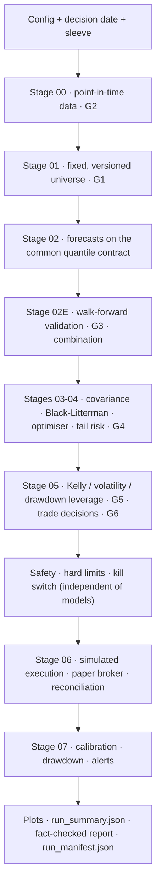

# AQP-PYTHON Implementation Guide

**Build the Advanced Quantitative Pipeline (design v12) from an empty folder to a working, tested, paper-trading pipeline — one file at a time.**

This guide follows `AQP_OVERVIEW.md` (the v12 design) and the folder layout in `PY REPOSITORY OVERVIEW.md`. Every code block in it was taken from a reference implementation that was run and tested before the guide was written: 112 tests pass on Python 3.11 (with the oldest supported library versions) and Python 3.13 (with the latest), and a full run takes about 7 seconds.

---

## What you will have at the end

A Python package, `aqp_python`, that runs this flow for the **ASX interday sleeve** on a synthetic market:



One command runs everything and writes an immutable folder per run:

```powershell
python -m aqp_python.cli run --as-of 2026-10-16
```

```text
outputs/runs/20261018T071436Z_626e7519/
├── run_manifest.json        every stage, gate, reason code, artifact and input hash
├── config_snapshot.yaml     the exact configuration used
├── data_lineage/  universe/  forecasts/  validation/  portfolio/
├── sizing/  safety/  execution/  monitoring/  plots/
├── reports/run_summary.json + run_report.md
└── run.log
```

The synthetic market is deliberately awkward. It includes a delisted company, a late listing, an illiquid name, a distressed name, a stock split, a bad price print and a suspension, so every gate has something real to catch. It also contains a weak planted signal, so validation has something genuine to find. **Nothing about it says anything about real markets.** A passing run is technical evidence only; it is not evidence of profitability.

## How to use this guide

Work through the parts in order. Each part follows the same rhythm:

1. **Why** — the design rule this part implements (with the section of `AQP_OVERVIEW.md`).
2. **Build** — each file in the order you should create it, with the code and an explanation of every decision in it. Long files are shown in pieces (`top of file`, then one function at a time); type the pieces into the same file, in order.
3. **Run and test** — the exact PowerShell commands, and what you should see.
4. **Checkpoint** — what must be true before you move on, and the Git commit to make.

| Part | You build | Design section | Tests |
|---|---|---|---|
| [01](01_setup_windows_vscode_and_project.md) | Windows/PowerShell/VS Code setup, virtual environment, package skeleton, logging | §13 of the repo overview | environment check |
| [02](02_contracts_configuration_and_gates.md) | Run status, reason codes, quantile grid, all YAML config, fail-fast validation, gate result, CLI | §2, §5, §16 | `batch01` |
| [03](03_storage_run_context_and_manifest.md) | Point-in-time vintage store, run folders, run context, stage result, atomic manifest | §3, §16 | `batch01` |
| [04](04_stage00_point_in_time_data.md) | Synthetic market, data source, split adjustment, G2, quality report, Stage 00 | §3 | `batch01` |
| [05](05_stage01_universe.md) | Universe metrics, G1, robust scoring, formation, versioning, mandatory exits | §4 | `batch02` |
| [06](06_validation_framework.md) | Labels with purge dates, walk-forward folds, purging/embargo, pinball, Diebold–Mariano, net-of-cost test, deflated Sharpe, trial registry | §5, §10 | `batch03` |
| [07](07_stage02_forecasting.md) | Forecast contract, leakage-safe features, baselines, ridge location-scale model, quantile regression, validator, Stage 02 | §5, §6 | `batch04` |
| [08](08_stage02e_eligibility_and_combination.md) | Out-of-sample evaluation loop, G3, inverse-loss combination, Stage 02E | §10 | `batch04` |
| [09](09_stages03_05_portfolio_and_sizing.md) | Ledoit–Wolf, Black–Litterman, cost-aware optimiser, relaxation policy, ES and stress, G4, Kelly/vol/drawdown leverage, G5, trade decisions, G6 | §11, §12 | `batch05` |
| [10](10_safety_execution_monitoring_reporting.md) | Hard limits, kill switch, pre-trade checks, paper broker, fills, reconciliation, monitoring, plots, fact-checked report | §13, §16 | `batch06`, `batch07` |
| [11](11_orchestrator_cli_and_full_runs.md) | Orchestrator, CLI `run`, first full run, reading the outputs, paper trading day by day, replay, invariants, import contracts | §9, §16, §17 | everything |
| [12](12_extending_to_production.md) | Tested extension modules (GJR-GARCH, macro exposure and shrinkage, realised measures, news events and graph propagation, R adapter, G7) and how to wire them in; other sleeves; scheduled paper trading; deployment sign-off | §6–§9, §13, §17 | `batch08` |
| [A](A_powershell_testing_and_debugging.md) | PowerShell, pytest, output inspection and error playbook (keep it open while you work) | | |
| [B](B_module_map_and_glossary.md) | Every planned module in the repository overview → built in this guide or where it plugs in later; glossary | | |

**Time:** Parts 01–05 take about a day; Parts 06–11 take three or four days if you type the code and run every test. Typing the code rather than pasting it is slower but is how the ideas stick. If you do paste, read every line before running it.

## Conventions

- **Terminal:** VS Code's integrated PowerShell, opened at the `AQP-PYTHON` folder (the folder that contains `pyproject.toml`). Every command in this guide assumes that location.
- **Python:** always `python -m <tool>` (for example `python -m pytest`) inside the activated `.venv`, so the tool runs with the project's interpreter.
- **Paths:** code uses forward slashes (`outputs/runs`) because `pathlib` handles them on Windows. PowerShell commands use backslashes (`.\outputs\runs`). Both refer to the same place.
- **Captions:** every code block starts with `**File:** path`. If a caption says `top of file`, that block is the module docstring, imports and constants; the function blocks that follow go underneath it in the same file.
- **Configuration:** limits, thresholds and costs live in `configs/*.yaml`, never in code. Values shown are *provisional examples* to be calibrated and approved per sleeve (design §2).
- **Placeholders:** `<run_id>` means "paste the real folder name". Angle brackets are not typed.

## How the guide maps to the repository overview

The repository overview lists 243 planned Python files (204 under `src/`) across four sleeves and four forecast layers. This guide builds the **spine**: 95 source modules that make the ASX interday sleeve work end-to-end, with every stage, gate and control from the design. 84 of them are files the overview names; the rest are stage entry points and helpers. The responsibilities of 56 more planned files (modules and tests) are folded into those. The remaining modules (macro, microstructure and news layers; GARCH/HAR-RV; DCC; intraday sleeves; LSEG connectors; model lifecycle) plug into the same contracts. Part 12 shows how, and Appendix B lists every planned module with its status. Where the guide merges several small planned files into one module (for example the four universe filters in `gates/g1_universe.py`), Appendix B says which.

## What changed from the previous edition

| Previous edition | This edition |
|---|---|
| 67 files: 26 root notes, 36 labs, 3 module-card catalogues (~840 KB of repeated generic starters) | 15 files in one reading order |
| Snippets that were not run together (`QUANTILE_GRID` used before it is defined, two versions of `main()` to merge by hand) | Every block comes from one tested codebase; each file is complete once its pieces are typed |
| "Bite 4 — finish the actual responsibility" left the real algorithm to the reader | Real implementations: purged walk-forward validation, Diebold–Mariano, deflated Sharpe, Black–Litterman, cost-aware optimiser, Kelly/vol/drawdown leverage, reconciliation |
| Test advice per file | A test suite organised by roadmap batch (`pytest -m batch03`), stage checkpoints and permanent invariants |
| No way to see a stage's output until the end | A checkpoint test per stage from Part 04 onwards, and a full run in Part 11 |

## Before you start

Keep these open in VS Code:

- `docs/design/AQP_OVERVIEW.md` — the specification. When this guide says "design §11", it means section 11 there.
- `PY REPOSITORY OVERVIEW.md` — the target layout.
- Appendix A of this guide, for commands and troubleshooting.

If you also have **`AQP-PYTHON-reference.zip`**, it contains the finished, tested code that every block in this guide comes from. Do not start from it. Use it as an answer key: when a test fails and you cannot see why, compare your file with the reference copy (`code --diff yourfile referencefile`).

Then begin with [Part 01](01_setup_windows_vscode_and_project.md).
