# AQP-LSEG v5 — Pipeline Architecture Overview

**1 · Pipeline architecture overview** · [2 · Repository design](02_Repository_Design.md) · [3 · Models: a conceptual discussion](03_Models_Conceptual_Discussion.md)

| | |
|---|---|
| Project | Advance Quant Pipeline (LSEG), AQP-LSEG v5 — ASX equities, paper trading |
| Source | v5 Technical Architecture (25 A3 sheets) and the v5.2.1 local-edition code |
| Covers | design sheets 01–07, 12 and 21–25 |

This document describes **what the pipeline does and how information flows through it**: the system map and
design invariants, how the investable universe is chosen and filtered, how LSEG data are acquired and stored
point-in-time, how decisions pass the governance gates and become tickets, and how the system is operated.
The quantitative models are discussed in document 3; the code layout and the C++ core in document 2.
Section numbers are the original sheet numbers, so cross-references between sheets still work.

> **Later versions.** v5.1 removed the R stages and the AI-report layer (gate G6, sheet 24); the v5.2 local edition
> removed the GitHub workflows, the scheduler and the intraday/event clocks (sheets 21–22). Those sheets are kept
> here as the design record.

## Contents

- [01. Advance Quant Pipeline (LSEG) — System Overview](#01-advance-quant-pipeline-lseg--system-overview)
- [02. Design Invariants, Gate Catalogue and v5 Changes](#02-design-invariants-gate-catalogue-and-v5-changes)
- [03. Market Selection and Information Layer](#03-market-selection-and-information-layer)
- [04. Filtration and Data-Depth Specification](#04-filtration-and-data-depth-specification)
- [05. LSEG Acquisition Engineering](#05-lseg-acquisition-engineering)
- [06. Point-in-Time Data and Information Integrity](#06-point-in-time-data-and-information-integrity)
- [07. Storage and Data Model on the External SSD](#07-storage-and-data-model-on-the-external-ssd)
- [12. Decision, Trade Governance and Execution](#12-decision-trade-governance-and-execution)
- [21. Automation, Clocks and Local Execution](#21-automation-clocks-and-local-execution)
- [22. Event-Driven Override](#22-event-driven-override)
- [23. Additional Information Streams](#23-additional-information-streams)
- [24. AI/ML Final Run Reporting](#24-aiml-final-run-reporting)
- [25. Roadmap, Risk Register and References](#25-roadmap-risk-register-and-references)

---

## 01. Advance Quant Pipeline (LSEG) — System Overview
`SYSTEM MAP` · *One connected research-to-trade system: discover → filter → acquire → secure → model → validate → trade → report → learn*

> **Principle.** The pipeline is one dependency graph: the control plane schedules and governs it; independent nodes run in parallel once their inputs and gates are satisfied.

### System map

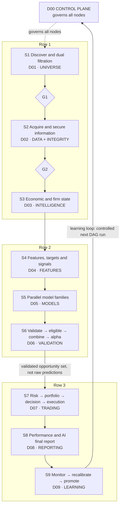

### D00 · Control plane

Governs every node; owns no market logic. Python `Py`; runs on the self-hosted runner.

Modules:

- 00.01 Typed config
- 00.02 DAG compiler
- 00.03 Orchestrator
- 00.04 Scheduler W·D·I·M
- 00.05 Event engine
- 00.06 Checkpoint & recovery
- 00.07 Data contracts
- 00.08 Manifest & lineage
- 00.09 Model registry
- 00.10 Observability
- 00.11 Storage lifecycle
- 00.12 Licence & entitlements (new)

Cross-cutting services: content-addressed caching · atomic writes · run IDs · 7 gates.

The control plane governs all nodes (dashed link to the stage rows).

### S1 · Discover & dual filtration
`D01 · UNIVERSE`

Extract every listed security on the target venue (ASX reference configuration) → resolve RIC / ISIN / entity in the security master → keep listing, delisting and share-class history (survivorship-safe) → **financial** filter $\wedge$ **macro + microeconometric** screen → assign data-depth tiers T1 / T2 / T3 under an explicit request and storage budget.

**◆ G1** dual-pass AND gate · `W` weekly · `Py` `R`

### S2 · Acquire & secure information
`D02 · DATA + INTEGRITY`

Budgeted LSEG Data Library acquisition ($\le$ 10k requests/day, $\approx$ 5 req/s) with watermarks → daily LFD, **forward-captured** tiered HFD, fundamentals and estimates, macro vintages, news → corporate actions and revisions → **bitemporal point-in-time store** (valid time $\times$ knowledge time) → schema, unit, timezone, freshness checks.

**◆ G2** PIT + data-quality firewall · `D` `I` · `Py` `C++`

### S3 · Economic & firm state
`D03 · INTELLIGENCE`

Macro factors and Markov-switching regimes (DFM + Hamilton filter), MIDAS / BVAR nowcasts, panel and double-ML firm sensitivities, macro → sector → firm transmission network, news novelty / shock probabilities, Kalman and time-varying-parameter latent states. Output: state vectors with uncertainty, all stamped with knowledge time.

`D` daily · `E` event refresh · `Py` `R`

### S4 · Features, targets & signals
`D04 · FEATURES`

PIT feature store (market, macro, firm, cross-asset, implied risk, revisions, regimes); **realised measures from ticks in C++** (RV, bipower, realised kernel, jump tests); forward targets with explicit horizon $h$ for purging; robust cross-sectional standardisation; factor and macro-conditioned signals.

`D` · `Py` `C++`

### S5 · Parallel model families
`D05 · MODELS`

Statistical (ARIMA, VAR/SVAR, cointegration) · volatility (GJR/EGARCH, HAR-RV) · high-frequency (Hawkes, ACD) · machine learning (elastic net, gradient boosting) · distribution and tails (quantile, conformal, EVT, copulas) · causal (local projections, IRFs). Every family emits forecasts on one **common quantile grid**.

`D` fast refits · `M` deep retrain · `Py` `R` `C++`

### S6 · Validate → eligible → combine → alpha
`D06 · VALIDATION`

Purged walk-forward with embargo and nested tuning → DM, SPA, MCS, deflated Sharpe, PBO → **eligibility gate** → combine *eligible models only* (error-weighted, stacking, regime-weighted) → alpha decay, horizon and signal selection → C++ event-driven backtest that replays the D07 decision code in simulation mode.

**◆ G3** model eligibility · `D` `M` · `Py` `C++`

Output to S7: validated opportunity set (not raw predictions).

### S7 · Risk → portfolio → decision → execution
`D07 · TRADING`

Shrinkage / factor / DCC covariance → VaR, ES and stress → risk and capital budgets → convex optimiser (turnover, liquidity, sector, CVaR limits) → **◆ G4** risk limits → BUY / HOLD / REDUCE / SELL with hysteresis → **◆ G5** NO-TRADE gate → order tickets (closing auction or VWAP, participation-capped).

**◆ G4** **◆ G5** · `D` `I` monitor · `Py` `C++`

### S8 · Performance & AI final report
`D08 · REPORTING`

Return, risk and Brinson / factor attribution; implementation shortfall vs decision price; deterministic run reports → evidence graph (every number linked to artefact, vintage, model version) → AI synthesis → **claim validation** → PDF, HTML, XLSX and JSON evidence package archived with the run manifest.

**◆ G6** claim validation · `D` · `Py`

### S9 · Monitor → recalibrate → promote
`D09 · LEARNING`

Data drift (PSI, KS), concept drift (rolling IC, Page–Hinkley), calibration drift (interval coverage), alpha-decay alarms → policy-driven reweight, retrain, reselect, universe review or cadence change → champion–challenger with shadow period → updated registry feeds the next *controlled* run.

**◆ G7** promotion gate · `M` `E` · `Py`

Learning loop: S9 feeds back to the control plane as a controlled next DAG run.

### Platform
*See Sheets 20–21.*

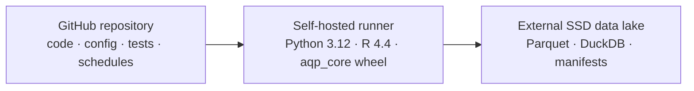

### aqp_core — C++20 performance core `C++`

One header-only library bound to Python (nanobind) and R (Rcpp): tick cleaning + realised measures (D02/D04), GARCH and Hawkes likelihoods with analytic gradients (D05), stationary-bootstrap SPA and the event-driven backtester (D06/D07). Measured 3.6–59$\times$ faster than the Python it replaces (Sheet 17).

### Legend

- **◆ Gx** authoritative gate (downstream nodes cannot read a failed gate's artefacts).
- Clocks: `W` weekly, `D` daily, `I` intraday, `M` monthly, `E` event.
- Languages: `Py` Python, `R` R, `C++` C++.
- Domain IDs D00–D09 are identical here, in the register (Sheets 18–19) and in the repository (Sheet 20).

---

## 02. Design Invariants, Gate Catalogue and v5 Changes
`DESIGN CONTRACT` · *What must always be true, where the pipeline is allowed to stop, and what was corrected relative to v4*

> **Principle.** Every rule on this sheet is enforced in code or CI; none relies on operator discipline alone.

### Design invariants (I1–I8) and how each is enforced

| ID | Invariant | Enforcement |
|---|---|---|
| **I1** | **Point-in-time** | No datum is used at decision time $t$ unless its knowledge time $k \le t$. All reads go through `pit.read(ds, as_of=t)`; raw tables are not importable by model code; CI injects "future-poison" rows that must never surface. |
| **I2** | **Determinism** | Same code + config + inputs → same outputs. Seeds come from the run manifest; one RNG stream per work item; `uv.lock` / `renv.lock`; C++ built with `-ffp-contract=off`. |
| **I3** | **Idempotency** | Node cache key $=H(\text{code SHA},\text{config slice},\text{input hashes})$; unchanged key → skip. Writes go to a temp file and are renamed atomically; upserts use natural keys. |
| **I4** | **Gate authority** | Nodes write to `staging/`; artefacts move to `published/` only when the owning gate passes. Downstream contracts accept `published/` paths only. |
| **I5** | **One code path** | Backtest, paper and live trading call the same D07 functions; the C++ backtester uses the live cost and participation model. |
| **I6** | **Lineage** | Each artefact has a manifest row: run ID, node, git SHA, config hash, input hashes, rows, checksum, gate status. |
| **I7** | **Licence boundary** | Raw and derived LSEG data stay on the SSD. A pre-commit hook and CI job reject data files in Git; 00.12 checks anything leaving the machine. |
| **I8** | **AI is subordinate** | The reporting layer has read-only access to artefacts, no write path to decision tables, and every claim it makes must pass G6. |

### Gate catalogue — the only places the pipeline may stop or exclude

| Gate | Owner | Pass criteria (defaults; all configurable) | On failure |
|---|---|---|---|
| **◆ G1** universe | 01.08 · `W` | Financial pass $\wedge$ macro/micro pass $\wedge$ $\ge 252$ trading days of clean history (IPO rule: $\ge 60$ days, flagged) $\wedge$ identity resolved. | Excluded with reason codes; history retained for survivorship. |
| **◆ G2** PIT + DQ | 02.10 · `D` `I` | Zero **BLOCK** checks; every input row has $k \le$ cut-off; freshness within SLA; corporate actions reconciled. | Affected branch halts; failing securities quarantined; alert. |
| **◆ G3** eligibility | 06.03 · `D` | Converged (KKT, PD Hessian) $\wedge$ stable (Nyblom / CUSUM) $\wedge$ calibrated (90% interval coverage within $\pm$3 pp) $\wedge$ OOS skill (in MCS$_{90}$ or DM $p<0.10$) $\wedge$ net-of-cost IC $>0$ $\wedge$ PBO $<0.2$. | Model excluded from combination this run; registry flag. |
| **◆ G4** risk limits | 07.04 · `D` | Ex-ante vol $\le 1.1\times$ target; ES$_{97.5}$ $\le$ limit; name $\le 8\%$, sector $\le 30\%$; liquidation $\le 3$ days at 20% ADV; stress loss $\le$ budget. | Re-optimise with tightened bounds, else scale toward cash. |
| **◆ G5** NO-TRADE | 07.06 · `D` `I` | Data, model, risk, operational, market-state and kill-switch rule sets all pass (Sheet 12). | NO-TRADE for portfolio or name; incident record. |
| **◆ G6** claims | 08.05 · `D` | 100% of numeric claims reconcile to artefacts within tolerance; all evidence IDs resolve; no evidence newer than the run cut-off. | Regenerate (max 2); then publish deterministic report only. |
| **◆ G7** promotion | 09.02 · `M` | Challenger beats champion over $\ge 60$ shadow days (DM / MCS), calibration intact, no governance exceptions, human sign-off. | Remains challenger or is retired. |

### What v5 corrects relative to v4 (each change is traceable to a sheet)

| # | v4 issue | v5 resolution | Sheet |
|---|---|---|---|
| 1 | Eligibility (36) ran before validation (37–38); combination (35) before eligibility. | Order is validation → tests → eligibility → combination → alpha decay. | 10 |
| 2 | Decision layer (48) came after execution (45) and performance (47). | Decision → governance → execution inside D07; performance is post-trade (D08). | 12 |
| 3 | Backtesting separate from trading code; live/backtest drift risk. | One D07 code path; C++ engine replays it in simulation (invariant I5). | 15–16 |
| 4 | 9 stages vs 10 folders vs IDs 00.1–53 did not line up; 3 AI scripts missing from register. | Unified IDs D00–D09 / `dd.ss`; 69 modules registered, AI scripts 08.03–08.05. | 18–20 |
| 5 | File names such as `RUN_MANIFEST+ARTIFACT_LINEAGE_AQP_LSEG.py` cannot be imported (`+`, `-`). | `snake_case` modules in an installable package; v4 names kept as aliases. | 18–20 |
| 6 | Tier-1 "full HFD" assumed deep tick history is downloadable. | Workspace tick depth is limited ($\approx$90 days): HFD is *forward-captured* daily with a harvest SLA. | 05 |
| 7 | Screening used heavy causal tools (IV, DID, RDD, DML) on every listed firm. | Light screening statistics in 01.07; heavy causal work moves to D03 for the investable set. | 04, 08 |
| 8 | GitHub cron is UTC; Sydney daylight saving shifts every run by an hour twice a year. | `timezone: Australia/Sydney` on every schedule; market-calendar guard. | 21 |
| 9 | No measurable gate criteria; NO-TRADE logic undefined. | Seven gates with numeric defaults; rule-set kill switch. | 02, 12 |
| 10 | No data-licence or secrets control; LSEG data could reach GitHub. | 00.12 licence and entitlements; pre-commit and CI data guards (I7). | 20–21 |
| 11 | All compute in Python/R, including sequential hot loops. | C++20 core for five kernel families, chosen by measurement. | 14–17 |
| 12 | Sheet defects: duplicated subtitle, overlapping text, non-embedded fonts. | Redrawn sheets; all fonts embedded; one style file for every sheet. | all |

### Sheet guide

| Sheet | Topic | Sheet | Topic | Sheet | Topic |
|---|---|---|---|---|---|
| 01 | System overview | 10 | Validation → alpha | 19 | Register II (D04–D09) |
| 02 | Invariants & gates | 11 | Risk & portfolio | 20 | Repository |
| 03 | Market selection | 12 | Decision & execution | 21 | Automation & runner |
| 04 | Filtration spec | 13 | Learning loop | 22 | Event override |
| 05 | LSEG acquisition | 14 | C++: what & why | 23 | Information streams |
| 06 | Point-in-time | 15 | C++ kernels I | 24 | AI final reporting |
| 07 | Storage (SSD) | 16 | C++ kernels II | 25 | Roadmap & references |
| 08 | Econ & firm state | 17 | C++ verification | | |
| 09 | Features & models | 18 | Register I (D00–D03) | | |

### Notation used on every sheet

| Symbol | Meaning | Symbol | Meaning |
|---|---|---|---|
| $i$, $t$ | security; decision time (trading-day close) | $k$, $\tau$ | knowledge time; valid (event) time |
| $h$ | horizon in trading days | $r_{i,t}$ | log return (decimal) |
| $\mathbf{w}$, $\Sigma$ | weights; covariance | $\pi_t(s)$ | regime probabilities |
| $\mathcal{F}_t$ | PIT information set at $t$ | $q_i$ | screening score in $[0,1]$ |

### Conventions

| Item | Convention | Item | Convention |
|---|---|---|---|
| **Time** | UTC `int64` ns on disk; sessions and calendars in Australia/Sydney; daily cut-off $t^\ast$ = 18:30 | **Run ID** | `AQP-20261007-1830-D-3f9c2ab` (date, time, clock, git SHA) |
| **Units** | AUD; decimal log returns; rates decimal p.a.; volume in shares | **Files** | Parquet (zstd), Hive partitions, DuckDB catalogue; model IDs `family/name@semver` |

---

## 03. Market Selection and Information Layer
`D01 · D02` · *Complete discovery → identity → light screening → dual filtration → investable universe → budgeted data depth → LSEG research hub → firewall*

> **Principle.** Cheap screening first: expensive LSEG depth (tick capture, deep history) is allocated only after both filtration branches pass.

### Flow

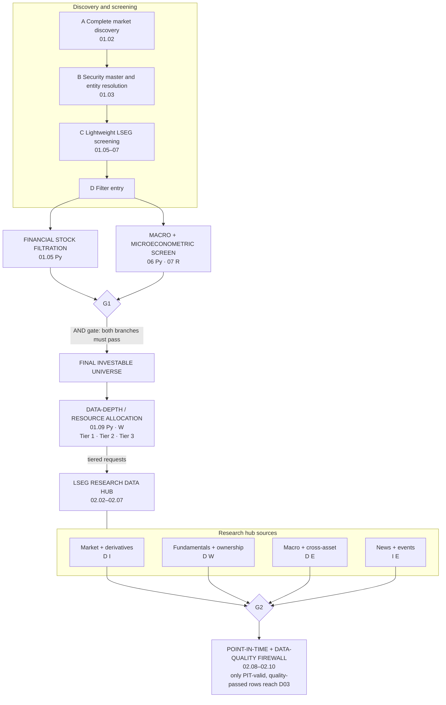

### A · Complete market discovery (01.02)

- LSEG Workspace via the Data Library (screener / exchange listing chains).
- Every instrument on the venue; ASX reference set keeps ordinary shares and stapled securities (ETFs, LICs, hybrids, warrants optional).
- Fields: RIC, ticker, ISIN, PermIDs, type, status, list / delist dates, currency.
- *Out: `listing_snapshot` (weekly, diffed against last week).*

### B · Security master & entity resolution (01.03)

- RIC ↔ ISIN ↔ organisation PermID; ticker and name changes; share classes; mergers, schemes, delisting reason codes.
- Slowly-changing dimension (type 2): every row carries `valid_from`/`valid_to`.
- Historical universe (01.04) is rebuilt from it, so **delisted names stay in the backtest**.
- *Out: `security_master` (SCD-2), `universe_history`.*

### C · Lightweight LSEG screening (01.05–07)

- 260 days of daily OHLCV and traded value; latest fundamentals snapshot and key ratios; liquidity, valuation and analyst-revision fields.
- Whole venue in $\approx$ 25–40 batched requests per week.
- **No high-frequency data is requested at this stage.**
- *Out: `screen_panel` (one snapshot timestamp for both branches).*

### D · Filter entry

- Candidate securities with a single, shared snapshot time (both branches see identical inputs).
- Ready for financial AND macro/microeconometric tests.
- Reason codes are written for every rejection so the funnel is auditable and reversible.
- *Still no HFD.*

### Financial stock filtration (01.05 `Py`)

| Criterion | Rule |
|---|---|
| **Size & liquidity** | market cap $\ge$ A\$100m; median daily traded value (60d) $\ge$ A\$0.5m; zero-volume days $\le 5\%$; price $\ge$ A\$0.10 |
| **History** | $\ge 252$ clean trading days (IPO rule: $\ge 60$, flagged); no unresolved identity breaks |
| **Profitability & cash** | ROA, operating cash flow / assets, accruals ratio; Piotroski F-score $\ge 4$ |
| **Pre-revenue issuers** | allowed only with cash runway $\ge 4$ quarters (cash / quarterly burn from Appendix 4C / 5B) |
| **Leverage** | net debt / EBITDA $\le 4$ and interest cover $\ge 2$ (non-financials); capital ratios for banks/insurers |
| **Growth & valuation** | revenue and EPS growth stability; negative-equity and extreme-multiple exclusions |

*Thresholds are sector-aware YAML defaults. Out: pass/fail, reason codes, financial quality score $q^{\mathrm{fin}}_i \in [0,1]$.*

### Macro + microeconometric screen (06 `Py`, 07 `R`)

| Criterion | Rule |
|---|---|
| **Macro fit** | sector Sharpe under the current regime probabilities $\pi_t$ (from last D03 run); rolling betas to rates, AUD, iron ore, gold, credit |
| **Forecastability** | OOS $R^2$ of HAR-RV on volatility; Ljung–Box on $\lvert r_t\rvert$; ratio of signal to microstructure noise |
| **Stability** | rolling CUSUM / Chow on market and sector betas; idiosyncratic-volatility percentile |
| **Information flow** | $\ge 4$ earnings announcements in history; analyst coverage $\ge 2$ (else flagged) |
| **Data quality** | missingness, stale-price runs, corporate-action breaks (score from G2 history) |

*Deliberately light: IV / DID / RDD / DML now run in D03 on the investable set only. Out: score $q^{\mathrm{mm}}_i$, pass/fail.*

### Illustrative ASX funnel (planning)

| Stage | Approximate count |
|---|---|
| Listed instruments | $\approx$ 2,200 |
| Equity, primary listing | $\approx$ 1,900 |
| After hygiene | $\approx$ 1,300 |
| Financial pass | $\approx$ 500 |
| Both passes | $\approx$ 330 |
| Tier split | T1 $\le$ 40 · T2 $\le$ 120 · T3 rest |

> Note: Counts are planning estimates; the run report publishes the actual funnel each week.

### **◆ G1** and the final investable universe

**◆ G1** is an AND gate: both branches (financial and macro + microeconometric) must pass.

> **Key point.** FINAL INVESTABLE UNIVERSE — membership is dated (`universe_history`); additions and removals carry reason codes; removed names are never deleted.

### Data-depth / resource allocation (01.09 `Py` `W`)

#### Tier 1 — $\le 40$ names

Full LFD + **daily forward capture of all trades** (and quotes where entitled) + full research stack (HF models, realised measures, intraday risk).

#### Tier 2 — $\le 120$ names

Full LFD + 1-minute bars captured daily; 5/15-minute aggregates kept long-term; tick capture switched on around events.

#### Tier 3 — remaining investable

Full LFD; event-triggered HFD for $\pm 2$ sessions around results, guidance, trading halts and large moves.

#### Allocation = multiple-choice knapsack (greedy by value/cost)

$$
\max \sum_{i,k} x_{ik}V_{ik} \quad \text{s.t.} \quad \sum_{i,k} x_{ik}c^{\mathrm{req}}_{ik}\le R,\quad \sum_{i,k}x_{ik}c^{\mathrm{GB}}_{ik}\le S,\quad \sum_k x_{ik}=1
$$

$V_{ik}$: signal strength / uncertainty, event sensitivity, liquidity and whether a model family needs ticks; $R$: daily request budget (Sheet 5); $S$: SSD growth budget.

### LSEG research data hub (02.02–02.07)

Tiered requests flow from the tier allocation into four source groups.

#### Market + derivatives — `D` `I`

Daily OHLCV, VWAP, turnover, closing bid/ask; tiered trades, quotes and 1-minute bars; S&P/ASX indices and sector indices; listed options where they exist: implied volatility, term structure, skew, open interest.

#### Fundamentals + ownership — `D` `W`

Annual / half-year statements; quarterly cash-flow reports (Appendix 4C / 5B); consensus estimates, revisions, target prices; guidance; dividends incl. franking; substantial holders and director dealings; corporate events.

#### Macro + cross-asset — `D` `E`

RBA cash rate, BBSW and ACGB curve, inflation, labour force, GDP (with vintages); AUD/USD and TWI; iron ore, gold, copper, energy; China and US activity and rates; credit spreads; volatility indices.

#### News + events — `I` `E`

LSEG news headlines and stories (headline history $\approx$ 15 months); exchange announcements with price-sensitive flag where carried; earnings and macro release calendars; trading halts.

### **◆ G2** Point-in-time + data-quality firewall (02.08–02.10)

> **Key point.** All four hub sources pass through the firewall: release timestamps | vintages | revisions | corporate actions | historical tradability | market calendar | schema | units | timezone | missingness | freshness → only PIT-valid, quality-passed rows reach D03.

---

## 04. Filtration and Data-Depth Specification
`D01 · UNIVERSE` · *Exact metric definitions, scoring, the G1 decision rule, reason codes, configuration and the tier-allocation algorithm (01.05–01.09)*

> **Principle.** Screens must be cheap, explainable and stable: hard thresholds, a robust composite score, hysteresis, and a reason code for every exclusion.

### Financial metrics (01.05) — daily data only, no HFD

| Metric | Definition (threshold / use) |
|---|---|
| **Traded value** | $\mathrm{MDTV}_i=\operatorname{med}_{s\in[t-59,t]}\,P_{i,s}V_{i,s}$ ($\ge$ A\$0.5m) |
| **Amihud illiquidity** | $\mathrm{ILLIQ}_i=\frac{1}{\lvert S\rvert}\sum_{s\in S}\frac{\lvert r_{i,s}\rvert}{P_{i,s}V_{i,s}}\times10^{6}$ (top decile penalised) |
| **Zero-volume ratio** | $\mathrm{ZV}_i=\lvert\{s:V_{i,s}=0\}\rvert/60$ ($\le 0.05$) |
| **Roll spread** | $\hat s_i=2\sqrt{\max\{0,-\operatorname{Cov}(\Delta p_s,\Delta p_{s-1})\}}$ (cost sanity check) |
| **Accruals** | $(\mathrm{NI}-\mathrm{CFO})/\overline{\mathrm{TA}}$ (high accruals penalised) |
| **Piotroski F** | $F_i=\sum_{j=1}^{9}\mathbb{1}\{\text{signal}_j\}$ ($\ge 4$) |
| **Cash runway** | $\mathrm{RW}_i=\mathrm{Cash}_q/\max\{-(\mathrm{OCF}_q+\mathrm{ICF}_q),\varepsilon\}$ quarters ($\ge 4$, pre-revenue only) |
| **Leverage** | $\mathrm{ND}/\mathrm{EBITDA}\le4$, $\mathrm{EBIT}/\mathrm{Interest}\ge2$ (banks, insurers exempt) |

### Macro + microeconometric screen (01.06 `Py`, 01.07 `R`)

| Metric | Definition (threshold / use) |
|---|---|
| **Regime fit** | $\mathrm{SR}_{s}(\pi_t)=\sum_{k}\pi_t(k)\,\mu_{s,k}/\sigma_{s,k}$ for the issuer's GICS sector $s$ |
| **Exposures** | $r_{i,w}=a_i+\sum_j b_{ij}f_{j,w}+e_{i,w}$, weekly, 156 weeks; $f$ = rates, AUD, iron ore, gold, credit |
| **Forecastability** | $R^2_{\mathrm{OOS},i}=1-\frac{\sum_t(v_{i,t+1}-\hat v^{\mathrm{HAR}}_{i,t+1})^2}{\sum_t(v_{i,t+1}-\bar v_{i,t})^2}$ with range-based $v=\frac{(\ln H/L)^2}{4\ln 2}$ (Parkinson) — no ticks needed; $\ge 0.05$ |
| **Clustering** | Ljung–Box $Q(10)$ on $\lvert r_{i,t}\rvert$ (evidence that volatility models add value) |
| **Stability** | Brown–Durbin–Evans CUSUM of recursive residuals of the beta regression; fail if the 5% band is crossed |
| **Information flow** | $\ge 4$ earnings announcements and $\ge 2$ covering analysts (else flagged, not failed) |

> **Key point.** **Why the screen is light.** v4 applied IV, DID, RDD and DML to every listed firm. Those estimators need identification designs per question and are expensive; at screening they add noise, not information. They now run in D03 (03.03) on the investable set, where results feed models rather than membership.

### Scoring, hysteresis and the G1 decision rule (01.08)

Robust, sector-neutral standardisation (winsorised at $\pm3$, sign-aligned so higher is better):

$$
z_{ij}=\frac{x_{ij}-\operatorname{med}_{s(i)}(x_j)}{1.4826\,\operatorname{MAD}_{s(i)}(x_j)},\qquad
q^{\mathrm{fin}}_i=\sum_j\omega_j\,\Phi(z_{ij}),\quad \textstyle\sum_j\omega_j=1
$$

Default weights $\omega$: liquidity 0.30, profitability 0.25, cash quality 0.20, leverage 0.15, growth 0.10.

$$
\mathrm{pass}^{\mathrm{fin}}_i=H_i\wedge\{q^{\mathrm{fin}}_i\ge0.40\},\qquad
\mathrm{G1}_i=\mathrm{pass}^{\mathrm{fin}}_i\wedge\mathrm{pass}^{\mathrm{mm}}_i\wedge\mathrm{hist}_i\wedge\mathrm{id}_i
$$

$H_i$ = all hard thresholds. Membership uses **hysteresis** on the composite rank $\rho_i$ to limit churn (every forced exit is a trade):

$$
m_{i,t}=\bigl(m_{i,t-1}\wedge\rho_i\ge\theta_{\mathrm{out}}\bigr)\vee\bigl(\neg m_{i,t-1}\wedge\rho_i\ge\theta_{\mathrm{in}}\bigr),
\quad \theta_{\mathrm{in}}=0.55,\ \theta_{\mathrm{out}}=0.45
$$

**Forced exits** override hysteresis: delisting notice, suspension $>5$ sessions, scheme of arrangement approved, identity break unresolved for $>2$ weeks.

### Reason codes (stored per security per week in `universe_decisions`)

| Code | Meaning | Code | Meaning |
|---|---|---|---|
| `F-LIQ-01` | MDTV below floor | `M-REG-01` | regime misfit |
| `F-LIQ-02` | zero-volume days | `M-FCT-01` | low forecastability |
| `F-PRC-01` | price below floor | `M-STB-01` | unstable beta |
| `F-HST-01` | history too short | `M-INF-01` | thin information flow |
| `F-QLY-01` | F-score $<4$ | `Q-DQ-01` | data-quality score low |
| `F-CSH-01` | runway $<4$ quarters | `X-ID-01` | identity unresolved |
| `F-LEV-01` | leverage / coverage | `X-EVT-01` | forced-exit event |
| `F-EQT-01` | negative equity | `H-KEEP-01` | kept by hysteresis |

### Tier value and cost model (01.09)

$$
V_{ik}=g_k\bigl(0.35\,\mathrm{rk}(\lvert\hat\alpha_i\rvert/\hat\sigma_{\alpha,i})+0.25\,\mathrm{ev}_i+0.20\,\mathrm{rk}(\mathrm{MDTV}_i)+0.20\,\mathrm{hf}_i\bigr)
$$

$g=(1,\,0.6,\,0.25)$ for T1, T2, T3; $\mathrm{ev}_i$ = event sensitivity (mean $\lvert$abnormal return$\rvert$ on announcement days); $\mathrm{hf}_i=1$ if an eligible model family needs ticks. Costs: $c^{\mathrm{req}}_{ik}$ from the request ledger (Sheet 5), $c^{\mathrm{GB}}_{ik}$ from 30-day compressed size per name.

### `configs/universe.yaml` (excerpt — every threshold lives here)

```yaml
universe:
  venue: ASX
  instrument_types: [ordinary, stapled]
  snapshot: {clock: W, day: SAT, time: "08:00"}
  hard_filters:
    mcap_min_aud: 1.0e8
    mdtv_min_aud: 5.0e5        # 60-day median traded value
    zero_volume_max: 0.05
    price_min_aud: 0.10
    history_min_days: 252
    ipo_history_min_days: 60   # flagged, not silent
    runway_min_quarters: 4     # pre-revenue (4C/5B)
    leverage:
      nd_ebitda_max: 4.0
      icr_min: 2.0
      exempt_gics: [Banks, Insurance]
  score_weights: {liquidity: .30, profitability: .25,
                  cash: .20, leverage: .15, growth: .10}
  pass_score_min: 0.40
  hysteresis: {enter: 0.55, exit: 0.45}
macro_micro_screen:
  forecastability_r2_min: 0.05
  ljung_box_lags: 10
  beta_cusum_alpha: 0.05
  min_earnings_announcements: 4
depth_tiers:
  T1: {max_names: 40,  capture: [trades, quotes]}
  T2: {max_names: 120, capture: [bars_1m]}
  T3: {event_window_sessions: 2}
  budget: {requests_per_day: 8000,   # 20% headroom
           ssd_growth_gb_per_month: 15}
```

### Tier allocation: greedy multiple-choice knapsack

```text
x[i] <- T3 for all i in U        # T3 is mandatory & cheapest
R <- R - sum c_req[i,T3];  S <- S - sum c_gb[i,T3]
cand <- {(i,k): k in {T1,T2}}
for (i,k) in sort(cand, key = dV/dC, desc):
    dV = V[i,k] - V[i,T3]
    if x[i] == T3 and n[k] < cap[k]
       and dC_req <= R and dC_gb <= S:
        x[i] <- k;  R -= dC_req;  S -= dC_gb
report value captured, LP-relaxation bound
       (optimality gap), shadow price of R
```

*$O(N\log N)$; the LP bound makes sub-optimality visible in the weekly report.*

### Worked example — three hypothetical ASX securities through one weekly screen (values illustrative)

| Check | AAA (large-cap miner) | BBB (pre-revenue explorer) | CCC (mid-cap industrial) | Reading |
|---|---|---|---|---|
| MDTV / price / history | A\$48m / A\$41.20 / 5,000 d ✓ | A\$0.9m / A\$0.32 / 900 d ✓ | A\$2.1m / A\$6.85 / 2,100 d ✓ | all clear the hard liquidity floors |
| Runway / F-score | n.a. / 7 ✓ | 2.5 quarters ✗ | n.a. / 5 ✓ | BBB fails `F-CSH-01`: cash covers $<4$ quarters of burn |
| $q^{\mathrm{fin}}$ | 0.81 ✓ | — | 0.52 ✓ | CCC passes the 0.40 floor |
| $R^2_{\mathrm{OOS}}$ / CUSUM / analysts | 0.18 / stable / 14 ✓ | — | 0.07 / stable / 1 (flag) | CCC passes; `M-INF-01` is a flag, not a failure |
| Composite rank $\rho$ | 0.92 | — | 0.48 (member last week) | CCC: $0.45\le\rho<0.55$ → kept by hysteresis `H-KEEP-01`, flagged |
| **G1 outcome** | **in**, Tier 1 candidate | **out** (history retained) | **in** on watch; re-test next week | membership and codes written to `universe_decisions` |

---

## 05. LSEG Acquisition Engineering
`D02 · DATA` · *Workspace session limits, request budget, rate limiting, watermark-based incremental loads, retries, and forward capture of high-frequency data (02.01–02.07)*

> **Principle.** Acquisition is budgeted, incremental and resumable: every request is metered, every batch is watermarked, and nothing is fetched twice.

### Workspace desktop-session limits and the design response

| Limit | Approx. value | Design response |
|---|---|---|
| Request rate | $\approx$5 req/s per session | token bucket, pace 3.5 req/s |
| Response volume | $\approx$50 MB/min | batch size chosen by expected bytes |
| Requests per day | 10,000 | ledger; routine plan $\le$ 8,000 (20% headroom) |
| Volume per day | 5 GB | ledger tracks bytes; HFD capped per tier |
| `get_history` daily | $\approx$3,000 rows / request | $\le$ 11 years per call; split by instrument batch |
| `get_history` intraday | $\approx$50,000 points / request | backward pagination with de-duplication |
| `get_data` | very large requests time out ($\approx$300 s) | $\le$ 200 instruments $\times$ 40 fields |
| Tick history depth | $\approx$90 days | **forward capture daily**; deep backfill needs LSEG Tick History (separate licence) |
| News | headlines $\approx$15 months; 1 story / request | stories fetched only for T1/T2 names and high-novelty items |

*Values are LSEG's published guidance for the Data Library ("maximum usage reference guide") and developer-community answers; they vary by licence and version, so 02.01 reads them from config and the ledger verifies them empirically.*

### Session architecture — why the runner must be local

The Data Library's **desktop session** talks to the locally running, signed-in Workspace application. Consequences:

- GitHub-hosted runners cannot reach it; the **self-hosted runner is the Workspace machine**.
- 02.01 performs a pre-flight check (open session, 1-instrument probe, entitlement probe); failure → branch skipped, no partial run.
- App key and credentials live in the OS keychain and are injected as environment variables at run time; never in the repository or logs.
- A **platform session** (machine credentials) is the headless alternative if the licence allows it; the session factory hides the difference from callers.

### Daily request budget (ASX reference configuration, planning)

| Job | Clock | Req/day | Volume |
|---|---|---:|---:|
| LFD daily bars, $\approx$1,900 names, 100-name batches | `D` | 20–40 | $<$5 MB |
| Corporate actions, dividends, halts | `D` | $\approx$20 | $<$1 MB |
| Fundamentals snapshot (weekly, amortised) | `W` | $\approx$15 | $<$20 MB |
| Estimates and revisions, investable set | `D` | $\approx$10 | $<$5 MB |
| Macro and cross-asset, $\approx$150 series | `D` | $\approx$15 | $<$2 MB |
| T1 tick capture, $\le$40 names $\times$ 1–6 pages | `D` | 120–240 | 50–150 MB |
| T2 1-minute bars, $\le$120 names | `D` | $\approx$120 | $\approx$10 MB |
| T3 event windows | `E` | $\approx$60 | $\approx$20 MB |
| News headlines (intraday polls) + selected stories | `I` | 400–700 | $<$30 MB |
| **Routine total** | | **0.8–1.2k** | **0.1–0.25 GB** |
| Backfill (residual budget only) | | $\le$ 6,000 | — |

*Routine load uses $\approx$8–12% of the daily request cap; the remainder funds backfill and event bursts. Real figures are written to the ledger and plotted in the run report.*

### Rate limiter and budget ledger (02.01)

Token bucket with capacity $b=4$ and refill $r=3.5\,\mathrm{s^{-1}}$:

$$
\mathrm{tok}(t)=\min\{b,\ \mathrm{tok}(t_0)+r\,(t-t_0)\},\qquad
\text{wait}=\max\{0,\,(1-\mathrm{tok})/r\}
$$

Every call is written to `api_ledger`(`request_id`, `run_id`, `ts_utc`, `endpoint`, `n_instr`, `n_fields`, `n_points`, `bytes`, `status`, `latency_ms`, `retry_of`).

**Priority classes:** P0 portfolio names and corporate actions > P1 universe LFD and fundamentals > P2 HFD capture > P3 backfill. When the residual budget falls below 15%, P3 stops and P2 shrinks to Tier 1.

### Incremental load with watermarks (02.02)

```python
for job in plan.by_priority():
  wm  = watermarks.get(job.dataset)    # last committed
  win = [wm - job.overlap, now - job.settle_lag]
  for batch in job.chunks(max_points, max_bytes):
    ledger.acquire(job.priority)       # bucket + daily cap
    df = fetch_with_retry(job, batch, win)
    raw.append(df, ingest_ts=now(), request_id=rid)
    contracts.validate(df, job.schema) # types/units/tz
  pit.merge_from_raw(job.dataset, since=wm)
  watermarks.advance(job.dataset, new_wm)  # after commit
```

*`overlap` re-reads a short window so late corrections and revisions are captured; the raw zone is append-only, so a re-read never overwrites history (it creates a new knowledge-time version, Sheet 6).*

### Error taxonomy and retry policy

| Class | Examples | Policy |
|---|---|---|
| Transient | timeout, HTTP 429/5xx, session drop | backoff with full jitter $U(0,\min(c,\,b\,2^{n}))$, $\le$ 6 tries |
| Permanent | invalid RIC or field, no entitlement | no retry; reason logged; instrument flagged |
| Partial | some instruments empty | re-queue missing only; never the batch |
| Systemic | 5 consecutive failures | circuit breaker opens 10 min; branch deferred |

### HFD forward capture and pagination (02.04 `C++`)

With tick depth $D\approx90$ days, a session not captured within $D$ is lost for good, so the archive is built **forward**, one session at a time. Harvest lag $\ell$ is monitored: warn at $\ell\ge5$ sessions, critical at $\ell\ge30$ (loss horizon $D-\ell$ shown on the dashboard). Requests page backwards from the session close; each page sets `end` = earliest timestamp returned; rows are de-duplicated on (timestamp, sequence, price, size); paging stops when a page returns fewer than the cap. The C++ cleaner (Sheet 15) then applies the trade-cleaning rules.

### A trading day of acquisition (Australia/Sydney; all times configurable, derived from the exchange calendar)

Market session: continuous trading 10:00–16:00 · closing auction $\approx$16:10.

| Time | Activity |
|---|---|
| 07:00 | pre-open: health checks, session probe |
| during continuous trading (10:00–16:00) | intraday polls every 15 min: news, T1 snapshots, risk monitor |
| 16:10 (approx.) | closing auction |
| 18:30 ($t^\ast$) | daily LFD, CA, estimates, macro → PIT → **◆ G2** |
| 19:30 | T1 tick + T2 bar harvest (P2) |
| ≈21:00 | run report + AI report |
| 22:00–06:00 | backfill from residual budget (P3) |

---

## 06. Point-in-Time Data and Information Integrity
`D02 · INTEGRITY` · *Bitemporal storage, as-of queries, knowledge-time rules, corporate actions, tradability and the G2 data-quality firewall (02.08–02.10)*

> **Principle.** A backtest is only as honest as its knowledge times: every fact records when it became knowable, and every read asks "as of when?".

### Bitemporal model: valid time $\tau$ (what period a fact describes) $\times$ knowledge time $k$ (when it was knowable)

#### Worked example: value of EPS for $\tau$ = FY2025 (Jul 24 – Jun 25)

The figure plots the EPS value for the fixed valid period FY2025 against knowledge time $k$ (axis ticks: Jun 25, Aug 25, Dec 25, Feb 26, Mar 26).

| Knowledge-time interval $k$ | Value visible for $\tau$ = FY2025 |
|---|---|
| before Aug 25 (e.g. at Jun 25, the end of the valid period) | not yet knowable |
| Aug 25 → Feb 26 | reported 1.10 |
| from Feb 26 onwards (shown to Mar 26 and beyond) | restated 1.04 |

| Query | As-of date | Result |
|---|---|---|
| **Q1** | 31 Dec 25 | → 1.10 |
| **Q2** | 15 Mar 26 | → 1.04 |

#### Table `pit_facts` (one row per version)

`entity_id, field, valid_from, valid_to, known_from, known_to, value, unit, source, vintage_id, request_id, ingest_ts, quality_flag`

A new value never updates a row: the old row's `known_to` is closed and a new row opens. Backtests at time $t$ therefore see exactly what a live run on that day would have seen.

**Reconstructed vs captured.** History loaded by backfill carries `quality_flag = reconstructed` (conservative lags, below); rows observed live carry `captured`. Reports state the share of reconstructed inputs behind every backtest statistic.

### As-of read (DuckDB)

```sql
SELECT entity_id, field, value
FROM   pit_facts
WHERE  known_from <= $as_of
  AND  $as_of < known_to
  AND  valid_from <= $obs
  AND  $obs < valid_to
QUALIFY row_number() OVER (
  PARTITION BY entity_id, field
  ORDER BY known_from DESC) = 1;
```

*Wrapped as `pit.read(ds, as_of, obs)`; the only read path model code may use (I1).*

### Knowledge-time rules ($k$ assignment)

| Data type | Knowledge-time rule |
|---|---|
| Daily bars | session close + publication lag; usable at $t^\ast$ = 18:30 |
| Fundamentals | announcement timestamp; if missing, period end + statutory deadline (2 months for half-year and preliminary final reports) |
| Estimates | first-seen `ingest_ts` (captured) |
| Macro | official release time per vintage (e.g. 11:30 Sydney) |
| News | story time + processing latency |
| Index members | announcement date, not effective date |

### G2 data-quality checks (02.10) — severity decides the action

| Check | Rule (defaults) | Severity |
|---|---|---|
| Schema / types | columns, dtypes, nullability match the data contract | **BLOCK** |
| Keys | natural key unique per (`entity`, `field`, `valid`, `known`) | **BLOCK** |
| Timezone | all timestamps UTC `int64` ns; session boundaries from the exchange calendar | **BLOCK** |
| Look-ahead | no row with `known_from` $>$ run cut-off reaches a model input | **BLOCK** |
| Units / currency | AUD, shares, decimals; scale jumps $\times100$ or $\times1000$ detected | **BLOCK** |
| Freshness | age $\le$ SLA (bars 1 session, estimates 7 days, macro by calendar) | **QUARANTINE** |
| Completeness | rows $\ge 99\%$ of calendar-expected per security | **QUARANTINE** |
| Price sanity | $P>0$; $L\le O,C\le H$; $V\ge0$ | **QUARANTINE** |
| Return outlier | $\lvert r_{i,t}\rvert>8\,\hat\sigma^{\mathrm{rob}}_i$ with no corporate action or announcement | **QUARANTINE** |
| CA reconciliation | overnight gap matches a split / consolidation factor within 1% | **QUARANTINE** |
| Stale runs | $\ge5$ identical closes with $V>0$ | **WARN** |
| Revision burst | revisions per day $> 5\times$ trailing median | **WARN** |

*BLOCK fails G2 for the affected branch; QUARANTINE removes the security from this run; WARN is reported. Thresholds live in `configs/quality.yaml`.*

### Corporate actions (02.08)

Raw prices are never overwritten; adjustment factors are stored and applied on read.

$$
F_{t}=\prod_{e:\,t<\mathrm{ex}_e\le T}a_e,\qquad \tilde P_t=P_t\,F_t
$$

Split / consolidation $n\!:\!m$: $a=m/n$. Rights issue: $a=\mathrm{TERP}/P_{\mathrm{cum}}$. Total return: $\mathrm{TR}_t=\mathrm{TR}_{t-1}(P_t+D_t)/P_{t-1}$ with cash dividends at ex-date; franking credits kept as a separate field.

### Tradability, calendar, leakage tests

- **Tradable at $t$**: listed, not halted or suspended, $V_{i,t}>0$; the backtester cannot trade otherwise.
- Exchange calendar with holidays and early closes; all clocks derive from it.
- **Leakage tests** in CI: future-poison rows, shuffled-label null, $t\to t{+}1$ feature shift must change results.

### Look-ahead traps and the control that closes each one

| Trap | Control in v5 |
|---|---|
| Restated fundamentals used as if original | bitemporal `pit_facts`; as-of reads only |
| Survivorship (today's listed names only) | `universe_history` from the SCD-2 security master |
| Index membership by effective date | membership keyed on announcement time |
| Macro data at final revised values | per-vintage release times; first-release series kept |
| Back-adjusted price levels in level filters | level rules (e.g. price $\ge$ A\$0.10) use *unadjusted as-of* prices |
| Full-sample normalisation or winsorisation | expanding or rolling statistics only, inside each fold |
| Same-close decision and execution | decide after $t^\ast$; execute next session (auction or VWAP) |
| Hyper-parameters tuned on the whole sample | nested purged walk-forward (Sheet 10) |
| UTC vs Sydney date boundary | `int64` UTC storage + exchange calendar for session dates |
| Estimate timestamps unknown | first-seen `ingest_ts`; reconstructed rows flagged |

### PIT build path for every dataset (02.08 → 02.09 → 02.10)

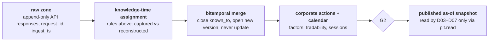

---

## 07. Storage and Data Model on the External SSD
`D00 · D02 · STORAGE` · *Zones, layout, dataset catalogue, sizing, write safety, lifecycle and backup (00.07, 00.08, 00.11)*

> **Principle.** The SSD is the system of record for data; GitHub is the system of record for code. Neither is trusted without checksums and a tested restore.

### Volume layout (`AQP_DATA/`)

```text
AQP_DATA/
|-- .aqp_volume_id          # UUID checked before every run
|-- catalog.duckdb          # views over all Parquet zones
|-- raw/                    # append-only API responses
|   `-- {dataset}/ingest_date=YYYY-MM-DD/part-*.parquet
|-- pit/                    # bitemporal facts (Sheet 6)
|   `-- {dataset}/valid_year=YYYY/part-*.parquet
|-- market/
|   |-- lfd_daily/year=YYYY/part-*.parquet
|   |-- hfd_trades/date=YYYY-MM-DD/bucket=00..15/*.parquet
|   `-- hfd_bars_1m/month=YYYY-MM/*.parquet
|-- derived/                # features, states, forecasts,
|   `-- {dataset}/run_date=YYYY-MM-DD/*.parquet   # signals
|-- runs/{run_id}/
|   |-- staging/            # written by nodes
|   |-- published/          # promoted after gate pass (I4)
|   `-- manifest.json       # lineage, hashes, gate results
|-- registry/               # models (+ joblib / RDS blobs)
|-- reports/{run_id}/       # PDF, HTML, XLSX, JSON
`-- tmp/                    # deleted after validation
```

*Tick files are bucketed by `hash(RIC) mod 16` so a day is 16 files, not 40 tiny ones per name.*

### Catalogue view (DuckDB)

```sql
CREATE OR REPLACE VIEW hfd_trades AS
SELECT * FROM read_parquet(
  'market/hfd_trades/*/*/*.parquet',
  hive_partitioning = true);
```

### Dataset catalogue (excerpt)

| Dataset | Key / grain | Owner | Retention | Size / yr |
|---|---|---|---|---|
| `security_master` | sec_id, valid_from (SCD-2) | 01.03 | forever | $<$0.1 GB |
| `universe_history` | sec_id, week | 01.08 | forever | $<$0.1 GB |
| `lfd_daily` | sec_id, date | 02.03 | forever | $\approx$0.3 GB |
| `hfd_trades` | sec_id, ts, seq | 02.04 | raw 2 y, then 1-min | 3–6 GB |
| `hfd_bars_1m` | sec_id, minute | 02.04 | 5 y, then 15-min | $\approx$1.5 GB |
| `pit_facts` | entity, field, valid, known | 02.09 | forever | $\approx$1 GB |
| `features` | sec_id, date, feature_set | 04.01 | 3 y + monthly snapshots | $\approx$4 GB |
| `forecast_dist` | model, sec_id, date, $h$, $\tau$-grid | 05.07 | 3 y | $\approx$3 GB |
| `signals`, `portf.` | sec_id, date | 06–07 | forever | $<$0.5 GB |
| `orders`, `fills` | order_id | 07.07 | forever | $<$0.1 GB |
| `api_ledger` | request_id | 02.01 | forever | $<$0.1 GB |
| `manifests` | run_id, artefact | 00.08 | forever | $<$0.1 GB |
| **Total** | | | | **$\approx$15–20 GB** |

*Planning sizes with zstd Parquet (ticks $\approx$10–12 bytes/trade compressed; 40 names $\times$ $\approx$40k trades $\times$ 252 sessions). A 2 TB SSD holds well over a decade; the binding constraint is backup time, not capacity.*

### Data contract example (`contracts/lfd_daily.yaml`, enforced by 00.07)

```yaml
dataset: lfd_daily       owner: "02.03"     grain: [sec_id, date]
columns:
  sec_id:   {type: string,  nullable: false}
  date:     {type: date32,  nullable: false}
  open/high/low/close: {type: float64, unit: AUD, check: "> 0"}
  volume:   {type: int64,   unit: shares, check: ">= 0"}
  known_from: {type: timestamp[ns, UTC], nullable: false}
checks: ["low <= least(open, close)", "high >= greatest(open, close)"]
freshness_sla: 1 session          consumers: ["04.01", "05.02", "06.06"]
```

### Write safety on a removable drive

- **Volume guard**: run refuses to start unless `.aqp_volume_id` matches config, free space $\ge20\%$ and a write–read–delete probe succeeds (prevents silently writing to the laptop disk if the SSD is unplugged).
- **File system**: NTFS (Windows), APFS (macOS) or ext4 (Linux) — journalled. Avoid exFAT for the data volume: no journal, so an unplug mid-write can corrupt the allocation table.
- **Atomic writes**: write `*.tmp` in the target directory, `fsync`, rename; readers never see partial files.
- **Checksums**: xxHash64 per file in the manifest; verified on read for published artefacts and during backup.
- Eject cleanly; the runner service stops before the volume is unmounted.

### Lifecycle (00.11) and backup (3-2-1)

- **Lifecycle**: Tier-1 ticks kept raw for 2 years, then aggregated to 1-minute bars; `tmp/` and `staging/` of successful runs purged after 7 days; failed runs kept 30 days for diagnosis.
- **Copy 2**: weekly incremental sync to a second SSD with checksum verification; drives rotated.
- **Copy 3 (off-site)**: encrypted, deduplicated backup of code, configs, manifests, models and reports. Raw LSEG data goes off-site only if the licence permits it (00.12 decides).
- **Restore test** monthly: restore one month of `pit_facts` and one run, re-execute, compare hashes.

### Run manifest (excerpt of `runs/{run_id}/manifest.json`, written by 00.08)

```text
{"run_id": "AQP-20261007-1830-D-3f9c2ab", "clock": "D", "cutoff_utc": "2026-10-07T07:30:00Z",
 "code": {"git_sha": "3f9c2ab", "aqp_core": "5.0.0", "uv_lock": "sha256:91c2...", "renv_lock": "sha256:7d0e..."},
 "nodes": [{"id": "05.02", "status": "ok", "cache_key": "xxh64:5e1f...", "seconds": 41.2,
            "inputs":  [{"ds": "pit_facts", "hash": "xxh64:a83b..."}, {"ds": "features", "hash": "xxh64:0c77..."}],
            "outputs": [{"ds": "forecast_dist", "rows": 118204, "hash": "xxh64:d419...", "zone": "published"}]}],
 "gates": {"G2": {"pass": true, "block": 0, "quarantined": ["XYZ.AX"]}, "G3": {"pass": true, "eligible": 23, "excluded": 6}}}
```

### Cross-language data interchange (Python `Py`, R `R`, C++ `C++`)

- **On disk**: Parquet is the only interchange format; R stages read and write through the `arrow` package, so no CSV round-trips and types survive (timestamps, decimals, dictionaries).
- **In memory, Python → C++**: NumPy arrays pass to `aqp_core` zero-copy (C-contiguous `float64`/`int64`); results return as NumPy arrays that own their buffers; the GIL is released during compute.
- **In memory, R → C++**: the same headers compiled through Rcpp; R and Python results are bitwise identical (Sheet 17).
- **Process boundary**: R stages run as `Rscript` subprocesses with a JSON argument file (run ID, as-of, input paths); exit code and a result manifest are checked by the orchestrator.

---

## 12. Decision, Trade Governance and Execution
`D07 · TRADING` · *From target weights to actions, the G5 NO-TRADE rule sets and kill switch, and participation-capped execution on the ASX (07.05–07.07)*

> **Principle.** The default action is NO-TRADE: a trade happens only when every rule set passes and the expected benefit clears its cost.

### Decision layer (07.05) — state machine with a cost-aware no-trade band

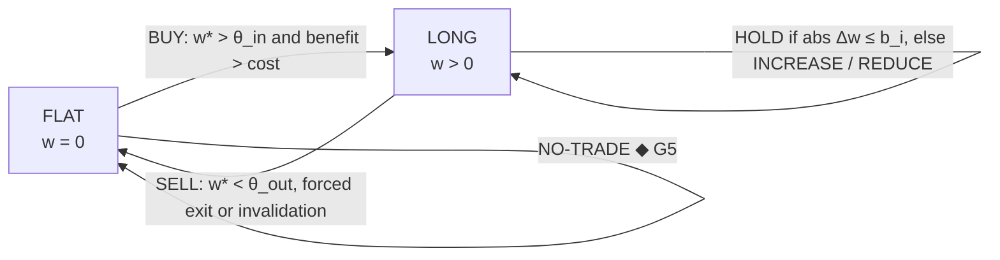

Trade only if the expected benefit over the signal horizon exceeds expected cost by a margin $m$:

$$
|\hat\alpha_i|\,h\,|\Delta w_i|\ >\ (1+m)\bigl(c_i|\Delta w_i|+\eta_i|\Delta w_i|^{3/2}\bigr)
\iff |\Delta w_i|>b_i
$$

Each action stores its **invalidation conditions** (forecast sign flip, regime probability $>0.6$ for stress, price beyond the 5% forecast quantile, adverse news shock) — these drive SELL and appear in the report.

### Execution on the ASX (07.07 `Py` `C++` cost model)

ASX trading day (timeline):

| From | To | Phase |
|---|---|---|
| 07:00 | 10:00 | pre-open |
| 10:00 | 16:00 | continuous trading (price–time priority) |
| 16:00 | 16:10 | closing auction |

**Default**: daily rebalance in the closing single-price auction of session $t+1$ (decided after $t^\ast$ on day $t$); orders above 5% of expected auction volume move to a VWAP schedule across the session.
Impact model (square-root law) and optimal schedule (Almgren–Chriss):

$$
\mathbb{E}[\text{cost}]\approx\tfrac{s}{2}+Y\sigma\sqrt{Q/V},\qquad
x_j=X\frac{\sinh\bigl(\kappa(T-t_j)\bigr)}{\sinh(\kappa T)},\ \ \kappa=\sqrt{\lambda\sigma^2/\tilde\eta}
$$

**Implementation shortfall** vs decision price $p_d$:
$\mathrm{IS}=\sum_j q_j(p_j-p_d)+(Q-\sum_jq_j)(p_{\mathrm{end}}-p_d)$ (impact + delay + opportunity), fed back to recalibrate $Y$.

### ◆ G5 trade governance and kill switch (07.06) — all rule sets must pass

| Rule set | Checks (defaults) | Action on failure |
|---|---|---|
| **Data** | G2 passed for all inputs; every held name has a price $\le1$ session old; no quarantined name in the order list | **NO-TRADE** for affected names |
| **Model** | champion present for each required family; $\ge3$ eligible models in each combination; no G3 regression vs last run | **NO-TRADE** (portfolio); hold weights |
| **Risk** | G4 passed; post-trade ES and stress within limits; orders do not raise ES by $>10\%$ | trim orders to fit, else **NO-TRADE** |
| **Liquidity** | order $\le$ participation cap; auction share $\le5\%$ of expected volume; spread $<$ 3$\times$ 60-day median | move to VWAP or defer |
| **Operational** | SSD guard passed; disk free $\ge20\%$; clock sync $<1$ s; LSEG session healthy; run is the latest code on `main` | **NO-TRADE**; incident |
| **Market state** | trading halt or suspension; exchange outage; announced corporate action pending | **NO-TRADE** for name |
| **Kill switch** | drawdown from peak $>$ 15%; daily loss $>3\hat\sigma_p$; realised vs predicted P&L z-score $>4$ twice in 5 days; $\ge2$ broker rejects | **halt all trading**; requires signed manual re-enable |

> Note: Rules are data (`configs/governance.yaml`); the evaluation trace for every order is stored in `decisions` and quoted by the AI report.

### Order ticket (`orders` schema)

`order_id, run_id, sec_id, side, qty, lot, limit_px?, venue_session (CSPA|VWAP), decision_px, max_participation, valid_until, rationale_id, invalidation, governance_trace_id, approved_by`

### Human in the loop by default

The pipeline **produces tickets**; a person approves and places them with the broker. An optional broker API adapter requires two approvals, a per-day notional cap and the kill switch wired to cancel open orders.

### Worked example — does a rebalance clear the no-trade band? (NAV A\$1m, ADV A\$2m, $\sigma=2\%$, $Y=0.7$, half-spread 10 bp, commission 5 bp, margin $m=1$)

| Case | notional | impact | cost rate | cost (A\$) | benefit (A\$) | Decision |
|---|---:|---:|---:|---:|---:|---|
| $\Delta w=0.6\%$, $\lvert\hat\alpha\rvert h=0.8\%$ | 6,000 | 0.077% | 0.227% | 13.60 | 48.00 | $48.00>2\times13.60$ → **TRADE** |
| $\Delta w=0.2\%$, $\lvert\hat\alpha\rvert h=0.3\%$ | 2,000 | 0.044% | 0.194% | 3.89 | 6.00 | $6.00<2\times3.89$ → **HOLD** |

> Note: Impact $=Y\sigma\sqrt{Q/\mathrm{ADV}}$, e.g. $0.7\times0.02\times\sqrt{6{,}000/2{,}000{,}000}=0.077\%$. Small, low-conviction tweaks are suppressed, which is where most avoidable turnover comes from.

### Order lifecycle — from target weights to reconciled positions

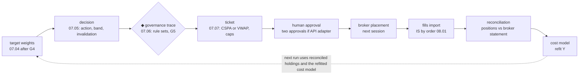

---

## 21. Automation, Clocks and Local Execution
`D00 · AUTOMATION` · *Execution clocks in Sydney time, GitHub Actions on a self-hosted runner, hardening, and what happens when the laptop sleeps, the SSD is missing or a run is missed*

> **Principle.** GitHub schedules and versions; the runner computes; the SSD holds the data — and each failure has a defined response.

### Execution topology

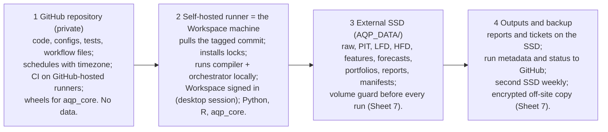

1. **GitHub repository (private)** — code, configs, tests, workflow files; schedules with `timezone`; CI on GitHub-hosted runners; wheels for `aqp_core`. No data.
2. **Self-hosted runner = the Workspace machine** — pulls the tagged commit; installs locks; runs compiler + orchestrator locally; Workspace signed in (desktop session); Python, R, `aqp_core`.
3. **External SSD (`AQP_DATA/`)** — raw, PIT, LFD, HFD, features, forecasts, portfolios, reports, manifests; volume guard before every run (Sheet 7).
4. **Outputs and backup** — reports and tickets on the SSD; run metadata and status to GitHub; second SSD weekly; encrypted off-site copy (Sheet 7).

### Execution clocks (Australia/Sydney; exchange-calendar aware)

| Clock | Schedule (cron + timezone) | Runs | Missed-run policy |
|---|---|---|---|
| `W` weekly | `0 8 * * 6` Sat 08:00 | discovery, security master, filters, G1, depth tiers, fundamentals snapshot | run at next start; universe frozen until done |
| `D` daily | `30 18 * * 1-5` 18:30, trading days only | incremental data → PIT → G2 → states → features → models → validation → risk → decisions → G5 → tickets → reports | catch up data; **no tickets** for a stale decision date |
| `I` intraday | `*/15 10-16 * * 1-5` (10:00–16:45) | news, T1 snapshots, intraday risk and governance; fast branch only | skip; never back-filled |
| `M` monthly | `0 6 * * 0` + guard `day <= 7` (first Sunday 06:00) | deep retraining, hyper-parameters, G7 promotions, lifecycle, restore test | run at next start |
| `E` event | from 00.05 (`repository_dispatch`) | affected branches only (Sheet 22) | expire after SLA |

> Note: GitHub evaluates `schedule` entries with an optional IANA `timezone`, so daylight-saving changes need no edits; scheduled runs can start late under load (the 18:30 job tolerates up to 60 min) and use the default branch. A guard step exits cleanly on exchange holidays. Cron ORs day-of-month and day-of-week when both are set, so "first Sunday" needs the guard, not `1-7 * 0`.

### Runner hardening

- **Private repository only**; self-hosted runners must never execute workflows from forks or untrusted pull requests.
- Dedicated OS user with access to the repo checkout and `AQP_DATA/` only; runner installed as a service.
- Workflow `permissions: read-all` by default; actions pinned to commit SHAs; secrets scoped to an environment with required reviewers for broker access.
- Runner labels (`self-hosted, aqp, workspace`) so only pipeline jobs land on it; CI jobs use GitHub-hosted runners.
- Disk encryption on the laptop and the SSD; OS auto-updates scheduled outside 18:00–22:00.

### `.github/workflows/daily_pipeline.yml`

```yaml
name: daily-pipeline
on:
  schedule:
    - cron: "30 18 * * 1-5"
      timezone: "Australia/Sydney"
  workflow_dispatch: {inputs: {as_of: {required: false}}}
permissions: read-all
concurrency: {group: aqp-pipeline, cancel-in-progress: false}
jobs:
  run:
    runs-on: [self-hosted, aqp, workspace]
    timeout-minutes: 210
    environment: production
    steps:
      - uses: actions/checkout@<pinned-sha>
      - name: Guards (calendar, SSD volume, LSEG session, clock)
        run: uv run python -m aqp.d00_control.preflight --clock D
      - name: Sync environments
        run: uv sync --frozen && Rscript -e "renv::restore(prompt=FALSE)"
      - name: Compile DAG and run
        run: uv run python -m aqp.d00_control.orchestrator --clock D
      - name: Publish run metadata (no data)
        if: always()
        run: uv run python -m aqp.d00_control.lineage --summary
```

### Laptop operations

- **Sleep**: disable sleep on AC power between 18:00 and 22:00 (or keep the lid open); the preflight step fails fast if Workspace is signed out.
- **Machine off**: GitHub queues the job until the runner returns or times out; the scheduler detects the gap from the last successful manifest and runs a *catch-up* that refreshes data but issues no tickets for past decision dates.
- **Concurrency**: one pipeline job at a time; event runs queue behind the daily run.

### Failure modes and defined responses

| Failure | Detected by | Response |
|---|---|---|
| SSD missing or wrong volume | preflight volume guard | no run; alert |
| Workspace signed out | preflight session probe | no run; alert |
| LSEG 429 storm | ledger error rate | circuit breaker; P3 paused |
| Runner offline at 18:30 | job queued / timed out | catch-up run, no stale tickets |
| GitHub unavailable | no job by 19:30 | local scheduler fallback runs the same orchestrator command |
| node crash (transient) | orchestrator exit code | retry with backoff; resume from checkpoint |
| G2 **BLOCK** | data-quality node | branch halts; last published snapshot kept; **NO-TRADE** for affected names |
| disk < 20% free | preflight + 00.11 | lifecycle purge; alert if still low |

---

## 22. Event-Driven Override
`D00 · EVENTS` · *Event taxonomy, urgency and service levels, the affected-subgraph algorithm, and the safety rules for event runs (00.05)*

> **Principle.** An event run is a partial DAG run, never a rebuild: it recomputes only what the event can change and can only make intraday risk smaller.

### Event taxonomy

| Trigger | Detection rule | Urg. | Branch re-run | SLA |
|---|---|---|---|---|
| Trading halt / suspension | exchange status change for a held or candidate name | P0 | 07.06 governance → **NO-TRADE** for the name | 5 min |
| Price-sensitive announcement (results, guidance, M&A) | flagged announcement for an investable name | P1 | 02.05 → 03.04 → 03.06 → 04.01 (name) → 05.\* (name) → 07.02 → 07.06 | 15 min |
| Large move / volume / volatility | $\lvert r\rvert>4\hat\sigma$ intraday, or volume $>5\times$ the time-of-day norm | P1 | tier upgrade to T1 for 2 sessions → 02.04 capture → 07.02 → 07.06 | 15 min |
| Macro release (CPI, labour force, GDP, RBA) | release calendar + vintage ingest | P1 | 02.06 → 03.01–03.02 → 04.01 (macro) → macro-sensitive 05.\* → 06.04 → 07.01–07.06 (monitor) | 30 min |
| High-confidence news shock | shock probability $>0.7$ (03.06) and novelty $>0.5$ | P2 | 03.06 → 04.01 (name) → 07.02 | 30 min |
| LSEG revision / late release | PIT merge creates a new version for a published fact | P3 | recompute in the next daily run (no intraday action) | next run |

### Affected-subgraph algorithm

```text
on event e:
  S  <- datasets touched by e (scoped to names)
  A  <- descendants(S, dag) & nodes allowed for E
  In <- inputs(A) - outputs(A)
  for x in In: bind x to latest published snapshot
  run topo_order(A) under run_id AQP-..-E-<e.id>
  results -> runs/<id>/published (own namespace)
  07.06 evaluates risk-reducing actions only
```

### Safety rules for event runs

- Intraday events may **reduce or hold**; new BUYs wait for the daily run (configurable).
- Read-only access to daily artefacts; writes only in the event run's namespace.
- Debounce 5 min to coalesce bursts; at most 20 event runs per day.
- 10% of the daily request budget is reserved for events.

### Example: results announcement for a held name

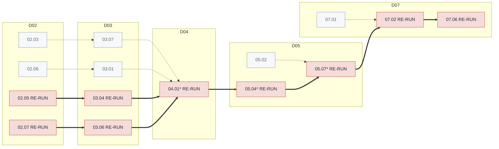

Red (RE-RUN) nodes re-run (\* = restricted to the affected name); grey nodes are bound to their latest published snapshot (dotted edges). Here 9 of 69 nodes run, for one security, in a few minutes instead of a two-hour rebuild.

### Event record (`events` table)

`event_id, detected_at, source, type, entities, urgency, rule_id, evidence (request or story IDs), run_id, outcome, latency_s`

Every event and its outcome is quoted in the next AI report, including events that triggered no action.

### Event trigger flow

detect (00.05) → classify and score urgency → map to entities and datasets → choose HFD depth → create event run ID → `repository_dispatch` to the runner → partial DAG → governance → notify.

### Worked timeline — a price-sensitive results announcement for a held name (times illustrative, Sydney)

| Time | Step | Detail |
|---|---|---|
| 13:02:10 | detect (00.05) | announcement flagged price-sensitive for a T2 holding; event `E-20261007-0041` created |
| 13:02:12 | classify + urgency | results release → P1; entities = 1 security; datasets = estimates, news, intraday bars |
| 13:02:15 | depth upgrade | name moved to T1 for 2 sessions; tick capture switched on (02.04) |
| 13:07:12 | debounce ends | two follow-up headlines coalesced into the same event |
| 13:07:15–13:10:40 | partial DAG (9 nodes) | 02.05 → 03.04 → 03.06 → 04.01\* → 05.04\* → 05.07\* → 07.02 → 07.06; shock probability 0.82; forecast median cut from $+0.6\%$ to $-1.1\%$ |
| 13:10:41 | governance (G5) | REDUCE recommended to the band edge; ticket for the closing auction; BUYs suppressed intraday |
| 13:10:45 | notify + record | alert with evidence links; event row written; quoted in tonight's AI report |

> Note: Detection-to-decision latency 8 min 31 s (5 min of it is the deliberate debounce; compute 3 min 25 s), inside the 15-minute P1 SLA. A person still approves the ticket before the auction.

---

## 23. Additional Information Streams
`D02 · D03 · D04` · *Six enrichment streams, one pathway: every stream passes the PIT firewall and feeds layers that already exist*

> **Principle.** Additional variables enrich existing filtration, state, forecast, risk and execution layers; they never form disconnected mini-pipelines.

### Six streams into one integrated information state

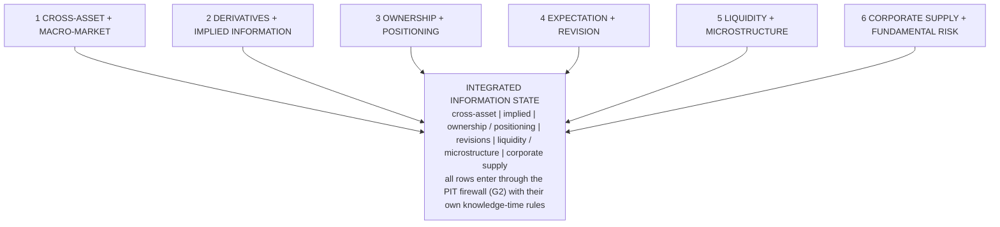

#### 1 Cross-asset + macro-market
ACGB curve and BBSW, real yields, breakevens; credit spreads and funding stress; AUD/USD, TWI; iron ore, gold, copper and energy curves; financial-conditions and correlation stress.
*Feeds: macro filter, regimes, transmission, stress.*

#### 2 Derivatives + implied information
Compact surface per optionable name: ATM IV 30/90d, 25Δ skew, term slope, open interest, option volume; variance risk premium $\mathrm{IV}^2-\mathbb{E}[\mathrm{RV}]$.
*Feeds: volatility and tail models, event sensitivity, sizing, execution.*

#### 3 Ownership + positioning
Substantial-holder changes, director dealings, holder concentration; short-position reports where available, with their publication lag as knowledge time.
*Feeds: crowding, governance risk, signal confirmation, squeeze and exit risk.*

#### 4 Expectation + revision
Consensus EPS and revenue changes, revision breadth, target-price revisions, estimate dispersion, surprises (SUE), guidance changes.
*Feeds: firm state, earnings-drift signals, event risk, regime conditioning.*

#### 5 Liquidity + microstructure
Bid–ask spread, depth, turnover, Amihud and Kyle $\lambda$ (T1), trade and quote intensity, order imbalance where available, auction volumes.
*Feeds: signal reliability, HFD tiering, position limits, cost model, execution.*

#### 6 Corporate supply + fundamental risk
Placements and share purchase plans, buy-backs, dividends, splits and consolidations, M&A, dilution; debt maturity and refinancing; optional ESG / controversy overlay where licensed.
*Feeds: valuation, earnings risk, stress, portfolio constraints.*

### One pathway, not six new stages

new information → PIT firewall → macro / firm states → features / targets → signals / forecasts → validation / risk → portfolio / execution

*Priority additions: cross-asset state, analyst revisions, liquidity / microstructure and derivatives-implied information. Ownership / positioning is useful where coverage exists; ESG / controversy remains an optional risk overlay.*

### Where each stream is consumed

| Stream | D01 | D03 | D04 | D05 | D06 | D07r | D07g |
|---|:-:|:-:|:-:|:-:|:-:|:-:|:-:|
| 1 Cross-asset | ● | ● | ● | ○ |  | ● | ○ |
| 2 Implied |  | ○ | ● | ● | ○ | ● | ○ |
| 3 Positioning | ○ |  | ● |  |  | ○ | ● |
| 4 Revisions | ○ | ● | ● | ● |  |  |  |
| 5 Liquidity | ● |  | ● | ○ | ● | ● | ● |
| 6 Corp. supply | ● | ● | ● |  |  | ● | ● |

*● primary input, ○ secondary. D07r = risk and sizing; D07g = governance.*

### PIT rule per stream

| Stream | Knowledge time |
|---|---|
| Cross-asset | market close or official release time |
| Implied | snapshot time of the surface |
| Positioning | lodgement or publication time (not trade date) |
| Revisions | first-seen ingest time |
| Liquidity | bar end; T1 metrics after the session |
| Corp. supply | announcement time; ex-dates from the CA engine |

### Coverage and licence

Optionable names are a minority of the ASX universe, so implied features carry a coverage mask and models must work without them. Each stream lists its LSEG entitlement in `configs/licence.yaml`; 00.12 blocks any stream whose entitlement is missing rather than silently dropping fields.

### Derived features each stream contributes (definitions used in 04.01)

| Stream | Feature |
|---|---|
| Cross-asset | curve slope $y_{10}-y_{3}$; financial-conditions index = first principal component of standardised spreads, volatility and funding gauges |
| Implied | $\mathrm{VRP}_i=\mathrm{IV}^2_{i,30}-\mathbb{E}_t[\mathrm{RV}_{i,t:t+21}]$; skew $=\mathrm{IV}_{25\Delta P}-\mathrm{IV}_{25\Delta C}$; term slope $\mathrm{IV}_{90}-\mathrm{IV}_{30}$ |
| Positioning | crowding $=\Delta(\text{short interest})/\text{free float}$; holder-concentration HHI; net director buying (value, 90 days) |
| Revisions | revision breadth $(n_{\uparrow}-n_{\downarrow})/n$ over 30 days; $\mathrm{SUE}=(\mathrm{EPS}-\mathbb{E}[\mathrm{EPS}])/\hat\sigma$; dispersion $\mathrm{sd}/\lvert\mathrm{mean}\rvert$ |
| Liquidity | Amihud; Kyle $\lambda$ from $\Delta p_j=\lambda\,\mathrm{sign}(q_j)\sqrt{\lvert q_j\rvert}+\varepsilon_j$ (T1); auction share of volume |
| Corp. supply | net issuance $\ln(N_t/N_{t-252})$; dilution events in 12 months; refinancing wall = debt due < 18 months / market cap |

---

## 24. AI/ML Final Run Reporting
`D08 · AI REPORTING` · *Evidence-grounded synthesis, claim-level validation (G6), prompt-injection and licence controls, and the final artefacts (08.02–08.05)*

> **Principle.** Stage D08 closes the run with an auditable narrative: quantitative evidence → validated findings → AI synthesis → claim validation → final report.

### Reporting flow

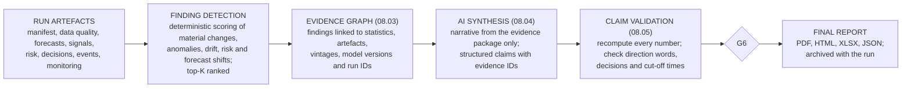

### A  What the AI/ML layer does

| Function | Description |
|---|---|
| **Run comparison** | material changes vs prior runs in universe, forecasts, signals, risk and model health |
| **Importance ranking** | findings ordered by expected analytical and trading importance |
| **Narrative** | plain-language explanation that keeps model, statistic and data provenance |
| **Decision explanation** | explains BUY / HOLD / REDUCE / SELL / NO-TRADE without creating or overriding them |
| **Research agenda** | model deterioration, feature issues, data gaps, names needing deeper work, conditions to watch |

### B  Finding detection (deterministic, 08.03)

For each tracked metric $m$ (IC, coverage, ES, weight, regime probability, …):

$$
z_m=\frac{x_{m,t}-x_{m,t-1}}{1.4826\,\operatorname{MAD}(\Delta x_m)},\qquad
\mathrm{score}_m=|z_m|\cdot c_{\mathrm{cat}(m)}\cdot e_m
$$

$c$ = category weight (risk $>$ decisions $>$ models $>$ data), $e$ = portfolio exposure. Run-health anomalies by isolation forest. The top $K=15$ findings, with their statistics, form the evidence package.

### C  Governance — the AI cannot override the quant pipeline

Deterministic decision, validation, risk and governance layers stay authoritative. The AI layer can explain, compare, prioritise and flag; it cannot bypass a NO-TRADE gate, invent evidence, use information after the cut-off, or alter model outputs. It has no write access to decision tables (I8).

### D  Evidence graph schema

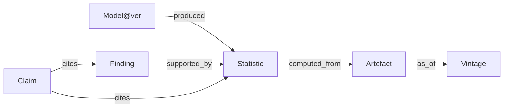

Every node has a stable ID and hash; the graph is stored as JSON and as DuckDB tables in the run folder.

### E  Generation protocol (08.04)

- Input = evidence package only (findings, statistics, decisions, events) — never raw LSEG data.
- Structured output: each sentence carries claim objects `{text, value, unit, evidence_ids}`.
- **No new numbers**: any number not present in the evidence is a violation.
- Deterministic settings (temperature 0), pinned prompt template and model version, both in the manifest.
- News text appears only as quoted data with source IDs; instructions inside it are ignored (prompt-injection defence).

### F  Claim validation algorithm (**◆ G6**, 08.05)

```text
for claim in draft.claims:
  ev = graph.resolve(claim.evidence_ids)   # must exist
  v  = recompute(ev)                       # from artefact
  ok = within_tol(claim.value, v, claim.unit)
       and all(e.known_from <= cutoff for e in ev)
       and direction_matches(claim.text, v)
  if claim.is_decision:
       ok &= claim.matches(decisions_table)
  mark(claim, ok)
pass = all numeric claims ok and no unsupported
       decision statements
if not pass: regenerate(feedback)   # max 2
if still not pass: publish 08.02 deterministic report
```

*Tolerances by unit: percentages $\pm0.05$ pp, basis points $\pm0.5$, prices to tick, counts exact.*

### G  Final artefacts

`AI_FINAL_RUN_REPORT_AQP_LSEG_<RUN_ID>.pdf | .html | .xlsx | .json`

archived with the run manifest, lineage and evidence package. Contents: executive summary and changes; universe and filtration; macro regime and transmission; news shocks; model performance and uncertainty; alpha and decay; risk, stress and execution; decisions with invalidation conditions; data quality and governance exceptions; next-run actions.

### H  Licence boundary

If a hosted model is used, only derived statistics that the LSEG licence allows may be sent; 00.12 checks the evidence package before the call. A local model avoids the question entirely.

### Example — one sentence of the AI report, its claim objects and the validator's verdict (values illustrative)

**Draft sentence.** "Ex-ante ES$_{97.5}$ rose from 1.42% to 1.61% after the regime model moved 0.31 of probability into *slowdown*; the governance layer therefore trimmed two orders but issued no NO-TRADE."

**Verdict.** Three numeric claims recomputed within tolerance; "rose" matches the sign; the decision claim matches the `decisions` table (2 trimmed, 0 NO-TRADE); every evidence row has `known_from` $\le$ cut-off → **pass**. Had the draft said "three orders", the decision check would fail and the sentence would be regenerated.

```json
{"claims": [
 {"text": "ES97.5 rose from 1.42% to 1.61%", "value": [0.0142, 0.0161], "unit": "pct",
  "evidence_ids": ["stat:risk.es975@AQP-20261006-1830-D", "stat:risk.es975@AQP-20261007-1830-D"]},
 {"text": "0.31 of probability into slowdown", "value": 0.31, "unit": "prob", "evidence_ids": ["stat:regime.dpi_slowdown"]},
 {"text": "trimmed two orders, no NO-TRADE", "is_decision": true, "value": {"trimmed": 2, "no_trade": 0},
  "evidence_ids": ["tbl:decisions@AQP-20261007-1830-D"]}],
 "validator": {"numeric_ok": 3, "numeric_total": 3, "decision_ok": true, "post_cutoff": 0, "status": "pass"}}
```

---

## 25. Roadmap, Risk Register and References
`DELIVERY` · *Phased delivery with exit criteria, the main project risks with mitigations, and the methods and sources behind this design*

> **Principle.** Build in the order that makes every later stage testable: data honesty first, then models, then money, then automation of judgement.

### Phased roadmap (indicative weeks) — a phase ends only when its exit criterion is met

Timeline (week axis w0–w32, gridlines every 4 weeks):

| Phase | Start week | End week | Duration |
|---|---|---|---|
| P0 Foundations | w0 | w4 | 4 weeks |
| P1 Universe + daily models | w4 | w10 | 6 weeks |
| P2 Portfolio + governance | w10 | w16 | 6 weeks |
| P3 HFD capture + events | w16 | w22 | 6 weeks |
| P4 AI reporting + learning loop | w22 | w28 | 6 weeks |
| P5 live, small capital | w28 | w32 | 4 weeks |

| Phase | Scope | Exit criterion |
|---|---|---|
| P0 | repo, configs, contracts, orchestrator, SSD guard, LSEG session + ledger, PIT store | 20 consecutive daily LFD runs on 50 names with G2 green and replay-identical hashes |
| P1 | D01 complete; macro state; features; baselines, GJR, HAR; purged walk-forward; `aqp_core` integrated | G3 decisions for $\ge3$ families; DSR / PBO computed from registry trial counts |
| P2 | D07 complete; tickets; paper trading | 40 paper sessions; G4/G5 traces complete; implementation shortfall measured |
| P3 | T1/T2 forward capture, realised measures, Hawkes, event engine | harvest lag $<2$ sessions for 30 days; event SLA met for 95% |
| P4 | AI evidence graph, G6, drift, G7 | 20 reports with zero unsupported claims; one champion–challenger cycle |
| P5 | human-approved live trading at small size | kill switch tested end-to-end; monthly review |

### Risk register

| Risk | L | I | Mitigation | Owner |
|---|---|---|---|---|
| Licensed data leaves the machine | L | H | I7 guards, 00.12 checks, no data in Git or prompts | 00.12 |
| API limits or entitlements change | M | M | limits in config, ledger, priority classes | 02.01 |
| Tick history lost to harvest gaps | M | H | daily forward capture, lag alarms, P2 priority | 02.04 |
| Look-ahead bias | M | H | bitemporal PIT, leakage tests, filtered states | 02.09 |
| Over-fitting / data snooping | H | H | purged walk-forward, SPA, DSR, PBO, registry trial counts | 06.02 |
| SSD failure or corruption | L | H | journalled FS, checksums, 3-2-1, monthly restore test | 00.11 |
| Runner or credential compromise | L | H | private repo, hardened runner, keychain secrets | 00.10 |
| Regime break / model decay | M | H | drift detectors, regime models, G7, kill switch | 09.02 |
| Execution error | L | H | human approval, caps, kill switch | 07.06 |
| LLM unsupported claims | M | M | claim validation G6; deterministic fallback | 08.05 |

### Definition of done for any module

- ✓ `NODE` spec: reads, writes, clock, gate
- ✓ data contract for every output
- ✓ unit + leakage tests; fixtures only
- ✓ thresholds in `configs/`, none in code
- ✓ manifest rows and observability metrics
- ✓ replay-identical output hashes
- ✓ runbook entry: failure modes, alerts, recovery
- ✓ ADR if it changes an invariant or interface
- ✓ register row regenerated (`modules.py`)

### References

**Data, microstructure, volatility.** Amihud (2002) illiquidity, *JFM*. Roll (1984) implied spread, *JF*. Barndorff-Nielsen & Shephard (2004) bipower variation, *J. Fin. Econometrics*. Barndorff-Nielsen, Hansen, Lunde & Shephard (2008) realised kernels, *Econometrica*; (2009) realised kernels in practice, *Econometrics J.* Huang & Tauchen (2005) jumps, *J. Fin. Econometrics*. Corsi (2009) HAR-RV, *J. Fin. Econometrics*. Glosten, Jagannathan & Runkle (1993), *JF*. Nelson (1991) EGARCH, *Econometrica*. Engle & Russell (1998) ACD, *Econometrica*. Hawkes (1971), *Biometrika*; Ozaki (1979); Ogata (1981) thinning, *IEEE Trans. Inf. Theory*. Engle (2002) DCC, *JBES*. Ledoit & Wolf (2004), *J. Multivariate Anal.*

**States and causality.** Hamilton (1989) regimes, *Econometrica*. Ghysels, Santa-Clara & Valkanov (2004) MIDAS. Jordà (2005) local projections, *AER*. Chernozhukov et al. (2018) double ML, *Econometrics J.* Merton (1974), *JF*. Piotroski (2000) F-score, *J. Accounting Research*.

**Evaluation and inference.** Diebold & Mariano (1995), *JBES*; Harvey, Leybourne & Newbold (1997), *IJF*. Giacomini & White (2006), *Econometrica*. White (2000) reality check, *Econometrica*. Hansen (2005) SPA, *JBES*. Hansen, Lunde & Nason (2011) MCS, *Econometrica*. Politis & Romano (1994) stationary bootstrap, *JASA*. Romano & Wolf (2005), *Econometrica*. Bailey & López de Prado (2014) deflated Sharpe, *JPM*. Bailey, Borwein, López de Prado & Zhu (2017) PBO, *J. Computational Finance*. López de Prado (2018) *Advances in Financial Machine Learning*. Romano, Patterson & Candès (2019) CQR, *NeurIPS*. Gibbs & Candès (2021) adaptive conformal, *NeurIPS*. Page (1954) CUSUM, *Biometrika*.

**Risk, portfolio, execution.** Kupiec (1995), *J. Derivatives*. Christoffersen (1998), *IER*. Acerbi & Székely (2014), *Risk*. Rockafellar & Uryasev (2000) CVaR, *J. Risk*. Black & Litterman (1992), *FAJ*. Grinold (1989); Clarke, de Silva & Thorley (2002) transfer coefficient, *FAJ*. Almgren & Chriss (2000), *J. Risk*. Brinson & Fachler (1985), *JPM*.

**Numerics.** Marsaglia & Tsang (2000) gamma variates, *ACM TOMS*. Blackman & Vigna (2021) xoshiro generators, *ACM TOMS*.

**Technical sources (accessed October 2026).** LSEG Developers: *LSEG Data Library for Python* documentation and *maximum usage reference guide*; LSEG developer community answers on daily limits and tick depth. GitHub Docs: workflow syntax (`on.schedule` with `timezone`), self-hosted runner security. ASX: cash market trading hours. nanobind and scikit-build-core documentation. K. Sheppard, `arch` package (parity reference).

### Companion files

- `latex/` — this document (XeLaTeX; `aqp_preamble.sty` is the shared preamble; `tools/modules.py` generates the register and `modules.csv`).
- `cpp/` — `aqp_core` headers, nanobind and Rcpp bindings, C++ and Python tests, R parity script, benchmark script and results.

### Glossary

| Term | Meaning | Term | Meaning |
|---|---|---|---|
| PIT | point-in-time: as known at that moment | CSPA | closing single-price auction |
| LFD / HFD | low- / high-frequency data | IS | implementation shortfall |
| SCD-2 | versioned rows with validity dates | ES | expected shortfall (CVaR) |
| RV, BV, RK | realised variance, bipower, realised kernel | DCC | dynamic conditional correlation |
| HAR | heterogeneous autoregressive (RV) | SPA | superior predictive ability test |
| ACD | autoregressive conditional duration | MCS | model confidence set |
| DSR | deflated Sharpe ratio | PBO | probability of backtest over-fitting |
| CRPS | continuous ranked probability score | PSI | population stability index |
| CQR | conformalised quantile regression | DML | double / debiased machine learning |

---
