# AQP — Multi-Market Quantitative Investment Pipeline

**Architecture Version 14 · workflow realignment around filter-first data collection and paired news benchmarks**

> **Status:** Research and system-design specification, not evidence of profitability or production
> readiness. Model thresholds are provisional. Live use requires tested implementation, validated data and
> broker interfaces, approved risk limits, operational testing and explicit sign-off.
>
> **Math rendering:** Formulas use LaTeX Markdown (`$...$` for inline maths and `$$...$$` for display
> equations). Use a math-enabled Markdown preview if commands such as `\mathrm` display literally.

| Scope | Design |
|---|---|
| Markets | ASX and US equities |
| Sleeves | ASX interday, US interday, ASX intraday, US intraday |
| Forecast architecture | Financial, macroeconomic and firm/microstructure model families; a shared AI-NLP news feature engine creates quantitative covariates for matched news-augmented challengers |
| Main flow | Data → fixed research universe → forecasts → validation → risk/optimisation → leverage/pre-trade gates → execution → monitoring/reporting |
| Out of scope | Full source code, provider API instructions and production runbooks |

## Executive Summary

AQP is a **gated, multi-market research-to-execution pipeline**. Its job is to turn a broad company
candidate list and market information into validated forecasts, risk-constrained portfolio decisions,
and auditable run reports. It is a framework for research and controlled operation—not a single
prediction algorithm and not evidence that a strategy is profitable.

The operating order is deliberate:

1. **Build the screening dataset.** Load the candidate company/security list and only the point-in-time
   data needed to assess identity, listing status, basic financial condition, liquidity, historical-data
   availability and strategy suitability. Apply the same timing and data-quality rules used later in the
   pipeline.
2. **Filter and freeze the research universe.** Use the screening data to reject ineligible or unsuitable
   names, record reasons, and create a versioned universe. Do not run the full research-data or AI-NLP
   news pipeline across every initial candidate.
3. **Collect detailed analysis data for admitted names.** Expand financial/interday data, the required
   intraday data tier, firm and market-microstructure inputs, relevant macroeconomic series and the raw
   qualitative news corpus. Keep timestamps, data vintages, coverage and source lineage. The detailed
   data request is driven by the fixed universe, sleeve and coverage tier.
4. **Build two matched forecasting arms.** Financial, macroeconomic and firm/microstructure model
   families each have a no-news baseline that uses the common core features and a challenger that adds
   a versioned quantitative news vector, $Z^{news}_{i,t,h}$. That vector is produced by converting
   timestamped text into validated numerical variables; it is an input to the three model families, not a
   fourth stand-alone return-model family.
5. **Test the added value of news before choosing a model.** Compare baseline and challenger on matched
   out-of-sample observations with the same universe, target, horizon, folds, model family, tuning budget
   and transaction-cost assumptions. A news challenger is preferred only when its incremental value is
   robust, calibrated and economically useful after costs. If it is not, retain the eligible baseline or
   current approved model.
6. **Pass eligible forecasts through the same risk and operating controls.** Forecasts feed portfolio
   construction, leverage and margin checks, pre-trade eligibility, controlled execution and monitoring.
   Model outputs never override a hard limit, data-integrity gate, reconciliation rule or kill switch.

This structure limits unnecessary data acquisition, keeps the benchmark interpretable, and separates
feature engineering from model evaluation. “News as an exogenous variable” means that NLP-derived news
features are external inputs relative to the no-news feature set; it does **not** prove causal exogeneity.
Every stage remains subject to point-in-time controls, tests, documented fallbacks and approval before
live use. If a required gate fails and no pre-approved safe fallback applies, the affected branch or run
is blocked and the decision is recorded with a reason code.

### Terminology convention

G1–G7 and the **Company Reference and Exposure Dataset** are AQP-specific architecture labels. Numerical
thresholds are provisional research settings unless explicitly approved; they are not universal industry
or regulatory standards.

## Contents

1. [Pipeline at a Glance](#1-pipeline-at-a-glance)
2. [Design Principles and Gates](#2-design-principles-and-gates)
3. [Stage 0: Screening Data and Point-in-Time Foundation](#3-stage-0-screening-data-and-point-in-time-foundation)
4. [Stage 1: Universe Selection and Strategy
   Classification](#4-stage-1-universe-selection-and-strategy-classification)
5. [Stage 2: Post-filter Data Expansion and Common Forecast Schema](#5-stage-2-post-filter-data-expansion-and-common-forecast-schema)
6. [Stage 2A: Financial Forecast and Distress Model](#6-stage-2a-financial-forecast-and-distress-model)
7. [Stage 2B: Macroeconomic Exposure and Regime Model](#7-stage-2b-macroeconomic-exposure-and-regime-model)
8. [Stage 2C: Firm Fundamentals and Market
   Microstructure](#8-stage-2c-firm-fundamentals-and-market-microstructure)
9. [Stage 2D: AI News Feature Engineering and
   Quantification](#9-stage-2d-ai-news-feature-engineering-and-quantification)
10. [Stage 2E: Validation, Eligibility and Signal
    Combination](#10-stage-2e-validation-eligibility-and-signal-combination)
11. [Stages 3–4: Risk, Optimisation and Sleeve
    Allocation](#11-stages-34-risk-model-optimiser-and-sleeve-allocator)
12. [Stage 5: Leverage and Position Report](#12-stage-5-leverage-and-position-report)
13. [Stages 6–7: Execution, Controls and
    Monitoring](#13-stages-67-execution-hard-limits-monitoring-and-learning)
14. [Notation, Glossary and Open Decisions](#14-notation-glossary-and-open-decisions)
15. [Operating Contract and Run Outputs](#15-operating-contract-and-run-outputs)
16. [Implementation Roadmap](#16-implementation-roadmap-and-readiness-gates)

---

## 1. Pipeline at a Glance

Use this as the system map. The diagrams in Sections 3–13 show the process and stage hand-offs.

### 1A. Core operating pipeline

The first data pull is for screening. Detailed research data and full news processing begin only after
G1 has created the fixed, versioned universe.

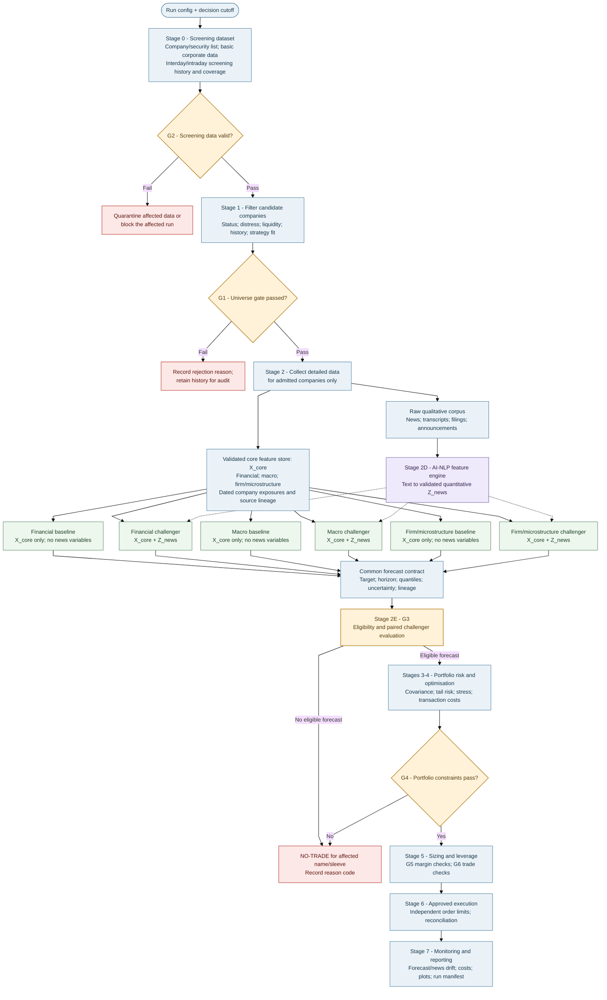

### 1B. Post-filter data collection and feature assembly

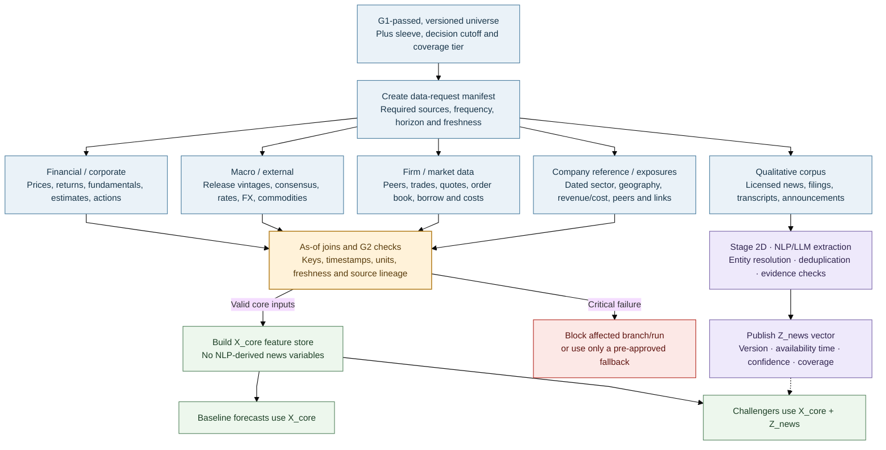

### 1C. Matched benchmark and promotion path

The detailed statistical protocol is in Stage 2E. This diagram shows the decision sequence for each
model family, target, horizon and sleeve.

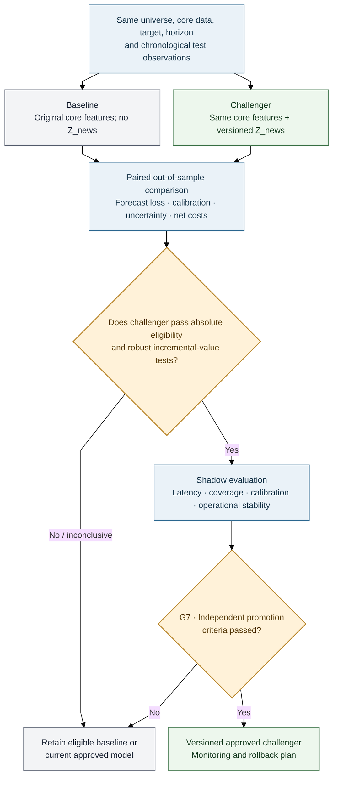

### How to read the diagrams

Solid arrows show normal data/control flow. Dotted arrows show that $Z^{news}$ is added to challenger
models only; they do not assert a causal effect. G1–G7 are project-defined gates. The initial screening
pull is deliberately smaller than the post-filter research-data pull. A rejected company does not proceed
to full feature construction, except for records required for audit or historical research integrity.

A challenger is never promoted on fit or one favourable metric alone. Stage 2E defines paired evaluation;
Stage 7 defines ongoing monitoring, rollback and controlled model changes.

### Sleeves

| Sleeve | Market / currency | Key concern |
|---|---|---|
| ASX interday | ASX / AUD | Closing-auction execution and limited short borrow |
| US interday | US / USD | FX exposure and overnight gap risk |
| ASX intraday | ASX / AUD | Spread, tick size and available depth |
| US intraday | US / USD | Execution costs and competition for short-horizon signals |

Portfolio sleeves (separately governed sub-portfolios) share infrastructure but keep separate calendars,
cost assumptions, data depth and risk budgets.

| Model family / feature engine | Interday role | Intraday role |
|---|---|---|
| Financial | Return distributions, volatility, distress and factor exposures; baseline and matched news-augmented variant | Volatility, distress and only validated short-horizon effects; baseline and matched augmented variant |
| Macro | Regimes, geographic exposure and shock transmission; news aggregates where relevant | Scheduled-release risk and latency-aware news features where validated |
| Firm / microstructure | Firm economics, peer relationships and firm/sector-linked news features | Order flow, spread, intensity, impact and latency-sensitive event features |
| AI-NLP news feature engine (shared input, not a fourth return-model family) | Multi-day event probabilities, novelty, severity, surprise and persistence/decay features | Fast-decaying event features with strict publication/processing-latency checks |

---

## 2. Design Principles and Gates

| Principle | Implementation |
|---|---|
| Point-in-time | Input availability timestamp must be no later than decision time. Filtered states only; smoothing is for retrospective analysis. |
| Filter before deep retrieval | Stage 0 collects screen-level data; Stage 2 retrieves detailed research data only for G1-admitted names and relevant macro/relationship scope. |
| Isolate the news experiment | The registered baseline/challenger pair differs only by NLP-derived $Z^{news}$ inputs. Keep downstream rules and costs identical; test any separate news overlay as its own experiment. |
| Common forecast format | Each forecast-producing model produces a predictive distribution and lineage metadata; the news engine publishes covariates, not an assumed fourth return forecast. |
| Validate before weighting | Fit success is not proof of out-of-sample skill or economic value. |
| Conservative, validated risk estimates | Use the most conservative risk estimate that passes its own backtests. |
| Default no-trade | Trade only when required checks pass and expected benefit exceeds expected cost. |
| Separate sizing and leverage | Optimiser chooses relative weights; a separate rule controls total exposure. |
| Charge for search | Record trials and account for multiple testing and backtest overfitting. |
| Fixed, versioned universe | Formation runs once per version; only specified mandatory removal rules may remove names. |

| Gate | Pass condition | Failure action |
|---|---|---|
| **G1 Universe gate (project-defined)** | Formation filters pass; existing members meet safety rules | Reject at formation or log a safety exit |
| **G2 Data-integrity gate (project-defined)** | No look-ahead, schema, unit, timezone or freshness breach | Quarantine affected name or block affected branch/run |
| **G3 Model-eligibility gate (project-defined)** | Each candidate has stable, calibrated, out-of-sample skill and net-of-cost evidence; a news challenger must also pass the registered paired incremental-value test | Exclude the failing candidate; retain an eligible baseline if its challenger fails; no eligible candidate means no-trade |
| **G4 Portfolio-risk gate (project-defined)** | Volatility, expected shortfall, concentration, liquidity and stress limits pass | Re-optimise within approved relaxations or scale toward cash |
| **G5 Leverage/margin gate (project-defined)** | Exposure, financing and stressed margin stay within approved limits | Reduce gross exposure or block new risk |
| **G6 Final trade-eligibility gate (project-defined)** | Data, model, risk, liquidity, market-state and kill-switch checks pass | Block the order; risk-reducing actions only if policy permits |
| **G7 Model-promotion gate (project-defined)** | Challenger passes independent validation and shadow period | Keep the current approved model |

**Run status (project-defined labels):** `PASS` means checks passed; `DEGRADED` means an approved
fallback is active; `BLOCKED` means a critical check failed. These are internal operational statuses,
not exchange or regulatory classifications. Every failure receives a machine-readable reason code. If no
approved fallback exists, stop the affected run/sleeve.

---

## 3. Stage 0: Screening Data and Point-in-Time Foundation

**Purpose:** Prepare the candidate company/security list and the minimum reliable dataset needed to make
the universe decision. Stage 0 is not the full research-data download. Detailed financial, macro, firm-level
and news data are expanded only after Stage 1 has frozen the admitted universe.

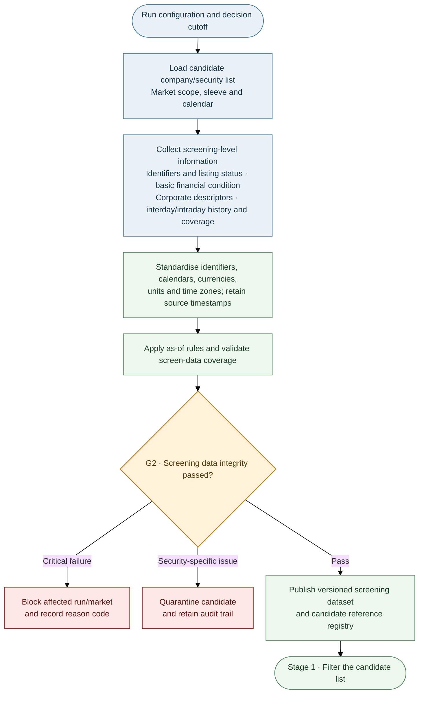

### Screening scope versus full data scope

Stage 0 may use daily/interday history, summary liquidity measures, basic financial statements or ratios,
company descriptions, sector/industry classifications, listing and corporate-action records, and coverage
metadata for intraday data. These fields must be available as of the formation date. Intraday availability
can be checked or sampled for suitability without downloading the full high-frequency history for every
candidate.

Do **not** build full NLP news sentiment/event features at this stage. Stage 0 may record whether a source
or history exists, but the quantitative news vector is produced in Stage 2D only for the filtered research
universe. This keeps costly extraction and feature construction downstream of the universe decision.

### Data timing and integrity

Every datum used at any stage must preserve **valid time** (the period described) and **availability time**
(when the system could first have used it). An as-of query at decision time `t` may use only versions with
availability timestamp `a ≤ t`; later revisions create new vintages instead of overwriting history.
These rules apply both to Stage 0 screening inputs and to all detailed sources retrieved after Stage 1.

| Source | Timing rule |
|---|---|
| Daily/interday prices and quotes | Bar end or session close plus publication lag; include later-delisted names in historical tests |
| Intraday trades/quotes | Exchange timestamp, receipt/first-seen time where available, session calendar and processing latency |
| Fundamentals and guidance | Actual announcement/publication timestamp; conservative fallback if unavailable |
| Estimates and consensus | First-observed timestamp and subsequent revisions |
| Macro data | Official release timestamp and each historical vintage |
| News (Stage 2 collection) | Publication time **and** first-seen/processing time |
| Index membership | Announcement date, not only effective date |
| Borrow and margin | Observation timestamp and provider freshness |

Preserve raw prices. Apply adjustment factors for splits, rights and dividends on read; level filters use the
unadjusted price available at the time. Halted, suspended and zero-volume names are not tradable.

| G2 severity | Examples | Action |
|---|---|---|
| Block | Look-ahead, schema/type mismatch, invalid units/time zone, duplicate keys or corrupted timestamps | Stop the affected branch/run |
| Quarantine | Stale/incomplete history, unexplained extreme return, unreconciled corporate action | Exclude the affected name for this run |
| Warn | Repeated closes, revision bursts or non-critical coverage gaps | Record warning; do not silently suppress it |

**Stage 0 output:** a versioned candidate registry, screening snapshot, market/calendar context, coverage
inventory and G2 evidence. It is not yet the full Company Reference and Exposure Dataset or the model feature
store; those are completed for admitted names in Stage 2.

---

## 4. Stage 1: Universe Selection and Strategy Classification

**Purpose:** Select companies suitable for deeper research-data collection, not forecast returns. Use the
Stage 0 screening dataset and fields available at the formation cutoff. Historical formation must include
later-delisted companies to avoid survivorship bias.

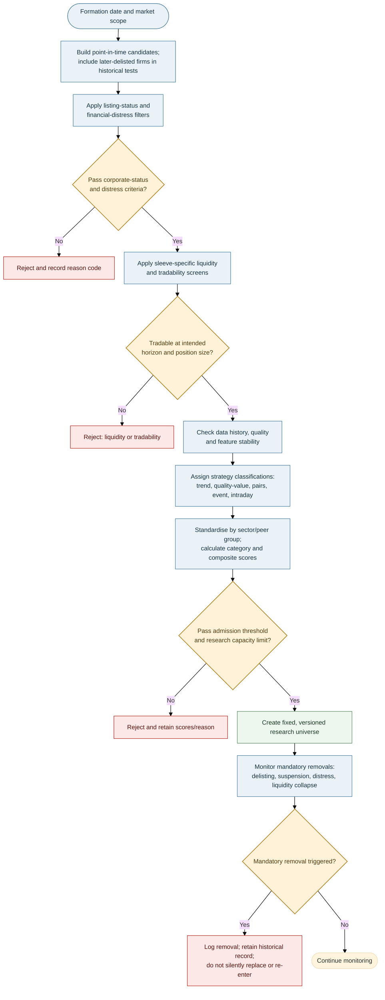

### Eligibility filters and composite score

The order is: **corporate eligibility/distress risk → liquidity/tradability → data depth and stability →
strategy classification → category score → admission**. Rejection reasons are recorded (for example
`DIST`, `LIQ`, `HIST`, `DATA`). Banks and insurers require sector-appropriate capital/funding metrics
rather than generic debt/EBITDA rules.

The screen may consider whether a usable source or event history is available; it must not use the
post-filter NLP news score as an admission criterion. After G1, the data-coverage tier controls how deeply
the surviving name is researched, not an unrecorded change to the fixed universe membership.

| Category | Example measures |
|---|---|
| Financial distress and corporate status | Screening-level distress/default score based on available point-in-time statements and market data, distance-to-default proxy, interest cover, debt maturities and cash runway where available; full Stage 2A distress model is assessed after admission |
| Liquidity | Median daily dollar value traded, Amihud illiquidity, screening-level bid–ask spread and zero-volume ratio; depth proxy where available. Full order-book/depth retrieval is tiered after G1. |
| Stability | Structural-break tests for market beta, volatility-model performance and usable history |
| Business/market suitability | Profitability/cash conversion, valuation, trend, peer relationships and availability of event-source coverage |
| Operational/data coverage | Identifier quality, corporate-action history, borrow-data availability and intraday-quote coverage |

Metrics are robustly standardised within sector/peer group, direction-aligned and combined first within
categories, then across categories. Here MAD is median absolute deviation, Φ is the standard normal
cumulative distribution function, and $d_j$ is +1 when higher values are preferable or −1 when lower
values are preferable:

$$
z_{ij}=\frac{x_{ij}-\operatorname{median}_{s(i)}(x_j)}
{1.4826\,\operatorname{MAD}_{s(i)}(x_j)},\qquad
C_{ik}=\sum_{j\in k}\omega_{jk}\Phi(d_jz_{ij}),\qquad
S_i=100\sum_k w_k C_{ik},\qquad \sum_{j\in k}\omega_{jk}=1,\quad \sum_k w_k=1.
$$

A company is admitted only if it passes all hard gates and clears the configured formation
threshold/capacity for that sleeve. Scores and membership remain fixed for that universe version.

| Strategy classification | Typical characteristics |
|---|---|
| Momentum/trend | Persistent 12–1 momentum (trailing 12-month return excluding the most recent month), adequate liquidity, manageable idiosyncratic noise |
| Quality-value | Profitability, cash conversion, low accruals and sector-relative valuation |
| Mean-reversion/pairs | Stable peer relationship and spread half-life; borrow/costs permit trading |
| Event-driven | Screen-level event-source/history availability; detailed announcement-response estimates are measured after admission |
| Intraday liquid large-cap | Tight spreads, depth, activity and potentially forecastable short-horizon volatility |

### Fixed membership and mandatory removals

No score-based removal, replacement or re-entry is allowed within a universe version. A deliberate
re-formation creates a new version and requires validation.

| Exit code | Trigger |
|---|---|
| `EXIT-DIST` | Distress probability exceeds approved threshold or insolvency event |
| `EXIT-DLST` / `EXIT-SUSP` | Delisting or suspension beyond policy tolerance |
| `EXIT-TKO` | Approved takeover/scheme changes the security's status |
| `EXIT-LIQ` | Liquidity remains below the formation floor for the configured period |

Exited names stay in historical data and attribution. Positions are closed through normal execution
controls.

### Data-coverage tiers

| Tier | Typical allocation | Data use |
|---|---|---|
| T1 | Top ~40 per market | Trades/quotes for intraday and realised measures |
| T2 | Next ~120 | One-minute bars for intraday volatility/costs |
| T3 | Remaining names | Daily data; tick data selectively around events |

Sizes are budget examples, not fixed requirements. Allocate detailed data depth by analytical need, storage,
provider cost and expected signal value. Record the tier in the universe/run manifest; tiering governs the
Stage 2 data request and does not silently replace or re-rank members of the frozen universe.

---

## 5. Stage 2: Post-filter Data Expansion and Common Forecast Schema

**Purpose:** Once G1 has frozen the universe, retrieve the detailed inputs needed to model only the admitted
names and relevant macro/market relationships. Validate and join the non-news inputs into a common core
feature set, process the qualitative corpus through Stage 2D, and provide a standard forecast contract for
both baseline and news-augmented model arms.

### 2.1 Detailed data collection after filtering

The Stage 2 request is generated from the **universe version + sleeve + decision cutoff + coverage tier**.
Do not retrieve full target-security histories or run full NLP feature construction for rejected candidates,
except where existing positions, historical retention or audit rules require it. A non-admitted supplier,
customer, competitor or shared-input entity may still be used as a context node: retrieve only the linked data
needed to analyse an admitted company, record the relationship and scope, and never silently add that entity
to the research universe.

| Data stream | Detailed data collected after G1 | Main use |
|---|---|---|
| Financial and corporate | Interday prices/returns, required historical depth, intraday bars as tiered, fundamentals, dated statements, estimates, guidance, corporate actions and benchmark series | Return distributions, volatility, distress, factor exposures and financial controls |
| Macroeconomic and external | Point-in-time releases/vintages, consensus, rates, FX, commodities and other relevant indicators for markets/economies linked to the admitted universe | Macro states, regime probabilities, nowcasts, company exposures and shock scenarios |
| Firm and microstructure | Peer panels, demand/input-cost/margin data, supplier/customer/competitor links, trades, quotes, order book, volume, borrow availability and execution-cost inputs | Firm economics, peer relationships, order flow, price impact, liquidity and execution estimates |
| Qualitative source corpus | Licensed news, exchange announcements, filings, transcripts and other timestamped text tied to admitted firms/securities and relevant counterparties, sectors or economies | Raw input to Stage 2D; the text is not directly added to the baseline feature set |
| Company reference and exposure data | Dated geography revenue/cost shares, company/industry/product classifications, peer groups, relationship graph and membership history | Macro transmission, entity linking, exposure-aware features, stress and attribution |

The macro stream is not limited to company-specific rows: select the economies, release calendars and market
series relevant to the admitted universe, its dated geographic exposures and the active sleeve. Likewise,
relationship-based news retrieval may include relevant suppliers, customers, competitors or shared inputs, but
must follow the dated relationship map and a documented retrieval scope. Company Reference and Exposure data
is fully assembled here: keep dated revenue and cost shares separate; version geography and industry/product
classifications; maintain peer groups, the entity relationship graph and membership history. These features
support macro transmission, entity linking, stress testing and attribution.

### 2.2 Build the shared core feature set

Detailed source data pass through G2 checks before modelling. Use a common join key (security/entity, event or
series identifier), decision timestamp, frequency/horizon, units/currency and availability rule. Preserve source
lineage and missingness rather than silently filling unknown values.

| Collection step | Required action | Output |
|---|---|---|
| 1. Freeze the request | Record universe version, decision cutoff, sleeve, required horizon, sources and coverage tier | Reproducible data-request manifest |
| 2. Retrieve detailed inputs | Fetch only the required series/frequency/depth for admitted names and relevant exposures | Raw, timestamped source records |
| 3. Validate and harmonise | Apply as-of joins, schema/unit/timezone checks, corporate-action handling, freshness checks and G2 reason codes | Validated point-in-time source tables |
| 4. Build non-news features | Construct financial, macro, firm and microstructure covariates without NLP-derived news variables | Shared core feature set $X^{core}_{i,t,h}$ |
| 5. Process qualitative text | Route eligible timestamped text to Stage 2D and publish quality/coverage metadata | Versioned $Z^{news}_{i,t,h}$ plus lineage |
| 6. Build matched arms | Join $X^{core}$ to both variants; join $Z^{news}$ to the challenger only | Comparable baseline/challenger forecasts |

**Define the experimental difference precisely:** “no-news” means no features produced by the Stage 2D
NLP/LLM pipeline. The baseline may still use structured numerical information—such as reported revenue,
earnings, estimates or official macro releases—when those values are part of the ordinary core feed and were
available by the decision cutoff. Removing those ordinary data as well would change more than the news-feature
treatment.

**Missing data policy:** critical core-data or timestamp failures block the affected branch/run. Non-critical
fallbacks are permitted only when pre-specified, tested and logged. If news is absent or fails QC, do not
replace it with zero. The challenger is unavailable for the affected observation unless an approved missingness
strategy applies; the baseline can continue only under the registered sample and operating policy. Report news
coverage so missing sources cannot improve challenger results by silently shrinking the test sample.

### 2.3 Common forecast contract

All forecast-producing models use the same output schema so their predictive distributions can be compared,
calibrated, combined and passed into risk calculations. The feature sets differ by experiment arm; the output
contract does not.

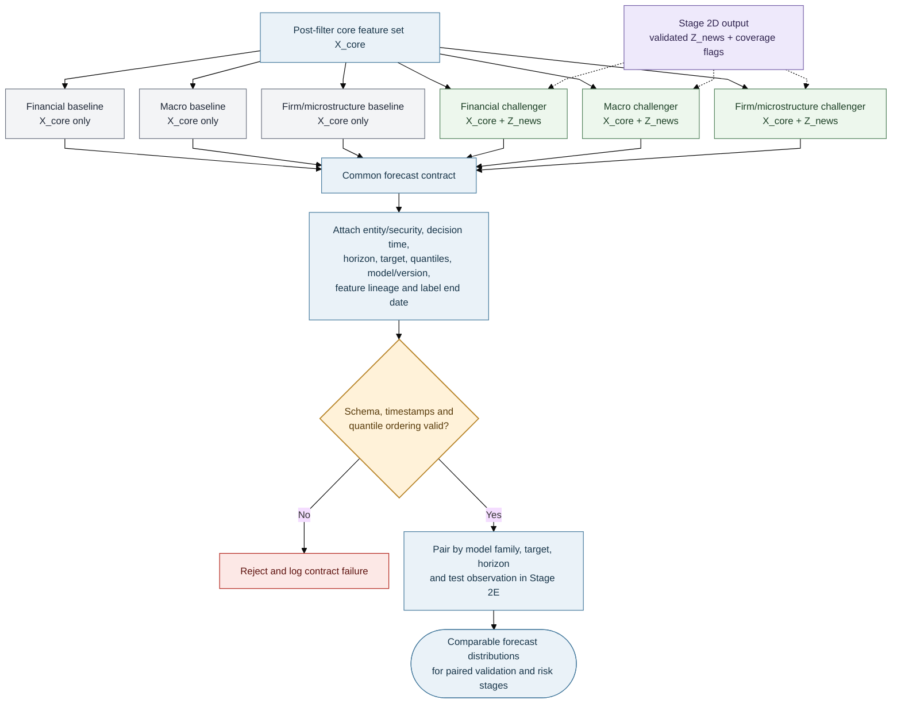

For security $i$, decision time $t$ and horizon $h$, emit quantiles on a shared grid:

$$
\mathcal T=\{0.01,0.025,0.05,0.10,0.25,0.50,0.75,0.90,0.95,0.975,0.99\}.
$$

The benchmark-relative excess-return target spans the selected forecast horizon, beginning after the
 decision point:

$$
y^{(h)}_{i,t}=\sum_{s=2}^{h+1}(r_{i,t+s}-r_{b,t+s}).
$$

Each forecast includes security/entity, decision timestamp, horizon, target definition, quantile values,
model/version, training window, feature version, data lineage and label end date. Reject invalid timestamps,
schema or crossing quantiles; record the label end date for purging.

Use mean quantile pinball loss as the primary quantile score; also track interval coverage, sharpness and the
probability integral transform (PIT). More elaborate models are not admitted solely because they fit in sample.

---

## 6. Stage 2A: Financial Forecast and Distress Model

**Purpose:** Estimate return distributions, volatility, distress and changing factor exposures from the detailed
financial data retrieved after G1. Stage 2E—not this model family—decides model eligibility.

**Paired variants:** Fit a no-news baseline on $X^{core}$ and a matched challenger on the same core data plus
as-of $Z^{news}$. Keep the target, fold boundaries and tuning budget aligned; evaluate return, volatility and
distress endpoints separately where relevant. Stage 2E defines the shared paired protocol.

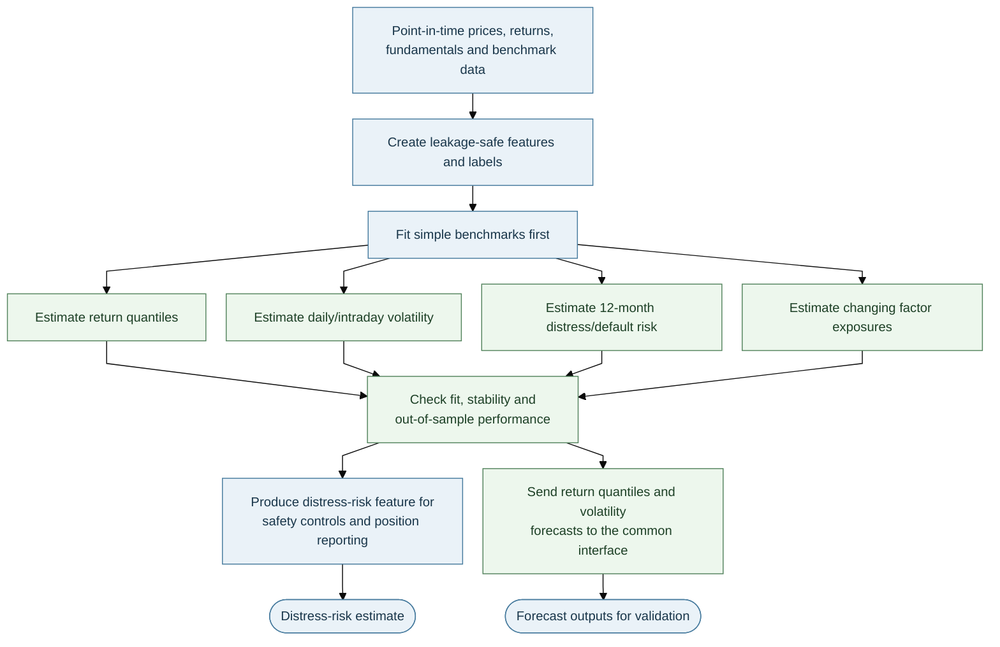

| Task | Candidate methods | Baseline / control |
|---|---|---|
| Return quantiles | Elastic net, quantile regression, gradient boosting (LightGBM/XGBoost), quantile random forest | Zero excess return, rolling mean and factor model |
| Distress | Discrete-time firm-year hazard model | Compare with simple threshold/logistic baseline |
| Daily volatility | Glosten–Jagannathan–Runkle GARCH (GJR-GARCH) or exponential GARCH (EGARCH), with Student-t innovations | exponentially weighted moving average (EWMA) variance |
| Intraday realised volatility | Heterogeneous Autoregressive model of Realised Volatility (HAR-RV), with realised variance and jump measures | Daily-only volatility baseline |
| Dynamic exposures | Filtered state-space/Kalman model | Static rolling beta |

**Distress hazard:**

$$
P(\text{default in }(t,t+1]\mid x_{i,t})=\Lambda(\alpha(t)+\beta^\top x_{i,t}),
$$

with distance to default, profitability, leverage, cash runway, returns and volatility as inputs. Use
the output for distress-risk gates, optimiser penalties and position reporting.

**Glosten–Jagannathan–Runkle GARCH (GJR-GARCH):**

$$
r_t=\sigma_tz_t,\qquad \sigma_t^2=\omega+(\alpha+\gamma\mathbf1\{r_{t-1}<0\})r_{t-1}^2+\beta\sigma_{t-1}^2.
$$

Student-t innovations capture fat tails; `γ` captures asymmetric volatility response. For intraday data,
the HAR-RV uses daily, weekly and monthly realised-variance averages, optionally with a jump component.
Filter changing factor exposures using data available up to `t`; never use smoothed future-informed
estimates for live signals.

**Feature groups:** earnings revisions/surprises, profitability and cash conversion, accruals, margins,
investment and asset growth, leverage, valuation, momentum/reversal, idiosyncratic volatility and
distress. Standardise features inside each training fold.

---

## 7. Stage 2B: Macroeconomic Exposure and Regime Model

**Purpose:** Combine economy-level states with each admitted firm's dated revenue/cost exposures and estimated
sensitivities, using macro releases and other detailed data retrieved after G1.

**Paired variants:** Preserve the original macro specification as the baseline. Its matched challenger may add
as-of news aggregates by macro topic, country, sector or exposed firm. Do not relabel news-derived features as
official macro releases or causal shocks.

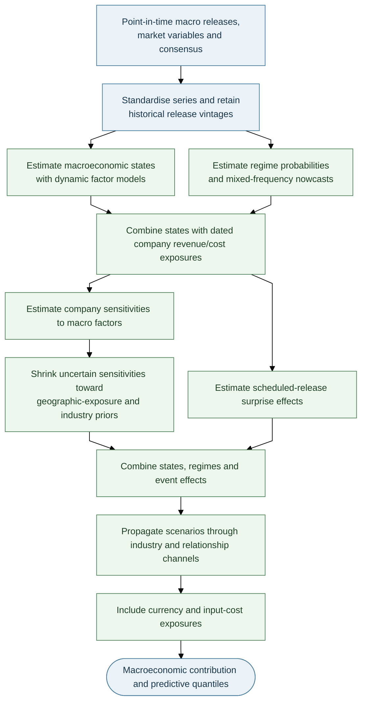

| Component | Method / output |
|---|---|
| Economy states | Dynamic factor model for activity, inflation, rates, labour, credit and financial conditions; use the Kalman filter for ragged-edge releases |
| Regimes | Markov-switching model with filtered probabilities for expansion, slowdown and stress |
| Nowcasts | Mixed-data sampling (MIDAS) regression for mixed-frequency targets such as GDP; Bayesian vector autoregression (BVAR) as a challenger |
| Company exposure | Retain dated revenue-share and cost-share exposures separately; do not collapse them into one score. |
| Sensitivities | Estimate firm responses to macro factors; shrink noisy coefficients toward geographic-exposure and industry priors |
| Scheduled events | Standardised actual-minus-consensus surprise, with release-time volatility controls for intraday sleeves |
| Transmission/stress | Local projections and the shared relationship graph to convert macro scenarios into firm shocks |
| FX | Explicit revenue/cost currency exposure and portfolio-level USD translation exposure |

For economy $c$, calculate revenue and cost exposure separately:

$$
f^{rev}_{i,t}=\sum_c e^{rev}_{i,c}f_{c,t}, \qquad f^{cost}_{i,t}=\sum_c e^{cost}_{i,c}f_{c,t}.
$$

The weights are dated revenue and cost shares. Preserve coverage flags; do not silently treat unknown
exposures as zero.

Shrink noisy firm sensitivities toward prior estimates:

$$
\hat b^{post}_{ij}=\lambda_{ij}\hat b^{OLS}_{ij}+(1-\lambda_{ij})b^{prior}_{ij},\qquad
\lambda_{ij}=\frac{\tau_j^2}{\tau_j^2+\mathrm{se}(\hat b_{ij})^2}.
$$

Standardised release surprise:
$S_{c,t}=(\mathrm{actual}-\mathrm{consensus})/\mathrm{sd}(\mathrm{surprise})$. Estimate horizon-specific
shock responses with local projections; include industry, geographic exposure, input-cost and FX
channels. Use filtered, point-in-time states only.

---

## 8. Stage 2C: Firm Fundamentals and Market Microstructure

Interday models describe firm fundamentals, industry conditions and peer effects. Intraday models
describe price formation, order flow and execution.

**News integration:** Retain each firm/market model without news as its baseline. The matched challenger
may add entity-linked news variables for the firm, sector, customer, supplier, competitor or shared
input, using the dated relationship graph and coverage flags. For intraday models, apply strict
availability/processing-latency cut-offs; a feature generated after the decision time is unavailable
even if its article publication time is earlier.

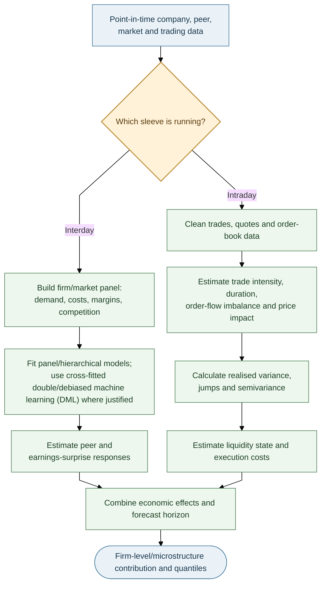

| Branch | Main methods and features | Output |
|---|---|---|
| Interday | Firm/market panel and hierarchical models; demand, input costs, prices, margins, market share and competitive intensity; cross-fitted double/debiased machine learning (DML) only where justified | Peer/earnings response and firm-level micro contribution |
| Intraday | Trade/quote cleaning; trade intensity and durations; order-flow imbalance; spread, depth and price impact | Short-horizon features, liquidity state and execution-cost estimates |

Two-way panel baseline:

$$
r_{it}=\alpha_i+\lambda_t+\beta^\top x_{it}+\epsilon_{it},
$$

with firm- and date-clustered uncertainty. Hierarchical estimates shrink low-history firms toward
industry- and peer-group estimates.

Realised measures from intraday data include realised variance, bipower variation, jumps, semivariance
and realised kernels. Use them only when quote/trade timestamps and market sessions are reliable;
otherwise fall back to validated daily estimates.

---

## 9. Stage 2D: AI News Feature Engineering and Quantification

**Purpose:** Convert timestamped qualitative information into a versioned, auditable vector of
quantitative covariates that can be added to the financial, macroeconomic and firm/microstructure
models. The vector is denoted $Z^{news}_{i,t,h}$ when entity, decision time and horizon matter, and
$Z^{news}_t$ when those indices are implicit. News is a shared feature engine—not a fourth stand-alone
return-forecast family. It does not issue orders or independently declare a trade profitable.

“Exogenous” here means that the news variables are external inputs relative to the core feature set
being benchmarked. It does **not** establish causal exogeneity: news may react to prices, market
conditions and anticipated outcomes. Preserve timing and provenance, and test predictive value out of
sample.

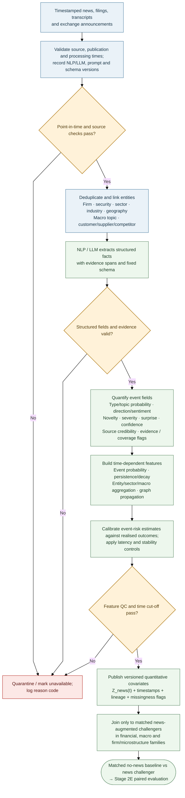

### Processing and quantitative feature schema

1. **Validate timing and provenance:** retain publication and first-seen/processing times, source, extraction/prompt/model versions and the decision cut-off.
2. **Resolve entities and extract evidence:** deduplicate stories, map them to relevant firms, securities, sectors, geographies and macro topics, and preserve source spans or IDs.
3. **Build quantitative features:** use a fixed schema to quantify event type, direction, novelty, severity, credibility, calibrated probability and expected persistence/decay; retain uncertainty and coverage.
4. **Aggregate and publish:** use only point-in-time relationships, apply documented decay/latency rules and publish versioned $Z^{news}_t$ with lineage, quality and missingness flags. Retain licensed data according to source terms and access controls.

| Feature group | Examples | Intended use |
|---|---|---|
| Event semantics | Event type/topic probabilities, signed direction/sentiment, severity | Candidate predictive covariates in matched model variants |
| Surprise / novelty | Novelty versus prior disclosures, residual surprise, already-known/priced-in proxy | Separate new information from repeated or expected information |
| Reliability | Source credibility, extraction confidence, evidence coverage | Weighting, filtering, calibration and uncertainty reporting—not a guarantee of truth |
| Time dynamics | Publication-to-processing latency, event age, persistence/decay, event-window flags | Horizon-specific aggregation and intraday admissibility |
| Exposure / network | Firm, sector, country, customer/supplier/competitor and shared-input links | Propagate potentially relevant information using dated, versioned links |
| Calibrated event risk | Probability of a material event / abnormal move over a defined horizon | Optional quantitative covariate for forecasting and risk monitoring |

For a directed relationship from entity $j$ to entity $i$, a first-order propagated feature may be
proportional to $W_{ij}\delta_j z_j$, where $W_{ij}$ is the dated relationship weight and $\delta_j$ is
the horizon-specific decay. Check the graph for stability (for example, spectral radius below one for a
linear propagation system) and prevent duplicate stories from multiplying the same shock. The graph is a
modelling assumption to validate, not proof of transmission.

A calibrated logistic model may estimate the probability of a material abnormal-return event:

$$
P(|AR_{i,t,h}|>c\hat\sigma_{i,t}\mid z^{news}_{i,t})=\Lambda(\theta^\top z^{news}_{i,t}),
$$

where $AR_{i,t,h}$ is abnormal return over the pre-defined event horizon relative to a specified
benchmark, $\hat\sigma_{i,t}$ is point-in-time conditional volatility, and $c$ is a configurable
research threshold. This probability is a **feature**, not a separate return forecast or an order
instruction. Validate it with Brier/log loss, reliability curves and chronological out-of-sample tests.

### Missingness and leakage rules

- News features must pass publication-time **and** first-seen/processing-time checks. Freeze the NLP
  model, prompt, extraction schema and transformation choices during each evaluation period unless a
  version change is itself the declared experiment.
- Never backfill features using an article or correction that became available after the decision
  cut-off. Preserve revisions and model versions.
- Never silently replace unavailable or low-confidence news with zero. Mark the feature missing, log the
  reason and retain coverage flags.
- Keep the baseline evaluable over its full eligible sample. For the paired comparison, use common test
  observations or a missingness policy registered before testing; report both paired-sample results and
  sample coverage so missing-news cases cannot disappear unnoticed.
- Intraday news is admissible only if processing latency fits the decision schedule. Until a directional
  edge is demonstrated after costs, intraday event information may be used conservatively for
  risk/volatility awareness rather than assumed directional alpha.
- Quantitative news inputs may support forecasts and, under a separately documented policy, risk monitoring.
  During a paired benchmark, any news-based overlay must be identical across arms or evaluated separately.
  Only Stage 2E can grant model eligibility, and downstream independent risk/execution gates remain mandatory.

---

## 10. Stage 2E: Validation, Eligibility and Signal Combination

Validation occurs before a candidate model receives any combination weight. In addition to absolute
eligibility tests, every news-augmented model is tested as a matched challenger against its no-news
counterpart; the architecture does not assume news has incremental predictive or economic value.

### Matched no-news baseline versus news-augmented challenger

For each model family, target, horizon and sleeve, register two arms before inspecting test results:

- **Arm A — baseline:** the original core feature set, with no $Z^{news}_t$ inputs.
- **Arm B — challenger:** the same core feature set plus the versioned $Z^{news}_t$ vector.

Hold constant the universe version, decision timestamps, labels, forecast horizons, walk-forward folds,
model family, tuning budget, evaluation metrics, downstream portfolio/risk rules, execution policy and
transaction-cost assumptions. The intended difference is the addition of the NLP-derived news vector. A
news-based safety overlay must either be applied identically to both arms or assessed in a separately registered
experiment; otherwise its effect is confounded with the forecasting-variable test. Any other change is a
separate experiment. Compare forecasts on matched observations and report missing-news coverage separately.

Make the selection **per model family × target × horizon × sleeve**. The baseline and its challenger are
alternative versions of one model slot, not two independent ensemble members by default. If the challenger
fails to improve robustly, retain an eligible baseline; if it passes, it still requires shadow evaluation and G7
approval before promotion. Do not count both copies in the ensemble unless that combined design is separately
registered and justified.

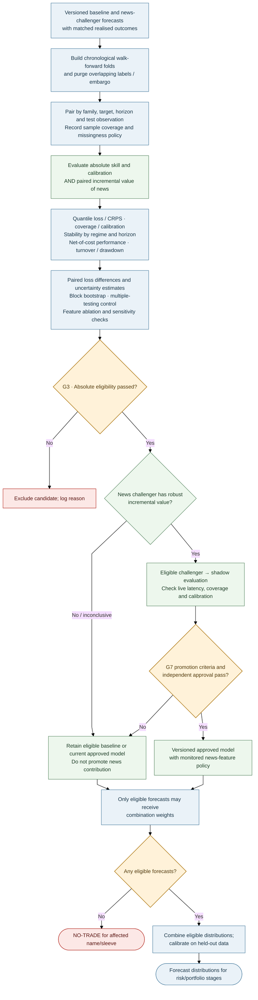

### Validation protocol

- Use chronological walk-forward folds; train only on prior data.
- Purge training labels overlapping each test window and embargo at least the forecast horizon.
- Tune hyperparameters inside training folds; use outer test blocks once.
- Compare with relevant baselines and deduct realistic spread, commission, borrow and impact costs.
- For each news challenger, report paired differences in forecast loss and net-of-cost outcomes with
  uncertainty estimates; do not compare unmatched periods and attribute the difference to news.
- Apply ablation/sensitivity checks and account for all model, feature and prompt trials; do not select
  the best result from an unreported search.

| Test / metric | Question |
|---|---|
| Pinball loss / continuous ranked probability score (CRPS) and coverage | Is the predictive distribution accurate and calibrated? |
| Diebold–Mariano / Giacomini–White | Is forecast skill better, possibly conditional on regime? |
| Hansen Superior Predictive Ability (SPA) test / Model Confidence Set (MCS) | Do comparative forecast tests identify superior candidates or a statistically indistinguishable set of best models? |
| Deflated Sharpe Ratio (DSR) / Probability of Backtest Overfitting (PBO) | Could apparent trading performance be due to repeated trials/overfitting? |
| Stability and residual checks | Are parameter estimates, forecast errors and coefficient signs stable across folds? |

### G3 model-eligibility criteria (provisional)

| Criterion | Provisional research rule |
|---|---|
| Fit | Converged; acceptable diagnostics; no unexplained boundary estimates |
| Stability | Coefficients/signs reasonably stable across folds |
| Calibration | 90% interval coverage near target (e.g. within ±3 percentage points) |
| Skill | Out-of-sample improvement against suitable baseline/model set |
| Incremental news value (news challengers only) | Robust paired improvement over the matched no-news model, with uncertainty, coverage, ablation and multiple-testing controls |
| Economic value | Positive net-of-cost value; costs and turnover included; an improved statistical score alone is insufficient |
| Overfitting | Record all model, feature, prompt and parameter trials; apply PBO/DSR or comparable controls |

Thresholds must be calibrated per sleeve and approved; they are not universal constants. If the eligible
set is empty, output `NO-TRADE` for the affected name/sleeve.

### Combination and calibration

Candidate approaches include inverse-loss weights, stacking and regime-conditional weights. Use only the
selected eligible variant for each baseline/challenger pair unless a separately validated ensemble design says
otherwise; do not double-count near-duplicate variants from the same family. Shrink estimated weights toward
equal weights when evidence is weak. Quantile averaging:

$$
\hat q_\tau=\sum_kw_k\hat q_{k,\tau},\qquad w_k\ge0,\quad\sum_kw_k=1.
$$

Apply conformal calibration on held-out data and choose the horizon with the best net information ratio
after costs, capacity and portfolio constraints. Track signal decay and re-evaluate the sleeve
assignment if the estimated half-life changes materially.

---

## 11. Stages 3–4: Risk Model, Optimiser and Sleeve Allocator

The optimiser uses only risk estimates that passed their own checks. Liquidity and tail-risk limits are
not relaxed merely to produce a feasible solution.

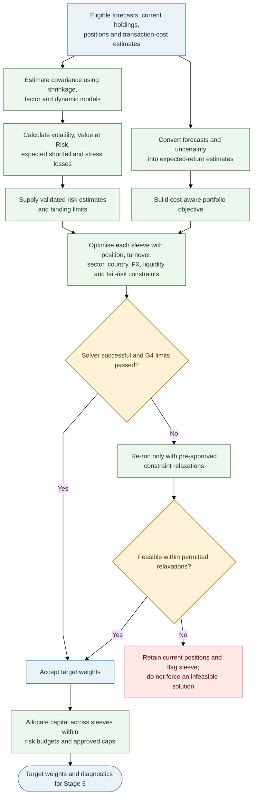

### Risk estimation

| Method | Role |
|---|---|
| Ledoit–Wolf shrinkage | Stabilise sample covariance |
| Factor covariance | Explain market, sector, style, macroeconomic, geographic exposure and FX risks |
| Dynamic conditional correlation GARCH (DCC-GARCH) | Allow correlations to vary over time |
| Regime mixture | Blend calm/stress covariance using filtered regime probabilities |
| Filtered historical simulation / Monte Carlo / extreme-value theory (EVT) | Independent tail-risk views; use a risk estimate only if its backtest is acceptable |

$$
\mathrm{VaR}_\alpha=-\inf\{x:P(R_p\le x)>1-\alpha\},\qquad
\mathrm{ES}_\alpha=-E[R_p\mid R_p\le-\mathrm{VaR}_\alpha].
$$

Backtest value-at-risk (VaR) coverage and independence, and assess expected shortfall (ES) forecasts.
Demote an engine that fails. Cross-market covariance must account for asynchronous ASX and US sessions
via multi-day returns or lead–lag terms.

### Stress library

Include global crisis/recession/rate-shock history, China activity shocks, AUD moves, US overnight gaps,
liquidity drought (lower volume/wider spreads) and relationship-graph contagion. Apply shocks through
company-specific geographic revenue/cost exposures and sector exposures.

### Portfolio optimisation

Use Black–Litterman to blend equilibrium returns with confidence-weighted forecast views:

$$
\mu_{BL}=\left[(\tau\Sigma)^{-1}+P^\top\Omega^{-1}P\right]^{-1}
\left[(\tau\Sigma)^{-1}\pi+P^\top\Omega^{-1}q\right].
$$

Cost-aware objective:

$$
\max_w\ \mu_{BL}^\top w-\frac{\gamma}{2}w^\top\hat\Sigma w
-\sum_i(c_i|\Delta w_i|+\eta_i|\Delta w_i|^{3/2})
-\kappa\sum_i p_i^{dist}|w_i|.
$$

Constraints cover position and liquidity capacity, turnover, sector/country concentration, geographic
revenue/cost exposures, factor and foreign-exchange (FX) exposures, borrow availability, and
stress-loss/expected-shortfall limits. Check solver status and residuals. If infeasible, relax only
approved constraints (e.g. turnover, then sector, then tracking error); never relax liquidity or
tail-risk limits. If still infeasible, hold current positions and flag the sleeve.

**Provisional examples only:** volatility no more than 1.1× target; single name ≤8%; sector ≤30%; test
whether an exit within three trading days is feasible at a participation cap of 20% of average daily
volume (ADV). Configure and validate limits separately for each sleeve/instrument.

### Sleeve allocation

Allocate capital across sleeves by risk budget and out-of-sample evidence, with bounds and a hard cap on
intraday risk. Budget USD/FX exposure explicitly or hedge it. Do not allow intraday drawdown to consume
the risk budget allocated to interday positions without an explicit policy rule.

---

## 12. Stage 5: Leverage and Position Report

Optimisation determines relative weights; this stage determines permitted total exposure and whether
each proposed trade should be submitted.

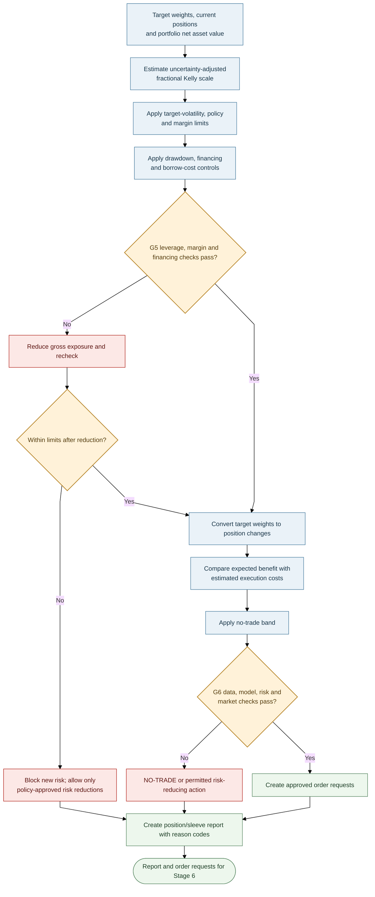

### Fractional Kelly and leverage rule

The classical Kelly rule relates expected excess return to return variance. Here, **fractional Kelly is
used only as a conservative portfolio-exposure scaling heuristic**; it is not a universal or regulatory
formula. Here, $\hat\mu_{BL,t}^{\mathrm{excess}}$ is the estimated excess return in the proposed
portfolio direction, and $\hat\sigma_{p,t}$ is the estimated volatility of those target weights before
leverage scaling. Keep forecasts, variances and drawdown inputs on consistent horizons and in consistent
units. The portfolio optimiser determines trade direction; this stage applies a non-negative exposure
cap.

First combine portfolio variance and uncertainty in the expected-return estimate:

$$
u_t = \hat\sigma_{p,t}^{2} + \widehat{\operatorname{Var}}\!\left(\hat\mu_{BL,t}^{\mathrm{excess}}\right).
$$

Then calculate the Kelly exposure cap. The fractional coefficient range is provisional and must be
validated:

$$
L_t^{\mathrm{Kelly}} = \max\!\left(0,\ c\frac{\hat\mu_{BL,t}^{\mathrm{excess}}}{u_t}\right), \qquad 0.25\le c\le0.5.
$$

Calculate the volatility-scaling cap:

$$
L_t^{\mathrm{vol}} = \frac{\sigma_{\mathrm{target}}}{\hat\sigma_{p,t}}.
$$

The leverage cap is the smallest permitted bound:

$$
L_t^{\mathrm{cap}} = \min\!\left(L_t^{\mathrm{vol}},\ L_t^{\mathrm{Kelly}},\ L_{\max},\ L_t^{\mathrm{margin}}\right).
$$

Apply the drawdown multiplier:

$$
d_t^{\mathrm{DD}} = \max\!\left(0,\ 1-\frac{DD_t}{DD_{\max}}\right), \qquad L_t = L_t^{\mathrm{cap}}d_t^{\mathrm{DD}}.
$$

**Plain-text reading:** estimate uncertainty-adjusted Kelly exposure; cap it by target volatility,
maximum leverage and margin capacity; then reduce it according to drawdown. Drawdown is expressed as a
positive fraction (for example, 0.10 for a 10% drawdown). If drawdown reaches the configured maximum,
the multiplier is zero. Missing, stale, non-finite or invalid inputs must trigger a safe fallback—not an
increase in permitted leverage. If estimated volatility or the maximum drawdown threshold is zero or
invalid, block new risk pending a valid configuration.

Overnight sizing must include gap risk; US positions held during Sydney night hours are a key case.
Financing, borrow costs and stressed margin headroom are included in expected net returns and G5.

### Trade decision and position report

Trade only if expected benefit over the chosen horizon exceeds spread, commission and market-impact cost
by the configured margin. Suppress changes within the no-trade band. Each position records invalidation
conditions (forecast reversal, tail-quantile breach, stress-regime change, material new information under the
pre-registered policy, or rising distress probability). For a baseline-versus-news experiment, downstream
news-based overlays must be identical across arms or assessed separately; otherwise the economic comparison
cannot isolate the forecasting value of $Z^{news}$.

Every report—trade or `NO-TRADE`—contains:

- Current/target weight, action and reason code.
- Median and interval forecasts, model-layer contributions and model agreement.
- Volatility, expected-shortfall contribution and main stress scenarios.
- Distress probability, geographic, sector, factor and FX exposures and expected costs.
- Gross/net exposure, leverage components, margin headroom, drawdown state and G5/G6 results.

---

## 13. Stages 6–7: Execution, Hard Limits, Monitoring and Learning

Execution uses approved order requests only. Hard limits are independent of forecast, optimisation and
monitoring models.

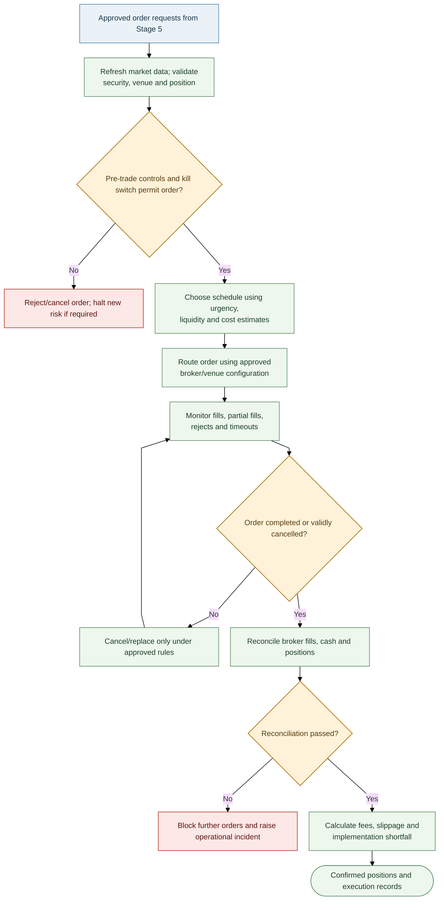

### Independent safety controls

Security, exposure, daily-loss, drawdown and market-state checks run independently of the forecast and
optimisation models. A breach blocks new risk and triggers the configured cancellation, risk-reduction
and incident-review policy. These controls cannot be bypassed by a model output.

### Hard limits and monitoring

| Control | Illustrative behaviour |
|---|---|
| Name/gross leverage/participation | Reject orders beyond approved limits |
| Kill switch | Cancel open orders and block new risk on breach, stale data or operational incident |
| Reconciliation | Block further orders if broker fills, cash or positions do not reconcile |
| Drawdown | Reduce risk according to the approved drawdown policy |
| Monitoring | Track P&L, forecast calibration, feature drift, risk backtests, execution error, slippage and data quality |

Illustrative alerts (calibrate per sleeve; these are not universal regulatory thresholds): 90% interval
coverage outside 87–93% for 20 sessions; alpha half-life more than 50% shorter than at admission; VaR
backtest p-value below 0.01; realised execution-cost error above 30%. Alerts trigger the configured
response, not automatic model promotion.

### Monitoring and controlled learning

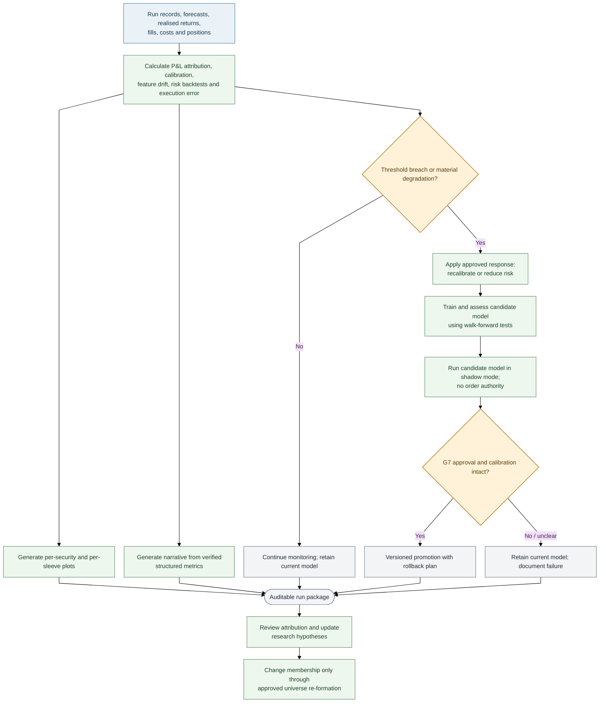

A model may move through `candidate → G3 eligible → shadow mode → G7 approved production model →
retired`. Promotion requires independent review, a pre-agreed shadow period (e.g. at least 60 sessions),
intact calibration, evidence against the current approved model and a rollback path. A candidate model
never replaces the current approved model automatically.

Performance attribution should separate selection, forecasting, portfolio allocation,
factor/sector/country effects and execution shortfall. Findings can inform later research but must not
alter a fixed universe version without an approved re-formation.

---

## 14. Notation, Glossary and Open Decisions

| Symbol / term | Meaning |
|---|---|
| $t$, $a$, $v$ | Decision time, first-available timestamp and valid time |
| $h$, $r_{i,t}$ | Forecast horizon and security return |
| $e^{rev}_{i,c}$, $e^{cost}_{i,c}$ | Security $i$'s dated revenue and cost exposure shares for economy $c$ |
| $f_{c,t}$ | Macroeconomic state/factor for economy $c$ at time $t$ |
| $q_{i,t}(\tau)$ | Forecast quantile at probability level $\tau$ |
| $Z^{news}_{i,t,h}$ | Versioned, point-in-time quantitative news covariate vector produced by NLP/LLM extraction and validation; indexed to the relevant entity, decision time and horizon |
| No-news baseline / news challenger | Matched core-feature model / same model family and target with quantitative news covariates added |
| Incremental news value | Paired out-of-sample change in forecast and economic metrics attributable to adding news features under the registered experiment |
| $\hat{\Sigma}$ | Estimated covariance matrix |
| $p_i^{dist}$ | Estimated distress/default probability |
| $w_i$, $L_t$, $DD_t$ | Portfolio weight, leverage and drawdown |
| $b_i$ | No-trade band for security $i$ |
| Purging / embargo | Removing overlapping labels and a defined buffer around test periods during validation |

### Acronyms and established model names

| Term | Meaning |
|---|---|
| VaR / ES | Value at Risk / Expected Shortfall; some literature uses Conditional Value at Risk (CVaR) for related tail-risk measures |
| CRPS / PIT | Continuous Ranked Probability Score / Probability Integral Transform |
| GARCH / GJR-GARCH / EGARCH | Generalised Autoregressive Conditional Heteroskedasticity / Glosten–Jagannathan–Runkle GARCH / Exponential GARCH |
| HAR-RV | Heterogeneous Autoregressive model of Realised Volatility |
| MIDAS / DCC-GARCH | Mixed Data Sampling model / Dynamic Conditional Correlation GARCH model |
| DML | Double/debiased machine learning (academic terminology; both forms are used in the literature) |
| EWMA | Exponentially weighted moving average |
| DSR / PBO | Deflated Sharpe Ratio / Probability of Backtest Overfitting |
| SPA / MCS | Superior Predictive Ability test / Model Confidence Set |
| NAV / ADV / FX | Net asset value / average daily volume / foreign exchange |
| OLS / EVT / BVAR | Ordinary Least Squares / Extreme Value Theory / Bayesian Vector Autoregression |
| Champion / challenger | Current approved model / candidate model undergoing independent evaluation |
| G1–G7 | Project-specific gate identifiers, not external regulatory rule numbers |

### Decisions required before implementation

1. Instruments and capital structure: cash equities on margin, CFDs or futures; available capital and
   financing arrangements.
2. Per-sleeve target volatility, maximum drawdown, per-name/sector/gross limits and margin buffer.
3. US-market broker and provider; licensed data coverage and intraday data cost/depth.
4. Licensed news sources, publication/first-seen timestamp quality, NLP/LLM and prompt versioning,
   retention/privacy requirements, minimum coverage, latency budgets, missingness policy, and criteria
   for any intraday directional use.
5. Long-only versus long-short and permitted borrow, especially for ASX names.
6. Whether universe re-formation is only by deliberate decision or on a defined schedule.
7. Whether model families are fixed or open to a challenger process governed by G3/G7.

---

## 15. Operating Contract and Run Outputs

Every run creates a unique `run_id` and records:

| Record | Required fields |
|---|---|
| Run/config | Start/end timestamps, code revision, config version, market, sleeve, cutoff, calendar and horizons |
| Data lineage | Provider/dataset, extraction and observation timestamps, availability-time rule, row counts and schema version |
| News features | Source/coverage counts, publication and first-seen times, NLP/LLM and prompt versions, feature schema, entity-map/relationship-graph version, quality flags and missingness reasons |
| Universe | Universe version, eligible names, exits and reason codes |
| Models/validation | Registered experiment ID, `BASELINE`/`NEWS_CHALLENGER` arm, model/feature and NLP/prompt versions, training window, fold/purge/embargo settings, paired metrics, matched sample/coverage, uncertainty, calibration/net-cost results, trial count and promotion decision |
| Portfolio/decision | Forecasts, current/target weights, costs, risk contributions, binding constraints, `TRADE`/`REDUCE`/`HOLD`/`NO-TRADE` and reason codes |
| Execution | Order requests, submissions/fills, timestamps, fees, cancellations/rejections and implementation shortfall |
| Outputs | Per-security and per-sleeve plots, diagnostics, warnings and narrative report |

Run status uses the `PASS`, `DEGRADED` and `BLOCKED` definitions in Section 2. Store the status and
reason codes in every run manifest.

The narrative report must be generated from structured outputs. An AI-generated summary may describe
measured results but must not invent numbers, override a gate or issue an order. Plot/report failures
are logged and never conceal safety failures. Fallbacks must be tested and cannot bypass data integrity,
margin, hard exposure limits, kill switches or reconciliation.

---

## 16. Implementation Roadmap and Readiness Gates

Build the system in the same order it runs. Do not implement a downstream model until the upstream contract
and its failure tests pass.

| Phase | Deliverable | Exit criterion |
|---|---|---|
| 1. Screening foundation (Stage 0) | Candidate/ticker registry, point-in-time screening data, calendars, identifiers, corporate status and G2 checks | As-of, schema, timestamp, units and coverage tests pass; the screen uses only information available at its cutoff |
| 2. Universe formation (Stage 1 / G1) | Screening filters, rejection reason codes, strategy classification, fixed universe version and coverage tiers | Survivorship/look-ahead tests pass; membership is reproducible and deep data requests are not issued before G1 |
| 3. Post-filter data expansion (Stage 2) | Run-specific data manifest, detailed financial/macro/firm inputs, company exposure graph, source lineage and core feature store $X^{core}$ | Source joins, vintages, freshness, units, missingness and G2 failure paths pass; only admitted names receive full analysis-data requests |
| 4. No-news baseline models (Stages 2A–2C) | Financial, macro and firm/microstructure baselines plus the common forecast contract | Each baseline has leakage-safe targets, a simple comparator, stable outputs and walk-forward evaluation |
| 5. AI-NLP feature engine (Stage 2D) | Timestamped text ingestion, entity resolution, fixed extraction schema, quantitative $Z^{news}$ features, coverage and version lineage | Text availability, duplicates, evidence/schema, processing latency, missingness and feature stability tests pass |
| 6. Paired challenger evaluation (Stage 2E / G3) | Matched news-augmented challengers, registered experiment pairs, paired loss/economic results, uncertainty and multiple-testing controls | Baseline/challenger differ only by registered NLP-derived features; model eligibility and incremental value are reported separately; no challenger auto-promotes |
| 7. Risk, optimisation and sizing (Stages 3–5) | Covariance/expected shortfall, stress library, cost-aware optimiser, sleeve allocation, leverage and margin checks | Constraint and infeasibility tests pass; invalid inputs or infeasible portfolios cannot create tradable weights |
| 8. Execution simulation and hard controls (Stage 6) | Fill/cost model, order lifecycle, independent limits, kill switch and reconciliation | Cost/fill stress tests, duplicate/restart, stale-data, margin, broker reconciliation and emergency-stop tests pass |
| 9. Monitoring, shadow and controlled release (Stage 7 / G7) | Per-security/sleeve plots, structured reports, drift monitoring, paper/shadow operation, approvals and rollback | Reproducible runs, stable calibration/coverage/latency, tested incident response, written approval and versioned rollback are demonstrated |

A stage is complete only when its contracts, positive and failure tests, point-in-time controls, versioned
configuration, reason codes, reproducible outputs and downstream failure actions are documented. The
baseline remains an explicit control throughout development; it must not be deleted just because a challenger
shows promise in one fold or one metric.

## Selected technical references

The references below identify established methods and external terminology; they do not certify this
design as profitable or compliant. Legal obligations depend on the instrument, entity and jurisdiction.

- [CFA Institute — Backtesting and
  Simulation](https://www.cfainstitute.org/insights/professional-learning/refresher-readings/2026/backtesting-and-simulation):
  walk-forward backtesting, look-ahead bias, survivorship bias and limitations of historical simulation.
- [CFA Institute — Active Equity Investing:
  Strategies](https://www.cfainstitute.org/insights/professional-learning/refresher-readings/2026/active-equity-investing-strategies):
  portfolio and active-investment context.
- [Basel Committee / Bank for International Settlements — Market risk
  terminology](https://www.bis.org/committees/bcbs/basel-framework/standard/mar/10/inforce/2023-01-01/published/2020-03-27):
  regulatory market-risk terminology, including Value at Risk, expected shortfall and liquidity horizon.
- [U.S. Securities and Exchange Commission — Market Access Rule
  FAQ](https://www.sec.gov/rules-regulations/staff-guidance/trading-markets-frequently-asked-questions/divisionsmarketregfaq-0):
  U.S. broker-dealer terminology for market-access controls, order limits and pre-trade risk controls.
  Applicability depends on the entity, product and jurisdiction; this document is not a legal compliance
  determination.
- [Bailey and López de Prado — The Deflated Sharpe Ratio](https://doi.org/10.3905/jpm.2014.40.5.094) and
  [The Probability of Backtest Overfitting](https://doi.org/10.2139/ssrn.2326253): original research
  references for DSR and PBO.
- [Hansen, Lunde and Nason — The Model Confidence Set](https://doi.org/10.3982/ECTA5771): original
  research reference for MCS; Hansen’s [Superior Predictive Ability
  test](https://doi.org/10.1198/073500105000000063) is another established forecast-comparison method.
- [Corsi — A Simple Approximate Long-Memory Model of Realized
  Volatility](https://doi.org/10.1093/jjfinec/nbp001): original HAR-RV reference.
- [Mermaid — Flowchart
  configuration](https://mermaid.js.org/config/schema-docs/config-defs-flowchart-diagram-config.html)
  and [Mermaid configuration schema](https://mermaid.js.org/config/schema-docs/config.html): references
  for node spacing, rank spacing, wrapping width and diagram padding used in the flowcharts.
