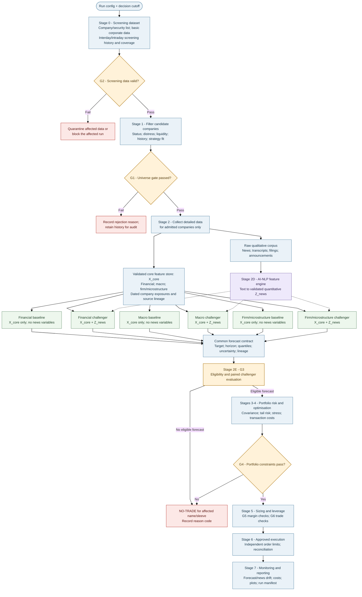
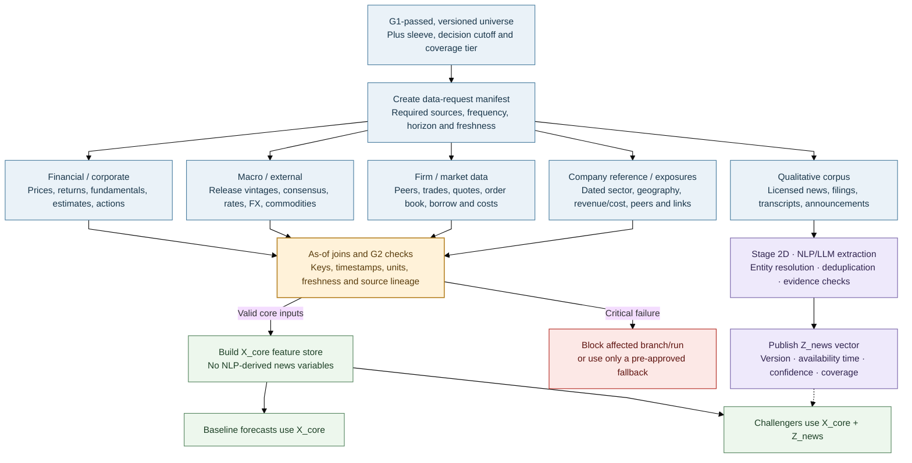
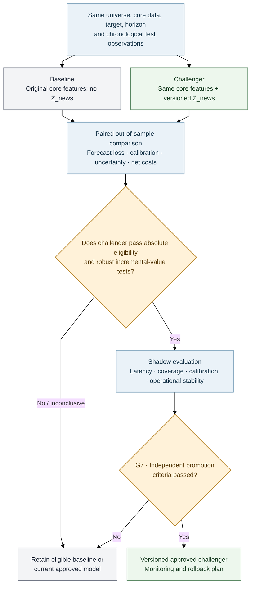

# AQP — Multi-Market Quantitative Investment Pipeline

**Architecture Version 14 · workflow realignment around filter-first data collection and paired news benchmarks**

> **Status:** Research and system-design specification, not evidence of profitability or production
> readiness. Model thresholds are provisional. Live use requires tested implementation, validated data and
> broker interfaces, approved risk limits, operational testing and explicit sign-off.
>
> **Math rendering:** Formulas use LaTeX Markdown (`$...$` for inline maths and `$$...$$` for display
> equations). Use a math-enabled Markdown preview if commands such as `\mathrm` display literally.

| Scope | Design |
|---|---|
| Markets | ASX and US equities |
| Sleeves | ASX interday, US interday, ASX intraday, US intraday |
| Forecast architecture | Financial, macroeconomic and firm/microstructure model families; a shared AI-NLP news feature engine creates quantitative covariates for matched news-augmented challengers |
| Main flow | Data → fixed research universe → forecasts → validation → risk/optimisation → leverage/pre-trade gates → execution → monitoring/reporting |
| Out of scope | Full source code, provider API instructions and production runbooks |

## Executive Summary

AQP is a **gated, multi-market research-to-execution pipeline**. Its job is to turn a broad company
candidate list and market information into validated forecasts, risk-constrained portfolio decisions,
and auditable run reports. It is a framework for research and controlled operation—not a single
prediction algorithm and not evidence that a strategy is profitable.

The operating order is deliberate:

1. **Build the screening dataset.** Load the candidate company/security list and only the point-in-time
   data needed to assess identity, listing status, basic financial condition, liquidity, historical-data
   availability and strategy suitability. Apply the same timing and data-quality rules used later in the
   pipeline.
2. **Filter and freeze the research universe.** Use the screening data to reject ineligible or unsuitable
   names, record reasons, and create a versioned universe. Do not run the full research-data or AI-NLP
   news pipeline across every initial candidate.
3. **Collect detailed analysis data for admitted names.** Expand financial/interday data, the required
   intraday data tier, firm and market-microstructure inputs, relevant macroeconomic series and the raw
   qualitative news corpus. Keep timestamps, data vintages, coverage and source lineage. The detailed
   data request is driven by the fixed universe, sleeve and coverage tier.
4. **Build two matched forecasting arms.** Financial, macroeconomic and firm/microstructure model
   families each have a no-news baseline that uses the common core features and a challenger that adds
   a versioned quantitative news vector, $Z^{news}_{i,t,h}$. That vector is produced by converting
   timestamped text into validated numerical variables; it is an input to the three model families, not a
   fourth stand-alone return-model family.
5. **Test the added value of news before choosing a model.** Compare baseline and challenger on matched
   out-of-sample observations with the same universe, target, horizon, folds, model family, tuning budget
   and transaction-cost assumptions. A news challenger is preferred only when its incremental value is
   robust, calibrated and economically useful after costs. If it is not, retain the eligible baseline or
   current approved model.
6. **Pass eligible forecasts through the same risk and operating controls.** Forecasts feed portfolio
   construction, leverage and margin checks, pre-trade eligibility, controlled execution and monitoring.
   Model outputs never override a hard limit, data-integrity gate, reconciliation rule or kill switch.

This structure limits unnecessary data acquisition, keeps the benchmark interpretable, and separates
feature engineering from model evaluation. “News as an exogenous variable” means that NLP-derived news
features are external inputs relative to the no-news feature set; it does **not** prove causal exogeneity.
Every stage remains subject to point-in-time controls, tests, documented fallbacks and approval before
live use. If a required gate fails and no pre-approved safe fallback applies, the affected branch or run
is blocked and the decision is recorded with a reason code.

### Terminology convention

G1–G7 and the **Company Reference and Exposure Dataset** are AQP-specific architecture labels. Numerical
thresholds are provisional research settings unless explicitly approved; they are not universal industry
or regulatory standards.

## Stage document map

Read the design first, then implement the stages in order. All Stage 2 components (2A–2E) now live in a single document so the common data contract, model families, AI News feature engine and paired benchmark can be reviewed together.

| Order | File | Scope |
|---:|---|---|
| 1 | [Stage 0 — Screening data and point-in-time foundation](01_STAGE_0_SCREENING_DATA_AND_POINT_IN_TIME_FOUNDATION.md) | Candidate list, minimum screening data, timestamp integrity and G2. |
| 2 | [Stage 1 — Universe selection and classification](02_STAGE_1_UNIVERSE_SELECTION_AND_CLASSIFICATION.md) | Eligibility filters, fixed universe formation, scoring and coverage tiers. |
| 3 | [Stage 2 — Data, forecasting, AI News and paired validation](03_STAGE_2_DATA_EXPANSION_AND_COMMON_FORECAST_SCHEMA.md) | Detailed data, common schema, Stage 2A–2E model and validation subsections. |
| 4 | [Stages 3–4 — Portfolio risk, optimisation and sleeve allocation](04_STAGES_3_4_PORTFOLIO_RISK_OPTIMISATION_AND_SLEEVES.md) | Risk estimation, stress tests, constrained optimisation and allocation. |
| 5 | [Stage 5 — Leverage, sizing and position report](05_STAGE_5_LEVERAGE_SIZING_AND_POSITION_REPORT.md) | Exposure scaling, margin, trade decisions and auditable position reports. |
| 6 | [Stages 6–7 — Execution, safety, monitoring and learning](06_STAGES_6_7_EXECUTION_SAFETY_MONITORING_AND_LEARNING.md) | Order controls, reconciliation, monitoring, shadow evaluation and lifecycle. |
| 7 | [Notation, glossary and open decisions](07_NOTATION_GLOSSARY_AND_OPEN_DECISIONS.md) | Shared notation, abbreviations and implementation decisions still to settle. |
| 8 | [Operating contract and run outputs](08_OPERATING_CONTRACT_AND_RUN_OUTPUTS.md) | Run manifest, lineage, model evaluation records and terminal statuses. |
| 9 | [Implementation roadmap and readiness gates](09_IMPLEMENTATION_ROADMAP_AND_READINESS_GATES.md) | Implementation order and acceptance criteria for each build phase. |
| 10 | [Selected technical references](10_SELECTED_TECHNICAL_REFERENCES.md) | External method and terminology references cited by the overview. |

---

## 1. Pipeline at a Glance

Use this as the system map. The linked stage files in the README provide the detailed process and stage hand-offs.

### 1A. Core operating pipeline

The first data pull is for screening. Detailed research data and full news processing begin only after
G1 has created the fixed, versioned universe.

### 1B. Post-filter data collection and feature assembly

### 1C. Matched benchmark and promotion path

The detailed statistical protocol is in Stage 2E. This diagram shows the decision sequence for each
model family, target, horizon and sleeve.

### How to read the diagrams

Solid arrows show normal data/control flow. Dotted arrows show that $Z^{news}$ is added to challenger
models only; they do not assert a causal effect. G1–G7 are project-defined gates. The initial screening
pull is deliberately smaller than the post-filter research-data pull. A rejected company does not proceed
to full feature construction, except for records required for audit or historical research integrity.

A challenger is never promoted on fit or one favourable metric alone. Stage 2E defines paired evaluation;
Stage 7 defines ongoing monitoring, rollback and controlled model changes.

### Sleeves

| Sleeve | Market / currency | Key concern |
|---|---|---|
| ASX interday | ASX / AUD | Closing-auction execution and limited short borrow |
| US interday | US / USD | FX exposure and overnight gap risk |
| ASX intraday | ASX / AUD | Spread, tick size and available depth |
| US intraday | US / USD | Execution costs and competition for short-horizon signals |

Portfolio sleeves (separately governed sub-portfolios) share infrastructure but keep separate calendars,
cost assumptions, data depth and risk budgets.

| Model family / feature engine | Interday role | Intraday role |
|---|---|---|
| Financial | Return distributions, volatility, distress and factor exposures; baseline and matched news-augmented variant | Volatility, distress and only validated short-horizon effects; baseline and matched augmented variant |
| Macro | Regimes, geographic exposure and shock transmission; news aggregates where relevant | Scheduled-release risk and latency-aware news features where validated |
| Firm / microstructure | Firm economics, peer relationships and firm/sector-linked news features | Order flow, spread, intensity, impact and latency-sensitive event features |
| AI-NLP news feature engine (shared input, not a fourth return-model family) | Multi-day event probabilities, novelty, severity, surprise and persistence/decay features | Fast-decaying event features with strict publication/processing-latency checks |

---

## 2. Design Principles and Gates

| Principle | Implementation |
|---|---|
| Point-in-time | Input availability timestamp must be no later than decision time. Filtered states only; smoothing is for retrospective analysis. |
| Filter before deep retrieval | Stage 0 collects screen-level data; Stage 2 retrieves detailed research data only for G1-admitted names and relevant macro/relationship scope. |
| Isolate the news experiment | The registered baseline/challenger pair differs only by NLP-derived $Z^{news}$ inputs. Keep downstream rules and costs identical; test any separate news overlay as its own experiment. |
| Common forecast format | Each forecast-producing model produces a predictive distribution and lineage metadata; the news engine publishes covariates, not an assumed fourth return forecast. |
| Validate before weighting | Fit success is not proof of out-of-sample skill or economic value. |
| Conservative, validated risk estimates | Use the most conservative risk estimate that passes its own backtests. |
| Default no-trade | Trade only when required checks pass and expected benefit exceeds expected cost. |
| Separate sizing and leverage | Optimiser chooses relative weights; a separate rule controls total exposure. |
| Charge for search | Record trials and account for multiple testing and backtest overfitting. |
| Fixed, versioned universe | Formation runs once per version; only specified mandatory removal rules may remove names. |

| Gate | Pass condition | Failure action |
|---|---|---|
| **G1 Universe gate (project-defined)** | Formation filters pass; existing members meet safety rules | Reject at formation or log a safety exit |
| **G2 Data-integrity gate (project-defined)** | No look-ahead, schema, unit, timezone or freshness breach | Quarantine affected name or block affected branch/run |
| **G3 Model-eligibility gate (project-defined)** | Each candidate has stable, calibrated, out-of-sample skill and net-of-cost evidence; a news challenger must also pass the registered paired incremental-value test | Exclude the failing candidate; retain an eligible baseline if its challenger fails; no eligible candidate means no-trade |
| **G4 Portfolio-risk gate (project-defined)** | Volatility, expected shortfall, concentration, liquidity and stress limits pass | Re-optimise within approved relaxations or scale toward cash |
| **G5 Leverage/margin gate (project-defined)** | Exposure, financing and stressed margin stay within approved limits | Reduce gross exposure or block new risk |
| **G6 Final trade-eligibility gate (project-defined)** | Data, model, risk, liquidity, market-state and kill-switch checks pass | Block the order; risk-reducing actions only if policy permits |
| **G7 Model-promotion gate (project-defined)** | Challenger passes independent validation and shadow period | Keep the current approved model |

**Run status (project-defined labels):** `PASS` means checks passed; `DEGRADED` means an approved
fallback is active; `BLOCKED` means a critical check failed. These are internal operational statuses,
not exchange or regulatory classifications. Every failure receives a machine-readable reason code. If no
approved fallback exists, stop the affected run/sleeve.

---

---

## Navigate this documentation

**Start here:** This is the system-level overview.  
**Next →:** [Stage 0 — Screening Data and Point-in-Time Foundation](01_STAGE_0_SCREENING_DATA_AND_POINT_IN_TIME_FOUNDATION.md)  
**Quick links:** [Overall design](00_AQP_OVERALL_DESIGN.md) · [Document index](README.md) · [Glossary and open decisions](07_NOTATION_GLOSSARY_AND_OPEN_DECISIONS.md)
