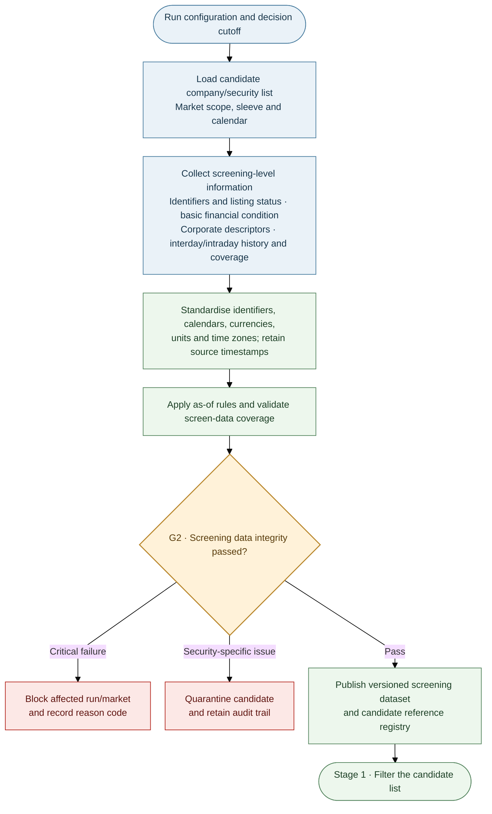

# Stage 0 — Screening Data and Point-in-Time Foundation

> **AQP Architecture Version 14** · [Document index](README.md) · [Overall design](00_AQP_OVERALL_DESIGN.md)

**In scope:** Candidate list, minimum screening data, timestamp integrity and G2.

---

**Purpose:** Prepare the candidate company/security list and the minimum reliable dataset needed to make
the universe decision. Stage 0 is not the full research-data download. Detailed financial, macro, firm-level
and news data are expanded only after Stage 1 has frozen the admitted universe.

## Screening scope versus full data scope

Stage 0 may use daily/interday history, summary liquidity measures, basic financial statements or ratios,
company descriptions, sector/industry classifications, listing and corporate-action records, and coverage
metadata for intraday data. These fields must be available as of the formation date. Intraday availability
can be checked or sampled for suitability without downloading the full high-frequency history for every
candidate.

Do **not** build full NLP news sentiment/event features at this stage. Stage 0 may record whether a source
or history exists, but the quantitative news vector is produced in Stage 2D only for the filtered research
universe. This keeps costly extraction and feature construction downstream of the universe decision.

## Data timing and integrity

Every datum used at any stage must preserve **valid time** (the period described) and **availability time**
(when the system could first have used it). An as-of query at decision time `t` may use only versions with
availability timestamp `a ≤ t`; later revisions create new vintages instead of overwriting history.
These rules apply both to Stage 0 screening inputs and to all detailed sources retrieved after Stage 1.

| Source | Timing rule |
|---|---|
| Daily/interday prices and quotes | Bar end or session close plus publication lag; include later-delisted names in historical tests |
| Intraday trades/quotes | Exchange timestamp, receipt/first-seen time where available, session calendar and processing latency |
| Fundamentals and guidance | Actual announcement/publication timestamp; conservative fallback if unavailable |
| Estimates and consensus | First-observed timestamp and subsequent revisions |
| Macro data | Official release timestamp and each historical vintage |
| News (Stage 2 collection) | Publication time **and** first-seen/processing time |
| Index membership | Announcement date, not only effective date |
| Borrow and margin | Observation timestamp and provider freshness |

Preserve raw prices. Apply adjustment factors for splits, rights and dividends on read; level filters use the
unadjusted price available at the time. Halted, suspended and zero-volume names are not tradable.

| G2 severity | Examples | Action |
|---|---|---|
| Block | Look-ahead, schema/type mismatch, invalid units/time zone, duplicate keys or corrupted timestamps | Stop the affected branch/run |
| Quarantine | Stale/incomplete history, unexplained extreme return, unreconciled corporate action | Exclude the affected name for this run |
| Warn | Repeated closes, revision bursts or non-critical coverage gaps | Record warning; do not silently suppress it |

**Stage 0 output:** a versioned candidate registry, screening snapshot, market/calendar context, coverage
inventory and G2 evidence. It is not yet the full Company Reference and Exposure Dataset or the model feature
store; those are completed for admitted names in Stage 2.

---

---

**Related documents:** [Overall design](00_AQP_OVERALL_DESIGN.md) · [Stage 1 — Universe selection and classification](02_STAGE_1_UNIVERSE_SELECTION_AND_CLASSIFICATION.md) · [Stage 2 — Data, forecasting, AI News and paired validation](03_STAGE_2_DATA_EXPANSION_AND_COMMON_FORECAST_SCHEMA.md)
