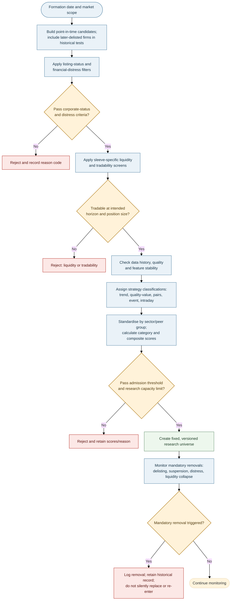

# Stage 1 — Universe Selection and Strategy Classification

> **AQP Architecture Version 14** · [Document index](README.md) · [Overall design](00_AQP_OVERALL_DESIGN.md)

**In scope:** Eligibility filters, fixed universe formation, scoring and coverage tiers.

---

**Purpose:** Select companies suitable for deeper research-data collection, not forecast returns. Use the
Stage 0 screening dataset and fields available at the formation cutoff. Historical formation must include
later-delisted companies to avoid survivorship bias.

## Eligibility filters and composite score

The order is: **corporate eligibility/distress risk → liquidity/tradability → data depth and stability →
strategy classification → category score → admission**. Rejection reasons are recorded (for example
`DIST`, `LIQ`, `HIST`, `DATA`). Banks and insurers require sector-appropriate capital/funding metrics
rather than generic debt/EBITDA rules.

The screen may consider whether a usable source or event history is available; it must not use the
post-filter NLP news score as an admission criterion. After G1, the data-coverage tier controls how deeply
the surviving name is researched, not an unrecorded change to the fixed universe membership.

| Category | Example measures |
|---|---|
| Financial distress and corporate status | Screening-level distress/default score based on available point-in-time statements and market data, distance-to-default proxy, interest cover, debt maturities and cash runway where available; full Stage 2A distress model is assessed after admission |
| Liquidity | Median daily dollar value traded, Amihud illiquidity, screening-level bid–ask spread and zero-volume ratio; depth proxy where available. Full order-book/depth retrieval is tiered after G1. |
| Stability | Structural-break tests for market beta, volatility-model performance and usable history |
| Business/market suitability | Profitability/cash conversion, valuation, trend, peer relationships and availability of event-source coverage |
| Operational/data coverage | Identifier quality, corporate-action history, borrow-data availability and intraday-quote coverage |

Metrics are robustly standardised within sector/peer group, direction-aligned and combined first within
categories, then across categories. Here MAD is median absolute deviation, Φ is the standard normal
cumulative distribution function, and $d_j$ is +1 when higher values are preferable or −1 when lower
values are preferable:

$$
z_{ij}=\frac{x_{ij}-\operatorname{median}_{s(i)}(x_j)}
{1.4826\,\operatorname{MAD}_{s(i)}(x_j)},\qquad
C_{ik}=\sum_{j\in k}\omega_{jk}\Phi(d_jz_{ij}),\qquad
S_i=100\sum_k w_k C_{ik},\qquad \sum_{j\in k}\omega_{jk}=1,\quad \sum_k w_k=1.
$$

A company is admitted only if it passes all hard gates and clears the configured formation
threshold/capacity for that sleeve. Scores and membership remain fixed for that universe version.

| Strategy classification | Typical characteristics |
|---|---|
| Momentum/trend | Persistent 12–1 momentum (trailing 12-month return excluding the most recent month), adequate liquidity, manageable idiosyncratic noise |
| Quality-value | Profitability, cash conversion, low accruals and sector-relative valuation |
| Mean-reversion/pairs | Stable peer relationship and spread half-life; borrow/costs permit trading |
| Event-driven | Screen-level event-source/history availability; detailed announcement-response estimates are measured after admission |
| Intraday liquid large-cap | Tight spreads, depth, activity and potentially forecastable short-horizon volatility |

## Fixed membership and mandatory removals

No score-based removal, replacement or re-entry is allowed within a universe version. A deliberate
re-formation creates a new version and requires validation.

| Exit code | Trigger |
|---|---|
| `EXIT-DIST` | Distress probability exceeds approved threshold or insolvency event |
| `EXIT-DLST` / `EXIT-SUSP` | Delisting or suspension beyond policy tolerance |
| `EXIT-TKO` | Approved takeover/scheme changes the security's status |
| `EXIT-LIQ` | Liquidity remains below the formation floor for the configured period |

Exited names stay in historical data and attribution. Positions are closed through normal execution
controls.

## Data-coverage tiers

| Tier | Typical allocation | Data use |
|---|---|---|
| T1 | Top ~40 per market | Trades/quotes for intraday and realised measures |
| T2 | Next ~120 | One-minute bars for intraday volatility/costs |
| T3 | Remaining names | Daily data; tick data selectively around events |

Sizes are budget examples, not fixed requirements. Allocate detailed data depth by analytical need, storage,
provider cost and expected signal value. Record the tier in the universe/run manifest; tiering governs the
Stage 2 data request and does not silently replace or re-rank members of the frozen universe.

---

---

**Related documents:** [Overall design](00_AQP_OVERALL_DESIGN.md) · [Stage 0 — Screening data and point-in-time foundation](01_STAGE_0_SCREENING_DATA_AND_POINT_IN_TIME_FOUNDATION.md) · [Stage 2 — Data, forecasting, AI News and paired validation](03_STAGE_2_DATA_EXPANSION_AND_COMMON_FORECAST_SCHEMA.md)
