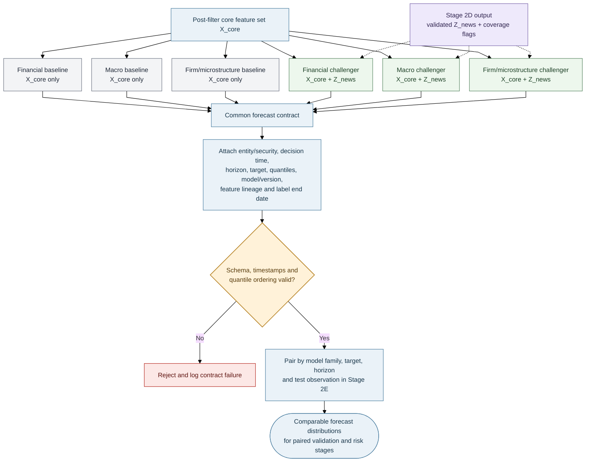
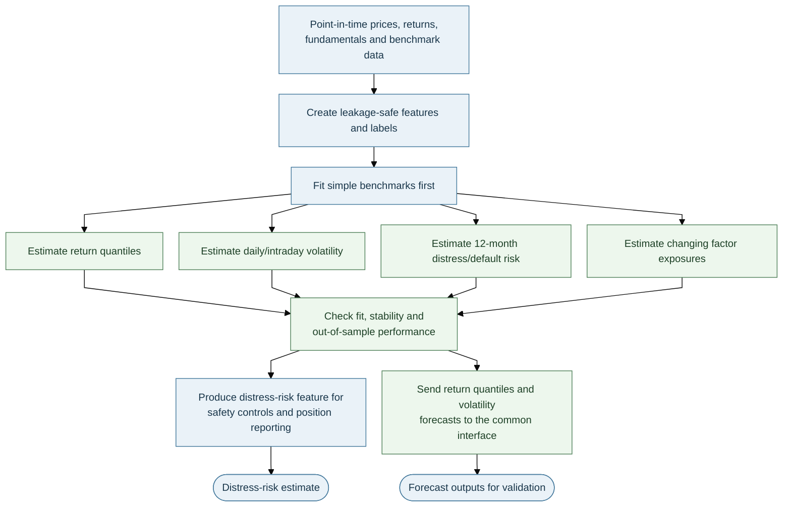
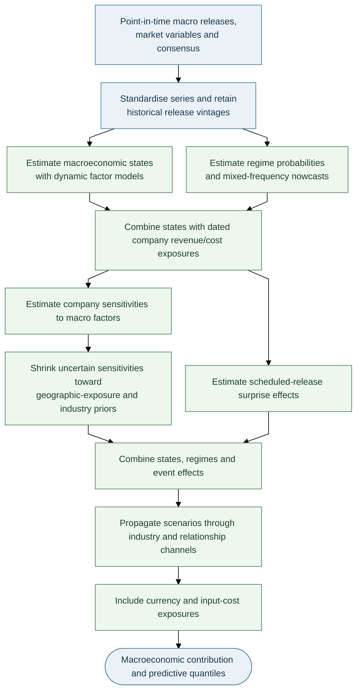
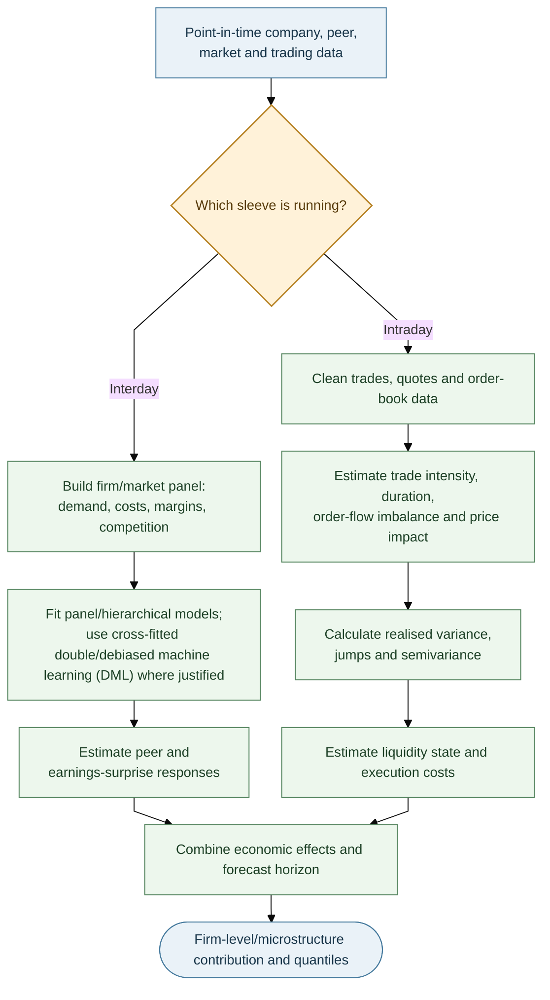
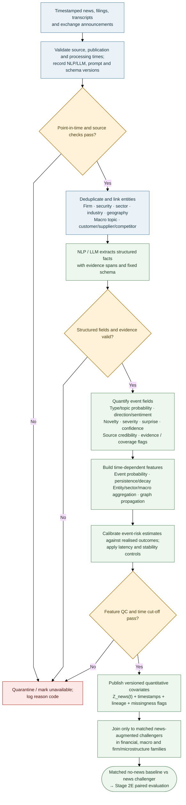
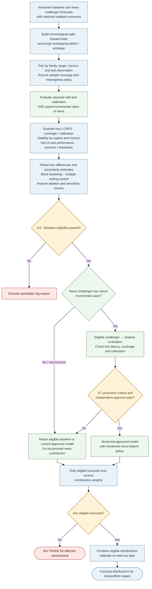

# Stage 2 — Data Expansion, Forecasting, AI News and Paired Validation

> **AQP Architecture Version 14** · [Document index](README.md) · [Overall design](00_AQP_OVERALL_DESIGN.md)

**In scope:** Post-filter data acquisition, shared core features and forecast schema, financial/macro/firm model families, NLP-derived AI News features, and paired validation of no-news baselines against news-augmented challengers.

---

**Purpose:** Once G1 has frozen the universe, retrieve the detailed inputs needed to model only the admitted
names and relevant macro/market relationships. Validate and join the non-news inputs into a common core
feature set, process the qualitative corpus through Stage 2D, and provide a standard forecast contract for
both baseline and news-augmented model arms.

## Stage 2 contents

1. [Detailed data collection after filtering](#21-detailed-data-collection-after-filtering)
2. [Build the shared core feature set](#22-build-the-shared-core-feature-set)
3. [Common forecast contract](#23-common-forecast-contract)
4. [Stage 2A: Financial forecast and distress model](#24-stage-2a-financial-forecast-and-distress-model)
5. [Stage 2B: Macroeconomic exposure and regime model](#25-stage-2b-macroeconomic-exposure-and-regime-model)
6. [Stage 2C: Firm fundamentals and market microstructure](#26-stage-2c-firm-fundamentals-and-market-microstructure)
7. [Stage 2D: AI News feature engineering and quantification](#27-stage-2d-ai-news-feature-engineering-and-quantification)
8. [Stage 2E: Validation, eligibility and signal combination](#28-stage-2e-validation-eligibility-and-signal-combination)

The five model/validation subsections are kept in this document so that the complete Stage 2 hand-off can be reviewed in one place. They remain distinct research responsibilities, but are not separate Markdown files.

## 2.1 Detailed data collection after filtering

The Stage 2 request is generated from the **universe version + sleeve + decision cutoff + coverage tier**.
Do not retrieve full target-security histories or run full NLP feature construction for rejected candidates,
except where existing positions, historical retention or audit rules require it. A non-admitted supplier,
customer, competitor or shared-input entity may still be used as a context node: retrieve only the linked data
needed to analyse an admitted company, record the relationship and scope, and never silently add that entity
to the research universe.

| Data stream | Detailed data collected after G1 | Main use |
|---|---|---|
| Financial and corporate | Interday prices/returns, required historical depth, intraday bars as tiered, fundamentals, dated statements, estimates, guidance, corporate actions and benchmark series | Return distributions, volatility, distress, factor exposures and financial controls |
| Macroeconomic and external | Point-in-time releases/vintages, consensus, rates, FX, commodities and other relevant indicators for markets/economies linked to the admitted universe | Macro states, regime probabilities, nowcasts, company exposures and shock scenarios |
| Firm and microstructure | Peer panels, demand/input-cost/margin data, supplier/customer/competitor links, trades, quotes, order book, volume, borrow availability and execution-cost inputs | Firm economics, peer relationships, order flow, price impact, liquidity and execution estimates |
| Qualitative source corpus | Licensed news, exchange announcements, filings, transcripts and other timestamped text tied to admitted firms/securities and relevant counterparties, sectors or economies | Raw input to Stage 2D; the text is not directly added to the baseline feature set |
| Company reference and exposure data | Dated geography revenue/cost shares, company/industry/product classifications, peer groups, relationship graph and membership history | Macro transmission, entity linking, exposure-aware features, stress and attribution |

The macro stream is not limited to company-specific rows: select the economies, release calendars and market
series relevant to the admitted universe, its dated geographic exposures and the active sleeve. Likewise,
relationship-based news retrieval may include relevant suppliers, customers, competitors or shared inputs, but
must follow the dated relationship map and a documented retrieval scope. Company Reference and Exposure data
is fully assembled here: keep dated revenue and cost shares separate; version geography and industry/product
classifications; maintain peer groups, the entity relationship graph and membership history. These features
support macro transmission, entity linking, stress testing and attribution.

## 2.2 Build the shared core feature set

Detailed source data pass through G2 checks before modelling. Use a common join key (security/entity, event or
series identifier), decision timestamp, frequency/horizon, units/currency and availability rule. Preserve source
lineage and missingness rather than silently filling unknown values.

| Collection step | Required action | Output |
|---|---|---|
| 1. Freeze the request | Record universe version, decision cutoff, sleeve, required horizon, sources and coverage tier | Reproducible data-request manifest |
| 2. Retrieve detailed inputs | Fetch only the required series/frequency/depth for admitted names and relevant exposures | Raw, timestamped source records |
| 3. Validate and harmonise | Apply as-of joins, schema/unit/timezone checks, corporate-action handling, freshness checks and G2 reason codes | Validated point-in-time source tables |
| 4. Build non-news features | Construct financial, macro, firm and microstructure covariates without NLP-derived news variables | Shared core feature set $X^{core}_{i,t,h}$ |
| 5. Process qualitative text | Route eligible timestamped text to Stage 2D and publish quality/coverage metadata | Versioned $Z^{news}_{i,t,h}$ plus lineage |
| 6. Build matched arms | Join $X^{core}$ to both variants; join $Z^{news}$ to the challenger only | Comparable baseline/challenger forecasts |

**Define the experimental difference precisely:** “no-news” means no features produced by the Stage 2D
NLP/LLM pipeline. The baseline may still use structured numerical information—such as reported revenue,
earnings, estimates or official macro releases—when those values are part of the ordinary core feed and were
available by the decision cutoff. Removing those ordinary data as well would change more than the news-feature
treatment.

**Missing data policy:** critical core-data or timestamp failures block the affected branch/run. Non-critical
fallbacks are permitted only when pre-specified, tested and logged. If news is absent or fails QC, do not
replace it with zero. The challenger is unavailable for the affected observation unless an approved missingness
strategy applies; the baseline can continue only under the registered sample and operating policy. Report news
coverage so missing sources cannot improve challenger results by silently shrinking the test sample.

## 2.3 Common forecast contract

All forecast-producing models use the same output schema so their predictive distributions can be compared,
calibrated, combined and passed into risk calculations. The feature sets differ by experiment arm; the output
contract does not.

For security $i$, decision time $t$ and horizon $h$, emit quantiles on a shared grid:

$$
\mathcal T=\{0.01,0.025,0.05,0.10,0.25,0.50,0.75,0.90,0.95,0.975,0.99\}.
$$

The benchmark-relative excess-return target spans the selected forecast horizon, beginning after the
 decision point:

$$
y^{(h)}_{i,t}=\sum_{s=2}^{h+1}(r_{i,t+s}-r_{b,t+s}).
$$

Each forecast includes security/entity, decision timestamp, horizon, target definition, quantile values,
model/version, training window, feature version, data lineage and label end date. Reject invalid timestamps,
schema or crossing quantiles; record the label end date for purging.

Use mean quantile pinball loss as the primary quantile score; also track interval coverage, sharpness and the
probability integral transform (PIT). More elaborate models are not admitted solely because they fit in sample.

---

## 2.4 Stage 2A: Financial Forecast and Distress Model

**Focus:** Return distributions, volatility, distress/default risk and financial baselines.

**Purpose:** Estimate return distributions, volatility, distress and changing factor exposures from the detailed
financial data retrieved after G1. Stage 2E—not this model family—decides model eligibility.

**Paired variants:** Fit a no-news baseline on $X^{core}$ and a matched challenger on the same core data plus
as-of $Z^{news}$. Keep the target, fold boundaries and tuning budget aligned; evaluate return, volatility and
distress endpoints separately where relevant. Stage 2E defines the shared paired protocol.

| Task | Candidate methods | Baseline / control |
|---|---|---|
| Return quantiles | Elastic net, quantile regression, gradient boosting (LightGBM/XGBoost), quantile random forest | Zero excess return, rolling mean and factor model |
| Distress | Discrete-time firm-year hazard model | Compare with simple threshold/logistic baseline |
| Daily volatility | Glosten–Jagannathan–Runkle GARCH (GJR-GARCH) or exponential GARCH (EGARCH), with Student-t innovations | exponentially weighted moving average (EWMA) variance |
| Intraday realised volatility | Heterogeneous Autoregressive model of Realised Volatility (HAR-RV), with realised variance and jump measures | Daily-only volatility baseline |
| Dynamic exposures | Filtered state-space/Kalman model | Static rolling beta |

**Distress hazard:**

$$
P(\text{default in }(t,t+1]\mid x_{i,t})=\Lambda(\alpha(t)+\beta^\top x_{i,t}),
$$

with distance to default, profitability, leverage, cash runway, returns and volatility as inputs. Use
the output for distress-risk gates, optimiser penalties and position reporting.

**Glosten–Jagannathan–Runkle GARCH (GJR-GARCH):**

$$
r_t=\sigma_tz_t,\qquad \sigma_t^2=\omega+(\alpha+\gamma\mathbf1\{r_{t-1}<0\})r_{t-1}^2+\beta\sigma_{t-1}^2.
$$

Student-t innovations capture fat tails; `γ` captures asymmetric volatility response. For intraday data,
the HAR-RV uses daily, weekly and monthly realised-variance averages, optionally with a jump component.
Filter changing factor exposures using data available up to `t`; never use smoothed future-informed
estimates for live signals.

**Feature groups:** earnings revisions/surprises, profitability and cash conversion, accruals, margins,
investment and asset growth, leverage, valuation, momentum/reversal, idiosyncratic volatility and
distress. Standardise features inside each training fold.

---

## 2.5 Stage 2B: Macroeconomic Exposure and Regime Model

**Focus:** Macro factors, economic states, shock transmission and dated firm exposures.

**Purpose:** Combine economy-level states with each admitted firm's dated revenue/cost exposures and estimated
sensitivities, using macro releases and other detailed data retrieved after G1.

**Paired variants:** Preserve the original macro specification as the baseline. Its matched challenger may add
as-of news aggregates by macro topic, country, sector or exposed firm. Do not relabel news-derived features as
official macro releases or causal shocks.

| Component | Method / output |
|---|---|
| Economy states | Dynamic factor model for activity, inflation, rates, labour, credit and financial conditions; use the Kalman filter for ragged-edge releases |
| Regimes | Markov-switching model with filtered probabilities for expansion, slowdown and stress |
| Nowcasts | Mixed-data sampling (MIDAS) regression for mixed-frequency targets such as GDP; Bayesian vector autoregression (BVAR) as a challenger |
| Company exposure | Retain dated revenue-share and cost-share exposures separately; do not collapse them into one score. |
| Sensitivities | Estimate firm responses to macro factors; shrink noisy coefficients toward geographic-exposure and industry priors |
| Scheduled events | Standardised actual-minus-consensus surprise, with release-time volatility controls for intraday sleeves |
| Transmission/stress | Local projections and the shared relationship graph to convert macro scenarios into firm shocks |
| FX | Explicit revenue/cost currency exposure and portfolio-level USD translation exposure |

For economy $c$, calculate revenue and cost exposure separately:

$$
f^{rev}_{i,t}=\sum_c e^{rev}_{i,c}f_{c,t}, \qquad f^{cost}_{i,t}=\sum_c e^{cost}_{i,c}f_{c,t}.
$$

The weights are dated revenue and cost shares. Preserve coverage flags; do not silently treat unknown
exposures as zero.

Shrink noisy firm sensitivities toward prior estimates:

$$
\hat b^{post}_{ij}=\lambda_{ij}\hat b^{OLS}_{ij}+(1-\lambda_{ij})b^{prior}_{ij},\qquad
\lambda_{ij}=\frac{\tau_j^2}{\tau_j^2+\mathrm{se}(\hat b_{ij})^2}.
$$

Standardised release surprise:
$S_{c,t}=(\mathrm{actual}-\mathrm{consensus})/\mathrm{sd}(\mathrm{surprise})$. Estimate horizon-specific
shock responses with local projections; include industry, geographic exposure, input-cost and FX
channels. Use filtered, point-in-time states only.

---

## 2.6 Stage 2C: Firm Fundamentals and Market Microstructure

**Focus:** Firm/peer economics, order flow, realised measures and market impact.

Interday models describe firm fundamentals, industry conditions and peer effects. Intraday models
describe price formation, order flow and execution.

**News integration:** Retain each firm/market model without news as its baseline. The matched challenger
may add entity-linked news variables for the firm, sector, customer, supplier, competitor or shared
input, using the dated relationship graph and coverage flags. For intraday models, apply strict
availability/processing-latency cut-offs; a feature generated after the decision time is unavailable
even if its article publication time is earlier.

| Branch | Main methods and features | Output |
|---|---|---|
| Interday | Firm/market panel and hierarchical models; demand, input costs, prices, margins, market share and competitive intensity; cross-fitted double/debiased machine learning (DML) only where justified | Peer/earnings response and firm-level micro contribution |
| Intraday | Trade/quote cleaning; trade intensity and durations; order-flow imbalance; spread, depth and price impact | Short-horizon features, liquidity state and execution-cost estimates |

Two-way panel baseline:

$$
r_{it}=\alpha_i+\lambda_t+\beta^\top x_{it}+\epsilon_{it},
$$

with firm- and date-clustered uncertainty. Hierarchical estimates shrink low-history firms toward
industry- and peer-group estimates.

Realised measures from intraday data include realised variance, bipower variation, jumps, semivariance
and realised kernels. Use them only when quote/trade timestamps and market sessions are reliable;
otherwise fall back to validated daily estimates.

---

## 2.7 Stage 2D: AI News Feature Engineering and Quantification

**Focus:** NLP/LLM extraction and the timestamped quantitative news vector.

**Purpose:** Convert timestamped qualitative information into a versioned, auditable vector of
quantitative covariates that can be added to the financial, macroeconomic and firm/microstructure
models. The vector is denoted $Z^{news}_{i,t,h}$ when entity, decision time and horizon matter, and
$Z^{news}_t$ when those indices are implicit. News is a shared feature engine—not a fourth stand-alone
return-forecast family. It does not issue orders or independently declare a trade profitable.

“Exogenous” here means that the news variables are external inputs relative to the core feature set
being benchmarked. It does **not** establish causal exogeneity: news may react to prices, market
conditions and anticipated outcomes. Preserve timing and provenance, and test predictive value out of
sample.

### Processing and quantitative feature schema

1. **Validate timing and provenance:** retain publication and first-seen/processing times, source, extraction/prompt/model versions and the decision cut-off.
2. **Resolve entities and extract evidence:** deduplicate stories, map them to relevant firms, securities, sectors, geographies and macro topics, and preserve source spans or IDs.
3. **Build quantitative features:** use a fixed schema to quantify event type, direction, novelty, severity, credibility, calibrated probability and expected persistence/decay; retain uncertainty and coverage.
4. **Aggregate and publish:** use only point-in-time relationships, apply documented decay/latency rules and publish versioned $Z^{news}_t$ with lineage, quality and missingness flags. Retain licensed data according to source terms and access controls.

| Feature group | Examples | Intended use |
|---|---|---|
| Event semantics | Event type/topic probabilities, signed direction/sentiment, severity | Candidate predictive covariates in matched model variants |
| Surprise / novelty | Novelty versus prior disclosures, residual surprise, already-known/priced-in proxy | Separate new information from repeated or expected information |
| Reliability | Source credibility, extraction confidence, evidence coverage | Weighting, filtering, calibration and uncertainty reporting—not a guarantee of truth |
| Time dynamics | Publication-to-processing latency, event age, persistence/decay, event-window flags | Horizon-specific aggregation and intraday admissibility |
| Exposure / network | Firm, sector, country, customer/supplier/competitor and shared-input links | Propagate potentially relevant information using dated, versioned links |
| Calibrated event risk | Probability of a material event / abnormal move over a defined horizon | Optional quantitative covariate for forecasting and risk monitoring |

For a directed relationship from entity $j$ to entity $i$, a first-order propagated feature may be
proportional to $W_{ij}\delta_j z_j$, where $W_{ij}$ is the dated relationship weight and $\delta_j$ is
the horizon-specific decay. Check the graph for stability (for example, spectral radius below one for a
linear propagation system) and prevent duplicate stories from multiplying the same shock. The graph is a
modelling assumption to validate, not proof of transmission.

A calibrated logistic model may estimate the probability of a material abnormal-return event:

$$
P(|AR_{i,t,h}|>c\hat\sigma_{i,t}\mid z^{news}_{i,t})=\Lambda(\theta^\top z^{news}_{i,t}),
$$

where $AR_{i,t,h}$ is abnormal return over the pre-defined event horizon relative to a specified
benchmark, $\hat\sigma_{i,t}$ is point-in-time conditional volatility, and $c$ is a configurable
research threshold. This probability is a **feature**, not a separate return forecast or an order
instruction. Validate it with Brier/log loss, reliability curves and chronological out-of-sample tests.

### Missingness and leakage rules

- News features must pass publication-time **and** first-seen/processing-time checks. Freeze the NLP
  model, prompt, extraction schema and transformation choices during each evaluation period unless a
  version change is itself the declared experiment.
- Never backfill features using an article or correction that became available after the decision
  cut-off. Preserve revisions and model versions.
- Never silently replace unavailable or low-confidence news with zero. Mark the feature missing, log the
  reason and retain coverage flags.
- Keep the baseline evaluable over its full eligible sample. For the paired comparison, use common test
  observations or a missingness policy registered before testing; report both paired-sample results and
  sample coverage so missing-news cases cannot disappear unnoticed.
- Intraday news is admissible only if processing latency fits the decision schedule. Until a directional
  edge is demonstrated after costs, intraday event information may be used conservatively for
  risk/volatility awareness rather than assumed directional alpha.
- Quantitative news inputs may support forecasts and, under a separately documented policy, risk monitoring.
  During a paired benchmark, any news-based overlay must be identical across arms or evaluated separately.
  Only Stage 2E can grant model eligibility, and downstream independent risk/execution gates remain mandatory.

---

## 2.8 Stage 2E: Validation, Eligibility and Signal Combination

**Focus:** Matched no-news baselines, news challengers, eligibility and combination.

Validation occurs before a candidate model receives any combination weight. In addition to absolute
eligibility tests, every news-augmented model is tested as a matched challenger against its no-news
counterpart; the architecture does not assume news has incremental predictive or economic value.

### Matched no-news baseline versus news-augmented challenger

For each model family, target, horizon and sleeve, register two arms before inspecting test results:

- **Arm A — baseline:** the original core feature set, with no $Z^{news}_t$ inputs.
- **Arm B — challenger:** the same core feature set plus the versioned $Z^{news}_t$ vector.

Hold constant the universe version, decision timestamps, labels, forecast horizons, walk-forward folds,
model family, tuning budget, evaluation metrics, downstream portfolio/risk rules, execution policy and
transaction-cost assumptions. The intended difference is the addition of the NLP-derived news vector. A
news-based safety overlay must either be applied identically to both arms or assessed in a separately registered
experiment; otherwise its effect is confounded with the forecasting-variable test. Any other change is a
separate experiment. Compare forecasts on matched observations and report missing-news coverage separately.

Make the selection **per model family × target × horizon × sleeve**. The baseline and its challenger are
alternative versions of one model slot, not two independent ensemble members by default. If the challenger
fails to improve robustly, retain an eligible baseline; if it passes, it still requires shadow evaluation and G7
approval before promotion. Do not count both copies in the ensemble unless that combined design is separately
registered and justified.

### Validation protocol

- Use chronological walk-forward folds; train only on prior data.
- Purge training labels overlapping each test window and embargo at least the forecast horizon.
- Tune hyperparameters inside training folds; use outer test blocks once.
- Compare with relevant baselines and deduct realistic spread, commission, borrow and impact costs.
- For each news challenger, report paired differences in forecast loss and net-of-cost outcomes with
  uncertainty estimates; do not compare unmatched periods and attribute the difference to news.
- Apply ablation/sensitivity checks and account for all model, feature and prompt trials; do not select
  the best result from an unreported search.

| Test / metric | Question |
|---|---|
| Pinball loss / continuous ranked probability score (CRPS) and coverage | Is the predictive distribution accurate and calibrated? |
| Diebold–Mariano / Giacomini–White | Is forecast skill better, possibly conditional on regime? |
| Hansen Superior Predictive Ability (SPA) test / Model Confidence Set (MCS) | Do comparative forecast tests identify superior candidates or a statistically indistinguishable set of best models? |
| Deflated Sharpe Ratio (DSR) / Probability of Backtest Overfitting (PBO) | Could apparent trading performance be due to repeated trials/overfitting? |
| Stability and residual checks | Are parameter estimates, forecast errors and coefficient signs stable across folds? |

### G3 model-eligibility criteria (provisional)

| Criterion | Provisional research rule |
|---|---|
| Fit | Converged; acceptable diagnostics; no unexplained boundary estimates |
| Stability | Coefficients/signs reasonably stable across folds |
| Calibration | 90% interval coverage near target (e.g. within ±3 percentage points) |
| Skill | Out-of-sample improvement against suitable baseline/model set |
| Incremental news value (news challengers only) | Robust paired improvement over the matched no-news model, with uncertainty, coverage, ablation and multiple-testing controls |
| Economic value | Positive net-of-cost value; costs and turnover included; an improved statistical score alone is insufficient |
| Overfitting | Record all model, feature, prompt and parameter trials; apply PBO/DSR or comparable controls |

Thresholds must be calibrated per sleeve and approved; they are not universal constants. If the eligible
set is empty, output `NO-TRADE` for the affected name/sleeve.

### Combination and calibration

Candidate approaches include inverse-loss weights, stacking and regime-conditional weights. Use only the
selected eligible variant for each baseline/challenger pair unless a separately validated ensemble design says
otherwise; do not double-count near-duplicate variants from the same family. Shrink estimated weights toward
equal weights when evidence is weak. Quantile averaging:

$$
\hat q_\tau=\sum_kw_k\hat q_{k,\tau},\qquad w_k\ge0,\quad\sum_kw_k=1.
$$

Apply conformal calibration on held-out data and choose the horizon with the best net information ratio
after costs, capacity and portfolio constraints. Track signal decay and re-evaluate the sleeve
assignment if the estimated half-life changes materially.

---

## Stage 2 exit criteria

Stage 2 is complete only when the detailed-data request is reproducible; source data pass point-in-time, schema, timestamp, unit, freshness and lineage checks; baseline and challenger forecasts share the same contract; all paired experiments and model trials are registered; missing-news coverage is reported; and invalid forecasts cannot bypass validation. If no model is eligible for a name/sleeve, emit `NO-TRADE` with a reason code rather than manufacturing a forecast.

**Downstream hand-off:** eligible forecast distributions, model-selection evidence, feature/data lineage, coverage diagnostics and calibrated uncertainty pass to [Stages 3–4 — Portfolio Risk, Optimisation and Sleeve Allocation](04_STAGES_3_4_PORTFOLIO_RISK_OPTIMISATION_AND_SLEEVES.md).
