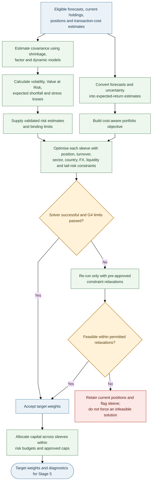

# Stages 3–4 — Risk, Optimisation and Sleeve Allocation

> **AQP Architecture Version 14** · [Document index](README.md) · [Overall design](00_AQP_OVERALL_DESIGN.md)

**In scope:** Risk estimation, stress tests, constrained optimisation and allocation.

---

The optimiser uses only risk estimates that passed their own checks. Liquidity and tail-risk limits are
not relaxed merely to produce a feasible solution.

## Risk estimation

| Method | Role |
|---|---|
| Ledoit–Wolf shrinkage | Stabilise sample covariance |
| Factor covariance | Explain market, sector, style, macroeconomic, geographic exposure and FX risks |
| Dynamic conditional correlation GARCH (DCC-GARCH) | Allow correlations to vary over time |
| Regime mixture | Blend calm/stress covariance using filtered regime probabilities |
| Filtered historical simulation / Monte Carlo / extreme-value theory (EVT) | Independent tail-risk views; use a risk estimate only if its backtest is acceptable |

$$
\mathrm{VaR}_\alpha=-\inf\{x:P(R_p\le x)>1-\alpha\},\qquad
\mathrm{ES}_\alpha=-E[R_p\mid R_p\le-\mathrm{VaR}_\alpha].
$$

Backtest value-at-risk (VaR) coverage and independence, and assess expected shortfall (ES) forecasts.
Demote an engine that fails. Cross-market covariance must account for asynchronous ASX and US sessions
via multi-day returns or lead–lag terms.

## Stress library

Include global crisis/recession/rate-shock history, China activity shocks, AUD moves, US overnight gaps,
liquidity drought (lower volume/wider spreads) and relationship-graph contagion. Apply shocks through
company-specific geographic revenue/cost exposures and sector exposures.

## Portfolio optimisation

Use Black–Litterman to blend equilibrium returns with confidence-weighted forecast views:

$$
\mu_{BL}=\left[(\tau\Sigma)^{-1}+P^\top\Omega^{-1}P\right]^{-1}
\left[(\tau\Sigma)^{-1}\pi+P^\top\Omega^{-1}q\right].
$$

Cost-aware objective:

$$
\max_w\ \mu_{BL}^\top w-\frac{\gamma}{2}w^\top\hat\Sigma w
-\sum_i(c_i|\Delta w_i|+\eta_i|\Delta w_i|^{3/2})
-\kappa\sum_i p_i^{dist}|w_i|.
$$

Constraints cover position and liquidity capacity, turnover, sector/country concentration, geographic
revenue/cost exposures, factor and foreign-exchange (FX) exposures, borrow availability, and
stress-loss/expected-shortfall limits. Check solver status and residuals. If infeasible, relax only
approved constraints (e.g. turnover, then sector, then tracking error); never relax liquidity or
tail-risk limits. If still infeasible, hold current positions and flag the sleeve.

**Provisional examples only:** volatility no more than 1.1× target; single name ≤8%; sector ≤30%; test
whether an exit within three trading days is feasible at a participation cap of 20% of average daily
volume (ADV). Configure and validate limits separately for each sleeve/instrument.

## Sleeve allocation

Allocate capital across sleeves by risk budget and out-of-sample evidence, with bounds and a hard cap on
intraday risk. Budget USD/FX exposure explicitly or hedge it. Do not allow intraday drawdown to consume
the risk budget allocated to interday positions without an explicit policy rule.

---

---

**Related documents:** [Stage 2 — Data, forecasting, AI News and paired validation](03_STAGE_2_DATA_EXPANSION_AND_COMMON_FORECAST_SCHEMA.md) · [Stage 5 — Leverage, sizing and position report](05_STAGE_5_LEVERAGE_SIZING_AND_POSITION_REPORT.md) · [Stages 6–7 — Execution, safety, monitoring and learning](06_STAGES_6_7_EXECUTION_SAFETY_MONITORING_AND_LEARNING.md)
