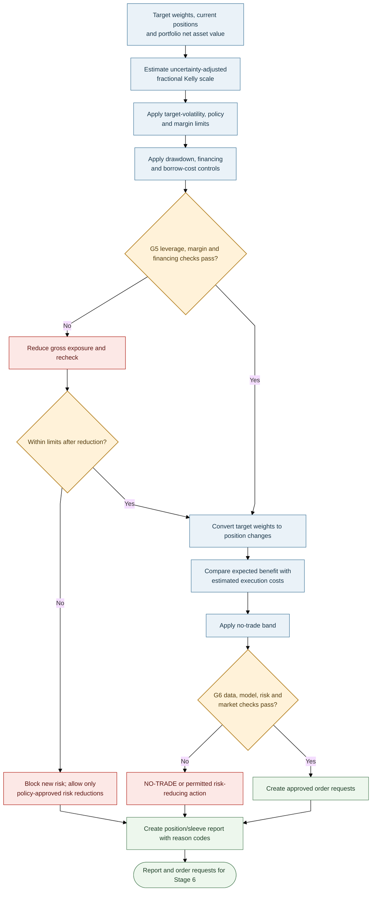

# Stage 5 — Leverage and Position Report

> **AQP Architecture Version 14** · [Document index](README.md) · [Overall design](00_AQP_OVERALL_DESIGN.md)

**In scope:** Exposure scaling, margin, trade decisions and auditable position reports.

---

Optimisation determines relative weights; this stage determines permitted total exposure and whether
each proposed trade should be submitted.

## Fractional Kelly and leverage rule

The classical Kelly rule relates expected excess return to return variance. Here, **fractional Kelly is
used only as a conservative portfolio-exposure scaling heuristic**; it is not a universal or regulatory
formula. Here, $\hat\mu_{BL,t}^{\mathrm{excess}}$ is the estimated excess return in the proposed
portfolio direction, and $\hat\sigma_{p,t}$ is the estimated volatility of those target weights before
leverage scaling. Keep forecasts, variances and drawdown inputs on consistent horizons and in consistent
units. The portfolio optimiser determines trade direction; this stage applies a non-negative exposure
cap.

First combine portfolio variance and uncertainty in the expected-return estimate:

$$
u_t = \hat\sigma_{p,t}^{2} + \widehat{\operatorname{Var}}\!\left(\hat\mu_{BL,t}^{\mathrm{excess}}\right).
$$

Then calculate the Kelly exposure cap. The fractional coefficient range is provisional and must be
validated:

$$
L_t^{\mathrm{Kelly}} = \max\!\left(0,\ c\frac{\hat\mu_{BL,t}^{\mathrm{excess}}}{u_t}\right), \qquad 0.25\le c\le0.5.
$$

Calculate the volatility-scaling cap:

$$
L_t^{\mathrm{vol}} = \frac{\sigma_{\mathrm{target}}}{\hat\sigma_{p,t}}.
$$

The leverage cap is the smallest permitted bound:

$$
L_t^{\mathrm{cap}} = \min\!\left(L_t^{\mathrm{vol}},\ L_t^{\mathrm{Kelly}},\ L_{\max},\ L_t^{\mathrm{margin}}\right).
$$

Apply the drawdown multiplier:

$$
d_t^{\mathrm{DD}} = \max\!\left(0,\ 1-\frac{DD_t}{DD_{\max}}\right), \qquad L_t = L_t^{\mathrm{cap}}d_t^{\mathrm{DD}}.
$$

**Plain-text reading:** estimate uncertainty-adjusted Kelly exposure; cap it by target volatility,
maximum leverage and margin capacity; then reduce it according to drawdown. Drawdown is expressed as a
positive fraction (for example, 0.10 for a 10% drawdown). If drawdown reaches the configured maximum,
the multiplier is zero. Missing, stale, non-finite or invalid inputs must trigger a safe fallback—not an
increase in permitted leverage. If estimated volatility or the maximum drawdown threshold is zero or
invalid, block new risk pending a valid configuration.

Overnight sizing must include gap risk; US positions held during Sydney night hours are a key case.
Financing, borrow costs and stressed margin headroom are included in expected net returns and G5.

## Trade decision and position report

Trade only if expected benefit over the chosen horizon exceeds spread, commission and market-impact cost
by the configured margin. Suppress changes within the no-trade band. Each position records invalidation
conditions (forecast reversal, tail-quantile breach, stress-regime change, material new information under the
pre-registered policy, or rising distress probability). For a baseline-versus-news experiment, downstream
news-based overlays must be identical across arms or assessed separately; otherwise the economic comparison
cannot isolate the forecasting value of $Z^{news}$.

Every report—trade or `NO-TRADE`—contains:

- Current/target weight, action and reason code.
- Median and interval forecasts, model-layer contributions and model agreement.
- Volatility, expected-shortfall contribution and main stress scenarios.
- Distress probability, geographic, sector, factor and FX exposures and expected costs.
- Gross/net exposure, leverage components, margin headroom, drawdown state and G5/G6 results.

---

## Navigate this documentation

**← Previous:** [Stages 3–4 — Risk, Optimisation and Sleeve Allocation](04_STAGES_3_4_PORTFOLIO_RISK_OPTIMISATION_AND_SLEEVES.md)  
**Next →:** [Stages 6–7 — Execution, Safety, Monitoring and Learning](06_STAGES_6_7_EXECUTION_SAFETY_MONITORING_AND_LEARNING.md)  
**Quick links:** [Overall design](00_AQP_OVERALL_DESIGN.md) · [Document index](README.md) · [Glossary and open decisions](07_NOTATION_GLOSSARY_AND_OPEN_DECISIONS.md)
