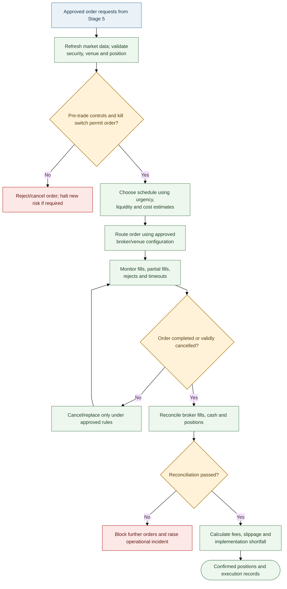
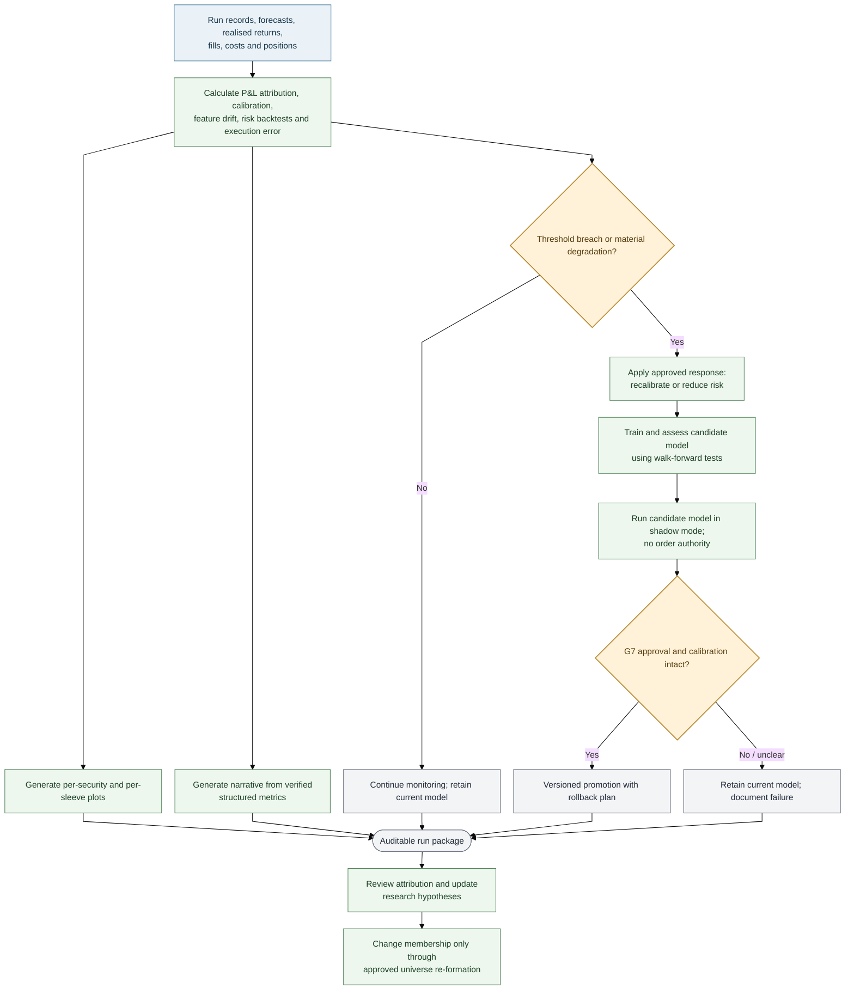

# Stages 6–7 — Execution, Hard Limits, Monitoring and Learning

> **AQP Architecture Version 14** · [Document index](README.md) · [Overall design](00_AQP_OVERALL_DESIGN.md)

**In scope:** Order controls, reconciliation, monitoring, shadow evaluation and lifecycle.

---

Execution uses approved order requests only. Hard limits are independent of forecast, optimisation and
monitoring models.

## Independent safety controls

Security, exposure, daily-loss, drawdown and market-state checks run independently of the forecast and
optimisation models. A breach blocks new risk and triggers the configured cancellation, risk-reduction
and incident-review policy. These controls cannot be bypassed by a model output.

## Hard limits and monitoring

| Control | Illustrative behaviour |
|---|---|
| Name/gross leverage/participation | Reject orders beyond approved limits |
| Kill switch | Cancel open orders and block new risk on breach, stale data or operational incident |
| Reconciliation | Block further orders if broker fills, cash or positions do not reconcile |
| Drawdown | Reduce risk according to the approved drawdown policy |
| Monitoring | Track P&L, forecast calibration, feature drift, risk backtests, execution error, slippage and data quality |

Illustrative alerts (calibrate per sleeve; these are not universal regulatory thresholds): 90% interval
coverage outside 87–93% for 20 sessions; alpha half-life more than 50% shorter than at admission; VaR
backtest p-value below 0.01; realised execution-cost error above 30%. Alerts trigger the configured
response, not automatic model promotion.

## Monitoring and controlled learning

A model may move through `candidate → G3 eligible → shadow mode → G7 approved production model →
retired`. Promotion requires independent review, a pre-agreed shadow period (e.g. at least 60 sessions),
intact calibration, evidence against the current approved model and a rollback path. A candidate model
never replaces the current approved model automatically.

Performance attribution should separate selection, forecasting, portfolio allocation,
factor/sector/country effects and execution shortfall. Findings can inform later research but must not
alter a fixed universe version without an approved re-formation.

---

## Navigate this documentation

**← Previous:** [Stage 5 — Leverage, Sizing and Position Report](05_STAGE_5_LEVERAGE_SIZING_AND_POSITION_REPORT.md)  
**Next →:** [Notation, Glossary and Open Decisions](07_NOTATION_GLOSSARY_AND_OPEN_DECISIONS.md)  
**Quick links:** [Overall design](00_AQP_OVERALL_DESIGN.md) · [Document index](README.md) · [Glossary and open decisions](07_NOTATION_GLOSSARY_AND_OPEN_DECISIONS.md)
