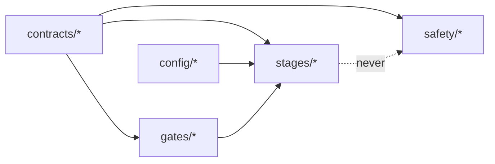

# Part 02 — Contracts, configuration and the gate result

**Goal:** agree on shared definitions *before* any model exists: the words every stage uses (`PASS`, `BLOCKED`, `NO-TRADE`, reason codes, the quantile grid), the place every limit lives (YAML), the check that refuses incomplete or dangerous configuration, and the shape every gate returns.

**Design:** "Design Principles and Gates" in the overall design (G1–G7, run status), Stage 2.3 (common forecast contract), the operating contract (document 08). **Overview:** §2 (naming), §5 (gates, reason codes, run status), §8 (configuration).

Why first? Stages built by different people, or by you at different times, can only be combined if they agree on these shapes. If each model invented its own idea of a "forecast" or a "failure", combining them later would mean rewriting them.



`contracts` and `config` are the bottom layer. They import nothing else from `aqp_python`, so everything else can depend on them without circular imports. Part 13 enforces this automatically.

## What you will build in this part

| Section | File | Components |
|---|---|---|
| 2.1 | `contracts/run_status.py` | 2 |
| 2.2 | `contracts/reason_codes.py` | 4 |
| 2.3 | `contracts/quantile_grid.py` | 2 |
| 2.4 | `contracts/data_schemas.py` (first two components) | 2 of 3 |
| 2.5 | `contracts/order_schema.py` | 1 |
| 2.6 | fourteen YAML files in `configs\` | 21 |
| 2.7 | `config/config_loader.py` | 2 |
| 2.8 | `config/config_validation.py` | 4 |
| 2.9 | `gates/gate_result.py` | 2 |
| 2.10 | `cli.py` | 2 |
| 2.11 | five test files | |

---

## 2.1 Run status vs trade decision

**File:** `src/aqp_python/contracts/run_status.py` — component 1 of 2: the two vocabularies

```python
"""Run status (is the pipeline healthy?) and trade decision (what to do?) are different things."""
from enum import StrEnum


class RunStatus(StrEnum):
    PASS = "PASS"            # required checks passed
    DEGRADED = "DEGRADED"    # an approved fallback is active and recorded
    BLOCKED = "BLOCKED"      # a critical check failed; no new risk


class TradeDecision(StrEnum):
    TRADE = "TRADE"
    REDUCE = "REDUCE"
    HOLD = "HOLD"
    NO_TRADE = "NO-TRADE"
```

**What it does.** Defines two separate vocabularies:

- **`RunStatus`** answers *is the pipeline healthy?* `DEGRADED` means an approved fallback is active and recorded (in this build: news features unavailable, baseline arms only). `BLOCKED` means a critical check failed and no new risk may be taken.
- **`TradeDecision`** answers *what should we do with this security?*

**Why they must never be mixed.** A run can be `PASS` and still decide `NO-TRADE` everywhere: every check worked, and no model earned the right to trade. That is a healthy outcome, not a failure. `StrEnum` (Python 3.11+) members are also strings, so `RunStatus.PASS == "PASS"` is `True` and they serialise to JSON without special handling.

**File:** `src/aqp_python/contracts/run_status.py` — component 2 of 2: worst_status: the run's terminal status

```python
_SEVERITY = {RunStatus.PASS: 0, RunStatus.DEGRADED: 1, RunStatus.BLOCKED: 2}


def worst_status(statuses: list[RunStatus]) -> RunStatus:
    """Terminal status is the most severe one seen: BLOCKED > DEGRADED > PASS."""
    if not statuses:
        return RunStatus.PASS
    return max(statuses, key=_SEVERITY.__getitem__)
```

**What it does.** The run's terminal status is the most severe status of any stage. **Why:** the overview §5 convention: `BLOCKED` over `DEGRADED` over `PASS`, so one blocked stage can never be averaged away.

```python
from aqp_python.contracts.run_status import RunStatus, TradeDecision, worst_status

print(worst_status([RunStatus.PASS, RunStatus.DEGRADED, RunStatus.PASS]))
print(worst_status([]))
print(TradeDecision.NO_TRADE, TradeDecision.NO_TRADE == "NO-TRADE")
```

```text
DEGRADED
PASS
NO-TRADE True
```

## 2.2 Reason codes

Design: *"Every failure receives a machine-readable reason code."* The file is long, so it is split into four components by stage. Type them in order; the second, third and fourth continue the class body (note the indentation).

**File:** `src/aqp_python/contracts/reason_codes.py` — component 1 of 4: run, data-integrity and universe codes

```python
"""Machine-readable reason codes. Every failure, exclusion and decision gets one."""
from enum import StrEnum


class ReasonCode(StrEnum):
    # Configuration / run
    CONFIG_INVALID = "CONFIG_INVALID"
    STAGE_EXCEPTION = "STAGE_EXCEPTION"
    UPSTREAM_BLOCKED = "UPSTREAM_BLOCKED"
    FALLBACK_ACTIVE = "FALLBACK_ACTIVE"
    # G2 data integrity
    DATA_SCHEMA = "DATA_SCHEMA"
    DATA_TIMEZONE = "DATA_TIMEZONE"
    DATA_DUPLICATE = "DATA_DUPLICATE"
    DATA_LOOKAHEAD = "DATA_LOOKAHEAD"
    DATA_STALE = "DATA_STALE"
    DATA_EXTREME_RETURN = "DATA_EXTREME_RETURN"
    DATA_NONPOSITIVE_PRICE = "DATA_NONPOSITIVE_PRICE"
    # G1 universe formation rejections (design codes)
    DIST = "DIST"
    LIQ = "LIQ"
    HIST = "HIST"
    DATA = "DATA"
    NOT_LISTED = "NOT_LISTED"
    BELOW_THRESHOLD = "BELOW_THRESHOLD"
    CAPACITY = "CAPACITY"
    # Mandatory exits (design codes)
    EXIT_DIST = "EXIT-DIST"
    EXIT_DLST = "EXIT-DLST"
    EXIT_SUSP = "EXIT-SUSP"
    EXIT_TKO = "EXIT-TKO"
    EXIT_LIQ = "EXIT-LIQ"
```

**What it does.** Run-level codes, the G2 data-integrity codes, and the universe codes. The design's own codes are kept **exactly** (`DIST`, `LIQ`, `HIST`, `DATA`, `EXIT-DIST`, `EXIT-DLST`, `EXIT-SUSP`, `EXIT-TKO`, `EXIT-LIQ`); the Python names use underscores because a hyphen is not allowed in an identifier, while the *values* keep the hyphen.

**File:** `src/aqp_python/contracts/reason_codes.py` — component 2 of 4: data-request and news-feature codes (Stages 2 and 2D)

```python
    # Stage 2 data expansion
    DATA_REQUEST_INVALID = "DATA_REQUEST_INVALID"     # no G1 universe behind the request
    SOURCE_NOT_AVAILABLE = "SOURCE_NOT_AVAILABLE"     # requested source/tier the provider cannot supply
    # Stage 2D news features
    NEWS_UNAVAILABLE = "NEWS_UNAVAILABLE"
    NEWS_NOT_YET_AVAILABLE = "NEWS_NOT_YET_AVAILABLE"  # processed after the decision cut-off
    NEWS_TIMESTAMP_INVALID = "NEWS_TIMESTAMP_INVALID"
    NEWS_DUPLICATE = "NEWS_DUPLICATE"
    NEWS_UNLINKED = "NEWS_UNLINKED"
    NEWS_OUT_OF_SCOPE = "NEWS_OUT_OF_SCOPE"
    NEWS_EXTRACTION_INVALID = "NEWS_EXTRACTION_INVALID"
    NEWS_COVERAGE_GAP = "NEWS_COVERAGE_GAP"
```

**What it does.** Codes for the filter-first data request (Stage 2) and for the news engine (Stage 2D). **Why so many news codes:** design 2D says a story that fails a timing, entity, schema or evidence check is *marked*, not silently dropped. Each way to fail gets its own code, so the story log in every run says exactly why a story did not count.

**File:** `src/aqp_python/contracts/reason_codes.py` — component 3 of 4: forecasting, G3 and paired-experiment codes

```python
    FORECAST_INVALID = "FORECAST_INVALID"
    QUANTILE_CROSSING = "QUANTILE_CROSSING"
    MODEL_FIT_FAILED = "MODEL_FIT_FAILED"
    MODEL_IS_BASELINE = "MODEL_IS_BASELINE"
    MODEL_MISCALIBRATED = "MODEL_MISCALIBRATED"
    MODEL_NO_SKILL = "MODEL_NO_SKILL"
    MODEL_NO_NET_VALUE = "MODEL_NO_NET_VALUE"
    MODEL_OVERFIT_RISK = "MODEL_OVERFIT_RISK"
    NO_ELIGIBLE_MODEL = "NO_ELIGIBLE_MODEL"
    EXPERIMENT_NOT_REGISTERED = "EXPERIMENT_NOT_REGISTERED"
    ARM_PARITY_BROKEN = "ARM_PARITY_BROKEN"
    NEWS_COVERAGE_LOW = "NEWS_COVERAGE_LOW"
    NEWS_NO_INCREMENTAL_VALUE = "NEWS_NO_INCREMENTAL_VALUE"
    NEWS_ABLATION_FAILED = "NEWS_ABLATION_FAILED"
    SHADOW_CANDIDATE = "SHADOW_CANDIDATE"             # passed every test; awaits shadow + G7
    APPROVED_ARM_INELIGIBLE = "APPROVED_ARM_INELIGIBLE"
```

**What it does.** Forecasting and G3 codes, including the paired-experiment outcomes. `SHADOW_CANDIDATE` is unusual: it is not a failure. It records that a news challenger passed every test and must now go through shadow evaluation and G7 before it may trade.

**File:** `src/aqp_python/contracts/reason_codes.py` — component 4 of 4: portfolio, sizing, safety and execution codes

```python
    # Portfolio / G4
    OPT_INFEASIBLE = "OPT_INFEASIBLE"
    OPT_RELAXED = "OPT_RELAXED"
    RISK_ES_BREACH = "RISK_ES_BREACH"
    RISK_STRESS_BREACH = "RISK_STRESS_BREACH"
    RISK_CONCENTRATION = "RISK_CONCENTRATION"
    # Sizing / G5 / G6
    LEVERAGE_INVALID_INPUT = "LEVERAGE_INVALID_INPUT"
    LEVERAGE_ZERO = "LEVERAGE_ZERO"
    MARGIN_HEADROOM = "MARGIN_HEADROOM"
    DRAWDOWN_LIMIT = "DRAWDOWN_LIMIT"
    WITHIN_NO_TRADE_BAND = "WITHIN_NO_TRADE_BAND"
    BELOW_COST_THRESHOLD = "BELOW_COST_THRESHOLD"
    TRADE_APPROVED = "TRADE_APPROVED"
    DATA_TOO_OLD = "DATA_TOO_OLD"
    # Safety / execution
    HARD_LIMIT_NAME = "HARD_LIMIT_NAME"
    HARD_LIMIT_GROSS = "HARD_LIMIT_GROSS"
    HARD_LIMIT_PARTICIPATION = "HARD_LIMIT_PARTICIPATION"
    HARD_LIMIT_DAILY_LOSS = "HARD_LIMIT_DAILY_LOSS"
    HARD_LIMIT_ORDER_COUNT = "HARD_LIMIT_ORDER_COUNT"
    KILL_SWITCH = "KILL_SWITCH"
    RECONCILIATION_FAILED = "RECONCILIATION_FAILED"
    PARTIAL_FILL = "PARTIAL_FILL"
    PAPER_OUT_OF_ORDER = "PAPER_OUT_OF_ORDER"
```

**What it does.** The remaining codes for portfolio construction (G4), sizing (G5, G6), safety and execution.

**Why codes are stable identifiers.** Downstream reports, monitoring and tests match on these strings. Explanations go in a gate result's `detail`, never in the code. Add a code only through the decision log (Part 14).

## 2.3 The shared quantile grid

**File:** `src/aqp_python/contracts/quantile_grid.py` — component 1 of 2: the grid and its column names

```python
"""The one quantile grid every forecast model must use."""
import math
from collections.abc import Sequence

QUANTILE_GRID: tuple[float, ...] = (
    0.01, 0.025, 0.05, 0.10, 0.25, 0.50, 0.75, 0.90, 0.95, 0.975, 0.99,
)
QUANTILE_COLUMNS: tuple[str, ...] = tuple(f"q{q:.3f}" for q in QUANTILE_GRID)
MEDIAN_COLUMN = "q0.500"
LOWER_90, UPPER_90 = "q0.050", "q0.950"
```

**What it does.** Design 2.3: every forecast-producing model, in every experiment arm, emits the same 11 quantiles 𝒯 = {0.01, 0.025, 0.05, 0.10, 0.25, 0.50, 0.75, 0.90, 0.95, 0.975, 0.99}. Column names are *generated* from the grid, so a typo cannot create a twelfth quantile.

**Why a shared grid.** Because every model reports the same quantiles, the no-news baseline and its news challenger can be scored, compared observation by observation, averaged and handed to the portfolio stage without any conversion.

**File:** `src/aqp_python/contracts/quantile_grid.py` — component 2 of 2: check_quantile_values

```python
def check_quantile_values(values: Sequence[float]) -> None:
    """Raise ValueError if values do not match the grid or are not ordered."""
    if len(values) != len(QUANTILE_GRID):
        raise ValueError(f"expected {len(QUANTILE_GRID)} quantiles, got {len(values)}")
    if any(not math.isfinite(v) for v in values):
        raise ValueError("quantiles must be finite")
    if any(left > right for left, right in zip(values, values[1:])):
        raise ValueError("quantile crossing: values must be non-decreasing")
```

**What it does.** Enforces the two non-negotiable properties of a predictive distribution: finite values and **no quantile crossing** (the 5% quantile can never exceed the 10% quantile).

```python
from aqp_python.contracts.quantile_grid import QUANTILE_COLUMNS, check_quantile_values

print(QUANTILE_COLUMNS)
try:
    check_quantile_values([0, 1, 2, 4, 3, 5, 6, 7, 8, 9, 10])
except ValueError as error:
    print("rejected:", error)
```

```text
('q0.010', 'q0.025', 'q0.050', 'q0.100', 'q0.250', 'q0.500', 'q0.750', 'q0.900', 'q0.950', 'q0.975', 'q0.990')
rejected: quantile crossing: values must be non-decreasing
```

## 2.4 Table contracts

`data_schemas.py` holds the column lists of every raw table. Its third component, the Stage 2 hand-off `ResearchData`, is added in Part 06.

**File:** `src/aqp_python/contracts/data_schemas.py` — component 1 of 3: column contracts for every raw table

```python
"""Column contracts for raw tables, and the Stage 2 research hand-off."""
from collections.abc import Iterable
from dataclasses import dataclass

import pandas as pd

# One row per security per trading day. date = valid time; availability_ts = when usable.
PRICE_COLUMNS = ("security_id", "date", "availability_ts", "close", "volume", "currency", "source")
BENCHMARK_COLUMNS = ("date", "availability_ts", "benchmark_return")
# Screening may read only these reference fields (configs/screening_request.yaml).
REFERENCE_SCREENING_COLUMNS = (
    "security_id", "name", "short_name", "sector", "listing_date", "delisting_date", "currency",
    "distress_probability", "quality_score", "availability_ts",
)
# Company exposures are research data: requested only after G1 (configs/detailed_data_request.yaml).
REFERENCE_EXPOSURE_COLUMNS = ("revenue_share_au", "revenue_share_us", "revenue_share_cn")
REFERENCE_COLUMNS = REFERENCE_SCREENING_COLUMNS[:-1] + REFERENCE_EXPOSURE_COLUMNS + ("availability_ts",)
CORPORATE_ACTION_COLUMNS = ("security_id", "ex_date", "split_ratio", "availability_ts")
# The qualitative corpus: raw text with publication and first-seen times. Never a model input as-is.
NEWS_COLUMNS = ("story_id", "source", "published_ts", "first_seen_ts", "provider_tags", "headline", "body")
# Periods in which the news feed was actually monitoring each security.
NEWS_COVERAGE_COLUMNS = ("security_id", "start_date", "end_date")
```

**What it does.** Names the columns of the six raw tables the synthetic provider supplies.

**Why the reference columns are split in two.** `REFERENCE_SCREENING_COLUMNS` are the fields a universe decision needs (identity, listing dates, sector, distress, quality). `REFERENCE_EXPOSURE_COLUMNS` (revenue shares by economy) are *research* data from the Company Reference and Exposure Dataset, which design 2.1 says is assembled only for admitted names. Writing the split into the contract is how "filter before deep retrieval" starts: Stage 00 will physically read only the screening columns.

Note the two timestamps on price rows: `date` is the **valid time** (the period a fact describes) and `availability_ts` is when the system could first have used it. News rows have two different times: `published_ts` (what the source says) and `first_seen_ts` (when our feed received it). Part 09 adds a third, our own processing time.

**File:** `src/aqp_python/contracts/data_schemas.py` — component 2 of 3: require_columns

```python
def require_columns(frame: pd.DataFrame, columns: Iterable[str], name: str) -> None:
    missing = sorted(set(columns) - set(frame.columns))
    if missing:
        raise ValueError(f"{name} is missing columns: {missing}")
```

## 2.5 Order requests

**File:** `src/aqp_python/contracts/order_schema.py`

```python
"""Order requests: the only object that may travel from sizing to execution."""
from dataclasses import asdict, dataclass
from enum import StrEnum


class Side(StrEnum):
    BUY = "BUY"
    SELL = "SELL"


@dataclass(frozen=True)
class OrderRequest:
    order_id: str
    security_id: str
    side: Side
    quantity: int
    reference_price: float
    reason_code: str

    @property
    def notional(self) -> float:
        return self.quantity * self.reference_price

    def validate(self) -> None:
        if self.quantity <= 0:
            raise ValueError("order quantity must be positive")
        if self.reference_price <= 0:
            raise ValueError("reference price must be positive")

    def to_dict(self) -> dict:
        record = asdict(self)
        record["side"] = str(self.side)
        record["notional"] = self.notional
        return record
```

**What it does.** An order request is the *only* object that travels from sizing to execution, and it is created only after G5 and G6 pass (Part 11). **Why frozen:** `frozen=True` makes it immutable, so nothing downstream can quietly change a quantity after the safety checks have approved it.

## 2.6 All the configuration, in one place

Overview §8: *"all limits, thresholds, experiments and approvals live here, never in code."* Fill in all fourteen placeholders now, even though most keys are used later. The validator in 2.8 checks every section at once, so a run cannot start with a missing limit.

**File:** `configs/pipeline.yaml` — component 1 of 2: run settings

```yaml
# Top-level run configuration. Every limit and threshold lives in YAML, never in code.
pipeline:
  name: AQP-PYTHON
  mode: research            # research | paper   (live is not accepted by this build)
  output_root: outputs
  data_dir: data/samples
  universe_dir: data/universes
  request_dir: data/data_requests
  state_dir: outputs/state
  timezone: Australia/Sydney
  decision_time_local: "17:00"   # after the ASX close and data publication lag
  random_seed: 20261018
```

`decision_time_local: "17:00"` with `timezone: Australia/Sydney` means a decision for 16 October 2026 is taken at 17:00 Sydney time: after the ASX close and after the 16:30 publication time of the synthetic close prices, so that day's close is usable and nothing later is. `request_dir` is where frozen Stage 2 data requests are kept (Part 06).

**File:** `configs/pipeline.yaml` — component 2 of 2: included files and sleeves

```yaml
includes:
  gates: gates.yaml
  screening_request: screening_request.yaml
  universe: universe_rules.yaml
  coverage_tiers: coverage_tiers.yaml
  detailed_data_request: detailed_data_request.yaml
  news_features: news_features.yaml
  experiments: experiments.yaml
  forecast_models: forecast_models.yaml
  validation: validation.yaml
  risk_limits: risk_limits.yaml
  monitoring: monitoring_alerts.yaml
  fallbacks: fallbacks.yaml
  model_lifecycle: model_lifecycle.yaml

sleeves:
  asx_interday: sleeves/sleeve_asx_interday.yaml
```

`includes` lists the other files and the key each one is loaded under. `sleeves` maps a sleeve name to its file, so adding the US interday sleeve later means one line here and one file.

**File:** `configs/gates.yaml`

```yaml
# Provisional gate thresholds. Calibrate and approve per sleeve before paper trading.
g2_data_integrity:
  max_staleness_days: 3          # last price older than this -> quarantine name
  extreme_return_abs: 0.40       # unexplained |daily return| above this -> quarantine name
  extreme_lookback_days: 60

g3_model_eligibility:
  coverage_target: 0.90
  coverage_tolerance: 0.03       # 90% interval must cover 87%-93% of outcomes
  max_dm_pvalue: 0.10            # one-sided Diebold-Mariano test against the best baseline
  min_net_sharpe: 0.0            # annualised, after costs
  min_deflated_sharpe: 0.50      # probability that the true Sharpe exceeds the trial-adjusted benchmark

g4_portfolio_risk:
  max_expected_shortfall: 0.06   # 97.5% one-horizon ES of the relative portfolio
  max_stress_loss: 0.25

g5_leverage_margin:
  min_margin_headroom: 0.20

g6_trade_eligibility:
  max_data_age_days: 1
```

Provisional thresholds for G2–G6. They are research settings, not universal standards, and must be calibrated and approved per sleeve.

**File:** `configs/screening_request.yaml`

```yaml
# Stage 00 asks only for what the universe decision needs (design Stage 0).
files: [prices.csv, benchmark.csv, reference.csv, corporate_actions.csv, news_coverage.csv]
reference_fields: [security_id, name, short_name, sector, listing_date, delisting_date, currency,
                   distress_probability, quality_score, availability_ts]
# news_coverage.csv is metadata (does a source exist?), never the text itself.
```

**The filter-first rule as data.** Stage 00 may read these files and these reference fields, nothing else. `news.csv` (the text) is absent; `news_coverage.csv` is present because design Stage 0 allows recording *whether* a source exists.

**File:** `configs/universe_rules.yaml` — component 1 of 2: formation date, hard filters, threshold and capacity

```yaml
formation_date: "2025-06-30"     # universe is formed once per version, at this date
version_label: v1
max_distress_probability: 0.10   # DIST
min_median_dollar_volume: 2000000  # LIQ, AUD per day over the lookback
max_zero_volume_ratio: 0.05      # LIQ
min_history_days: 500            # HIST
max_missing_ratio: 0.02          # DATA: share of expected sessions with no price
liquidity_lookback_days: 60
admission_threshold: 40.0        # composite score 0-100
capacity: 30                     # research capacity per sleeve
```

**File:** `configs/universe_rules.yaml` — component 2 of 2: scoring recipe, strategy rules and mandatory removals

```yaml
category_weights:                # w_k, must sum to 1
  liquidity: 0.40
  stability: 0.30
  suitability: 0.30
category_metrics:                # metric: [direction d_j, weight omega_jk]; weights sum to 1 per category
  liquidity:
    log_dollar_volume: [1, 0.5]
    amihud_illiquidity: [-1, 0.3]
    zero_volume_ratio: [-1, 0.2]
  stability:
    volatility_252: [-1, 0.5]
    beta_instability: [-1, 0.5]
  suitability:
    quality_score: [1, 0.6]
    distress_probability: [-1, 0.4]
strategy_rules:
  momentum_abs_threshold: 0.25   # |12-1 momentum| above this -> momentum_trend
  quality_threshold: 0.5         # quality score above this -> quality_value
mandatory_removal:
  distress_probability: 0.20     # EXIT-DIST
  suspension_days: 5             # EXIT-SUSP
  liquidity_floor_ratio: 0.50    # EXIT-LIQ if median dollar volume < ratio x formation floor
```

This is design Stage 1's scoring recipe written as data. `category_metrics` gives each metric a direction `d_j` (+1 if higher is better, −1 if lower is better) and a weight `ω_jk`; `category_weights` gives `w_k`. Part 05 turns it into `S_i = 100 Σ_k w_k Σ_j ω_jk Φ(d_j z_ij)`.

**File:** `configs/coverage_tiers.yaml`

```yaml
# Data-depth budget (design Stage 1 coverage tiers). Ranked by formation liquidity within the
# admitted universe. Tiers govern the Stage 2 data request; they never change membership.
tiers:
  T1: {max_rank: 8, sources: [daily_prices, trades_quotes]}
  T2: {max_rank: 20, sources: [daily_prices, minute_bars]}
  T3: {max_rank: null, sources: [daily_prices]}
```

Design Stage 1's data-coverage tiers: the most liquid admitted names (T1) would get trades and quotes, the next (T2) one-minute bars, the rest (T3) daily data. The sizes are budget examples. A tier decides how deeply a name is researched, never whether it is a member.

**File:** `configs/detailed_data_request.yaml`

```yaml
# Stage 2 asks for detailed data ONLY for the G1-admitted universe version (design 2.1).
files: [prices.csv, benchmark.csv, reference.csv, corporate_actions.csv, news.csv, news_coverage.csv]
reference_fields: [security_id, name, short_name, sector, listing_date, delisting_date, currency,
                   distress_probability, quality_score, revenue_share_au, revenue_share_us,
                   revenue_share_cn, availability_ts]
history_start: "2022-01-03"
```

What Stage 2 may ask for, and only for admitted names: now the text corpus and the exposure fields are allowed.

**File:** `configs/news_features.yaml` — component 1 of 2: versions, timing and the feature recipe

```yaml
# Stage 2D: text -> versioned quantitative covariates Z_news. Never a trade signal on its own.
extractor: lexicon               # lexicon (built in) | llm (needs connectors/llm, Part 14)
prompt_version: lexicon-v1       # frozen during an evaluation period
extraction_schema_version: event-v1
processing_latency_minutes: 5    # our own processing time after first-seen
duplicate_window_hours: 24       # same entity + event type within this window = one story
novelty_window_days: 10          # an event type already seen for this entity within N days is not new
decay_days: 5.0                  # exp(-age / decay_days)
max_event_age_days: 20
count_window_days: 5
require_coverage_days: 5         # feed must have covered the name on each of the last N sessions
source_credibility: {wire_a: 1.0, wire_b: 0.8}
features: [news_sentiment_decay, news_intensity_decay, news_event_count_5d]
```

**File:** `configs/news_features.yaml` — component 2 of 2: the missingness rule

```yaml
# Missing news is NEVER zero. Uncovered (security, date) rows are NaN and the challenger
# arm is unavailable there (experiments.yaml -> missingness_policy).
```

The recipe for Z_news. Every value that changes the features (extractor, prompt version, schema version, decay, windows) is part of the published feature version (Part 09), so a forecast can always say which news recipe it used.

**File:** `configs/experiments.yaml` — component 1 of 2: registered baseline/challenger pairs

```yaml
# Register each pair BEFORE looking at test results. Arms differ only by news_features.
experiments:
  financial__xret__h5__asx_interday:
    family: financial
    model: ridge_location_scale
    target: benchmark_excess_return
    horizon_days: 5
    sleeve: asx_interday
    core_features: [mom_252_21, rev_5, vol_20, quality_score]
    news_features: [news_sentiment_decay, news_intensity_decay, news_event_count_5d]
    missingness_policy: matched_only     # challenger evaluated only where Z_news exists
    approved_arm: BASELINE               # changes only through G7 (Part 14), never automatically
```

**The heart of design 2E.** One registered experiment: the ridge model, the excess-return target, a 5-day horizon, the ASX interday sleeve. The two arms share `core_features`; only the challenger adds `news_features`. `approved_arm: BASELINE` means the baseline feeds the portfolio until a G7 review changes this line, which is a reviewed commit, never something the code does by itself.

**File:** `configs/experiments.yaml` — component 2 of 2: incremental-value rules

```yaml
incremental_value:
  max_paired_pvalue: 0.10        # one-sided paired DM on matched observations
  min_news_coverage: 0.80        # share of baseline test observations the challenger also covers
  bootstrap_block_dates: 4       # moving-block bootstrap of per-date loss differences
  bootstrap_samples: 500
  multiple_testing: holm         # across every registered experiment
  ablation_must_hurt: true       # removing the news block must worsen loss
```

The pre-registered rules for "does news add value?". They are fixed *before* any result is seen; changing them after looking at results would be choosing the test to fit the answer.

**File:** `configs/forecast_models.yaml`

```yaml
# Model registry entries. role: baseline models are references and never trade.
# Feature lists live with each experiment (experiments.yaml): the arm decides the features.
horizon_days: 5
models:
  zero_excess:
    role: baseline
    enabled: true
    version: "1.0"
  rolling_mean:
    role: baseline
    enabled: true
    version: "1.0"
    params: {window_days: 252}
  ridge_location_scale:
    role: candidate
    enabled: true
    version: "1.0"
    params: {alpha: 10.0, t_dof: 5}
  linear_quantile:
    role: candidate
    enabled: false               # slower; enable once the core run is working
    version: "1.0"
    params: {alpha: 0.0001, max_train_rows: 4000}
```

`role: baseline` models are the yardsticks of design 2A ("fit simple benchmarks first"). They are scored but never weighted. Feature lists are not here any more: in v14 the experiment arm decides which features a model sees.

**File:** `configs/validation.yaml`

```yaml
min_train_days: 252
n_folds: 5
embargo_days: 5                   # at least the forecast horizon
step_days: 5                      # evaluate non-overlapping decision dates
combination_shrinkage: 0.5        # 0 = pure inverse-loss weights, 1 = equal weights
long_short_quantile: 0.2          # top/bottom fraction for net-of-cost evaluation
```

`embargo_days` must be at least the 5-day horizon; the validator enforces this.

**File:** `configs/risk_limits.yaml`

```yaml
# Hard limits read ONLY by aqp_python.safety. Models cannot change these.
max_single_name_fraction_nav: 0.10
max_gross_leverage: 1.0
max_participation_adv: 0.20
max_daily_loss_fraction: 0.05
max_order_count: 60
kill_switch_file: KILL_SWITCH      # relative to pipeline.state_dir
```

Only the `safety` package reads this file (Part 12). Keeping hard limits in their own file makes it easy to give it a separate approval process and to show that no model parameter appears in it.

**File:** `configs/monitoring_alerts.yaml`

```yaml
# Illustrative alert thresholds - calibrate per sleeve. Alerts trigger review, never automatic promotion.
coverage_band: [0.87, 0.93]      # rolling 90% interval coverage
coverage_window_dates: 20        # number of recent test dates pooled
max_drawdown_alert: 0.10
max_shortfall_bps_alert: 50
min_news_coverage_alert: 0.80    # share of active names with usable Z_news today
max_news_drift_alert: 3.0        # |z| of today's mean news sentiment vs its history
```

**File:** `configs/fallbacks.yaml`

```yaml
# Approved, tested fallbacks. Anything not listed here BLOCKS instead of degrading.
# A fallback can never bypass data integrity, margin, hard limits, kill switches or reconciliation.
approved:
  news_features_unavailable:
    action: baseline_arm_only    # challengers are unavailable; registered baselines continue
    status: DEGRADED
    tested_by: tests/integration/test_fallback_behaviour.py
```

Design: *"If no approved fallback exists, stop the affected run/sleeve."* This build has exactly one approved fallback. Anything not listed blocks.

**File:** `configs/model_lifecycle.yaml`

```yaml
# G7 promotion policy (design Stage 7). Used by model-lifecycle tooling, never by a trading run.
min_shadow_sessions: 60
max_dm_pvalue_vs_champion: 0.05
```

**File:** `configs/sleeves/sleeve_asx_interday.yaml` — component 1 of 3: identity and costs

```yaml
sleeve: asx_interday
market: ASX
currency: AUD
calendar: ASX
initial_nav: 1000000
costs:
  half_spread_bps: 10
  commission_bps: 5
  impact_coefficient: 0.10       # eta in the eta*|dw|^1.5 term (per unit of daily vol)
  holding_periods: 4             # expected holding period in forecast horizons; costs are amortised over it
```

**File:** `configs/sleeves/sleeve_asx_interday.yaml` — component 2 of 3: portfolio constraints and stress scenarios

```yaml
portfolio:
  long_only: true                # open decision 5: long-only until ASX borrow is confirmed
  risk_aversion: 2.5             # gamma
  market_risk_premium_annual: 0.06   # equilibrium prior for Black-Litterman
  distress_penalty: 0.02         # kappa
  max_name_weight: 0.08
  max_sector_weight: 0.30
  max_turnover: 0.60
  participation_cap: 0.20
  exit_days: 3
  bl_tau: 0.05
  covariance_lookback_days: 252
  relaxation_order: [max_turnover, max_sector_weight]   # never liquidity or tail risk
  relaxation_step: 1.5
stress_scenarios:
  market_crash: {market: -0.20}
  china_slowdown: {revenue_cn: -0.15}
  sector_financials: {sector: Financials, shock: -0.25}
```

**File:** `configs/sleeves/sleeve_asx_interday.yaml` — component 3 of 3: sizing policy

```yaml
sizing:
  target_volatility_annual: 0.12
  kelly_fraction: 0.35           # c, provisional range 0.25-0.50
  max_leverage: 1.0
  initial_margin_rate: 1.0       # cash equities, no margin
  margin_buffer: 0.20
  max_drawdown: 0.15
  no_trade_band: 0.005           # |dw| below this is ignored
  min_benefit_cost_ratio: 1.5
```

Everything that differs between sleeves lives in the sleeve file: costs, portfolio constraints, stress scenarios and leverage policy. `long_only: true` records **open decision 5** (long-only versus long-short) as a configuration value with a comment instead of a silent assumption.

## 2.7 Loading configuration

**File:** `src/aqp_python/config/config_loader.py` — component 1 of 2: load_yaml

```python
"""Load the pipeline YAML and the files it includes into one mapping."""
import hashlib
import json
from pathlib import Path
from typing import Any

import yaml


def load_yaml(path: Path) -> dict[str, Any]:
    if not path.is_file():
        raise FileNotFoundError(f"Configuration file not found: {path}")
    with path.open("r", encoding="utf-8") as handle:
        value = yaml.safe_load(handle)
    if not isinstance(value, dict):
        raise ValueError(f"Top-level YAML value must be a mapping: {path}")
    return value
```

**What it does.** Reads one YAML file. **Why it is strict:** `yaml.safe_load` never constructs arbitrary Python objects; a missing file raises immediately (a missing risk policy must never silently become a default); and the top level must be a mapping.

**File:** `src/aqp_python/config/config_loader.py` — component 2 of 2: load_pipeline_config and config_hash

```python
def load_pipeline_config(path: Path, sleeve: str) -> dict[str, Any]:
    """Return {'pipeline', 'gates', 'universe', ..., 'sleeve'} for one sleeve."""
    path = Path(path)
    top = load_yaml(path)
    config: dict[str, Any] = {"pipeline": top.get("pipeline")}
    for key, relative in (top.get("includes") or {}).items():
        config[key] = load_yaml(path.parent / relative)
    sleeves = top.get("sleeves") or {}
    if sleeve not in sleeves:
        raise ValueError(f"Unknown sleeve '{sleeve}'. Configured: {sorted(sleeves)}")
    config["sleeve"] = load_yaml(path.parent / sleeves[sleeve])
    return config


def config_hash(config: dict[str, Any]) -> str:
    """Stable SHA-256 of the merged configuration (key order does not matter)."""
    canonical = json.dumps(config, sort_keys=True, default=str, separators=(",", ":"))
    return hashlib.sha256(canonical.encode("utf-8")).hexdigest()
```

**What it does.** Loads `pipeline.yaml`, then every included file under its key, then the chosen sleeve. `config_hash` turns the merged configuration into canonical JSON (sorted keys) and hashes it; two runs with the same hash used the same settings, and the hash goes into every run manifest.

```python
from pathlib import Path

from aqp_python.config.config_loader import config_hash, load_pipeline_config

config = load_pipeline_config(Path("configs/pipeline.yaml"), "asx_interday")
print(sorted(config))
print(config["experiments"]["experiments"]["financial__xret__h5__asx_interday"]["approved_arm"])
print(config_hash({"a": 1, "b": 2}) == config_hash({"b": 2, "a": 1}))
```

```text
['coverage_tiers', 'detailed_data_request', 'experiments', 'fallbacks', 'forecast_models', 'gates', 'model_lifecycle', 'monitoring', 'news_features', 'pipeline', 'risk_limits', 'screening_request', 'sleeve', 'universe', 'validation']
BASELINE
True
```

## 2.8 Fail-fast validation

**File:** `src/aqp_python/config/config_validation.py` — component 1 of 4: required sections and helper checks

```python
"""Fail-fast checks: a missing limit must stop the run, never become a default."""
from collections.abc import Iterable, Mapping
from typing import Any

REQUIRED_SECTIONS = (
    "pipeline", "gates", "screening_request", "universe", "coverage_tiers", "detailed_data_request",
    "news_features", "experiments", "forecast_models", "validation", "risk_limits", "monitoring",
    "fallbacks", "sleeve",
)
ALLOWED_MODES = {"research", "paper"}
ARMS = {"BASELINE", "NEWS_CHALLENGER"}


class ConfigError(ValueError):
    """Raised when configuration is missing, malformed or out of range."""


def require_keys(section: Mapping[str, Any], keys: Iterable[str], where: str) -> None:
    if not isinstance(section, Mapping):
        raise ConfigError(f"'{where}' must be a mapping")
    missing = sorted(set(keys) - set(section))
    if missing:
        raise ConfigError(f"'{where}' is missing keys: {missing}")


def require_fraction(value: Any, where: str, *, allow_zero: bool = True) -> None:
    if not isinstance(value, (int, float)) or isinstance(value, bool):
        raise ConfigError(f"'{where}' must be a number, got {value!r}")
    low_ok = value >= 0 if allow_zero else value > 0
    if not (low_ok and value <= 1):
        raise ConfigError(f"'{where}' must be in {'[0, 1]' if allow_zero else '(0, 1]'}, got {value}")
```

**What it does.** Lists the fourteen required sections and two helpers: `require_keys` (every key present) and `require_fraction` (a number in [0, 1]).

**File:** `src/aqp_python/config/config_validation.py` — component 2 of 4: validate_config: pipeline, screening and universe

```python
def validate_config(config: Mapping[str, Any]) -> None:
    require_keys(config, REQUIRED_SECTIONS, "config")

    pipeline = config["pipeline"]
    require_keys(pipeline, ["name", "mode", "output_root", "data_dir", "universe_dir", "request_dir",
                            "state_dir", "timezone", "decision_time_local"], "pipeline")
    if pipeline["mode"] not in ALLOWED_MODES:
        raise ConfigError(f"pipeline.mode must be one of {sorted(ALLOWED_MODES)}")

    screening = config["screening_request"]
    require_keys(screening, ["files", "reference_fields"], "screening_request")
    if "news.csv" in screening["files"]:
        raise ConfigError("screening_request may not read the news corpus: text is collected after G1")
    if set(screening["reference_fields"]) & {"revenue_share_au", "revenue_share_us", "revenue_share_cn"}:
        raise ConfigError("screening_request may not read company exposures: they are research data")

    universe = config["universe"]
    require_keys(universe, ["formation_date", "version_label", "max_distress_probability",
                            "min_median_dollar_volume", "min_history_days", "admission_threshold",
                            "capacity", "category_weights", "mandatory_removal"], "universe")
    if abs(sum(universe["category_weights"].values()) - 1.0) > 1e-9:
        raise ConfigError("universe.category_weights must sum to 1")
    for category, metrics in universe["category_metrics"].items():
        if abs(sum(weight for _, weight in metrics.values()) - 1.0) > 1e-9:
            raise ConfigError(f"universe.category_metrics.{category} weights must sum to 1")
        if any(direction not in (-1, 1) for direction, _ in metrics.values()):
            raise ConfigError(f"universe.category_metrics.{category} directions must be +1 or -1")
    require_keys(config["coverage_tiers"], ["tiers"], "coverage_tiers")
```

**What it does.** Starts `validate_config`. Note the two new v14 checks on `screening_request`: it may not read the news corpus, and it may not read exposure fields. A configuration that would break "filter before deep retrieval" is refused before anything runs.

**File:** `src/aqp_python/config/config_validation.py` — component 3 of 4: validate_config: news features, experiments and models

```python
    news = config["news_features"]
    require_keys(news, ["extractor", "prompt_version", "extraction_schema_version", "processing_latency_minutes",
                        "duplicate_window_hours", "novelty_window_days", "decay_days", "max_event_age_days",
                        "count_window_days", "require_coverage_days", "source_credibility", "features"],
                 "news_features")
    if news["decay_days"] <= 0:
        raise ConfigError("news_features.decay_days must be positive")

    models = config["forecast_models"]
    require_keys(models, ["horizon_days", "models"], "forecast_models")
    roles = {spec.get("role") for spec in models["models"].values() if spec.get("enabled")}
    if "baseline" not in roles:
        raise ConfigError("at least one enabled baseline model is required")

    experiments = config["experiments"]
    require_keys(experiments, ["experiments", "incremental_value"], "experiments")
    for experiment_id, spec in experiments["experiments"].items():
        where = f"experiments.{experiment_id}"
        require_keys(spec, ["family", "model", "target", "horizon_days", "sleeve", "core_features",
                            "news_features", "missingness_policy", "approved_arm"], where)
        if spec["model"] not in models["models"]:
            raise ConfigError(f"{where}.model '{spec['model']}' is not in forecast_models.yaml")
        if spec["horizon_days"] != models["horizon_days"]:
            raise ConfigError(f"{where}.horizon_days must equal forecast_models.horizon_days")
        if set(spec["core_features"]) & set(spec["news_features"]):
            raise ConfigError(f"{where}: a feature cannot be both core and news")
        if not set(spec["news_features"]) <= set(news["features"]):
            raise ConfigError(f"{where}.news_features must be published by news_features.yaml")
        if spec["approved_arm"] not in ARMS:
            raise ConfigError(f"{where}.approved_arm must be one of {sorted(ARMS)}")
        if spec["missingness_policy"] != "matched_only":
            raise ConfigError(f"{where}.missingness_policy: only 'matched_only' is approved")
```

**What it does.** Checks the news recipe and every registered experiment. Read the experiment checks as the design's rules for a clean experiment: the model must exist; the horizon must match; **a feature cannot be both core and news** (otherwise the baseline would contain news); the news features must actually be published by the news engine; the approved arm must be one of the two arms; and the only approved missingness policy is `matched_only`.

**File:** `src/aqp_python/config/config_validation.py` — component 4 of 4: validate_config: validation, limits, fallbacks and sleeve

```python
    validation = config["validation"]
    require_keys(validation, ["min_train_days", "n_folds", "embargo_days", "step_days"], "validation")
    if validation["embargo_days"] < models["horizon_days"]:
        raise ConfigError("validation.embargo_days must be at least forecast_models.horizon_days")

    limits = config["risk_limits"]
    require_keys(limits, ["max_single_name_fraction_nav", "max_gross_leverage",
                          "max_participation_adv", "max_daily_loss_fraction",
                          "max_order_count", "kill_switch_file"], "risk_limits")
    require_fraction(limits["max_single_name_fraction_nav"], "risk_limits.max_single_name_fraction_nav",
                     allow_zero=False)
    require_keys(config["fallbacks"], ["approved"], "fallbacks")

    sleeve = config["sleeve"]
    require_keys(sleeve, ["sleeve", "market", "currency", "initial_nav", "costs",
                          "portfolio", "sizing", "stress_scenarios"], "sleeve")
    sizing = sleeve["sizing"]
    require_keys(sizing, ["target_volatility_annual", "kelly_fraction", "max_leverage",
                          "max_drawdown", "no_trade_band", "min_benefit_cost_ratio"], "sleeve.sizing")
    if not 0.25 <= sizing["kelly_fraction"] <= 0.5:
        raise ConfigError("sleeve.sizing.kelly_fraction must be within the provisional range 0.25-0.50")
    require_fraction(sizing["max_drawdown"], "sleeve.sizing.max_drawdown", allow_zero=False)
    portfolio = sleeve["portfolio"]
    for key in ("max_name_weight", "max_sector_weight", "max_turnover"):
        require_fraction(portfolio[key], f"sleeve.portfolio.{key}", allow_zero=False)
    for never in ("participation_cap", "exit_days"):
        if never in portfolio.get("relaxation_order", []):
            raise ConfigError(f"'{never}' is a liquidity limit and may never be relaxed")
```

**What it does.** The remaining checks: embargo covers the horizon, hard limits are present, fallbacks are listed, the Kelly fraction is in the design's provisional 0.25–0.50 range, and **liquidity limits can never appear in the relaxation list** (design Stages 3–4: "never relax liquidity or tail-risk limits").

```python
import copy
from pathlib import Path

from aqp_python.config.config_loader import load_pipeline_config
from aqp_python.config.config_validation import ConfigError, validate_config

config = load_pipeline_config(Path("configs/pipeline.yaml"), "asx_interday")
validate_config(config)
print("shipped configuration: valid")
bad = copy.deepcopy(config)
experiment = bad["experiments"]["experiments"]["financial__xret__h5__asx_interday"]
experiment["core_features"].append("news_sentiment_decay")      # smuggle news into the baseline
try:
    validate_config(bad)
except ConfigError as error:
    print("refused:", error)
```

```text
shipped configuration: valid
refused: experiments.financial__xret__h5__asx_interday: a feature cannot be both core and news
```

## 2.9 The gate result

**File:** `src/aqp_python/gates/gate_result.py` — component 1 of 2: GateOutcome: the four failure actions

```python
"""Every gate returns the same small, serialisable result object."""
from dataclasses import dataclass, field
from enum import StrEnum


class GateOutcome(StrEnum):
    PASS = "PASS"
    WARN = "WARN"              # recorded, never silently suppressed
    QUARANTINE = "QUARANTINE"  # exclude one subject (e.g. a security) for this run
    BLOCK = "BLOCK"            # stop the affected branch or run
```

**What it does.** The four outcomes map onto the design's failure actions: `BLOCK` stops a branch or run, `QUARANTINE` excludes one subject for this run, `WARN` is recorded but never suppressed, `PASS` continues.

**File:** `src/aqp_python/gates/gate_result.py` — component 2 of 2: GateResult and any_block

```python
@dataclass(frozen=True)
class GateResult:
    gate_id: str                       # "G1" ... "G7"
    outcome: GateOutcome
    subject: str = "run"               # "run", a security_id, a model name, an experiment id
    reason_codes: tuple[str, ...] = ()
    detail: str = ""
    evidence: dict = field(default_factory=dict)

    def __post_init__(self) -> None:
        if self.outcome != GateOutcome.PASS and not self.reason_codes:
            raise ValueError(f"{self.gate_id} {self.outcome} for {self.subject} needs a reason code")

    @property
    def passed(self) -> bool:
        return self.outcome in (GateOutcome.PASS, GateOutcome.WARN)

    def to_dict(self) -> dict:
        return {
            "gate_id": self.gate_id, "outcome": str(self.outcome), "subject": self.subject,
            "reason_codes": [str(code) for code in self.reason_codes],
            "detail": self.detail, "evidence": self.evidence,
        }


def any_block(results: list[GateResult]) -> bool:
    return any(result.outcome == GateOutcome.BLOCK for result in results)
```

**What it does.** Every gate in the project (G1–G7) returns this one object, so the orchestrator, manifest and report treat them the same way. `subject` names what was judged: the run, a security, a model slot such as `ridge_location_scale@NEWS_CHALLENGER`, or an experiment. **Why `__post_init__`:** it makes it impossible to create a failing result without a reason code.

```python
from aqp_python.gates.gate_result import GateOutcome, GateResult

ok = GateResult("G1", GateOutcome.PASS, "SYN01")
print(ok.passed, ok.to_dict())
try:
    GateResult("G2", GateOutcome.BLOCK, "run")
except ValueError as error:
    print("refused:", error)
```

```text
True {'gate_id': 'G1', 'outcome': 'PASS', 'subject': 'SYN01', 'reason_codes': [], 'detail': '', 'evidence': {}}
refused: G2 BLOCK for run needs a reason code
```

## 2.10 The command line

Write the whole CLI now. Only `validate-config` works at this point; the other commands import their modules *inside* their `if` branch (a **lazy import**), so the CLI loads even though later stages do not exist yet.

**File:** `src/aqp_python/cli.py` — component 1 of 2: imports and the argument parser

```python
"""Command line: python -m aqp_python.cli <command> ...   (or just `aqp <command>` once installed)."""
import argparse
import logging
import sys
from datetime import date
from pathlib import Path

from aqp_python.logging_config import configure_logging

log = logging.getLogger("aqp")


def build_parser() -> argparse.ArgumentParser:
    parser = argparse.ArgumentParser(prog="aqp", description="AQP - Advanced Quantitative Pipeline")
    sub = parser.add_subparsers(dest="command", required=True)

    check = sub.add_parser("validate-config", help="load and validate the configuration")
    check.add_argument("--config", type=Path, default=Path("configs/pipeline.yaml"))
    check.add_argument("--sleeve", default="asx_interday")

    sample = sub.add_parser("build-sample-data", help="write the synthetic market to data/samples")
    sample.add_argument("--output", type=Path, default=Path("data/samples"))
    sample.add_argument("--seed", type=int, default=7)
    sample.add_argument("--no-signal", action="store_true",
                        help="remove the planted price signal (no model should pass G3 -> NO-TRADE)")
    sample.add_argument("--no-news-signal", action="store_true",
                        help="keep the news but remove its effect on returns (news should add nothing)")

    run = sub.add_parser("run", help="run the pipeline for one sleeve and decision date")
    run.add_argument("--config", type=Path, default=Path("configs/pipeline.yaml"))
    run.add_argument("--sleeve", default="asx_interday")
    run.add_argument("--as-of", type=date.fromisoformat, required=True, help="trading date, YYYY-MM-DD")
    run.add_argument("--mode", choices=("research", "paper"), default=None)
    return parser
```

**What it does.** Defines three commands. `build-sample-data` has two switches that remove one planted signal each (Part 04); they power the drills in Part 13.

**File:** `src/aqp_python/cli.py` — component 2 of 2: main: one branch per command

```python
def main(argv: list[str] | None = None) -> int:
    args = build_parser().parse_args(argv)
    configure_logging()
    root = Path.cwd()

    if args.command == "validate-config":
        from aqp_python.config.config_loader import config_hash, load_pipeline_config
        from aqp_python.config.config_validation import ConfigError, validate_config
        try:
            config = load_pipeline_config(args.config, args.sleeve)
            validate_config(config)
        except (ConfigError, FileNotFoundError, ValueError) as error:
            log.error("Configuration INVALID: %s", error)
            return 2
        print(f"Configuration valid: {args.config} (sleeve {args.sleeve}, hash {config_hash(config)[:12]})")
        return 0

    if args.command == "build-sample-data":
        from aqp_python.connectors.synthetic.synthetic_market import write_sample_data
        if "raw" in args.output.parts:
            log.error("refusing to write synthetic data into a raw-data folder")
            return 2
        signal = {"quality_alpha": 0.0, "reversal_strength": 0.0} if args.no_signal else {}
        if args.no_news_signal:
            signal["news_alpha"] = 0.0
        for name, path in write_sample_data(args.output, seed=args.seed, **signal).items():
            print(f"wrote {name:<18} -> {path}")
        return 0

    if args.command == "run":
        from aqp_python.orchestration.orchestrator import run_pipeline
        try:
            outcome = run_pipeline(args.config, args.sleeve, args.as_of, root, args.mode)
        except (ValueError, FileNotFoundError) as error:     # bad config or sleeve: nothing ran
            log.error("Run not started: %s", error)
            return 2
        print(f"\nrun_id : {outcome.run_id}\nstatus : {outcome.status}\nfolder : {outcome.run_dir}")
        print(f"report : {outcome.run_dir / 'reports' / 'run_report.md'}")
        return 0 if str(outcome.status) != "BLOCKED" else 1
    return 2


if __name__ == "__main__":
    sys.exit(main())
```

**What it does.** One branch per command. Exit codes are part of the contract: `0` for PASS or DEGRADED, `1` for BLOCKED, `2` for bad input. A scheduler (Part 14) relies on them.

```powershell
python -m aqp_python.cli validate-config
```

```text
Configuration valid: configs/pipeline.yaml (sleeve asx_interday, hash dbc1831aac6d)
```

Break something on purpose. Delete the line `max_gross_leverage: 1.0` from `risk_limits.yaml` and run it again: you should see `Configuration INVALID: 'risk_limits' is missing keys: ['max_gross_leverage']` and `$LASTEXITCODE` is `2`. Put the line back.

## 2.11 Tests

Start `tests\conftest.py` with the shared configuration fixture. More fixtures are added to this file in Parts 04 and 08.

**File:** `tests/conftest.py` — component 1 of 3: top of file and the config fixture

```python
"""Shared fixtures. Tests never touch the real data/, outputs/ or configs/ folders."""
import shutil
from datetime import date
from pathlib import Path

import pandas as pd
import pytest

REPO = Path(__file__).resolve().parents[1]
CONFIG = REPO / "configs" / "pipeline.yaml"
AS_OF = date(2026, 10, 16)          # last date of the synthetic market


@pytest.fixture
def config():
    """The shipped configuration for the ASX interday sleeve (read-only)."""
    from aqp_python.config.config_loader import load_pipeline_config
    return load_pipeline_config(CONFIG, "asx_interday")
```

**File:** `tests/unit/test_quantile_grid.py`

```python
import pytest

from aqp_python.contracts.quantile_grid import QUANTILE_COLUMNS, QUANTILE_GRID, check_quantile_values

pytestmark = pytest.mark.batch01


def test_quantile_grid_is_sorted_and_symmetric():
    assert list(QUANTILE_GRID) == sorted(QUANTILE_GRID)
    assert all(abs(a + b - 1) < 1e-12 for a, b in zip(QUANTILE_GRID, reversed(QUANTILE_GRID)))
    assert QUANTILE_COLUMNS[5] == "q0.500"


def test_crossing_quantiles_are_rejected():
    values = list(range(11))
    values[3], values[4] = values[4], values[3]
    with pytest.raises(ValueError, match="crossing"):
        check_quantile_values(values)


def test_non_finite_quantiles_are_rejected():
    with pytest.raises(ValueError, match="finite"):
        check_quantile_values([0.0] * 10 + [float("nan")])
```

**File:** `tests/unit/test_reason_codes.py`

```python
"""The shared vocabulary: run status, trade decisions, reason codes and order requests."""
import pytest

from aqp_python.contracts.order_schema import OrderRequest, Side
from aqp_python.contracts.reason_codes import ReasonCode
from aqp_python.contracts.run_status import RunStatus, worst_status

pytestmark = pytest.mark.batch01


def test_design_codes_are_kept_exactly():
    design = {"DIST", "LIQ", "HIST", "DATA", "EXIT-DIST", "EXIT-DLST", "EXIT-SUSP", "EXIT-TKO", "EXIT-LIQ"}
    assert design <= {str(code) for code in ReasonCode}


def test_codes_are_unique():
    values = [str(code) for code in ReasonCode]
    assert len(values) == len(set(values))


def test_worst_status_orders_blocked_over_degraded_over_pass():
    assert worst_status([RunStatus.PASS, RunStatus.DEGRADED]) == RunStatus.DEGRADED
    assert worst_status([RunStatus.BLOCKED, RunStatus.PASS]) == RunStatus.BLOCKED
    assert worst_status([]) == RunStatus.PASS


def test_order_validation():
    with pytest.raises(ValueError):
        OrderRequest("o1", "SYN01", Side.BUY, 0, 10.0, "x").validate()
    assert OrderRequest("o1", "SYN01", Side.BUY, 10, 2.5, "x").notional == 25.0
```

`test_design_codes_are_kept_exactly` protects the design's own codes from a well-meaning rename.

`test_gates.py` grows with every gate: each part that builds a gate appends a component with its tests.

**File:** `tests/unit/test_gates.py` — component 1 of 6: the common gate result

```python
"""Gate tests. Each Part appends the tests for the gate it builds (G1-G7)."""
import pytest

from aqp_python.contracts.reason_codes import ReasonCode as RC
from aqp_python.gates.gate_result import GateOutcome, GateResult, any_block


@pytest.mark.batch01
def test_a_failed_gate_needs_a_reason_code():
    with pytest.raises(ValueError, match="reason code"):
        GateResult("G2", GateOutcome.BLOCK, "run")


@pytest.mark.batch01
def test_warn_passes_but_quarantine_and_block_do_not():
    assert GateResult("G2", GateOutcome.WARN, "x", (RC.DATA_STALE,)).passed
    assert not GateResult("G2", GateOutcome.QUARANTINE, "x", (RC.DATA_STALE,)).passed
    assert any_block([GateResult("G2", GateOutcome.PASS), GateResult("G2", GateOutcome.BLOCK, "r", ("X",))])
```

**File:** `tests/unit/test_config_loader.py`

```python
import copy

import pytest

from aqp_python.config.config_loader import config_hash, load_pipeline_config, load_yaml
from aqp_python.config.config_validation import ConfigError, validate_config
from tests.conftest import CONFIG

pytestmark = pytest.mark.batch01


def test_shipped_config_is_valid(config):
    validate_config(config)


def test_missing_file_is_an_error(tmp_path):
    with pytest.raises(FileNotFoundError):
        load_yaml(tmp_path / "nope.yaml")


def test_top_level_must_be_a_mapping(tmp_path):
    path = tmp_path / "list.yaml"
    path.write_text("- a\n- b\n")
    with pytest.raises(ValueError, match="mapping"):
        load_yaml(path)


def test_unknown_sleeve_is_rejected():
    with pytest.raises(ValueError, match="Unknown sleeve"):
        load_pipeline_config(CONFIG, "mars_intraday")


@pytest.mark.parametrize("path, value, message", [
    (("pipeline", "mode"), "live", "mode"),
    (("sleeve", "sizing", "kelly_fraction"), 0.9, "kelly_fraction"),
    (("experiments", "experiments", "financial__xret__h5__asx_interday", "approved_arm"), "AUTO", "approved_arm"),
    (("screening_request", "files"), ["prices.csv", "news.csv"], "news corpus"),
])
def test_dangerous_settings_are_refused(config, path, value, message):
    bad = copy.deepcopy(config)
    section = bad
    for key in path[:-1]:
        section = section[key]
    section[path[-1]] = value
    with pytest.raises(ConfigError, match=message):
        validate_config(bad)


def test_missing_limit_fails_closed(config):
    bad = copy.deepcopy(config)
    del bad["risk_limits"]["max_gross_leverage"]
    with pytest.raises(ConfigError, match="max_gross_leverage"):
        validate_config(bad)


def test_liquidity_limits_can_never_be_relaxed(config):
    bad = copy.deepcopy(config)
    bad["sleeve"]["portfolio"]["relaxation_order"].append("participation_cap")
    with pytest.raises(ConfigError, match="never be relaxed"):
        validate_config(bad)


def test_a_feature_cannot_be_both_core_and_news(config):
    bad = copy.deepcopy(config)
    spec = bad["experiments"]["experiments"]["financial__xret__h5__asx_interday"]
    spec["core_features"].append("news_sentiment_decay")
    with pytest.raises(ConfigError, match="both core and news"):
        validate_config(bad)


def test_config_hash_ignores_key_order():
    assert config_hash({"a": 1, "b": {"c": 2}}) == config_hash({"b": {"c": 2}, "a": 1})
```

`test_dangerous_settings_are_refused` is **parametrised**: one test function, four cases, each breaking one setting the design forbids. Testing the failure path is as important as testing success: these tests prove that a dangerous configuration stops the run.

```powershell
python -m pytest tests\unit\test_quantile_grid.py tests\unit\test_reason_codes.py tests\unit\test_gates.py tests\unit\test_config_loader.py -q
```

You should see `21 passed`.

## Checkpoint

- [ ] `python -m aqp_python.cli validate-config` prints `Configuration valid`.
- [ ] Removing a limit from YAML produces `Configuration INVALID` and exit code 2.
- [ ] Moving a news feature into `core_features` is refused.

**Check your understanding.** (1) Why is `SHADOW_CANDIDATE` a reason code even though nothing failed? (2) Which section of the configuration would you change to promote the news challenger, and why should the code never do that by itself?

```powershell
git add .
git commit -m "Contracts, YAML configuration, fail-fast validation, gate result and CLI"
```

Next: [Part 03 — storage, run context and manifest](03_storage_run_context_and_manifest.md).
