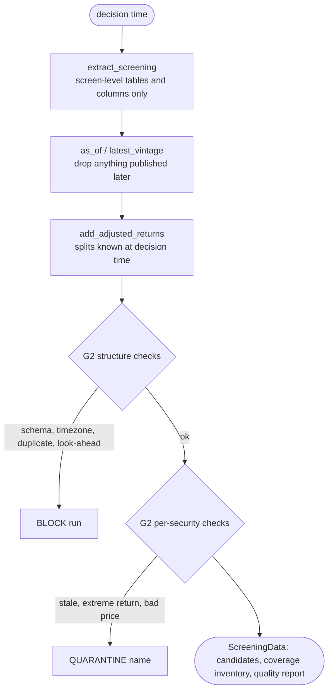

# Part 04 — The data foundation and Stage 00: screening data and G2

**Goal:** turn raw provider tables into one validated, point-in-time, split-adjusted **screening dataset** for every candidate company, and decide what to do about bad data: **block** the run, **quarantine** a security, or **warn**. Read only what the universe decision needs. Text and company exposures stay unread until Part 06.

**Design:** Stage 0 ("Screening scope versus full data scope"; "Data timing and integrity"; the G2 severity table). **Overview:** §1.1 rows "Point-in-time data" and "Filter before deep retrieval", §4 row "00 — Screening".



## What you will build in this part

| Section | File | Components |
|---|---|---|
| 4.2 | `connectors/synthetic/synthetic_market.py` | 9 |
| 4.3 | `connectors/connector_base.py` | 3 |
| 4.4 | `data_foundation/calendar_manager.py`, `corporate_actions.py`, `as_of_join.py` | 1 + 1 + 2 |
| 4.5 | `gates/g2_data_integrity.py`, `data_foundation/data_validator.py`, `data_quality_report.py` | 2 + 1 + 1 |
| 4.6 | `contracts/screening_schema.py` | 1 |
| 4.7 | `stage_00_screening/extractors/screening_extractor.py`, `source_availability_probe.py` | 2 + 1 |
| 4.8 | `stage_00_screening/candidate_registry.py`, `coverage_inventory.py` | 1 + 1 |
| 4.9 | `stage_00_screening/service.py` | 4 |
| 4.10 | tests | |

**Why a `data_foundation` package?** Design Stage 0 says the timing and integrity rules *"apply both to Stage 0 screening inputs and to all detailed sources retrieved after Stage 1"*. The calendar, split adjustment, as-of joins and G2 validation are therefore shared by Stage 00 and Stage 2 (Part 06), so they live in one package both can import.

---

## 4.1 A market designed to break things

You cannot test a data gate on clean data, or a news engine on tidy news. The synthetic generator plants one problem for each check in the design:

| Security / story | What happens | Who should catch it | Expected result |
|---|---|---|---|
| SYN05 | delisted 2023-09-01, before universe formation | Stage 01 | rejected at formation: `NOT_LISTED` |
| SYN07 | 15% distress probability | Stage 01 / G1 | rejected: `DIST` |
| SYN09 | tiny volume, frequent zero-volume days | Stage 01 / G1 | rejected: `LIQ` |
| SYN11 | 2-for-1 split on 2024-05-13, announced 2024-04-22 | split adjustment | **no** false −50% return |
| SYN13 | a new reference vintage on 2026-08-03 raises distress to 25% | vintage store + Stage 01 | mandatory exit `EXIT-DIST` |
| SYN17 | one wrong print (×1.8) ten days before the end | G2 | quarantined: `DATA_EXTREME_RETURN` |
| SYN21 | listed 2025-01-15 | Stage 01 / G1 | rejected: `HIST` |
| SYN25 | stops trading 8 days before the end, still listed | G2 and G1 | quarantined `DATA_STALE` + exit `EXIT-SUSP` |
| SYN30 | delisted 2026-03-02, after formation | Stage 01 / G1 | mandatory exit `EXIT-DLST` |
| news wire | 4% of stories reach the feed 6–30 hours late | Stage 02D timing | counted from the next usable day |
| news wire | 25% of stories repeated by a second wire | Stage 02D | `NEWS_DUPLICATE` |
| news wire | 5% of stories untagged by the provider | Stage 02D | still linked, from the text |
| news wire | 12 whole-feed outage days; SYN03 monitored only from 2024 | Stage 02D | Z_news is NaN there, never 0 |
| `P_LATE`, `P_UNLINKED`, `P_NO_EVENT` | three stories on the last day | Stage 02D | `NEWS_NOT_YET_AVAILABLE`, `NEWS_UNLINKED`, `NEWS_EXTRACTION_INVALID` |

Returns follow a simple factor model, `r_it = α_it + β_i m_t + s_sector,t + ε_it + news_it`, with a calm/stress volatility regime in 2022. Two weak signals are planted:

- a **price signal**, `α_it = 0.0012·quality_i − 0.12·(last 5 days' excess return)`: a quality drift and a short-term reversal;
- a **news signal**: after a story, the company drifts in the story's direction for about three weeks, `0.006 × direction × severity × e^{−(k−1)/5}` on day `k` after the market first reacts.

`--no-signal` removes the price signal and `--no-news-signal` removes the news drift, so you can watch the pipeline correctly refuse to trade, and correctly refuse to credit news (Part 13). **Nothing about this market says anything about real markets.**

## 4.2 The generator

**File:** `src/aqp_python/connectors/synthetic/synthetic_market.py` — component 1 of 9: docstring, imports and the scenario table

```python
"""Deterministic synthetic ASX-like market (prices AND news) used for tests and first runs.

The data is fake but deliberately awkward: a delisted name, a late listing, an
illiquid name, a distressed name, a stock split, a bad price print and a
suspension, so every gate has something real to catch. A news wire publishes
timestamped stories about the companies; some arrive late, some are duplicated,
some are untagged, and the feed has outages, so the news engine has something
real to catch too. Two weak signals are planted: a price signal (quality drift,
short-term reversal) and a news signal (post-event drift). Nothing here says
anything about real markets.
"""
from pathlib import Path

import numpy as np
import pandas as pd

TIMEZONE = "Australia/Sydney"
PUBLICATION_TIME = "16:30"          # close data becomes usable 30 minutes after the auction
SECTORS = ("Financials", "Materials", "Health Care", "Industrials", "Consumer", "Technology")

# Named special cases (security_id -> scenario). See module docstring.
DELISTED_BEFORE_FORMATION = ("SYN05", "2023-09-01")
DELISTED_AFTER_FORMATION = ("SYN30", "2026-03-02")
LATE_LISTING = ("SYN21", "2025-01-15")
ILLIQUID = "SYN09"
DISTRESSED = "SYN07"
DISTRESS_REVISION = ("SYN13", "2026-08-03", 0.25)   # new reference vintage after formation
SPLIT = ("SYN11", "2024-05-13", "2024-04-22", 2.0)   # ex-date, announcement, ratio
BAD_PRINT_DAYS_BEFORE_END = ("SYN17", 10)
SUSPENDED_DAYS_BEFORE_END = ("SYN25", 8)

# Planted price signal. Set both to 0.0 to get a market in which no model should pass G3.
QUALITY_ALPHA = 0.0012     # daily drift per unit of quality score
REVERSAL_STRENGTH = 0.12   # share of last week's excess move that reverses each day
```

**What it does.** Names each price scenario from the table above and the two price-signal strengths. Keeping scenarios as named constants (not magic numbers inside the code) means a test can refer to `SPLIT` or `DISTRESSED` and stay correct if you change them.

**File:** `src/aqp_python/connectors/synthetic/synthetic_market.py` — component 2 of 9: the news scenario table

```python
# event type: (direction, severity, headline template, body phrase)
EVENT_TYPES = {
    "guidance_raised": (1, 1.0, "{name} raises full-year guidance", "has raised its full-year earnings guidance"),
    "guidance_cut": (-1, 1.0, "{name} cuts full-year guidance", "has cut its full-year earnings guidance"),
    "earnings_beat": (1, 0.8, "{name} profit beats market expectations",
                      "reported a half-year profit that beat market expectations"),
    "earnings_miss": (-1, 0.8, "{name} profit misses market expectations",
                      "reported a half-year profit that missed market expectations"),
    "contract_win": (1, 0.6, "{name} wins major supply contract", "has won a major multi-year supply contract"),
    "regulatory_probe": (-1, 0.7, "Regulator opens probe into {name}",
                         "has been notified of a regulatory probe into its disclosures"),
    "product_launch": (1, 0.4, "{name} launches new product line", "will launch a new product line next quarter"),
    "executive_departure": (-1, 0.4, "{name} chief executive to step down", "said its chief executive will step down"),
    "routine_update": (0, 0.1, "{name} holds annual investor briefing", "will hold its annual investor briefing"),
}
EVENT_RATE = 0.03            # chance of a story per listed company per trading day
NEWS_ALPHA = 0.006           # planted post-event drift per unit of signed severity (0 = no news signal)
NEWS_DRIFT_DAYS, NEWS_DECAY = 15, 5.0
NEWS_JUMP = 0.012            # same-day price reaction (not predictable by a 17:00 decision)
LATE_COVERAGE = ("SYN03", "2024-01-02")   # the wire only starts monitoring SYN03 here
FEED_OUTAGE_DAYS = 12        # whole-feed outages: nothing is captured on these days
DELAYED_SHARE, DUPLICATE_SHARE, UNTAGGED_SHARE = 0.04, 0.25, 0.05
# Three hand-made stories on the last day, one for each way a story can fail Stage 02D:
PLANTED_STORIES = (
    # (story_id, provider tag, local publish time, minutes until first seen, headline, body)
    ("P_LATE", "SYN10", "16:50", 30, "Synthetic Company 10 wins major supply contract",
     "Synthetic Company 10 (SYNCO10) told the exchange that the company has won a major multi-year supply contract."),
    ("P_UNLINKED", "SYN12", "11:00", 2, "Sector outlook: analysts expect steady demand",
     "Analysts said demand across the sector should stay steady into next year."),
    ("P_NO_EVENT", "SYN12", "12:00", 2, "Synthetic Company 12 comments on media speculation",
     "Synthetic Company 12 (SYNCO12) said it does not comment on media speculation."),
)
```

**What it does.** The news scenario. Each event type has a direction, a severity, a headline template and a body phrase. `NEWS_ALPHA` is the planted drift; `NEWS_JUMP` is a same-day price reaction. The three `PLANTED_STORIES` guarantee that every way a story can fail Stage 02D appears in every run.

**Why both a jump and a drift.** The jump happens on the day the market hears the news, before or during the session our 17:00 decision follows. No honest model can trade it. The drift continues for days afterwards, and *that* is what a news feature could legitimately help forecast. If the generator had only a jump, a correct pipeline would find no incremental value in news, and so would an incorrect one.

**File:** `src/aqp_python/connectors/synthetic/synthetic_market.py` — component 3 of 9: _availability: stamp daily rows with their publication time

```python
def _availability(dates: pd.Series | pd.DatetimeIndex) -> pd.Series:
    local = pd.to_datetime(pd.Series(dates).dt.strftime("%Y-%m-%d") + f" {PUBLICATION_TIME}")
    return local.dt.tz_localize(TIMEZONE).dt.tz_convert("UTC")
```

**What it does.** Stamps every daily row with **16:30 Sydney time**, converted to UTC. That one line makes the data point-in-time: a decision at 17:00 can use that day's close, and a decision at 16:00 cannot.

**File:** `src/aqp_python/connectors/synthetic/synthetic_market.py` — component 4 of 9: _news_events: when things happen (before any price is drawn)

```python
def _news_events(rng: np.random.Generator, dates: pd.DatetimeIndex, ids: list[str],
                 listed: np.ndarray) -> pd.DataFrame:
    """One row per real-world event: who, which day, what type, and the minute it was published."""
    hits = (rng.uniform(size=listed.shape) < EVENT_RATE) & listed
    day_index, security_index = np.nonzero(hits)
    types = list(EVENT_TYPES)
    weights = np.array([0.08, 0.08, 0.14, 0.14, 0.12, 0.08, 0.12, 0.08, 0.16])
    events = pd.DataFrame({
        "day": day_index, "security_id": [ids[j] for j in security_index],
        "event_type": rng.choice(types, size=len(day_index), p=weights / weights.sum()),
        "minute": rng.integers(7 * 60, 21 * 60, size=len(day_index)),       # 07:00-21:00 Sydney
    })
    events["direction"] = events["event_type"].map(lambda t: EVENT_TYPES[t][0])
    events["severity"] = events["event_type"].map(lambda t: EVENT_TYPES[t][1])
    # Published after the 16:00 close -> the market reacts on the next session.
    events["effect_day"] = np.where(events["minute"] >= 16 * 60, events["day"] + 1, events["day"])
    return events.loc[events["effect_day"] < len(dates)].reset_index(drop=True)
```

**What it does.** Decides *when real-world events happen*: for each listed company and day, a 3% chance of a story, a random type, and a publication minute between 07:00 and 21:00. A story published after the 16:00 close moves the price on the next session (`effect_day`).

**Why events are drawn before prices.** The news drift has to be part of the returns, so the events must exist first. They use their own random generator (`seed + 1000`), so adding or changing news never shifts the random numbers of the price model.

**File:** `src/aqp_python/connectors/synthetic/synthetic_market.py` — component 5 of 9: _news_effects: what the events do to returns

```python
def _news_effects(events: pd.DataFrame, n_days: int, ids: list[str],
                  news_alpha: float) -> tuple[np.ndarray, np.ndarray]:
    """Same-day jump (unforecastable at 17:00) and a slow post-event drift (forecastable)."""
    jump, drift = np.zeros((n_days, len(ids))), np.zeros((n_days, len(ids)))
    column = {s: j for j, s in enumerate(ids)}
    for event in events.itertuples(index=False):
        signed, j = event.direction * event.severity, column[event.security_id]
        jump[event.effect_day, j] += NEWS_JUMP * signed
        for k in range(1, NEWS_DRIFT_DAYS + 1):
            if event.effect_day + k < n_days:
                drift[event.effect_day + k, j] += news_alpha * signed * np.exp(-(k - 1) / NEWS_DECAY)
    return jump, drift
```

**What it does.** Turns each event into two arrays the size of the price history: the same-day jump and the decaying drift that follows.

**File:** `src/aqp_python/connectors/synthetic/synthetic_market.py` — component 6 of 9: generate_market: characteristics and returns

```python
def generate_market(seed: int = 7, start: str = "2022-01-03", end: str = "2026-10-16",
                    n_securities: int = 40, quality_alpha: float = QUALITY_ALPHA,
                    reversal_strength: float = REVERSAL_STRENGTH,
                    news_alpha: float = NEWS_ALPHA) -> dict[str, pd.DataFrame]:
    rng = np.random.default_rng(seed)
    news_rng = np.random.default_rng(seed + 1000)   # separate stream: news never shifts the price draws
    dates = pd.bdate_range(start, end)
    n_days, n = len(dates), n_securities
    ids = [f"SYN{i + 1:02d}" for i in range(n)]
    sectors = [SECTORS[i % len(SECTORS)] for i in range(n)]
    sector_index = np.array([SECTORS.index(s) for s in sectors])

    beta = rng.uniform(0.7, 1.3, n)
    idio_vol = rng.uniform(0.012, 0.022, n)
    quality = rng.normal(0.0, 1.0, n)
    distress = rng.uniform(0.005, 0.05, n)
    distress[ids.index(DISTRESSED)] = 0.15
    dollar_volume_median = np.exp(rng.normal(np.log(8e6), 0.6, n))
    dollar_volume_median[ids.index(ILLIQUID)] = 2e5
    start_price = rng.uniform(5.0, 60.0, n)
    revenue = rng.dirichlet([3.0, 1.5, 1.0], n)        # AU, US, CN revenue shares

    listing = pd.Series(pd.Timestamp(start), index=ids)
    listing[LATE_LISTING[0]] = pd.Timestamp(LATE_LISTING[1])
    delisting = pd.Series(pd.NaT, index=ids, dtype="datetime64[ns]")
    for security_id, day in (DELISTED_BEFORE_FORMATION, DELISTED_AFTER_FORMATION):
        delisting[security_id] = pd.Timestamp(day)
    listed = np.array([[listing[s] <= d and (pd.isna(delisting[s]) or d < delisting[s])
                        for s in ids] for d in dates])

    events = _news_events(news_rng, dates, ids, listed)
    jump, drift = _news_effects(events, n_days, ids, news_alpha)

    stress = (dates >= "2022-05-02") & (dates <= "2022-07-29")
    market_vol = np.where(stress, 0.018, 0.009)
    market = rng.normal(0.0003, 1.0, n_days) * market_vol
    sector_factor = rng.normal(0.0, 0.006, (n_days, len(SECTORS)))
    noise = rng.normal(0.0, 1.0, (n_days, n)) * idio_vol
    returns = np.zeros((n_days, n))
    for t in range(n_days):
        past = returns[max(0, t - 5):t]
        past_excess = (past - past.mean(axis=1, keepdims=True)).sum(axis=0) if len(past) else 0.0
        alpha = quality_alpha * quality - reversal_strength * past_excess + drift[t]   # planted signals
        returns[t] = alpha + beta * market[t] + sector_factor[t, sector_index] + noise[t] + jump[t]
```

**What it does.** Draws company characteristics, listing dates and the daily returns. The return loop is sequential because the reversal term depends on the previous five days; `past_excess` subtracts the cross-sectional mean, so it is an *excess* move, which is what a benchmark-relative model can predict. `drift[t]` and `jump[t]` add the news.

**File:** `src/aqp_python/connectors/synthetic/synthetic_market.py` — component 7 of 9: generate_market: prices, benchmark and reference

```python
    suspended_id, suspended_days = SUSPENDED_DAYS_BEFORE_END
    listed_trading = listed.copy()
    listed_trading[-suspended_days:, ids.index(suspended_id)] = False
    benchmark_return = np.nanmean(np.where(listed, returns, np.nan), axis=1)

    rows = []
    split_id, split_ex, _, split_ratio = SPLIT
    bad_id, bad_offset = BAD_PRINT_DAYS_BEFORE_END
    for j, security_id in enumerate(ids):
        true_close = start_price[j] * np.cumprod(1.0 + np.where(listed[:, j], returns[:, j], 0.0))
        raw_close = true_close.copy()
        if security_id == split_id:
            raw_close[dates >= split_ex] /= split_ratio
        if security_id == bad_id:
            raw_close[n_days - bad_offset] *= 1.8                 # one wrong print, not a real move
        dollar_volume = dollar_volume_median[j] * np.exp(rng.normal(0.0, 0.35, n_days))
        if security_id == ILLIQUID:
            dollar_volume[rng.uniform(size=n_days) < 0.10] = 0.0  # frequent zero-volume days
        volume = np.round(dollar_volume / raw_close)
        for t in np.flatnonzero(listed_trading[:, j]):
            rows.append((security_id, dates[t], raw_close[t], volume[t]))

    prices = pd.DataFrame(rows, columns=["security_id", "date", "close", "volume"])
    prices["close"] = prices["close"].round(4)
    prices["availability_ts"] = _availability(prices["date"]).to_numpy()
    prices["currency"] = "AUD"
    prices["source"] = "synthetic"
    prices = prices[["security_id", "date", "availability_ts", "close", "volume", "currency", "source"]]

    benchmark = pd.DataFrame({"date": dates, "benchmark_return": benchmark_return})
    benchmark["availability_ts"] = _availability(benchmark["date"]).to_numpy()
    benchmark = benchmark[["date", "availability_ts", "benchmark_return"]]

    reference = pd.DataFrame({
        "security_id": ids, "name": [f"Synthetic Company {i[3:]}" for i in ids],
        "short_name": [f"SYNCO{i[3:]}" for i in ids], "sector": sectors,
        "listing_date": listing.to_numpy(), "delisting_date": delisting.to_numpy(), "currency": "AUD",
        "distress_probability": distress.round(4), "quality_score": quality.round(4),
        "revenue_share_au": revenue[:, 0].round(4), "revenue_share_us": revenue[:, 1].round(4),
        "revenue_share_cn": revenue[:, 2].round(4),
    })
    reference["availability_ts"] = pd.Timestamp(start, tz="UTC") - pd.Timedelta(days=1)
    revision = reference.loc[reference["security_id"] == DISTRESS_REVISION[0]].copy()
    revision["distress_probability"] = DISTRESS_REVISION[2]
    revision["availability_ts"] = pd.Timestamp(DISTRESS_REVISION[1], tz="UTC")
    reference = pd.concat([reference, revision], ignore_index=True)
    reference["availability_ts"] = pd.to_datetime(reference["availability_ts"], utc=True)

    actions = pd.DataFrame({
        "security_id": [split_id], "ex_date": [pd.Timestamp(split_ex)],
        "split_ratio": [split_ratio],
        "availability_ts": [pd.Timestamp(SPLIT[2], tz="UTC")],
    })
    news, coverage = _news_feed(news_rng, events, dates, reference.drop_duplicates("security_id"))
    return {"prices": prices, "benchmark": benchmark, "reference": reference,
            "corporate_actions": actions, "news": news, "news_coverage": coverage}
```

**What it does.** Builds the four price-side tables. Points worth slowing down for:

- The split divides **raw** prices after the ex-date while the true returns are unchanged. The data foundation must undo that using the corporate-action file.
- `reference` gets a **second row** for SYN13, available from 2026-08-03. Both vintages are kept; nothing is overwritten.
- `short_name` (`SYNCO12`) is the alias a news story may use instead of the full name; entity linking (Part 09) needs both.

**File:** `src/aqp_python/connectors/synthetic/synthetic_market.py` — component 8 of 9: _news_feed: what the wire actually captured

```python
def _news_feed(rng: np.random.Generator, events: pd.DataFrame, dates: pd.DatetimeIndex,
               reference: pd.DataFrame) -> tuple[pd.DataFrame, pd.DataFrame]:
    """Turn events into stories: latency, duplicates, missing tags, outages and late coverage."""
    names = reference.set_index("security_id")
    outages = set(rng.choice(np.arange(20, len(dates) - 20), size=FEED_OUTAGE_DAYS, replace=False))
    late_id, late_start = LATE_COVERAGE
    coverage_rows = []
    for security_id in names.index:
        first = dates.searchsorted(pd.Timestamp(late_start)) if security_id == late_id else 0
        start = first
        for day in sorted(d for d in outages if d >= first) + [len(dates)]:
            if day > start:
                coverage_rows.append((security_id, dates[start], dates[day - 1]))
            start = day + 1
    coverage = pd.DataFrame(coverage_rows, columns=["security_id", "start_date", "end_date"])

    stories = []
    for number, event in enumerate(events.itertuples(index=False)):
        late = event.security_id == late_id and dates[event.day] < pd.Timestamp(late_start)
        if event.day in outages or late:
            continue                                   # the wire missed it: the event still moved prices
        name, short = names.loc[event.security_id, "name"], names.loc[event.security_id, "short_name"]
        published = (pd.Timestamp(dates[event.day]) + pd.Timedelta(minutes=int(event.minute))).tz_localize(TIMEZONE)
        if rng.uniform() < DELAYED_SHARE:
            latency = pd.Timedelta(minutes=int(rng.uniform(6, 30) * 60))    # stuck in a queue overnight
        else:
            latency = pd.Timedelta(seconds=int(60 * rng.lognormal(1.2, 0.6)))
        headline = EVENT_TYPES[event.event_type][2].format(name=name)
        body = (f"{name} ({short}) told the exchange on {dates[event.day]:%A} that the company "
                f"{EVENT_TYPES[event.event_type][3]}.")
        tags = "" if rng.uniform() < UNTAGGED_SHARE else event.security_id
        stories.append((f"N{number:05d}", "wire_a", published, published + latency, tags, headline, body))
        if rng.uniform() < DUPLICATE_SHARE:                                  # a second wire repeats it
            again = published + pd.Timedelta(minutes=int(rng.integers(10, 120)))
            stories.append((f"N{number:05d}b", "wire_b", again, again + latency, tags,
                            f"UPDATE: {headline}", body))
    last_day = dates[-1]
    for story_id, tag, local_time, minutes, headline, body in PLANTED_STORIES:
        published = pd.Timestamp(f"{last_day:%Y-%m-%d} {local_time}").tz_localize(TIMEZONE)
        stories.append((story_id, "wire_a", published, published + pd.Timedelta(minutes=minutes), tag,
                        headline, body))
    news = pd.DataFrame(stories, columns=["story_id", "source", "published_ts", "first_seen_ts",
                                          "provider_tags", "headline", "body"])
    for column in ("published_ts", "first_seen_ts"):
        news[column] = news[column].dt.tz_convert("UTC")
    return news.sort_values("first_seen_ts").reset_index(drop=True), coverage
```

**What it does.** Decides what the news wire *actually captured*: coverage periods (with outage days and SYN03's late start), feed latency, second-wire repeats, missing provider tags, and the three planted stories.

**Why this matters.** The difference between "the event happened" and "the feed captured it" is the whole missingness lesson of Stage 2D. On an outage day the company still drifts, but no story exists. A pipeline that turned "no story" into "sentiment 0" would teach the model that nothing happened when in fact the feed was simply blind.

**File:** `src/aqp_python/connectors/synthetic/synthetic_market.py` — component 9 of 9: write_sample_data

```python
def write_sample_data(folder: Path, seed: int = 7, **signal: float) -> dict[str, Path]:
    """Write the six CSV files. Timestamps are stored as ISO-8601 with a UTC offset."""
    folder = Path(folder)
    folder.mkdir(parents=True, exist_ok=True)
    written = {}
    for name, frame in generate_market(seed=seed, **signal).items():
        frame = frame.copy()
        for column in frame.columns:
            if isinstance(frame[column].dtype, pd.DatetimeTZDtype):
                frame[column] = frame[column].dt.strftime("%Y-%m-%dT%H:%M:%S%z")
            elif pd.api.types.is_datetime64_any_dtype(frame[column]):
                frame[column] = frame[column].dt.strftime("%Y-%m-%d")
        path = folder / f"{name}.csv"
        frame.to_csv(path, index=False)
        written[name] = path
    return written
```

Timestamps are written as ISO-8601 with an explicit offset (`2022-01-03T05:30:00+0000`), so nobody has to guess the time zone when a file is read back.

Now build the data:

```powershell
python -m aqp_python.cli build-sample-data
```

```text
wrote prices             -> data/samples/prices.csv
wrote benchmark          -> data/samples/benchmark.csv
wrote reference          -> data/samples/reference.csv
wrote corporate_actions  -> data/samples/corporate_actions.csv
wrote news               -> data/samples/news.csv
wrote news_coverage      -> data/samples/news_coverage.csv
```

```python
import pandas as pd

news = pd.read_csv("data/samples/news.csv")
print(len(news), "stories |", news["source"].value_counts().to_dict())
late = pd.to_datetime(news["first_seen_ts"]) - pd.to_datetime(news["published_ts"])
print("median feed latency:", late.median(), "| slowest:", late.max())
print(news.loc[news["story_id"].str.startswith("P_"), ["story_id", "provider_tags", "headline"]].to_string(index=False))
```

```text
1763 stories | {'wire_a': 1406, 'wire_b': 357}
median feed latency: 0 days 00:03:25 | slowest: 1 days 05:03:00
  story_id provider_tags                                           headline
P_UNLINKED         SYN12      Sector outlook: analysts expect steady demand
P_NO_EVENT         SYN12 Synthetic Company 12 comments on media speculation
    P_LATE         SYN10    Synthetic Company 10 wins major supply contract
```

## 4.3 The data source boundary

Stages never open files themselves. They ask a *source* for a table and, crucially, for specific columns.

**File:** `src/aqp_python/connectors/connector_base.py` — component 1 of 3: imports and the table schemas

```python
"""Data sources. Stages read tables through this boundary, never through a provider SDK.

A source knows HOW to read a table; the stage extractors decide WHICH tables and
columns may be read at each point of the pipeline (screening vs. detailed data).
"""
import hashlib
from collections.abc import Sequence
from pathlib import Path
from typing import Protocol

import pandas as pd

from aqp_python.contracts.data_schemas import (
    BENCHMARK_COLUMNS,
    CORPORATE_ACTION_COLUMNS,
    NEWS_COLUMNS,
    NEWS_COVERAGE_COLUMNS,
    PRICE_COLUMNS,
    REFERENCE_COLUMNS,
    require_columns,
)

# table -> (allowed columns, {column: "date" (naive trading date) | "utc" (timestamp)})
SCHEMAS = {
    "prices.csv": (PRICE_COLUMNS, {"date": "date", "availability_ts": "utc"}),
    "benchmark.csv": (BENCHMARK_COLUMNS, {"date": "date", "availability_ts": "utc"}),
    "reference.csv": (REFERENCE_COLUMNS, {"listing_date": "date", "delisting_date": "date",
                                          "availability_ts": "utc"}),
    "corporate_actions.csv": (CORPORATE_ACTION_COLUMNS, {"ex_date": "date", "availability_ts": "utc"}),
    "news.csv": (NEWS_COLUMNS, {"published_ts": "utc", "first_seen_ts": "utc"}),
    "news_coverage.csv": (NEWS_COVERAGE_COLUMNS, {"start_date": "date", "end_date": "date"}),
}
```

**What it does.** `SCHEMAS` names, for each table, the columns it may contain and how each time column is parsed: `"date"` for a naive trading date, `"utc"` for an instant.

**File:** `src/aqp_python/connectors/connector_base.py` — component 2 of 3: the TabularSource protocol

```python
class TabularSource(Protocol):
    """Anything that can say whether it has a table and read selected columns of it."""
    name: str
    lineage: dict

    def has_table(self, table: str) -> bool: ...

    def read_table(self, table: str, columns: Sequence[str] | None = None) -> pd.DataFrame: ...


def _sha256(path: Path) -> str:
    return hashlib.sha256(path.read_bytes()).hexdigest()
```

**What it does.** `TabularSource` is a `Protocol`: anything with `name`, `lineage`, `has_table` and `read_table` can be used. Today that is `CsvSampleSource`; Part 14 shows where an LSEG source plugs in with the same shape, and nothing downstream changes.

**File:** `src/aqp_python/connectors/connector_base.py` — component 3 of 3: CsvSampleSource: read only what you are asked for, and record it

```python
class CsvSampleSource:
    """Reads the synthetic CSV files written by `aqp build-sample-data`."""

    name = "synthetic_csv"

    def __init__(self, folder: Path) -> None:
        self.folder = Path(folder)
        self.lineage: dict[str, dict] = {}       # every table read: path, columns, rows, SHA-256

    def has_table(self, table: str) -> bool:
        return (self.folder / table).is_file()

    def read_table(self, table: str, columns: Sequence[str] | None = None) -> pd.DataFrame:
        if table not in SCHEMAS:
            raise KeyError(f"unknown table {table!r}")
        path = self.folder / table
        if not path.is_file():
            raise FileNotFoundError(f"Sample data missing: {path}. Run: python -m aqp_python.cli build-sample-data")
        allowed, parse = SCHEMAS[table]
        wanted = list(columns) if columns is not None else list(allowed)
        unknown = sorted(set(wanted) - set(allowed))
        if unknown:
            raise ValueError(f"{table} has no columns {unknown}")
        frame = pd.read_csv(path, usecols=wanted)
        require_columns(frame, wanted, table)
        for column, kind in parse.items():
            if column in frame:
                frame[column] = (pd.to_datetime(frame[column], utc=True) if kind == "utc"
                                 else pd.to_datetime(frame[column]))
        if "provider_tags" in frame:
            frame["provider_tags"] = frame["provider_tags"].fillna("").astype(str)
        self.lineage[table] = {"path": str(path), "columns": wanted, "rows": len(frame),
                               "sha256": _sha256(path), "provider": self.name}
        return frame
```

**What it does.** Reads a table, optionally only some columns (`pd.read_csv(usecols=...)`), parses the times and records **lineage**: path, the columns actually read, row count and SHA-256 of the file.

**Why "only what you are asked for" matters.** With a real provider, the fields you request are the fields you are billed for and licensed to hold. Recording the requested columns in lineage turns "Stage 00 never read company exposures" from a promise into evidence you can check in the manifest.

```python
from aqp_python.connectors.connector_base import CsvSampleSource

source = CsvSampleSource("data/samples")
reference = source.read_table("reference.csv", columns=["security_id", "name", "sector", "availability_ts"])
print(reference.head(3).to_string(index=False))
print(source.lineage["reference.csv"]["columns"], source.lineage["reference.csv"]["rows"])
```

```text
security_id                 name      sector           availability_ts
      SYN01 Synthetic Company 01  Financials 2022-01-02 00:00:00+00:00
      SYN02 Synthetic Company 02   Materials 2022-01-02 00:00:00+00:00
      SYN03 Synthetic Company 03 Health Care 2022-01-02 00:00:00+00:00
['security_id', 'name', 'sector', 'availability_ts'] 41
```

## 4.4 Calendar, corporate actions and as-of joins

**File:** `src/aqp_python/data_foundation/calendar_manager.py`

```python
"""Trading calendar. The benchmark's dates are the official trading days of the sleeve."""
import pandas as pd


def trading_days(benchmark: pd.DataFrame) -> pd.DatetimeIndex:
    days = pd.DatetimeIndex(pd.to_datetime(benchmark["date"])).sort_values().unique()
    if days.empty:
        raise ValueError("benchmark has no dates; cannot build a trading calendar")
    return days
```

The benchmark's dates are the sleeve's official trading days. A US sleeve would take its calendar from its own benchmark.

**File:** `src/aqp_python/data_foundation/corporate_actions.py`

```python
"""Raw prices are preserved; split adjustments are applied on read, point-in-time."""
from datetime import datetime

import numpy as np
import pandas as pd

from aqp_python.storage.vintage_store import as_of


def add_adjusted_returns(prices: pd.DataFrame, actions: pd.DataFrame,
                         decision_time: datetime) -> pd.DataFrame:
    """Add `return`, `adj_close` and `dollar_volume` using only actions known at decision time.

    On an ex-date with ratio k (k new shares per old share) the raw close drops by
    a factor k, so the economic return is close_t * k / close_{t-1} - 1.
    An action announced after the decision time is NOT applied, which is exactly
    what a system running on that day would have seen.
    """
    known = as_of(actions, decision_time)
    frame = prices.sort_values(["security_id", "date"], kind="mergesort").reset_index(drop=True)
    ratio = pd.Series(1.0, index=frame.index)
    for action in known.itertuples(index=False):
        hit = (frame["security_id"] == action.security_id) & (frame["date"] == action.ex_date)
        ratio[hit] = float(action.split_ratio)
    previous_close = frame.groupby("security_id")["close"].shift(1)
    frame["return"] = frame["close"] * ratio / previous_close - 1.0

    # Backward adjustment factor: divide earlier prices by every later split ratio.
    later_ratio = (ratio.groupby(frame["security_id"])
                   .transform(lambda r: r[::-1].cumprod()[::-1].shift(-1, fill_value=1.0)))
    frame["adj_close"] = frame["close"] / later_ratio
    frame["dollar_volume"] = frame["close"] * frame["volume"]
    frame["return"] = frame["return"].replace([np.inf, -np.inf], np.nan)
    return frame
```

**The algebra.** On an ex-date with ratio `k` (2.0 for a 2-for-1 split) the raw close drops by a factor `k`, so the economic return is `close_t · k / close_{t−1} − 1`. Two design rules are visible:

- **Raw prices are never modified.** `close` stays as published; `adj_close` and `return` are new columns (design Stage 0: *"Preserve raw prices. Apply adjustment factors… on read"*).
- **Only actions known at the decision time are applied** (`as_of(actions, decision_time)`). A system running on 1 April 2024 did not know about the split announced on 22 April, so the backtest must not know either.

```python
from datetime import UTC, datetime

import pandas as pd

from aqp_python.data_foundation.corporate_actions import add_adjusted_returns

days = pd.bdate_range("2024-05-09", periods=4)
prices = pd.DataFrame({"security_id": "SYN11", "date": days, "close": [20.0, 20.2, 10.1, 10.0], "volume": 1e5})
split = pd.DataFrame({"security_id": ["SYN11"], "ex_date": [days[2]], "split_ratio": [2.0],
                      "availability_ts": pd.to_datetime(["2024-04-22"], utc=True)})
for decided in (datetime(2024, 5, 20, tzinfo=UTC), datetime(2024, 4, 1, tzinfo=UTC)):
    out = add_adjusted_returns(prices, split, decided)
    print(decided.date(), "returns:", out["return"].round(4).tolist())
```

```text
2024-05-20 returns: [nan, 0.01, 0.0, -0.0099]
2024-04-01 returns: [nan, 0.01, -0.5, -0.0099]
```

Decided after the announcement, the ex-date return is 0.0. Decided before it (an impossible backtest, shown only to make the point) the same data shows a −50% "crash", which G2 would quarantine.

**File:** `src/aqp_python/data_foundation/as_of_join.py` — component 1 of 2: decision_timestamps: when was each trading date decided?

```python
"""Row-by-row point-in-time joins: each (security, date) row sees only what was known by its decision time."""
import pandas as pd


def decision_timestamps(dates: pd.Series, timezone: str, local_time: str) -> pd.Series:
    """The UTC instant of the decision taken on each trading date (e.g. 17:00 Sydney)."""
    local = pd.to_datetime(pd.Series(dates).dt.strftime("%Y-%m-%d") + f" {local_time}")
    return local.dt.tz_localize(timezone).dt.tz_convert("UTC").astype("datetime64[ns, UTC]")
```

**What it does.** Converts each trading date into the instant its decision was taken (17:00 Sydney → 06:00 or 07:00 UTC, depending on daylight saving).

**File:** `src/aqp_python/data_foundation/as_of_join.py` — component 2 of 2: join_as_of: attach the latest vintage known at each row's decision time

```python
def join_as_of(rows: pd.DataFrame, vintages: pd.DataFrame, columns: list[str], *,
               timezone: str, local_time: str) -> pd.DataFrame:
    """Attach `columns` from the latest vintage with availability_ts <= that row's decision time.

    Joining "today's" value onto all history would leak later revisions into the past;
    this join is the row-by-row version of storage.vintage_store.as_of.
    """
    left = rows.assign(_decision_ts=decision_timestamps(rows["date"], timezone, local_time).to_numpy())
    right = vintages[["security_id", "availability_ts", *columns]].copy()
    right["availability_ts"] = right["availability_ts"].astype("datetime64[ns, UTC]")
    joined = pd.merge_asof(left.sort_values("_decision_ts"), right.sort_values("availability_ts"),
                           left_on="_decision_ts", right_on="availability_ts", by="security_id",
                           direction="backward")
    return (joined.drop(columns=["_decision_ts", "availability_ts"])
            .sort_values(["security_id", "date"]).reset_index(drop=True))
```

**What it does.** For every `(security, date)` row, attaches the latest vintage whose `availability_ts` is at or before **that row's** decision instant (`pd.merge_asof(direction="backward")`).

**Why compare instants, not dates.** A vintage published at 18:00 Sydney on 3 August must not be joined to the 3 August row, because the 17:00 decision that day could not have seen it. Comparing calendar dates would leak it by one hour; comparing decision instants does not. `as_of` (3.1) filters a whole table for one decision; `join_as_of` applies the same rule row by row across history, which is what feature building needs (Part 06).

## 4.5 The G2 gate and the validator

**File:** `src/aqp_python/gates/g2_data_integrity.py` — component 1 of 2: imports and check_structure: faults that block the run

```python
"""G2 - data integrity. Block the run for structural faults; quarantine names for local faults."""
from datetime import datetime

import numpy as np
import pandas as pd

from aqp_python.contracts.data_schemas import PRICE_COLUMNS
from aqp_python.contracts.reason_codes import ReasonCode as RC
from aqp_python.gates.gate_result import GateOutcome, GateResult

GATE = "G2"


def check_structure(prices: pd.DataFrame, decision_time: datetime) -> list[GateResult]:
    """Run-level checks. Any failure here is a BLOCK: the data cannot be trusted at all."""
    missing = sorted(set(PRICE_COLUMNS) - set(prices.columns))
    if missing:
        return [GateResult(GATE, GateOutcome.BLOCK, "run", (RC.DATA_SCHEMA,), f"missing {missing}")]
    availability = prices["availability_ts"]
    if not isinstance(availability.dtype, pd.DatetimeTZDtype):
        return [GateResult(GATE, GateOutcome.BLOCK, "run", (RC.DATA_TIMEZONE,),
                           "availability_ts must be timezone-aware")]
    results = []
    duplicates = int(prices.duplicated(["security_id", "date"]).sum())
    if duplicates:
        results.append(GateResult(GATE, GateOutcome.BLOCK, "run", (RC.DATA_DUPLICATE,),
                                  f"{duplicates} duplicate (security_id, date) rows"))
    future = int((availability > pd.Timestamp(decision_time)).sum())
    if future:
        results.append(GateResult(GATE, GateOutcome.BLOCK, "run", (RC.DATA_LOOKAHEAD,),
                                  f"{future} rows were not available at the decision time"))
    return results
```

**What it does.** Run-level checks. Any failure is a `BLOCK`: missing columns, naive timestamps, duplicate keys, rows from after the decision time. **Why the look-ahead check looks redundant:** `as_of` already removed future rows. It is a **second line of defence**: if someone later edits a stage and forgets `as_of`, G2 blocks the run instead of silently leaking the future.

**File:** `src/aqp_python/gates/g2_data_integrity.py` — component 2 of 2: check_securities: faults that quarantine one name

```python
def check_securities(prices: pd.DataFrame, listed: set[str], decision_date: pd.Timestamp,
                     rules: dict) -> list[GateResult]:
    """Per-security checks. Failures QUARANTINE that name for this run only.

    `prices` must already carry split-adjusted returns in column 'return'.
    """
    results = []
    lookback_start = decision_date - pd.offsets.BDay(rules["extreme_lookback_days"])
    for security_id, rows in prices.groupby("security_id", sort=True):
        codes, notes = [], []
        if (rows["close"] <= 0).any():
            codes.append(RC.DATA_NONPOSITIVE_PRICE)
        if security_id in listed:
            last_date = rows["date"].max()
            stale_days = len(pd.bdate_range(last_date, decision_date)) - 1
            if stale_days > rules["max_staleness_days"]:
                codes.append(RC.DATA_STALE)
                notes.append(f"last price {last_date.date()} ({stale_days} business days old)")
        recent = rows.loc[rows["date"] >= lookback_start, "return"].abs()
        if np.nanmax(recent.to_numpy(), initial=0.0) > rules["extreme_return_abs"]:
            codes.append(RC.DATA_EXTREME_RETURN)
            notes.append(f"max |return| {recent.max():.2f} in last {rules['extreme_lookback_days']} days")
        if codes:
            results.append(GateResult(GATE, GateOutcome.QUARANTINE, str(security_id),
                                      tuple(codes), "; ".join(notes)))
    return results
```

**What it does.** Per-security checks. A failure **quarantines** that name for this run only: a non-positive price, a stale price for a listed name, or an unexplained extreme return in the last 60 sessions.

| Function | Faults | Outcome | Why |
|---|---|---|---|
| `check_structure` | missing columns, naive time zone, duplicate keys, future rows | `BLOCK` the run | the whole table is untrustworthy |
| `check_securities` | bad price, stale listed name, extreme return | `QUARANTINE` the name | the problem is local; keep an audit trail |

**File:** `src/aqp_python/data_foundation/data_validator.py`

```python
"""Run G2 on a price table and decide which names are quarantined (used by Stage 00 and Stage 2)."""
from datetime import datetime

import pandas as pd

from aqp_python.gates.g2_data_integrity import check_securities, check_structure
from aqp_python.gates.gate_result import GateOutcome, GateResult


def listed_at(reference: pd.DataFrame, date: pd.Timestamp) -> set[str]:
    listed = (reference["listing_date"] <= date) & (
        reference["delisting_date"].isna() | (reference["delisting_date"] > date))
    return set(reference.loc[listed, "security_id"])


def validate_prices(prices: pd.DataFrame, reference: pd.DataFrame, decision_time: datetime,
                    decision_date: pd.Timestamp, rules: dict) -> tuple[list[GateResult], frozenset[str]]:
    """Return all G2 results and the set of quarantined securities."""
    results = check_structure(prices, decision_time)
    if any(result.outcome == GateOutcome.BLOCK for result in results):
        return results, frozenset()
    results += check_securities(prices, listed_at(reference, decision_date), decision_date, rules)
    quarantined = frozenset(r.subject for r in results if r.outcome == GateOutcome.QUARANTINE)
    results.insert(0, GateResult("G2", GateOutcome.PASS, "run", (), "structure checks passed"))
    return results, quarantined
```

**What it does.** Runs both halves of G2 and returns the results with the set of quarantined names. `listed_at` matters for staleness: a delisted name *should* have no recent prices; only a name that is still listed but has stopped printing is suspicious.

**File:** `src/aqp_python/data_foundation/data_quality_report.py`

```python
"""One row per security describing what a stage saw - written to data_lineage/ by Stages 00 and 2."""
import pandas as pd

from aqp_python.gates.gate_result import GateResult


def build_quality_report(prices: pd.DataFrame, trading_days: pd.DatetimeIndex,
                         gate_results: list[GateResult]) -> pd.DataFrame:
    codes = {r.subject: ";".join(map(str, r.reason_codes)) for r in gate_results if r.subject != "run"}
    rows = []
    for security_id, group in prices.groupby("security_id", sort=True):
        first, last = group["date"].min(), group["date"].max()
        expected = int(((trading_days >= first) & (trading_days <= last)).sum())
        rows.append({
            "security_id": security_id,
            "first_date": first.date(), "last_date": last.date(), "rows": len(group),
            "missing_ratio": round(1 - len(group) / expected, 4) if expected else 1.0,
            "max_abs_return": round(float(group["return"].abs().max()), 4),
            "median_dollar_volume": round(float(group["dollar_volume"].median()), 0),
            "quarantined": security_id in codes,
            "reason_codes": codes.get(security_id, ""),
        })
    return pd.DataFrame(rows)
```

One row per security describing what the stage saw: first and last dates, missing ratio, the largest absolute return, median dollar volume and any quarantine codes.

## 4.6 The Stage 00 hand-off contract

**File:** `src/aqp_python/contracts/screening_schema.py`

```python
"""Stage 00 hand-off: the screening dataset the universe decision is made from."""
from dataclasses import dataclass

import pandas as pd


@dataclass(frozen=True)
class ScreeningData:
    """Validated, point-in-time, split-adjusted screen-level data for every candidate."""
    prices: pd.DataFrame              # PRICE_COLUMNS + adj_close, return, dollar_volume
    benchmark: pd.DataFrame           # BENCHMARK_COLUMNS
    reference: pd.DataFrame           # latest screening vintage per candidate (no exposures)
    reference_vintages: pd.DataFrame  # every screening vintage known at decision time
    trading_days: pd.DatetimeIndex
    candidates: pd.DataFrame          # candidate registry: every security ever known, incl. delisted
    coverage: pd.DataFrame            # coverage inventory: does a news/intraday source exist?
    quarantined: frozenset[str]       # names excluded for this run by G2
```

Later stages receive this object and nothing else from Stage 00. They never reopen the CSV files. **Why `reference_vintages` as well as `reference`:** Stage 01 must reconstruct what was known on the *formation* date (2025-06-30), not today.

## 4.7 Extractors: what screening may read

**File:** `src/aqp_python/stages/stage_00_screening/extractors/screening_extractor.py` — component 1 of 2: RawScreeningData and the screening rules

```python
"""Stage 00 extractor: read ONLY the screen-level tables and fields named in screening_request.yaml."""
from dataclasses import dataclass

import pandas as pd

from aqp_python.connectors.connector_base import TabularSource

FORBIDDEN_AT_SCREENING = {"news.csv"}   # text is collected after G1, for admitted names only


@dataclass(frozen=True)
class RawScreeningData:
    prices: pd.DataFrame
    benchmark: pd.DataFrame
    reference: pd.DataFrame
    corporate_actions: pd.DataFrame
    news_coverage: pd.DataFrame | None
    lineage: dict
```

**File:** `src/aqp_python/stages/stage_00_screening/extractors/screening_extractor.py` — component 2 of 2: extract_screening

```python
def extract_screening(source: TabularSource, request: dict) -> RawScreeningData:
    files = set(request["files"])
    if files & FORBIDDEN_AT_SCREENING:
        raise ValueError(f"screening may not read {sorted(files & FORBIDDEN_AT_SCREENING)}")
    reference = source.read_table("reference.csv", columns=request["reference_fields"])
    coverage = (source.read_table("news_coverage.csv")
                if "news_coverage.csv" in files and source.has_table("news_coverage.csv") else None)
    return RawScreeningData(
        prices=source.read_table("prices.csv"),
        benchmark=source.read_table("benchmark.csv"),
        reference=reference,
        corporate_actions=source.read_table("corporate_actions.csv"),
        news_coverage=coverage,
        lineage=dict(source.lineage),
    )
```

**What it does.** Reads the tables named in `screening_request.yaml`, and the reference table **only with the screening fields**. It refuses `news.csv` outright.

**Why the rule is enforced twice.** The configuration validator (Part 02) refuses a screening request that names the corpus; the extractor refuses it again at run time. Defence in depth is cheap here, and the cost of a leak (admission decisions quietly influenced by news) is a biased universe you can never detect afterwards.

**File:** `src/aqp_python/stages/stage_00_screening/extractors/source_availability_probe.py`

```python
"""Does a source EXIST for a candidate? (design Stage 0: record availability, never build features)."""
import pandas as pd

from aqp_python.connectors.connector_base import TabularSource

INTRADAY_TABLES = ("trades_quotes.csv", "minute_bars.csv")


def intraday_available(source: TabularSource) -> bool:
    """The sample source has daily data only; a provider connector would answer per security."""
    return any(source.has_table(table) for table in INTRADAY_TABLES)


def news_covered_share(coverage: pd.DataFrame | None, security_id: str,
                       days: pd.DatetimeIndex) -> float:
    """Share of `days` on which the news feed was monitoring this security (0 if no feed)."""
    if coverage is None or len(days) == 0:
        return 0.0
    periods = coverage.loc[coverage["security_id"] == security_id]
    covered = pd.Series(False, index=days)
    for period in periods.itertuples(index=False):
        covered |= (days >= period.start_date) & (days <= period.end_date)
    return float(covered.mean())
```

**What it does.** Answers two existence questions without reading content: is there an intraday source (the sample provider has none) and, for each candidate, what share of recent days the news feed was monitoring it. This is the design's *"Stage 0 may record whether a source or history exists"*. The overview plans a separate `intraday_coverage_probe.py`; at two lines it lives here until a real provider needs more (Appendix B).

## 4.8 The candidate registry and the coverage inventory

**File:** `src/aqp_python/stages/stage_00_screening/candidate_registry.py`

```python
"""Every security ever known at the decision time - including later-delisted ones (no survivorship)."""
import pandas as pd


def build_candidate_registry(reference_vintages: pd.DataFrame, prices: pd.DataFrame) -> pd.DataFrame:
    first = reference_vintages.sort_values("availability_ts").drop_duplicates("security_id", keep="first")
    span = prices.groupby("security_id")["date"].agg(first_price="min", last_price="max", price_rows="size")
    registry = (first[["security_id", "name", "short_name", "sector", "listing_date", "delisting_date"]]
                .set_index("security_id").join(span).reset_index())
    registry["vintages"] = registry["security_id"].map(reference_vintages["security_id"].value_counts())
    return registry.sort_values("security_id").reset_index(drop=True)
```

**What it does.** One row per security ever known at the decision time, **including companies that later delisted**, with its price span and number of reference vintages. **Why:** design Stage 1 requires historical formation to include later-delisted firms. A registry built from "today's listed companies" would silently remove them (survivorship bias).

**File:** `src/aqp_python/stages/stage_00_screening/coverage_inventory.py`

```python
"""What deeper data COULD be requested for each candidate - recorded, never used to admit or reject."""
import pandas as pd

from aqp_python.stages.stage_00_screening.extractors.source_availability_probe import news_covered_share


def build_coverage_inventory(candidates: pd.DataFrame, news_coverage: pd.DataFrame | None,
                             trading_days: pd.DatetimeIndex, intraday: bool,
                             lookback_days: int = 252) -> pd.DataFrame:
    recent = trading_days[-lookback_days:]
    inventory = candidates[["security_id", "first_price", "last_price", "price_rows"]].copy()
    inventory["news_source"] = news_coverage is not None
    inventory["news_covered_share"] = [round(news_covered_share(news_coverage, sid, recent), 4)
                                       for sid in inventory["security_id"]]
    inventory["intraday_source"] = intraday
    return inventory
```

**What it does.** Records what deeper data *could* be requested for each candidate. The docstring states the rule: recorded, never used to admit or reject. Part 05 adds an invariant test that proves it.

## 4.9 The Stage 00 service

Every stage exposes one function, `run_stage(ctx, ...)`, which returns a `StageResult` and the stage's hand-off object. The orchestrator (Part 13) calls only these functions.

**File:** `src/aqp_python/stages/stage_00_screening/service.py` — component 1 of 4: imports

```python
"""Stage 00 entry point: screen-level data -> as-of filter -> adjust -> G2 -> registry + inventory."""
import logging

import pandas as pd

from aqp_python.connectors.connector_base import CsvSampleSource
from aqp_python.contracts.reason_codes import ReasonCode as RC
from aqp_python.contracts.screening_schema import ScreeningData
from aqp_python.data_foundation.calendar_manager import trading_days
from aqp_python.data_foundation.corporate_actions import add_adjusted_returns
from aqp_python.data_foundation.data_quality_report import build_quality_report
from aqp_python.data_foundation.data_validator import validate_prices
from aqp_python.gates.gate_result import GateOutcome
from aqp_python.orchestration.run_context import RunContext
from aqp_python.orchestration.stage_status import StageResult
from aqp_python.stages.stage_00_screening.candidate_registry import build_candidate_registry
from aqp_python.stages.stage_00_screening.coverage_inventory import build_coverage_inventory
from aqp_python.stages.stage_00_screening.extractors.screening_extractor import extract_screening
from aqp_python.stages.stage_00_screening.extractors.source_availability_probe import intraday_available
from aqp_python.storage.vintage_store import as_of, latest_vintage

log = logging.getLogger(__name__)
STAGE = "stage_00_screening"
```

**File:** `src/aqp_python/stages/stage_00_screening/service.py` — component 2 of 4: run_stage: read and filter point-in-time

```python
def run_stage(ctx: RunContext) -> tuple[StageResult, ScreeningData | None]:
    result = StageResult(STAGE)
    source = CsvSampleSource(ctx.resolve(ctx.config["pipeline"]["data_dir"]))
    raw = extract_screening(source, ctx.config["screening_request"])
    result.lineage = raw.lineage            # which tables and columns were read, with SHA-256

    # 1. Point-in-time view: nothing published after the decision time survives.
    prices = as_of(raw.prices, ctx.decision_time)
    benchmark = as_of(raw.benchmark, ctx.decision_time)
    reference_vintages = as_of(raw.reference, ctx.decision_time)
    reference = latest_vintage(reference_vintages, ctx.decision_time, keys=["security_id"])
    days = trading_days(benchmark)
```

**What it does.** Extracts the screening tables, stores their lineage, and filters every table *as of* the decision time. The reference table is reduced to its latest known vintage, and all vintages are kept for Stage 01.

**File:** `src/aqp_python/stages/stage_00_screening/service.py` — component 3 of 4: run_stage: adjust, validate (G2) and write the evidence

```python
    # 2. Split adjustment on read, then G2.
    prices = add_adjusted_returns(prices, raw.corporate_actions, ctx.decision_time)
    gates, quarantined = validate_prices(prices, reference, ctx.decision_time, ctx.decision_date,
                                         ctx.config["gates"]["g2_data_integrity"])
    result.gates.extend(gates)

    candidates = build_candidate_registry(reference_vintages, prices)
    coverage = build_coverage_inventory(candidates, raw.news_coverage, days, intraday_available(source))
    candidates.to_csv(ctx.paths.sub("screening", "candidate_registry.csv"), index=False)
    coverage.to_csv(ctx.paths.sub("screening", "coverage_inventory.csv"), index=False)
    build_quality_report(prices, days, gates).to_csv(
        ctx.paths.sub("data_lineage", "data_quality_summary.csv"), index=False)
    pd.DataFrame([g.to_dict() for g in gates if g.outcome == GateOutcome.QUARANTINE]).to_csv(
        ctx.paths.sub("data_lineage", "quarantine.csv"), index=False)
    result.artifacts.update({"candidate_registry": "screening/candidate_registry.csv",
                             "coverage_inventory": "screening/coverage_inventory.csv",
                             "data_quality_summary": "data_lineage/data_quality_summary.csv",
                             "quarantine": "data_lineage/quarantine.csv"})
```

**What it does.** Adjusts for splits, runs G2, builds the candidate registry and coverage inventory, and writes four artifacts: `screening\candidate_registry.csv`, `screening\coverage_inventory.csv`, `data_lineage\data_quality_summary.csv` and `data_lineage\quarantine.csv`.

**File:** `src/aqp_python/stages/stage_00_screening/service.py` — component 4 of 4: run_stage: block or hand off

```python
    blocking = [code for g in gates if g.outcome == GateOutcome.BLOCK for code in g.reason_codes]
    if blocking:
        result.reason_codes.extend(map(str, blocking[1:]))
        return result.block(blocking[0], "G2 blocked the run; see gates in the manifest"), None
    if days[-1] != ctx.decision_date:
        return result.block(RC.DATA_STALE, f"no benchmark data for {ctx.decision_date.date()}"), None

    result.metrics.update({"candidates": len(candidates), "rows": len(prices),
                           "quarantined": sorted(quarantined)})
    if quarantined:
        result.warnings.append(f"quarantined for this run: {sorted(quarantined)}")
    log.info("Stage 00: %d candidates, %d quarantined", len(candidates), len(quarantined))
    return result, ScreeningData(prices, benchmark, reference, reference_vintages, days,
                                 candidates, coverage, quarantined)
```

**What it does.** Blocks if G2 blocked, or if there is no benchmark row for the decision date (you cannot make a 16 October decision with data that ends on 15 October). Otherwise it hands over the `ScreeningData`.

## 4.10 Tests

G2 gets its own component in `test_gates.py`. Append it under the first component:

**File:** `tests/unit/test_gates.py` — component 2 of 6: G2 data integrity (Part 04)

```python
def _prices(closes, start="2026-01-01", sid="A"):
    import pandas as pd
    dates = pd.bdate_range(start, periods=len(closes))
    return pd.DataFrame({"security_id": sid, "date": dates, "close": closes, "volume": 1000.0,
                         "availability_ts": pd.to_datetime(dates, utc=True), "currency": "AUD",
                         "source": "test"})


def _codes(results):
    return {code for r in results for code in r.reason_codes}


G2_DECISION = __import__("datetime").datetime(2026, 1, 10, 6, 0, tzinfo=__import__("datetime").UTC)
G2_RULES = {"max_staleness_days": 3, "extreme_return_abs": 0.4, "extreme_lookback_days": 60}


@pytest.mark.batch01
def test_g2_duplicate_rows_block_the_run():
    import pandas as pd

    from aqp_python.gates.g2_data_integrity import check_structure
    frame = _prices([10, 11, 12])
    frame = pd.concat([frame, frame.iloc[[0]]])
    assert RC.DATA_DUPLICATE in _codes(check_structure(frame, G2_DECISION))


@pytest.mark.batch01
def test_g2_future_rows_and_naive_timestamps_block_the_run():
    from aqp_python.gates.g2_data_integrity import check_structure
    assert RC.DATA_LOOKAHEAD in _codes(check_structure(_prices([10, 11, 12], start="2026-01-09"), G2_DECISION))
    naive = _prices([10, 11])
    naive["availability_ts"] = naive["availability_ts"].dt.tz_localize(None)
    assert RC.DATA_TIMEZONE in _codes(check_structure(naive, G2_DECISION))


@pytest.mark.batch01
def test_g2_quarantines_extreme_returns_and_stale_listed_names():
    import pandas as pd

    from aqp_python.gates.g2_data_integrity import check_securities
    jumpy = _prices([10, 10, 18, 10, 10])
    jumpy["return"] = jumpy["close"].pct_change()
    result = check_securities(jumpy, {"A"}, jumpy["date"].max(), G2_RULES)
    assert result[0].outcome == GateOutcome.QUARANTINE and RC.DATA_EXTREME_RETURN in result[0].reason_codes
    stale = _prices([10, 10, 10]).assign(**{"return": 0.0})
    assert RC.DATA_STALE in _codes(check_securities(stale, {"A"}, pd.Timestamp("2026-01-12"), G2_RULES))
```

**File:** `tests/unit/test_data_validator.py`

```python
from datetime import UTC, datetime

import pandas as pd
import pytest

from aqp_python.data_foundation.corporate_actions import add_adjusted_returns
from aqp_python.data_foundation.data_validator import listed_at, validate_prices

pytestmark = pytest.mark.batch01
DECISION = datetime(2026, 1, 10, 6, 0, tzinfo=UTC)
RULES = {"max_staleness_days": 3, "extreme_return_abs": 0.4, "extreme_lookback_days": 60}


def prices(closes, start="2026-01-01", sid="A"):
    dates = pd.bdate_range(start, periods=len(closes))
    return pd.DataFrame({"security_id": sid, "date": dates, "close": closes, "volume": 1000.0,
                         "availability_ts": pd.to_datetime(dates, utc=True), "currency": "AUD",
                         "source": "test"})


def test_known_split_is_not_mistaken_for_a_crash():
    frame = prices([20.0, 20.2, 10.1, 10.0])
    actions = pd.DataFrame({"security_id": ["A"], "ex_date": [frame["date"][2]], "split_ratio": [2.0],
                            "availability_ts": pd.to_datetime(["2025-12-01"], utc=True)})
    adjusted = add_adjusted_returns(frame, actions, DECISION)
    assert adjusted["return"].iloc[2] == pytest.approx(0.0, abs=1e-12)
    assert adjusted["adj_close"].iloc[0] == pytest.approx(10.0)


def test_split_announced_after_the_decision_is_not_applied():
    frame = prices([20.0, 20.2, 10.1])
    actions = pd.DataFrame({"security_id": ["A"], "ex_date": [frame["date"][2]], "split_ratio": [2.0],
                            "availability_ts": pd.to_datetime(["2026-06-01"], utc=True)})
    adjusted = add_adjusted_returns(frame, actions, DECISION)
    assert adjusted["return"].iloc[2] == pytest.approx(10.1 / 20.2 - 1)


def test_a_delisted_name_is_not_stale_but_a_silent_listed_name_is():
    reference = pd.DataFrame({"security_id": ["A", "B"],
                              "listing_date": pd.to_datetime(["2020-01-01", "2020-01-01"]),
                              "delisting_date": pd.to_datetime([None, "2026-01-02"])})
    frame = pd.concat([prices([10, 10, 10], sid="A"), prices([5, 5, 5], sid="B")])
    frame["return"] = 0.0
    decision_date = pd.Timestamp("2026-01-12")
    assert listed_at(reference, decision_date) == {"A"}
    _, quarantined = validate_prices(frame, reference, DECISION, decision_date, RULES)
    assert quarantined == {"A"}
```

**File:** `tests/unit/test_as_of_join.py`

```python
import pandas as pd
import pytest

from aqp_python.data_foundation.as_of_join import decision_timestamps, join_as_of

pytestmark = pytest.mark.batch01


def test_decision_timestamp_is_17_00_sydney_in_utc():
    stamps = decision_timestamps(pd.Series(pd.to_datetime(["2026-10-16", "2026-06-16"])),
                                 "Australia/Sydney", "17:00")
    assert [str(s) for s in stamps] == ["2026-10-16 06:00:00+00:00", "2026-06-16 07:00:00+00:00"]


def test_a_vintage_published_after_the_decision_is_not_joined_that_day():
    rows = pd.DataFrame({"security_id": ["A", "A"], "date": pd.to_datetime(["2026-08-03", "2026-08-04"])})
    vintages = pd.DataFrame({"security_id": ["A", "A"], "score": [1.0, 2.0],
                             "availability_ts": pd.to_datetime(["2026-01-01 00:00",          # old vintage
                                                                "2026-08-03 08:00"], utc=True)})  # 18:00 Sydney
    joined = join_as_of(rows, vintages, ["score"], timezone="Australia/Sydney", local_time="17:00")
    assert joined["score"].tolist() == [1.0, 2.0]          # Aug 3 decision is before the new vintage
```

`test_a_vintage_published_after_the_decision_is_not_joined_that_day` is the 18:00 example from 4.4 as code.

**File:** `tests/unit/test_candidate_registry.py`

```python
import pandas as pd
import pytest

from aqp_python.stages.stage_00_screening.candidate_registry import build_candidate_registry

pytestmark = pytest.mark.batch01


def test_registry_keeps_delisted_names_and_counts_vintages():
    vintages = pd.DataFrame({
        "security_id": ["A", "B", "B"], "name": ["a", "b", "b"], "short_name": ["A", "B", "B"],
        "sector": ["x", "y", "y"], "listing_date": pd.to_datetime(["2020-01-01"] * 3),
        "delisting_date": pd.to_datetime([None, "2023-01-02", "2023-01-02"]),
        "availability_ts": pd.to_datetime(["2020-01-01", "2020-01-01", "2022-06-01"], utc=True)})
    prices = pd.DataFrame({"security_id": ["A", "B"], "date": pd.to_datetime(["2026-01-02", "2022-12-30"])})
    registry = build_candidate_registry(vintages, prices).set_index("security_id")
    assert list(registry.index) == ["A", "B"]                    # the delisted name is still a candidate
    assert registry.loc["B", "vintages"] == 2 and registry.loc["B", "last_price"] == pd.Timestamp("2022-12-30")
```

**File:** `tests/unit/test_coverage_inventory.py`

```python
import pandas as pd
import pytest

from aqp_python.stages.stage_00_screening.coverage_inventory import build_coverage_inventory
from aqp_python.stages.stage_00_screening.extractors.source_availability_probe import news_covered_share

pytestmark = pytest.mark.batch01
DAYS = pd.bdate_range("2026-01-01", periods=10)


def test_covered_share_counts_days_inside_coverage_periods():
    coverage = pd.DataFrame({"security_id": ["A", "A"], "start_date": [DAYS[0], DAYS[6]],
                             "end_date": [DAYS[3], DAYS[9]]})
    assert news_covered_share(coverage, "A", DAYS) == pytest.approx(0.8)    # 4 + 4 of 10 days
    assert news_covered_share(coverage, "B", DAYS) == 0.0
    assert news_covered_share(None, "A", DAYS) == 0.0


def test_inventory_records_availability_without_reading_any_text():
    candidates = pd.DataFrame({"security_id": ["A"], "first_price": [DAYS[0]], "last_price": [DAYS[-1]],
                               "price_rows": [10]})
    inventory = build_coverage_inventory(candidates, None, DAYS, intraday=False, lookback_days=10)
    assert inventory.loc[0, ["news_source", "news_covered_share", "intraday_source"]].tolist() == [False, 0.0, False]
```

Now the fixtures that give every integration test a fresh, throw-away copy of the project. Add them to `tests\conftest.py`, under the `config` fixture:

**File:** `tests/conftest.py` — component 2 of 3: sample_data_dir, project and make_context

```python
@pytest.fixture(scope="session")
def sample_data_dir(tmp_path_factory) -> Path:
    """Generate the synthetic market once per test session (imported lazily: built in Part 04)."""
    from aqp_python.connectors.synthetic.synthetic_market import write_sample_data
    folder = tmp_path_factory.mktemp("samples")
    write_sample_data(folder)
    return folder


@pytest.fixture
def project(tmp_path, sample_data_dir, monkeypatch) -> Path:
    """A throw-away copy of the project (configs + sample data) used as the working directory."""
    shutil.copytree(REPO / "configs", tmp_path / "configs")
    shutil.copytree(sample_data_dir, tmp_path / "data" / "samples")
    (tmp_path / "pyproject.toml").write_text("[project]\nname = 'fixture'\n")
    monkeypatch.chdir(tmp_path)
    return tmp_path


@pytest.fixture
def make_context(project):
    """Factory for a RunContext whose run folder lives inside the throw-away project."""
    from aqp_python.orchestration.run_context import create_context

    def _make(mode: str = "research", as_of: date = AS_OF):
        return create_context(project / "configs" / "pipeline.yaml", "asx_interday", as_of, project, mode)
    return _make
```

`sample_data_dir` has `scope="session"`, so the synthetic market is generated once per pytest run, not once per test. `project` copies it with the configs into pytest's temporary folder and makes that the working directory (`monkeypatch.chdir`), so nothing a test writes can land in your real `outputs\`.

Finally, the **stage checkpoint file**. It grows by one test per part. This is where you watch each stage work on the whole synthetic market:

**File:** `tests/integration/test_stage_handoffs.py` — component 1 of 9: top of file and run_through

```python
"""Stage-by-stage checkpoints on the synthetic market.

Each Part of the guide adds one test here. Run one with output visible, e.g.

    python -m pytest tests/integration/test_stage_handoffs.py -k stage_00 -s

`run_through` imports each stage only when it is reached, so this file works
while later stages do not exist yet.
"""
import pandas as pd
import pytest


def run_through(ctx, last: str, news: bool = True) -> dict:
    """Run the stages in order up to and including `last`; return every stage's outputs.

    news=False skips Stage 02D, which is how the no-news baselines are checked (Part 08).
    """
    out = {}
    from aqp_python.stages.stage_00_screening import service as s00
    out["stage_00_screening"], screening = s00.run_stage(ctx)
    out["screening"] = screening
    if last == "stage_00_screening":
        return out
    from aqp_python.stages.stage_01_universe import service as s01
    out["stage_01_universe"], universe = s01.run_stage(ctx, screening)
    out["universe"] = universe
    if last == "stage_01_universe":
        return out
    from aqp_python.stages.stage_02_data_expansion import service as s02x
    out["stage_02_data_expansion"], research = s02x.run_stage(ctx, universe)
    out["research"] = research
    if last == "stage_02_data_expansion":
        return out
    news_features = None
    if news:
        from aqp_python.stages.stage_02d_news_features import service as s02d
        out["stage_02d_news_features"], news_features = s02d.run_stage(ctx, research)
        out["news"] = news_features
    if last == "stage_02d_news_features":
        return out
    from aqp_python.stages.stage_02_forecasting import service as s02
    out["stage_02_forecasting"], bundle = s02.run_stage(ctx, research, universe, news_features)
    out["bundle"] = bundle
    if last == "stage_02_forecasting":
        return out
    from aqp_python.stages.stage_02e_validation import service as s02e
    out["stage_02e_validation"], combined = s02e.run_stage(ctx, bundle, research.trading_days)
    out["combined"] = combined
    if last == "stage_02e_validation":
        return out
    from aqp_python.stages.stage_06_execution.portfolio_state import load_portfolio_state
    from aqp_python.stages.stages_03_04_portfolio import service as s0304
    state = load_portfolio_state(ctx, research)
    out["state"] = state
    out["stages_03_04_portfolio"], target = s0304.run_stage(ctx, research, combined, state)
    out["target"] = target
    if last == "stages_03_04_portfolio":
        return out
    from aqp_python.stages.stage_05_sizing import service as s05
    out["stage_05_sizing"], orders = s05.run_stage(ctx, research, universe, combined, target, state)
    out["orders"] = orders
    if last == "stage_05_sizing":
        return out
    from aqp_python.stages.stage_06_execution import service as s06
    out["stage_06_execution"] = s06.run_stage(ctx, research, orders, state)
    return out
```

**Read `run_through` once now.** It names every stage of the v14 flow in order, but each `import` sits inside the function just before its stage. Asking for `"stage_00_screening"` returns before any later import runs, so the file works now even though nothing after Stage 00 exists yet. The `news` switch lets Part 08 check the no-news baselines on their own.

**File:** `tests/integration/test_stage_handoffs.py` — component 2 of 9: test_stage_00_screening

```python
@pytest.mark.batch01
def test_stage_00_screening(make_context):
    ctx = make_context()
    out = run_through(ctx, "stage_00_screening")
    result, screening = out["stage_00_screening"], out["screening"]
    print("\nrun folder:", ctx.paths.root, "\nquarantined:", sorted(screening.quarantined),
          "\ntables read:", sorted(result.lineage))
    assert result.status == "PASS"
    assert screening.quarantined == {"SYN17", "SYN25"}            # bad print and suspension
    assert "news.csv" not in result.lineage                       # no text before G1
    assert "revenue_share_cn" not in result.lineage["reference.csv"]["columns"]
    assert (screening.prices["availability_ts"] <= pd.Timestamp(ctx.decision_time)).all()
    assert {"SYN05", "SYN30"} <= set(screening.candidates["security_id"])   # delisted names stay candidates
```

Run the unit tests, then the checkpoint with its output visible (`-s`). `--basetemp` puts pytest's temporary folders inside `build\`, which Git ignores, so you can open the run folder it creates:

```powershell
python -m pytest -m batch01 -q
New-Item -ItemType Directory -Force build | Out-Null
python -m pytest tests\integration\test_stage_handoffs.py -k stage_00 -s -q --basetemp=build\pytest
```

```text
run folder: C:\Users\you\Documents\AQP-PYTHON\build\pytest\test_stage_00_screening0\outputs\runs\20261021T064404Z_23f8471d 
quarantined: ['SYN17', 'SYN25'] 
tables read: ['benchmark.csv', 'corporate_actions.csv', 'news_coverage.csv', 'prices.csv', 'reference.csv']
.
1 passed in 1.90s
```

Open the quality report from that run:

```powershell
$run = (Get-ChildItem .\build\pytest\test_stage_00_screening0\outputs\runs -Directory)[0].FullName
Import-Csv "$run\data_lineage\data_quality_summary.csv" |
    Where-Object { $_.security_id -in 'SYN11','SYN17','SYN25','SYN30' } |
    Format-Table security_id, first_date, last_date, rows, max_abs_return, quarantined, reason_codes
```

```python
import glob

import pandas as pd

run = sorted(glob.glob("build/pytest/test_stage_00_screening0/outputs/runs/*"))[0]
report = pd.read_csv(f"{run}/data_lineage/data_quality_summary.csv")
rows = report.loc[report["security_id"].isin(["SYN11", "SYN17", "SYN25", "SYN30"]),
                  ["security_id", "last_date", "rows", "max_abs_return", "quarantined", "reason_codes"]]
print(rows.fillna("").to_string(index=False))
```

```text
security_id  last_date  rows  max_abs_return  quarantined        reason_codes
      SYN11 2026-10-16  1250          0.0652        False                    
      SYN17 2026-10-16  1250          0.8202         True DATA_EXTREME_RETURN
      SYN25 2026-10-06  1242          0.0737         True          DATA_STALE
      SYN30 2026-02-27  1085          0.0630        False
```

SYN11's largest move is a normal daily move, so the split was handled. SYN30 is delisted, so its old last price is correct and not "stale".

## Checkpoint

- [ ] `python -m pytest -m batch01 -q` → `39 passed`.
- [ ] The Stage 00 checkpoint quarantines exactly SYN17 and SYN25 and reads no `news.csv`.
- [ ] Experiment: in `test_data_validator.py`, change the split announcement in `test_known_split_is_not_mistaken_for_a_crash` to `"2026-06-01"`. The test fails because the return becomes −50%. Undo the change.

**Check your understanding.** (1) Where, exactly, is the rule "screening never reads company exposures" enforced? Name three places. (2) Why does an outage day in the news feed not change any *price*?

```powershell
git add .
git commit -m "Data foundation, synthetic market with news, CSV source, G2 and Stage 00 screening"
```

Next: [Part 05 — Stage 01 universe and coverage tiers](05_stage01_universe_and_coverage_tiers.md).
