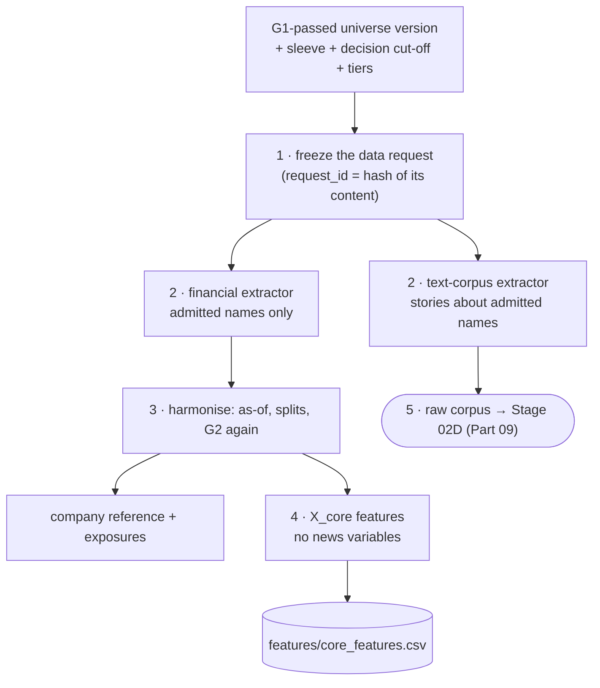

# Part 06 — Stage 2 data expansion: the data request, the company reference and X_core

**Goal:** once G1 has frozen the universe, retrieve the detailed inputs needed to model **only the admitted names**, validate them under the same point-in-time rules as screening, assemble the Company Reference and Exposure Dataset, and build the shared core feature set **X_core**, which contains no news-derived variables.

**Design:** Stage 2, sections 2.1 ("Detailed data collection after filtering") and 2.2 ("Build the shared core feature set": the six collection steps). **Overview:** §1.1 rows "Filter before deep retrieval" and "Missing news is never zero", §7.1–7.2.

This is the first part that has no counterpart in the v12 guide. In v12, Stage 00 loaded everything and Stage 01 chose from it. In v14 the order is deliberate (design Executive Summary, steps 1–3): a small screening pull, then the universe decision, then a detailed pull driven by the universe.



## What you will build in this part

| Section | File | Components |
|---|---|---|
| 6.1 | `contracts/data_request_schema.py`, `stage_02_data_expansion/data_request_manifest.py`, `storage/data_request_store.py` | 2 + 1 + 1 |
| 6.2 | `extractors/financial_extractor.py`, `extractors/text_corpus_extractor.py` | 2 + 2 |
| 6.3 | `harmonisation.py`, `reference/company_reference_builder.py` | 1 + 1 |
| 6.4 | `contracts/core_feature_schema.py`, `core_feature_builder.py`, `missingness_policy.py`, `storage/feature_store.py` | 1 + 2 + 1 + 1 |
| 6.5 | `contracts/data_schemas.py` (third component) | 1 |
| 6.6 | `stage_02_data_expansion/service.py` | 5 |
| 6.7 | tests and two invariants | |

---

## 6.1 Step 1: freeze the request

**File:** `src/aqp_python/contracts/data_request_schema.py` — component 1 of 2: DataRequest: the frozen Stage 2 request

```python
"""The Stage 2 data request: frozen, hashable and reproducible (design 2.2, step 1)."""
import hashlib
import json
from dataclasses import asdict, dataclass, field


@dataclass(frozen=True)
class DataRequest:
    universe_id: str                       # a G1-passed universe version - never empty
    sleeve: str
    decision_time: str                     # ISO-8601 with offset
    horizon_days: int
    securities: tuple[str, ...]            # admitted members only
    coverage_tiers: dict[str, str]         # security_id -> T1/T2/T3
    sources_by_tier: dict[str, list[str]]  # T1 -> [daily_prices, trades_quotes], ...
    files: tuple[str, ...]
    reference_fields: tuple[str, ...]
    history_start: str
    context_nodes: tuple[str, ...] = field(default_factory=tuple)   # linked non-members, if any
```

**What it does.** Everything Stage 2 is about to ask a provider for, written down before asking: which universe version, which securities, which tier each one is in, which sources each tier wants, which files and fields, and from which date.

**File:** `src/aqp_python/contracts/data_request_schema.py` — component 2 of 2: request_id and to_dict

```python
    @property
    def request_id(self) -> str:
        """Same request -> same id. The id is what lineage and replays refer to."""
        payload = json.dumps(asdict(self), sort_keys=True, default=str)
        return hashlib.sha256(payload.encode("utf-8")).hexdigest()[:16]

    def to_dict(self) -> dict:
        return {"request_id": self.request_id, **asdict(self)}
```

**What it does.** `request_id` is a hash of the request's content. **Why a content hash:** two runs that ask for exactly the same thing share an id, and any difference (a new member, a new field, another decision time) produces a new id. Lineage and replays can then say "this run used request `e4625a3b…`" instead of "whatever was in the folder".

**File:** `src/aqp_python/stages/stage_02_data_expansion/data_request_manifest.py`

```python
"""Freeze the Stage 2 request from the G1 universe version (design 2.2, step 1)."""
from aqp_python.contracts.data_request_schema import DataRequest
from aqp_python.contracts.universe_schema import UniverseSelection


class DataRequestError(ValueError):
    """Raised when a detailed-data request is attempted without a G1-passed universe."""


def build_data_request(universe: UniverseSelection | None, *, sleeve: str, decision_time: str,
                       horizon_days: int, detailed_cfg: dict, tiers_cfg: dict) -> DataRequest:
    if universe is None or not universe.universe_id or universe.members.empty:
        raise DataRequestError("no G1-passed universe: detailed data may not be requested")
    tiers = universe.coverage_tiers
    return DataRequest(
        universe_id=universe.universe_id, sleeve=sleeve, decision_time=decision_time,
        horizon_days=horizon_days, securities=tuple(sorted(universe.members["security_id"])),
        coverage_tiers=tiers,
        sources_by_tier={name: list(spec["sources"]) for name, spec in tiers_cfg.items()},
        files=tuple(detailed_cfg["files"]), reference_fields=tuple(detailed_cfg["reference_fields"]),
        history_start=str(detailed_cfg["history_start"]),
    )
```

**What it does.** Builds the request from a `UniverseSelection`, and **refuses** if there is no universe, no ID or no members. **Why this is the most important three lines of the part:** design Executive Summary step 2 says *"Do not run the full research-data or AI-NLP news pipeline across every initial candidate."* This function is the door; without a G1-passed universe it stays shut. An invariant test (6.7) checks it.

```python
import pandas as pd

from aqp_python.contracts.universe_schema import UniverseSelection
from aqp_python.stages.stage_02_data_expansion.data_request_manifest import DataRequestError, build_data_request

detailed = {"files": ["prices.csv", "news.csv"], "reference_fields": ["security_id"], "history_start": "2022-01-03"}
tiers = {"T1": {"max_rank": 1, "sources": ["daily_prices", "trades_quotes"]}, "T3": {"max_rank": None, "sources": ["daily_prices"]}}
universe = UniverseSelection("ASX_20250630_v1", pd.DataFrame({"security_id": ["B", "A"], "coverage_tier": ["T1", "T3"]}), ("A", "B"))
args = dict(sleeve="asx_interday", decision_time="2026-10-16T17:00:00+11:00", horizon_days=5,
            detailed_cfg=detailed, tiers_cfg=tiers)
request = build_data_request(universe, **args)
print(request.request_id, request.securities, request.coverage_tiers)
print("same content, same id:", build_data_request(universe, **args).request_id == request.request_id)
try:
    build_data_request(None, **args)
except DataRequestError as error:
    print("refused:", error)
```

```text
a35e9c44faedcb1d ('A', 'B') {'B': 'T1', 'A': 'T3'}
same content, same id: True
refused: no G1-passed universe: detailed data may not be requested
```

**File:** `src/aqp_python/storage/data_request_store.py`

```python
"""Frozen data requests, kept by request_id. A saved request is never edited."""
import json
from pathlib import Path


def save_request(request_dir: Path, request) -> Path:
    path = Path(request_dir) / f"{request.request_id}.json"
    path.parent.mkdir(parents=True, exist_ok=True)
    if not path.is_file():                     # same id = same content, so an existing file is kept
        path.write_text(json.dumps(request.to_dict(), indent=2, default=str), encoding="utf-8")
    return path


def load_request(request_dir: Path, request_id: str) -> dict:
    return json.loads((Path(request_dir) / f"{request_id}.json").read_text(encoding="utf-8"))
```

**What it does.** Keeps every request under `data\data_requests\<request_id>.json`. Because the id is a content hash, an existing file never needs to be overwritten.

## 6.2 Step 2: extract only what the request names

**File:** `src/aqp_python/stages/stage_02_data_expansion/extractors/financial_extractor.py` — component 1 of 2: RawDetailedData and the tier-to-table map

```python
"""Detailed financial data for the requested securities only (design 2.1)."""
from dataclasses import dataclass

import pandas as pd

from aqp_python.connectors.connector_base import TabularSource
from aqp_python.contracts.data_request_schema import DataRequest

# Which table would serve each tier source. daily_prices is prices.csv; the others need a provider.
SOURCE_TABLES = {"daily_prices": "prices.csv", "trades_quotes": "trades_quotes.csv",
                 "minute_bars": "minute_bars.csv"}


@dataclass(frozen=True)
class RawDetailedData:
    prices: pd.DataFrame
    benchmark: pd.DataFrame
    reference: pd.DataFrame
    corporate_actions: pd.DataFrame
    unavailable: dict[str, list[str]]       # tier source -> securities the provider could not serve
```

**What it does.** The detailed financial bundle, plus a record of what the provider **could not** supply. `SOURCE_TABLES` maps each tier source to the table that would serve it.

**File:** `src/aqp_python/stages/stage_02_data_expansion/extractors/financial_extractor.py` — component 2 of 2: extract_financial

```python
def extract_financial(source: TabularSource, request: DataRequest) -> RawDetailedData:
    wanted = set(request.securities) | set(request.context_nodes)
    start = pd.Timestamp(request.history_start)
    prices = source.read_table("prices.csv")
    prices = prices.loc[prices["security_id"].isin(wanted) & (prices["date"] >= start)]
    reference = source.read_table("reference.csv", columns=list(request.reference_fields))
    actions = source.read_table("corporate_actions.csv")
    unavailable: dict[str, list[str]] = {}
    for security_id, tier in request.coverage_tiers.items():
        for wanted_source in request.sources_by_tier[tier]:
            if not source.has_table(SOURCE_TABLES[wanted_source]):
                unavailable.setdefault(wanted_source, []).append(security_id)
    return RawDetailedData(
        prices=prices.reset_index(drop=True),
        benchmark=source.read_table("benchmark.csv"),
        reference=reference.loc[reference["security_id"].isin(wanted)].reset_index(drop=True),
        corporate_actions=actions.loc[actions["security_id"].isin(wanted)].reset_index(drop=True),
        unavailable=unavailable,
    )
```

**What it does.** Reads prices, the benchmark, the reference table **with exposure fields** (allowed now) and corporate actions, keeping only the requested securities. Then it checks each tier's sources: T1 wants trades and quotes and T2 wants minute bars, which the sample provider does not have. Those gaps are returned, and Stage 2 records them as `SOURCE_NOT_AVAILABLE` warnings rather than pretending the data exists.

**File:** `src/aqp_python/stages/stage_02_data_expansion/extractors/text_corpus_extractor.py` — component 1 of 2: in_scope: which stories belong to the request?

```python
"""The raw qualitative corpus for the requested securities only (design 2.1, 'Qualitative source corpus')."""
import re

import pandas as pd

from aqp_python.connectors.connector_base import TabularSource
from aqp_python.contracts.data_request_schema import DataRequest


def in_scope(stories: pd.DataFrame, names: pd.DataFrame) -> pd.Series:
    """A story is in scope if the provider tagged a requested security OR the text names one."""
    tagged = stories["provider_tags"].isin(names["security_id"])
    pattern = "|".join(re.escape(n) for n in pd.concat([names["name"], names["short_name"]]))
    mentioned = (stories["headline"] + " " + stories["body"]).str.contains(pattern, regex=True)
    return tagged | mentioned
```

**What it does.** A story belongs to the request if the provider tagged an admitted security **or** its text names one (full name or short name). **Why both:** provider tags are sometimes missing (5% in the synthetic feed), and a text search alone would miss a story that only uses a ticker-like alias. The real entity decision is made later, from the text, in Part 09.

**File:** `src/aqp_python/stages/stage_02_data_expansion/extractors/text_corpus_extractor.py` — component 2 of 2: extract_text_corpus

```python
def extract_text_corpus(source: TabularSource, request: DataRequest, reference: pd.DataFrame,
                        decision_time) -> tuple[pd.DataFrame, pd.DataFrame | None, int]:
    """Return (stories in scope published by the decision time, coverage periods, out-of-scope count).

    Publication after the decision time is excluded here. First-seen and processing
    times are checked in Stage 2D, where a late story is marked, not silently dropped.
    """
    if "news.csv" not in request.files or not source.has_table("news.csv"):
        return pd.DataFrame(), None, 0
    names = reference.drop_duplicates("security_id")[["security_id", "name", "short_name"]]
    names = names.loc[names["security_id"].isin(request.securities)]
    stories = source.read_table("news.csv")
    stories = stories.loc[stories["published_ts"] <= pd.Timestamp(decision_time)]
    scope = in_scope(stories, names)
    coverage = source.read_table("news_coverage.csv") if source.has_table("news_coverage.csv") else None
    if coverage is not None:
        coverage = coverage.loc[coverage["security_id"].isin(request.securities)].reset_index(drop=True)
    return stories.loc[scope].reset_index(drop=True), coverage, int((~scope).sum())
```

**What it does.** Reads the corpus, keeps stories **published** by the decision time and in scope, and returns the coverage periods of the requested securities.

**Why publication time here, but not first-seen time.** A story published after the decision cannot be in a live system's database at all, so excluding it is simply realistic. A story published *before* the decision but received or processed *after* it is subtler. It must be kept and marked `NEWS_NOT_YET_AVAILABLE`, so the story log shows that the cut-off worked (Part 09).

```python
import pandas as pd

from aqp_python.stages.stage_02_data_expansion.extractors.text_corpus_extractor import in_scope

names = pd.DataFrame({"security_id": ["SYN01"], "name": ["Synthetic Company 01"], "short_name": ["SYNCO01"]})
stories = pd.DataFrame({
    "provider_tags": ["SYN01", "", "", "SYN07"],
    "headline": ["Synthetic Company 01 raises guidance", "SYNCO01 wins contract", "Sector outlook", "Synthetic Company 07 cuts guidance"],
    "body": ["", "", "", ""]})
print(in_scope(stories, names).tolist())
```

```text
[True, True, False, False]
```

The first story is tagged, the second is found by its alias, the third names nobody, and the fourth is about SYN07, which G1 rejected: out of scope, never retrieved.

## 6.3 Step 3: harmonise, and assemble the company reference

**File:** `src/aqp_python/stages/stage_02_data_expansion/harmonisation.py`

```python
"""Validate and harmonise detailed prices: as-of, split adjustment and G2 again (design 2.2, step 3)."""
from datetime import datetime

import pandas as pd

from aqp_python.data_foundation.corporate_actions import add_adjusted_returns
from aqp_python.data_foundation.data_validator import validate_prices
from aqp_python.gates.gate_result import GateResult
from aqp_python.storage.vintage_store import as_of


def harmonise_prices(prices: pd.DataFrame, actions: pd.DataFrame, reference: pd.DataFrame,
                     decision_time: datetime, decision_date: pd.Timestamp,
                     rules: dict) -> tuple[pd.DataFrame, list[GateResult], frozenset[str]]:
    """Same timing and integrity rules as screening - detailed data earns no exemptions."""
    known = as_of(prices, decision_time)
    adjusted = add_adjusted_returns(known, actions, decision_time)
    gates, quarantined = validate_prices(adjusted, reference, decision_time, decision_date, rules)
    return adjusted, gates, quarantined
```

**What it does.** The same as-of filter, split adjustment and G2 checks as screening, applied to the detailed prices. **Why repeat G2:** design 2.2 step 3. Detailed data earns no exemptions, and in a real deployment it often comes from a different, deeper provider endpoint than the screening data.

**File:** `src/aqp_python/stages/stage_02_data_expansion/reference/company_reference_builder.py`

```python
"""Company Reference and Exposure Dataset for admitted names (design 2.1: assembled here, after G1)."""
from datetime import datetime

import pandas as pd

from aqp_python.contracts.data_schemas import REFERENCE_EXPOSURE_COLUMNS
from aqp_python.storage.vintage_store import as_of, latest_vintage


def build_company_reference(reference: pd.DataFrame, decision_time: datetime) -> tuple[pd.DataFrame, pd.DataFrame]:
    """Return (latest vintage per name, every vintage known at decision time).

    Revenue exposures are kept per economy and never collapsed into one score;
    an unknown exposure stays NaN and is flagged, never silently treated as zero.
    """
    vintages = as_of(reference, decision_time)
    latest = latest_vintage(vintages, decision_time, keys=["security_id"])
    latest["exposure_known"] = latest[list(REFERENCE_EXPOSURE_COLUMNS)].notna().all(axis=1)
    return latest, vintages.reset_index(drop=True)
```

**What it does.** The latest known vintage per admitted company, now *with* revenue exposures, plus every vintage known at the decision time. **Why the `exposure_known` flag:** design 2B: *"Preserve coverage flags; do not silently treat unknown exposures as zero."* The China stress scenario (Part 11) multiplies by `revenue_share_cn`; a silent zero would hide a company's risk.

## 6.4 Step 4: build X_core

**File:** `src/aqp_python/contracts/core_feature_schema.py`

```python
"""X_core: the shared core feature set. It never contains NLP-derived news variables."""
from collections.abc import Iterable

CORE_KEY_COLUMNS = ("security_id", "date")
CORE_FEATURE_COLUMNS = ("mom_252_21", "rev_5", "vol_20", "ewma_vol", "quality_score")
NEWS_PREFIX = "news_"          # every Stage 2D feature name starts with this


def require_no_news(columns: Iterable[str]) -> None:
    """The experimental difference must stay clean: core features may not include news variables."""
    leaked = sorted(c for c in columns if str(c).startswith(NEWS_PREFIX))
    if leaked:
        raise ValueError(f"news-derived columns found in X_core: {leaked}")
```

**What it does.** Names the core features and states the rule that defines the experiment: *no-news* means **no feature produced by the Stage 2D NLP pipeline** (design 2.2). Every news feature name starts with `news_`, so `require_no_news` can enforce the rule mechanically.

**Why ordinary structured data stays in.** Design 2.2: the baseline *"may still use structured numerical information… reported revenue, earnings, estimates or official macro releases"*. Removing those too would change more than the news treatment, and the experiment would no longer isolate one thing.

**File:** `src/aqp_python/stages/stage_02_data_expansion/core_feature_builder.py` — component 1 of 2: imports, version and the long-format helper

```python
"""X_core: leakage-safe price and reference features. Every value at date t uses data up to t only."""
import numpy as np
import pandas as pd

from aqp_python.contracts.core_feature_schema import CORE_FEATURE_COLUMNS, require_no_news
from aqp_python.data_foundation.as_of_join import join_as_of

CORE_CODE_VERSION = "core-1.0"
EWMA_LAMBDA = 0.94


def _long(wide: pd.DataFrame, name: str) -> pd.Series:
    """Wide (date x security) -> long Series indexed by (date, security_id), keeping NaN."""
    wide = wide.copy()
    wide.index.name = "date"
    long = wide.reset_index().melt(id_vars="date", var_name="security_id", value_name=name)
    return long.set_index(["date", "security_id"])[name]
```

**File:** `src/aqp_python/stages/stage_02_data_expansion/core_feature_builder.py` — component 2 of 2: build_core_features

```python
def build_core_features(prices: pd.DataFrame, benchmark: pd.DataFrame, reference_vintages: pd.DataFrame,
                        trading_days: pd.DatetimeIndex, *, timezone: str, local_time: str) -> pd.DataFrame:
    close = prices.pivot(index="date", columns="security_id", values="adj_close").reindex(trading_days)
    ret = prices.pivot(index="date", columns="security_id", values="return").reindex(trading_days)
    bench = benchmark.set_index("date")["benchmark_return"].reindex(trading_days)
    excess = ret.sub(bench, axis=0)

    features = pd.concat([
        _long(close.shift(21) / close.shift(252) - 1.0, "mom_252_21"),      # 12-1 momentum
        _long(excess.rolling(5, min_periods=5).sum(), "rev_5"),              # last week's excess move
        _long(ret.rolling(20, min_periods=20).std(), "vol_20"),
        _long(np.sqrt((excess ** 2).ewm(alpha=1 - EWMA_LAMBDA, adjust=False,
                                         min_periods=20).mean()), "ewma_vol"),
    ], axis=1).reset_index()

    # Reference data joins point-in-time: each row sees the latest vintage known at ITS decision time.
    features = join_as_of(features, reference_vintages, ["quality_score"], timezone=timezone,
                          local_time=local_time)
    features = features[["security_id", "date", *CORE_FEATURE_COLUMNS]]
    require_no_news(features.columns)
    return features
```

| Feature | Formula | Known at the close of `t` because… |
|---|---|---|
| `mom_252_21` | `P_{t−21} / P_{t−252} − 1` (12-1 momentum) | it uses prices from 21 or more days ago |
| `rev_5` | sum of the last 5 daily excess returns | it ends at `t` |
| `vol_20` | 20-day return standard deviation | rolling window ending at `t` |
| `ewma_vol` | `sqrt(EWMA(excess²))`, λ = 0.94 | `adjust=False` is a recursive filter: past values only |
| `quality_score` | latest reference vintage known at that row's 17:00 | `join_as_of` from Part 04 |

Three habits prevent leaks:

1. **Wide tables indexed by the trading calendar.** `pivot(...).reindex(trading_days)` puts every security on the same dates, so `shift(21)` means 21 sessions, not "21 rows of whatever data this security has".
2. **Only backward-looking operations** (`shift(k ≥ 0)`, `rolling`, `ewm(adjust=False)`). A negative shift in a feature is a red flag.
3. **Reference data joins point-in-time**, row by row, at each row's decision instant.

The last line, `require_no_news(features.columns)`, is a guard against future edits: if someone adds a news column to X_core, the stage fails instead of quietly contaminating the baseline.

```python
import numpy as np
import pandas as pd

from aqp_python.stages.stage_02_data_expansion.core_feature_builder import build_core_features

days = pd.bdate_range("2025-01-01", periods=30)
returns = np.r_[np.zeros(20), [0.01, 0.02, -0.01, 0.03, 0.00, 0.01, 0.01, 0.01, 0.01, 0.01]]
prices = pd.DataFrame({"security_id": "A", "date": days, "return": returns, "adj_close": 10 * np.cumprod(1 + returns)})
bench = pd.DataFrame({"date": days, "benchmark_return": 0.0})
vintages = pd.DataFrame({"security_id": ["A"], "quality_score": [0.5], "availability_ts": pd.to_datetime(["2024-12-01"], utc=True)})
core = build_core_features(prices, bench, vintages, days, timezone="Australia/Sydney", local_time="17:00")
print(core.loc[[24], ["date", "rev_5", "quality_score"]].to_string(index=False))
print("rev_5 on day 24 by hand:", round(0.01 + 0.02 - 0.01 + 0.03 + 0.00, 4))
```

```text
      date  rev_5  quality_score
2025-02-04   0.05            0.5
rev_5 on day 24 by hand: 0.05
```

**File:** `src/aqp_python/stages/stage_02_data_expansion/missingness_policy.py`

```python
"""Missingness is reported, never silently filled (design 2.2 'Missing data policy')."""
import pandas as pd


def missingness_report(frame: pd.DataFrame, columns: list[str], by: str = "security_id") -> pd.DataFrame:
    """Share of missing values per column, overall and for the worst security."""
    rows = []
    for column in columns:
        missing = frame[column].isna()
        worst = missing.groupby(frame[by]).mean()
        rows.append({"feature": column, "missing_share": round(float(missing.mean()), 4),
                     "worst_security": worst.idxmax() if len(worst) else "",
                     "worst_share": round(float(worst.max()), 4) if len(worst) else 0.0})
    return pd.DataFrame(rows)


def assert_not_filled(original: pd.DataFrame, published: pd.DataFrame, columns: list[str]) -> None:
    """A published table may not have FEWER missing values than its source: nothing was imputed."""
    for column in columns:
        if published[column].isna().sum() < original[column].isna().sum():
            raise ValueError(f"missing values in {column} were filled; missingness must stay visible")
```

**What it does.** Reports, per feature, the share of missing values and the worst security. `assert_not_filled` is a check you can put after any transformation: a published table may never have *fewer* missing values than its source.

**File:** `src/aqp_python/storage/feature_store.py`

```python
"""Versioned feature tables. X_core and Z_news are published separately and joined only by the arm builder."""
import hashlib
from pathlib import Path

import pandas as pd


def feature_version(code_version: str, names: list[str], *parts: str) -> str:
    """Hash the feature names (and any upstream versions) into the code version."""
    digest = hashlib.sha256("|".join([*sorted(names), *parts]).encode("utf-8")).hexdigest()[:8]
    return f"{code_version}-{digest}"


def publish_features(frame: pd.DataFrame, path: Path, version: str) -> Path:
    """Write a feature table with its version column; the table is evidence, not a cache."""
    frame.assign(feature_version=version).to_csv(path, index=False)
    return path
```

**What it does.** Versions and publishes feature tables. **Why X_core's version includes the request id:** the same feature code applied to a different data request is a different feature table. Every forecast will later carry this version (Part 08).

## 6.5 The Stage 2 hand-off

Add the third component to the bottom of `contracts\data_schemas.py`:

**File:** `src/aqp_python/contracts/data_schemas.py` — component 3 of 3: ResearchData: the Stage 2 hand-off (Part 06)

```python
@dataclass(frozen=True)
class ResearchData:
    """Detailed, validated point-in-time data for the admitted universe only (design 2.1-2.2)."""
    request: object                   # contracts.data_request_schema.DataRequest
    prices: pd.DataFrame              # admitted names: PRICE_COLUMNS + adj_close, return, dollar_volume
    benchmark: pd.DataFrame
    company_reference: pd.DataFrame   # latest vintage per admitted name, incl. dated exposures
    reference_vintages: pd.DataFrame  # every vintage known at decision time, admitted names
    trading_days: pd.DatetimeIndex
    quarantined: frozenset[str]       # G2 on the detailed data
    core_features: pd.DataFrame       # X_core: security_id, date + CORE_FEATURE_COLUMNS
    core_feature_version: str
    text_corpus: pd.DataFrame         # raw stories in scope - input to Stage 2D only
    news_coverage: pd.DataFrame | None
```

**What it does.** Everything later stages may use: the request, the validated prices of admitted names, the company reference, X_core, and the raw corpus (which only Stage 02D will read). `request` is annotated as `object` only to keep `data_schemas.py` free of imports from other contract modules; it always holds a `DataRequest`.

## 6.6 The Stage 2 service

**File:** `src/aqp_python/stages/stage_02_data_expansion/service.py` — component 1 of 5: imports

```python
"""Stage 2 data expansion: request -> detailed data for admitted names -> validated X_core."""
import json
import logging

from aqp_python.connectors.connector_base import CsvSampleSource
from aqp_python.contracts.core_feature_schema import CORE_FEATURE_COLUMNS
from aqp_python.contracts.data_schemas import ResearchData
from aqp_python.contracts.reason_codes import ReasonCode as RC
from aqp_python.contracts.universe_schema import UniverseSelection
from aqp_python.data_foundation.calendar_manager import trading_days
from aqp_python.data_foundation.data_quality_report import build_quality_report
from aqp_python.gates.gate_result import GateOutcome
from aqp_python.orchestration.run_context import RunContext
from aqp_python.orchestration.stage_status import StageResult
from aqp_python.stages.stage_02_data_expansion.core_feature_builder import CORE_CODE_VERSION, build_core_features
from aqp_python.stages.stage_02_data_expansion.data_request_manifest import build_data_request
from aqp_python.stages.stage_02_data_expansion.extractors.financial_extractor import extract_financial
from aqp_python.stages.stage_02_data_expansion.extractors.text_corpus_extractor import extract_text_corpus
from aqp_python.stages.stage_02_data_expansion.harmonisation import harmonise_prices
from aqp_python.stages.stage_02_data_expansion.missingness_policy import missingness_report
from aqp_python.stages.stage_02_data_expansion.reference.company_reference_builder import build_company_reference
from aqp_python.storage.data_request_store import save_request
from aqp_python.storage.feature_store import feature_version, publish_features
from aqp_python.storage.vintage_store import as_of

log = logging.getLogger(__name__)
STAGE = "stage_02_data_expansion"
```

**File:** `src/aqp_python/stages/stage_02_data_expansion/service.py` — component 2 of 5: run_stage: freeze the request and extract

```python
def run_stage(ctx: RunContext, universe: UniverseSelection) -> tuple[StageResult, ResearchData | None]:
    result = StageResult(STAGE)
    pipeline = ctx.config["pipeline"]
    request = build_data_request(universe, sleeve=ctx.sleeve, decision_time=ctx.decision_time.isoformat(),
                                 horizon_days=ctx.config["forecast_models"]["horizon_days"],
                                 detailed_cfg=ctx.config["detailed_data_request"],
                                 tiers_cfg=ctx.config["coverage_tiers"]["tiers"])
    save_request(ctx.resolve(pipeline["request_dir"]), request)
    ctx.paths.sub("data_request", "data_request.json").write_text(
        json.dumps(request.to_dict(), indent=2, default=str), encoding="utf-8")

    source = CsvSampleSource(ctx.resolve(pipeline["data_dir"]))
    raw = extract_financial(source, request)
    corpus, coverage, out_of_scope = extract_text_corpus(source, request, raw.reference, ctx.decision_time)
    result.lineage = dict(source.lineage)
```

**What it does.** Steps 1 and 2: builds and saves the request (to `data\data_requests\` and to the run's `data_request\` folder), then extracts financial data and the corpus. `result.lineage` now lists `news.csv`, with the columns read, for the first time in the run.

**File:** `src/aqp_python/stages/stage_02_data_expansion/service.py` — component 3 of 5: run_stage: harmonise, validate and build the company reference

```python
    prices, gates, quarantined = harmonise_prices(
        raw.prices, raw.corporate_actions, raw.reference, ctx.decision_time, ctx.decision_date,
        ctx.config["gates"]["g2_data_integrity"])
    result.gates.extend(gates)
    if any(g.outcome == GateOutcome.BLOCK for g in gates):
        codes = [c for g in gates if g.outcome == GateOutcome.BLOCK for c in g.reason_codes]
        return result.block(codes[0], "G2 blocked the detailed data"), None
    benchmark = as_of(raw.benchmark, ctx.decision_time)
    days = trading_days(benchmark)
    company_reference, vintages = build_company_reference(raw.reference, ctx.decision_time)
```

**What it does.** Step 3: harmonise and validate. A structural G2 failure on the detailed data blocks the run.

**File:** `src/aqp_python/stages/stage_02_data_expansion/service.py` — component 4 of 5: run_stage: build X_core and publish the evidence

```python
    core = build_core_features(prices, benchmark, vintages, days,
                               timezone=pipeline["timezone"], local_time=pipeline["decision_time_local"])
    version = feature_version(CORE_CODE_VERSION, list(CORE_FEATURE_COLUMNS), request.request_id)
    publish_features(core, ctx.paths.sub("features", "core_features.csv"), version)
    missingness_report(core, list(CORE_FEATURE_COLUMNS)).to_csv(
        ctx.paths.sub("features", "core_missingness.csv"), index=False)
    build_quality_report(prices, days, gates).to_csv(
        ctx.paths.sub("data_lineage", "detailed_quality_summary.csv"), index=False)
    company_reference.to_csv(ctx.paths.sub("data_request", "company_reference.csv"), index=False)
    result.artifacts.update({"data_request": "data_request/data_request.json",
                             "company_reference": "data_request/company_reference.csv",
                             "core_features": "features/core_features.csv",
                             "core_missingness": "features/core_missingness.csv",
                             "detailed_quality_summary": "data_lineage/detailed_quality_summary.csv"})
```

**What it does.** Step 4: builds X_core, versions it, and writes five artifacts: the core features, their missingness report, the detailed quality summary, the company reference and the request.

**File:** `src/aqp_python/stages/stage_02_data_expansion/service.py` — component 5 of 5: run_stage: record what could not be supplied, then hand off

```python
    for wanted_source, ids in raw.unavailable.items():
        result.reason_codes.append(str(RC.SOURCE_NOT_AVAILABLE))
        result.warnings.append(f"{wanted_source} not available from {source.name} for {len(ids)} names")
    result.metrics.update({"request_id": request.request_id, "securities": len(request.securities),
                           "price_rows": len(prices), "stories_in_scope": len(corpus),
                           "stories_out_of_scope": out_of_scope, "quarantined": sorted(quarantined),
                           "core_feature_version": version})
    log.info("Stage 2: request %s, %d names, %d stories in scope", request.request_id,
             len(request.securities), len(corpus))
    return result, ResearchData(request, prices, benchmark, company_reference, vintages, days, quarantined,
                                core, version, corpus, coverage)
```

**What it does.** Records sources the provider could not supply, then hands over `ResearchData`. Step 5 of design 2.2 (routing text to Stage 2D) happens simply by passing `text_corpus` along. This stage never interprets a story.

The overview plans `context_node_scope.py` (non-admitted suppliers, customers or competitors used only as context). The synthetic market has no relationship links, so `DataRequest.context_nodes` is always empty here; Part 14 shows where context nodes plug in.

## 6.7 Tests

**File:** `tests/unit/test_data_request_manifest.py`

```python
import pandas as pd
import pytest

from aqp_python.contracts.universe_schema import UniverseSelection
from aqp_python.stages.stage_02_data_expansion.data_request_manifest import DataRequestError, build_data_request

pytestmark = pytest.mark.batch03
DETAILED = {"files": ["prices.csv"], "reference_fields": ["security_id"], "history_start": "2022-01-03"}
TIERS = {"T1": {"max_rank": 1, "sources": ["daily_prices", "trades_quotes"]},
         "T3": {"max_rank": None, "sources": ["daily_prices"]}}


def universe(ids=("B", "A"), tiers=("T1", "T3")):
    members = pd.DataFrame({"security_id": list(ids), "coverage_tier": list(tiers)})
    return UniverseSelection("ASX_20250630_v1", members, tuple(sorted(ids)))


def request(u):
    return build_data_request(u, sleeve="asx_interday", decision_time="2026-10-16T17:00:00+11:00",
                              horizon_days=5, detailed_cfg=DETAILED, tiers_cfg=TIERS)


def test_no_universe_means_no_detailed_request():
    with pytest.raises(DataRequestError):
        request(None)
    with pytest.raises(DataRequestError):
        request(universe(ids=(), tiers=()))


def test_request_is_frozen_sorted_and_identified_by_its_content():
    first, second = request(universe()), request(universe())
    assert first.securities == ("A", "B") and first.coverage_tiers == {"B": "T1", "A": "T3"}
    assert first.request_id == second.request_id
    assert request(universe(ids=("A", "C"))).request_id != first.request_id
```

**File:** `tests/unit/test_company_reference.py`

```python
from datetime import UTC, datetime

import numpy as np
import pandas as pd
import pytest

from aqp_python.stages.stage_02_data_expansion.reference.company_reference_builder import build_company_reference

pytestmark = pytest.mark.batch03


def test_latest_known_vintage_is_used_and_unknown_exposures_are_flagged():
    reference = pd.DataFrame({
        "security_id": ["A", "A", "B"], "distress_probability": [0.01, 0.30, 0.02],
        "revenue_share_au": [0.6, 0.6, np.nan], "revenue_share_us": [0.3, 0.3, 0.5],
        "revenue_share_cn": [0.1, 0.1, 0.5],
        "availability_ts": pd.to_datetime(["2022-01-01", "2026-12-01", "2022-01-01"], utc=True)})
    latest, vintages = build_company_reference(reference, datetime(2026, 10, 16, 6, tzinfo=UTC))
    latest = latest.set_index("security_id")
    assert latest.loc["A", "distress_probability"] == 0.01          # the December revision is not known yet
    assert latest.loc["A", "exposure_known"] and not latest.loc["B", "exposure_known"]
    assert np.isnan(latest.loc["B", "revenue_share_au"])            # unknown stays unknown, never 0
    assert len(vintages) == 2
```

**File:** `tests/unit/test_core_feature_builder.py`

```python
import numpy as np
import pandas as pd
import pytest

from aqp_python.contracts.core_feature_schema import require_no_news
from aqp_python.stages.stage_02_data_expansion.core_feature_builder import build_core_features
from aqp_python.stages.stage_02_data_expansion.missingness_policy import assert_not_filled, missingness_report

pytestmark = pytest.mark.batch03
DAYS = pd.bdate_range("2025-01-01", periods=300)


def frames():
    rng = np.random.default_rng(0)
    ret = rng.normal(0, 0.01, len(DAYS))
    prices = pd.DataFrame({"security_id": "A", "date": DAYS, "return": ret,
                           "adj_close": 10 * np.cumprod(1 + ret)})
    bench = pd.DataFrame({"date": DAYS, "benchmark_return": 0.0})
    vintages = pd.DataFrame({"security_id": ["A"], "quality_score": [0.5],
                             "availability_ts": pd.to_datetime(["2024-12-01"], utc=True)})
    return prices, bench, vintages


def test_rev_5_is_the_sum_of_the_last_five_excess_returns():
    prices, bench, vintages = frames()
    core = build_core_features(prices, bench, vintages, DAYS, timezone="Australia/Sydney", local_time="17:00")
    t = 100
    assert core.loc[t, "rev_5"] == pytest.approx(prices["return"].iloc[t - 4:t + 1].sum())
    assert np.isnan(core.loc[200, "mom_252_21"]) and not np.isnan(core.loc[260, "mom_252_21"])


def test_news_columns_can_never_enter_x_core():
    with pytest.raises(ValueError, match="news-derived"):
        require_no_news(["rev_5", "news_sentiment_decay"])


def test_missingness_is_reported_not_filled():
    frame = pd.DataFrame({"security_id": ["A", "A", "B"], "x": [1.0, np.nan, np.nan]})
    report = missingness_report(frame, ["x"]).iloc[0]
    assert report["missing_share"] == pytest.approx(0.6667) and report["worst_security"] == "B"
    with pytest.raises(ValueError, match="filled"):
        assert_not_filled(frame, frame.fillna(0.0), ["x"])
```

Two invariants. The first is the filter-first rule, tested from three directions:

**File:** `tests/invariants/test_no_deep_retrieval_before_g1.py`

```python
"""Filter before deep retrieval: no text and no exposures are read until G1 has frozen a universe."""
import pytest

from aqp_python.stages.stage_00_screening import service as stage_00
from aqp_python.stages.stage_01_universe import service as stage_01
from aqp_python.stages.stage_02_data_expansion import service as stage_02x
from aqp_python.stages.stage_02_data_expansion.data_request_manifest import DataRequestError

pytestmark = pytest.mark.invariant


def test_screening_reads_no_text_and_no_exposures(make_context):
    result, _ = stage_00.run_stage(make_context())
    assert "news.csv" not in result.lineage
    assert not {"revenue_share_au", "revenue_share_us", "revenue_share_cn"} & set(
        result.lineage["reference.csv"]["columns"])


def test_detailed_data_requires_a_universe(make_context):
    with pytest.raises(DataRequestError):
        stage_02x.run_stage(make_context(), None)


def test_detailed_data_covers_admitted_names_only(make_context):
    ctx = make_context()
    _, screening = stage_00.run_stage(ctx)
    _, universe = stage_01.run_stage(ctx, screening)
    _, research = stage_02x.run_stage(ctx, universe)
    members = set(universe.members["security_id"])
    assert set(research.prices["security_id"]) <= members
    assert set(research.core_features["security_id"]) <= members
    assert {"SYN07", "SYN09"}.isdisjoint(set(research.prices["security_id"]))   # rejected at G1
```

The second is the look-ahead invariant. It grows by one component in Parts 08 and 09; this is the X_core component. If a feature at date `t` changes when data after `t` is added, the feature is leaking:

**File:** `tests/invariants/test_no_lookahead.py` — component 1 of 3: X_core features (Part 06)

```python
"""Nothing computed at time t may change when data after t is added."""
from datetime import UTC, datetime

import pandas as pd
import pytest

from aqp_python.connectors.synthetic.synthetic_market import generate_market
from aqp_python.data_foundation.corporate_actions import add_adjusted_returns
from aqp_python.stages.stage_02_data_expansion.core_feature_builder import build_core_features

pytestmark = pytest.mark.invariant
CUT = pd.Timestamp("2025-06-30")


@pytest.fixture(scope="module")
def market():
    data = generate_market()
    late = datetime(2027, 1, 1, tzinfo=UTC)
    data["prices"] = add_adjusted_returns(data["prices"], data["corporate_actions"], late)
    return data


def core_until(data, end):
    prices = data["prices"].loc[data["prices"]["date"] <= end]
    bench = data["benchmark"].loc[data["benchmark"]["date"] <= end]
    days = pd.DatetimeIndex(bench["date"])
    return build_core_features(prices, bench, data["reference"], days,
                               timezone="Australia/Sydney", local_time="17:00")


def test_core_features_do_not_change_when_future_data_arrives(market):
    truncated = core_until(market, CUT)
    full = core_until(market, pd.Timestamp("2026-10-16"))
    a = truncated.loc[truncated["date"] == CUT].set_index("security_id").sort_index()
    b = full.loc[full["date"] == CUT].set_index("security_id").sort_index()
    pd.testing.assert_frame_equal(a, b)
```

And the Stage 2 checkpoint:

**File:** `tests/integration/test_stage_handoffs.py` — component 4 of 9: test_stage_02_data_expansion

```python
@pytest.mark.batch03
def test_stage_02_data_expansion(make_context):
    ctx = make_context()
    out = run_through(ctx, "stage_02_data_expansion")
    research, metrics = out["research"], out["stage_02_data_expansion"].metrics
    print("\nrequest:", metrics["request_id"], "| names:", metrics["securities"],
          "| stories in scope:", metrics["stories_in_scope"], "| out of scope:", metrics["stories_out_of_scope"])
    assert set(research.request.securities) == set(out["universe"].members["security_id"])
    assert not [c for c in research.core_features.columns if c.startswith("news_")]
    assert (ctx.paths.root / "data_request" / "data_request.json").is_file()
    assert research.text_corpus["published_ts"].max() <= pd.Timestamp(ctx.decision_time)
```

```powershell
python -m pytest -m batch03 -q
python -m pytest tests\invariants\test_no_deep_retrieval_before_g1.py tests\invariants\test_no_lookahead.py -q
python -m pytest tests\integration\test_stage_handoffs.py -k data_expansion -s -q --basetemp=build\pytest
```

```text
request: e4625a3b973b15d2 | names: 26 | stories in scope: 1200 | out of scope: 563
.
1 passed in 3.12s
```

Look at the request the run froze, and at the missingness of X_core:

```python
import glob
import json

import pandas as pd

run = sorted(glob.glob("build/pytest/test_stage_02_data_expansion0/outputs/runs/*"))[0]
request = json.load(open(f"{run}/data_request/data_request.json"))
print(request["request_id"], request["universe_id"], len(request["securities"]), "securities")
print({tier: request["sources_by_tier"][tier] for tier in sorted(request["sources_by_tier"])})
print(pd.read_csv(f"{run}/features/core_missingness.csv").to_string(index=False))
```

```text
e4625a3b973b15d2 ASX_20250630_v1 26 securities
{'T1': ['daily_prices', 'trades_quotes'], 'T2': ['daily_prices', 'minute_bars'], 'T3': ['daily_prices']}
      feature  missing_share worst_security  worst_share
   mom_252_21         0.2060          SYN30       0.3168
        rev_5         0.0093          SYN30       0.1360
       vol_20         0.0213          SYN30       0.1480
     ewma_vol         0.0160          SYN01       0.0160
quality_score         0.0000          SYN01       0.0000
```

`mom_252_21` is missing for roughly the first year of every name (it needs 252 sessions of history), and the missingness report says so instead of hiding it.

## Checkpoint

- [ ] `python -m pytest -m batch03 -q` → `7 passed`.
- [ ] `test_detailed_data_requires_a_universe` passes: no universe, no request.
- [ ] `core_features.csv` has no column starting with `news_`.

**Check your understanding.** (1) The text-corpus extractor drops stories published after the decision time but keeps stories *seen* after it. Why the difference? (2) Two runs on the same day produce the same `request_id`. A third run on the next day produces a different one. Which field changed?

```powershell
git add .
git commit -m "Stage 2 data expansion: frozen request, detailed extractors, company reference and X_core"
```

Next: [Part 07 — the validation framework](07_validation_framework.md).
