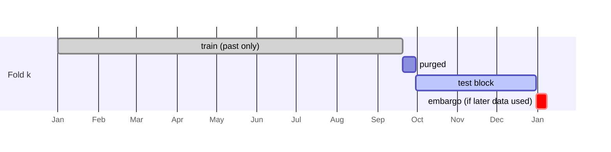

# Part 07 — The validation framework (build the judge before the contestants)

**Goal:** decide *how a model will be judged* before writing any model: the target and its label end date, chronological folds with purging and embargo, proper scores for quantile forecasts, a test of whether one forecast is really better than another, a net-of-cost trading test, and a penalty for having tried many models.

**Design:** 2.3 (target and label end date), 2E ("Validation protocol", the test table, G3 criteria). **Roadmap:** phase 4's exit criterion asks for *"leakage-safe targets, a simple comparator, stable outputs and walk-forward evaluation"* for each baseline. This part builds the walk-forward machinery those baselines will be judged by.

These are pure functions on arrays and tables, so you can check each one against numbers you work out by hand. They live in `stage_02e_validation`, except the label builder, which belongs to the forecast contract and lives in `stage_02_forecasting`. Part 10 wires them into the paired evaluation.

## What you will build in this part

| Section | File | Components |
|---|---|---|
| 7.1 | `stage_02_forecasting/label_builder.py` | 2 |
| 7.2 | `stage_02e_validation/purging_embargo.py`, `walk_forward_folds.py` | 1 + 2 |
| 7.3 | `stage_02e_validation/forecast_scoring.py` | 1 |
| 7.4 | `stage_02e_validation/forecast_comparison_tests.py` | 2 |
| 7.5 | `stage_02e_validation/net_of_cost_evaluation.py`, `overfitting_controls.py`, `storage/trial_registry.py` | 2 + 2 + 2 |
| 7.6 | three test files | |

---

## 7.1 The target and its label end date

Design 2.3:

```text
y_{i,t}^{(h)} = Σ_{s=2}^{h+1} ( r_{i,t+s} − r_{b,t+s} )
```

This is the benchmark-relative (excess) return over `h` sessions, **starting two sessions after the decision**. The decision is taken after the close on day `t`, the order executes at the close of `t+1`, so the first return the position can earn is on `t+2`. The last return in the sum is on day `t+h+1`, the **label end date**. Until that day has closed, the label is unknown.

```text
day:      t      t+1      t+2   t+3   t+4   t+5   t+6        (h = 5)
          decide execute  |-------- label window --------|
                                                     label_end = t+6
```

**File:** `src/aqp_python/stages/stage_02_forecasting/label_builder.py` — component 1 of 2: docstring and excess_returns_wide

```python
"""Target: y(h)_t = sum_{s=2}^{h+1} (r_i,t+s - r_b,t+s), with its label_end date for purging.

The sum starts at s=2 because a decision taken after the close on day t is
executed at the close of t+1, so the first return the position earns is t+2.
"""
import pandas as pd


def excess_returns_wide(prices: pd.DataFrame, benchmark: pd.DataFrame,
                        trading_days: pd.DatetimeIndex) -> pd.DataFrame:
    wide = prices.pivot(index="date", columns="security_id", values="return").reindex(trading_days)
    bench = benchmark.set_index("date")["benchmark_return"].reindex(trading_days)
    return wide.sub(bench, axis=0)
```

**File:** `src/aqp_python/stages/stage_02_forecasting/label_builder.py` — component 2 of 2: build_labels

```python
def build_labels(prices: pd.DataFrame, benchmark: pd.DataFrame,
                 trading_days: pd.DatetimeIndex, horizon: int) -> pd.DataFrame:
    excess = excess_returns_wide(prices, benchmark, trading_days)
    # rolling(h).sum() at k covers k-h+1..k; shifting by -(h+1) aligns it to t = k-h-1.
    label = excess.rolling(horizon, min_periods=horizon).sum().shift(-(horizon + 1))
    label_end = pd.Series(trading_days, index=trading_days).shift(-(horizon + 1))
    label.index.name = "date"
    long = label.reset_index().melt(id_vars="date", var_name="security_id", value_name="label")
    long["label_end"] = long["date"].map(label_end)
    return long.dropna(subset=["label", "label_end"]).reset_index(drop=True)
```

**The rolling-sum trick.** `rolling(h).sum()` at row `k` adds rows `k−h+1..k`. Shifting the result up by `h+1` places that sum on row `t = k−h−1`, which is exactly `Σ_{s=2}^{h+1}`. `dropna` removes the last `h+1` rows of each security, whose futures are incomplete. A row with an unknown label must never be used for training.

```python
import pandas as pd

from aqp_python.stages.stage_02_forecasting.label_builder import build_labels

days = pd.bdate_range("2026-01-05", periods=8)
prices = pd.DataFrame({"security_id": "A", "date": days, "return": [0.0, 0.01, 0.02, 0.03, 0.04, 0.05, 0.06, 0.07]})
bench = pd.DataFrame({"date": days, "benchmark_return": 0.01})
labels = build_labels(prices, bench, days, horizon=3)
labels["label"] = labels["label"].round(4)
print(labels.to_string(index=False))
print("day 0 by hand: (0.02-0.01) + (0.03-0.01) + (0.04-0.01) =", round(0.01 + 0.02 + 0.03, 4))
```

```text
      date security_id  label  label_end
2026-01-05           A   0.06 2026-01-09
2026-01-06           A   0.09 2026-01-12
2026-01-07           A   0.12 2026-01-13
2026-01-08           A   0.15 2026-01-14
day 0 by hand: (0.02-0.01) + (0.03-0.01) + (0.04-0.01) = 0.06
```

Eight days of data give only four labels: the last four days' futures are incomplete.

## 7.2 Walk-forward folds, purging and embargo



- **Walk-forward:** test blocks move forward in time, and each model is trained only on data from before its test block.
- **Purging:** a training row whose label window `[date, label_end]` overlaps the test block is removed, because its label contains returns from the test period.
- **Embargo:** rows just after the test block are removed, in case later data is used. This build uses expanding windows (past only), so the embargo is a second line of defence, tested on its own.
- **Non-overlapping test dates:** test dates are spaced `step_days = 5` apart, so consecutive test labels do not overlap and the per-date scores are closer to independent.

**File:** `src/aqp_python/stages/stage_02e_validation/purging_embargo.py`

```python
"""Purging and embargo: remove training rows whose labels could know about the test period."""
import pandas as pd


def purge_and_embargo(rows: pd.DataFrame, test_start: pd.Timestamp, test_end: pd.Timestamp,
                      trading_days: pd.DatetimeIndex, embargo_days: int) -> pd.DataFrame:
    """Training rows for one test block.

    Purge: drop any row whose label window [date, label_end] touches the test period.
    Embargo: drop rows starting within `embargo_days` sessions after the test period.
    """
    overlaps = (rows["date"] <= test_end) & (rows["label_end"] >= test_start)
    end_position = trading_days.searchsorted(test_end)
    embargo_end = trading_days[min(end_position + embargo_days, len(trading_days) - 1)]
    embargoed = (rows["date"] > test_end) & (rows["date"] <= embargo_end)
    return rows.loc[~overlaps & ~embargoed]
```

**What it does.** Removes training rows whose label window touches `[test_start, test_end]`, and rows that start within `embargo_days` sessions after `test_end`. It is its own module, as the overview plans, because Part 10 also uses it when judging the news challenger.

**File:** `src/aqp_python/stages/stage_02e_validation/walk_forward_folds.py` — component 1 of 2: Fold

```python
"""Chronological folds (train only on the past), with purging and embargo applied to each."""
from dataclasses import dataclass

import numpy as np
import pandas as pd

from aqp_python.stages.stage_02e_validation.purging_embargo import purge_and_embargo


@dataclass(frozen=True)
class Fold:
    number: int
    test_dates: pd.DatetimeIndex

    @property
    def test_start(self) -> pd.Timestamp:
        return self.test_dates[0]

    @property
    def test_end(self) -> pd.Timestamp:
        return self.test_dates[-1]
```

**File:** `src/aqp_python/stages/stage_02e_validation/walk_forward_folds.py` — component 2 of 2: make_folds and expanding_train

```python
def make_folds(trading_days: pd.DatetimeIndex, first_date: pd.Timestamp, last_date: pd.Timestamp, *,
               min_train_days: int, n_folds: int, step_days: int) -> list[Fold]:
    """Evaluate every `step_days`-th session after a burn-in, split into contiguous blocks.

    first_date/last_date bound the usable research rows; the first test date sits
    `min_train_days` sessions after first_date so fold 1 has a real training set.
    """
    start = trading_days.searchsorted(first_date) + min_train_days
    candidates = trading_days[start:]
    candidates = candidates[candidates <= last_date][::step_days]
    if len(candidates) < n_folds * 5:
        raise ValueError("not enough history for the requested number of folds")
    return [Fold(i + 1, pd.DatetimeIndex(block))
            for i, block in enumerate(np.array_split(candidates.to_numpy(), n_folds))]


def expanding_train(rows: pd.DataFrame, fold: Fold, trading_days: pd.DatetimeIndex,
                    embargo_days: int) -> pd.DataFrame:
    """Expanding window: past rows only, then purge/embargo as a second line of defence."""
    past = rows.loc[rows["date"] < fold.test_start]
    return purge_and_embargo(past, fold.test_start, fold.test_end, trading_days, embargo_days)
```

**What it does.** `make_folds` starts the first test date `min_train_days` sessions after the first usable row, takes every `step_days`-th session, and splits the candidates into `n_folds` contiguous blocks. `expanding_train` keeps only past rows and then purges and embargoes them anyway.

```python
import pandas as pd

from aqp_python.stages.stage_02e_validation.purging_embargo import purge_and_embargo

days = pd.bdate_range("2026-01-01", periods=30)
rows = pd.DataFrame({"date": days, "label_end": days.shift(6, freq="B")})
kept = purge_and_embargo(rows, days[15], days[19], days, embargo_days=3)
removed = rows.loc[~rows.index.isin(kept.index), "date"]
print("test block :", days[15].date(), "to", days[19].date())
print("removed    :", removed.iloc[0].date(), "to", removed.iloc[-1].date(), f"({len(removed)} rows)")
```

```text
test block : 2026-01-22 to 2026-01-28
removed    : 2026-01-14 to 2026-02-02 (14 rows)
```

The removed span starts six sessions *before* the test block (labels that end inside it) and ends three sessions after it (the embargo).

## 7.3 Scoring quantile forecasts

The **pinball loss** for quantile `τ` and error `e = y − q_τ` is `ρ_τ(e) = max(τe, (τ−1)e)`. Under-predicting the 95% quantile costs 0.95 per unit; over-predicting it costs only 0.05. Averaged over the grid, it is a *proper* score: on average a forecaster minimises it by reporting their true belief. It is the design's primary score.

**Coverage:** the share of outcomes inside the 5%–95% interval; a calibrated forecast covers about 90%. **Sharpness:** the average width of that interval; among calibrated forecasts, narrower is better.

**File:** `src/aqp_python/stages/stage_02e_validation/forecast_scoring.py`

```python
"""Proper scoring rules for quantile forecasts."""
import numpy as np

from aqp_python.contracts.quantile_grid import QUANTILE_GRID

TAUS = np.asarray(QUANTILE_GRID)
LOWER_90, UPPER_90 = list(QUANTILE_GRID).index(0.05), list(QUANTILE_GRID).index(0.95)


def pinball_loss(y: np.ndarray, q: np.ndarray) -> np.ndarray:
    """Mean pinball loss across the grid, one value per row.

    rho_tau(e) = max(tau * e, (tau - 1) * e),  with e = y - q_tau.
    """
    error = y[:, None] - q
    return np.maximum(TAUS * error, (TAUS - 1) * error).mean(axis=1)


def coverage_90(y: np.ndarray, q: np.ndarray) -> float:
    """Share of outcomes inside the 5%-95% interval. Target 0.90."""
    inside = (y >= q[:, LOWER_90]) & (y <= q[:, UPPER_90])
    return float(inside.mean())


def width_90(q: np.ndarray) -> float:
    """Sharpness: average width of the 90% interval (narrower is better if calibrated)."""
    return float((q[:, UPPER_90] - q[:, LOWER_90]).mean())
```

```python
import numpy as np

from aqp_python.stages.stage_02e_validation.forecast_scoring import TAUS, pinball_loss

quantiles = np.linspace(-0.05, 0.05, 11)[None, :]
for outcome in (0.0, 0.04, -0.08):
    print(f"outcome {outcome:+.2f}: mean pinball {pinball_loss(np.array([outcome]), quantiles)[0]:.5f}")
error = 0.04 - 0.05                    # the 0.99 quantile was 0.05; the outcome 0.04 lies below it
print("by hand, tau=0.99:", round(max(0.99 * error, (0.99 - 1) * error), 6), "| tau list starts", TAUS[:3])
```

```text
outcome +0.00: mean pinball 0.00136
outcome +0.04: mean pinball 0.00864
outcome -0.08: mean pinball 0.02773
by hand, tau=0.99: 0.0001 | tau list starts [0.01  0.025 0.05 ]
```

An outcome in the middle of the distribution is cheap; one far outside it is expensive. That asymmetry is what rewards honest tails.

## 7.4 Is the candidate really better? Diebold–Mariano

A candidate's average pinball loss will always differ slightly from a baseline's. The question is whether the difference is larger than chance.

```text
d_t   = L_candidate,t − L_baseline,t          one number per test date
DM    = mean(d) / sqrt( HAC variance of d / n )
p     = Φ(DM)                                  one-sided: small p ⇒ candidate has lower loss
```

**HAC** (Newey–West) variance allows for correlation between nearby `d_t`. Losses are averaged *per date* first, because rows on the same date share market moves and are not independent.

**File:** `src/aqp_python/stages/stage_02e_validation/forecast_comparison_tests.py` — component 1 of 2: imports and newey_west_variance

```python
"""Diebold-Mariano test on a time series of loss differences, with HAC variance."""
import numpy as np
from scipy.stats import norm


def newey_west_variance(x: np.ndarray, lags: int) -> float:
    x = x - x.mean()
    n = len(x)
    variance = x @ x / n
    for lag in range(1, lags + 1):
        weight = 1 - lag / (lags + 1)                 # Bartlett kernel
        variance += 2 * weight * (x[lag:] @ x[:-lag]) / n
    return float(variance)
```

**File:** `src/aqp_python/stages/stage_02e_validation/forecast_comparison_tests.py` — component 2 of 2: diebold_mariano

```python
def diebold_mariano(loss_candidate: np.ndarray, loss_baseline: np.ndarray,
                    lags: int) -> tuple[float, float]:
    """One-sided test of H0: equal accuracy vs H1: candidate has lower expected loss.

    Pass per-date average losses (one number per test date), not per-row losses:
    rows on the same date are cross-sectionally dependent.
    Returns (statistic, p_value); a small p-value favours the candidate.
    """
    d = np.asarray(loss_candidate) - np.asarray(loss_baseline)
    n = len(d)
    if n < 10:
        raise ValueError("too few observations for a Diebold-Mariano test")
    variance = newey_west_variance(d, lags)
    if variance <= 0:
        return 0.0, 0.5
    statistic = d.mean() / np.sqrt(variance / n)
    return float(statistic), float(norm.cdf(statistic))
```

**Why this matters twice in v14.** In Part 10 the same test is used for two different questions: is a model better than the best *yardstick* (absolute eligibility), and is the news challenger better than *its own baseline* on the same observations (incremental value)?

## 7.5 Does it make money after costs? And how many times did we try?

**Net of cost.** A simple, transparent test portfolio: on each test date, go long the top 20% of names by forecast median and short the bottom 20%, with equal weights. Earn their realised labels and pay `cost × turnover`. The annualised Sharpe ratio of the net returns must be positive (G3).

**File:** `src/aqp_python/stages/stage_02e_validation/net_of_cost_evaluation.py` — component 1 of 2: long_short_returns

```python
"""Does the forecast make money after costs? A simple long-short test portfolio."""
import numpy as np
import pandas as pd


def long_short_returns(oos: pd.DataFrame, fraction: float, cost_per_unit_turnover: float) -> pd.Series:
    """Per test date: long the top `fraction` by forecast median, short the bottom, equal weights.

    oos needs columns: date, security_id, median, label. Returns net returns per date.
    Test dates are spaced `step_days` apart so the h-day labels do not overlap.
    """
    returns, previous = {}, pd.Series(dtype=float)
    for date, day in oos.groupby("date", sort=True):
        n = int(np.floor(len(day) * fraction))
        if n < 1:
            continue
        ranked = day.sort_values("median")
        weights = pd.Series(0.0, index=day["security_id"])
        weights[ranked["security_id"].iloc[-n:]] = 1.0 / n
        weights[ranked["security_id"].iloc[:n]] = -1.0 / n
        gross = float((weights * day.set_index("security_id")["label"]).sum())
        turnover = float(weights.sub(previous, fill_value=0.0).abs().sum())
        returns[date] = gross - turnover * cost_per_unit_turnover
        previous = weights
    return pd.Series(returns, name="net_return")
```

**File:** `src/aqp_python/stages/stage_02e_validation/net_of_cost_evaluation.py` — component 2 of 2: annualised_sharpe

```python
def annualised_sharpe(returns: pd.Series, periods_per_year: float) -> float:
    if len(returns) < 2 or returns.std() == 0:
        return 0.0
    return float(returns.mean() / returns.std() * np.sqrt(periods_per_year))
```

```python
import pandas as pd

from aqp_python.stages.stage_02e_validation.net_of_cost_evaluation import long_short_returns

oos = pd.DataFrame({"date": [1, 1, 2, 2], "security_id": ["A", "B", "A", "B"],
                    "median": [1.0, -1.0, -1.0, 1.0], "label": [0.02, -0.02, -0.01, 0.01]})
print(long_short_returns(oos, fraction=0.5, cost_per_unit_turnover=0.001).round(4).to_dict())
```

```text
{1: 0.038, 2: 0.016}
```

Day 1 earns 0.04 and pays 0.002 to open two legs (turnover 2). Day 2 flips both legs (turnover 4) and earns 0.02 − 0.004.

**Charging for search** (design 2E). If you try 100 strategies, the best one will look good by luck. The **deflated Sharpe ratio** (Bailey and López de Prado, 2014) asks: *what is the probability that the true Sharpe ratio exceeds what the best of N trials would reach by chance?*

```text
SR̂      per-period Sharpe of the net returns
σ_SR    = sqrt( (1 − γ₃·SR̂ + (γ₄−1)/4 · SR̂²) / (n−1) )        γ₃ skew, γ₄ kurtosis
SR₀     = σ_SR · [ (1−γ) Φ⁻¹(1 − 1/N) + γ Φ⁻¹(1 − 1/(N e)) ]   γ = 0.5772 (Euler)
DSR     = Φ( (SR̂ − SR₀) / σ_SR )
```

**File:** `src/aqp_python/stages/stage_02e_validation/overfitting_controls.py` — component 1 of 2: Sharpe standard error and the luck benchmark

```python
"""Deflated Sharpe ratio (Bailey and Lopez de Prado, 2014): charge for the number of trials."""
import numpy as np
from scipy.stats import kurtosis, norm, skew

EULER_GAMMA = 0.5772156649


def sharpe_std(sr: float, n: int, skewness: float, kurt: float) -> float:
    """Standard error of a per-period Sharpe ratio under non-normal returns."""
    return float(np.sqrt(max(1 - skewness * sr + (kurt - 1) / 4 * sr ** 2, 1e-12) / (n - 1)))


def expected_max_sharpe(n_trials: int, sr_dispersion: float) -> float:
    """Sharpe ratio a best-of-N search would reach by luck alone (per period)."""
    if n_trials <= 1:
        return 0.0
    return sr_dispersion * ((1 - EULER_GAMMA) * norm.ppf(1 - 1 / n_trials)
                            + EULER_GAMMA * norm.ppf(1 - 1 / (n_trials * np.e)))
```

**File:** `src/aqp_python/stages/stage_02e_validation/overfitting_controls.py` — component 2 of 2: deflated_sharpe_ratio

```python
def deflated_sharpe_ratio(returns: np.ndarray, n_trials: int) -> float:
    """Probability that the true Sharpe exceeds the luck benchmark of N trials.

    Uses the estimation standard error as the dispersion of Sharpe ratios across
    trials - an approximation documented in docs/decisions when better data exist.
    """
    returns = np.asarray(returns, dtype=float)
    n = len(returns)
    if n < 10 or returns.std(ddof=1) == 0:
        return 0.0
    sr = returns.mean() / returns.std(ddof=1)
    g3, g4 = float(skew(returns)), float(kurtosis(returns, fisher=False))
    sigma = sharpe_std(sr, n, g3, g4)
    benchmark = expected_max_sharpe(n_trials, sigma)
    return float(norm.cdf((sr - benchmark) / sigma))
```

With one trial `SR₀ = 0`, and DSR is the probability that the Sharpe ratio is positive. Each extra trial raises the bar.

```python
import numpy as np

from aqp_python.stages.stage_02e_validation.overfitting_controls import deflated_sharpe_ratio

returns = np.random.default_rng(1).normal(0.002, 0.01, 250)
for trials in (1, 4, 20, 100):
    print(f"{trials:>3} trials -> DSR {deflated_sharpe_ratio(returns, trials):.3f}")
```

```text
  1 trials -> DSR 0.959
  4 trials -> DSR 0.754
 20 trials -> DSR 0.436
100 trials -> DSR 0.214
```

`N` comes from a **trial registry** that remembers every distinct model configuration ever evaluated:

**File:** `src/aqp_python/storage/trial_registry.py` — component 1 of 2: trial_key

```python
"""Charge for search: every distinct model configuration ever evaluated is a trial."""
import hashlib
import json
from datetime import UTC, datetime
from pathlib import Path


def trial_key(model_name: str, model_version: str, params: dict, features: list[str]) -> str:
    payload = json.dumps({"m": model_name, "v": model_version, "p": params, "f": sorted(features)},
                         sort_keys=True)
    return hashlib.sha256(payload.encode("utf-8")).hexdigest()[:16]
```

**File:** `src/aqp_python/storage/trial_registry.py` — component 2 of 2: record_trial

```python
def record_trial(registry_path: Path, key: str, record: dict) -> int:
    """Append the trial if new and return the number of distinct trials so far.

    Re-running an identical configuration is not a new trial, so the count
    measures research breadth, not how often the pipeline ran.
    """
    registry_path.parent.mkdir(parents=True, exist_ok=True)
    keys = set()
    if registry_path.is_file():
        with registry_path.open("r", encoding="utf-8") as handle:
            keys = {json.loads(line)["trial_key"] for line in handle if line.strip()}
    if key not in keys:
        entry = {"trial_key": key, "recorded_at": datetime.now(UTC).isoformat(), **record}
        with registry_path.open("a", encoding="utf-8") as handle:
            handle.write(json.dumps(entry, default=str) + "\n")
        keys.add(key)
    return len(keys)
```

The key hashes the slot (model and arm), version, parameters and feature list. Re-running the same configuration is not a new trial, so running the pipeline daily does not raise the bar. Adding the news challenger *is* a new trial, and stays counted even if you later remove it. In v14 the challenger therefore pays for itself: running it makes the baseline's DSR bar slightly higher too.

## 7.6 Tests

**File:** `tests/unit/test_purging_embargo.py`

```python
import pandas as pd
import pytest

from aqp_python.stages.stage_02_forecasting.label_builder import build_labels
from aqp_python.stages.stage_02e_validation.purging_embargo import purge_and_embargo

pytestmark = pytest.mark.batch04
DAYS = pd.bdate_range("2026-01-01", periods=12)


def test_label_skips_one_session_and_sums_h_excess_returns():
    returns = [0.0, 0.01, 0.02, 0.03, 0.04, 0.05, 0.06, 0.07, 0.08, 0.09, 0.10, 0.11]
    prices = pd.DataFrame({"security_id": "A", "date": DAYS, "return": returns})
    bench = pd.DataFrame({"date": DAYS, "benchmark_return": 0.01})
    labels = build_labels(prices, bench, DAYS, horizon=3).set_index("date")
    # t = day 0: sum of excess returns on days 2, 3, 4 = (0.02+0.03+0.04) - 3*0.01
    assert labels.loc[DAYS[0], "label"] == pytest.approx(0.06)
    assert labels.loc[DAYS[0], "label_end"] == DAYS[4]
    assert labels.index.max() == DAYS[-5]            # later rows have incomplete futures


def test_purge_removes_overlapping_labels_and_embargo_removes_the_gap():
    days = pd.bdate_range("2026-01-01", periods=40)
    rows = pd.DataFrame({"date": days, "label_end": days.shift(6, freq="B")})
    kept = purge_and_embargo(rows, days[15], days[19], days, embargo_days=5)
    assert not ((kept["date"] <= days[19]) & (kept["label_end"] >= days[15])).any()
    assert not kept["date"].between(days[20], days[24]).any()
    assert days[14 - 6] in set(kept["date"])          # label ends before the test start: kept
```

Read `test_label_skips_one_session_and_sums_h_excess_returns` with a pencil. Day 0's label is the excess returns of days 2, 3 and 4: `(0.02 − 0.01) + (0.03 − 0.01) + (0.04 − 0.01) = 0.06`, and its label end is day 4.

**File:** `tests/unit/test_walk_forward_folds.py`

```python
import pandas as pd
import pytest

from aqp_python.stages.stage_02e_validation.walk_forward_folds import expanding_train, make_folds

pytestmark = pytest.mark.batch04


def test_folds_are_chronological_and_disjoint():
    days = pd.bdate_range("2020-01-01", periods=600)
    folds = make_folds(days, days[0], days[-10], min_train_days=200, n_folds=4, step_days=5)
    ends = [f.test_end for f in folds]
    assert ends == sorted(ends)
    assert all(a.test_end < b.test_start for a, b in zip(folds, folds[1:]))
    assert folds[0].test_start == days[200]


def test_expanding_train_uses_only_the_past():
    days = pd.bdate_range("2020-01-01", periods=600)
    rows = pd.DataFrame({"date": days, "label_end": days.shift(6, freq="B")})
    fold = make_folds(days, days[0], days[-10], min_train_days=200, n_folds=4, step_days=5)[1]
    train = expanding_train(rows, fold, days, embargo_days=5)
    assert train["label_end"].max() < fold.test_start


def test_too_little_history_is_refused():
    days = pd.bdate_range("2020-01-01", periods=100)
    with pytest.raises(ValueError, match="not enough history"):
        make_folds(days, days[0], days[-1], min_train_days=90, n_folds=5, step_days=5)
```

**File:** `tests/unit/test_forecast_scoring.py`

```python
import numpy as np
import pandas as pd
import pytest

from aqp_python.stages.stage_02e_validation.forecast_comparison_tests import diebold_mariano
from aqp_python.stages.stage_02e_validation.forecast_scoring import coverage_90, pinball_loss, width_90
from aqp_python.stages.stage_02e_validation.net_of_cost_evaluation import annualised_sharpe, long_short_returns
from aqp_python.stages.stage_02e_validation.overfitting_controls import deflated_sharpe_ratio
from aqp_python.storage.trial_registry import record_trial

pytestmark = pytest.mark.batch04


def test_pinball_of_a_perfect_point_forecast_is_zero():
    y = np.array([0.01, -0.02])
    assert pinball_loss(y, np.repeat(y[:, None], 11, axis=1)).tolist() == [0.0, 0.0]


def test_coverage_and_width_of_the_90_interval():
    q = np.tile(np.linspace(-1, 1, 11), (4, 1))
    assert coverage_90(np.array([0.0, 0.5, 2.0, -2.0]), q) == 0.5
    assert width_90(q) == pytest.approx(1.2)            # q0.950 - q0.050 = 0.6 - (-0.6)


def test_diebold_mariano_detects_a_clearly_better_forecast():
    rng = np.random.default_rng(0)
    base = rng.uniform(1.0, 2.0, 200)
    _, p_better = diebold_mariano(base - 0.3, base, lags=1)
    _, p_same = diebold_mariano(base + rng.normal(0, 0.01, 200), base, lags=1)
    assert p_better < 0.01 and p_same > 0.05


def test_long_short_pays_for_turnover():
    oos = pd.DataFrame({"date": [1, 1, 2, 2], "security_id": ["A", "B", "A", "B"],
                        "median": [1.0, -1.0, -1.0, 1.0], "label": [0.02, -0.02, -0.01, 0.01]})
    net = long_short_returns(oos, fraction=0.5, cost_per_unit_turnover=0.001)
    assert net.tolist() == pytest.approx([0.04 - 0.002, 0.02 - 0.004])   # day 2 flips both legs
    assert annualised_sharpe(pd.Series([0.01, 0.01]), 52) == 0.0          # no dispersion -> 0


def test_more_trials_lower_the_deflated_sharpe():
    returns = np.random.default_rng(1).normal(0.002, 0.01, 250)
    assert deflated_sharpe_ratio(returns, 1) > deflated_sharpe_ratio(returns, 100)


def test_identical_trials_are_counted_once(tmp_path):
    path = tmp_path / "trials.jsonl"
    assert record_trial(path, "k1", {}) == 1
    assert record_trial(path, "k1", {}) == 1
    assert record_trial(path, "k2", {}) == 2
```

```powershell
python -m pytest tests\unit\test_purging_embargo.py tests\unit\test_walk_forward_folds.py tests\unit\test_forecast_scoring.py -q
```

You should see `11 passed`. The rest of batch 4 (the baselines themselves) arrives in Part 08.

## Checkpoint

- [ ] You can state why the label starts at `t+2` and what `label_end` is used for.
- [ ] You can explain purging and embargo with the diagram above.
- [ ] You can explain why adding the news challenger raises the DSR bar for every model.

**Check your understanding.** (1) In the long-short test, why would two baselines with a constant median produce an arbitrary "portfolio"? (2) Why must per-row losses be averaged per date before the Diebold–Mariano test?

```powershell
git add .
git commit -m "Validation framework: labels, purged walk-forward folds, pinball, DM, net-of-cost, DSR, trial registry"
```

Next: [Part 08 — the forecast contract, matched arms and the no-news baselines](08_stage02_forecast_contract_and_baselines.md).
