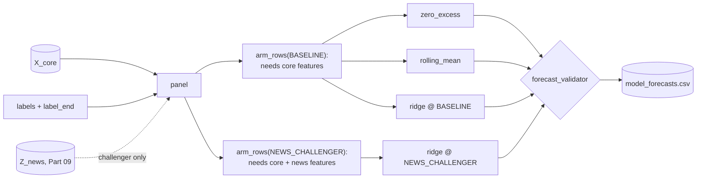

# Part 08 — Stage 02: the forecast contract, matched arms and the no-news baselines

**Goal:** produce forecasts every later stage can trust: one row per (model slot, security) on the shared quantile grid, with the decision time, horizon, target, label end, **arm**, **experiment**, model version, feature version and training window attached. Build the simple yardsticks first, then the candidate model, and the machinery that runs the same candidate in two **arms**: a no-news baseline on X_core, and (from Part 09 on) a news challenger on X_core + Z_news.

**Design:** 2.3 (common forecast contract), 2A (financial family: *"fit simple benchmarks first"*; *"standardise features inside each training fold"*), 2.2 step 6 (*"Join X_core to both variants; join Z_news to the challenger only"*). **Roadmap:** phase 4, no-news baselines. **Overview:** §7.4, §8.



## What you will build in this part

| Section | File | Components |
|---|---|---|
| 8.1 | `contracts/forecast_schema.py` (first two), `contracts/experiment_schema.py`, `contracts/news_feature_schema.py` | 2 of 3 + 2 + 2 |
| 8.2 | `stage_02_forecasting/financial/baselines.py` | 3 |
| 8.3 | `stage_02_forecasting/financial/return_quantiles.py` | 4 |
| 8.4 | `stage_02_forecasting/forecast_registry.py` | 1 |
| 8.5 | `stage_02_forecasting/arm_builder.py` | 2 |
| 8.6 | `stage_02_forecasting/forecast_validator.py`, `forecast_runner.py` | 1 + 3 |
| 8.7 | `stage_02_forecasting/service.py` | 4 |
| 8.8 | tests and one invariant | |

---

## 8.1 Contracts first: forecasts, arms, and the news features you have not built yet

**File:** `src/aqp_python/contracts/forecast_schema.py` — component 1 of 3: the forecast columns

```python
"""The common forecast contract: every model, in every arm, returns rows in this shape."""
from dataclasses import dataclass

import pandas as pd

from aqp_python.contracts.quantile_grid import QUANTILE_COLUMNS

FORECAST_ID_COLUMNS = (
    "security_id", "sleeve", "decision_time", "horizon_days", "target",
    "label_end", "model_name", "arm", "experiment_id", "model_version", "feature_version",
    "train_start", "train_end",
)
FORECAST_COLUMNS = FORECAST_ID_COLUMNS + QUANTILE_COLUMNS
TARGET_NAME = "benchmark_excess_return"
```

**What it does.** Every forecast row carries the fields design 2.3 requires. Two are new in v14: `arm` (`BASELINE` or `NEWS_CHALLENGER`) and `experiment_id`. Without them, a baseline forecast and its challenger would be indistinguishable in every downstream file.

**File:** `src/aqp_python/contracts/forecast_schema.py` — component 2 of 3: ForecastBundle: the Stage 02 hand-off

```python
@dataclass(frozen=True)
class ForecastBundle:
    """Stage 02 output.

    panel: X_core (+ Z_news where available) + labels for every (security, date)
    live:  one row per (model slot, active security) at the decision time, FORECAST_COLUMNS
    slots: every model slot that was run (baselines and both experiment arms)
    """
    panel: pd.DataFrame
    live: pd.DataFrame
    slots: tuple
    core_feature_version: str
    news_feature_version: str | None
```

**What it does.** The Stage 02 hand-off. `slots` lists every model slot that ran, so Stage 02E knows which arms exist without re-reading configuration.

**File:** `src/aqp_python/contracts/experiment_schema.py` — component 1 of 2: Arm and ModelSlot

```python
"""Paired experiments: the same model slot in two arms that differ ONLY by the news features."""
from dataclasses import dataclass, field
from enum import StrEnum


class Arm(StrEnum):
    BASELINE = "BASELINE"                  # X_core only - no NLP-derived variables
    NEWS_CHALLENGER = "NEWS_CHALLENGER"    # the same X_core plus the versioned Z_news


@dataclass(frozen=True)
class ModelSlot:
    """One model in one arm. Baseline yardsticks (zero_excess, ...) have no experiment."""
    model_name: str
    arm: Arm
    role: str                              # "baseline" (yardstick) | "candidate"
    features: tuple[str, ...]
    experiment_id: str = ""
    version: str = "1.0"
    params: dict = field(default_factory=dict)

    @property
    def key(self) -> str:
        return f"{self.model_name}@{self.arm}"
```

**What it does.** A **model slot** is one model in one arm. Its `key`, for example `ridge_location_scale@NEWS_CHALLENGER`, is the name used in every file from here to the report. The two yardsticks have no experiment: they are references for every slot.

**Why a slot, not just a model name.** Design 2E: *"The baseline and its challenger are alternative versions of one model slot, not two independent ensemble members by default."* Giving each arm its own key keeps the evidence for the two arms separate, and keeps either from being counted twice.

**File:** `src/aqp_python/contracts/experiment_schema.py` — component 2 of 2: ExperimentDecision: the outcome vocabulary of a paired test

```python
class ExperimentDecision(StrEnum):
    SHADOW_CANDIDATE = "SHADOW_CANDIDATE"          # eligible AND robust incremental value: shadow + G7 next
    NO_INCREMENTAL_VALUE = "NO_INCREMENTAL_VALUE"  # keep the baseline (or the current approved arm)
    CHALLENGER_INELIGIBLE = "CHALLENGER_INELIGIBLE"
    CHALLENGER_UNAVAILABLE = "CHALLENGER_UNAVAILABLE"   # no Z_news this run (approved fallback)
```

**What it does.** The four things Stage 02E can conclude about a news challenger. You will meet all four in Part 10's tests and Part 13's drills.

The forecasting stage needs to *receive* news features, but the engine that produces them is built in Part 09. So the contract comes first. That is the overview's extension rule ("contract first"), and it means this part can be finished and tested without any news code.

**File:** `src/aqp_python/contracts/news_feature_schema.py` — component 1 of 2: NewsFeatures: the Z_news hand-off

```python
"""Z_news: versioned, point-in-time quantitative news covariates (design 2D). Covariates, never forecasts."""
from dataclasses import dataclass, field

import pandas as pd

NEWS_KEY_COLUMNS = ("security_id", "date")


@dataclass(frozen=True)
class NewsFeatures:
    """Stage 02D output. NaN means 'not available at this decision time' - it is never zero."""
    features: pd.DataFrame | None     # NEWS_KEY_COLUMNS + names; one row per (security, date)
    names: tuple[str, ...]
    version: str                      # extractor, prompt, schema and feature-recipe versions
    available: bool
    coverage: dict = field(default_factory=dict)

    @classmethod
    def unavailable(cls, reason: str) -> "NewsFeatures":
        return cls(None, (), "", False, {"reason": reason})
```

**What it does.** The shape of Z_news: a table keyed by `(security_id, date)`, the feature names, a version string and an `available` flag. `NewsFeatures.unavailable(reason)` is how the approved fallback is represented. **Why the docstring insists NaN is never zero:** this object is where the missingness rule becomes a type. Downstream code can tell "no news engine this run" (`available=False`) from "the engine ran but the feed did not cover this name today" (`NaN`).

**File:** `src/aqp_python/contracts/news_feature_schema.py` — component 2 of 2: check_news_frame

```python
def check_news_frame(frame: pd.DataFrame, names: tuple[str, ...]) -> None:
    """Every published column must be a key or a declared news_* feature."""
    extra = sorted(set(frame.columns) - set(NEWS_KEY_COLUMNS) - set(names))
    undeclared = [n for n in names if not n.startswith("news_")]
    if extra or undeclared:
        raise ValueError(f"news frame has undeclared columns {extra} or names without news_ prefix {undeclared}")
```

## 8.2 Baselines (the yardsticks)

Design 2A: *"Fit simple benchmarks first."* A candidate is worth something only if it beats these out of sample.

**File:** `src/aqp_python/stages/stage_02_forecasting/financial/baselines.py` — component 1 of 3: docstring, imports and horizon_scale

```python
"""Simple baselines first. A candidate model must beat these out of sample to earn weight.

All models share one interface:
    fit(train) -> self        train has feature columns, 'ewma_vol' and 'label'
    predict(rows) -> ndarray  shape (n_rows, 11) on QUANTILE_GRID
"""
import numpy as np
import pandas as pd
from scipy.stats import norm

from aqp_python.contracts.quantile_grid import QUANTILE_GRID

Z = norm.ppf(QUANTILE_GRID)


def horizon_scale(rows: pd.DataFrame, horizon: int) -> np.ndarray:
    """Volatility of an h-day excess return implied by the daily EWMA volatility."""
    return rows["ewma_vol"].to_numpy() * np.sqrt(horizon)
```

**What it does.** States the two-method interface every model shares, `fit(train) -> self` and `predict(rows) -> array (n, 11)`, and computes the h-day volatility `ewma_vol · √h`.

**File:** `src/aqp_python/stages/stage_02_forecasting/financial/baselines.py` — component 2 of 3: ZeroExcessBaseline

```python
class ZeroExcessBaseline:
    """Median 0; spread from EWMA volatility with a training-fitted scale factor."""
    name = "zero_excess"

    def __init__(self, horizon: int, version: str = "1.0", **_: object) -> None:
        self.horizon, self.version = horizon, version
        self.scale_ = 1.0

    def fit(self, train: pd.DataFrame) -> "ZeroExcessBaseline":
        standardised = train["label"].to_numpy() / horizon_scale(train, self.horizon)
        self.scale_ = float(np.std(standardised))
        if not np.isfinite(self.scale_) or self.scale_ <= 0:
            raise ValueError("could not estimate a positive scale")
        return self

    def predict(self, rows: pd.DataFrame) -> np.ndarray:
        sigma = horizon_scale(rows, self.horizon)[:, None] * self.scale_
        return sigma * Z[None, :]
```

**What it does.** Median 0; spread from the EWMA volatility times a scale factor fitted on the training data, so the 90% interval is already roughly calibrated.

**File:** `src/aqp_python/stages/stage_02_forecasting/financial/baselines.py` — component 3 of 3: RollingMeanBaseline

```python
class RollingMeanBaseline(ZeroExcessBaseline):
    """Location = mean label over the most recent `window_days` of training data."""
    name = "rolling_mean"

    def __init__(self, horizon: int, version: str = "1.0", window_days: int = 252, **_: object) -> None:
        super().__init__(horizon, version)
        self.window_days = window_days
        self.mean_ = 0.0

    def fit(self, train: pd.DataFrame) -> "RollingMeanBaseline":
        super().fit(train)
        recent_dates = np.sort(train["date"].unique())[-self.window_days:]
        self.mean_ = float(train.loc[train["date"].isin(recent_dates), "label"].mean())
        return self

    def predict(self, rows: pd.DataFrame) -> np.ndarray:
        return self.mean_ + super().predict(rows)
```

**What it does.** Same spread, but the location is the mean label over the most recent `window_days` of training dates. **Why both yardsticks share the spread:** they differ only in location, so a candidate cannot beat them just by having better-calibrated tails.

## 8.3 The candidate model: volatility-standardised ridge with Student-t quantiles

Return noise scales with volatility, so the model works in volatility units:

```text
u_t  = y_t / (σ_t √h)                                    standardised label
x_t  = (features − mean_train) / std_train               standardised inside the training fold
β̂    = (XᵀX + αI)⁻¹ Xᵀu      (intercept not penalised)    ridge regression
s    = std(u − Xβ̂)                                        residual scale
q_τ  = σ_t √h · ( x_tᵀβ̂ + s · t_ν⁻¹(τ) · √((ν−2)/ν) )    Student-t quantiles with unit variance
```

**File:** `src/aqp_python/stages/stage_02_forecasting/financial/return_quantiles.py` — component 1 of 4: imports

```python
"""Candidate return-quantile models."""
import numpy as np
import pandas as pd
from scipy.stats import t as student_t

from aqp_python.contracts.quantile_grid import QUANTILE_GRID
from aqp_python.stages.stage_02_forecasting.financial.baselines import horizon_scale
```

**File:** `src/aqp_python/stages/stage_02_forecasting/financial/return_quantiles.py` — component 2 of 4: RidgeLocationScale: __init__ and _design

```python
class RidgeLocationScale:
    """Volatility-standardised ridge regression with Student-t quantiles.

    u = label / (ewma_vol * sqrt(h)) is regressed on standardised features:
        beta = (X'X + alpha I)^-1 X'u
    Quantiles are  sigma_h * (x'beta + s * t_nu^-1(tau) * sqrt((nu-2)/nu)),
    where s is the residual standard deviation. Feature means and standard
    deviations are estimated on the training fold only.
    """
    name = "ridge_location_scale"

    def __init__(self, horizon: int, features: list[str], version: str = "1.0",
                 alpha: float = 10.0, t_dof: float = 5.0, **_: object) -> None:
        if t_dof <= 2:
            raise ValueError("t_dof must exceed 2 for a finite variance")
        self.horizon, self.features, self.version = horizon, list(features), version
        self.alpha, self.t_dof = alpha, t_dof

    def _design(self, rows: pd.DataFrame) -> np.ndarray:
        x = (rows[self.features].to_numpy() - self.mean_) / self.std_
        return np.column_stack([np.ones(len(rows)), x])
```

**What it does.** Stores the settings and builds the design matrix: an intercept column plus features standardised with the **training** means and standard deviations (design 2A: standardise inside each training fold).

**Why the feature list is a constructor argument.** The ridge class does not know about news. Given `("mom_252_21", "rev_5", "vol_20", "quality_score")` it is the baseline arm; given the same four plus three `news_*` names it is the challenger. The arm decides the features; the model code is identical. That is how "the arms differ only by the news features" stays true by construction.

**File:** `src/aqp_python/stages/stage_02_forecasting/financial/return_quantiles.py` — component 3 of 4: RidgeLocationScale: fit and predict

```python
    def fit(self, train: pd.DataFrame) -> "RidgeLocationScale":
        self.mean_ = train[self.features].mean().to_numpy()
        self.std_ = train[self.features].std().replace(0, 1.0).to_numpy()
        x = self._design(train)
        u = train["label"].to_numpy() / horizon_scale(train, self.horizon)
        penalty = self.alpha * np.eye(x.shape[1])
        penalty[0, 0] = 0.0                                 # never shrink the intercept
        self.beta_ = np.linalg.solve(x.T @ x + penalty, x.T @ u)
        self.resid_std_ = float(np.std(u - x @ self.beta_))
        if not np.all(np.isfinite(self.beta_)) or self.resid_std_ <= 0:
            raise ValueError("ridge fit produced non-finite coefficients")
        return self

    def predict(self, rows: pd.DataFrame) -> np.ndarray:
        location = self._design(rows) @ self.beta_
        unit_t = student_t.ppf(QUANTILE_GRID, self.t_dof) * np.sqrt((self.t_dof - 2) / self.t_dof)
        standardised = location[:, None] + self.resid_std_ * unit_t[None, :]
        return horizon_scale(rows, self.horizon)[:, None] * standardised
```

**What it does.** Solves the ridge system without penalising the intercept, measures the residual scale, and predicts quantiles as a location plus increasing Student-t offsets. The Student-t (ν = 5) has fatter tails than the normal, as daily returns do; `√((ν−2)/ν)` rescales it to variance 1 so `s` keeps its meaning. The quantiles are increasing by construction.

```python
import numpy as np
import pandas as pd

from aqp_python.stages.stage_02_forecasting.financial.return_quantiles import RidgeLocationScale

rng = np.random.default_rng(3)
train = pd.DataFrame({"signal": rng.normal(size=3000), "noise": rng.normal(size=3000), "ewma_vol": 0.02})
train["label"] = 0.02 * np.sqrt(5) * (0.3 * train["signal"] + rng.standard_t(5, 3000) * 0.6)
model = RidgeLocationScale(horizon=5, features=["signal", "noise"], alpha=1.0).fit(train)
print("beta (intercept, signal, noise):", model.beta_.round(3))
q = model.predict(pd.DataFrame({"signal": [-1.0, 0.0, 1.0], "noise": 0.0, "ewma_vol": 0.02}))
print("medians:", q[:, 5].round(4), "| 90% width:", (q[:, 8] - q[:, 2]).round(4))
```

```text
beta (intercept, signal, noise): [-0.005  0.293 -0.029]
medians: [-0.0135 -0.0005  0.0125] | 90% width: [0.109 0.109 0.109]
```

This is a **parameter recovery test**: generate data where you know the truth (0.3 on `signal`, 0 on `noise`), fit, and check the model finds it. It is the fastest way to catch a sign error or a mis-scaled feature.

**File:** `src/aqp_python/stages/stage_02_forecasting/financial/return_quantiles.py` — component 4 of 4: LinearQuantile

```python
class LinearQuantile:
    """One linear quantile regression per grid point (scikit-learn QuantileRegressor).

    Separate fits can cross; crossed rows are rejected by the forecast validator,
    never silently sorted.
    """
    name = "linear_quantile"

    def __init__(self, horizon: int, features: list[str], version: str = "1.0",
                 alpha: float = 1e-4, max_train_rows: int = 4000, **_: object) -> None:
        self.horizon, self.features, self.version = horizon, list(features), version
        self.alpha, self.max_train_rows = alpha, max_train_rows

    def fit(self, train: pd.DataFrame) -> "LinearQuantile":
        from sklearn.linear_model import QuantileRegressor  # optional dependency, imported on use
        sample = train.sample(min(len(train), self.max_train_rows), random_state=0)
        self.mean_ = sample[self.features].mean().to_numpy()
        self.std_ = sample[self.features].std().replace(0, 1.0).to_numpy()
        x = (sample[self.features].to_numpy() - self.mean_) / self.std_
        u = sample["label"].to_numpy() / horizon_scale(sample, self.horizon)
        self.models_ = [QuantileRegressor(quantile=q, alpha=self.alpha, solver="highs").fit(x, u)
                        for q in QUANTILE_GRID]
        return self

    def predict(self, rows: pd.DataFrame) -> np.ndarray:
        x = (rows[self.features].to_numpy() - self.mean_) / self.std_
        standardised = np.column_stack([m.predict(x) for m in self.models_])
        return horizon_scale(rows, self.horizon)[:, None] * standardised
```

**Why ship a disabled model.** Eleven separate quantile regressions can cross. `linear_quantile` is disabled in `forecast_models.yaml`, and the validator (8.6) would reject its crossed rows and record `QUANTILE_CROSSING`. Silently sorting them would change which model produced which quantile. If you adopt a correction later, version it and test it. Note the `sklearn` import inside `fit`: a heavy optional dependency is loaded only when the model is used.

## 8.4 The model registry

**File:** `src/aqp_python/stages/stage_02_forecasting/forecast_registry.py`

```python
"""Config name -> model class. Adding a model = new class + one line here + YAML entry."""
from aqp_python.contracts.experiment_schema import ModelSlot
from aqp_python.stages.stage_02_forecasting.financial.baselines import RollingMeanBaseline, ZeroExcessBaseline
from aqp_python.stages.stage_02_forecasting.financial.return_quantiles import LinearQuantile, RidgeLocationScale

MODEL_CLASSES = {
    "zero_excess": ZeroExcessBaseline,
    "rolling_mean": RollingMeanBaseline,
    "ridge_location_scale": RidgeLocationScale,
    "linear_quantile": LinearQuantile,
}


def build_model(slot: ModelSlot, horizon: int):
    """A fresh, unfitted model for one slot. The slot's arm decides its features."""
    if slot.model_name not in MODEL_CLASSES:
        raise KeyError(f"model '{slot.model_name}' is configured but not registered")
    return MODEL_CLASSES[slot.model_name](horizon=horizon, features=list(slot.features),
                                          version=slot.version, **slot.params)
```

Adding a model takes three steps: the class, one line in `MODEL_CLASSES`, and a YAML entry. A *candidate* also needs a registered experiment (8.5); a yardstick does not.

## 8.5 Matched arms

**File:** `src/aqp_python/stages/stage_02_forecasting/arm_builder.py` — component 1 of 2: model_slots: which (model, arm) pairs run

```python
"""Matched arms (design 2.2 step 6): join X_core to both arms and Z_news to the challenger only."""
import pandas as pd

from aqp_python.contracts.experiment_schema import Arm, ModelSlot


def model_slots(models_cfg: dict, experiments_cfg: dict, news_available: bool) -> tuple[list[ModelSlot], list[str]]:
    """Return (slots to run, models skipped because they belong to no registered experiment)."""
    by_model = {spec["model"]: (eid, spec) for eid, spec in experiments_cfg["experiments"].items()}
    slots, unregistered = [], []
    for name, spec in models_cfg["models"].items():
        if not spec.get("enabled"):
            continue
        common = {"model_name": name, "role": spec["role"], "version": spec.get("version", "1.0"),
                  "params": dict(spec.get("params", {}))}
        if spec["role"] == "baseline":                    # yardsticks: no features, no experiment
            slots.append(ModelSlot(arm=Arm.BASELINE, features=(), **common))
            continue
        if name not in by_model:
            unregistered.append(name)                     # a candidate must be registered before testing
            continue
        experiment_id, experiment = by_model[name]
        core, news = tuple(experiment["core_features"]), tuple(experiment["news_features"])
        slots.append(ModelSlot(arm=Arm.BASELINE, features=core, experiment_id=experiment_id, **common))
        if news_available:
            slots.append(ModelSlot(arm=Arm.NEWS_CHALLENGER, features=core + news,
                                   experiment_id=experiment_id, **common))
    return slots, unregistered
```

**What it does.** Turns configuration into slots. Yardsticks get one `BASELINE` slot with no features. A candidate in a registered experiment gets a `BASELINE` slot with the core features, and a `NEWS_CHALLENGER` slot with core + news **only if news is available this run**. A candidate in no experiment is skipped and reported (`EXPERIMENT_NOT_REGISTERED`): design 2E says pairs are registered *before* results are seen, so an unregistered candidate cannot be evaluated fairly.

**File:** `src/aqp_python/stages/stage_02_forecasting/arm_builder.py` — component 2 of 2: build_panel and arm_rows

```python
def build_panel(core: pd.DataFrame, labels: pd.DataFrame, news: pd.DataFrame | None) -> pd.DataFrame:
    """X_core joined with labels (where known) and Z_news (where it exists). Nothing is filled."""
    panel = core.merge(labels, on=["security_id", "date"], how="left")
    if news is not None:
        panel = panel.merge(news, on=["security_id", "date"], how="left")
    return panel.sort_values(["date", "security_id"]).reset_index(drop=True)


def arm_rows(panel: pd.DataFrame, slot: ModelSlot) -> pd.DataFrame:
    """Rows a slot may use: every feature it needs is present. For a challenger this is the
    registered 'matched_only' missingness policy - no Z_news, no challenger forecast."""
    needed = list(slot.features) + ["ewma_vol"]
    return panel.dropna(subset=needed)
```

**What it does.** `build_panel` joins X_core, labels and (if present) Z_news, filling nothing. `arm_rows` returns the rows a slot may use: every one of its features present, plus the volatility scale.

**Why this is the matched_only policy.** For the challenger, `arm_rows` drops rows where any news feature is NaN. No news means no challenger forecast, and the baseline is unaffected because it never looks at the news columns. Part 10 then compares the two arms only on the rows both could use, and reports how many that is.

```python
from pathlib import Path

from aqp_python.config.config_loader import load_pipeline_config
from aqp_python.stages.stage_02_forecasting.arm_builder import model_slots

config = load_pipeline_config(Path("configs/pipeline.yaml"), "asx_interday")
for news in (False, True):
    slots, skipped = model_slots(config["forecast_models"], config["experiments"], news_available=news)
    print(f"news available={news}:")
    for slot in slots:
        print(f"   {slot.key:<40} features={list(slot.features)}")
```

```text
news available=False:
   zero_excess@BASELINE                     features=[]
   rolling_mean@BASELINE                    features=[]
   ridge_location_scale@BASELINE            features=['mom_252_21', 'rev_5', 'vol_20', 'quality_score']
news available=True:
   zero_excess@BASELINE                     features=[]
   rolling_mean@BASELINE                    features=[]
   ridge_location_scale@BASELINE            features=['mom_252_21', 'rev_5', 'vol_20', 'quality_score']
   ridge_location_scale@NEWS_CHALLENGER     features=['mom_252_21', 'rev_5', 'vol_20', 'quality_score', 'news_sentiment_decay', 'news_intensity_decay', 'news_event_count_5d']
```

## 8.6 Enforcing the contract and producing today's forecasts

**File:** `src/aqp_python/stages/stage_02_forecasting/forecast_validator.py`

```python
"""Enforce the common forecast contract before any forecast leaves Stage 02."""
from datetime import datetime

import numpy as np
import pandas as pd

from aqp_python.contracts.forecast_schema import FORECAST_COLUMNS
from aqp_python.contracts.quantile_grid import QUANTILE_COLUMNS
from aqp_python.contracts.reason_codes import ReasonCode as RC


def validate_forecasts(frame: pd.DataFrame, decision_time: datetime) -> tuple[pd.DataFrame, pd.DataFrame]:
    """Split rows into (valid, rejected); rejected rows carry a reason_code column."""
    missing = sorted(set(FORECAST_COLUMNS) - set(frame.columns))
    if missing:
        raise ValueError(f"forecast frame is missing columns: {missing}")
    q = frame[list(QUANTILE_COLUMNS)].to_numpy(dtype=float)
    decision_date = pd.Timestamp(decision_time.date())
    reason = pd.Series("", index=frame.index, dtype=object)
    reason[~np.isfinite(q).all(axis=1)] = str(RC.FORECAST_INVALID)
    crossing = (np.diff(q, axis=1) < 0).any(axis=1)
    reason[(reason == "") & crossing] = str(RC.QUANTILE_CROSSING)
    bad_time = (pd.to_datetime(frame["label_end"]) <= decision_date) | (
        pd.to_datetime(frame["train_end"]) > decision_date)
    reason[(reason == "") & bad_time.to_numpy()] = str(RC.FORECAST_INVALID)
    rejected = frame.loc[reason != ""].assign(reason_code=reason[reason != ""])
    return frame.loc[reason == ""].copy(), rejected
```

**What it does.** Rejects a row if any quantile is not finite, if quantiles cross, if its label end is not after the decision date, or if its training window ends after the decision date (look-ahead). Rejections are kept with their reason codes, never dropped silently.

**File:** `src/aqp_python/stages/stage_02_forecasting/forecast_runner.py` — component 1 of 3: imports and training_rows

```python
"""Produce live forecasts at the decision time for every model slot."""
import logging

import numpy as np
import pandas as pd

from aqp_python.contracts.experiment_schema import ModelSlot
from aqp_python.contracts.forecast_schema import FORECAST_COLUMNS, TARGET_NAME
from aqp_python.contracts.quantile_grid import QUANTILE_COLUMNS
from aqp_python.stages.stage_02_forecasting.arm_builder import arm_rows
from aqp_python.stages.stage_02_forecasting.forecast_registry import build_model

log = logging.getLogger(__name__)


def training_rows(rows: pd.DataFrame, decision_date: pd.Timestamp) -> pd.DataFrame:
    """Rows whose label was fully known at the decision date (label_end <= decision date)."""
    return rows.loc[rows["label"].notna() & (rows["label_end"] <= decision_date)]
```

**What it does.** `training_rows` is the purge for *live* forecasting: on 16 October a label is known only if its `label_end ≤ 16 October`. Rows from the last six sessions still have open labels and are excluded, even though their features are known.

**File:** `src/aqp_python/stages/stage_02_forecasting/forecast_runner.py` — component 2 of 3: to_forecast_frame: attach the contract metadata

```python
def to_forecast_frame(rows: pd.DataFrame, quantiles: np.ndarray, slot: ModelSlot, *, sleeve: str,
                      decision_time, horizon: int, label_end: pd.Timestamp, feature_version: str,
                      train: pd.DataFrame) -> pd.DataFrame:
    frame = pd.DataFrame(quantiles, columns=list(QUANTILE_COLUMNS), index=rows.index)
    frame.insert(0, "security_id", rows["security_id"].to_numpy())
    meta = {"sleeve": sleeve, "decision_time": decision_time.isoformat(), "horizon_days": horizon,
            "target": TARGET_NAME, "label_end": label_end, "model_name": slot.model_name,
            "arm": str(slot.arm), "experiment_id": slot.experiment_id, "model_version": slot.version,
            "feature_version": feature_version, "train_start": train["date"].min(),
            "train_end": train["label_end"].max()}
    for key, value in meta.items():
        frame[key] = value
    return frame[list(FORECAST_COLUMNS)].reset_index(drop=True)
```

**What it does.** Wraps a quantile array in the contract: security, sleeve, decision time, horizon, target, label end, model, **arm**, **experiment**, versions and training window.

**File:** `src/aqp_python/stages/stage_02_forecasting/forecast_runner.py` — component 3 of 3: live_forecasts: fit each slot on its own arm, predict today

```python
def live_forecasts(panel: pd.DataFrame, slots: list[ModelSlot], active_ids: tuple[str, ...], *,
                   decision_time, decision_date: pd.Timestamp, label_end: pd.Timestamp, horizon: int,
                   sleeve: str, feature_versions: dict[str, str]) -> tuple[pd.DataFrame, dict[str, str]]:
    """Fit each slot on all fully-labelled history of its arm and predict for today."""
    frames, failures = [], {}
    for slot in slots:
        rows = arm_rows(panel, slot)
        train = training_rows(rows, decision_date)
        today = rows.loc[(rows["date"] == decision_date) & rows["security_id"].isin(active_ids)]
        try:
            q = build_model(slot, horizon).fit(train).predict(today)
        except Exception as error:                      # a failed model is recorded, not hidden
            failures[slot.key] = f"{type(error).__name__}: {error}"
            log.warning("model %s failed: %s", slot.key, error)
            continue
        frames.append(to_forecast_frame(today, q, slot, sleeve=sleeve, decision_time=decision_time,
                                        horizon=horizon, label_end=label_end,
                                        feature_version=feature_versions[str(slot.arm)], train=train))
    live = pd.concat(frames, ignore_index=True) if frames else pd.DataFrame(columns=FORECAST_COLUMNS)
    return live, failures
```

**What it does.** For each slot, takes *its own arm's* rows, fits on everything fully labelled, and predicts for today's active names. A failure is caught and recorded, never turned into an empty or stale forecast. A challenger has no row for a name whose news is missing today, so it simply produces no forecast for it.

## 8.7 The Stage 02 service

**File:** `src/aqp_python/stages/stage_02_forecasting/service.py` — component 1 of 4: imports

```python
"""Stage 02 entry point: labels + X_core (+ Z_news) -> matched arms -> live forecasts per model slot."""
import pandas as pd

from aqp_python.contracts.data_schemas import ResearchData
from aqp_python.contracts.forecast_schema import ForecastBundle
from aqp_python.contracts.news_feature_schema import NewsFeatures
from aqp_python.contracts.reason_codes import ReasonCode as RC
from aqp_python.contracts.universe_schema import UniverseSelection
from aqp_python.orchestration.run_context import RunContext
from aqp_python.orchestration.stage_status import StageResult
from aqp_python.stages.stage_02_forecasting.arm_builder import build_panel, model_slots
from aqp_python.stages.stage_02_forecasting.forecast_runner import live_forecasts
from aqp_python.stages.stage_02_forecasting.forecast_validator import validate_forecasts
from aqp_python.stages.stage_02_forecasting.label_builder import build_labels

STAGE = "stage_02_forecasting"
```

**File:** `src/aqp_python/stages/stage_02_forecasting/service.py` — component 2 of 4: run_stage: panel and slots

```python
def run_stage(ctx: RunContext, research: ResearchData, universe: UniverseSelection,
              news: NewsFeatures | None = None) -> tuple[StageResult, ForecastBundle | None]:
    result = StageResult(STAGE)
    horizon = ctx.config["forecast_models"]["horizon_days"]
    news_ok = news is not None and news.available

    # The research panel excludes names quarantined on the detailed data: their recent rows are not trusted.
    prices = research.prices.loc[~research.prices["security_id"].isin(research.quarantined)]
    labels = build_labels(prices, research.benchmark, research.trading_days, horizon)
    core = research.core_features.loc[~research.core_features["security_id"].isin(research.quarantined)]
    panel = build_panel(core, labels, news.features if news_ok else None)
    slots, unregistered = model_slots(ctx.config["forecast_models"], ctx.config["experiments"], news_ok)
    for name in unregistered:
        result.reason_codes.append(str(RC.EXPERIMENT_NOT_REGISTERED))
        result.warnings.append(f"candidate {name} is not in a registered experiment and was not run")
```

**What it does.** Builds labels and the panel from the **research** data (admitted names only, minus names quarantined on the detailed data), then the slots. `news` is optional: `None` (no news stage) and `available=False` (the approved fallback) both mean baseline arms only.

**File:** `src/aqp_python/stages/stage_02_forecasting/service.py` — component 3 of 4: run_stage: forecast, validate and write

```python
    versions = {"BASELINE": research.core_feature_version,
                "NEWS_CHALLENGER": f"{research.core_feature_version}+{news.version}" if news_ok else ""}
    label_end = ctx.decision_date + pd.offsets.BDay(horizon + 1)   # may lie beyond the known calendar
    active = tuple(s for s in universe.active_ids if s not in research.quarantined)
    live, failures = live_forecasts(panel, slots, active, decision_time=ctx.decision_time,
                                    decision_date=ctx.decision_date, label_end=label_end, horizon=horizon,
                                    sleeve=ctx.sleeve, feature_versions=versions)
    valid, rejected = validate_forecasts(live, ctx.decision_time)
    valid.to_csv(ctx.paths.sub("forecasts", "model_forecasts.csv"), index=False)
    rejected.to_csv(ctx.paths.sub("forecasts", "rejected_forecasts.csv"), index=False)
    result.artifacts.update({"model_forecasts": "forecasts/model_forecasts.csv",
                             "rejected_forecasts": "forecasts/rejected_forecasts.csv"})
```

**What it does.** Records two feature versions: X_core's for the baseline arm, and X_core's plus Z_news's for the challenger. Then forecasts, validates and writes `model_forecasts.csv` and `rejected_forecasts.csv`.

**File:** `src/aqp_python/stages/stage_02_forecasting/service.py` — component 4 of 4: run_stage: record failures and hand off

```python
    for key, message in failures.items():          # recorded; G3 will exclude the slot
        result.reason_codes.append(str(RC.MODEL_FIT_FAILED))
        result.warnings.append(f"{key} failed to fit: {message}")
    if len(rejected):
        result.warnings.append(f"{len(rejected)} forecast rows rejected by the contract validator")
    counts = valid.groupby(["model_name", "arm"]).size()
    result.metrics.update({"panel_rows": len(panel), "slots": [s.key for s in slots],
                           "live_rows": {f"{m}@{a}": int(n) for (m, a), n in counts.items()},
                           "failed_slots": sorted(failures), "news_used": news_ok})
    if valid.empty:
        return result.block(RC.FORECAST_INVALID, "no valid forecasts were produced"), None
    return result, ForecastBundle(panel, valid, tuple(slots), research.core_feature_version,
                                  news.version if news_ok else None)
```

**Survivorship note.** In v12 the research panel used *every* security with data. In v14 detailed data exists only for admitted names, so models are trained on the histories of the 26 members, including SYN30, which delisted after formation. Membership was decided point-in-time at formation, so this is not a look-ahead; but pre-formation history is conditioned on having been admitted. Design 2.1 allows retrieving extra history *"where… historical retention or audit rules require it"*; record that choice in the decision log if you make it.

## 8.8 Tests

Add the shared forecast-row helper to the bottom of `tests\conftest.py`:

**File:** `tests/conftest.py` — component 3 of 3: forecast_frame

```python
def forecast_frame(quantiles, label_end="2026-01-20", train_end="2026-01-09", model="m", arm="BASELINE"):
    """One forecast row on the common contract (imported lazily: the contract is built in Part 08)."""
    from aqp_python.contracts.forecast_schema import FORECAST_COLUMNS
    from aqp_python.contracts.quantile_grid import QUANTILE_COLUMNS

    row = {"security_id": "A", "sleeve": "s", "decision_time": "t", "horizon_days": 5, "target": "x",
           "label_end": pd.Timestamp(label_end), "model_name": model, "arm": arm, "experiment_id": "e",
           "model_version": "1", "feature_version": "f", "train_start": pd.Timestamp("2025-01-01"),
           "train_end": pd.Timestamp(train_end), **dict(zip(QUANTILE_COLUMNS, quantiles))}
    return pd.DataFrame([row])[list(FORECAST_COLUMNS)]
```

**File:** `tests/unit/test_forecast_schema.py`

```python
from datetime import UTC, datetime

import numpy as np
import pandas as pd
import pytest

from aqp_python.contracts.forecast_schema import FORECAST_COLUMNS
from aqp_python.stages.stage_02_forecasting.forecast_validator import validate_forecasts
from tests.conftest import forecast_frame

pytestmark = pytest.mark.batch04


def test_every_forecast_names_its_arm_and_experiment():
    assert {"arm", "experiment_id", "label_end", "feature_version"} <= set(FORECAST_COLUMNS)


def test_validator_rejects_crossing_and_bad_timing():
    decision = datetime(2026, 1, 12, 6, tzinfo=UTC)
    good = list(np.linspace(-1, 1, 11))
    crossing = good.copy()
    crossing[2], crossing[3] = crossing[3], crossing[2]
    frame = pd.concat([forecast_frame(good), forecast_frame(crossing),
                       forecast_frame(good, train_end="2026-02-01")])
    valid, rejected = validate_forecasts(frame, decision)
    assert len(valid) == 1
    assert rejected["reason_code"].tolist() == ["QUANTILE_CROSSING", "FORECAST_INVALID"]
```

**File:** `tests/unit/test_forecast_models.py`

```python
import numpy as np
import pandas as pd
import pytest

from aqp_python.stages.stage_02_forecasting.financial.baselines import ZeroExcessBaseline
from aqp_python.stages.stage_02_forecasting.financial.return_quantiles import RidgeLocationScale

pytestmark = pytest.mark.batch04


@pytest.fixture
def training():
    rng = np.random.default_rng(3)
    n = 3000
    frame = pd.DataFrame({"signal": rng.normal(size=n), "noise": rng.normal(size=n),
                          "ewma_vol": 0.02, "date": pd.Timestamp("2026-01-01")})
    frame["label"] = 0.02 * np.sqrt(5) * (0.3 * frame["signal"] + rng.standard_t(5, n) * 0.6)
    return frame


def test_baseline_quantiles_are_ordered_and_centred(training):
    q = ZeroExcessBaseline(horizon=5).fit(training).predict(training.head(3))
    assert (np.diff(q, axis=1) > 0).all() and np.allclose(q[:, 5], 0.0)


def test_ridge_recovers_the_signal_direction(training):
    model = RidgeLocationScale(horizon=5, features=["signal", "noise"], alpha=1.0).fit(training)
    assert model.beta_[1] > 0.2 and abs(model.beta_[2]) < 0.05
    q = model.predict(training.head(50))
    assert (np.diff(q, axis=1) >= 0).all()
```

**File:** `tests/unit/test_arm_builder.py`

```python
import numpy as np
import pandas as pd
import pytest

from aqp_python.contracts.experiment_schema import Arm, ModelSlot
from aqp_python.stages.stage_02_forecasting.arm_builder import arm_rows, build_panel, model_slots

pytestmark = pytest.mark.batch04
MODELS = {"models": {"zero_excess": {"role": "baseline", "enabled": True},
                     "ridge_location_scale": {"role": "candidate", "enabled": True, "params": {"alpha": 1.0}},
                     "orphan": {"role": "candidate", "enabled": True}}}
EXPERIMENTS = {"experiments": {"e1": {"model": "ridge_location_scale", "core_features": ["a", "b"],
                                      "news_features": ["news_x"]}}}


def test_slots_pair_each_registered_candidate_and_skip_orphans():
    slots, unregistered = model_slots(MODELS, EXPERIMENTS, news_available=True)
    assert [s.key for s in slots] == ["zero_excess@BASELINE", "ridge_location_scale@BASELINE",
                                      "ridge_location_scale@NEWS_CHALLENGER"]
    assert slots[2].features == ("a", "b", "news_x") and slots[1].features == ("a", "b")
    assert unregistered == ["orphan"]


def test_without_news_only_baseline_arms_run():
    slots, _ = model_slots(MODELS, EXPERIMENTS, news_available=False)
    assert {s.arm for s in slots} == {Arm.BASELINE}


def test_panel_keeps_missing_news_and_the_challenger_uses_matched_rows_only():
    core = pd.DataFrame({"security_id": ["A", "B"], "date": pd.to_datetime(["2026-01-02"] * 2),
                         "a": [1.0, 2.0], "b": [0.0, 0.0], "ewma_vol": [0.01, 0.01]})
    labels = pd.DataFrame({"security_id": ["A", "B"], "date": core["date"], "label": [0.0, 0.0],
                           "label_end": core["date"]})
    news = pd.DataFrame({"security_id": ["A"], "date": core["date"][:1], "news_x": [0.5]})
    panel = build_panel(core, labels, news)
    assert np.isnan(panel.set_index("security_id").loc["B", "news_x"])        # not filled with 0
    challenger = ModelSlot("ridge", Arm.NEWS_CHALLENGER, "candidate", ("a", "b", "news_x"))
    baseline = ModelSlot("ridge", Arm.BASELINE, "candidate", ("a", "b"))
    assert arm_rows(panel, challenger)["security_id"].tolist() == ["A"]
    assert arm_rows(panel, baseline)["security_id"].tolist() == ["A", "B"]
```

`test_panel_keeps_missing_news_and_the_challenger_uses_matched_rows_only` is the matched_only policy in six lines: B has no news, the panel says NaN (not 0), the challenger skips B, the baseline does not.

The baseline invariant. If adding news columns to the panel changed a single baseline forecast, the experiment would no longer isolate the news features:

**File:** `tests/invariants/test_baseline_has_no_news_features.py`

```python
"""The no-news baseline must be untouched by Z_news: same forecasts with or without news in the panel."""
import numpy as np
import pandas as pd
import pytest

from aqp_python.contracts.experiment_schema import Arm
from aqp_python.stages.stage_02_forecasting.arm_builder import model_slots
from aqp_python.stages.stage_02_forecasting.forecast_runner import live_forecasts

pytestmark = pytest.mark.invariant


def test_baseline_slots_declare_no_news_features(config):
    slots, _ = model_slots(config["forecast_models"], config["experiments"], news_available=True)
    for slot in (s for s in slots if s.arm == Arm.BASELINE):
        assert not [f for f in slot.features if f.startswith("news_")], slot.key


def test_baseline_forecasts_ignore_news_columns(config):
    rng = np.random.default_rng(0)
    days = pd.bdate_range("2024-01-01", periods=300)
    panel = pd.DataFrame({"security_id": np.repeat(["A", "B"], len(days)), "date": np.tile(days, 2)})
    for column in ("mom_252_21", "rev_5", "vol_20", "quality_score"):
        panel[column] = rng.normal(size=len(panel))
    panel["ewma_vol"], panel["label"] = 0.02, rng.normal(0, 0.03, len(panel))
    panel["label_end"] = panel["date"] + pd.offsets.BDay(6)
    with_news = panel.assign(news_sentiment_decay=rng.normal(size=len(panel)),
                             news_intensity_decay=1.0, news_event_count_5d=0.0)
    slots, _ = model_slots(config["forecast_models"], config["experiments"], news_available=False)
    common = dict(decision_time=pd.Timestamp("2025-02-28 17:00", tz="Australia/Sydney"),
                  decision_date=days[-1], label_end=days[-1] + pd.offsets.BDay(6), horizon=5, sleeve="s",
                  feature_versions={"BASELINE": "v"})
    a, _ = live_forecasts(panel, slots, ("A", "B"), **common)
    b, _ = live_forecasts(with_news, slots, ("A", "B"), **common)
    pd.testing.assert_frame_equal(a, b)
```

Add the second look-ahead component, under the X_core one:

**File:** `tests/invariants/test_no_lookahead.py` — component 2 of 3: training rows (Part 08)

```python
def test_training_rows_only_use_labels_known_at_the_decision():
    from aqp_python.stages.stage_02_forecasting.forecast_runner import training_rows
    panel = pd.DataFrame({"date": pd.bdate_range("2026-01-01", periods=10), "label": 0.0,
                          "label_end": pd.bdate_range("2026-01-07", periods=10)})
    rows = training_rows(panel, pd.Timestamp("2026-01-12"))
    assert rows["label_end"].max() <= pd.Timestamp("2026-01-12")
```

The Stage 02 checkpoint, run **without** the news stage:

**File:** `tests/integration/test_stage_handoffs.py` — component 5 of 9: test_stage_02_forecasting (no-news baselines)

```python
@pytest.mark.batch04
def test_stage_02_forecasting_baselines(make_context):
    ctx = make_context()
    out = run_through(ctx, "stage_02_forecasting", news=False)
    live = out["bundle"].live
    print("\n", live.groupby(["model_name", "arm"]).size())
    assert set(live["arm"]) == {"BASELINE"}
    assert set(live["model_name"]) == {"zero_excess", "rolling_mean", "ridge_location_scale"}
    expected = set(out["universe"].active_ids) - out["research"].quarantined
    assert set(live["security_id"]) == expected
```

```powershell
python -m pytest -m batch04 -q
python -m pytest tests\invariants -q
python -m pytest tests\integration\test_stage_handoffs.py -k forecasting_baselines -s -q --basetemp=build\pytest
```

```text
ridge_location_scale  BASELINE    23
rolling_mean          BASELINE    23
zero_excess           BASELINE    23
dtype: int64
.
1 passed in 3.37s
```

Three yardstick-or-baseline slots, one row for each active, non-quarantined member.

**Experiment:** set `linear_quantile: enabled: true` in `configs\forecast_models.yaml` and rerun the checkpoint. The run reports `EXPERIMENT_NOT_REGISTERED`, because a candidate with no registered experiment is not allowed to run. Set it back to `false`.

## Checkpoint

- [ ] `python -m pytest -m batch04 -q` → `19 passed`.
- [ ] `test_baseline_forecasts_ignore_news_columns` passes.
- [ ] You can name the three habits that keep features leak-free (Part 06) and the rule that keeps the arms comparable (this part).

**Check your understanding.** (1) Why does the ridge class take its feature list as an argument instead of reading it from configuration? (2) What does the challenger forecast for a security whose news feed was down today, and why?

```powershell
git add .
git commit -m "Stage 02: forecast contract, arms and slots, baselines, ridge model, validator"
```

Next: [Part 09 — Stage 02D: the AI news feature engine](09_stage02d_news_feature_engine.md).
