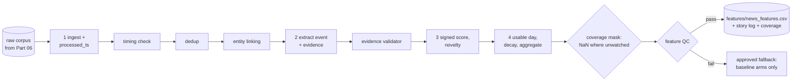

# Part 09 — Stage 02D: the AI news feature engine

**Goal:** turn timestamped news text into a small, versioned table of numbers, **Z_news**, keyed by `(security_id, date)`, that the news-challenger arm may use and the baseline arm never sees. Every story is kept and given a status; every number can be traced back to a quoted phrase in a story; and wherever the feed was not watching a company, the features are **missing**, not zero.

**Design:** 2D (*"The language model is a feature-extraction tool, not the forecasting model"*), steps 1–4 (timing and provenance, structured extraction, quantification, aggregation), *"Missingness and leakage"* and *"Feature QC and time cut-off"*. **Roadmap:** phase 5, the news feature engine. **Overview:** §1.1 row "Missing news is never zero", §7.3.



Every box before the aggregation **marks** stories and never deletes them. A story's `status` starts as `OK`; the first check it fails replaces it with a reason code, and later steps only look at `OK` rows. At the end, the story log shows every story and why it was or was not used.

## What you will build in this part

| Section | File | Components |
|---|---|---|
| 9.1 | `text_ingestion.py`, `source_timing_check.py` | 1 + 1 |
| 9.2 | `story_deduplication.py`, `entity_linking.py` | 1 + 2 |
| 9.3 | `prompt_registry.py`, `llm_event_extractor.py` (first two), `evidence_validator.py` | 1 + 2 of 3 + 1 |
| 9.4 | `event_quantification.py`, `novelty_surprise.py` | 1 + 1 |
| 9.5 | `time_decay.py`, `entity_aggregation.py` | 1 + 2 |
| 9.6 | `feature_qc.py`, `latency_admissibility.py`, `news_coverage_report.py`, `news_feature_publisher.py` | 1 + 1 + 1 + 1 |
| 9.7 | `stage_02d_news_features/service.py` | 5 |
| 9.8 | tests, a gate test and an invariant | |

The `LLMExtractor` (third component of `llm_event_extractor.py`), `graph_propagation.py` and `event_risk_calibration.py` are extensions, built in Part 14.

---

## 9.1 Step 1: timing and provenance

A news story has three times:

| Time | Who sets it | Meaning |
|---|---|---|
| `published_ts` | the publisher | when the story says it was released |
| `first_seen_ts` | the feed | when our provider first delivered it |
| `processed_ts` | **us** | `first_seen_ts` + our own processing latency |

Only the last one says when *we* could have acted. A story published at 16:50 but not processed until 17:03 cannot affect a 17:00 decision, however early its publication time.

**File:** `src/aqp_python/stages/stage_02d_news_features/text_ingestion.py`

```python
"""Normalise the raw corpus and stamp OUR processing time (design 2D step 1: timing and provenance)."""
import pandas as pd


def ingest(corpus: pd.DataFrame, processing_latency_minutes: int) -> pd.DataFrame:
    """processed_ts = first_seen_ts + our own processing latency. Text is cleaned, never rewritten."""
    stories = corpus.copy()
    for column in ("headline", "body"):
        stories[column] = stories[column].astype(str).str.replace(r"\s+", " ", regex=True).str.strip()
    stories["processed_ts"] = stories["first_seen_ts"] + pd.Timedelta(minutes=processing_latency_minutes)
    stories["status"] = "OK"
    return stories.sort_values("first_seen_ts", kind="mergesort").reset_index(drop=True)
```

**What it does.** Collapses whitespace in the headline and body (the text is cleaned, never paraphrased), adds `processed_ts`, sets every status to `OK`, and sorts by when we saw the story. `kind="mergesort"` is a *stable* sort: ties keep their original order, so reruns produce identical files.

**File:** `src/aqp_python/stages/stage_02d_news_features/source_timing_check.py`

```python
"""A story counts at a decision time only if it was PROCESSED by then - publication time is not enough."""
from datetime import datetime

import pandas as pd

from aqp_python.contracts.reason_codes import ReasonCode as RC


def check_timing(stories: pd.DataFrame, decision_time: datetime) -> pd.DataFrame:
    """Mark (never drop) stories with impossible timestamps or not yet processed at the decision time."""
    out = stories.copy()
    ok = out["status"] == "OK"
    invalid = out["published_ts"].isna() | out["first_seen_ts"].isna() | (out["first_seen_ts"] < out["published_ts"])
    out.loc[ok & invalid, "status"] = str(RC.NEWS_TIMESTAMP_INVALID)
    late = out["processed_ts"] > pd.Timestamp(decision_time)
    out.loc[(out["status"] == "OK") & late, "status"] = str(RC.NEWS_NOT_YET_AVAILABLE)
    return out
```

**What it does.** Two marks. `NEWS_TIMESTAMP_INVALID`: a time is missing, or the feed claims to have seen the story before it was published. `NEWS_NOT_YET_AVAILABLE`: we had not processed it by the decision time. **Why mark instead of filter:** a late story is not wrong. It will count tomorrow (9.5), and it belongs in today's log so that a reviewer can see what arrived too late.

## 9.2 One story per event, and the right company

**File:** `src/aqp_python/stages/stage_02d_news_features/story_deduplication.py`

```python
"""One event, one story: repeats from other wires must not multiply the same shock (design 2D)."""
import pandas as pd

from aqp_python.contracts.reason_codes import ReasonCode as RC


def normalised_headline(headline: pd.Series) -> pd.Series:
    return (headline.str.replace(r"^(UPDATE|CORRECTED|REPEAT):\s*", "", regex=True)
            .str.lower().str.replace(r"[^a-z0-9 ]", "", regex=True).str.strip())


def deduplicate(stories: pd.DataFrame, window_hours: float) -> pd.DataFrame:
    """Keep the first-seen copy; later copies of the same headline within the window are duplicates."""
    out = stories.sort_values("first_seen_ts", kind="mergesort").copy()
    out["dedup_key"] = normalised_headline(out["headline"])
    usable = out["status"] == "OK"
    last_seen: dict[str, pd.Timestamp] = {}
    for index, row in out.loc[usable].iterrows():
        previous = last_seen.get(row["dedup_key"])
        if previous is not None and row["first_seen_ts"] - previous <= pd.Timedelta(hours=window_hours):
            out.loc[index, "status"] = str(RC.NEWS_DUPLICATE)
        else:
            last_seen[row["dedup_key"]] = row["first_seen_ts"]
    return out.drop(columns="dedup_key")
```

**What it does.** Strips `UPDATE:`, `CORRECTED:` and `REPEAT:` prefixes, lower-cases and removes punctuation to form a key, then marks later copies of the same key within `duplicate_window_hours` as `NEWS_DUPLICATE`. **Why it matters:** the sample feed sends some stories on both wires. Without this step, one guidance upgrade would be counted twice and look like twice the news.

**File:** `src/aqp_python/stages/stage_02d_news_features/entity_linking.py` — component 1 of 2: name patterns

```python
"""Map each story to the security it is about, from its TEXT; provider tags are only a hint."""
import re

import pandas as pd

from aqp_python.contracts.reason_codes import ReasonCode as RC


def _patterns(reference: pd.DataFrame) -> list[tuple[str, re.Pattern]]:
    names = reference.drop_duplicates("security_id")
    return [(row.security_id, re.compile(rf"\b({re.escape(row.name)}|{re.escape(row.short_name)})\b"))
            for row in names.itertuples(index=False)]
```

**What it does.** One regular expression per security, matching its full name or short name as whole words (`\b…\b`), so `SYNCO01` does not match inside `SYNCO010`.

**File:** `src/aqp_python/stages/stage_02d_news_features/entity_linking.py` — component 2 of 2: link_entities

```python
def link_entities(stories: pd.DataFrame, reference: pd.DataFrame, in_scope: set[str]) -> pd.DataFrame:
    """Add security_id and tag_agrees. Unlinked and out-of-scope stories are marked with a reason code."""
    patterns = _patterns(reference)
    out = stories.copy()
    linked, agrees = [], []
    for row in out.itertuples(index=False):
        text = f"{row.headline} {row.body}"
        hits = sorted({sid for sid, pattern in patterns if pattern.search(text)})
        security_id = hits[0] if len(hits) == 1 else ""
        linked.append(security_id)
        agrees.append(bool(security_id) and row.provider_tags in ("", security_id))
    out["security_id"], out["tag_agrees"] = linked, agrees
    ok = out["status"] == "OK"
    out.loc[ok & (out["security_id"] == ""), "status"] = str(RC.NEWS_UNLINKED)
    out.loc[(out["status"] == "OK") & ~out["security_id"].isin(in_scope), "status"] = str(RC.NEWS_OUT_OF_SCOPE)
    return out
```

**What it does.** Links a story to a security only if **exactly one** company is named in its text. No name, or two names, gives `NEWS_UNLINKED`. A name outside the admitted universe gives `NEWS_OUT_OF_SCOPE`. `tag_agrees` records whether the provider's tag matched, for monitoring.

**Why the text decides, not the tag.** Provider tags are sometimes missing (the sample feed drops some on purpose) and sometimes wrong. A tag is a claim by the provider; a name in the text is evidence. Two names make the story ambiguous: it might be good for one company and bad for the other, so it is not used for either.

## 9.3 Step 2: structured extraction with evidence

The design's rule: *the model fills a fixed schema; it does not forecast returns or recommend trades.* The schema is five fields: `event_type` (from a fixed list), `direction` (−1, 0, +1), `severity` (0–1), `confidence` (0–1) and `evidence` (an **exact quote** from the story).

**File:** `src/aqp_python/stages/stage_02d_news_features/prompt_registry.py`

```python
"""Versioned extraction instructions. Frozen during an evaluation period (design 2D 'Missingness and leakage')."""
from dataclasses import dataclass

EVENT_TYPES = ("guidance_raised", "guidance_cut", "earnings_beat", "earnings_miss", "contract_win",
               "regulatory_probe", "product_launch", "executive_departure", "routine_update")


@dataclass(frozen=True)
class PromptSpec:
    version: str
    schema_version: str
    event_types: tuple[str, ...]
    instructions: str


PROMPTS = {
    "lexicon-v1": PromptSpec(
        version="lexicon-v1", schema_version="event-v1", event_types=EVENT_TYPES,
        instructions="Rule-based lexicon: one event per story; quote the matched phrase as evidence."),
    "llm-v1": PromptSpec(
        version="llm-v1", schema_version="event-v1", event_types=EVENT_TYPES,
        instructions=("Read ONE news story about ONE company. Return JSON with keys event_type "
                      f"(one of {', '.join(EVENT_TYPES)}), direction (-1, 0 or 1), severity (0-1), "
                      "confidence (0-1) and evidence (an exact quote from the story). Do not infer "
                      "price moves, do not recommend trades, do not use outside knowledge.")),
}


def get_prompt(version: str) -> PromptSpec:
    if version not in PROMPTS:
        raise KeyError(f"prompt version {version!r} is not registered")
    return PROMPTS[version]
```

**What it does.** Stores the extraction instructions under a version name. The run records which version it used, and the configuration freezes it for an evaluation period. **Why:** if the instructions changed in the middle of a test period, the features before and after the change would be different variables under one name, and the challenger's evaluation would mix them.

**File:** `src/aqp_python/stages/stage_02d_news_features/llm_event_extractor.py` — component 1 of 3: the extractor protocol and the lexicon

```python
"""Turn one story into one structured event with an evidence span (design 2D step 2).

The pipeline talks to an EventExtractor. LexiconExtractor is deterministic and needs no
network, so tests and research runs are reproducible; an LLM extractor implements the
same protocol through connectors/llm (Part 14) and is judged by the same validator.
"""
import re
from typing import Protocol

import pandas as pd

from aqp_python.stages.stage_02d_news_features.prompt_registry import PromptSpec


class EventExtractor(Protocol):
    prompt: PromptSpec

    def extract(self, headline: str, body: str) -> dict: ...


# (pattern, event_type, direction, severity)
LEXICON = (
    (r"rais\w* (its )?full-year (earnings )?guidance", "guidance_raised", 1, 1.0),
    (r"cut\w* (its )?full-year (earnings )?guidance", "guidance_cut", -1, 1.0),
    (r"profit (that )?beat\w* market expectations", "earnings_beat", 1, 0.8),
    (r"profit (that )?miss\w* market expectations", "earnings_miss", -1, 0.8),
    (r"w[io]n\w* (a )?major (multi-year )?supply contract", "contract_win", 1, 0.6),
    (r"regulatory probe|regulator opens probe", "regulatory_probe", -1, 0.7),
    (r"launch\w* (a )?new product line", "product_launch", 1, 0.4),
    (r"chief executive (will|to) step down", "executive_departure", -1, 0.4),
    (r"annual investor briefing", "routine_update", 0, 0.1),
)
```

**What it does.** `EventExtractor` is a `Protocol`: any object with a `prompt` and an `extract(headline, body) -> dict` method will do. `LEXICON` is the built-in extractor's knowledge: nine phrase patterns, each mapped to an event type, a direction and a severity.

**File:** `src/aqp_python/stages/stage_02d_news_features/llm_event_extractor.py` — component 2 of 3: LexiconExtractor and extract_events

```python
class LexiconExtractor:
    def __init__(self, prompt: PromptSpec) -> None:
        self.prompt = prompt
        self._rules = [(re.compile(p, re.IGNORECASE), t, d, s) for p, t, d, s in LEXICON]

    def extract(self, headline: str, body: str) -> dict:
        text = f"{headline}. {body}"
        hits = [(rule.search(text), t, d, s) for rule, t, d, s in self._rules]
        hits = [(m, t, d, s) for m, t, d, s in hits if m]
        if not hits:
            return {"event_type": None, "direction": 0, "severity": 0.0, "confidence": 0.0, "evidence": ""}
        match, event_type, direction, severity = hits[0]
        confidence = 0.9 if len({t for _, t, _, _ in hits}) == 1 else 0.5   # conflicting cues -> less sure
        return {"event_type": event_type, "direction": direction, "severity": severity,
                "confidence": confidence, "evidence": match.group(0)}


def extract_events(stories: pd.DataFrame, extractor: EventExtractor) -> pd.DataFrame:
    """Run the extractor on every usable story; record the prompt and schema versions on each row."""
    out = stories.copy()
    usable = out["status"] == "OK"
    fields = [extractor.extract(h, b) if ok else {}
              for h, b, ok in zip(out["headline"], out["body"], usable)]
    extracted = pd.DataFrame(fields, index=out.index)
    for column in ("event_type", "direction", "severity", "confidence", "evidence"):
        out[column] = extracted.get(column)
    out["prompt_version"] = extractor.prompt.version
    out["schema_version"] = extractor.prompt.schema_version
    return out
```

**What it does.** The lexicon returns the first matching rule, quotes the matched phrase as evidence, and lowers its confidence from 0.9 to 0.5 when the story matches rules of more than one event type. No match gives an empty event. `extract_events` runs the extractor on every `OK` story and stamps the prompt and schema versions on every row.

**Why a lexicon first.** It is deterministic and needs no network, so every test and research run is reproducible, and it gives a working end-to-end engine before any model is involved. In Part 14 an `LLMExtractor` implements the same protocol. Because the rest of the engine depends only on the protocol, swapping it in changes one line in the service and one in the configuration, and the validator below checks the language model's output exactly as it checks the lexicon's.

**File:** `src/aqp_python/stages/stage_02d_news_features/evidence_validator.py`

```python
"""Reject extracted events whose fields break the fixed schema or whose evidence is not in the story."""
import pandas as pd

from aqp_python.contracts.reason_codes import ReasonCode as RC


def problems(row, event_types: tuple[str, ...]) -> list[str]:
    found = []
    if row.event_type not in event_types:
        found.append("unknown event_type")
    if row.direction not in (-1, 0, 1):
        found.append("direction must be -1, 0 or 1")
    if not (0 <= row.severity <= 1 and 0 <= row.confidence <= 1):
        found.append("severity and confidence must be in [0, 1]")
    if not row.evidence or row.evidence.lower() not in f"{row.headline}. {row.body}".lower():
        found.append("evidence is not a quote from the story")
    return found


def validate_events(events: pd.DataFrame, event_types: tuple[str, ...]) -> pd.DataFrame:
    out = events.copy()
    out["extraction_problems"] = ""
    for index, row in out.loc[out["status"] == "OK"].iterrows():
        found = problems(row, event_types)
        if found:
            out.loc[index, ["status", "extraction_problems"]] = [str(RC.NEWS_EXTRACTION_INVALID), "; ".join(found)]
    return out
```

**What it does.** Rejects an event as `NEWS_EXTRACTION_INVALID` if its type is not in the fixed list, its direction or scores are out of range, or its evidence does not appear in the story. The problems are written to `extraction_problems` for the story log.

**Why check the evidence.** It is the main guard against a language model inventing facts. If the quoted phrase is not in the story, the event is not supported by the story and is thrown out, however plausible it sounds.

Run the first half of the engine on five hand-made stories:

```python
from datetime import UTC, datetime

import pandas as pd

from aqp_python.stages.stage_02d_news_features.entity_linking import link_entities
from aqp_python.stages.stage_02d_news_features.evidence_validator import validate_events
from aqp_python.stages.stage_02d_news_features.llm_event_extractor import LexiconExtractor, extract_events
from aqp_python.stages.stage_02d_news_features.prompt_registry import get_prompt
from aqp_python.stages.stage_02d_news_features.source_timing_check import check_timing
from aqp_python.stages.stage_02d_news_features.story_deduplication import deduplicate
from aqp_python.stages.stage_02d_news_features.text_ingestion import ingest

decision = datetime(2026, 10, 16, 6, 0, tzinfo=UTC)                     # 17:00 in Sydney
reference = pd.DataFrame({"security_id": ["SYN01", "SYN02"], "short_name": ["SYNCO01", "SYNCO02"],
                          "name": ["Synthetic Company 01", "Synthetic Company 02"]})
corpus = pd.DataFrame({
    "story_id": ["s1", "s2", "s3", "s4", "s5"],
    "source": ["wire_a", "wire_b", "wire_a", "wire_a", "wire_b"],
    "provider_tags": ["SYN01", "", "SYN02", "", "SYN02"],
    "headline": ["Synthetic Company 01 raises full-year guidance",
                 "UPDATE: Synthetic Company 01 raises full-year guidance",
                 "Synthetic Company 02 profit missed market expectations",
                 "Sector outlook steady",
                 "SYNCO02 comments on press speculation"],
    "body": ["", "", "", "Analysts see little change.", ""],
    "published_ts": pd.to_datetime(["2026-10-14 00:55", "2026-10-14 01:55", "2026-10-16 05:50",
                                    "2026-10-15 03:00", "2026-10-15 04:00"], utc=True),
    "first_seen_ts": pd.to_datetime(["2026-10-14 01:00", "2026-10-14 02:00", "2026-10-16 05:58",
                                     "2026-10-15 03:01", "2026-10-15 04:02"], utc=True)})

extractor = LexiconExtractor(get_prompt("lexicon-v1"))
stories = ingest(corpus, processing_latency_minutes=5)
stories = check_timing(stories, decision)
stories = deduplicate(stories, window_hours=24)
stories = link_entities(stories, reference, in_scope={"SYN01", "SYN02"})
events = validate_events(extract_events(stories, extractor), get_prompt("lexicon-v1").event_types)
print(events[["story_id", "security_id", "status", "event_type", "direction", "evidence"]].to_string(index=False))
```

```text
story_id security_id                  status      event_type  direction                  evidence
      s1       SYN01                      OK guidance_raised        1.0 raises full-year guidance
      s2       SYN01          NEWS_DUPLICATE             NaN        NaN                       NaN
      s4                       NEWS_UNLINKED             NaN        NaN                       NaN
      s5       SYN02 NEWS_EXTRACTION_INVALID             NaN        0.0                          
      s3       SYN02  NEWS_NOT_YET_AVAILABLE             NaN        NaN                       NaN
```

Read the table row by row:

- **s1** is used: it names one company and contains a lexicon phrase, which is quoted as evidence.
- **s2** is the same story from the second wire an hour later, so it is a duplicate.
- **s4** names no company and is unlinked.
- **s5** names SYN02 but says nothing the lexicon recognises, so it has no event type and no evidence, and the validator rejects it.
- **s3** was first seen at 05:58 UTC and processed at 06:03, three minutes after the 17:00 Sydney decision (06:00 UTC), so it is not yet available. It is sorted last because `ingest` orders stories by when they were seen.

## 9.4 Step 3: quantification and novelty

**File:** `src/aqp_python/stages/stage_02d_news_features/event_quantification.py`

```python
"""Quantify an event: signed score = direction x severity x confidence x source credibility."""
import pandas as pd


def quantify(events: pd.DataFrame, credibility: dict[str, float]) -> pd.DataFrame:
    out = events.copy()
    out["credibility"] = out["source"].map(credibility).fillna(0.5)      # unknown source: half weight
    usable = out["status"] == "OK"
    out["signed_score"] = 0.0
    out.loc[usable, "signed_score"] = (out.loc[usable, "direction"].astype(float) * out.loc[usable, "severity"]
                                       * out.loc[usable, "confidence"] * out.loc[usable, "credibility"])
    return out
```

**What it does.** One number per event: `signed_score = direction × severity × confidence × credibility`. Credibility comes from `source_credibility` in `news_features.yaml` (`wire_a` 1.0, `wire_b` 0.8); an unknown source gets 0.5. For s1: `1 × 1.0 × 0.9 × 1.0 = 0.9`.

**File:** `src/aqp_python/stages/stage_02d_news_features/novelty_surprise.py`

```python
"""Novelty: is this new information, or the same kind of event about the same company again?"""
import pandas as pd


def mark_novelty(events: pd.DataFrame, window_days: int) -> pd.DataFrame:
    """novelty = 1 for the first (security, event_type) within the window, else 0."""
    out = events.copy()
    out["novelty"] = 0.0
    usable = out.loc[out["status"] == "OK"].sort_values("processed_ts", kind="mergesort")
    last: dict[tuple[str, str], pd.Timestamp] = {}
    for index, row in usable.iterrows():
        key = (row["security_id"], row["event_type"])
        previous = last.get(key)
        if previous is None or row["processed_ts"] - previous > pd.Timedelta(days=window_days):
            out.loc[index, "novelty"] = 1.0
        last[key] = row["processed_ts"]
    return out
```

**What it does.** An event is novel (1) if it is the first of its type for that security within `novelty_window_days`, otherwise 0. **Why:** a second "guidance raised" story about the same company within ten days is usually the same information retold. Deduplication catches identical headlines; novelty catches the same news in different words. Novelty enters the sentiment and the event count, but not the intensity, which measures how much the company is in the news.

## 9.5 Step 4: when news counts, how it fades, and what "no news" means

**When an event first counts.** Decisions are taken at 17:00 Sydney on each trading day. An event is usable on the first trading day whose decision instant is at or after its `processed_ts`:

```text
processed Thu 16:00 Sydney  → usable Thu (decision Thu 17:00)
processed Thu 18:00 Sydney  → usable Fri
processed Sat 10:00 Sydney  → usable Mon
```

**File:** `src/aqp_python/stages/stage_02d_news_features/time_decay.py`

```python
"""When does an event first count, and how fast does it fade?"""
import numpy as np
import pandas as pd

from aqp_python.data_foundation.as_of_join import decision_timestamps


def usable_day_index(processed_ts: pd.Series, trading_days: pd.DatetimeIndex, *, timezone: str,
                     local_time: str) -> np.ndarray:
    """Index of the first trading day whose decision time is at or after processing (-1 = beyond calendar)."""
    decisions = pd.DatetimeIndex(decision_timestamps(pd.Series(trading_days), timezone, local_time))
    position = decisions.searchsorted(pd.DatetimeIndex(processed_ts).tz_convert("UTC"), side="left")
    return np.where(position < len(trading_days), position, -1)


def decay_weights(max_age: int, decay_days: float) -> np.ndarray:
    """exp(-age / decay) for age = 0 .. max_age trading days."""
    return np.exp(-np.arange(max_age + 1) / decay_days)
```

**What it does.** `usable_day_index` builds the decision timestamps for every trading day (the same `decision_timestamps` as the as-of join in Part 04) and uses `searchsorted` to find, for each processing time, the first decision at or after it. `-1` means the event is beyond the last known trading day. `decay_weights` gives `exp(−age / decay_days)`; with `decay_days = 5`, an event keeps 37% of its weight after five sessions.

**Why `pd.DatetimeIndex.searchsorted`.** Both sides are timezone-aware. Converting to plain numpy datetimes could silently drop the timezone and shift every boundary by eleven hours; a pandas index keeps both sides in UTC.

The three published features, for security *i* on day *t*, with *a* the age in sessions of each event *e* since its usable day:

```text
news_sentiment_decay  = Σ_e  signed_score_e × novelty_e × exp(−a/5)      for 0 ≤ a ≤ 20
news_intensity_decay  = Σ_e |signed_score_e|            × exp(−a/5)      for 0 ≤ a ≤ 20
news_event_count_5d   = Σ_e  novelty_e                                   for 0 ≤ a < 5
```

**File:** `src/aqp_python/stages/stage_02d_news_features/entity_aggregation.py` — component 1 of 2: aggregate: events -> one row per (security, date)

```python
"""Aggregate usable events into daily per-security features (design 2D step 4)."""
import numpy as np
import pandas as pd


def aggregate(events: pd.DataFrame, securities: list[str], trading_days: pd.DatetimeIndex, *,
              weights: np.ndarray, count_window: int) -> pd.DataFrame:
    """events need: security_id, usable_day (index into trading_days), signed_score, novelty.

    sentiment = sum(signed x novelty x decay); intensity = sum(|signed| x decay);
    count_5d = number of novel events in the last `count_window` sessions.
    """
    n_days, column = len(trading_days), {s: j for j, s in enumerate(securities)}
    sentiment, intensity, count = (np.zeros((n_days, len(securities))) for _ in range(3))
    for event in events.itertuples(index=False):
        start, j = int(event.usable_day), column[event.security_id]
        span = min(len(weights), n_days - start)
        sentiment[start:start + span, j] += event.signed_score * event.novelty * weights[:span]
        intensity[start:start + span, j] += abs(event.signed_score) * weights[:span]
        count[start:start + min(count_window, span), j] += event.novelty
    frames = {"news_sentiment_decay": sentiment, "news_intensity_decay": intensity, "news_event_count_5d": count}
    long = [pd.DataFrame(values, index=trading_days, columns=securities).rename_axis("date")
            .reset_index().melt(id_vars="date", var_name="security_id", value_name=name).set_index(
                ["security_id", "date"])[name] for name, values in frames.items()]
    return pd.concat(long, axis=1).reset_index()
```

**What it does.** Builds three (days × securities) arrays of zeros, then adds each event's decayed contribution from its usable day onward. `span` stops the event at the end of the calendar. Finally the arrays are melted into one long table with a row per `(security_id, date)`.

At this point a zero means "no events were found". That is only true if somebody was looking.

**File:** `src/aqp_python/stages/stage_02d_news_features/entity_aggregation.py` — component 2 of 2: apply_coverage: no feed, no feature (NaN, never zero)

```python
def covered_mask(coverage: pd.DataFrame | None, securities: list[str], trading_days: pd.DatetimeIndex,
                 require_days: int) -> pd.DataFrame:
    """True where the feed covered the name on each of the last `require_days` sessions."""
    daily = pd.DataFrame(False, index=trading_days, columns=securities)
    if coverage is not None:
        for period in coverage.itertuples(index=False):
            if period.security_id in daily.columns:
                daily.loc[(daily.index >= period.start_date) & (daily.index <= period.end_date),
                          period.security_id] = True
    return daily.astype(float).rolling(require_days, min_periods=require_days).min().fillna(0.0).astype(bool)


def apply_coverage(features: pd.DataFrame, mask: pd.DataFrame, names: list[str]) -> pd.DataFrame:
    """Where the feed was not watching, zero events means 'unknown', so every feature becomes NaN."""
    covered = mask.rename_axis("date").reset_index().melt(id_vars="date", var_name="security_id",
                                                          value_name="covered")
    out = features.merge(covered, on=["security_id", "date"], how="left")
    out.loc[~out["covered"].fillna(False).astype(bool), names] = np.nan
    return out.drop(columns="covered")
```

**What it does.** `covered_mask` marks a `(security, day)` as covered only if the feed was monitoring that security on each of the last `require_coverage_days` sessions; the rolling minimum is 1 only when every day in the window was covered. `apply_coverage` then sets **all three features to NaN** wherever the mask is False.

**Why this is the most important function in Stage 02D.** Suppose the feed was down for SYN07 for a week. With zeros, the challenger would see "a quiet week, no news" and learn from it; but the truth is "we do not know". Its estimate of what quiet weeks mean would be wrong, and the paired test in Part 10 would compare the arms on days when the challenger was, in effect, guessing. With NaN, `arm_rows` (Part 08) excludes those rows from the challenger and Part 10 compares the arms only where the news was really observed, and reports how many rows that left.

Continue the example: score the usable story, place it on a calendar, and apply a coverage record in which the feed only started watching SYN02 on 13 October:

```python
# (the lines down to `events = ...` repeat the previous example, so this block runs on its own)
from datetime import UTC, datetime

import pandas as pd

from aqp_python.stages.stage_02d_news_features.entity_linking import link_entities
from aqp_python.stages.stage_02d_news_features.evidence_validator import validate_events
from aqp_python.stages.stage_02d_news_features.llm_event_extractor import LexiconExtractor, extract_events
from aqp_python.stages.stage_02d_news_features.prompt_registry import get_prompt
from aqp_python.stages.stage_02d_news_features.source_timing_check import check_timing
from aqp_python.stages.stage_02d_news_features.story_deduplication import deduplicate
from aqp_python.stages.stage_02d_news_features.text_ingestion import ingest

decision = datetime(2026, 10, 16, 6, 0, tzinfo=UTC)                     # 17:00 in Sydney
reference = pd.DataFrame({"security_id": ["SYN01", "SYN02"], "short_name": ["SYNCO01", "SYNCO02"],
                          "name": ["Synthetic Company 01", "Synthetic Company 02"]})
corpus = pd.DataFrame({
    "story_id": ["s1", "s2", "s3", "s4", "s5"],
    "source": ["wire_a", "wire_b", "wire_a", "wire_a", "wire_b"],
    "provider_tags": ["SYN01", "", "SYN02", "", "SYN02"],
    "headline": ["Synthetic Company 01 raises full-year guidance",
                 "UPDATE: Synthetic Company 01 raises full-year guidance",
                 "Synthetic Company 02 profit missed market expectations",
                 "Sector outlook steady",
                 "SYNCO02 comments on press speculation"],
    "body": ["", "", "", "Analysts see little change.", ""],
    "published_ts": pd.to_datetime(["2026-10-14 00:55", "2026-10-14 01:55", "2026-10-16 05:50",
                                    "2026-10-15 03:00", "2026-10-15 04:00"], utc=True),
    "first_seen_ts": pd.to_datetime(["2026-10-14 01:00", "2026-10-14 02:00", "2026-10-16 05:58",
                                     "2026-10-15 03:01", "2026-10-15 04:02"], utc=True)})

extractor = LexiconExtractor(get_prompt("lexicon-v1"))
stories = ingest(corpus, processing_latency_minutes=5)
stories = check_timing(stories, decision)
stories = deduplicate(stories, window_hours=24)
stories = link_entities(stories, reference, in_scope={"SYN01", "SYN02"})
events = validate_events(extract_events(stories, extractor), get_prompt("lexicon-v1").event_types)

from aqp_python.stages.stage_02d_news_features.entity_aggregation import aggregate, apply_coverage, covered_mask
from aqp_python.stages.stage_02d_news_features.event_quantification import quantify
from aqp_python.stages.stage_02d_news_features.novelty_surprise import mark_novelty
from aqp_python.stages.stage_02d_news_features.time_decay import decay_weights, usable_day_index

days = pd.bdate_range("2026-10-09", "2026-10-16")
scored = mark_novelty(quantify(events, {"wire_a": 1.0, "wire_b": 0.8}), window_days=10)
usable = scored.loc[scored["status"] == "OK"].copy()
usable["usable_day"] = usable_day_index(usable["processed_ts"], days, timezone="Australia/Sydney",
                                        local_time="17:00")
print("s1 processed", usable["processed_ts"].iloc[0], "-> first counts on", days[usable["usable_day"].iloc[0]].date())

names = ["news_sentiment_decay", "news_intensity_decay", "news_event_count_5d"]
features = aggregate(usable, ["SYN01", "SYN02"], days, weights=decay_weights(20, 5.0), count_window=5)
coverage = pd.DataFrame({"security_id": ["SYN01", "SYN02"],
                         "start_date": pd.to_datetime(["2026-01-01", "2026-10-13"]),
                         "end_date": pd.to_datetime(["2026-12-31", "2026-12-31"])})
features = apply_coverage(features, covered_mask(coverage, ["SYN01", "SYN02"], days, require_days=3), names)
print(features.pivot(index="date", columns="security_id", values="news_sentiment_decay").round(3))
```

```text
s1 processed 2026-10-14 01:05:00+00:00 -> first counts on 2026-10-14
security_id  SYN01  SYN02
date                     
2026-10-09     NaN    NaN
2026-10-12     NaN    NaN
2026-10-13   0.000    NaN
2026-10-14   0.900    NaN
2026-10-15   0.737    0.0
2026-10-16   0.603    0.0
```

- SYN01 gets 0.9 on 14 October, the day s1 was first usable, and then fades: `0.9 × e^(−1/5) = 0.737`, `0.9 × e^(−2/5) = 0.603`.
- SYN02 is NaN until 15 October, the first day with three covered sessions behind it (13, 14 and 15 October); then it is `0.0`, because the feed was watching and found nothing usable. s3 will count from 19 October.
- The first two SYN01 rows are NaN only because this toy calendar starts on 9 October, and three sessions of coverage history are needed.

## 9.6 Quality control, latency, coverage and publishing

**File:** `src/aqp_python/stages/stage_02d_news_features/feature_qc.py`

```python
"""Feature QC: a news table that fails any check is not published (design 2D 'Feature QC and time cut-off')."""
import numpy as np
import pandas as pd


def qc_features(features: pd.DataFrame, names: list[str], decision_date: pd.Timestamp) -> list[str]:
    issues = []
    values = features[names].to_numpy(dtype=float)
    if np.isinf(values).any():
        issues.append("infinite values")
    for name in ("news_intensity_decay", "news_event_count_5d"):
        if name in features and (features[name] < 0).any():
            issues.append(f"{name} has negative values")
    if (features["date"] > decision_date).any():
        issues.append("features dated after the decision date")
    if features[names].isna().all().any():
        issues.append("a feature is missing everywhere")
    if features.duplicated(["security_id", "date"]).any():
        issues.append("duplicate (security_id, date) rows")
    return issues
```

**What it does.** Five checks, any of which stops publication: infinite values, negative intensities or counts (impossible by construction, so a sign of a bug), rows dated after the decision, a feature that is missing everywhere, and duplicate keys. A failing table goes to the fallback (9.7) rather than to the models.

**File:** `src/aqp_python/stages/stage_02d_news_features/latency_admissibility.py`

```python
"""How long did news take to become usable? Publication -> first seen -> processed (design 2D 'Time dynamics')."""
import pandas as pd


def latency_report(stories: pd.DataFrame) -> dict:
    """Median and 95th-percentile latencies in minutes, over stories that were processed."""
    feed = (stories["first_seen_ts"] - stories["published_ts"]).dt.total_seconds() / 60
    total = (stories["processed_ts"] - stories["published_ts"]).dt.total_seconds() / 60
    if total.empty:
        return {"median_feed_minutes": None, "p95_total_minutes": None, "stories": 0}
    return {"median_feed_minutes": round(float(feed.median()), 2),
            "p95_total_minutes": round(float(total.quantile(0.95)), 2), "stories": int(len(total))}
```

**What it does.** Median feed latency (publication → first seen) and the 95th percentile of total latency (publication → processed), in minutes. Stage 07 monitors these in Part 12: if the 95th percentile drifts towards the gap between the close and 17:00, news is arriving too late to matter.

**File:** `src/aqp_python/stages/stage_02d_news_features/news_coverage_report.py`

```python
"""Report coverage so missing news can never quietly shrink the challenger's test sample."""
import pandas as pd


def coverage_report(features: pd.DataFrame, names: list[str], stories: pd.DataFrame,
                    decision_date: pd.Timestamp, active_ids: list[str]) -> tuple[pd.DataFrame, dict]:
    available = features[names].notna().all(axis=1)
    by_security = available.groupby(features["security_id"]).mean().round(4).rename("available_share")
    today = features.loc[(features["date"] == decision_date) & features["security_id"].isin(active_ids)]
    summary = {
        "available_share_all_rows": round(float(available.mean()), 4),
        "available_share_today": round(float(today[names].notna().all(axis=1).mean()), 4) if len(today) else 0.0,
        "stories_by_status": stories["status"].value_counts().sort_index().to_dict(),
    }
    return by_security.reset_index(), summary
```

**What it does.** The share of rows where all features are available, overall, per security and for today's active names, plus a count of stories by status. **Why:** design 2D, *"Report coverage, latency and missingness so that a poor news feed cannot quietly change the model sample."* If today's coverage is 60%, the challenger forecasts only 60% of names, and anyone reading the report should know that.

**File:** `src/aqp_python/stages/stage_02d_news_features/news_feature_publisher.py`

```python
"""Publish Z_news with its versions and lineage (design 2D step 4)."""
from pathlib import Path

import pandas as pd

from aqp_python.contracts.news_feature_schema import NewsFeatures, check_news_frame
from aqp_python.storage.feature_store import feature_version, publish_features

NEWS_CODE_VERSION = "news-1.0"


def news_version(cfg: dict) -> str:
    """Changes whenever the recipe, the extractor, the prompt or the schema changes."""
    return feature_version(NEWS_CODE_VERSION, list(cfg["features"]), cfg["extractor"], cfg["prompt_version"],
                           cfg["extraction_schema_version"], str(cfg["decay_days"]), str(cfg["novelty_window_days"]))


def publish_news(features: pd.DataFrame, names: list[str], cfg: dict, path: Path, coverage: dict) -> NewsFeatures:
    frame = features[["security_id", "date", *names]].copy()
    check_news_frame(frame, tuple(names))
    version = news_version(cfg)
    publish_features(frame, path, version)
    return NewsFeatures(frame, tuple(names), version, True, coverage)
```

**What it does.** Checks the table against the `NewsFeatures` contract from Part 08, computes a version from **everything that changes the numbers** (the code version, the feature list, the extractor, the prompt and schema versions, the decay and the novelty window), writes the table through the feature store and returns the `NewsFeatures` object. Change the decay from 5 to 3 days and the version changes, so a challenger trained on the old features cannot be confused with one trained on the new.

## 9.7 The Stage 02D service

**File:** `src/aqp_python/stages/stage_02d_news_features/service.py` — component 1 of 5: imports

```python
"""Stage 02D entry point: timestamped text -> validated, versioned quantitative covariates Z_news."""
import logging

from aqp_python.contracts.data_schemas import ResearchData
from aqp_python.contracts.news_feature_schema import NewsFeatures
from aqp_python.contracts.reason_codes import ReasonCode as RC
from aqp_python.gates.gate_result import GateOutcome, GateResult
from aqp_python.orchestration.run_context import RunContext
from aqp_python.orchestration.stage_status import StageResult
from aqp_python.stages.stage_02d_news_features.entity_aggregation import aggregate, apply_coverage, covered_mask
from aqp_python.stages.stage_02d_news_features.entity_linking import link_entities
from aqp_python.stages.stage_02d_news_features.event_quantification import quantify
from aqp_python.stages.stage_02d_news_features.evidence_validator import validate_events
from aqp_python.stages.stage_02d_news_features.feature_qc import qc_features
from aqp_python.stages.stage_02d_news_features.latency_admissibility import latency_report
from aqp_python.stages.stage_02d_news_features.llm_event_extractor import LexiconExtractor, extract_events
from aqp_python.stages.stage_02d_news_features.news_coverage_report import coverage_report
from aqp_python.stages.stage_02d_news_features.news_feature_publisher import publish_news
from aqp_python.stages.stage_02d_news_features.novelty_surprise import mark_novelty
from aqp_python.stages.stage_02d_news_features.prompt_registry import get_prompt
from aqp_python.stages.stage_02d_news_features.source_timing_check import check_timing
from aqp_python.stages.stage_02d_news_features.story_deduplication import deduplicate
from aqp_python.stages.stage_02d_news_features.text_ingestion import ingest
from aqp_python.stages.stage_02d_news_features.time_decay import decay_weights, usable_day_index

log = logging.getLogger(__name__)
STAGE = "stage_02d_news_features"
```

**File:** `src/aqp_python/stages/stage_02d_news_features/service.py` — component 2 of 5: _fallback: degrade only if the fallback is approved

```python
def _fallback(ctx: RunContext, result: StageResult, reason: str) -> tuple[StageResult, NewsFeatures]:
    """No usable Z_news: challengers become unavailable. Allowed ONLY if fallbacks.yaml approves it."""
    if "news_features_unavailable" in ctx.config["fallbacks"]["approved"]:
        result.degrade(RC.NEWS_UNAVAILABLE, f"{reason}; approved fallback: baseline arms only")
    else:
        result.block(RC.NEWS_UNAVAILABLE, f"{reason}; no approved fallback")
    result.records["news_features"] = {"available": False, "reason": reason}
    return result, NewsFeatures.unavailable(reason)
```

**What it does.** The one route by which Stage 02D can fail without stopping the run. If `news_features_unavailable` is listed under `approved` in `fallbacks.yaml`, the stage is DEGRADED and returns `NewsFeatures.unavailable(...)`, so Part 08's `model_slots` builds baseline arms only. If it is not listed, the stage BLOCKS. Either way the reason is recorded.

**File:** `src/aqp_python/stages/stage_02d_news_features/service.py` — component 3 of 5: run_stage: text to events

```python
def run_stage(ctx: RunContext, research: ResearchData) -> tuple[StageResult, NewsFeatures]:
    result = StageResult(STAGE)
    cfg, pipeline = ctx.config["news_features"], ctx.config["pipeline"]
    if research.text_corpus.empty or research.news_coverage is None:
        return _fallback(ctx, result, "no news corpus or coverage metadata in the data request")
    if cfg["extractor"] != "lexicon":
        return _fallback(ctx, result, f"extractor {cfg['extractor']!r} is not wired in this build")
    prompt = get_prompt(cfg["prompt_version"])

    stories = ingest(research.text_corpus, cfg["processing_latency_minutes"])
    stories = check_timing(stories, ctx.decision_time)
    stories = deduplicate(stories, cfg["duplicate_window_hours"])
    stories = link_entities(stories, research.company_reference, set(research.request.securities))
    events = extract_events(stories, LexiconExtractor(prompt))
    events = validate_events(events, prompt.event_types)
    events = quantify(events, cfg["source_credibility"])
    events = mark_novelty(events, cfg["novelty_window_days"])
```

**What it does.** Falls back if there is no corpus or no coverage metadata (an outage of the whole feed), or if the configured extractor is not the lexicon. Then runs sections 9.1–9.4 in order. Each step takes the table and returns it with more columns and more marks, so you can stop after any line and inspect it.

**File:** `src/aqp_python/stages/stage_02d_news_features/service.py` — component 4 of 5: run_stage: events to daily features

```python
    days, securities = research.trading_days, sorted(research.request.securities)
    usable = events.loc[events["status"] == "OK"].copy()
    usable["usable_day"] = usable_day_index(usable["processed_ts"], days, timezone=pipeline["timezone"],
                                            local_time=pipeline["decision_time_local"])
    usable = usable.loc[usable["usable_day"] >= 0]
    names = list(cfg["features"])
    features = aggregate(usable, securities, days, count_window=cfg["count_window_days"],
                         weights=decay_weights(cfg["max_event_age_days"], cfg["decay_days"]))
    mask = covered_mask(research.news_coverage, securities, days, cfg["require_coverage_days"])
    features = apply_coverage(features, mask, names)
    issues = qc_features(features, names, ctx.decision_date)
    if issues:
        return _fallback(ctx, result, f"feature QC failed: {issues}")
```

**What it does.** Sections 9.5 and 9.6: usable days, aggregation, coverage, QC. Note `research.request.securities`: features are built for the admitted names only, the same list the data request froze in Part 06.

**File:** `src/aqp_python/stages/stage_02d_news_features/service.py` — component 5 of 5: run_stage: publish, report and hand off

```python
    active = [s for s in securities if s not in research.quarantined]
    by_security, coverage = coverage_report(features, names, events, ctx.decision_date, active)
    news = publish_news(features, names, cfg, ctx.paths.sub("features", "news_features.csv"), coverage)
    events.drop(columns=["body"]).to_csv(ctx.paths.sub("features", "news_story_log.csv"), index=False)
    by_security.to_csv(ctx.paths.sub("features", "news_coverage.csv"), index=False)
    result.artifacts.update({"news_features": "features/news_features.csv",
                             "news_story_log": "features/news_story_log.csv",
                             "news_coverage": "features/news_coverage.csv"})
    for code, count in coverage["stories_by_status"].items():
        if code != "OK":
            result.gates.append(GateResult("G2", GateOutcome.WARN, f"news:{code}", (code,),
                                           f"{count} stories marked, kept in the story log", {"stories": count}))
    latency = latency_report(events.loc[events["status"] == "OK"])
    result.records["news_features"] = {
        "available": True, "version": news.version, "extractor": cfg["extractor"],
        "prompt_version": prompt.version, "schema_version": prompt.schema_version,
        "stories_in_scope": int(len(events)), "events_used": int(len(usable)),
        "latency": latency, **coverage}
    result.metrics.update({"version": news.version, "events_used": int(len(usable)),
                           "available_share_today": coverage["available_share_today"]})
    log.info("Stage 02D: %d events used, coverage today %.0f%%", len(usable),
             100 * coverage["available_share_today"])
    return result, news
```

**What it does.** Publishes three files under `features\`: `news_features.csv` (Z_news), `news_story_log.csv` (every story with its status, event and evidence; the body is dropped to keep it small) and `news_coverage.csv`. Each non-OK status becomes a G2 **warning** with its count: never silent, never blocking. The record written to the manifest has the version, the extractor, the prompt and schema versions, the event counts, the latency and the coverage.

## 9.8 Tests

**File:** `tests/unit/test_news_timing.py`

```python
from datetime import UTC, datetime

import pandas as pd
import pytest

from aqp_python.stages.stage_02d_news_features.source_timing_check import check_timing
from aqp_python.stages.stage_02d_news_features.text_ingestion import ingest
from aqp_python.stages.stage_02d_news_features.time_decay import decay_weights, usable_day_index

pytestmark = pytest.mark.batch05
DECISION = datetime(2026, 10, 16, 6, 0, tzinfo=UTC)          # 17:00 Sydney


def corpus(published, first_seen):
    return pd.DataFrame({"story_id": ["s"], "source": ["wire_a"], "provider_tags": [""],
                         "headline": ["  A   headline "], "body": ["body"],
                         "published_ts": pd.to_datetime([published], utc=True),
                         "first_seen_ts": pd.to_datetime([first_seen], utc=True)})


def test_processing_time_not_publication_time_decides_usability():
    stories = ingest(corpus("2026-10-16 05:50", "2026-10-16 05:58"), processing_latency_minutes=5)
    assert stories.loc[0, "headline"] == "A headline"
    assert check_timing(stories, DECISION).loc[0, "status"] == "NEWS_NOT_YET_AVAILABLE"   # 06:03 > 06:00


def test_impossible_timestamps_are_marked():
    stories = ingest(corpus("2026-10-16 05:00", "2026-10-16 04:00"), processing_latency_minutes=5)
    assert check_timing(stories, DECISION).loc[0, "status"] == "NEWS_TIMESTAMP_INVALID"


def test_a_story_processed_after_17_00_first_counts_the_next_trading_day():
    days = pd.bdate_range("2026-10-15", periods=3)                       # Thu, Fri, Mon
    processed = pd.Series(pd.to_datetime(["2026-10-15 05:00", "2026-10-15 07:00", "2026-10-19 08:00"], utc=True))
    index = usable_day_index(processed, days, timezone="Australia/Sydney", local_time="17:00")
    assert index.tolist() == [0, 1, -1]                                 # -1: beyond the known calendar


def test_decay_weights_halve_roughly_every_3_5_days():
    weights = decay_weights(max_age=10, decay_days=5.0)
    assert weights[0] == 1.0 and weights[5] == pytest.approx(0.3679, abs=1e-4) and len(weights) == 11
```

The third test is the "When an event first counts" table from 9.5: Thursday 16:00 Sydney is usable on Thursday, 18:00 on Friday, and a time beyond the calendar gives `-1`.

**File:** `tests/unit/test_entity_linking.py`

```python
import pandas as pd
import pytest

from aqp_python.stages.stage_02d_news_features.entity_linking import link_entities
from aqp_python.stages.stage_02d_news_features.story_deduplication import deduplicate

pytestmark = pytest.mark.batch05
REFERENCE = pd.DataFrame({"security_id": ["SYN01", "SYN02"], "name": ["Synthetic Company 01", "Synthetic Company 02"],
                          "short_name": ["SYNCO01", "SYNCO02"]})


def stories(rows):
    frame = pd.DataFrame(rows, columns=["headline", "body", "provider_tags", "first_seen_ts"])
    frame["first_seen_ts"] = pd.to_datetime(frame["first_seen_ts"], utc=True)
    frame["status"] = "OK"
    return frame


def test_text_decides_the_entity_and_untagged_stories_still_link():
    linked = link_entities(stories([
        ("Synthetic Company 01 raises guidance", "", "SYN01", "2026-01-01"),
        ("SYNCO02 wins contract", "", "", "2026-01-01"),
        ("Sector outlook steady", "", "SYN01", "2026-01-01"),
        ("Synthetic Company 01 and Synthetic Company 02 merge", "", "SYN01", "2026-01-01"),
    ]), REFERENCE, in_scope={"SYN01", "SYN02"})
    assert linked["security_id"].tolist() == ["SYN01", "SYN02", "", ""]
    assert linked["status"].tolist() == ["OK", "OK", "NEWS_UNLINKED", "NEWS_UNLINKED"]   # two names: ambiguous


def test_out_of_scope_entities_are_marked_not_used():
    linked = link_entities(stories([("Synthetic Company 02 cuts guidance", "", "SYN02", "2026-01-01")]),
                           REFERENCE, in_scope={"SYN01"})
    assert linked.loc[0, "status"] == "NEWS_OUT_OF_SCOPE"


def test_a_repeat_from_a_second_wire_is_a_duplicate_only_inside_the_window():
    out = deduplicate(stories([
        ("Synthetic Company 01 raises guidance", "", "", "2026-01-01 00:00"),
        ("UPDATE: Synthetic Company 01 raises guidance", "", "", "2026-01-01 01:00"),
        ("Synthetic Company 01 raises guidance", "", "", "2026-01-05 00:00"),
    ]), window_hours=24)
    assert out["status"].tolist() == ["OK", "NEWS_DUPLICATE", "OK"]
```

**File:** `tests/unit/test_event_extraction_schema.py`

```python
import pandas as pd
import pytest

from aqp_python.stages.stage_02d_news_features.event_quantification import quantify
from aqp_python.stages.stage_02d_news_features.evidence_validator import validate_events
from aqp_python.stages.stage_02d_news_features.llm_event_extractor import LexiconExtractor, extract_events
from aqp_python.stages.stage_02d_news_features.novelty_surprise import mark_novelty
from aqp_python.stages.stage_02d_news_features.prompt_registry import EVENT_TYPES, get_prompt

pytestmark = pytest.mark.batch05
EXTRACTOR = LexiconExtractor(get_prompt("lexicon-v1"))


def test_lexicon_returns_the_fixed_schema_with_a_quoted_evidence_span():
    event = EXTRACTOR.extract("Synthetic Company 01 cuts full-year guidance", "")
    assert event == {"event_type": "guidance_cut", "direction": -1, "severity": 1.0, "confidence": 0.9,
                     "evidence": "cuts full-year guidance"}
    assert EXTRACTOR.extract("Company comments on speculation", "")["event_type"] is None


def test_events_without_valid_fields_or_evidence_are_rejected():
    frame = pd.DataFrame({"headline": ["a cuts full-year guidance", "a says nothing"], "body": ["", ""],
                          "status": ["OK", "OK"]})
    events = validate_events(extract_events(frame, EXTRACTOR), EVENT_TYPES)
    assert events["status"].tolist() == ["OK", "NEWS_EXTRACTION_INVALID"]
    assert events.loc[0, "prompt_version"] == "lexicon-v1"


def test_signed_score_and_novelty():
    events = pd.DataFrame({"status": ["OK"] * 3, "source": ["wire_a", "wire_b", "wire_a"],
                           "direction": [1, 1, -1], "severity": [1.0, 1.0, 0.8], "confidence": [0.9] * 3,
                           "security_id": ["A", "A", "A"], "event_type": ["guidance_raised"] * 2 + ["earnings_miss"],
                           "processed_ts": pd.to_datetime(["2026-01-01", "2026-01-05", "2026-01-06"], utc=True)})
    scored = mark_novelty(quantify(events, {"wire_a": 1.0, "wire_b": 0.8}), window_days=10)
    assert scored["signed_score"].tolist() == pytest.approx([0.9, 0.72, -0.72])
    assert scored["novelty"].tolist() == [1.0, 0.0, 1.0]          # same type again within 10 days: not new
```

**File:** `tests/unit/test_news_aggregation.py`

```python
import numpy as np
import pandas as pd
import pytest

from aqp_python.stages.stage_02d_news_features.entity_aggregation import aggregate, apply_coverage, covered_mask
from aqp_python.stages.stage_02d_news_features.feature_qc import qc_features

pytestmark = pytest.mark.batch05
DAYS = pd.bdate_range("2026-01-01", periods=8)
NAMES = ["news_sentiment_decay", "news_intensity_decay", "news_event_count_5d"]


def test_an_event_counts_from_its_usable_day_and_decays():
    events = pd.DataFrame({"security_id": ["A"], "usable_day": [2], "signed_score": [1.0], "novelty": [1.0]})
    out = aggregate(events, ["A"], DAYS, weights=np.array([1.0, 0.5, 0.25]), count_window=2).set_index("date")
    assert out["news_sentiment_decay"].tolist() == [0, 0, 1.0, 0.5, 0.25, 0, 0, 0]
    assert out["news_event_count_5d"].tolist() == [0, 0, 1, 1, 0, 0, 0, 0]


def test_uncovered_days_are_nan_not_zero():
    coverage = pd.DataFrame({"security_id": ["A"], "start_date": [DAYS[0]], "end_date": [DAYS[4]]})
    mask = covered_mask(coverage, ["A"], DAYS, require_days=2)
    assert mask["A"].tolist() == [False, True, True, True, True, False, False, False]
    features = aggregate(pd.DataFrame(columns=["security_id", "usable_day", "signed_score", "novelty"]),
                         ["A"], DAYS, weights=np.array([1.0]), count_window=1)
    out = apply_coverage(features, mask, NAMES)
    assert out["news_sentiment_decay"].isna().tolist() == [True, False, False, False, False, True, True, True]


def test_qc_refuses_impossible_tables():
    good = pd.DataFrame({"security_id": ["A"], "date": [DAYS[0]], "news_sentiment_decay": [0.1],
                         "news_intensity_decay": [0.1], "news_event_count_5d": [1.0]})
    assert qc_features(good, NAMES, DAYS[-1]) == []
    assert "news_intensity_decay has negative values" in qc_features(
        good.assign(news_intensity_decay=-1.0), NAMES, DAYS[-1])
```

Add the G2 news component to `tests\unit\test_gates.py`:

**File:** `tests/unit/test_gates.py` — component 4 of 6: G2 news timing summary (Part 09)

```python
@pytest.mark.batch05
def test_g2_news_marks_are_warnings_that_are_never_silent():
    result = GateResult("G2", GateOutcome.WARN, "news:NEWS_DUPLICATE", (RC.NEWS_DUPLICATE,), "3 stories")
    assert result.passed and result.to_dict()["reason_codes"] == ["NEWS_DUPLICATE"]
```

The third look-ahead component: adding an event that becomes usable on day 6 must not change any feature before day 6.

**File:** `tests/invariants/test_no_lookahead.py` — component 3 of 3: news features (Part 09)

```python
def test_news_features_at_a_date_ignore_stories_processed_later():
    from aqp_python.stages.stage_02d_news_features.entity_aggregation import aggregate
    days = pd.bdate_range("2026-01-01", periods=10)
    early = pd.DataFrame({"security_id": ["A"], "usable_day": [2], "signed_score": [1.0], "novelty": [1.0]})
    late = pd.concat([early, early.assign(usable_day=6, signed_score=-1.0)])
    weights = __import__("numpy").exp(-__import__("numpy").arange(5) / 2)
    a = aggregate(early, ["A"], days, weights=weights, count_window=5).set_index("date")
    b = aggregate(late, ["A"], days, weights=weights, count_window=5).set_index("date")
    pd.testing.assert_frame_equal(a.loc[: days[5]], b.loc[: days[5]])     # identical before day 6
```

The missing-news invariant runs Stages 00 to 02D on the sample data and checks three things: SYN03's features before its coverage started are NaN; outages leave between 0% and 20% of rows missing (if 0%, the coverage mask is not working); and no missing row has been filled with 0.

**File:** `tests/invariants/test_missing_news_not_zero_filled.py`

```python
"""Unavailable news is NaN and makes the challenger unavailable - it is never replaced with zero."""
import pandas as pd
import pytest

from aqp_python.stages.stage_00_screening import service as stage_00
from aqp_python.stages.stage_01_universe import service as stage_01
from aqp_python.stages.stage_02_data_expansion import service as stage_02x
from aqp_python.stages.stage_02d_news_features import service as stage_02d

pytestmark = pytest.mark.invariant


def test_uncovered_rows_are_missing_and_feed_outages_show(make_context):
    ctx = make_context()
    _, screening = stage_00.run_stage(ctx)
    _, universe = stage_01.run_stage(ctx, screening)
    _, research = stage_02x.run_stage(ctx, universe)
    _, news = stage_02d.run_stage(ctx, research)
    frame = news.features.set_index(["security_id", "date"])
    names = list(news.names)
    if "SYN03" in set(research.request.securities):              # monitored only from 2024-01-02
        assert frame.loc[("SYN03", pd.Timestamp("2023-06-30")), names].isna().all()
    missing = frame[names].isna().all(axis=1)
    assert 0 < missing.mean() < 0.2                                # outages leave visible gaps
    assert not (frame.loc[missing, names].fillna(-1) == 0).any().any()
```

The Stage 02D checkpoint:

**File:** `tests/integration/test_stage_handoffs.py` — component 6 of 9: test_stage_02d_news_features

```python
@pytest.mark.batch05
def test_stage_02d_news_features(make_context):
    ctx = make_context()
    out = run_through(ctx, "stage_02d_news_features")
    result, news = out["stage_02d_news_features"], out["news"]
    record = result.records["news_features"]
    print("\nversion:", news.version, "\nstories by status:", record["stories_by_status"],
          "\ncoverage today:", record["available_share_today"], "| latency:", record["latency"])
    assert news.available and news.names == ("news_sentiment_decay", "news_intensity_decay", "news_event_count_5d")
    for code in ("NEWS_DUPLICATE", "NEWS_NOT_YET_AVAILABLE", "NEWS_UNLINKED", "NEWS_EXTRACTION_INVALID"):
        assert record["stories_by_status"].get(code, 0) >= 1, code
    log = pd.read_csv(ctx.paths.root / "features" / "news_story_log.csv").set_index("story_id")
    assert log.loc["P_LATE", "status"] == "NEWS_NOT_YET_AVAILABLE"       # seen 17:20, decision 17:00
```

```powershell
python -m pytest -m batch05 -q
python -m pytest tests\invariants -q
python -m pytest tests\integration\test_stage_handoffs.py -k 02d -s -q --basetemp=build\pytest
```

```text
version: news-1.0-b4aade60 
stories by status: {'NEWS_DUPLICATE': 250, 'NEWS_EXTRACTION_INVALID': 1, 'NEWS_NOT_YET_AVAILABLE': 1, 'NEWS_UNLINKED': 1, 'OK': 947} 
coverage today: 1.0 | latency: {'median_feed_minutes': 3.48, 'p95_total_minutes': 20.54, 'stories': 947}
1 passed in 4.09s
```

Every kind of planted problem from Part 04 appears with a count, and `P_LATE`, seen at 17:20, is not yet available.

**Experiments.**

1. Change `decay_days` in `configs\news_features.yaml` from `5.0` to `2.0` and rerun the checkpoint. The version changes; nothing else in the output does, because the decay changes values, not statuses. Set it back.
2. Set `require_coverage_days: 1` and rerun `tests\invariants\test_missing_news_not_zero_filled.py`. It still passes, but fewer rows are missing: after an outage, a name counts as covered again the very next day, when its decayed features still lack the events the outage hid. That is why the default is 5. Set it back.
3. Open `build\pytest\test_stage_02d_news_features0\outputs\runs\<run id>\features\news_story_log.csv` (`--basetemp` keeps the test's run folder under `build\pytest`) and filter the `status` column: the three planted stories are there with their reason codes, and the rejected ones have their `extraction_problems`.

## Checkpoint

- [ ] `python -m pytest -m batch05 -q` → `15 passed`.
- [ ] `test_uncovered_rows_are_missing_and_feed_outages_show` passes.
- [ ] You can explain, without looking, why a covered day with no events is `0.0` but an uncovered day is `NaN`.

**Check your understanding.** (1) A story was published at 16:45 Sydney, first seen at 16:52 and processed at 16:57. On which day does it first count? And if it was first seen at 16:58? (2) Why is a story that names two admitted companies not used for either? (3) The language model in Part 14 returns `{"event_type": "guidance_raised", ..., "evidence": "strong outlook"}` for a story that never says "strong outlook". What happens to it, and which line of which file decides?

```powershell
git add .
git commit -m "Stage 02D: news engine - timing, dedup, linking, lexicon extraction, decay, coverage, Z_news"
```

Next: [Part 10 — Stage 02E: paired evaluation, the news challenger decision and signal combination](10_stage02e_paired_evaluation_and_combination.md).
