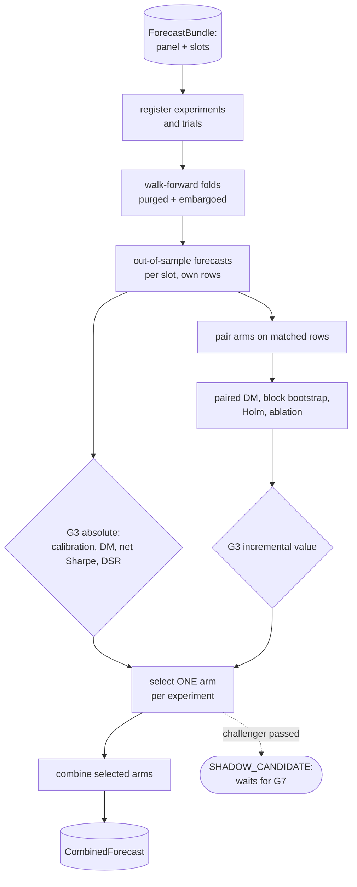

# Part 10 — Stage 02E: paired evaluation, the news challenger decision and signal combination

**Goal:** decide, with evidence a reviewer can check, which forecasts may reach the portfolio. Two separate questions are asked. **Absolute eligibility (G3):** is each model slot calibrated, more skilful than the best yardstick, profitable after costs and robust to the number of trials? **Incremental value:** within each registered experiment, does the news challenger beat *its own baseline* on the *same* observations? The answers decide one arm per experiment, and the selected arms are combined into the one distribution Stage 03 is allowed to use.

**Design:** 2E (*"compare each news challenger with its matched baseline on the same observations"*; *"The baseline and its challenger are alternative versions of one model slot"*; *"A news challenger that passes … becomes a shadow candidate"*), G3, and the extension rule that promotion is a G7 decision. **Roadmap:** phase 6, paired evaluation. **Overview:** §1.1 rows "Paired experiments" and "No automatic promotion", §7.5.



You built the scoring tools in Part 07 (pinball loss, Diebold–Mariano, net-of-cost returns, deflated Sharpe, folds with purging and embargo). This part wires them together.

## What you will build in this part

| Section | File | Components |
|---|---|---|
| 10.1 | `stage_02e_validation/model_eligibility.py` | 4 |
| 10.2 | `gates/g3_model_eligibility.py` | 2 |
| 10.3 | `coverage_matching.py`, `experiment_pairing.py`, `arm_parity_check.py` | 1 + 1 + 1 |
| 10.4 | `block_bootstrap.py`, `paired_loss_differences.py`, `multiple_testing.py`, `incremental_value_test.py`, `feature_ablation.py` | 1 + 1 + 1 + 1 + 1 |
| 10.5 | `storage/experiment_registry.py`, `scripts/register_experiment.py` | 1 + 1 |
| 10.6 | `slot_selection.py` | 2 |
| 10.7 | `signal_combiner.py`, `contracts/forecast_schema.py` (third component) | 2 + 1 |
| 10.8 | `stage_02e_validation/service.py` | 6 |
| 10.9 | tests, gate tests and two invariants | |

---

## 10.1 Out-of-sample forecasts for every slot

**File:** `src/aqp_python/stages/stage_02e_validation/model_eligibility.py` — component 1 of 4: imports

```python
"""Walk-forward evaluation of every model slot (both arms) -> absolute metrics consumed by G3."""
import numpy as np
import pandas as pd

from aqp_python.contracts.experiment_schema import ModelSlot
from aqp_python.contracts.quantile_grid import QUANTILE_COLUMNS
from aqp_python.stages.stage_02_forecasting.arm_builder import arm_rows
from aqp_python.stages.stage_02_forecasting.forecast_registry import build_model
from aqp_python.stages.stage_02e_validation.forecast_comparison_tests import diebold_mariano
from aqp_python.stages.stage_02e_validation.forecast_scoring import coverage_90, pinball_loss, width_90
from aqp_python.stages.stage_02e_validation.net_of_cost_evaluation import annualised_sharpe, long_short_returns
from aqp_python.stages.stage_02e_validation.overfitting_controls import deflated_sharpe_ratio
from aqp_python.stages.stage_02e_validation.walk_forward_folds import Fold, expanding_train

MEDIAN_INDEX = list(QUANTILE_COLUMNS).index("q0.500")
```

**File:** `src/aqp_python/stages/stage_02e_validation/model_eligibility.py` — component 2 of 4: out_of_sample_predictions: fit on the purged past, predict each test block

```python
def out_of_sample_predictions(panel: pd.DataFrame, slots: list[ModelSlot], folds: list[Fold],
                              trading_days: pd.DatetimeIndex, *, horizon: int,
                              embargo_days: int) -> tuple[pd.DataFrame, dict[str, str]]:
    labelled = panel.loc[panel["label"].notna()]
    frames, failures = [], {}
    for slot in slots:
        rows = arm_rows(labelled, slot)                     # each arm uses only the rows it may use
        for fold in folds:
            train = expanding_train(rows, fold, trading_days, embargo_days)
            test = rows.loc[rows["date"].isin(fold.test_dates)]
            try:
                if train.empty or test.empty:
                    raise ValueError("empty training or test set")
                q = build_model(slot, horizon).fit(train).predict(test)
            except Exception as error:
                failures[slot.key] = f"fold {fold.number}: {type(error).__name__}: {error}"
                break
            out = pd.DataFrame(q, columns=list(QUANTILE_COLUMNS))
            out["date"], out["security_id"] = test["date"].to_numpy(), test["security_id"].to_numpy()
            out["label"], out["fold"] = test["label"].to_numpy(), fold.number
            out["slot"], out["model_name"], out["arm"] = slot.key, slot.model_name, str(slot.arm)
            out["experiment_id"] = slot.experiment_id
            frames.append(out)
    if not frames:
        raise ValueError("no model slot produced out-of-sample forecasts")
    oos = pd.concat(frames, ignore_index=True)
    return oos.loc[~oos["slot"].isin(failures)].reset_index(drop=True), failures
```

**What it does.** For each slot and each fold: take the slot's own rows (`arm_rows`, Part 08), train on the purged and embargoed past (`expanding_train`, Part 07), predict the test block, and label every prediction with its slot, arm and experiment. A slot that fails in any fold is recorded in `failures` and removed entirely. **Why remove it entirely:** a slot with forecasts for only some folds would be scored on a different, smaller test set than the others.

**File:** `src/aqp_python/stages/stage_02e_validation/model_eligibility.py` — component 3 of 4: per_date_losses: the unit of comparison

```python
def per_date_losses(rows: pd.DataFrame) -> pd.Series:
    """Mean pinball loss per test date. Rows on one date share market moves, so dates are the unit."""
    loss = pinball_loss(rows["label"].to_numpy(), rows[list(QUANTILE_COLUMNS)].to_numpy())
    return pd.Series(loss).groupby(rows["date"].to_numpy()).mean()
```

**What it does.** One number per test date: the mean pinball loss across securities. This is the unit every comparison in this part uses. Ten securities on one day all move with the market, so they are one observation of model quality, not ten.

**File:** `src/aqp_python/stages/stage_02e_validation/model_eligibility.py` — component 4 of 4: score_models: absolute evidence per slot

```python
def score_models(oos: pd.DataFrame, slots: list[ModelSlot], failures: dict[str, str], *, horizon: int,
                 step_days: int, fraction: float, cost_per_turnover: float, n_trials: int) -> dict[str, dict]:
    """Absolute G3 evidence per slot. Skill is tested against the best yardstick ON THE SLOT'S OWN ROWS."""
    metrics: dict[str, dict] = {key: {"fit_ok": False, "error": err} for key, err in failures.items()}
    yardsticks = [s.key for s in slots if s.role == "baseline" and s.key in set(oos["slot"])]
    best = min(yardsticks, key=lambda k: per_date_losses(oos.loc[oos["slot"] == k]).mean()) if yardsticks else None
    lags = max(1, int(np.ceil(horizon / step_days)))
    for key, rows in oos.groupby("slot"):
        q, y = rows[list(QUANTILE_COLUMNS)].to_numpy(), rows["label"].to_numpy()
        ls = long_short_returns(rows.assign(median=q[:, MEDIAN_INDEX]), fraction, cost_per_turnover)
        metrics[key] = {
            "fit_ok": True, "pinball": float(pinball_loss(y, q).mean()), "coverage_90": coverage_90(y, q),
            "width_90": width_90(q), "net_sharpe": annualised_sharpe(ls, 252 / step_days),
            "deflated_sharpe": deflated_sharpe_ratio(ls.to_numpy(), n_trials), "n_test_rows": int(len(rows)),
            "n_trials": n_trials, "compared_with": best, "dm_pvalue": 1.0, "dm_statistic": 0.0,
        }
        if best is not None and key != best:
            yardstick = oos.loc[oos["slot"] == best].merge(rows[["date", "security_id"]], on=["date", "security_id"])
            aligned = pd.concat([per_date_losses(rows), per_date_losses(yardstick)], axis=1, join="inner").to_numpy()
            stat, p = diebold_mariano(aligned[:, 0], aligned[:, 1], lags)
            metrics[key].update(dm_pvalue=p, dm_statistic=stat)
    return metrics
```

**What it does.** For every slot: pinball loss, 90% coverage, interval width, the net-of-cost long-short Sharpe ratio of its medians, and the deflated Sharpe ratio charged for every trial in the registry. Skill is a Diebold–Mariano test against the **best yardstick, on the slot's own rows**: the challenger is compared with the yardstick only on dates and names where it has news.

**Why "the best yardstick".** If skill were measured against the weaker yardstick, a model could look skilful just by being better than a poor reference. `lags = ⌈h/step⌉` lets the HAC variance allow for overlapping labels: with weekly test steps and five-day labels, neighbouring losses share returns.

## 10.2 G3: absolute eligibility, and incremental value

**File:** `src/aqp_python/gates/g3_model_eligibility.py` — component 1 of 2: check_model: absolute eligibility of one slot

```python
"""G3 - model eligibility. Fit success is not evidence of skill; adding news is not evidence of value."""
from collections.abc import Mapping

from aqp_python.contracts.reason_codes import ReasonCode as RC
from aqp_python.gates.gate_result import GateOutcome, GateResult

GATE = "G3"


def check_model(slot_key: str, role: str, metrics: Mapping, rules: Mapping) -> GateResult:
    """`metrics` comes from Stage 02E validation; all criteria must pass."""
    if role == "baseline":
        return GateResult(GATE, GateOutcome.BLOCK, slot_key, (RC.MODEL_IS_BASELINE,),
                          "yardsticks are references and never receive weight")
    if not metrics.get("fit_ok", False):
        return GateResult(GATE, GateOutcome.BLOCK, slot_key, (RC.MODEL_FIT_FAILED,),
                          metrics.get("error", "fit failed"))
    codes = []
    if abs(metrics["coverage_90"] - rules["coverage_target"]) > rules["coverage_tolerance"]:
        codes.append(RC.MODEL_MISCALIBRATED)
    if not metrics["dm_pvalue"] <= rules["max_dm_pvalue"]:
        codes.append(RC.MODEL_NO_SKILL)
    if not metrics["net_sharpe"] > rules["min_net_sharpe"]:
        codes.append(RC.MODEL_NO_NET_VALUE)
    if not metrics["deflated_sharpe"] >= rules["min_deflated_sharpe"]:
        codes.append(RC.MODEL_OVERFIT_RISK)
    evidence = {key: metrics[key] for key in
                ("coverage_90", "pinball", "dm_pvalue", "net_sharpe", "deflated_sharpe", "n_trials")}
    if codes:
        return GateResult(GATE, GateOutcome.BLOCK, slot_key, tuple(codes), "not eligible", evidence)
    return GateResult(GATE, GateOutcome.PASS, slot_key, (), "eligible", evidence)
```

**What it does.** Yardsticks are always blocked with `MODEL_IS_BASELINE`: they are references and never receive weight. A failed fit is blocked with its error. Otherwise **every** criterion must pass, and each failure has its own reason code, so `eligibility.csv` says exactly why a slot was refused.

| Criterion | Rule in `gates.yaml` | Code if it fails |
|---|---|---|
| calibration | `|coverage_90 − 0.90| ≤ 0.03` | `MODEL_MISCALIBRATED` |
| skill | DM p-value ≤ 0.10 | `MODEL_NO_SKILL` |
| money | net Sharpe > 0 | `MODEL_NO_NET_VALUE` |
| search | deflated Sharpe ≥ 0.5 | `MODEL_OVERFIT_RISK` |

**File:** `src/aqp_python/gates/g3_model_eligibility.py` — component 2 of 2: check_incremental_value: does the news arm beat its own baseline?

```python
def check_incremental_value(experiment_id: str, evidence: Mapping, rules: Mapping) -> GateResult:
    """The paired test for a news challenger (design 2E). Every condition must hold."""
    codes, notes = [], []
    if evidence["coverage"] < rules["min_news_coverage"]:
        codes.append(RC.NEWS_COVERAGE_LOW)
        notes.append(f"matched coverage {evidence['coverage']:.2f}")
    if not (evidence["adjusted_pvalue"] <= rules["max_paired_pvalue"] and evidence["ci_high"] < 0
            and evidence["net_sharpe_difference"] > 0):
        codes.append(RC.NEWS_NO_INCREMENTAL_VALUE)
        notes.append(f"adjusted p {evidence['adjusted_pvalue']:.3f}, CI high {evidence['ci_high']:.2e}, "
                     f"net Sharpe change {evidence['net_sharpe_difference']:+.2f}")
    if rules["ablation_must_hurt"] and not evidence["ablation_block_increase"] > 0:
        codes.append(RC.NEWS_ABLATION_FAILED)
        notes.append("removing the news block did not worsen the loss")
    subject = f"experiment:{experiment_id}"
    if codes:
        return GateResult(GATE, GateOutcome.BLOCK, subject, tuple(codes), "; ".join(notes), dict(evidence))
    return GateResult(GATE, GateOutcome.PASS, subject, (), "robust incremental value", dict(evidence))
```

**What it does.** The news challenger's extra test. All of these must hold:

1. **Coverage.** The challenger covers at least 80% of the baseline's test observations (`NEWS_COVERAGE_LOW`). Below that, a "win" could just reflect *which* days had news.
2. **Significance.** The Holm-adjusted paired p-value is at most 0.10, *and* the upper end of the bootstrap interval for the loss difference is below zero, *and* the net Sharpe ratio improves (`NEWS_NO_INCREMENTAL_VALUE`).
3. **Ablation.** Removing the news block makes the loss worse (`NEWS_ABLATION_FAILED`).

**Why three different kinds of evidence.** Each has a different blind spot. The DM test assumes its variance estimate is right; the bootstrap does not, but it is noisy for short samples; the Sharpe change asks whether the better loss is worth money after costs; and the ablation asks whether the news features themselves did the work, rather than an accident of the refit.

## 10.3 Pairing the arms, on the same rows, with only one difference

**File:** `src/aqp_python/stages/stage_02e_validation/coverage_matching.py`

```python
"""Compare arms only on the SAME observations, and say how many observations that is."""
import pandas as pd


def match_observations(baseline: pd.DataFrame, challenger: pd.DataFrame) -> tuple[pd.DataFrame, dict]:
    """Inner-join the two arms' OOS rows on (date, security_id). Columns get _base / _chal suffixes."""
    keys = ["date", "security_id"]
    matched = baseline.merge(challenger, on=keys, suffixes=("_base", "_chal"))
    coverage = {"baseline_rows": int(len(baseline)), "challenger_rows": int(len(challenger)),
                "matched_rows": int(len(matched)),
                "coverage": round(len(matched) / len(baseline), 4) if len(baseline) else 0.0}
    return matched, coverage
```

**What it does.** Inner-joins the two arms' out-of-sample rows on `(date, security_id)` and reports how many rows each arm had and how many matched. `coverage = matched / baseline rows`.

**File:** `src/aqp_python/stages/stage_02e_validation/experiment_pairing.py`

```python
"""Find the two arms of each registered experiment in the OOS forecasts and pair them row by row."""
import pandas as pd

from aqp_python.contracts.experiment_schema import Arm
from aqp_python.contracts.quantile_grid import QUANTILE_COLUMNS
from aqp_python.stages.stage_02e_validation.coverage_matching import match_observations
from aqp_python.stages.stage_02e_validation.forecast_scoring import pinball_loss


def pair_arms(oos: pd.DataFrame, experiment_id: str) -> tuple[pd.DataFrame, dict] | None:
    """Return (matched rows with loss_base, loss_chal, median_base, median_chal, label), coverage."""
    rows = oos.loc[oos["experiment_id"] == experiment_id]
    base = rows.loc[rows["arm"] == str(Arm.BASELINE)]
    chal = rows.loc[rows["arm"] == str(Arm.NEWS_CHALLENGER)]
    if base.empty or chal.empty:
        return None
    columns = list(QUANTILE_COLUMNS)

    def losses(frame: pd.DataFrame) -> pd.DataFrame:
        return pd.DataFrame({"date": frame["date"].to_numpy(), "security_id": frame["security_id"].to_numpy(),
                             "label": frame["label"].to_numpy(), "median": frame["q0.500"].to_numpy(),
                             "loss": pinball_loss(frame["label"].to_numpy(), frame[columns].to_numpy())})

    matched, coverage = match_observations(losses(base), losses(chal))
    matched = matched.drop(columns="label_chal").rename(columns={"label_base": "label"})
    return matched, coverage
```

**What it does.** For one experiment, finds its baseline and challenger rows, reduces each to a per-row loss and median, and matches them. If either arm has no rows (for example, news was unavailable this run) it returns `None`.

**File:** `src/aqp_python/stages/stage_02e_validation/arm_parity_check.py`

```python
"""The arms of an experiment may differ ONLY by the registered news features (design 2E)."""
from aqp_python.contracts.experiment_schema import Arm, ModelSlot


def parity_problems(baseline: ModelSlot, challenger: ModelSlot, experiment: dict) -> list[str]:
    problems = []
    if baseline.arm != Arm.BASELINE or challenger.arm != Arm.NEWS_CHALLENGER:
        problems.append("arms are not BASELINE and NEWS_CHALLENGER")
    for attribute in ("model_name", "role", "version", "params", "experiment_id"):
        if getattr(baseline, attribute) != getattr(challenger, attribute):
            problems.append(f"{attribute} differs between arms")
    if tuple(baseline.features) != tuple(experiment["core_features"]):
        problems.append("baseline features are not the registered core features")
    if set(challenger.features) - set(baseline.features) != set(experiment["news_features"]):
        problems.append("the feature difference is not exactly the registered news features")
    if not set(baseline.features) <= set(challenger.features):
        problems.append("the challenger dropped a core feature")
    return problems
```

**What it does.** Checks that the two arms have the same model, role, version, parameters and experiment; that the baseline uses exactly the registered core features; and that the challenger adds **exactly** the registered news features and drops nothing. Any problem blocks the experiment with `ARM_PARITY_BROKEN`.

**Why check at run time when `arm_builder` builds the arms correctly.** Parts 08 and 10 were written separately; a later change to either could break the guarantee without breaking anything else. The parity check makes the experiment's one assumption (*the arms differ only by the news features*) a condition that is tested on every run.

## 10.4 The paired evidence

The challenger's per-date loss minus the baseline's, on matched rows:

```text
d_t = mean_i L(challenger)_{i,t} − mean_i L(baseline)_{i,t}        negative = news helps
```

Three questions about `d`: is its mean below zero beyond chance (paired DM)? How uncertain is that mean (block bootstrap)? And is the improvement still convincing after allowing for the number of experiments tested (Holm)?

**File:** `src/aqp_python/stages/stage_02e_validation/block_bootstrap.py`

```python
"""Moving-block bootstrap: an uncertainty interval for a mean that respects serial dependence."""
import numpy as np


def block_bootstrap_ci(values: np.ndarray, block: int, samples: int, alpha: float = 0.10,
                       seed: int = 0) -> tuple[float, float]:
    """Two-sided (1 - alpha) interval for the mean of a time series, resampling whole blocks."""
    values = np.asarray(values, dtype=float)
    n = len(values)
    if n < 2 * block:
        raise ValueError("series too short for the block length")
    rng = np.random.default_rng(seed)
    starts = np.arange(n - block + 1)
    n_blocks = int(np.ceil(n / block))
    means = np.empty(samples)
    for i in range(samples):
        picks = rng.choice(starts, size=n_blocks)
        means[i] = np.concatenate([values[s:s + block] for s in picks])[:n].mean()
    return float(np.quantile(means, alpha / 2)), float(np.quantile(means, 1 - alpha / 2))
```

**What it does.** Draws random starting points, copies **whole blocks** of `block` consecutive values, joins enough blocks to rebuild a series of the original length, and records its mean. Repeated `samples` times, the 5th and 95th percentiles of those means form a 90% interval. **Why blocks:** losses on nearby dates are correlated (overlapping labels, market regimes). Resampling single values would destroy that correlation and make the interval too narrow. Within a block, the correlation is preserved.

```python
import numpy as np

from aqp_python.stages.stage_02e_validation.block_bootstrap import block_bootstrap_ci

rng = np.random.default_rng(32)
shocks = rng.normal(0, 1, 400)
series = np.convolve(shocks, np.ones(5) / 5, mode="valid")[:390]    # overlapping 5-day windows: true mean 0
naive = 1.645 * series.std(ddof=1) / np.sqrt(len(series))
print(f"mean {series.mean():.3f}")
print(f"naive 90% interval (assumes independence): [{series.mean() - naive:.3f}, {series.mean() + naive:.3f}]")
for block in (1, 5, 10):
    low, high = block_bootstrap_ci(series, block=block, samples=1000)
    print(f"block bootstrap, block={block:>2}:              [{low:.3f}, {high:.3f}]")
```

```text
mean 0.054
naive 90% interval (assumes independence): [0.015, 0.094]
block bootstrap, block= 1:              [0.017, 0.096]
block bootstrap, block= 5:              [-0.017, 0.130]
block bootstrap, block=10:              [-0.023, 0.135]
```

The series has a true mean of zero, but its values are averages of overlapping windows, like five-day returns. The naive interval treats the 390 values as independent and wrongly excludes zero; so does a bootstrap with `block=1`, which is the same mistake. With blocks of five or more, the interval is roughly twice as wide and includes zero. Wrongly narrow intervals are how a model with no skill gets promoted.

**File:** `src/aqp_python/stages/stage_02e_validation/paired_loss_differences.py`

```python
"""Paired incremental-value evidence: is the challenger better than ITS OWN baseline on the same rows?"""
import numpy as np
import pandas as pd

from aqp_python.stages.stage_02e_validation.block_bootstrap import block_bootstrap_ci
from aqp_python.stages.stage_02e_validation.forecast_comparison_tests import diebold_mariano
from aqp_python.stages.stage_02e_validation.net_of_cost_evaluation import annualised_sharpe, long_short_returns


def paired_evidence(matched: pd.DataFrame, *, horizon: int, step_days: int, block: int, samples: int,
                    fraction: float, cost_per_turnover: float) -> dict:
    """d_t = mean loss(challenger) - mean loss(baseline) per date. Negative = news helps."""
    by_date = matched.groupby("date")[["loss_base", "loss_chal"]].mean()
    difference = (by_date["loss_chal"] - by_date["loss_base"]).to_numpy()
    lags = max(1, int(np.ceil(horizon / step_days)))
    statistic, p_value = diebold_mariano(by_date["loss_chal"].to_numpy(), by_date["loss_base"].to_numpy(), lags)
    low, high = block_bootstrap_ci(difference, block, samples)
    per_year = 252 / step_days
    sharpe = {arm: annualised_sharpe(long_short_returns(
        matched.rename(columns={f"median_{arm}": "median"}), fraction, cost_per_turnover), per_year)
        for arm in ("base", "chal")}
    return {"mean_loss_difference": float(difference.mean()), "relative_loss_change":
            float(difference.mean() / by_date["loss_base"].mean()), "dm_statistic": statistic,
            "paired_pvalue": p_value, "ci_low": low, "ci_high": high, "n_dates": int(len(difference)),
            "net_sharpe_base": sharpe["base"], "net_sharpe_chal": sharpe["chal"],
            "net_sharpe_difference": sharpe["chal"] - sharpe["base"]}
```

**What it does.** Averages each arm's losses per date, then computes the paired DM test, the block-bootstrap interval for the mean difference, the relative loss change and the net Sharpe ratio of each arm's medians on the matched rows. Everything is computed on the **same** rows for both arms.

```python
import numpy as np
import pandas as pd

from aqp_python.contracts.quantile_grid import QUANTILE_COLUMNS
from aqp_python.stages.stage_02e_validation.experiment_pairing import pair_arms
from aqp_python.stages.stage_02e_validation.paired_loss_differences import paired_evidence

rng = np.random.default_rng(0)
dates, names = pd.bdate_range("2025-01-01", periods=150), [f"S{i}" for i in range(10)]
grid = pd.MultiIndex.from_product([dates, names], names=["date", "security_id"]).to_frame(index=False)
news = rng.normal(size=len(grid))                         # the information only the challenger sees
grid["label"] = 0.01 * news + rng.normal(0, 0.03, len(grid))
spread = 0.03 * np.array([-2.33, -1.96, -1.64, -1.04, -0.52, 0, 0.52, 1.04, 1.64, 1.96, 2.33])


def arm(name, centre, keep):
    frame = grid.loc[keep].copy()
    frame[list(QUANTILE_COLUMNS)] = centre[keep, None] + spread
    return frame.assign(arm=name, experiment_id="e1")


has_news = rng.uniform(size=len(grid)) > 0.08             # the feed missed about 8% of rows
oos = pd.concat([arm("BASELINE", np.zeros(len(grid)), np.ones(len(grid), bool)),
                 arm("NEWS_CHALLENGER", 0.01 * news, has_news)])
matched, coverage = pair_arms(oos, "e1")
print("coverage:", coverage)
evidence = paired_evidence(matched, horizon=5, step_days=5, block=4, samples=500, fraction=0.2,
                           cost_per_turnover=0.0)
for key in ("mean_loss_difference", "relative_loss_change", "paired_pvalue", "ci_low", "ci_high",
            "net_sharpe_difference"):
    print(f"{key:<22} {evidence[key]: .3g}")
```

```text
coverage: {'baseline_rows': 1500, 'challenger_rows': 1381, 'matched_rows': 1381, 'coverage': 0.9207}
mean_loss_difference   -0.000238
relative_loss_change   -0.0462
paired_pvalue           2.93e-09
ci_low                 -0.000303
ci_high                -0.000179
net_sharpe_difference   3.8
```

The challenger sees information (`news`) that the baseline does not, and the feed misses about 8% of rows. `pair_arms` reports 92% coverage, the improvement is about 4.6% of the baseline's loss, and the whole bootstrap interval is below zero. Change `0.01 * news` in the challenger to `0.0 * news` and run it again: the p-value rises well above 0.10 and the interval includes zero.

**File:** `src/aqp_python/stages/stage_02e_validation/multiple_testing.py`

```python
"""Holm's step-down adjustment: the more experiments we run, the stronger each result must be."""


def holm_adjust(p_values: dict[str, float]) -> dict[str, float]:
    ordered = sorted(p_values.items(), key=lambda item: item[1])
    m, running, adjusted = len(ordered), 0.0, {}
    for rank, (name, p) in enumerate(ordered):
        running = max(running, min(1.0, (m - rank) * p))     # monotone: never smaller than the previous
        adjusted[name] = running
    return adjusted
```

**What it does.** Holm's step-down method. Sort the `m` p-values from smallest to largest; multiply the smallest by `m`, the next by `m − 1`, and so on; never let an adjusted value fall below the previous one; cap at 1. With p-values 0.01, 0.03 and 0.04: `0.01 × 3 = 0.03`, `0.03 × 2 = 0.06`, `max(0.06, 0.04 × 1) = 0.06`. **Why:** with ten experiments at the 10% level, about one would pass by luck. The trial registry (Part 07) charges a *single* model for search; Holm charges the *set of experiments*.

**File:** `src/aqp_python/stages/stage_02e_validation/incremental_value_test.py`

```python
"""Assemble the incremental-value evidence of every experiment, with Holm adjustment across experiments."""
from aqp_python.stages.stage_02e_validation.multiple_testing import holm_adjust


def finalise_evidence(evidence: dict[str, dict]) -> dict[str, dict]:
    """Add the multiple-testing-adjusted p-value to each experiment's paired evidence."""
    adjusted = holm_adjust({eid: e["paired_pvalue"] for eid, e in evidence.items()})
    return {eid: {**e, "adjusted_pvalue": adjusted[eid], "experiments_tested": len(evidence)}
            for eid, e in evidence.items()}
```

**What it does.** Adds each experiment's Holm-adjusted p-value and the number of experiments tested to its evidence.

**File:** `src/aqp_python/stages/stage_02e_validation/feature_ablation.py`

```python
"""Ablation: refit the challenger without each news feature in turn. If nothing hurts, nothing helps."""
import pandas as pd

from aqp_python.contracts.experiment_schema import ModelSlot
from aqp_python.stages.stage_02_forecasting.arm_builder import arm_rows
from aqp_python.stages.stage_02e_validation.model_eligibility import out_of_sample_predictions, per_date_losses
from aqp_python.stages.stage_02e_validation.walk_forward_folds import Fold


def ablation_table(panel: pd.DataFrame, challenger: ModelSlot, news_features: list[str], folds: list[Fold],
                   trading_days: pd.DatetimeIndex, *, horizon: int, embargo_days: int,
                   full_oos: pd.DataFrame) -> pd.DataFrame:
    """Loss increase when one news feature - or the whole block - is removed.

    Every variant trains and tests on the challenger's own rows, so only the features differ.
    """
    rows, same_rows = [], arm_rows(panel, challenger)
    full = per_date_losses(full_oos).mean()
    variants = {f"without {f}": [f] for f in news_features} | {"without news block": list(news_features)}
    for name, dropped in variants.items():
        features = tuple(f for f in challenger.features if f not in dropped)
        slot = ModelSlot(challenger.model_name, challenger.arm, challenger.role, features,
                         challenger.experiment_id, challenger.version, challenger.params)
        oos, _ = out_of_sample_predictions(same_rows, [slot], folds, trading_days, horizon=horizon,
                                           embargo_days=embargo_days)
        rows.append({"variant": name, "loss_increase": float(per_date_losses(oos).mean() - full)})
    return pd.DataFrame(rows)
```

**What it does.** Refits the challenger without each news feature in turn, and once without the whole news block, on the **challenger's own rows**, and reports how much the loss rises. **Why the same rows:** without the news block the model is the baseline model, but if it were trained on the baseline's (larger) row set, the comparison would mix two changes: fewer features and more rows. Here only the features change.

## 10.5 Registering an experiment before the results

**File:** `src/aqp_python/storage/experiment_registry.py`

```python
"""Register each experiment BEFORE results are seen. A changed spec under the same id is refused."""
import hashlib
import json
from datetime import UTC, datetime
from pathlib import Path


class ExperimentRegistryError(ValueError):
    """Raised when a registered experiment's spec has changed."""


def spec_hash(spec: dict) -> str:
    return hashlib.sha256(json.dumps(spec, sort_keys=True, default=str).encode("utf-8")).hexdigest()[:16]


def register_experiment(registry_path: Path, experiment_id: str, spec: dict, run_id: str) -> str:
    """Append the experiment if new; if it exists, its spec must be unchanged. Returns the spec hash."""
    registry_path.parent.mkdir(parents=True, exist_ok=True)
    digest = spec_hash(spec)
    known = {}
    if registry_path.is_file():
        for line in registry_path.read_text(encoding="utf-8").splitlines():
            if line.strip():
                entry = json.loads(line)
                known[entry["experiment_id"]] = entry["spec_hash"]
    if experiment_id in known and known[experiment_id] != digest:
        raise ExperimentRegistryError(
            f"experiment {experiment_id} changed after registration; register it under a new id")
    if experiment_id not in known:
        entry = {"experiment_id": experiment_id, "spec_hash": digest, "spec": spec, "run_id": run_id,
                 "registered_at": datetime.now(UTC).isoformat()}
        with registry_path.open("a", encoding="utf-8") as handle:
            handle.write(json.dumps(entry, default=str) + "\n")
    return digest
```

**What it does.** Stores a hash of each experiment's specification in an append-only file. Registering the same specification again returns the same hash; a **changed** specification under the same id raises `ExperimentRegistryError`.

**Why.** If you could edit the news feature list after seeing the results, you could keep editing until the challenger passed. A changed experiment is a new experiment, with a new id and a new trial.

`approved_arm` is left out of the hash: promoting an arm through G7 (Part 14) is a decision *about* an experiment, not a change *to* it.

**File:** `scripts/register_experiment.py`

```python
"""Register every experiment in configs/experiments.yaml BEFORE looking at any result.

    python scripts/register_experiment.py [--config configs/pipeline.yaml]

Registration stores a hash of each experiment's spec. If a spec later changes under the
same id, Stage 02E refuses to run it: a changed experiment is a new experiment.
"""
import argparse
from pathlib import Path

from aqp_python.config.config_loader import load_pipeline_config
from aqp_python.storage.experiment_registry import register_experiment


def main() -> int:
    parser = argparse.ArgumentParser()
    parser.add_argument("--config", type=Path, default=Path("configs/pipeline.yaml"))
    parser.add_argument("--sleeve", default="asx_interday")
    args = parser.parse_args()
    config = load_pipeline_config(args.config, args.sleeve)
    registry = Path(config["pipeline"]["state_dir"]) / "experiment_registry.jsonl"
    for experiment_id, spec in config["experiments"]["experiments"].items():
        frozen = {k: v for k, v in spec.items() if k != "approved_arm"}   # promotion is not a new experiment
        print(f"{experiment_id}: {register_experiment(registry, experiment_id, frozen, 'manual')}")
    return 0


if __name__ == "__main__":
    raise SystemExit(main())
```

```powershell
python scripts\register_experiment.py
```

```text
financial__xret__h5__asx_interday: 4bd98c4cc8ddb44b
```

Stage 02E also registers experiments itself before computing anything, so the script is for registering a new experiment *before* its first run, and seeing its hash.

## 10.6 One arm per experiment

**File:** `src/aqp_python/stages/stage_02e_validation/slot_selection.py` — component 1 of 2: select_slot: which arm may feed the portfolio?

```python
"""Choose ONE arm per experiment for this run. A challenger never promotes itself (design 2E and G7)."""
from aqp_python.contracts.experiment_schema import Arm, ExperimentDecision
from aqp_python.contracts.reason_codes import ReasonCode as RC


def select_slot(model: str, approved_arm: str, eligible: set[str], incremental_passed: bool | None,
                challenger_ran: bool) -> tuple[str | None, ExperimentDecision, list[str]]:
    """Return (slot key used for trading or None, decision about the challenger, reason codes).

    incremental_passed is None when there was no challenger to test.
    """
    base, chal = f"{model}@{Arm.BASELINE}", f"{model}@{Arm.NEWS_CHALLENGER}"
    if not challenger_ran:
        decision = ExperimentDecision.CHALLENGER_UNAVAILABLE
    elif chal not in eligible:
        decision = ExperimentDecision.CHALLENGER_INELIGIBLE
    elif incremental_passed:
        decision = ExperimentDecision.SHADOW_CANDIDATE
    else:
        decision = ExperimentDecision.NO_INCREMENTAL_VALUE
    codes = [str(RC.SHADOW_CANDIDATE)] if decision == ExperimentDecision.SHADOW_CANDIDATE else []
```

**What it does.** Classifies the challenger into one of the four `ExperimentDecision` values from Part 08:

| Situation | Decision |
|---|---|
| no challenger ran (no news, or the fallback) | `CHALLENGER_UNAVAILABLE` |
| the challenger failed absolute G3 | `CHALLENGER_INELIGIBLE` |
| it passed G3 and the incremental-value test | `SHADOW_CANDIDATE` |
| it passed G3 but not the incremental-value test | `NO_INCREMENTAL_VALUE` |

**File:** `src/aqp_python/stages/stage_02e_validation/slot_selection.py` — component 2 of 2: select_slot: honour the approved arm, fall back only to an eligible baseline

```python
    if approved_arm == str(Arm.NEWS_CHALLENGER):
        if decision == ExperimentDecision.SHADOW_CANDIDATE:      # promoted earlier AND still proves itself
            return chal, decision, []
        codes.append(str(RC.APPROVED_ARM_INELIGIBLE))
    return (base if base in eligible else None), decision, codes
```

**What it does.** Decides which slot trades. If the approved arm is the challenger (set through G7), it trades only while it **still** passes every test; otherwise the run falls back to the baseline and records `APPROVED_ARM_INELIGIBLE`. If the approved arm is the baseline, the baseline trades if it is eligible, and nothing trades if it is not, **even if the challenger is eligible**.

```python
from aqp_python.stages.stage_02e_validation.slot_selection import select_slot

BASE, CHAL = "ridge@BASELINE", "ridge@NEWS_CHALLENGER"
cases = [("BASELINE", {BASE, CHAL}, True, True, "news wins every test"),
         ("BASELINE", {BASE, CHAL}, False, True, "news adds nothing"),
         ("BASELINE", {BASE}, None, False, "news feed down (fallback)"),
         ("NEWS_CHALLENGER", {BASE, CHAL}, True, True, "promoted through G7, still valid"),
         ("NEWS_CHALLENGER", {BASE, CHAL}, False, True, "promoted, but stopped working")]
print(f"{'situation':<34}{'approved':<17}{'used slot':<23}decision / codes")
for approved, eligible, passed, ran, label in cases:
    used, decision, codes = select_slot("ridge", approved, eligible, passed, ran)
    print(f"{label:<34}{approved:<17}{str(used):<23}{decision} {codes}")
```

```text
situation                         approved         used slot              decision / codes
news wins every test              BASELINE         ridge@BASELINE         SHADOW_CANDIDATE ['SHADOW_CANDIDATE']
news adds nothing                 BASELINE         ridge@BASELINE         NO_INCREMENTAL_VALUE []
news feed down (fallback)         BASELINE         ridge@BASELINE         CHALLENGER_UNAVAILABLE []
promoted through G7, still valid  NEWS_CHALLENGER  ridge@NEWS_CHALLENGER  SHADOW_CANDIDATE []
promoted, but stopped working     NEWS_CHALLENGER  ridge@BASELINE         NO_INCREMENTAL_VALUE ['APPROVED_ARM_INELIGIBLE']
```

Read the first row carefully: a challenger that wins every test is still not used. It becomes a `SHADOW_CANDIDATE`; the run records it and warns; and only a reviewed G7 change to `approved_arm` in `experiments.yaml` can let it trade (Part 14). That is design 2E's rule that a challenger never promotes itself.

## 10.7 Combining the selected arms

**File:** `src/aqp_python/stages/stage_02e_validation/signal_combiner.py` — component 1 of 2: inverse_loss_weights

```python
"""Combine selected, eligible forecasts: q_tau = sum_k w_k q_k,tau with w_k >= 0, sum w_k = 1."""
import pandas as pd

from aqp_python.contracts.forecast_schema import FORECAST_COLUMNS
from aqp_python.contracts.quantile_grid import QUANTILE_COLUMNS


def inverse_loss_weights(pinball: dict[str, float], shrinkage: float) -> dict[str, float]:
    """Inverse-loss weights per slot key, shrunk toward equal weights (shrinkage=1 -> equal)."""
    if not pinball:
        return {}
    inverse = {name: 1.0 / loss for name, loss in pinball.items()}
    total, k = sum(inverse.values()), len(inverse)
    return {name: (1 - shrinkage) * inv / total + shrinkage / k for name, inv in inverse.items()}
```

**What it does.** Weight each used slot by `1 / pinball loss`, normalise, and shrink towards equal weights: `w = (1 − s) · w_inverse + s / k`. With the shipped `combination_shrinkage`, two slots with similar losses get close to equal weights. **Why shrink:** loss estimates are noisy, and weights fitted to noise are a quiet form of overfitting.

**File:** `src/aqp_python/stages/stage_02e_validation/signal_combiner.py` — component 2 of 2: combine: weighted quantile average

```python
def combine(live: pd.DataFrame, weights: dict[str, float]) -> pd.DataFrame:
    """Weighted quantile average. Averaging ordered quantiles keeps them ordered."""
    if not weights:
        return pd.DataFrame(columns=FORECAST_COLUMNS)
    used = live.assign(slot=live["model_name"] + "@" + live["arm"])
    used = used.loc[used["slot"].isin(weights)].copy()
    used["w"] = used["slot"].map(weights)
    quantiles = list(QUANTILE_COLUMNS)
    weighted = used[quantiles].mul(used["w"], axis=0).assign(security_id=used["security_id"])
    combined = weighted.groupby("security_id")[quantiles].sum()
    # Only securities covered by every eligible model are combined.
    counts = used.groupby("security_id")["slot"].nunique()
    combined = combined.loc[counts[counts == len(weights)].index]
    template = used.drop_duplicates("security_id").set_index("security_id")
    meta = [c for c in FORECAST_COLUMNS if c not in quantiles and c != "security_id"]
    out = template.loc[combined.index, meta].join(combined).reset_index()
    out["model_name"], out["arm"], out["experiment_id"] = "combined", "SELECTED", ""
    out["model_version"] = "+".join(f"{n}:{w:.3f}" for n, w in sorted(weights.items()))
    out["train_start"] = used["train_start"].min()
    out["train_end"] = used["train_end"].max()
    return out[list(FORECAST_COLUMNS)]
```

**What it does.** For each security, the combined `q_τ = Σ_k w_k q_k,τ`, using only the selected slots and only securities that **every** selected slot forecast. **Why averaging keeps quantiles ordered:** if each model's quantiles increase across τ, a weighted sum with non-negative weights also increases. The combined rows are labelled `model_name = "combined"`, `arm = "SELECTED"`, and the weights are written into `model_version`, so the forecast file records how it was made.

**File:** `src/aqp_python/contracts/forecast_schema.py` — component 3 of 3: CombinedForecast: the Stage 02E hand-off (Part 10)

```python
@dataclass(frozen=True)
class CombinedForecast:
    """Stage 02E output: the only distribution the portfolio stage is allowed to use."""
    combined: pd.DataFrame          # FORECAST_COLUMNS, model_name == "combined"
    used_slots: tuple[str, ...]     # e.g. ("ridge_location_scale@BASELINE",)
    weights: dict[str, float]
    model_metrics: dict[str, dict]  # absolute G3 evidence per slot
    experiments: dict[str, dict]    # paired evidence and decision per experiment
```

**What it does.** The Stage 02E hand-off. It is the **only** forecast object Stage 03 receives, together with the evidence: which slots were used, their weights, every slot's metrics, and each experiment's decision.

## 10.8 The Stage 02E service

**File:** `src/aqp_python/stages/stage_02e_validation/service.py` — component 1 of 6: imports

```python
"""Stage 02E entry point: absolute eligibility (G3) + paired news test + one arm per experiment -> combine."""
import json

import pandas as pd

from aqp_python.contracts.experiment_schema import Arm, ExperimentDecision
from aqp_python.contracts.forecast_schema import CombinedForecast, ForecastBundle
from aqp_python.contracts.reason_codes import ReasonCode as RC
from aqp_python.gates.g3_model_eligibility import check_incremental_value, check_model
from aqp_python.gates.gate_result import GateOutcome, GateResult
from aqp_python.orchestration.run_context import RunContext
from aqp_python.orchestration.stage_status import StageResult
from aqp_python.stages.stage_02_forecasting.arm_builder import arm_rows
from aqp_python.stages.stage_02e_validation.arm_parity_check import parity_problems
from aqp_python.stages.stage_02e_validation.experiment_pairing import pair_arms
from aqp_python.stages.stage_02e_validation.feature_ablation import ablation_table
from aqp_python.stages.stage_02e_validation.incremental_value_test import finalise_evidence
from aqp_python.stages.stage_02e_validation.model_eligibility import out_of_sample_predictions, score_models
from aqp_python.stages.stage_02e_validation.paired_loss_differences import paired_evidence
from aqp_python.stages.stage_02e_validation.signal_combiner import combine, inverse_loss_weights
from aqp_python.stages.stage_02e_validation.slot_selection import select_slot
from aqp_python.stages.stage_02e_validation.walk_forward_folds import make_folds
from aqp_python.storage.experiment_registry import register_experiment
from aqp_python.storage.trial_registry import record_trial, trial_key

STAGE = "stage_02e_validation"
```

**File:** `src/aqp_python/stages/stage_02e_validation/service.py` — component 2 of 6: _register: experiments first, then trials

```python
def _register(ctx: RunContext, bundle: ForecastBundle, result: StageResult) -> int:
    """Experiments are registered (or checked unchanged) BEFORE any result is computed."""
    state = ctx.resolve(ctx.config["pipeline"]["state_dir"])
    experiments = ctx.config["experiments"]["experiments"]
    for experiment_id in sorted({s.experiment_id for s in bundle.slots if s.experiment_id}):
        spec = {k: v for k, v in experiments[experiment_id].items() if k != "approved_arm"}
        result.records.setdefault("experiments", {})[experiment_id] = {
            "spec_hash": register_experiment(state / "experiment_registry.jsonl", experiment_id, spec, ctx.run_id)}
    n_trials = 0
    for slot in bundle.slots:
        key = trial_key(slot.key, slot.version, slot.params, list(slot.features))
        n_trials = record_trial(state / "trial_registry.jsonl", key, {"slot": slot.key, "run_id": ctx.run_id})
    return n_trials
```

**What it does.** Registers each experiment (or checks it is unchanged) and records each slot as a trial, **before** any result is computed. `n_trials` is the number of distinct configurations ever evaluated, used by the deflated Sharpe ratio.

**File:** `src/aqp_python/stages/stage_02e_validation/service.py` — component 3 of 6: run_stage: folds, out-of-sample forecasts and absolute G3

```python
def run_stage(ctx: RunContext, bundle: ForecastBundle,
              trading_days: pd.DatetimeIndex) -> tuple[StageResult, CombinedForecast]:
    result = StageResult(STAGE)
    vcfg, costs = ctx.config["validation"], ctx.config["sleeve"]["costs"]
    horizon = ctx.config["forecast_models"]["horizon_days"]
    slots = list(bundle.slots)
    n_trials = _register(ctx, bundle, result)

    # Only labels fully known today; folds start where EVERY slot has usable rows.
    panel = bundle.panel.loc[bundle.panel["label"].notna() & (bundle.panel["label_end"] <= ctx.decision_date)]
    first = max(arm_rows(panel, slot)["date"].min() for slot in slots)
    folds = make_folds(trading_days, first, panel["date"].max(), min_train_days=vcfg["min_train_days"],
                       n_folds=vcfg["n_folds"], step_days=vcfg["step_days"])
    oos, failures = out_of_sample_predictions(panel, slots, folds, trading_days, horizon=horizon,
                                              embargo_days=vcfg["embargo_days"])
    cost = (costs["half_spread_bps"] + costs["commission_bps"]) * 1e-4
    scoring = dict(horizon=horizon, step_days=vcfg["step_days"], fraction=vcfg["long_short_quantile"],
                   cost_per_turnover=cost)
    metrics = score_models(oos, slots, failures, n_trials=n_trials, **scoring)
    rules = ctx.config["gates"]["g3_model_eligibility"]
    gates = [check_model(s.key, s.role, metrics.get(s.key, {"fit_ok": False}), rules) for s in slots]
    eligible = {g.subject for g in gates if g.passed}
```

**What it does.** Keeps only labels already known at the decision date, starts the folds where **every** slot has usable rows (the ridge needs a year of momentum history; the challenger needs news coverage), builds the out-of-sample forecasts, scores them, and runs absolute G3 on every slot.

**Why a common first date.** If the yardsticks' folds started a year before the ridge's, they would be scored on different periods, and "the best yardstick" would be chosen on a different sample from the one the ridge is tested on.

**File:** `src/aqp_python/stages/stage_02e_validation/service.py` — component 4 of 6: run_stage: the paired news test for each experiment

```python
    iv_rules = ctx.config["experiments"]["incremental_value"]
    experiments_cfg = ctx.config["experiments"]["experiments"]
    evidence, ablations = {}, []
    for experiment_id, spec in experiments_cfg.items():
        arms = {s.arm: s for s in slots if s.experiment_id == experiment_id}
        if Arm.NEWS_CHALLENGER not in arms or Arm.BASELINE not in arms:
            continue
        problems = parity_problems(arms[Arm.BASELINE], arms[Arm.NEWS_CHALLENGER], spec)
        paired = pair_arms(oos, experiment_id)
        if problems or paired is None:
            gates.append(GateResult("G3", GateOutcome.BLOCK, f"experiment:{experiment_id}",
                                    (RC.ARM_PARITY_BROKEN,), "; ".join(problems) or "an arm has no OOS rows"))
            eligible.discard(arms[Arm.NEWS_CHALLENGER].key)
            continue
        matched, coverage = paired
        challenger_oos = oos.loc[oos["slot"] == arms[Arm.NEWS_CHALLENGER].key]
        table = ablation_table(panel, arms[Arm.NEWS_CHALLENGER], list(spec["news_features"]), folds, trading_days,
                               horizon=horizon, embargo_days=vcfg["embargo_days"], full_oos=challenger_oos)
        ablations.append(table.assign(experiment_id=experiment_id))
        evidence[experiment_id] = {**coverage, **paired_evidence(
            matched, block=iv_rules["bootstrap_block_dates"], samples=iv_rules["bootstrap_samples"], **scoring),
            "ablation_block_increase": float(table.loc[table["variant"] == "without news block",
                                                        "loss_increase"].iloc[0])}
    evidence = finalise_evidence(evidence)
    incremental = {eid: check_incremental_value(eid, e, iv_rules) for eid, e in evidence.items()}
    gates.extend(incremental.values())
    result.gates.extend(gates)
```

**What it does.** For each experiment with both arms: check parity, pair the arms, run the ablation and the paired evidence, then apply Holm across experiments and the incremental-value gate. A parity failure, or an arm with no out-of-sample rows, blocks the experiment and removes its challenger from the eligible set.

**File:** `src/aqp_python/stages/stage_02e_validation/service.py` — component 5 of 6: run_stage: one arm per experiment, then combine

```python
    used, decisions = [], {}
    for experiment_id, spec in experiments_cfg.items():
        challenger_ran = any(s.experiment_id == experiment_id and s.arm == Arm.NEWS_CHALLENGER for s in slots)
        passed = incremental[experiment_id].passed if experiment_id in incremental else None
        chosen, decision, codes = select_slot(spec["model"], spec["approved_arm"], eligible, passed, challenger_ran)
        result.reason_codes.extend(codes)
        decisions[experiment_id] = {"approved_arm": spec["approved_arm"], "used_slot": chosen,
                                    "challenger_decision": str(decision),
                                    **{k: v for k, v in evidence.get(experiment_id, {}).items()}}
        result.records.setdefault("experiments", {}).setdefault(experiment_id, {}).update(decisions[experiment_id])
        if chosen:
            used.append(chosen)
        if decision == ExperimentDecision.SHADOW_CANDIDATE:
            result.warnings.append(f"{experiment_id}: news challenger is a SHADOW_CANDIDATE - "
                                   "shadow evaluation and G7 approval are required before it can trade")
    weights = inverse_loss_weights({key: metrics[key]["pinball"] for key in used}, vcfg["combination_shrinkage"])
    combined = combine(bundle.live, weights)
```

**What it does.** Selects one arm per experiment, records the decision, warns about any shadow candidate, and combines the used slots.

**File:** `src/aqp_python/stages/stage_02e_validation/service.py` — component 6 of 6: run_stage: write the evidence and hand off

```python
    pd.DataFrame([{"fold": f.number, "test_start": f.test_start.date(), "test_end": f.test_end.date(),
                   "test_dates": len(f.test_dates)} for f in folds]).to_csv(
        ctx.paths.sub("validation", "folds.csv"), index=False)
    pd.DataFrame(metrics).T.rename_axis("slot").to_csv(ctx.paths.sub("validation", "model_scores.csv"))
    pd.DataFrame([g.to_dict() for g in gates]).to_csv(ctx.paths.sub("validation", "eligibility.csv"), index=False)
    pd.DataFrame(decisions).T.rename_axis("experiment_id").to_csv(ctx.paths.sub("validation", "experiments.csv"))
    (pd.concat(ablations) if ablations else pd.DataFrame(columns=["variant", "loss_increase"])).to_csv(
        ctx.paths.sub("validation", "ablation.csv"), index=False)
    oos.to_csv(ctx.paths.sub("validation", "oos_forecasts.csv"), index=False)
    combined.to_csv(ctx.paths.sub("forecasts", "combined_forecasts.csv"), index=False)
    ctx.paths.sub("validation", "combination_weights.json").write_text(json.dumps(weights, indent=2))
    result.artifacts.update({
        "folds": "validation/folds.csv", "model_scores": "validation/model_scores.csv",
        "eligibility": "validation/eligibility.csv", "experiments": "validation/experiments.csv",
        "ablation": "validation/ablation.csv", "oos_forecasts": "validation/oos_forecasts.csv",
        "combined_forecasts": "forecasts/combined_forecasts.csv",
        "combination_weights": "validation/combination_weights.json"})
    result.metrics.update({"eligible_slots": sorted(eligible), "used_slots": used, "weights": weights,
                           "n_trials": n_trials, "folds": len(folds), "model_metrics": metrics,
                           "experiments": {k: v["challenger_decision"] for k, v in decisions.items()}})
    if not used:
        result.reason_codes.append(str(RC.NO_ELIGIBLE_MODEL))
        result.warnings.append("no eligible arm for any experiment: the sleeve will not trade (NO-TRADE)")
    return result, CombinedForecast(combined, tuple(used), weights, metrics, decisions)
```

**What it does.** Writes the evidence a reviewer needs: `folds.csv`, `model_scores.csv`, `eligibility.csv` (every gate result with its reason codes), `experiments.csv` (the paired evidence and decision), `ablation.csv`, `oos_forecasts.csv`, `combination_weights.json` and `forecasts\combined_forecasts.csv`. If no slot was used, the run records `NO_ELIGIBLE_MODEL` and the sleeve does not trade. That is a valid outcome, not an error (Part 13's "no signal" drill).

## 10.9 Tests

**File:** `tests/unit/test_model_eligibility.py`

```python
import numpy as np
import pandas as pd
import pytest

from aqp_python.contracts.experiment_schema import Arm, ModelSlot
from aqp_python.stages.stage_02e_validation.model_eligibility import out_of_sample_predictions, score_models
from aqp_python.stages.stage_02e_validation.walk_forward_folds import make_folds
from aqp_python.storage.experiment_registry import ExperimentRegistryError, register_experiment

pytestmark = pytest.mark.batch06
DAYS = pd.bdate_range("2023-01-02", periods=500)


@pytest.fixture
def panel():
    rng = np.random.default_rng(1)
    frame = pd.DataFrame({"security_id": np.tile([f"S{i}" for i in range(12)], len(DAYS)),
                          "date": np.repeat(DAYS, 12)})
    frame["signal"], frame["ewma_vol"] = rng.normal(size=len(frame)), 0.02
    frame["label"] = 0.02 * np.sqrt(5) * (0.4 * frame["signal"] + rng.standard_t(5, len(frame)) * 0.6)
    frame["label_end"] = frame["date"] + pd.offsets.BDay(6)
    return frame


def test_a_real_signal_beats_the_yardstick_out_of_sample(panel):
    slots = [ModelSlot("zero_excess", Arm.BASELINE, "baseline", ()),
             ModelSlot("ridge_location_scale", Arm.BASELINE, "candidate", ("signal",), "e1")]
    folds = make_folds(DAYS, DAYS[0], DAYS[-10], min_train_days=200, n_folds=4, step_days=5)
    oos, failures = out_of_sample_predictions(panel, slots, folds, DAYS, horizon=5, embargo_days=5)
    metrics = score_models(oos, slots, failures, horizon=5, step_days=5, fraction=0.2, cost_per_turnover=0.0,
                           n_trials=2)
    ridge = metrics["ridge_location_scale@BASELINE"]
    assert not failures and ridge["dm_pvalue"] < 0.01 and ridge["compared_with"] == "zero_excess@BASELINE"
    assert abs(ridge["coverage_90"] - 0.9) < 0.05


def test_a_registered_experiment_cannot_change_silently(tmp_path):
    path = tmp_path / "experiments.jsonl"
    first = register_experiment(path, "e1", {"news_features": ["news_a"]}, "run1")
    assert register_experiment(path, "e1", {"news_features": ["news_a"]}, "run2") == first
    with pytest.raises(ExperimentRegistryError, match="new id"):
        register_experiment(path, "e1", {"news_features": ["news_a", "news_b"]}, "run3")
```

The first test is a parameter-recovery test for the whole evaluation: plant a real signal, and the walk-forward machinery must find it against the yardstick and stay calibrated. The second is the registry rule from 10.5.

**File:** `tests/unit/test_paired_loss_differences.py`

```python
import numpy as np
import pandas as pd
import pytest

from aqp_python.stages.stage_02e_validation.coverage_matching import match_observations
from aqp_python.stages.stage_02e_validation.paired_loss_differences import paired_evidence

pytestmark = pytest.mark.batch06


def test_matching_reports_how_much_the_challenger_covers():
    base = pd.DataFrame({"date": [1, 1, 2, 2], "security_id": list("ABAB"), "loss": [1.0, 1.0, 1.0, 1.0]})
    chal = base.iloc[[0, 2, 3]]
    matched, coverage = match_observations(base, chal)
    assert len(matched) == 3 and coverage["coverage"] == 0.75


def matched_rows(improvement, seed=0):
    rng = np.random.default_rng(seed)
    dates = np.repeat(np.arange(120), 10)
    loss_base = rng.uniform(0.004, 0.006, len(dates))
    label = rng.normal(0, 0.02, len(dates))
    return pd.DataFrame({"date": dates, "security_id": np.tile(list("ABCDEFGHIJ"), 120), "label": label,
                         "loss_base": loss_base, "loss_chal": loss_base - improvement + rng.normal(0, 1e-4, len(dates)),
                         "median_base": rng.normal(size=len(dates)), "median_chal": label})


@pytest.mark.parametrize("improvement, significant", [(2e-4, True), (0.0, False)])
def test_paired_evidence_finds_a_real_improvement_and_not_a_fake_one(improvement, significant):
    evidence = paired_evidence(matched_rows(improvement), horizon=5, step_days=5, block=4, samples=200,
                               fraction=0.2, cost_per_turnover=0.0)
    assert (evidence["paired_pvalue"] < 0.05) is significant
    assert (evidence["ci_high"] < 0) is significant
    assert evidence["net_sharpe_chal"] > evidence["net_sharpe_base"]      # perfect medians earn more
```

`parametrize` runs the second test twice: with a real improvement it must be significant, with none it must not. A test of a statistical procedure should always check both directions.

**File:** `tests/unit/test_block_bootstrap.py`

```python
import numpy as np
import pytest

from aqp_python.stages.stage_02e_validation.block_bootstrap import block_bootstrap_ci
from aqp_python.stages.stage_02e_validation.multiple_testing import holm_adjust

pytestmark = pytest.mark.batch06


def test_interval_covers_the_true_mean_and_shrinks_with_data():
    rng = np.random.default_rng(0)
    short = block_bootstrap_ci(rng.normal(1.0, 1.0, 100), block=5, samples=400)
    long = block_bootstrap_ci(rng.normal(1.0, 1.0, 2000), block=5, samples=400)
    assert short[0] < 1.0 < short[1] and (long[1] - long[0]) < (short[1] - short[0])


def test_series_shorter_than_two_blocks_is_refused():
    with pytest.raises(ValueError):
        block_bootstrap_ci(np.ones(5), block=4, samples=10)


def test_holm_multiplies_the_smallest_p_by_the_number_of_tests_and_stays_monotone():
    adjusted = holm_adjust({"a": 0.01, "b": 0.04, "c": 0.03})
    assert adjusted == pytest.approx({"a": 0.03, "c": 0.06, "b": 0.06})
```

**File:** `tests/unit/test_slot_selection.py`

```python
import pytest

from aqp_python.stages.stage_02e_validation.slot_selection import select_slot

pytestmark = pytest.mark.batch06
BASE, CHAL = "m@BASELINE", "m@NEWS_CHALLENGER"


@pytest.mark.parametrize("approved, eligible, passed, ran, used, decision", [
    ("BASELINE", {BASE, CHAL}, True, True, BASE, "SHADOW_CANDIDATE"),          # good news still waits for G7
    ("BASELINE", {BASE, CHAL}, False, True, BASE, "NO_INCREMENTAL_VALUE"),
    ("BASELINE", {BASE}, None, True, BASE, "CHALLENGER_INELIGIBLE"),
    ("BASELINE", {BASE}, None, False, BASE, "CHALLENGER_UNAVAILABLE"),         # news fallback
    ("BASELINE", {CHAL}, True, True, None, "SHADOW_CANDIDATE"),                # no eligible approved arm: no trade
    ("NEWS_CHALLENGER", {BASE, CHAL}, True, True, CHAL, "SHADOW_CANDIDATE"),   # promoted via G7 and still valid
    ("NEWS_CHALLENGER", {BASE, CHAL}, False, True, BASE, "NO_INCREMENTAL_VALUE"),
])
def test_one_arm_per_experiment(approved, eligible, passed, ran, used, decision):
    chosen, outcome, codes = select_slot("m", approved, eligible, passed, ran)
    assert chosen == used and outcome == decision
    if approved == "NEWS_CHALLENGER" and used == BASE:
        assert "APPROVED_ARM_INELIGIBLE" in codes
```

**File:** `tests/unit/test_signal_combiner.py`

```python
import numpy as np
import pandas as pd
import pytest

from aqp_python.contracts.quantile_grid import QUANTILE_COLUMNS
from aqp_python.stages.stage_02e_validation.signal_combiner import combine, inverse_loss_weights
from tests.conftest import forecast_frame

pytestmark = pytest.mark.batch06


def test_combination_weights_sum_to_one_and_shrink_to_equal():
    weights = inverse_loss_weights({"a": 1.0, "b": 3.0}, shrinkage=0.0)
    assert sum(weights.values()) == pytest.approx(1.0) and weights["a"] == pytest.approx(0.75)
    assert inverse_loss_weights({"a": 1.0, "b": 3.0}, shrinkage=1.0) == {"a": 0.5, "b": 0.5}


def test_combined_quantiles_stay_ordered_and_only_selected_slots_count():
    a = forecast_frame(np.linspace(-1, 1, 11), model="a")
    b = forecast_frame(np.linspace(-3, 2, 11), model="b")
    ignored = forecast_frame(np.linspace(-9, 9, 11), model="a", arm="NEWS_CHALLENGER")
    out = combine(pd.concat([a, b, ignored]), {"a@BASELINE": 0.4, "b@BASELINE": 0.6})
    assert (np.diff(out[list(QUANTILE_COLUMNS)].to_numpy(), axis=1) >= 0).all()
    assert out.loc[0, "q0.990"] == pytest.approx(0.4 * 1 + 0.6 * 2)
```

Add the G3 component to `tests\unit\test_gates.py`:

**File:** `tests/unit/test_gates.py` — component 5 of 6: G3 model eligibility and incremental value (Part 10)

```python
G3_RULES = {"coverage_target": 0.90, "coverage_tolerance": 0.03, "max_dm_pvalue": 0.10,
            "min_net_sharpe": 0.0, "min_deflated_sharpe": 0.5}
G3_GOOD = {"fit_ok": True, "coverage_90": 0.89, "pinball": 0.005, "dm_pvalue": 0.02, "net_sharpe": 1.1,
           "deflated_sharpe": 0.9, "n_trials": 3}
IV_RULES = {"max_paired_pvalue": 0.10, "min_news_coverage": 0.8, "ablation_must_hurt": True}
IV_GOOD = {"coverage": 0.95, "adjusted_pvalue": 0.02, "ci_high": -1e-6, "net_sharpe_difference": 0.3,
           "ablation_block_increase": 1e-5}


@pytest.mark.batch06
@pytest.mark.parametrize("change, code", [
    ({"coverage_90": 0.80}, RC.MODEL_MISCALIBRATED), ({"dm_pvalue": 0.4}, RC.MODEL_NO_SKILL),
    ({"net_sharpe": -0.2}, RC.MODEL_NO_NET_VALUE), ({"deflated_sharpe": 0.2}, RC.MODEL_OVERFIT_RISK)])
def test_g3_each_failed_criterion_has_its_own_reason(change, code):
    from aqp_python.gates.g3_model_eligibility import check_model
    assert check_model("m@BASELINE", "candidate", G3_GOOD, G3_RULES).passed
    result = check_model("m@BASELINE", "candidate", {**G3_GOOD, **change}, G3_RULES)
    assert not result.passed and code in result.reason_codes


@pytest.mark.batch06
def test_g3_yardsticks_and_failed_fits_never_receive_weight():
    from aqp_python.gates.g3_model_eligibility import check_model
    assert check_model("b", "baseline", G3_GOOD, G3_RULES).reason_codes == (RC.MODEL_IS_BASELINE,)
    assert check_model("m", "candidate", {"fit_ok": False}, G3_RULES).reason_codes == (RC.MODEL_FIT_FAILED,)


@pytest.mark.batch06
@pytest.mark.parametrize("change, code", [
    ({"coverage": 0.5}, RC.NEWS_COVERAGE_LOW), ({"adjusted_pvalue": 0.3}, RC.NEWS_NO_INCREMENTAL_VALUE),
    ({"ci_high": 1e-6}, RC.NEWS_NO_INCREMENTAL_VALUE), ({"net_sharpe_difference": -0.1}, RC.NEWS_NO_INCREMENTAL_VALUE),
    ({"ablation_block_increase": -1e-6}, RC.NEWS_ABLATION_FAILED)])
def test_g3_incremental_value_needs_every_condition(change, code):
    from aqp_python.gates.g3_model_eligibility import check_incremental_value
    assert check_incremental_value("e", IV_GOOD, IV_RULES).passed
    assert code in check_incremental_value("e", {**IV_GOOD, **change}, IV_RULES).reason_codes
```

Two invariants. The first checks the shipped experiment's arms, and that *any* other difference (an unregistered feature, a tuned parameter) is detected:

**File:** `tests/invariants/test_arms_differ_only_by_news.py`

```python
"""A paired experiment isolates ONE change: the registered news features (design 2E)."""
import copy

import pytest

from aqp_python.contracts.experiment_schema import Arm
from aqp_python.stages.stage_02_forecasting.arm_builder import model_slots
from aqp_python.stages.stage_02e_validation.arm_parity_check import parity_problems

pytestmark = pytest.mark.invariant
EXPERIMENT = "financial__xret__h5__asx_interday"


def arms(config):
    slots, _ = model_slots(config["forecast_models"], config["experiments"], news_available=True)
    pair = {s.arm: s for s in slots if s.experiment_id == EXPERIMENT}
    return pair[Arm.BASELINE], pair[Arm.NEWS_CHALLENGER]


def test_shipped_experiment_arms_differ_only_by_news(config):
    baseline, challenger = arms(config)
    assert parity_problems(baseline, challenger, config["experiments"]["experiments"][EXPERIMENT]) == []


def test_any_other_difference_is_detected(config):
    baseline, challenger = arms(config)
    spec = config["experiments"]["experiments"][EXPERIMENT]
    sneaky = copy.deepcopy(spec)
    sneaky["news_features"] = spec["news_features"][:1]          # challenger now has two unregistered extras
    assert parity_problems(baseline, challenger, sneaky)
    tuned = type(challenger)(challenger.model_name, challenger.arm, challenger.role, challenger.features,
                             challenger.experiment_id, challenger.version, {**challenger.params, "alpha": 1.0})
    assert "params differs between arms" in parity_problems(baseline, tuned, spec)
```

The second is the promotion rule:

**File:** `tests/invariants/test_no_auto_promotion.py`

```python
"""A challenger never replaces the approved arm by itself - not even when it wins every test."""
import pytest

from aqp_python.stages.stage_02e_validation.slot_selection import select_slot

pytestmark = pytest.mark.invariant


def test_a_winning_challenger_is_only_a_shadow_candidate():
    eligible = {"m@BASELINE", "m@NEWS_CHALLENGER"}
    chosen, decision, codes = select_slot("m", "BASELINE", eligible, True, True)
    assert chosen == "m@BASELINE" and decision == "SHADOW_CANDIDATE" and "SHADOW_CANDIDATE" in codes


def test_the_shipped_configuration_approves_only_baselines(config):
    approved = {spec["approved_arm"] for spec in config["experiments"]["experiments"].values()}
    assert approved == {"BASELINE"}, "promotion is a reviewed G7 change, never a default"
```

The Stage 02E checkpoint, now with the news stage:

**File:** `tests/integration/test_stage_handoffs.py` — component 7 of 9: test_stage_02e_validation

```python
@pytest.mark.batch06
def test_stage_02e_validation(make_context):
    ctx = make_context()
    out = run_through(ctx, "stage_02e_validation")
    combined = out["combined"]
    scores = pd.DataFrame(combined.model_metrics).T[["pinball", "coverage_90", "dm_pvalue", "net_sharpe"]]
    experiment = combined.experiments["financial__xret__h5__asx_interday"]
    print("\n", scores, "\n\nused:", combined.used_slots, "| challenger:", experiment["challenger_decision"],
          f"| paired p {experiment['paired_pvalue']:.3f} | coverage {experiment['coverage']:.2%}")
    assert combined.used_slots == ("ridge_location_scale@BASELINE",)
    assert experiment["challenger_decision"] == "SHADOW_CANDIDATE"         # good news waits for shadow + G7
    assert not combined.combined.empty
```

```powershell
python -m pytest -m batch06 -q
python -m pytest tests\invariants -q
python -m pytest tests\integration\test_stage_handoffs.py -k 02e -s -q --basetemp=build\pytest
```

```text
                                        pinball coverage_90 dm_pvalue net_sharpe
ridge_location_scale@BASELINE         0.005395    0.886283  0.028452   2.018073
ridge_location_scale@NEWS_CHALLENGER  0.005378    0.884561  0.001732   2.774463
rolling_mean@BASELINE                 0.005416    0.902645       1.0  -1.158112
zero_excess@BASELINE                  0.005417    0.902918  0.792115  -1.158112 
used: ('ridge_location_scale@BASELINE',) | challenger: SHADOW_CANDIDATE | paired p 0.017 | coverage 95.91%
1 passed in 6.43s
```

Read the output:

- `rolling_mean@BASELINE` has the lower loss of the two yardsticks, so it is the reference: its own DM p-value is listed as 1.0 because it is not tested against itself. Both yardsticks have negative net Sharpe ratios, and as yardsticks they are never eligible anyway.
- `ridge_location_scale@BASELINE` beats the reference (p ≈ 0.03) and passes every G3 criterion, so it is the slot used.
- `ridge_location_scale@NEWS_CHALLENGER` is also eligible. Matched with its baseline on about 96% of the baseline's rows, it beats it (paired p ≈ 0.02), so the decision is `SHADOW_CANDIDATE`. It does **not** trade.

**Experiments.**

1. In `configs\experiments.yaml`, change `min_news_coverage` to `0.99` and rerun the checkpoint. The decision becomes `NO_INCREMENTAL_VALUE` (the assertion fails; that is the point) and `eligibility.csv` shows `NEWS_COVERAGE_LOW`. Set it back.
2. Each test runs in a throw-away copy of the project, so its registry starts empty. To see the registry refuse a change, use the real project: run `python scripts\register_experiment.py` (done above), remove `news_event_count_5d` from the experiment's `news_features`, and run it again. It stops with `ExperimentRegistryError: experiment financial__xret__h5__asx_interday changed after registration; register it under a new id`. Put the feature back and the script prints the original hash again.

## Checkpoint

- [ ] `python -m pytest -m batch06 -q` → `28 passed`.
- [ ] `python -m pytest tests\invariants -q` → all pass, including `test_no_auto_promotion.py`.
- [ ] You can say, for each of the four challenger decisions, what would have to change for the run to reach it.

**Check your understanding.** (1) Why is the challenger's skill against the yardsticks measured on its own rows, but its incremental value measured only on rows matched with its baseline? (2) A challenger has a paired p-value of 0.04 but the upper end of its bootstrap interval is slightly above zero. What does G3 decide, and why is that sensible? (3) Why is `approved_arm` excluded from the experiment's hash?

```powershell
git add .
git commit -m "Stage 02E: walk-forward eligibility, paired news test, one arm per experiment, combination"
```

Next: [Part 11 — Stages 03 to 05: portfolio construction, risk gates and sizing](11_stages03_05_portfolio_and_sizing.md).
