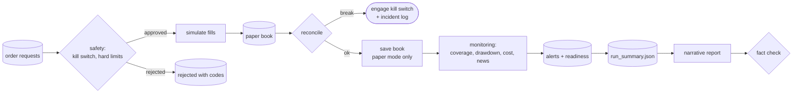

# Part 12 — Safety, execution, monitoring and reporting

**Goal:** build the last four layers. An **independent safety layer** that approves or rejects orders using only orders, the book and plain market facts, never forecasts. A **paper execution** stage that simulates fills, reconciles the book and stops everything if the book does not agree. A **monitoring** stage that watches calibration, drawdown, execution cost and now the health of the news feed. And a **report** that can only say what the run's files say.

**Design:** Stage 6 (execution and reconciliation), Stage 7 (monitoring: *"forecast, news and calibration drift"*), the safety section (*"hard limits are independent of model outputs"*) and the reporting rule (*"every number in the narrative is traceable"*). **Roadmap:** phases 8 and 9. **Overview:** §9–§10.



## What you will build in this part

| Section | File | Components |
|---|---|---|
| 12.1 | `safety/hard_limits.py`, `kill_switch.py`, `incident_log.py`, `reconciliation_block.py` | 1 + 1 + 1 + 1 |
| 12.2 | `safety/pre_trade_checks.py` | 2 |
| 12.3 | `stage_06_execution/execution_simulator.py`, `fill_reconciliation.py` | 1 + 1 |
| 12.4 | `stage_06_execution/service.py` | 3 |
| 12.5 | `stage_07_monitoring/calibration_monitor.py`, `performance_monitor.py`, `news_latency_coverage_monitor.py`, `news_feature_drift_monitor.py`, `alert_rules.py` | 1 + 1 + 1 + 1 + 2 |
| 12.6 | `stage_07_monitoring/service.py` | 2 |
| 12.7 | `compiler/plot_compiler.py` | 3 |
| 12.8 | `reporting/experiment_summary.py`, `metrics_summary.py`, `narrative_report.py`, `report_fact_checks.py` | 1 + 3 + 4 + 1 |
| 12.9 | tests and an invariant | |

The orchestrator calls the safety layer between Stage 05 and Stage 06; you wire that call in Part 13.

---

## 12.1 The safety primitives

**File:** `src/aqp_python/safety/hard_limits.py`

```python
"""Hard limits loaded from risk_limits.yaml only. No forecast or optimiser input can change them."""
from dataclasses import dataclass


@dataclass(frozen=True)
class HardLimits:
    max_single_name_fraction_nav: float
    max_gross_leverage: float
    max_participation_adv: float
    max_daily_loss_fraction: float
    max_order_count: int

    @classmethod
    def from_config(cls, risk_limits: dict) -> "HardLimits":
        return cls(**{field: risk_limits[field] for field in cls.__dataclass_fields__})
```

**What it does.** Five numbers, read from `risk_limits.yaml` and nowhere else. `from_config` reads exactly the dataclass's fields, so a misspelt or missing limit raises `KeyError` at start-up instead of silently defaulting. `frozen=True` means nothing can change a limit during a run.

**Why "independent".** The optimiser and the sizing rules in Part 11 already limit risk, but they are driven by forecasts. If a model bug produced absurd expected returns, those layers would size accordingly. The hard limits do not look at a forecast, so the same bug cannot loosen them. Part 13's import-linter contract checks that `safety` imports nothing from the stages.

**File:** `src/aqp_python/safety/kill_switch.py`

```python
"""A file-based kill switch: if the file exists, no new risk is allowed. Simple and inspectable."""
import json
from datetime import UTC, datetime
from pathlib import Path


def kill_switch_path(state_dir: Path, filename: str) -> Path:
    return Path(state_dir) / filename


def is_engaged(path: Path) -> bool:
    return path.is_file()


def engage(path: Path, reason: str) -> None:
    path.parent.mkdir(parents=True, exist_ok=True)
    path.write_text(json.dumps({"engaged_at": datetime.now(UTC).isoformat(),
                                "reason": reason}), encoding="utf-8")
```

**What it does.** The kill switch is a **file**. If `outputs\state\KILL_SWITCH` exists, no order is approved. **Why a file:** anyone can see whether it is on (`dir outputs\state`), engage it (create the file) or release it (delete it, after a review), without any code, database or running process.

**File:** `src/aqp_python/safety/incident_log.py`

```python
"""Append-only incident log. Restarting after an incident requires a human review."""
import json
from datetime import UTC, datetime
from pathlib import Path


def log_incident(path: Path, run_id: str, code: str, detail: str) -> None:
    path.parent.mkdir(parents=True, exist_ok=True)
    entry = {"at": datetime.now(UTC).isoformat(), "run_id": run_id, "code": code, "detail": detail}
    with path.open("a", encoding="utf-8") as handle:
        handle.write(json.dumps(entry) + "\n")
```

**File:** `src/aqp_python/safety/reconciliation_block.py`

```python
"""Compare what we expect to hold with what the broker says. Any mismatch blocks trading."""
import pandas as pd


def reconcile(expected: pd.Series, broker: pd.Series, tolerance: float = 0.0) -> pd.DataFrame:
    """Return the mismatching rows (empty frame = reconciled)."""
    ids = sorted(set(expected.index) | set(broker.index))
    table = pd.DataFrame({"expected": expected.reindex(ids).fillna(0.0),
                          "broker": broker.reindex(ids).fillna(0.0)})
    table["difference"] = table["broker"] - table["expected"]
    return table.loc[table["difference"].abs() > tolerance]
```

**What it does.** Lists every security where the broker's position differs from what we expect. An empty table means the book reconciles.

## 12.2 Pre-trade approval

**File:** `src/aqp_python/safety/pre_trade_checks.py` — component 1 of 2: SafetyDecision

```python
"""Independent pre-trade approval. Inputs are orders and plain market facts - never forecasts."""
from dataclasses import dataclass

import pandas as pd

from aqp_python.contracts.order_schema import OrderRequest, Side
from aqp_python.contracts.reason_codes import ReasonCode as RC
from aqp_python.safety.hard_limits import HardLimits


@dataclass(frozen=True)
class SafetyDecision:
    approved: list[OrderRequest]
    rejected: list[tuple[OrderRequest, tuple[str, ...]]]
```

**File:** `src/aqp_python/safety/pre_trade_checks.py` — component 2 of 2: approve_orders: sells first, then each limit

```python
def approve_orders(orders: list[OrderRequest], *, positions: pd.Series, prices: pd.Series,
                   nav: float, adv: pd.Series, daily_pnl_fraction: float,
                   limits: HardLimits, kill_switch_engaged: bool) -> SafetyDecision:
    if kill_switch_engaged:
        return SafetyDecision([], [(o, (str(RC.KILL_SWITCH),)) for o in orders])
    if len(orders) > limits.max_order_count:
        return SafetyDecision([], [(o, (str(RC.HARD_LIMIT_ORDER_COUNT),)) for o in orders])

    holdings = (positions * prices.reindex(positions.index)).fillna(0.0)
    approved, rejected = [], []
    loss_breached = daily_pnl_fraction < -limits.max_daily_loss_fraction
    # Sells first: they free capacity and are always risk-reducing for a long-only book.
    for order in sorted(orders, key=lambda o: o.side != Side.SELL):
        signed = order.notional if order.side == Side.BUY else -order.notional
        after = holdings.copy()
        after[order.security_id] = after.get(order.security_id, 0.0) + signed
        codes = []
        if order.side == Side.BUY:
            if loss_breached:
                codes.append(str(RC.HARD_LIMIT_DAILY_LOSS))
            if after[order.security_id] > limits.max_single_name_fraction_nav * nav + 1e-6:
                codes.append(str(RC.HARD_LIMIT_NAME))
            if after.abs().sum() > limits.max_gross_leverage * nav + 1e-6:
                codes.append(str(RC.HARD_LIMIT_GROSS))
        if order.notional > limits.max_participation_adv * float(adv.get(order.security_id, 0.0)):
            codes.append(str(RC.HARD_LIMIT_PARTICIPATION))
        if codes:
            rejected.append((order, tuple(codes)))
        else:
            approved.append(order)
            holdings = after
    return SafetyDecision(approved, rejected)
```

**What it does.**

1. The kill switch rejects **every** order, sells included. When the switch is on, something unexplained has happened, and a person decides what to trade.
2. Too many orders rejects every order: an unusual number of orders is itself a sign of a bug.
3. Otherwise, sells are checked first (in a long-only book they reduce risk and free capacity), then buys. A buy is rejected if today's loss already exceeds the daily limit, if it would take the name above its share of NAV, or if it would take gross exposure above the limit. Any order larger than the participation limit of the name's average daily value is rejected.
4. Each approved order updates the running `holdings`, so the limits apply to the book **after** all earlier approved orders, not to each order alone.

```python
import pandas as pd

from aqp_python.contracts.order_schema import OrderRequest, Side
from aqp_python.safety.hard_limits import HardLimits
from aqp_python.safety.pre_trade_checks import approve_orders

limits = HardLimits(max_single_name_fraction_nav=0.10, max_gross_leverage=1.0, max_participation_adv=0.20,
                    max_daily_loss_fraction=0.05, max_order_count=10)
orders = [OrderRequest("buy-A", "A", Side.BUY, 800, 10.0, "TRADE_APPROVED"),       # $8,000
          OrderRequest("buy-C", "C", Side.BUY, 1_500, 10.0, "TRADE_APPROVED"),     # $15,000 > 10% of NAV
          OrderRequest("sell-B", "B", Side.SELL, 500, 10.0, "TRADE_APPROVED")]
market = dict(positions=pd.Series({"B": 1_000.0}), prices=pd.Series(10.0, index=["A", "B", "C"]), nav=100_000,
              adv=pd.Series(1e6, index=["A", "B", "C"]), limits=limits)
for label, pnl, kill in [("normal day", 0.0, False), ("down 8% today", -0.08, False), ("kill switch", 0.0, True)]:
    decision = approve_orders(orders, daily_pnl_fraction=pnl, kill_switch_engaged=kill, **market)
    print(f"{label:<14} approved={[o.order_id for o in decision.approved]}")
    print(f"{'':<14} rejected={[(o.order_id, codes) for o, codes in decision.rejected]}")
```

```text
normal day     approved=['sell-B', 'buy-A']
               rejected=[('buy-C', ('HARD_LIMIT_NAME',))]
down 8% today  approved=['sell-B']
               rejected=[('buy-A', ('HARD_LIMIT_DAILY_LOSS',)), ('buy-C', ('HARD_LIMIT_DAILY_LOSS', 'HARD_LIMIT_NAME'))]
kill switch    approved=[]
               rejected=[('buy-A', ('KILL_SWITCH',)), ('buy-C', ('KILL_SWITCH',)), ('sell-B', ('KILL_SWITCH',))]
```

On a normal day, C's buy would make it 15% of NAV and is rejected. After an 8% loss, only the sell is allowed. With the kill switch, nothing is.

## 12.3 Simulated fills and the shortfall

**File:** `src/aqp_python/stages/stage_06_execution/execution_simulator.py`

```python
"""Simulated fills: half-spread + square-root impact, capped by participation of ADV."""
import numpy as np
import pandas as pd

from aqp_python.contracts.order_schema import OrderRequest, Side


def simulate_fills(orders: list[OrderRequest], *, adv: pd.Series, daily_vol: pd.Series,
                   half_spread_bps: float, commission_bps: float, impact_coefficient: float,
                   participation_cap: float) -> pd.DataFrame:
    rows = []
    for order in orders:
        capacity = participation_cap * float(adv.get(order.security_id, 0.0))
        fill_qty = min(order.quantity, int(capacity // order.reference_price))
        notional = fill_qty * order.reference_price
        impact = impact_coefficient * float(daily_vol.get(order.security_id, 0.0)) * np.sqrt(
            notional / max(float(adv.get(order.security_id, 1.0)), 1.0))
        sign = 1 if order.side == Side.BUY else -1
        price = order.reference_price * (1 + sign * (half_spread_bps * 1e-4 + impact))
        rows.append({
            "order_id": order.order_id, "security_id": order.security_id, "side": str(order.side),
            "requested_quantity": order.quantity, "filled_quantity": fill_qty,
            "reference_price": order.reference_price, "fill_price": round(price, 6),
            "fees": round(fill_qty * price * commission_bps * 1e-4, 2),
            "status": "FILLED" if fill_qty == order.quantity else ("PARTIAL" if fill_qty else "UNFILLED"),
        })
    return pd.DataFrame(rows, columns=["order_id", "security_id", "side", "requested_quantity",
                                       "filled_quantity", "reference_price", "fill_price", "fees", "status"])
```

**What it does.** Each order fills at most `participation_cap × ADV` worth of shares. The fill price is worse than the reference price by the half spread plus a square-root impact, `η · σ_daily · √(notional / ADV)`. Commission is charged on the filled value. Status is `FILLED`, `PARTIAL` or `UNFILLED`.

**File:** `src/aqp_python/stages/stage_06_execution/fill_reconciliation.py`

```python
"""Expected positions after fills, and implementation shortfall against the decision price."""
import pandas as pd


def signed_quantity(fills: pd.DataFrame) -> pd.Series:
    sign = fills["side"].map({"BUY": 1, "SELL": -1})
    return (fills["filled_quantity"] * sign).groupby(fills["security_id"]).sum()


def expected_positions(before: pd.Series, fills: pd.DataFrame) -> pd.Series:
    if fills.empty:
        return before.copy()
    after = before.add(signed_quantity(fills), fill_value=0.0)
    return after.loc[after != 0]


def implementation_shortfall(fills: pd.DataFrame) -> dict:
    """Cost of execution versus the reference (decision) price, in currency and bps."""
    if fills.empty or fills["filled_quantity"].sum() == 0:
        return {"shortfall": 0.0, "traded_notional": 0.0, "shortfall_bps": 0.0}
    sign = fills["side"].map({"BUY": 1, "SELL": -1})
    slippage = (sign * (fills["fill_price"] - fills["reference_price"]) * fills["filled_quantity"]).sum()
    traded = (fills["reference_price"] * fills["filled_quantity"]).sum()
    total = float(slippage + fills["fees"].sum())
    return {"shortfall": total, "traded_notional": float(traded), "shortfall_bps": float(total / traded * 1e4)}
```

**What it does.** `expected_positions` adds the signed fills to the book before trading. `implementation_shortfall` is the cost of trading relative to the decision price: price slippage plus fees, in dollars and in basis points of the traded value.

```python
import pandas as pd

from aqp_python.contracts.order_schema import OrderRequest, Side
from aqp_python.stages.stage_06_execution.execution_simulator import simulate_fills
from aqp_python.stages.stage_06_execution.fill_reconciliation import expected_positions, implementation_shortfall

orders = [OrderRequest("o1", "A", Side.BUY, 5_000, 20.0, "TRADE_APPROVED"),     # $100k, ADV $2m
          OrderRequest("o2", "B", Side.BUY, 5_000, 20.0, "TRADE_APPROVED"),     # $100k, ADV $300k
          OrderRequest("o3", "C", Side.SELL, 1_000, 20.0, "TRADE_APPROVED")]
fills = simulate_fills(orders, adv=pd.Series({"A": 2e6, "B": 3e5, "C": 2e6}),
                       daily_vol=pd.Series(0.02, index=["A", "B", "C"]), half_spread_bps=10,
                       commission_bps=5, impact_coefficient=0.1, participation_cap=0.10)
print(fills[["security_id", "side", "requested_quantity", "filled_quantity", "fill_price", "fees", "status"]]
      .to_string(index=False))
print("expected positions:", expected_positions(pd.Series({"C": 3_000.0}), fills).to_dict())
print("shortfall:", {k: round(v, 2) for k, v in implementation_shortfall(fills).items()})
```

```text
security_id side  requested_quantity  filled_quantity  fill_price  fees  status
          A  BUY                5000             5000   20.028944 50.07  FILLED
          B  BUY                5000             1500   20.032649 15.02 PARTIAL
          C SELL                1000             1000   19.976000  9.99  FILLED
expected positions: {'A': 5000.0, 'B': 1500.0, 'C': 2000.0}
shortfall: {'shortfall': 292.77, 'traded_notional': 150000.0, 'shortfall_bps': 19.52}
```

B's order is a third of its average daily value, so only 10% of ADV (1,500 shares) fills. Notice that the shortfall (19.5 bps) is larger than the half spread (10 bps) plus commission (5 bps): the rest is market impact. Stage 07 alerts if the shortfall drifts above `max_shortfall_bps_alert`.

## 12.4 The Stage 06 service

**File:** `src/aqp_python/stages/stage_06_execution/service.py` — component 1 of 3: imports

```python
"""Stage 06 entry point. The only stage that talks to the broker."""
import json

import pandas as pd

from aqp_python.contracts.data_schemas import ResearchData
from aqp_python.contracts.order_schema import OrderRequest
from aqp_python.contracts.portfolio_schema import PortfolioState
from aqp_python.contracts.reason_codes import ReasonCode as RC
from aqp_python.orchestration.run_context import RunContext
from aqp_python.orchestration.stage_status import StageResult
from aqp_python.safety.incident_log import log_incident
from aqp_python.safety.kill_switch import engage, kill_switch_path
from aqp_python.safety.reconciliation_block import reconcile
from aqp_python.stages.stage_06_execution.execution_simulator import simulate_fills
from aqp_python.stages.stage_06_execution.fill_reconciliation import (
    expected_positions,
    implementation_shortfall,
)
from aqp_python.stages.stage_06_execution.portfolio_state import latest_prices, open_broker, state_dir

STAGE = "stage_06_execution"
```

**File:** `src/aqp_python/stages/stage_06_execution/service.py` — component 2 of 3: run_stage: simulate fills and update the broker

```python
def run_stage(ctx: RunContext, data: ResearchData, orders: list[OrderRequest],
              state: PortfolioState) -> StageResult:
    result = StageResult(STAGE)
    history = state.equity_history
    if ctx.mode == "paper" and len(history) and history.index[-1] >= ctx.decision_date:
        return result.block(RC.PAPER_OUT_OF_ORDER,
                            f"paper book already has {history.index[-1].date()}; paper runs must move forward")
    costs, pcfg = ctx.config["sleeve"]["costs"], ctx.config["sleeve"]["portfolio"]
    recent = data.prices.loc[data.prices["date"] > ctx.decision_date - pd.offsets.BDay(60)]
    fills = simulate_fills(
        orders, adv=recent.groupby("security_id")["dollar_volume"].median(),
        daily_vol=recent.groupby("security_id")["return"].std(),
        half_spread_bps=costs["half_spread_bps"], commission_bps=costs["commission_bps"],
        impact_coefficient=costs["impact_coefficient"], participation_cap=pcfg["participation_cap"])

    broker = open_broker(ctx)
    for fill in fills.itertuples(index=False):
        if fill.filled_quantity:
            sign = 1 if fill.side == "BUY" else -1
            broker.apply_fill(fill.security_id, sign * fill.filled_quantity, fill.fill_price, fill.fees)

    expected = expected_positions(state.positions, fills)
    breaks = reconcile(expected, broker.positions())
    shortfall = implementation_shortfall(fills)
    prices = latest_prices(data)
    nav_after = broker.cash() + float((broker.positions() * prices.reindex(broker.positions().index)).sum())
```

**What it does.** In paper mode, refuses to run for a date the book has already recorded (`PAPER_OUT_OF_ORDER`): a paper book that could be replayed out of order would not be a record of anything. Then it simulates fills, applies them to the broker, computes the expected positions and compares them with the broker's.

**File:** `src/aqp_python/stages/stage_06_execution/service.py` — component 3 of 3: run_stage: record, reconcile, and only then save

```python
    fills.to_csv(ctx.paths.sub("execution", "fills.csv"), index=False)
    breaks.to_csv(ctx.paths.sub("execution", "reconciliation_breaks.csv"))
    ctx.paths.sub("execution", "implementation_shortfall.json").write_text(json.dumps(shortfall, indent=2))
    result.artifacts.update({"fills": "execution/fills.csv",
                             "reconciliation_breaks": "execution/reconciliation_breaks.csv",
                             "implementation_shortfall": "execution/implementation_shortfall.json"})
    partial = int((fills["status"] != "FILLED").sum()) if len(fills) else 0
    if partial:
        result.reason_codes.append(str(RC.PARTIAL_FILL))
        result.warnings.append(f"{partial} orders partially filled or unfilled")
    result.metrics.update({"fills": int(len(fills)), "nav_after": nav_after, **shortfall,
                           "book_updated": ctx.mode == "paper"})

    if not breaks.empty:
        path = kill_switch_path(state_dir(ctx), ctx.config["risk_limits"]["kill_switch_file"])
        engage(path, f"reconciliation failed in run {ctx.run_id}")
        log_incident(state_dir(ctx) / "incidents.jsonl", ctx.run_id, str(RC.RECONCILIATION_FAILED),
                     breaks.to_json())
        return result.block(RC.RECONCILIATION_FAILED, "positions do not reconcile; kill switch engaged")

    if ctx.mode == "paper":            # research runs never change the paper book
        broker.record_equity(str(ctx.decision_date.date()), nav_after)
        broker.save()
    return result
```

**What it does.** Writes the fills, the reconciliation breaks and the shortfall, and flags partial fills. Then the order matters:

1. If the book does not reconcile, engage the kill switch, write an incident and **block**, without saving the book.
2. Only in paper mode, and only if the book reconciles, record today's NAV and save.

**Why research runs never save.** A research run of 16 October and another of 3 March must not both add trades to the same book. `book_updated` in the metrics records which kind of run this was.

## 12.5 Monitors and alerts

**File:** `src/aqp_python/stages/stage_07_monitoring/calibration_monitor.py`

```python
"""Is the 90% interval still covering about 90% of outcomes?"""
import pandas as pd

from aqp_python.contracts.quantile_grid import LOWER_90, UPPER_90


def rolling_coverage(oos: pd.DataFrame, window_dates: int) -> pd.Series:
    """Coverage of the 5%-95% interval pooled over the last `window_dates` test dates."""
    inside = (oos["label"] >= oos[LOWER_90]) & (oos["label"] <= oos[UPPER_90])
    by_date = pd.DataFrame({"hits": inside, "n": 1}).groupby(oos["date"]).sum().sort_index()
    rolled = by_date.rolling(window_dates, min_periods=window_dates).sum()
    return (rolled["hits"] / rolled["n"]).dropna().rename("coverage_90")
```

**What it does.** The share of outcomes inside the 5–95% interval, pooled over the last `coverage_window_dates` test dates. A calibrated model gives about 0.90; the alert band in `monitoring_alerts.yaml` is 0.87 to 0.93.

**File:** `src/aqp_python/stages/stage_07_monitoring/performance_monitor.py`

```python
"""Performance of the paper book."""
import pandas as pd


def drawdown(equity: pd.Series) -> float:
    """Current drawdown from the running peak, as a positive fraction (0.10 = 10%)."""
    if equity.empty:
        return 0.0
    return float(1 - equity.iloc[-1] / equity.cummax().iloc[-1])
```

**File:** `src/aqp_python/stages/stage_07_monitoring/news_latency_coverage_monitor.py`

```python
"""Is the news engine still delivering on time and for enough names? (design Stage 7: forecast/news drift)."""


def news_health(news_record: dict | None) -> dict:
    """Summarise today's news coverage and latency from the Stage 02D record in the manifest."""
    if not news_record or not news_record.get("available"):
        return {"available": False, "coverage_today": 0.0, "p95_total_minutes": None}
    return {"available": True, "coverage_today": news_record.get("available_share_today", 0.0),
            "p95_total_minutes": news_record.get("latency", {}).get("p95_total_minutes")}
```

**What it does.** Reads the Stage 02D record from the manifest (Part 09): whether news was available, today's coverage and the 95th-percentile latency. It does not recompute anything.

**File:** `src/aqp_python/stages/stage_07_monitoring/news_feature_drift_monitor.py`

```python
"""Has today's news sentiment moved far outside its own history? A drift alert asks for review."""
import pandas as pd


def sentiment_drift(features: pd.DataFrame | None, decision_date: pd.Timestamp,
                    lookback_days: int = 252) -> float | None:
    """z-score of today's cross-sectional mean sentiment against the previous `lookback_days` daily means."""
    if features is None or "news_sentiment_decay" not in features:
        return None
    daily = features.groupby("date")["news_sentiment_decay"].mean().dropna().sort_index()
    history, today = daily.loc[daily.index < decision_date].tail(lookback_days), daily.get(decision_date)
    if today is None or len(history) < 20 or history.std() == 0:
        return None
    return float((today - history.mean()) / history.std())
```

**What it does.** A z-score of today's average sentiment against the previous year of daily averages. **Why watch for drift:** a provider that changes its style, a new source, or an extractor that starts mis-reading a phrase would all show up as sentiment suddenly moving outside its history. The challenger's evidence was gathered on the old behaviour.

**File:** `src/aqp_python/stages/stage_07_monitoring/alert_rules.py` — component 1 of 2: evaluate_alerts: model, book and execution alerts

```python
"""Turn monitored metrics into alerts. An alert asks for review; it changes nothing by itself."""


def evaluate_alerts(*, latest_coverage: float | None, drawdown: float, shortfall_bps: float,
                    news: dict, news_drift: float | None, rules: dict) -> list[dict]:
    alerts = []
    low, high = rules["coverage_band"]
    if latest_coverage is not None and not low <= latest_coverage <= high:
        alerts.append({"alert": "CALIBRATION_DRIFT", "value": latest_coverage, "band": [low, high],
                       "response": "review model calibration; consider a challenger (G7)"})
    if drawdown > rules["max_drawdown_alert"]:
        alerts.append({"alert": "DRAWDOWN", "value": drawdown, "limit": rules["max_drawdown_alert"],
                       "response": "risk reduced by the drawdown multiplier; review the sleeve"})
    if shortfall_bps > rules["max_shortfall_bps_alert"]:
        alerts.append({"alert": "EXECUTION_COST", "value": shortfall_bps,
                       "limit": rules["max_shortfall_bps_alert"], "response": "review cost model"})
```

**File:** `src/aqp_python/stages/stage_07_monitoring/alert_rules.py` — component 2 of 2: evaluate_alerts: news alerts

```python
    if news["available"] and news["coverage_today"] < rules["min_news_coverage_alert"]:
        alerts.append({"alert": "NEWS_COVERAGE", "value": news["coverage_today"],
                       "limit": rules["min_news_coverage_alert"],
                       "response": "check the feed; challenger evidence on today's names is thin"})
    if news_drift is not None and abs(news_drift) > rules["max_news_drift_alert"]:
        alerts.append({"alert": "NEWS_DRIFT", "value": news_drift, "limit": rules["max_news_drift_alert"],
                       "response": "review the extractor and sources before trusting news evidence"})
    return alerts
```

**What it does.** Each alert has a value, the limit it broke and a suggested **response**. An alert asks for review; it changes nothing by itself. **Why not act automatically:** a calibration alert might mean the model has decayed, or that the market has had an unusual month. Deciding which, and whether to change the approved arm, is a G7 decision (Part 14).

## 12.6 The Stage 07 service

**File:** `src/aqp_python/stages/stage_07_monitoring/service.py` — component 1 of 2: imports

```python
"""Stage 07 entry point: calibration, performance, news health, alerts and readiness."""
import json

import pandas as pd

from aqp_python.contracts.forecast_schema import CombinedForecast
from aqp_python.contracts.news_feature_schema import NewsFeatures
from aqp_python.contracts.portfolio_schema import PortfolioState
from aqp_python.orchestration.run_context import RunContext
from aqp_python.orchestration.stage_status import StageResult
from aqp_python.stages.stage_07_monitoring.alert_rules import evaluate_alerts
from aqp_python.stages.stage_07_monitoring.calibration_monitor import rolling_coverage
from aqp_python.stages.stage_07_monitoring.news_feature_drift_monitor import sentiment_drift
from aqp_python.stages.stage_07_monitoring.news_latency_coverage_monitor import news_health
from aqp_python.stages.stage_07_monitoring.performance_monitor import drawdown

STAGE = "stage_07_monitoring"
```

**File:** `src/aqp_python/stages/stage_07_monitoring/service.py` — component 2 of 2: run_stage

```python
def run_stage(ctx: RunContext, combined: CombinedForecast, state: PortfolioState, shortfall_bps: float,
              news: NewsFeatures | None, news_record: dict | None) -> StageResult:
    result = StageResult(STAGE)
    rules = ctx.config["monitoring"]
    oos_path = ctx.paths.sub("validation", "oos_forecasts.csv")
    oos = pd.read_csv(oos_path, parse_dates=["date"]) if oos_path.is_file() else pd.DataFrame()
    monitored = list(combined.used_slots)
    latest = None
    if monitored and not oos.empty:
        coverage = rolling_coverage(oos.loc[oos["slot"].isin(monitored)], rules["coverage_window_dates"])
        coverage.to_csv(ctx.paths.sub("monitoring", "rolling_coverage.csv"))
        result.artifacts["rolling_coverage"] = "monitoring/rolling_coverage.csv"
        latest = float(coverage.iloc[-1]) if len(coverage) else None
    book_drawdown = drawdown(state.equity_history)
    health = news_health(news_record)
    drift = sentiment_drift(news.features if news is not None and news.available else None, ctx.decision_date)
    alerts = evaluate_alerts(latest_coverage=latest, drawdown=book_drawdown, shortfall_bps=shortfall_bps,
                             news=health, news_drift=drift, rules=rules)
    readiness = {"mode": ctx.mode, "used_slots": monitored, "alerts": len(alerts),
                 "shadow_candidates": [eid for eid, e in combined.experiments.items()
                                       if e["challenger_decision"] == "SHADOW_CANDIDATE"],
                 "paper_sessions_recorded": int(len(state.equity_history)),
                 "note": "research evidence only; shadow evaluation, paper trading and sign-off are separate steps"}
    ctx.paths.sub("monitoring", "alerts.json").write_text(json.dumps(alerts, indent=2))
    ctx.paths.sub("monitoring", "readiness.json").write_text(json.dumps(readiness, indent=2))
    ctx.paths.sub("monitoring", "news_health.json").write_text(json.dumps({**health, "sentiment_drift_z": drift},
                                                                          indent=2))
    result.artifacts.update({"alerts": "monitoring/alerts.json", "readiness": "monitoring/readiness.json",
                             "news_health": "monitoring/news_health.json"})
    result.metrics.update({"latest_coverage_90": latest, "book_drawdown": book_drawdown,
                           "news_coverage_today": health["coverage_today"], "news_drift_z": drift,
                           "alerts": [a["alert"] for a in alerts]})
    result.warnings.extend(f"alert {a['alert']}" for a in alerts)
    return result
```

**What it does.** Monitors only the slots that were **used**, computes the drawdown, the news health and drift, evaluates the alerts and writes `alerts.json`, `news_health.json` and `readiness.json`. The readiness file lists any shadow candidates and how many paper sessions are recorded, and states plainly that a research run is not sign-off.

## 12.7 Plots

**File:** `src/aqp_python/compiler/plot_compiler.py` — component 1 of 3: docstring, imports and the Agg backend

```python
"""Draw the standard plots from files already in the run folder, then index them.

Read-only with respect to the pipeline: it never changes data, decisions or orders.
A failed plot is listed as missing with its error - it never hides a failure elsewhere.
"""
import logging
from collections.abc import Callable
from pathlib import Path

import matplotlib

matplotlib.use("Agg")                       # no window: safe in terminals and tests
import matplotlib.pyplot as plt  # noqa: E402
import pandas as pd  # noqa: E402

log = logging.getLogger(__name__)
```

**What it does.** `matplotlib.use("Agg")` draws to files without opening a window, so plotting works in a terminal, a scheduled task and the tests.

**File:** `src/aqp_python/compiler/plot_compiler.py` — component 2 of 3: the four plot functions

```python
def _validation_curve(run: Path, ax) -> None:
    oos = pd.read_csv(run / "validation" / "oos_forecasts.csv", parse_dates=["date"])
    for name, rows in oos.groupby("model_name"):
        daily = rows.groupby("date").apply(
            lambda d: d.nlargest(max(1, len(d) // 5), "q0.500")["label"].mean()
            - d.nsmallest(max(1, len(d) // 5), "q0.500")["label"].mean())
        ax.plot((1 + daily).cumprod(), label=name)
    ax.set_title("Out-of-sample long-short (gross, top vs bottom quintile)")
    ax.legend()


def _coverage(run: Path, ax) -> None:
    coverage = pd.read_csv(run / "monitoring" / "rolling_coverage.csv", index_col=0, parse_dates=True)
    ax.plot(coverage.iloc[:, 0])
    ax.axhspan(0.87, 0.93, alpha=0.2)
    ax.set_title("Rolling 90% interval coverage (target band shaded)")


def _fan(run: Path, ax) -> None:
    combined = pd.read_csv(run / "forecasts" / "combined_forecasts.csv").sort_values("q0.500")
    x = range(len(combined))
    ax.vlines(x, combined["q0.050"], combined["q0.950"], alpha=0.4)
    ax.vlines(x, combined["q0.250"], combined["q0.750"], linewidth=4)
    ax.scatter(x, combined["q0.500"], s=12, zorder=3)
    ax.set_xticks(list(x), combined["security_id"], rotation=90, fontsize=6)
    ax.axhline(0, linewidth=0.8)
    ax.set_title("Combined forecast: median, 50% and 90% intervals")


def _weights(run: Path, ax) -> None:
    table = pd.read_csv(run / "portfolio" / "target_weights.csv", index_col=0)
    table = table.loc[(table["target_weight"] > 0) | (table["current_weight"] > 0)]
    table[["current_weight", "target_weight"]].plot.bar(ax=ax)
    ax.set_title("Current vs target relative weights")
```

**File:** `src/aqp_python/compiler/plot_compiler.py` — component 3 of 3: PLOTS and compile_plots

```python
PLOTS: dict[str, Callable] = {
    "validation_long_short.png": _validation_curve,
    "rolling_coverage.png": _coverage,
    "combined_forecast_fan.png": _fan,
    "target_weights.png": _weights,
}


def compile_plots(run_dir: Path) -> pd.DataFrame:
    rows = []
    for filename, draw in PLOTS.items():
        fig, ax = plt.subplots(figsize=(9, 4.5))
        try:
            draw(run_dir, ax)
            fig.tight_layout()
            fig.savefig(run_dir / "plots" / filename, dpi=110)
            rows.append({"plot": filename, "status": "created", "detail": ""})
        except Exception as error:  # missing inputs are expected when a stage was blocked
            rows.append({"plot": filename, "status": "missing", "detail": f"{type(error).__name__}: {error}"})
            log.info("plot %s not created: %s", filename, error)
        finally:
            plt.close(fig)
    index = pd.DataFrame(rows)
    index.to_csv(run_dir / "plots" / "plot_index.csv", index=False)
    return index
```

**What it does.** Draws each plot from files already in the run folder and writes `plot_index.csv`. A plot whose inputs are missing (for example, because Stage 03 was blocked) is listed as `missing` with the error; it does not stop the run. **Why plots only read files:** if a plot could see the pipeline's objects, it could show something the run did not record.

## 12.8 The run summary and the fact-checked report

**File:** `src/aqp_python/reporting/experiment_summary.py`

```python
"""One line per registered experiment, built from validation/experiments.csv only."""
from pathlib import Path

import pandas as pd

COLUMNS = ("approved_arm", "used_slot", "challenger_decision", "coverage", "relative_loss_change",
           "adjusted_pvalue", "net_sharpe_difference")


def experiment_summary(run_dir: Path) -> dict[str, dict]:
    path = run_dir / "validation" / "experiments.csv"
    if not path.is_file() or path.stat().st_size < 2:
        return {}
    table = pd.read_csv(path, index_col=0)
    keep = [c for c in COLUMNS if c in table.columns]
    rounded = table[keep].apply(lambda col: col.round(4) if col.dtype.kind == "f" else col)
    return {eid: {k: (None if pd.isna(v) else v) for k, v in row.items()}
            for eid, row in rounded.to_dict(orient="index").items()}
```

**What it does.** One line per experiment from `validation\experiments.csv` (Part 10): approved arm, used slot, decision, matched coverage, loss change, adjusted p-value and net Sharpe change.

**File:** `src/aqp_python/reporting/metrics_summary.py` — component 1 of 3: helpers and the run identity

```python
"""run_summary.json: the single source of truth for the narrative report."""
import json
from pathlib import Path

import pandas as pd

from aqp_python.reporting.experiment_summary import experiment_summary


def _json(path: Path):
    return json.loads(path.read_text(encoding="utf-8")) if path.is_file() else None


def build_run_summary(run_dir: Path) -> dict:
    manifest = _json(run_dir / "run_manifest.json")
    stages = {s["stage"]: s for s in manifest["stages"]}
    summary = {
        "run_id": manifest["run_id"], "sleeve": manifest["sleeve"], "mode": manifest["mode"],
        "decision_time": manifest["decision_time"], "status": manifest["status"],
        "stage_status": {name: s["status"] for name, s in stages.items()},
        "warnings": manifest["warnings"],
        "gates_blocked": [g for g in manifest["gates"] if g["outcome"] in ("BLOCK", "QUARANTINE")],
    }
```

**File:** `src/aqp_python/reporting/metrics_summary.py` — component 2 of 3: screening, universe, data request and news

```python
    if "stage_00_screening" in stages:
        m = stages["stage_00_screening"]["metrics"]
        summary["screening"] = {k: m.get(k) for k in ("candidates", "rows", "quarantined")}
    if "stage_01_universe" in stages:
        m = stages["stage_01_universe"]["metrics"]
        summary["universe"] = {k: m.get(k) for k in ("universe_id", "members", "active", "exits")}
    if "stage_02_data_expansion" in stages:
        m = stages["stage_02_data_expansion"]["metrics"]
        summary["data_request"] = {k: m.get(k) for k in ("request_id", "securities", "stories_in_scope")}
    news = manifest.get("records", {}).get("news_features")
    if news is not None:
        summary["news"] = {k: news.get(k) for k in ("available", "version", "events_used",
                                                    "available_share_today", "reason")}
```

**File:** `src/aqp_python/reporting/metrics_summary.py` — component 3 of 3: models, experiments, portfolio and outcomes

```python
    scores = run_dir / "validation" / "model_scores.csv"
    if scores.is_file():
        table = pd.read_csv(scores, index_col=0)
        keep = [c for c in ("pinball", "coverage_90", "dm_pvalue", "net_sharpe", "deflated_sharpe") if c in table]
        summary["models"] = table[keep].round(4).to_dict(orient="index")
        summary["used_slots"] = stages.get("stage_02e_validation", {}).get("metrics", {}).get("used_slots", [])
        summary["experiments"] = experiment_summary(run_dir)
    for key, rel in (("portfolio", "portfolio/risk_summary.json"), ("sizing", "sizing/sizing_summary.json"),
                     ("execution", "execution/implementation_shortfall.json"), ("alerts", "monitoring/alerts.json")):
        value = _json(run_dir / rel)
        if value is not None:
            summary[key] = value
    report = run_dir / "sizing" / "position_report.csv"
    if report.is_file() and report.stat().st_size > 1:
        actions = pd.read_csv(report)
        summary["actions"] = actions["action"].value_counts().to_dict() if "action" in actions else {}
    (run_dir / "reports" / "run_summary.json").write_text(json.dumps(summary, indent=2, default=str))
    return summary
```

**What it does.** Builds `reports\run_summary.json` from the manifest and the run's files, in pipeline order: identity and status, screening, universe, data request, news, models, experiments, portfolio, sizing, execution, alerts and actions. A section is included only if its stage ran.

**File:** `src/aqp_python/reporting/narrative_report.py` — component 1 of 4: formatting helpers

```python
"""Plain-English report rendered ONLY from run_summary.json. It cannot invent numbers."""


def _pct(value) -> str:
    return "n/a" if value is None else f"{value:.2%}"


def _num(value, digits: int = 4) -> str:
    return "n/a" if value is None else f"{value:.{digits}f}"
```

**File:** `src/aqp_python/reporting/narrative_report.py` — component 2 of 4: render_report: measured results

```python
def render_report(summary: dict) -> str:
    lines = [f"# Run report {summary['run_id']}", "",
             f"**Sleeve:** {summary['sleeve']}  |  **Mode:** {summary['mode']}  |  "
             f"**Decision time:** {summary['decision_time']}  |  **Status:** {summary['status']}", ""]
    lines += ["## Measured results", ""]
    if "screening" in summary:
        s = summary["screening"]
        lines.append(f"- Screening: {s['candidates']} candidates, {s['rows']} price rows; "
                     f"quarantined this run: {', '.join(s['quarantined']) or 'none'}.")
    if "universe" in summary:
        u = summary["universe"]
        lines.append(f"- Universe {u['universe_id']}: {u['members']} members, {u['active']} active; "
                     f"mandatory exits: {', '.join(u['exits']) or 'none'}.")
    if "data_request" in summary:
        d = summary["data_request"]
        lines.append(f"- Data request {d['request_id']}: {d['securities']} admitted names; "
                     f"{d['stories_in_scope']} stories in scope.")
    if "news" in summary:
        n = summary["news"]
        lines.append(f"- News features {n['version']}: {n['events_used']} events used; usable for "
                     f"{_pct(n['available_share_today'])} of active names today." if n["available"]
                     else f"- News features unavailable ({n['reason']}): baseline arms only.")
    for name, m in summary.get("models", {}).items():
        lines.append(f"- {name}: pinball {_num(m.get('pinball'))}, 90% coverage {_pct(m.get('coverage_90'))}, "
                     f"DM p-value {_num(m.get('dm_pvalue'))}, net Sharpe {_num(m.get('net_sharpe'), 2)}.")
```

**File:** `src/aqp_python/reporting/narrative_report.py` — component 3 of 4: render_report: experiments, portfolio and execution

```python
    for name, e in summary.get("experiments", {}).items():
        lines.append(f"- Experiment {name}: challenger {e['challenger_decision']}; matched coverage "
                     f"{_pct(e.get('coverage'))}, loss change {_pct(e.get('relative_loss_change'))}, adjusted "
                     f"p-value {_num(e.get('adjusted_pvalue'))}; approved arm {e['approved_arm']}.")
    used = summary.get("used_slots")
    if used is not None:
        lines.append(f"- Forecasts used for the portfolio: {', '.join(used) or 'none - the sleeve does not trade'}.")
    if summary.get("sizing", {}).get("leverage"):
        s = summary["sizing"]
        lines.append(f"- Leverage {_num(s['leverage']['final'], 3)} (Kelly cap {_num(s['leverage']['kelly'], 3)}, "
                     f"volatility cap {_num(s['leverage']['volatility'], 3)}); gross exposure "
                     f"{_pct(s['gross_exposure'])}; orders {s['orders']}.")
    if summary.get("actions"):
        lines.append("- Decisions: " + ", ".join(f"{k} {v}" for k, v in sorted(summary["actions"].items())) + ".")
    if "execution" in summary:
        e = summary["execution"]
        lines.append(f"- Implementation shortfall {_num(e['shortfall_bps'], 2)} bps on "
                     f"{_num(e['traded_notional'], 2)} traded.")
```

**File:** `src/aqp_python/reporting/narrative_report.py` — component 4 of 4: render_report: failures and limitations

```python
    lines += ["", "## Failures, quarantines and alerts", ""]
    failed_stages = {k: v for k, v in summary.get("stage_status", {}).items() if v != "PASS"}
    for stage, status in failed_stages.items():
        lines.append(f"- Stage {stage} ended {status} (details in run_manifest.json and run.log).")
    for gate in summary.get("gates_blocked", []):
        lines.append(f"- {gate['gate_id']} {gate['outcome']} {gate['subject']}: {', '.join(gate['reason_codes'])}")
    for alert in summary.get("alerts") or []:
        lines.append(f"- Alert {alert['alert']}: value {_num(alert['value'])}")
    if not failed_stages and not summary.get("gates_blocked") and not summary.get("alerts"):
        lines.append("- None recorded.")
    lines += ["", "## Limitations", "",
              "- Results come from the synthetic sample market unless a licensed source is configured.",
              "- A news challenger marked SHADOW_CANDIDATE has NOT been promoted: it needs shadow evaluation "
              "and G7 approval.",
              "- A passing run is technical evidence only. It is not evidence of profitability or live readiness."]
    return "\n".join(lines) + "\n"
```

**What it does.** Renders `run_report.md` **only** from the summary dictionary: a function from data to text with no access to anything else. Its fixed "Limitations" section says that a shadow candidate has not been promoted and that a passing run is not evidence of profitability.

**File:** `src/aqp_python/reporting/report_fact_checks.py`

```python
"""Every number in the narrative must be traceable to run_summary.json."""
import re

NUMBER = re.compile(r"(?<![A-Za-z_\d.])-?\d+(?:\.\d+)?")   # skip identifiers like G3


def _leaves(value):
    if isinstance(value, dict):
        for item in value.values():
            yield from _leaves(item)
    elif isinstance(value, list):
        for item in value:
            yield from _leaves(item)
    else:
        yield value


def allowed_numbers(summary: dict) -> set[str]:
    allowed = set()
    for leaf in _leaves(summary):
        if isinstance(leaf, bool) or leaf is None:
            continue
        if isinstance(leaf, (int, float)):
            allowed.add(str(leaf))
            for digits in range(0, 5):
                allowed.add(f"{leaf:.{digits}f}")
                allowed.add(f"{leaf * 100:.{digits}f}")      # percentages
        else:
            allowed.update(NUMBER.findall(str(leaf)))
    return allowed


def unsupported_numbers(narrative: str, summary: dict) -> list[str]:
    allowed = allowed_numbers(summary) | {"90", "5", "95"}   # fixed wording, e.g. "90% coverage"
    return [n for n in NUMBER.findall(narrative) if n not in allowed]
```

**What it does.** Collects every number in the summary, in the forms the report may print (as is, rounded to 0–4 decimals, or as a percentage), and returns any number in the report that is not one of them. The orchestrator (Part 13) writes the result to the manifest; a non-empty list is a reporting error.

```python
from aqp_python.reporting.narrative_report import render_report
from aqp_python.reporting.report_fact_checks import unsupported_numbers

summary = {"run_id": "demo", "sleeve": "asx_interday", "mode": "research", "status": "PASS",
           "decision_time": "2026-10-16T17:00:00+11:00", "used_slots": ["ridge@BASELINE"],
           "models": {"ridge@BASELINE": {"pinball": 0.0054, "coverage_90": 0.8863, "dm_pvalue": 0.0285,
                                         "net_sharpe": 2.02}},
           "gates_blocked": [], "alerts": []}
report = render_report(summary)
print("\n".join(report.splitlines()[:8]))
print("unsupported:", unsupported_numbers(report, summary))
edited = report.replace("net Sharpe 2.02", "net Sharpe 2.40")          # someone 'improves' the report
print("unsupported after editing:", unsupported_numbers(edited, summary))
```

```text
# Run report demo

**Sleeve:** asx_interday  |  **Mode:** research  |  **Decision time:** 2026-10-16T17:00:00+11:00  |  **Status:** PASS

## Measured results

- ridge@BASELINE: pinball 0.0054, 90% coverage 88.63%, DM p-value 0.0285, net Sharpe 2.02.
- Forecasts used for the portfolio: ridge@BASELINE.
unsupported: []
unsupported after editing: ['2.40']
```

## 12.9 Tests

**File:** `tests/unit/test_execution_simulator.py`

```python
import pandas as pd
import pytest

from aqp_python.connectors.broker.paper_broker import PaperBroker
from aqp_python.contracts.order_schema import OrderRequest, Side
from aqp_python.safety.reconciliation_block import reconcile
from aqp_python.stages.stage_06_execution.execution_simulator import simulate_fills
from aqp_python.stages.stage_06_execution.fill_reconciliation import expected_positions, implementation_shortfall

pytestmark = pytest.mark.batch08


def fills_for(quantity, adv=1e6):
    order = OrderRequest("o1", "A", Side.BUY, quantity, 10.0, "TRADE_APPROVED")
    return simulate_fills([order], adv=pd.Series({"A": adv}), daily_vol=pd.Series({"A": 0.02}),
                          half_spread_bps=10, commission_bps=5, impact_coefficient=0.1,
                          participation_cap=0.2)


def test_buys_fill_above_the_reference_price():
    fill = fills_for(1000).iloc[0]
    assert fill["status"] == "FILLED" and fill["fill_price"] > 10.0 and fill["fees"] > 0


def test_participation_cap_creates_partial_fills():
    fill = fills_for(50_000).iloc[0]                 # 500k notional vs 200k capacity
    assert fill["status"] == "PARTIAL" and fill["filled_quantity"] == 20_000


def test_shortfall_is_positive_for_costly_execution():
    assert implementation_shortfall(fills_for(1000))["shortfall_bps"] > 10


def test_paper_broker_refuses_to_go_short(tmp_path):
    broker = PaperBroker(tmp_path / "book.json", 1000.0)
    with pytest.raises(ValueError, match="short"):
        broker.apply_fill("A", -5, 10.0, 0.0)


def test_reconciliation_detects_a_break():
    expected = expected_positions(pd.Series({"A": 100.0}), fills_for(1000))
    assert reconcile(expected, pd.Series({"A": 1100.0})).empty
    assert not reconcile(expected, pd.Series({"A": 1000.0})).empty
```

**File:** `tests/unit/test_safety_controls.py`

```python
import pandas as pd
import pytest

from aqp_python.contracts.order_schema import OrderRequest, Side
from aqp_python.contracts.reason_codes import ReasonCode as RC
from aqp_python.safety.hard_limits import HardLimits
from aqp_python.safety.pre_trade_checks import approve_orders

pytestmark = pytest.mark.batch08
LIMITS = HardLimits(max_single_name_fraction_nav=0.1, max_gross_leverage=1.0, max_participation_adv=0.2,
                    max_daily_loss_fraction=0.05, max_order_count=10)


def run(orders, **overrides):
    base = dict(positions=pd.Series({"B": 1000.0}), prices=pd.Series({"A": 10.0, "B": 10.0}), nav=100_000,
                adv=pd.Series({"A": 1e6, "B": 1e6}), daily_pnl_fraction=0.0, limits=LIMITS,
                kill_switch_engaged=False)
    return approve_orders(orders, **{**base, **overrides})


def buy(qty, sid="A"):
    return OrderRequest(f"o-{sid}-{qty}", sid, Side.BUY, qty, 10.0, "TRADE_APPROVED")


def test_kill_switch_rejects_everything():
    decision = run([buy(10)], kill_switch_engaged=True)
    assert not decision.approved and decision.rejected[0][1] == (RC.KILL_SWITCH,)


def test_single_name_limit():
    decision = run([buy(1500)])                      # 15k > 10% of 100k NAV
    assert RC.HARD_LIMIT_NAME in decision.rejected[0][1]


def test_participation_limit():
    decision = run([buy(900)], adv=pd.Series({"A": 20_000.0}))
    assert RC.HARD_LIMIT_PARTICIPATION in decision.rejected[0][1]


def test_daily_loss_blocks_buys_but_not_sells():
    sell = OrderRequest("s", "B", Side.SELL, 500, 10.0, "TRADE_APPROVED")
    decision = run([buy(100), sell], daily_pnl_fraction=-0.08)
    assert [o.order_id for o in decision.approved] == ["s"]


def test_a_misspelt_limit_fails_loudly():
    with pytest.raises(KeyError):
        HardLimits.from_config({"max_single_name_fraction_nav": 0.1})
```

**File:** `tests/unit/test_monitoring.py`

```python
import pandas as pd
import pytest

from aqp_python.stages.stage_07_monitoring.alert_rules import evaluate_alerts
from aqp_python.stages.stage_07_monitoring.news_feature_drift_monitor import sentiment_drift
from aqp_python.stages.stage_07_monitoring.news_latency_coverage_monitor import news_health

pytestmark = pytest.mark.batch09
RULES = {"coverage_band": [0.87, 0.93], "max_drawdown_alert": 0.10, "max_shortfall_bps_alert": 50,
         "min_news_coverage_alert": 0.8, "max_news_drift_alert": 3.0}


def test_news_health_reads_the_stage_02d_record():
    record = {"available": True, "available_share_today": 0.6, "latency": {"p95_total_minutes": 21.0}}
    assert news_health(record) == {"available": True, "coverage_today": 0.6, "p95_total_minutes": 21.0}
    assert news_health(None)["available"] is False


def test_sentiment_drift_is_a_z_score_against_history():
    days = pd.bdate_range("2026-01-01", periods=60)
    values = [0.0, 0.2] * 29 + [0.1, 1.0]
    features = pd.DataFrame({"date": days, "security_id": "A", "news_sentiment_decay": values})
    z = sentiment_drift(features, days[-1])
    assert z > 8


def test_alerts_ask_for_review_and_include_news():
    alerts = evaluate_alerts(latest_coverage=0.80, drawdown=0.0, shortfall_bps=10.0,
                             news={"available": True, "coverage_today": 0.5}, news_drift=4.0, rules=RULES)
    assert [a["alert"] for a in alerts] == ["CALIBRATION_DRIFT", "NEWS_COVERAGE", "NEWS_DRIFT"]
    assert all("response" in a for a in alerts)
```

**File:** `tests/unit/test_reporting.py`

```python
import pytest

from aqp_python.reporting.report_fact_checks import unsupported_numbers

pytestmark = pytest.mark.batch09


def test_fact_check_catches_an_invented_number():
    summary = {"run_id": "x", "models": {"m": {"pinball": 0.0057}}}
    assert unsupported_numbers("pinball 0.0057", summary) == []
    assert unsupported_numbers("pinball 0.0057 and Sharpe 3.1", summary) == ["3.1"]
```

The narrative invariant renders a report from a full v14 summary (screening, universe, data request, news, models, experiment, sizing and execution) and checks that every number in it is supported:

**File:** `tests/invariants/test_narrative_uses_structured_outputs.py`

```python
import pytest

from aqp_python.reporting.narrative_report import render_report
from aqp_python.reporting.report_fact_checks import unsupported_numbers

pytestmark = pytest.mark.invariant

SUMMARY = {
    "run_id": "20261016T060000Z_abcdef12", "sleeve": "asx_interday", "mode": "research",
    "decision_time": "2026-10-16T17:00:00+11:00", "status": "PASS",
    "screening": {"candidates": 40, "rows": 48219, "quarantined": ["SYN17"]},
    "universe": {"universe_id": "ASX_20250630_v1", "members": 26, "active": 23, "exits": ["SYN30"]},
    "data_request": {"request_id": "e4625a3b973b15d2", "securities": 26, "stories_in_scope": 1200},
    "news": {"available": True, "version": "news-1.0-b4aade60", "events_used": 947, "available_share_today": 1.0},
    "models": {"ridge@BASELINE": {"pinball": 0.0054, "coverage_90": 0.8863, "dm_pvalue": 0.0285, "net_sharpe": 2.0}},
    "experiments": {"e1": {"approved_arm": "BASELINE", "used_slot": "ridge@BASELINE",
                           "challenger_decision": "SHADOW_CANDIDATE", "coverage": 0.9591,
                           "relative_loss_change": -0.002, "adjusted_pvalue": 0.0173}},
    "used_slots": ["ridge@BASELINE"],
    "sizing": {"leverage": {"final": 0.8, "kelly": 3.2, "volatility": 1.1}, "gross_exposure": 0.48, "orders": 8},
    "execution": {"shortfall_bps": 16.6, "traded_notional": 475580.61},
    "gates_blocked": [], "alerts": [],
}


def test_every_number_in_the_report_comes_from_the_summary():
    assert unsupported_numbers(render_report(SUMMARY), SUMMARY) == []
```

The Stage 06 checkpoint, run in research mode:

**File:** `tests/integration/test_stage_handoffs.py` — component 9 of 9: test_stage_06_execution

```python
@pytest.mark.batch08
def test_stage_06_execution(make_context):
    ctx = make_context()
    out = run_through(ctx, "stage_06_execution")
    result = out["stage_06_execution"]
    print("\n", result.metrics)
    assert result.status == "PASS" and result.metrics["fills"] == len(out["orders"])
    assert result.metrics["book_updated"] is False             # research mode never touches the book
```

```powershell
python -m pytest -m batch08 -q
python -m pytest -m batch09 tests\unit -q
python -m pytest tests\integration\test_stage_handoffs.py -k 06_execution -s -q --basetemp=build\pytest
```

```text
 {'fills': 8, 'nav_after': 999208.1828480002, 'shortfall': 791.8171519999903, 'traded_notional': 475580.60919999995, 'shortfall_bps': 16.64948352986782, 'book_updated': False}
1 passed in 6.69s
```

`book_updated` is `False`: this was a research run. Stage 07 and the report run inside the orchestrator, so their checkpoint is the full run in Part 13.

## Checkpoint

- [ ] `python -m pytest -m batch08 -q` → `11 passed`.
- [ ] `python -m pytest -m batch09 tests\unit -q` → `4 passed` (the other batch09 tests arrive in Part 13).
- [ ] `python -m pytest tests\invariants -q` → all pass.

**Check your understanding.** (1) Why does the kill switch also reject sells, when the daily-loss limit does not? (2) Why does Stage 06 save the book only after reconciling it? (3) What would the fact check report if the narrative printed "coverage 89%" from a summary value of 0.8863?

```powershell
git add .
git commit -m "Safety layer, paper execution and reconciliation, monitoring with news health, fact-checked reporting"
```

Next: [Part 13 — the orchestrator, the CLI and full runs](13_orchestrator_cli_and_full_runs.md).
