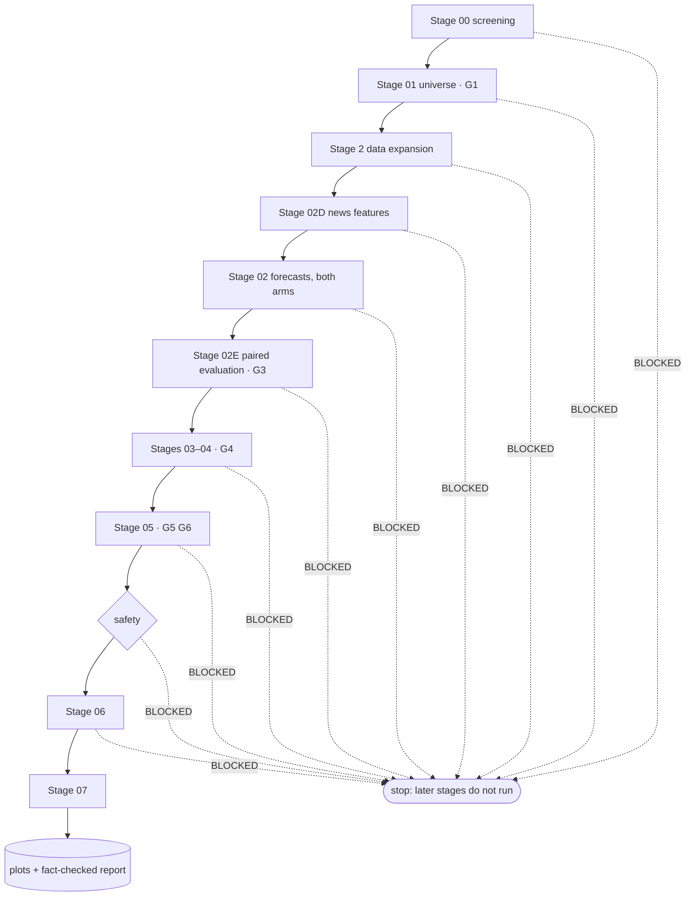

# Part 13 — The orchestrator, the CLI and full runs

**Goal:** connect every stage into one command, in the v14 order (screen → G1 → detailed data → news features → forecasts → paired evaluation → portfolio → sizing → safety → execution → monitoring), run it, and read everything it produces. Then use it the way the roadmap intends: failure drills that prove each control works (including the three news drills), a week of paper trading, a replay that proves reproducibility, and architecture rules that fail the build if someone breaks them.

**Design:** the run contract and terminal status (*"PASS, DEGRADED or BLOCKED; a degraded run names its approved fallback"*), the Executive Summary's order of stages, and the roadmap's operational phase. **Overview:** §9 (*"the orchestrator is the only component that launches the full flow"*), §11.



## What you will build in this part

| Section | File | Components |
|---|---|---|
| 13.1 | `orchestration/orchestrator.py` | 5 |
| 13.2 | `scripts/run_pipeline.py`, `scripts/build_sample_data.py` | 1 + 1 |
| 13.7 | `scripts/replay_run.py` | 2 |
| 13.8 | `tests/invariants/test_hard_limits_independence.py`, `.importlinter`, `tests/invariants/test_universe_fixed_membership.py` | 2 + 1 + 1 |
| 13.9 | `tests/integration/test_run_artifacts.py`, `tests/integration/test_fallback_behaviour.py` | 3 + 1 |

---

## 13.1 The orchestrator

**File:** `src/aqp_python/orchestration/orchestrator.py` — component 1 of 5: imports

```python
"""The only component that runs the full flow. Stages never start the workflow themselves."""
import logging
from collections.abc import Callable
from dataclasses import dataclass
from datetime import UTC, date, datetime
from pathlib import Path

import pandas as pd
import yaml

from aqp_python import __version__
from aqp_python.compiler.plot_compiler import compile_plots
from aqp_python.contracts.reason_codes import ReasonCode as RC
from aqp_python.contracts.run_manifest import initial_manifest
from aqp_python.contracts.run_status import RunStatus
from aqp_python.logging_config import configure_logging
from aqp_python.orchestration.run_context import RunContext, create_context
from aqp_python.orchestration.run_manifest_writer import ManifestWriter
from aqp_python.orchestration.stage_status import StageResult
from aqp_python.reporting.metrics_summary import build_run_summary
from aqp_python.reporting.narrative_report import render_report
from aqp_python.reporting.report_fact_checks import unsupported_numbers
from aqp_python.safety.hard_limits import HardLimits
from aqp_python.safety.kill_switch import is_engaged, kill_switch_path
from aqp_python.safety.pre_trade_checks import approve_orders
from aqp_python.stages.stage_00_screening import service as stage_00
from aqp_python.stages.stage_01_universe import service as stage_01
from aqp_python.stages.stage_02_data_expansion import service as stage_02x
from aqp_python.stages.stage_02_forecasting import service as stage_02
from aqp_python.stages.stage_02d_news_features import service as stage_02d
from aqp_python.stages.stage_02e_validation import service as stage_02e
from aqp_python.stages.stage_05_sizing import service as stage_05
from aqp_python.stages.stage_06_execution import service as stage_06
from aqp_python.stages.stage_06_execution.portfolio_state import load_portfolio_state
from aqp_python.stages.stage_07_monitoring import service as stage_07
from aqp_python.stages.stages_03_04_portfolio import service as stage_03_04

log = logging.getLogger(__name__)
```

**File:** `src/aqp_python/orchestration/orchestrator.py` — component 2 of 5: RunOutcome and StageRunner

```python
@dataclass(frozen=True)
class RunOutcome:
    run_id: str
    status: RunStatus
    run_dir: Path


class StageRunner:
    """Times each stage, converts exceptions into BLOCKED results and records the manifest."""

    def __init__(self, writer: ManifestWriter) -> None:
        self.writer = writer
        self.blocked = False

    def __call__(self, name: str, function: Callable, *args):
        started = datetime.now(UTC)
        try:
            outcome = function(*args)
        except Exception as error:                               # fail closed, never silently
            log.exception("stage %s raised", name)
            result = StageResult(name).block(RC.STAGE_EXCEPTION, f"{type(error).__name__}: {error}")
            outcome = (result, None)
        result = outcome[0] if isinstance(outcome, tuple) else outcome
        self.writer.record_stage(result, started, datetime.now(UTC))
        log.info("%-24s %s %s", name, result.status, ",".join(dict.fromkeys(result.reason_codes)))
        if result.status == RunStatus.BLOCKED:
            self.blocked = True
        return outcome
```

**What it does.** `StageRunner` wraps every stage call with three jobs:

- **Fail closed.** If a stage raises an exception, it becomes `BLOCKED` with `STAGE_EXCEPTION`, and the full traceback goes to `run.log`. The run stops cleanly with a complete manifest instead of crashing with half-written files.
- **Record.** Every stage is timed and written to the manifest as soon as it finishes.
- **Remember.** `self.blocked` stays `True` once any stage blocks, so no later stage runs.

**File:** `src/aqp_python/orchestration/orchestrator.py` — component 3 of 5: run_pipeline: the whole flow, in design order

```python
def run_pipeline(config_path: Path, sleeve: str, as_of: date, project_root: Path,
                 mode: str | None = None) -> RunOutcome:
    ctx = create_context(Path(config_path), sleeve, as_of, Path(project_root), mode)
    configure_logging(log_file=ctx.paths.root / "run.log")
    log.info("run %s | sleeve %s | mode %s | decision %s", ctx.run_id, sleeve, ctx.mode,
             ctx.decision_time.isoformat())
    ctx.paths.config_snapshot.write_text(yaml.safe_dump(ctx.config, sort_keys=True), encoding="utf-8")
    writer = ManifestWriter(ctx.paths.manifest, initial_manifest(
        run_id=ctx.run_id, sleeve=sleeve, mode=ctx.mode, decision_time=ctx.decision_time.isoformat(),
        config_hash=ctx.config_hash, code_revision=ctx.code_revision, package_version=__version__,
        started_at=datetime.now(UTC).isoformat()))
    stage = StageRunner(writer)

    _, screening = stage("stage_00_screening", stage_00.run_stage, ctx)
    if not stage.blocked:
        _, universe = stage("stage_01_universe", stage_01.run_stage, ctx, screening)
    if not stage.blocked:                                   # filter first: detailed data only after G1
        _, research = stage("stage_02_data_expansion", stage_02x.run_stage, ctx, universe)
    if not stage.blocked:
        news_result, news = stage("stage_02d_news_features", stage_02d.run_stage, ctx, research)
    if not stage.blocked:
        _, bundle = stage("stage_02_forecasting", stage_02.run_stage, ctx, research, universe, news)
    if not stage.blocked:
        _, combined = stage("stage_02e_validation", stage_02e.run_stage, ctx, bundle, research.trading_days)
    if not stage.blocked:
        state = load_portfolio_state(ctx, research)
        _, target = stage("stages_03_04_portfolio", stage_03_04.run_stage, ctx, research, combined, state)
    if not stage.blocked:
        _, orders = stage("stage_05_sizing", stage_05.run_stage, ctx, research, universe, combined, target, state)
    if not stage.blocked:
        approved = stage("safety", _safety_stage, ctx, research, orders, state)[1]
    if not stage.blocked:
        execution = stage("stage_06_execution", stage_06.run_stage, ctx, research, approved, state)
        shortfall = execution.metrics.get("shortfall_bps", 0.0)
        stage("stage_07_monitoring", stage_07.run_stage, ctx, combined, state, shortfall, news,
              news_result.records.get("news_features"))

    status = writer.finish()
    _compile_outputs(ctx, writer)
    log.info("run %s finished with status %s -> %s", ctx.run_id, status, ctx.paths.root)
    return RunOutcome(ctx.run_id, status, ctx.paths.root)
```

**What it does.** One line per stage, in the order of the design's Executive Summary. Read it against the flowchart above and notice three things:

1. **Filter first.** `stage_02_data_expansion` runs only after `stage_01_universe` has passed G1. Nothing before that line can request detailed data or news; the import-linter contract in 13.8 makes the same rule a build failure.
2. **News before forecasts.** `stage_02d_news_features` runs before `stage_02_forecasting`, which receives `news` (a `NewsFeatures` object, possibly `unavailable`) and decides which arms to build. If Stage 02D degrades under the approved fallback, the run continues with baseline arms only; if it blocks, nothing after it runs.
3. **Typed hand-offs only.** Each stage receives objects from earlier stages (`screening`, `universe`, `research`, `news`, `bundle`, `combined`, `target`, `orders`); no stage reads another stage's files. Stage 07 also receives the Stage 02D record, for news health.

`writer.finish()` fixes the terminal status **before** plots and the report are compiled, so a reporting failure can never change it.

**File:** `src/aqp_python/orchestration/orchestrator.py` — component 4 of 5: _safety_stage: independent approval

```python
def _safety_stage(ctx: RunContext, data, orders, state) -> tuple[StageResult, list]:
    """Independent approval. Uses risk_limits.yaml and plain facts only."""
    result = StageResult("safety")
    limits = HardLimits.from_config(ctx.config["risk_limits"])
    state_dir = ctx.resolve(ctx.config["pipeline"]["state_dir"])
    engaged = is_engaged(kill_switch_path(state_dir, ctx.config["risk_limits"]["kill_switch_file"]))
    recent = data.prices.loc[data.prices["date"] > ctx.decision_date - pd.offsets.BDay(60)]
    equity = state.equity_history
    daily_pnl = float(equity.iloc[-1] / equity.iloc[-2] - 1) if len(equity) > 1 else 0.0
    decision = approve_orders(orders, positions=state.positions, prices=state.prices, nav=state.nav,
                              adv=recent.groupby("security_id")["dollar_volume"].median(),
                              daily_pnl_fraction=daily_pnl, limits=limits, kill_switch_engaged=engaged)
    rows = ([{"order_id": o.order_id, "decision": "APPROVED", "reason_codes": ""} for o in decision.approved]
            + [{"order_id": o.order_id, "decision": "REJECTED", "reason_codes": ";".join(c)}
               for o, c in decision.rejected])
    pd.DataFrame(rows, columns=["order_id", "decision", "reason_codes"]).to_csv(
        ctx.paths.sub("safety", "pre_trade_checks.csv"), index=False)
    result.artifacts["pre_trade_checks"] = "safety/pre_trade_checks.csv"
    result.metrics.update({"approved": len(decision.approved), "rejected": len(decision.rejected),
                           "kill_switch_engaged": engaged})
    if engaged:
        result.block(RC.KILL_SWITCH, "kill switch engaged: no orders may be sent")
    for _, codes in decision.rejected:
        result.reason_codes.extend(codes)
    return result, decision.approved
```

**What it does.** Safety is its own entry in the manifest, between sizing and execution. The orchestrator gathers plain facts (positions, prices, NAV, ADV, today's P&L and the kill-switch file) and passes them to `approve_orders` from Part 12. It is the only place where Stage 05's orders meet the hard limits. Rejected orders are recorded with their codes; only approved orders reach Stage 06.

**File:** `src/aqp_python/orchestration/orchestrator.py` — component 5 of 5: _compile_outputs: plots and the fact-checked report

```python
def _compile_outputs(ctx: RunContext, writer: ManifestWriter) -> None:
    """Plots and report come last and from recorded outputs; their failure is logged, not hidden."""
    try:
        index = compile_plots(ctx.paths.root)
        summary = build_run_summary(ctx.paths.root)
        narrative = render_report(summary)
        problems = unsupported_numbers(narrative, summary)
        if problems:
            raise ValueError(f"narrative contains numbers not in run_summary.json: {problems}")
        ctx.paths.sub("reports", "run_report.md").write_text(narrative, encoding="utf-8")
        missing = index.loc[index["status"] != "created", "plot"].tolist()
        writer.record_report("CREATED", f"missing plots: {missing}" if missing else "")
    except Exception as error:
        log.exception("report compilation failed; structured outputs are kept")
        writer.record_report("FAILED", f"{type(error).__name__}: {error}")
```

**What it does.** Plots, the run summary, the narrative and the fact check, in that order. If the narrative contains an unsupported number, the report is **not** written and the manifest records `report: FAILED` with the numbers. The structured outputs are kept either way.

## 13.2 Thin script wrappers

The CLI from Part 02 already has `run` and `build-sample-data`. The overview lists scripts too; keep them as one-line wrappers so there is only one implementation:

**File:** `scripts/run_pipeline.py`

```python
"""Thin wrapper: python scripts/run_pipeline.py --as-of 2026-10-16 [--mode paper] [--sleeve asx_interday]"""
import sys

from aqp_python.cli import main

if __name__ == "__main__":
    raise SystemExit(main(["run", *sys.argv[1:]]))
```

**File:** `scripts/build_sample_data.py`

```python
"""Thin wrapper: python scripts/build_sample_data.py [--seed 7] [--no-signal] [--no-news-signal]"""
import sys

from aqp_python.cli import main

if __name__ == "__main__":
    raise SystemExit(main(["build-sample-data", *sys.argv[1:]]))
```

`--no-news-signal` is new in v14: it keeps every news story but removes the news effect from returns, for drill 2 below.

## 13.3 The first full run

```powershell
python scripts\run_pipeline.py --as-of 2026-10-16
```

```text
2026-10-21 17:45:15,473 INFO    aqp_python.orchestration.orchestrator | run 20261021T064515Z_5b9293b5 | sleeve asx_interday | mode research | decision 2026-10-16T17:00:00+11:00
2026-10-21 17:45:15,821 INFO    aqp_python.stages.stage_00_screening.service | Stage 00: 40 candidates, 2 quarantined
2026-10-21 17:45:15,823 INFO    aqp_python.orchestration.orchestrator | stage_00_screening       PASS 
2026-10-21 17:45:16,023 INFO    aqp_python.stages.stage_01_universe.service | Formed universe ASX_20250630_v1 with 26 members
2026-10-21 17:45:16,229 INFO    aqp_python.orchestration.orchestrator | stage_01_universe        PASS 
2026-10-21 17:45:16,726 INFO    aqp_python.stages.stage_02_data_expansion.service | Stage 2: request e4625a3b973b15d2, 26 names, 1200 stories in scope
2026-10-21 17:45:16,727 INFO    aqp_python.orchestration.orchestrator | stage_02_data_expansion  PASS SOURCE_NOT_AVAILABLE
2026-10-21 17:45:17,335 INFO    aqp_python.stages.stage_02d_news_features.service | Stage 02D: 947 events used, coverage today 100%
2026-10-21 17:45:17,336 INFO    aqp_python.orchestration.orchestrator | stage_02d_news_features  PASS 
2026-10-21 17:45:17,426 INFO    aqp_python.orchestration.orchestrator | stage_02_forecasting     PASS 
2026-10-21 17:45:19,845 INFO    aqp_python.orchestration.orchestrator | stage_02e_validation     PASS SHADOW_CANDIDATE
2026-10-21 17:45:21,398 INFO    aqp_python.orchestration.orchestrator | stages_03_04_portfolio   PASS 
2026-10-21 17:45:21,423 INFO    aqp_python.orchestration.orchestrator | stage_05_sizing          PASS 
2026-10-21 17:45:21,434 INFO    aqp_python.orchestration.orchestrator | safety                   PASS 
2026-10-21 17:45:21,450 INFO    aqp_python.orchestration.orchestrator | stage_06_execution       PASS 
2026-10-21 17:45:21,507 INFO    aqp_python.orchestration.orchestrator | stage_07_monitoring      PASS 
2026-10-21 17:45:22,909 INFO    aqp_python.orchestration.orchestrator | run 20261021T064515Z_5b9293b5 finished with status PASS -> C:\Users\you\Documents\AQP-PYTHON\outputs\runs\20261021T064515Z_5b9293b5

run_id : 20261021T064515Z_5b9293b5
status : PASS
folder : C:\Users\you\Documents\AQP-PYTHON\outputs\runs\20261021T064515Z_5b9293b5
report : C:\Users\you\Documents\AQP-PYTHON\outputs\runs\20261021T064515Z_5b9293b5\reports\run_report.md
```

Read the log from the top:

- Stage 00 screens 40 candidates from the screening extract only (no news, no exposures).
- Stage 01 forms the universe the first time and stores it; every later run loads it unchanged.
- Stage 2 requests detailed data for the admitted names, and Stage 02D turns their news into Z_news.
- Stage 02E reports `SHADOW_CANDIDATE`: the news challenger passed, is recorded and warned about, and does not trade.

## 13.4 Reading a run, in the right order

Always read the **manifest first**: it is the record. The narrative is a convenience built from it. This short script prints the stage table and every gate that did not pass, for the newest run (in PowerShell, `ConvertFrom-Json` does the same job; Python works on every system):

```python
import json
from pathlib import Path

run = sorted(Path("outputs/runs").iterdir())[-1]
manifest = json.loads((run / "run_manifest.json").read_text(encoding="utf-8"))
print(manifest["run_id"], manifest["mode"], manifest["status"])
for stage in manifest["stages"]:
    print(f"  {stage['stage']:<26}{stage['status']:<10}{stage['seconds']:>6.2f}s  {','.join(stage['reason_codes'])}")
print("gates that did not pass:")
for gate in manifest["gates"]:
    if gate["outcome"] != "PASS":
        print(f"  {gate['gate_id']} {gate['outcome']:<10} {gate['subject']:<42} {','.join(gate['reason_codes'])}")
experiment = manifest["records"]["experiments"]["financial__xret__h5__asx_interday"]
print("experiment:", {k: experiment[k] for k in ("approved_arm", "used_slot", "challenger_decision")})
```

```text
20261021T064515Z_5b9293b5 research PASS
  stage_00_screening        PASS        0.34s  
  stage_01_universe         PASS        0.41s  
  stage_02_data_expansion   PASS        0.50s  SOURCE_NOT_AVAILABLE
  stage_02d_news_features   PASS        0.61s  
  stage_02_forecasting      PASS        0.09s  
  stage_02e_validation      PASS        2.42s  SHADOW_CANDIDATE
  stages_03_04_portfolio    PASS        1.54s  
  stage_05_sizing           PASS        0.02s  
  safety                    PASS        0.01s  
  stage_06_execution        PASS        0.01s  
  stage_07_monitoring       PASS        0.06s  
gates that did not pass:
  G2 QUARANTINE SYN17                                      DATA_EXTREME_RETURN
  G2 QUARANTINE SYN25                                      DATA_STALE
  G1 BLOCK      SYN13                                      EXIT-DIST
  G1 BLOCK      SYN25                                      EXIT-SUSP
  G1 BLOCK      SYN30                                      EXIT-DLST,EXIT-LIQ
  G2 QUARANTINE SYN25                                      DATA_STALE
  G2 WARN       news:NEWS_DUPLICATE                        NEWS_DUPLICATE
  G2 WARN       news:NEWS_EXTRACTION_INVALID               NEWS_EXTRACTION_INVALID
  G2 WARN       news:NEWS_NOT_YET_AVAILABLE                NEWS_NOT_YET_AVAILABLE
  G2 WARN       news:NEWS_UNLINKED                         NEWS_UNLINKED
  G3 BLOCK      zero_excess@BASELINE                       MODEL_IS_BASELINE
  G3 BLOCK      rolling_mean@BASELINE                      MODEL_IS_BASELINE
experiment: {'approved_arm': 'BASELINE', 'used_slot': 'ridge_location_scale@BASELINE', 'challenger_decision': 'SHADOW_CANDIDATE'}
```

Every non-PASS gate has a subject and a reason code: the quarantined screening names (G2), the exits and exclusions (G1), the planted news problems (G2 warnings, Part 09), the yardsticks that never receive weight (G3), and so on. Nothing is dropped silently.

Then the report:

```powershell
$run = (Get-ChildItem .\outputs\runs -Directory | Sort-Object Name | Select-Object -Last 1).FullName
code "$run\reports\run_report.md"          # Ctrl+Shift+V for the formatted preview
```

```text
# Run report 20261021T064515Z_5b9293b5

**Sleeve:** asx_interday  |  **Mode:** research  |  **Decision time:** 2026-10-16T17:00:00+11:00  |  **Status:** PASS

## Measured results

- Screening: 40 candidates, 48219 price rows; quarantined this run: SYN17, SYN25.
- Universe ASX_20250630_v1: 26 members, 23 active; mandatory exits: SYN13, SYN25, SYN30.
- Data request e4625a3b973b15d2: 26 admitted names; 1200 stories in scope.
- News features news-1.0-b4aade60: 947 events used; usable for 100.00% of active names today.
- ridge_location_scale@BASELINE: pinball 0.0054, 90% coverage 88.63%, DM p-value 0.0285, net Sharpe 2.02.
- ridge_location_scale@NEWS_CHALLENGER: pinball 0.0054, 90% coverage 88.46%, DM p-value 0.0017, net Sharpe 2.77.
- rolling_mean@BASELINE: pinball 0.0054, 90% coverage 90.26%, DM p-value 1.0000, net Sharpe -1.16.
- zero_excess@BASELINE: pinball 0.0054, 90% coverage 90.29%, DM p-value 0.7921, net Sharpe -1.16.
- Experiment financial__xret__h5__asx_interday: challenger SHADOW_CANDIDATE; matched coverage 95.91%, loss change -0.20%, adjusted p-value 0.0173; approved arm BASELINE.
- Forecasts used for the portfolio: ridge_location_scale@BASELINE.
- Leverage 0.800 (Kelly cap 3.264, volatility cap 1.141); gross exposure 47.91%; orders 8.
- Decisions: NO-TRADE 15, TRADE 8.
- Implementation shortfall 16.65 bps on 475580.61 traded.

## Failures, quarantines and alerts

- G2 QUARANTINE SYN17: DATA_EXTREME_RETURN
- G2 QUARANTINE SYN25: DATA_STALE
- G1 BLOCK SYN13: EXIT-DIST
- G1 BLOCK SYN25: EXIT-SUSP
- G1 BLOCK SYN30: EXIT-DLST, EXIT-LIQ
- G2 QUARANTINE SYN25: DATA_STALE
- G3 BLOCK zero_excess@BASELINE: MODEL_IS_BASELINE
- G3 BLOCK rolling_mean@BASELINE: MODEL_IS_BASELINE

## Limitations

- Results come from the synthetic sample market unless a licensed source is configured.
- A news challenger marked SHADOW_CANDIDATE has NOT been promoted: it needs shadow evaluation and G7 approval.
- A passing run is technical evidence only. It is not evidence of profitability or live readiness.
```

And the plots (`explorer "$run\plots"`): the out-of-sample long-short curve per model, rolling 90% coverage against its band, the combined forecast fan and current-versus-target weights.

Where to find each record the design asks for:

| Record | Location in the run folder |
|---|---|
| Run and configuration | `run_manifest.json` (IDs, times, hash, revision) + `config_snapshot.yaml` |
| Data lineage | `run_manifest.json → lineage` (tables, columns read, file hashes) + `data_lineage\` |
| Screening | `screening\candidate_registry.csv`, `coverage_inventory.csv` |
| Universe | `universe\selected_companies.csv`, `exclusions.csv`, `exits.csv`, `active_members.csv`, `coverage_tiers.csv` |
| Data request | `data_request\data_request.json` (with its `request_id`) |
| Features | `features\core_features.csv`, `news_features.csv`, `news_story_log.csv`, `news_coverage.csv` |
| Models and experiments | `forecasts\*`, `validation\folds.csv`, `model_scores.csv`, `eligibility.csv`, `experiments.csv`, `ablation.csv`, `oos_forecasts.csv`, `combination_weights.json` |
| Portfolio and decisions | `portfolio\target_weights.csv`, `risk_summary.json`, `sizing\position_report.csv`, `sizing_summary.json`, `order_requests.csv` |
| Safety and execution | `safety\pre_trade_checks.csv`, `execution\fills.csv`, `reconciliation_breaks.csv`, `implementation_shortfall.json` |
| Monitoring and outputs | `monitoring\*` (incl. `news_health.json`), `plots\*`, `reports\run_summary.json`, `run_report.md`, `run.log` |

## 13.5 Failure drills: prove the controls work

Run each drill and check that what happens matches the design. The outputs below keep only the log lines that matter, followed by the experiment's row from `validation\experiments.csv` (open it in VS Code, or with `Import-Csv`).

**Drill 1: no price signal means no trade, even if news helps.**

```powershell
python scripts\build_sample_data.py --no-signal
Remove-Item -Recurse -Force .\data\universes, .\data\data_requests   # the market changed: form a new universe
python scripts\run_pipeline.py --as-of 2026-10-16
```

```text
2026-10-21 17:45:30,878 INFO    aqp_python.orchestration.orchestrator | stage_02e_validation     PASS NO_ELIGIBLE_MODEL
2026-10-21 17:45:30,891 INFO    aqp_python.orchestration.orchestrator | stages_03_04_portfolio   PASS NO_ELIGIBLE_MODEL
2026-10-21 17:45:30,900 INFO    aqp_python.orchestration.orchestrator | stage_05_sizing          PASS 
status : PASS
```

```text
 used_slot   challenger_decision  coverage  adjusted_pvalue
       NaN CHALLENGER_INELIGIBLE    0.9591         0.002094
```

The baseline has no edge, so G3 blocks it. The challenger still sees the news effect, and its paired test against the (useless) baseline is even significant (adjusted p ≈ 0.002), but on its own it does not beat the best yardstick after costs, so it is `CHALLENGER_INELIGIBLE`. Even if it were eligible, `approved_arm: BASELINE` would let nothing else trade. Stage 02E records `NO_ELIGIBLE_MODEL`, Stages 03–04 hold, there are no orders, and the run is `PASS`: **a healthy pipeline that refuses to trade is the most important result in this guide.**

**Drill 2: news with no effect adds nothing.**

```powershell
python scripts\build_sample_data.py --no-news-signal
Remove-Item -Recurse -Force .\data\universes, .\data\data_requests
python scripts\run_pipeline.py --as-of 2026-10-16
```

```text
2026-10-21 17:45:41,038 INFO    aqp_python.orchestration.orchestrator | stage_02e_validation     PASS 
status : PASS
```

```text
                    used_slot  challenger_decision  coverage  adjusted_pvalue
ridge_location_scale@BASELINE NO_INCREMENTAL_VALUE    0.9591         0.802011
```

The stories are still there, the engine still extracts events, and the challenger still runs, but its paired test fails: `NO_INCREMENTAL_VALUE`. The baseline trades as before. This is the drill that shows the paired test can say "no".

**Drill 3: news outage, the approved fallback.**

```powershell
python scripts\build_sample_data.py
Remove-Item -Recurse -Force .\data\universes, .\data\data_requests
Remove-Item .\data\samples\news.csv
python scripts\run_pipeline.py --as-of 2026-10-16
```

```text
2026-10-21 17:45:48,850 INFO    aqp_python.orchestration.orchestrator | stage_02d_news_features  DEGRADED NEWS_UNAVAILABLE
2026-10-21 17:45:50,208 INFO    aqp_python.orchestration.orchestrator | stage_02e_validation     PASS 
status : DEGRADED
```

```text
                    used_slot    challenger_decision  coverage  adjusted_pvalue
ridge_location_scale@BASELINE CHALLENGER_UNAVAILABLE       NaN              NaN
```

Stage 02D finds no corpus, and because `news_features_unavailable` is listed in `fallbacks.yaml`, it **degrades** instead of blocking. The challenger is `CHALLENGER_UNAVAILABLE`, the baseline trades, and the run is `DEGRADED`, with the reason in the manifest and the report. Remove `news_features_unavailable` from `fallbacks.yaml` and the same outage **blocks** the run (`test_an_unapproved_fallback_blocks_instead` in 13.9). Restore the data:

```powershell
python scripts\build_sample_data.py
```

```text
sample data rebuilt
```

**Drill 4: kill switch.**

```powershell
New-Item -ItemType Directory -Force .\outputs\state | Out-Null
'{"reason": "drill"}' | Set-Content .\outputs\state\KILL_SWITCH
python scripts\run_pipeline.py --as-of 2026-10-16          # status : BLOCKED
Remove-Item .\outputs\state\KILL_SWITCH
```

```text
2026-10-21 17:46:00,029 INFO    aqp_python.orchestration.orchestrator | safety                   BLOCKED KILL_SWITCH
status : BLOCKED
```

There is no `stage_06_execution` entry in the manifest: nothing reached the broker. `$LASTEXITCODE` is `1`, so a scheduler sees the failure.

**Drill 5: broken data.** Duplicate one line of `data\samples\prices.csv` (copy a row in VS Code), then run. Expect `BLOCKED` at Stage 00 with `DATA_DUPLICATE`, and a manifest with exactly one stage: the universe, the data request and everything after it never ran. Rebuild the sample data afterwards.

**Drill 6: a stage that crashes.** Temporarily add `raise RuntimeError("drill")` as the first line of `run_stage` in `stage_02d_news_features\service.py`. Run it. The run is `BLOCKED` with `STAGE_EXCEPTION` (a crash is **not** an approved fallback: only a clean "no news" is), the traceback is in `run.log`, every earlier artifact exists, and the report still appears with *"Stage stage_02d_news_features ended BLOCKED"* under failures. Remove the line.

## 13.6 Paper trading, one day at a time

`--mode paper` updates the paper book (`outputs\state\asx_interday\paper_book.json`), and runs must move forward in time. Simulate a week:

```powershell
Remove-Item -Recurse -Force .\outputs, .\data\universes, .\data\data_requests -ErrorAction SilentlyContinue
foreach ($day in '2026-10-12','2026-10-13','2026-10-14','2026-10-15','2026-10-16') {
    python scripts\run_pipeline.py --as-of $day --mode paper | Select-String '^status'
}
python -c "import json; b = json.load(open('outputs/state/asx_interday/paper_book.json')); print(round(b['cash'], 2), len(b['positions']), 'positions'); print(b['equity'])"
```

```text
status : PASS
status : PASS
status : PASS
status : PASS
status : PASS
335804.16 13 positions
{'2026-10-12': 999264.8361969999, '2026-10-13': 1000802.8133579999, '2026-10-14': 994036.265804, '2026-10-15': 1000562.5385339999, '2026-10-16': 990029.405613}
```

From day 2 the book is not empty, so the position reports contain `HOLD` and `REDUCE` decisions as well as `TRADE`. The equity history feeds the drawdown multiplier (Part 11) and the daily-loss limit (Part 12).

Run 16 October again:

```text
2026-10-21 17:46:46,317 INFO    aqp_python.orchestration.orchestrator | stage_06_execution       BLOCKED PAPER_OUT_OF_ORDER
status : BLOCKED
```

`PAPER_OUT_OF_ORDER`: the paper book already contains that day. Each run uses only data available at 17:00 on its own date, so this loop is an honest walk-forward of the whole system, from screening to execution, not just of the model.

## 13.7 Replay: prove a run reproduces

**File:** `scripts/replay_run.py` — component 1 of 2: docstring, imports and what is compared

```python
"""Replay a recorded run and check that it reproduces.

    python scripts/replay_run.py outputs/runs/<run_id>

1. Verifies the input files still have the SHA-256 hashes recorded in the manifest.
2. Re-runs the same sleeve and decision date in research mode (a NEW run folder;
   the original is never touched).
3. Compares book-independent outputs: model scores, experiment evidence and combined forecasts.
"""
import json
import sys
from datetime import date
from hashlib import sha256
from pathlib import Path

import pandas as pd

from aqp_python.orchestration.orchestrator import run_pipeline

COMPARE = ("validation/model_scores.csv", "validation/experiments.csv", "forecasts/combined_forecasts.csv")
```

**File:** `scripts/replay_run.py` — component 2 of 2: main: verify inputs, re-run, compare

```python
def main(argv: list[str]) -> int:
    if len(argv) != 1:
        print(__doc__)
        return 2
    original = Path(argv[0])
    manifest = json.loads((original / "run_manifest.json").read_text(encoding="utf-8"))
    lineage = {f"{stage}/{name}": item for stage, tables in manifest["lineage"].items()
               for name, item in tables.items()}
    changed = [name for name, item in lineage.items()
               if not Path(item["path"]).is_file()
               or sha256(Path(item["path"]).read_bytes()).hexdigest() != item["sha256"]]
    if changed:
        print(f"CANNOT REPLAY: input files changed or missing since the run: {changed}")
        return 1
    as_of = date.fromisoformat(manifest["decision_time"][:10])
    replay = run_pipeline(Path("configs/pipeline.yaml"), manifest["sleeve"], as_of, Path.cwd(), "research")
    print(f"replay run: {replay.run_id} ({replay.status})")
    same = True
    for relative in COMPARE:
        left, right = original / relative, replay.run_dir / relative
        if not (left.is_file() and right.is_file()):
            print(f"  MISSING  {relative}")
            same = False
            continue
        a, b = pd.read_csv(left), pd.read_csv(right)
        drop = [c for c in ("decision_time", "model_version") if c in a]
        try:
            pd.testing.assert_frame_equal(a.drop(columns=drop), b.drop(columns=drop),
                                          check_exact=False, rtol=1e-9)
            print(f"  MATCH    {relative}")
        except AssertionError:
            print(f"  DIFFERS  {relative}")
            same = False
    if manifest["config_hash"] != json.loads((replay.run_dir / "run_manifest.json").read_text())["config_hash"]:
        print("  NOTE     configuration hash differs (YAML or --mode changed since the original run)")
    return 0 if same else 1


if __name__ == "__main__":
    raise SystemExit(main(sys.argv[1:]))
```

**What it does.**

1. Checks every input file recorded in the manifest's lineage, for **every** stage (the screening extract, the detailed extract and the news corpus), against its SHA-256 hash. If any has changed, it refuses to replay: today's data under yesterday's run ID would be a false record.
2. Creates a **new** research run for the same date and sleeve; it never writes into the original folder.
3. Compares the book-independent outputs: model scores, **experiment evidence** and combined forecasts. Target weights are not compared, because they depend on the paper book at the time.

```powershell
python scripts\replay_run.py $run
```

```text
replay run: 20261021T064649Z_a60971c0 (PASS)
  MATCH    validation/model_scores.csv
  MATCH    validation/experiments.csv
  MATCH    forecasts/combined_forecasts.csv
  NOTE     configuration hash differs (YAML or --mode changed since the original run)
```

The original was a paper run and the replay is a research run, so the configuration hash differs (the mode is part of the configuration), and the script says so. The evidence still matches.

## 13.8 Turn the architecture rules into tests

The rules that keep the design honest are about **who may import whom**. Write them twice: as a plain test that needs no extra tools, and as `import-linter` contracts.

**File:** `tests/invariants/test_hard_limits_independence.py` — component 1 of 2: the dependency rules as data

```python
"""Architecture rules enforced by reading import statements (no extra tools needed)."""
import ast
from pathlib import Path

import pytest

pytestmark = pytest.mark.invariant
SRC = Path(__file__).resolve().parents[2] / "src" / "aqp_python"
STAGE_2 = ["aqp_python.stages.stage_02_data_expansion", "aqp_python.stages.stage_02_forecasting",
           "aqp_python.stages.stage_02d_news_features", "aqp_python.stages.stage_02e_validation"]

RULES = {
    "safety": ["aqp_python.stages", "aqp_python.reporting", "aqp_python.compiler", "aqp_python.orchestration",
               "aqp_python.model_lifecycle"],
    "contracts": ["aqp_python.gates", "aqp_python.stages", "aqp_python.safety", "aqp_python.storage",
                  "aqp_python.orchestration", "aqp_python.connectors", "aqp_python.data_foundation"],
    "config": ["aqp_python.gates", "aqp_python.stages", "aqp_python.safety", "aqp_python.storage"],
    "gates": ["aqp_python.stages", "aqp_python.safety", "aqp_python.orchestration", "aqp_python.storage"],
    "data_foundation": ["aqp_python.stages", "aqp_python.safety", "aqp_python.reporting"],
    "stages/stage_00_screening": [*STAGE_2, "aqp_python.connectors.news", "aqp_python.connectors.llm"],
    "stages/stage_01_universe": [*STAGE_2, "aqp_python.connectors.news", "aqp_python.connectors.llm"],
    "stages/stage_02d_news_features": ["aqp_python.stages.stage_02_forecasting",
                                       "aqp_python.stages.stage_02e_validation",
                                       "aqp_python.stages.stages_03_04_portfolio", "aqp_python.stages.stage_05_sizing",
                                       "aqp_python.stages.stage_06_execution", "aqp_python.connectors.broker"],
    "stages/stage_02_forecasting": ["aqp_python.stages.stage_02d_news_features", "aqp_python.connectors.llm"],
    "reporting": ["aqp_python.connectors.broker", "aqp_python.stages.stage_06_execution", "aqp_python.safety"],
    "compiler": ["aqp_python.connectors.broker", "aqp_python.stages.stage_06_execution", "aqp_python.safety"],
    "model_lifecycle": ["aqp_python.connectors.broker", "aqp_python.stages.stage_06_execution"],
}
```

**What it does.** Each package lists the packages it must never import. The v14 rules are the new ones in the middle: screening and universe must not import any Stage 2 package or the news and language-model connectors (filter first); the news engine must not import forecasting, validation, portfolio, sizing, execution or the broker (it publishes covariates only); and forecasting must not import the news engine (it reads Z_news through the contract).

**File:** `tests/invariants/test_hard_limits_independence.py` — component 2 of 2: imports_of and the two tests

```python
def imports_of(path: Path) -> set[str]:
    tree = ast.parse(path.read_text(encoding="utf-8"))
    names = set()
    for node in ast.walk(tree):
        if isinstance(node, ast.Import):
            names.update(alias.name for alias in node.names)
        elif isinstance(node, ast.ImportFrom) and node.module:
            names.add(node.module)
    return names


@pytest.mark.parametrize("package", sorted(RULES))
def test_forbidden_imports(package):
    violations = []
    for path in (SRC / package).rglob("*.py"):
        for name in imports_of(path):
            if any(name == f or name.startswith(f + ".") for f in RULES[package]):
                violations.append(f"{path.relative_to(SRC)} imports {name}")
    assert not violations, "\n".join(violations)


def test_only_stage_06_reaches_the_broker():
    allowed = {"stages/stage_06_execution", "connectors/broker"}
    offenders = [str(p.relative_to(SRC)) for p in SRC.rglob("*.py")
                 if any(n.startswith("aqp_python.connectors.broker") for n in imports_of(p))
                 and not any(str(p.relative_to(SRC)).startswith(a) for a in allowed)]
    assert not offenders, offenders
```

**What it does.** Reads the `import` statements of every file with Python's `ast` module, without running any of them, and fails if any rule is broken. The last test checks that only Stage 06 (and the broker package itself) touches the broker.

**File:** `.importlinter`

```ini
[importlinter]
root_package = aqp_python

[importlinter:contract:safety-independent]
name = Safety must not depend on models, news, portfolio, sizing or reporting
type = forbidden
source_modules =
    aqp_python.safety
forbidden_modules =
    aqp_python.stages
    aqp_python.reporting
    aqp_python.compiler
    aqp_python.orchestration
    aqp_python.model_lifecycle

[importlinter:contract:contracts-are-leaves]
name = Contracts and config import nothing else from aqp_python
type = forbidden
source_modules =
    aqp_python.contracts
    aqp_python.config
forbidden_modules =
    aqp_python.gates
    aqp_python.storage
    aqp_python.stages
    aqp_python.safety
    aqp_python.orchestration
    aqp_python.reporting
    aqp_python.compiler
    aqp_python.connectors
    aqp_python.data_foundation

[importlinter:contract:filter-first]
name = Screening and universe never touch Stage 2, news or language models
type = forbidden
source_modules =
    aqp_python.stages.stage_00_screening
    aqp_python.stages.stage_01_universe
forbidden_modules =
    aqp_python.stages.stage_02_data_expansion
    aqp_python.stages.stage_02_forecasting
    aqp_python.stages.stage_02d_news_features
    aqp_python.stages.stage_02e_validation
    aqp_python.connectors.news
    aqp_python.connectors.llm

[importlinter:contract:news-engine-isolated]
name = The news engine publishes covariates only - no forecasts, portfolio, execution or broker
type = forbidden
source_modules =
    aqp_python.stages.stage_02d_news_features
forbidden_modules =
    aqp_python.stages.stage_02_forecasting
    aqp_python.stages.stage_02e_validation
    aqp_python.stages.stages_03_04_portfolio
    aqp_python.stages.stage_05_sizing
    aqp_python.stages.stage_06_execution
    aqp_python.connectors.broker

[importlinter:contract:forecasting-reads-news-through-contract]
name = Forecasting reads Z_news through the contract, never the news engine
type = forbidden
source_modules =
    aqp_python.stages.stage_02_forecasting
forbidden_modules =
    aqp_python.stages.stage_02d_news_features
    aqp_python.connectors.llm

[importlinter:contract:reporting-read-only]
name = Reporting never touches the broker or execution
type = forbidden
source_modules =
    aqp_python.reporting
    aqp_python.compiler
forbidden_modules =
    aqp_python.connectors.broker
    aqp_python.stages.stage_06_execution
    aqp_python.safety

[importlinter:contract:lifecycle-no-orders]
name = A candidate model has no order authority
type = forbidden
source_modules =
    aqp_python.model_lifecycle
forbidden_modules =
    aqp_python.connectors.broker
    aqp_python.stages.stage_06_execution
```

```powershell
lint-imports
```

```text
Contracts
Safety must not depend on models, news, portfolio, sizing or reporting KEPT
Contracts and config import nothing else from aqp_python KEPT
Screening and universe never touch Stage 2, news or language models KEPT
The news engine publishes covariates only - no forecasts, portfolio, execution or broker KEPT
Forecasting reads Z_news through the contract, never the news engine KEPT
Reporting never touches the broker or execution KEPT
A candidate model has no order authority KEPT
Contracts: 7 kept, 0 broken.
```

Seven contracts, all kept. Try breaking one: add `from aqp_python.stages.stage_02d_news_features import service` to the top of `stage_01_universe\service.py` and run `lint-imports` again. The filter-first contract is reported `BROKEN`, with the import chain. Remove the line.

The universe-membership invariant runs the pipeline twice and checks that membership is identical and that exits never re-enter:

**File:** `tests/invariants/test_universe_fixed_membership.py`

```python
import pandas as pd
import pytest

from aqp_python.orchestration.orchestrator import run_pipeline
from tests.conftest import AS_OF

pytestmark = pytest.mark.invariant


def test_membership_is_frozen_and_exits_never_re_enter(project):
    config = project / "configs" / "pipeline.yaml"
    first = run_pipeline(config, "asx_interday", AS_OF, project, "research")
    second = run_pipeline(config, "asx_interday", AS_OF, project, "research")
    members = [pd.read_csv(r.run_dir / "universe" / "selected_companies.csv") for r in (first, second)]
    pd.testing.assert_frame_equal(*members)
    active = set(pd.read_csv(second.run_dir / "universe" / "active_members.csv")["security_id"])
    exits = set(pd.read_csv(second.run_dir / "universe" / "exits.csv")["security_id"])
    assert exits and not active & exits
```

## 13.9 The drills as code

**File:** `tests/integration/test_run_artifacts.py` — component 1 of 3: expected artifacts and the research run

```python
"""Full synthetic runs through the orchestrator: the drills of Part 13 written as code."""
import json

import pandas as pd
import pytest

from aqp_python.connectors.synthetic.synthetic_market import write_sample_data
from aqp_python.orchestration.orchestrator import run_pipeline
from aqp_python.safety.kill_switch import engage
from tests.conftest import AS_OF

pytestmark = pytest.mark.batch09
EXPECTED = ["run_manifest.json", "config_snapshot.yaml", "screening/candidate_registry.csv",
            "universe/selected_companies.csv", "data_request/data_request.json", "features/core_features.csv",
            "features/news_features.csv", "forecasts/combined_forecasts.csv", "validation/experiments.csv",
            "portfolio/target_weights.csv", "sizing/position_report.csv", "safety/pre_trade_checks.csv",
            "execution/fills.csv", "monitoring/news_health.json", "plots/plot_index.csv",
            "reports/run_summary.json", "reports/run_report.md"]


def run(project, mode="research", as_of=AS_OF):
    return run_pipeline(project / "configs" / "pipeline.yaml", "asx_interday", as_of, project, mode)


def test_research_run_passes_and_writes_every_artifact(project):
    outcome = run(project)
    assert outcome.status == "PASS"
    for relative in EXPECTED:
        assert (outcome.run_dir / relative).is_file(), relative
    manifest = json.loads((outcome.run_dir / "run_manifest.json").read_text())
    assert [s["stage"] for s in manifest["stages"]][:3] == ["stage_00_screening", "stage_01_universe",
                                                           "stage_02_data_expansion"]
    assert manifest["records"]["experiments"]["financial__xret__h5__asx_interday"]["challenger_decision"] == \
        "SHADOW_CANDIDATE"
    assert manifest["report"]["status"] == "CREATED"
    assert not (project / "outputs" / "state" / "asx_interday" / "paper_book.json").exists()
```

**What it does.** A research run must pass, write every artifact in `EXPECTED` (including the new v14 ones: screening, data request, core and news features, experiments, news health), start with screening → universe → data expansion, record the challenger as a shadow candidate, create the report, and leave the paper book untouched.

**File:** `tests/integration/test_run_artifacts.py` — component 2 of 3: paper trading moves forward only

```python
def test_paper_runs_update_the_book_and_must_move_forward(project):
    first = run(project, "paper", pd.Timestamp("2026-10-15").date())
    second = run(project, "paper", AS_OF)
    again = run(project, "paper", AS_OF)
    book = json.loads((project / "outputs/state/asx_interday/paper_book.json").read_text())
    assert first.status == second.status == "PASS"
    assert list(book["equity"]) == ["2026-10-15", "2026-10-16"]
    assert again.status == "BLOCKED"
```

**File:** `tests/integration/test_run_artifacts.py` — component 3 of 3: drills: no edge, kill switch, broken data

```python
def test_no_price_signal_means_no_trade_even_if_news_helps(project):
    write_sample_data(project / "data" / "samples", quality_alpha=0.0, reversal_strength=0.0)
    outcome = run(project)
    experiments = pd.read_csv(outcome.run_dir / "validation" / "experiments.csv")
    orders = (outcome.run_dir / "sizing" / "order_requests.csv").read_text().strip()
    assert outcome.status == "PASS"                     # healthy pipeline, no approved edge
    assert experiments["used_slot"].isna().all() and orders == ""


def test_no_news_signal_means_no_incremental_value(project):
    write_sample_data(project / "data" / "samples", news_alpha=0.0)
    outcome = run(project)
    experiments = pd.read_csv(outcome.run_dir / "validation" / "experiments.csv")
    assert experiments.loc[0, "challenger_decision"] == "NO_INCREMENTAL_VALUE"
    assert experiments.loc[0, "used_slot"] == "ridge_location_scale@BASELINE"


def test_kill_switch_blocks_the_run_before_execution(project):
    engage(project / "outputs" / "state" / "KILL_SWITCH", "test")
    outcome = run(project)
    manifest = json.loads((outcome.run_dir / "run_manifest.json").read_text())
    stages = {s["stage"]: s["status"] for s in manifest["stages"]}
    assert outcome.status == "BLOCKED" and stages["safety"] == "BLOCKED"
    assert "stage_06_execution" not in stages


def test_broken_data_blocks_at_screening(project):
    prices = project / "data" / "samples" / "prices.csv"
    frame = pd.read_csv(prices)
    pd.concat([frame, frame.head(1)]).to_csv(prices, index=False)    # duplicate key
    outcome = run(project)
    manifest = json.loads((outcome.run_dir / "run_manifest.json").read_text())
    assert outcome.status == "BLOCKED" and len(manifest["stages"]) == 1
    assert any("DATA_DUPLICATE" in g["reason_codes"] for g in manifest["gates"])
```

The fallback drill, and its unapproved twin:

**File:** `tests/integration/test_fallback_behaviour.py`

```python
"""The only approved fallback: no Z_news -> baseline arms only, run DEGRADED, everything recorded."""
import json

import pytest
import yaml

from aqp_python.orchestration.orchestrator import run_pipeline
from tests.conftest import AS_OF

pytestmark = pytest.mark.batch09


def run(project):
    return run_pipeline(project / "configs" / "pipeline.yaml", "asx_interday", AS_OF, project, "research")


def test_missing_news_degrades_and_the_baseline_still_trades(project):
    (project / "data" / "samples" / "news.csv").unlink()
    outcome = run(project)
    manifest = json.loads((outcome.run_dir / "run_manifest.json").read_text())
    stages = {s["stage"]: s for s in manifest["stages"]}
    assert outcome.status == "DEGRADED"
    assert stages["stage_02d_news_features"]["reason_codes"] == ["NEWS_UNAVAILABLE"]
    experiment = manifest["records"]["experiments"]["financial__xret__h5__asx_interday"]
    assert experiment["challenger_decision"] == "CHALLENGER_UNAVAILABLE"
    assert experiment["used_slot"] == "ridge_location_scale@BASELINE"


def test_an_unapproved_fallback_blocks_instead(project):
    (project / "data" / "samples" / "news.csv").unlink()
    path = project / "configs" / "fallbacks.yaml"
    path.write_text(yaml.safe_dump({"approved": {}}))
    outcome = run(project)
    assert outcome.status == "BLOCKED"
```

```powershell
python -m pytest -m batch09 -q
```

## 13.10 The whole suite, and code style

```powershell
python -m pytest -q
ruff check src tests scripts
```

```text
210 passed in 95.35s (0:01:35)
All checks passed!
```

| Command | Runs |
|---|---|
| `python -m pytest -m batch01` … `-m batch09` | one roadmap phase |
| `python -m pytest -m invariant` | the design invariants |
| `python -m pytest -m extension` | the Part 14 extensions |
| `python -m pytest tests\integration\test_stage_handoffs.py -s` | every stage checkpoint, with output |
| `python -m pytest -m "not batch09"` | everything except the slower full runs |

## 13.11 Is a stage "complete"?

The design: *"A stage is complete only when its input/output schema, unit and failure tests, point-in-time handling, versioned configuration, logs and reason codes, reproducible outputs, baselines/invariants and downstream failure actions are documented."* For what you have built:

| Criterion | Where it is satisfied |
|---|---|
| Input/output schema | `contracts\*` hand-off objects (`ScreeningData`, `UniverseSelection`, `DataRequest`, `ResearchData`, `NewsFeatures`, `ForecastBundle`, `CombinedForecast`, …); `require_columns` |
| Unit and failure tests | `tests\unit\*` (every gate has failing-case tests) |
| Point-in-time handling | `as_of`, `latest_vintage`, `join_as_of`, `processed_ts`, `usable_day_index`, `training_rows`, purged folds; `test_no_lookahead` (three components) |
| Versioned configuration | YAML + `config_hash` + `config_snapshot.yaml`; `request_id`, feature versions, prompt versions, experiment spec hashes |
| Logs and reason codes | `run.log`, `ReasonCode`, gate results and records in the manifest, the news story log |
| Reproducible outputs | immutable run folders, input hashes for every stage, `replay_run.py` |
| Baselines/invariants | `zero_excess`, `rolling_mean`, the BASELINE arm; `tests\invariants\*` |
| Downstream failure actions | `StageRunner` stop-on-block, the approved news fallback, `_hold`, NO-TRADE, kill switch, reconciliation block |

Copy this table into `docs\readiness\stage_completion_checklist.md` and add a row each time a stage is extended.

## Checkpoint

- [ ] A research run is `PASS` and its experiment is `SHADOW_CANDIDATE`; the six drills behave as described.
- [ ] Five consecutive paper days run; re-running a day is refused.
- [ ] `replay_run.py` prints `MATCH` three times.
- [ ] `python -m pytest -q` → `210 passed`; `lint-imports` → 7 kept; `ruff check` passes.

**Check your understanding.** (1) Drill 3 and drill 6 both stop the news engine. Why is one `DEGRADED` and the other `BLOCKED`? (2) In drill 1, the challenger passes its paired test. Why does it still not trade, and why would it not trade even if it were G3-eligible? (3) Why does the replay compare `experiments.csv` but not `target_weights.csv`?

```powershell
git add .
git commit -m "Orchestrator in v14 order, full runs, six drills, paper loop, replay, architecture invariants"
git tag v0.2-v14-spine
```

You now have the complete v14 spine. Next: [Part 14 — extending it toward production](14_extending_to_production.md).
