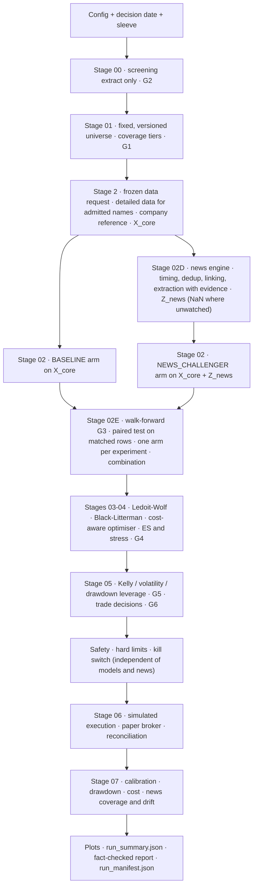

# AQP-PYTHON Implementation Guide (design v14, layout v3)

**Build the Advanced Quantitative Pipeline from an empty folder to a working, tested, paper-trading pipeline, one component at a time.**

This edition follows the v14 design (*filter first, then expand data; a shared no-news core; an AI news engine that produces covariates, not forecasts; paired baseline-versus-news experiments; no automatic promotion*) and the folder layout in `PY REPOSITORY OVERVIEW.md` (layout v3). Every code block comes from one reference implementation that was run and tested while the guide was rendered: **210 tests pass**, `ruff` is clean, the seven `import-linter` contracts are kept, and a full run takes under ten seconds. Every output block in the guide (try-its, test checkpoints, full runs, drills) is the real output of that code, not a hand-written example.

---

## What you will have at the end

A Python package, `aqp_python`, that runs this flow for the **ASX interday sleeve** on a synthetic market:



One command runs everything and writes an immutable folder per run:

```powershell
python scripts\run_pipeline.py --as-of 2026-10-16
```

```text
outputs/runs/<run_id>/
├── run_manifest.json        every stage, gate, record, reason code, artifact and input hash
├── config_snapshot.yaml     the exact configuration used
├── data_lineage/  screening/  universe/  data_request/  features/
├── forecasts/  validation/  portfolio/  sizing/  safety/  execution/  monitoring/  plots/
├── reports/run_summary.json + run_report.md
└── run.log
```

The synthetic market is deliberately awkward. It has a delisted company, a late listing, an illiquid name, a distressed name, a stock split, a bad price print and a suspension, so every gate has something real to catch. Its news feed has outages, a name whose coverage starts late, wire repeats, missing tags, and three planted stories (one processed after 17:00, one naming no company, one with no recognisable event). It contains a weak planted price signal and a weak planted news signal, so validation has something genuine to find, and the drills can switch either off. **Nothing about it says anything about real markets.** A passing run is technical evidence only.

## How to use this guide: components

Every file is shown as one or more **components**: short, captioned blocks such as

> **File:** `src/aqp_python/stages/stage_02d_news_features/entity_aggregation.py` — component 2 of 2: apply_coverage: no feed, no feature (NaN, never zero)

Type a file's components in order, into the same file. After each component comes **What it does** (the mechanics, line by line where it matters) and **Why** (the design rule it implements and what would go wrong without it). Many components are followed by a **try-it**: a few lines that call what you just wrote on hand-made numbers, with the exact output you should see. The parts are ordered by the **progression of building code**: contracts before the code that uses them, the judge (validation) before the contestants (models), the baseline arm before the news engine, and the news engine before the experiment that judges it.

Each part has the same rhythm:

1. **Goal, design and diagram**: what this part builds and which design rule it implements.
2. **What you will build**: a table of every file and its number of components.
3. **Build**: components in order, each with its explanation, try-its where they help.
4. **Tests**: the unit tests, the part's invariants, and a **stage checkpoint** that runs the pipeline up to this stage on the sample data.
5. **Checkpoint**: what must be true before you move on, three **Check your understanding** questions, and the Git commit.

| Part | You build | Tests |
|---|---|---|
| [01](01_setup_windows_vscode_and_project.md) | Windows/PowerShell/VS Code setup, the layout-v3 shell, virtual environment, package skeleton, logging | environment check |
| [02](02_contracts_configuration_and_gates.md) | Run status, reason codes, quantile grid, data contracts, all YAML configuration (incl. screening, tiers, news, experiments, fallbacks), fail-fast validation, the gate result, CLI | `batch01` |
| [03](03_storage_run_context_and_manifest.md) | Point-in-time vintage store, run folders, run context, stage result, atomic manifest with lineage and records | `batch01` |
| [04](04_data_foundation_and_stage00_screening.md) | Calendar, splits, as-of join, synthetic market with news, the screening extractor (no news), source probes, G2, candidate registry, Stage 00 | `batch01` |
| [05](05_stage01_universe_and_coverage_tiers.md) | Universe metrics, G1, composite score, formation, versioning, coverage tiers, mandatory exits | `batch02` |
| [06](06_stage02_data_expansion_and_core_features.md) | The frozen data request, detailed and text extractors, harmonisation, company reference and exposures, X_core (no news) | `batch03` |
| [07](07_validation_framework.md) | Labels with label-end dates, purging and embargo, walk-forward folds, pinball, Diebold–Mariano, net-of-cost test, deflated Sharpe, trial registry | `batch04` |
| [08](08_stage02_forecast_contract_and_baselines.md) | Forecast contract with arms, experiment and news-feature contracts, yardsticks, ridge location-scale model, registry, matched arms, validator, Stage 02 | `batch04` |
| [09](09_stage02d_news_feature_engine.md) | The news engine: ingestion, timing, dedup, entity linking, prompt registry, lexicon extraction with evidence, validation, scoring, novelty, decay, coverage mask, QC, publishing, the approved fallback | `batch05` |
| [10](10_stage02e_paired_evaluation_and_combination.md) | Out-of-sample evaluation per slot, G3, pairing on matched rows, block bootstrap, Holm, ablation, arm parity, experiment registry, one arm per experiment, combination | `batch06` |
| [11](11_stages03_05_portfolio_and_sizing.md) | Paper broker, Ledoit–Wolf, Black–Litterman, cost-aware optimiser, relaxations, ES and stress, G4, leverage, G5, trade decisions, G6 | `batch07` |
| [12](12_safety_execution_monitoring_reporting.md) | Hard limits, kill switch, pre-trade checks, fills, reconciliation, monitoring incl. news health and drift, plots, fact-checked report | `batch08`, `batch09` |
| [13](13_orchestrator_cli_and_full_runs.md) | Orchestrator in v14 order, full runs, six drills (incl. no news signal and news outage), paper week, replay, architecture invariants, import contracts | everything |
| [14](14_extending_to_production.md) | Tested extensions (GARCH, macro, realised measures, LLM extractor, propagation, calibrated event risk, R adapter, G7), promotion through `approved_arm`, more sleeves, scheduling, deployment sign-off | `extension` |
| [A](A_powershell_testing_and_debugging.md) | PowerShell, pytest markers, try-its, output inspection and the error playbook (keep it open while you work) | |
| [B](B_module_map_and_glossary.md) | Every planned module in layout v3 → built in Part NN, merged, or planned; glossary | |

**Time:** Parts 01–06 take one to two days; Parts 07–13 take four or five days if you type every component and run every try-it and test. Typing rather than pasting is slower but is how the ideas stick. If you do paste, read every line first.

## Conventions

- **Terminal:** VS Code's integrated PowerShell, opened at the `AQP-PYTHON` folder (the one that contains `pyproject.toml`). Every command assumes that location.
- **Python:** 3.11 or later; always `python -m <tool>` inside the activated `.venv`.
- **Paths:** code uses forward slashes (`outputs/runs`), which `pathlib` handles on Windows. PowerShell commands use backslashes (`.\outputs\runs`). Both refer to the same place. Output blocks show `C:\Users\you\Documents\AQP-PYTHON`; yours will show your own folder.
- **Run IDs and timestamps** in output blocks will differ in your runs; every number computed from the data will not.
- **Configuration:** limits, thresholds, costs, experiments and approvals live in `configs/*.yaml`, never in code. Values shown are *provisional examples* to be calibrated and approved per sleeve.
- **Placeholders:** `<run_id>` means "paste the real folder name". Angle brackets are not typed.

## What changed from the previous edition (v12 → v14)

| Previous edition (design v12) | This edition (design v14, layout v3) |
|---|---|
| Stage 00 loaded every field for every security, then Stage 01 chose | **Filter first**: a screening extract (no news, no exposures), G1, then a frozen data request for the admitted names only (Parts 04–06) |
| One forecast per model | Every candidate runs as a **matched pair of arms** (baseline on X_core, challenger on X_core + Z_news), registered as an experiment before results (Parts 08, 10) |
| News was a planned extension (`event_schema.py` in the last part) | A complete, tested **news feature engine** with timing, evidence, coverage and a story log (Part 09), and an LLM extractor behind the same protocol (Part 14) |
| G3 asked only "is this model eligible?" | G3 also asks "does news beat its own baseline on the same rows?": paired DM, block bootstrap, Holm, ablation, arm parity (Part 10) |
| A better model replaced the old one when it passed | A winning challenger is only a **shadow candidate**; promotion is a reviewed one-line G7 change (Parts 10, 14) |
| Missing data handled case by case | **Missing news is NaN, never zero**, enforced by an invariant; the only approved fallback is "no news → baseline arms, run DEGRADED" (Parts 09, 13) |
| Files shown as "top of file" plus functions, with explanations after the code | Files broken into **numbered components** with *What it does / Why* after each, **42 try-its** with real outputs, and three understanding questions per part |
| 12 parts, 112 tests, 4 import contracts | 14 parts, 210 tests in 9 roadmap batches plus invariants and extensions, 7 import contracts, 396 components across 242 files |
| Part 03 file named `3_storage…` | Every file numbered consistently (`03_storage…`) |

## Before you start

Keep these open in VS Code:

- `docs/design/` — the v14 design. When this guide says "design 2D", it means section 2D there.
- `PY REPOSITORY OVERVIEW.md` — the target layout, and `build_repository_shell.py`, which creates it (Part 01).
- Appendix A of this guide, for commands and troubleshooting.

If you also have **`AQP-PYTHON-reference.zip`**, it contains the finished, tested code that every component comes from. Do not start from it. Use it as an answer key: when a test fails and you cannot see why, compare your file with the reference copy (`code --diff yourfile referencefile`).

Then begin with [Part 01](01_setup_windows_vscode_and_project.md).
